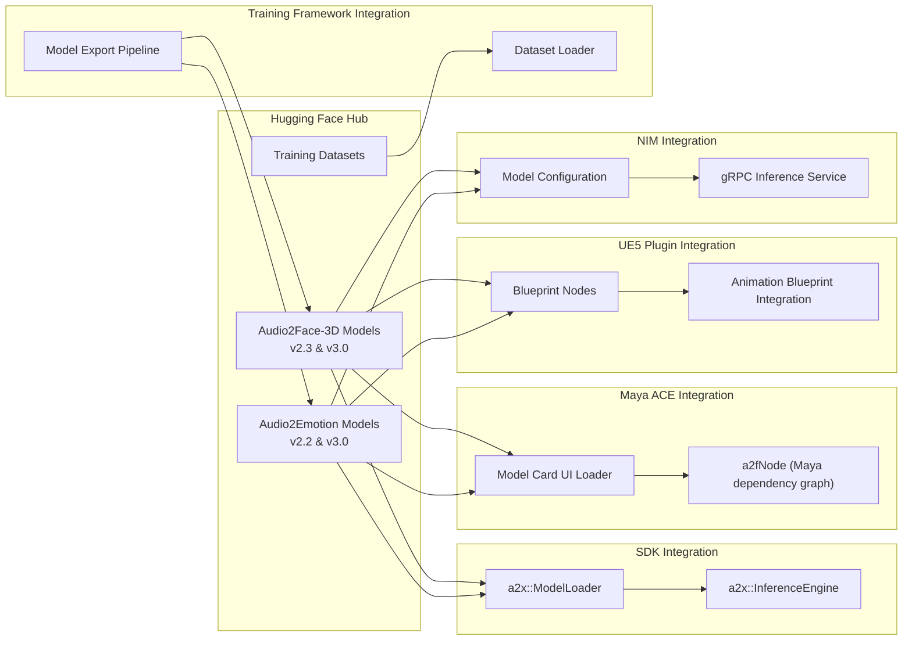

<!-- source: DeepWiki mcp.deepwiki.com · repo NVIDIA/Audio2Face-3D · page 7.2 Hugging Face Hub · fetched 2026-10-26 -->

# Hugging Face Hub

<details>
<summary>Relevant source files</summary>

The following files were used as context for generating this wiki page:

- [README.md](README.md)

</details>


## Purpose and Scope

This document describes how pre-trained models and training datasets for the Audio2Face-3D ecosystem are distributed via Hugging Face Hub. It covers the types of content available (Audio2Face-3D models, Audio2Emotion models, and sample datasets), their versioning schemes, file formats, licensing terms, and how they integrate with the various Audio2Face-3D tools.

For information about source code and packaged builds, see [NVIDIA Repositories](#7.1). For detailed documentation on specific model types, see [Audio2Face-3D Models](#5.1) and [Audio2Emotion Models](#5.2). For training dataset structure and usage, see [Training Datasets](#4.2).

**Sources:** [README.md:71-106]()

## Content Categories

The Hugging Face Hub serves as the central model registry and dataset repository for the Audio2Face-3D ecosystem. Content is organized into three primary categories:

| Category | Description | Format | License |
|----------|-------------|--------|---------|
| **Audio2Face-3D Models** | Pre-trained models for generating lip-sync animation | onnx-trt + JSON model card | NVIDIA Open Model License |
| **Audio2Emotion Models** | Models for inferring emotional state from audio | onnx-trt + JSON model card | Custom (use allowed with Audio2Face only) |
| **Training Sample Data** | Example datasets for training custom models | Audio files, blendshape data, geometry caches | Custom (evaluation only) |

All content is distributed under the `nvidia` organization namespace on Hugging Face Hub, with models following the naming convention `Audio2Face-3D-vX.Y-Character` or `Audio2Emotion-vX.Y`.

**Sources:** [README.md:71-106]()

## Hugging Face Hub Content Structure

```mermaid
graph TB
    subgraph HF["Hugging Face Hub (nvidia org)"]
        subgraph A2F_Models["Audio2Face-3D Models"]
            V30["Audio2Face-3D-v3.0<br/>(Diffusion-based)"]
            Mark["Audio2Face-3D-v2.3-Mark<br/>(Regression)"]
            Claire["Audio2Face-3D-v2.3.1-Claire<br/>(Regression)"]
            James["Audio2Face-3D-v2.3.1-James<br/>(Regression)"]
        end
        
        subgraph A2E_Models["Audio2Emotion Models"]
            A2E_22["Audio2Emotion-v2.2<br/>(Production)"]
            A2E_30["Audio2Emotion-v3.0<br/>(Experimental)"]
        end
        
        subgraph Datasets["Training Datasets"]
            Claire_Data["Audio2Face-3D-Dataset-v1.0.0-claire"]
        end
    end
    
    subgraph Format["Model Format"]
        ONNX["ONNX-TRT Files<br/>(Neural network weights)"]
        JSON["JSON Model Card<br/>(Metadata and configuration)"]
    end
    
    subgraph Dataset_Format["Dataset Format"]
        Audio_Files["Audio Files<br/>(.wav)"]
        Blendshape["Blendshape Data<br/>(Animation curves)"]
        Geo_Cache["Geometry Caches<br/>(Mesh sequences)"]
        Transform["Transform Files<br/>(Joint/object transforms)"]
    end
    
    V30 --> ONNX
    Mark --> ONNX
    Claire --> ONNX
    James --> ONNX
    A2E_22 --> ONNX
    A2E_30 --> ONNX
    
    V30 --> JSON
    Mark --> JSON
    Claire --> JSON
    James --> JSON
    A2E_22 --> JSON
    A2E_30 --> JSON
    
    Claire_Data --> Audio_Files
    Claire_Data --> Blendshape
    Claire_Data --> Geo_Cache
    Claire_Data --> Transform
```



**Sources:** [README.md:71-106]()

## Audio2Face-3D Model Versions

The Audio2Face-3D models generate lip-sync animation from audio input. Two major versions are available, representing different neural network architectures.

### Version 2.3 Series (Regression-Based)

Character-specific models trained using regression-based neural networks. Each model is optimized for a particular performance style.

| Repository | Character | Version | Description |
|------------|-----------|---------|-------------|
| `nvidia/Audio2Face-3D-v2.3-Mark` | Mark | v2.3 | Male character, neutral performance style |
| `nvidia/Audio2Face-3D-v2.3.1-Claire` | Claire | v2.3.1 | Female character, expressive performance style |
| `nvidia/Audio2Face-3D-v2.3.1-James` | James | v2.3.1 | Male character, subtle performance style |

### Version 3.0 (Diffusion-Based)

| Repository | Architecture | Description |
|------------|--------------|-------------|
| `nvidia/Audio2Face-3D-v3.0` | Diffusion | Next-generation model with improved quality and generalization |

All v2.3 models use identical output formats and can be loaded interchangeably by any Audio2Face-3D tool via their JSON model card files. Version 3.0 introduces diffusion-based generation for enhanced realism.

**Sources:** [README.md:82-89]()

## Audio2Emotion Model Versions

Audio2Emotion models infer emotional state from audio to generate emotion-driven facial expressions. These work alongside Audio2Face-3D models to add affective animation.

| Repository | Version | Status | Description |
|------------|---------|--------|-------------|
| `nvidia/Audio2Emotion-v2.2` | v2.2 | Production | Stable model for production workflows |
| `nvidia/Audio2Emotion-v3.0` | v3.0 | Experimental | Latest research model with experimental features |

Both versions output emotional state parameters that can be consumed by facial animation systems to drive expression blend shapes or procedural animation systems.

**Sources:** [README.md:91-98]()

## Training Datasets

Sample datasets demonstrate the required format for training custom Audio2Face-3D models using the Training Framework (see [Training Framework](#4.1)).

### Claire Dataset v1.0.0

| Repository | Content | File Types |
|------------|---------|------------|
| `nvidia/Audio2Face-3D-Dataset-v1.0.0-claire` | Example training data for the Claire character | Audio files (.wav), blendshape data, animated geometry caches, geometry files, transform files |

This dataset illustrates the data structure required for training:
- Synchronized audio recordings
- Corresponding facial animation data (blendshapes or mesh deformations)
- Character geometry and rig configuration
- Transform data for joint-based rigs

The dataset is licensed for evaluation purposes only and demonstrates the format expected by the Training Framework.

**Sources:** [README.md:99-105]()

## Model Format Specification

### ONNX-TRT Files

All pre-trained models are distributed in ONNX-TRT format:
- **ONNX**: Open Neural Network Exchange format for neural network interoperability
- **TensorRT Optimization**: NVIDIA TensorRT optimizations for GPU inference performance

The ONNX-TRT files contain the trained neural network weights and are loaded by the Audio2Face-3D inference engine.

### JSON Model Card

Each model includes a JSON model card that specifies:
- Model metadata (version, character name, training date)
- Input/output tensor specifications
- Required blendshape names and ordering
- Performance characteristics and hardware requirements
- Compatibility information

The JSON model card enables all Audio2Face-3D tools (SDK, Maya ACE, UE5 Plugin, NIM) to load models dynamically without code changes.

**Sources:** [README.md:82-98](), [README.md:142-144]()

## Integration with Audio2Face-3D Tools



**Sources:** [README.md:17-22](), [README.md:109-233]()

### Tool-Specific Integration Details

| Tool | Model Loading Method | Model Selection | Model Format Requirements |
|------|---------------------|-----------------|---------------------------|
| **SDK** | Direct API calls to load ONNX-TRT files and JSON model cards | Programmatic via `a2x::ModelLoader` class | ONNX-TRT + JSON model card |
| **Maya ACE** | UI-based model card selection with file browser | Interactive via plugin UI or MEL/Python scripts | ONNX-TRT + JSON model card |
| **UE5 Plugin** | Blueprint node configuration with asset picker | Blueprint visual scripting or C++ code | ONNX-TRT + JSON model card |
| **NIM** | Configuration file or environment variable specification | Docker container configuration | ONNX-TRT + JSON model card |
| **Training Framework** | Dataset path specification in training configuration | Python configuration files | Audio files, blendshape data, geometry caches |

All tools support loading any compatible model version (v2.3 or v3.0) via standardized JSON model cards, enabling model switching without code changes.

**Sources:** [README.md:109-233]()

## Download Procedures

### Direct Download via Web Interface

1. Navigate to the desired model repository on Hugging Face Hub (e.g., `https://huggingface.co/nvidia/Audio2Face-3D-v3.0`)
2. Click the "Files and versions" tab
3. Download ONNX-TRT files and JSON model card files
4. Place files in the location expected by your Audio2Face-3D tool

### Download via Hugging Face CLI

```bash
# Install Hugging Face CLI
pip install huggingface_hub

# Download a specific model
huggingface-cli download nvidia/Audio2Face-3D-v3.0

# Download to specific directory
huggingface-cli download nvidia/Audio2Face-3D-v3.0 --local-dir ./models/a2f-v3.0
```

### Programmatic Download via Python API

```python
from huggingface_hub import snapshot_download

# Download entire model repository
snapshot_download(
    repo_id="nvidia/Audio2Face-3D-v3.0",
    local_dir="./models/a2f-v3.0"
)

# Download specific files only
from huggingface_hub import hf_hub_download

model_path = hf_hub_download(
    repo_id="nvidia/Audio2Face-3D-v3.0",
    filename="model.onnx"
)
```

**Sources:** [README.md:71-106]()

## Model Selection Guidelines

### Choosing Between v2.3 and v3.0

| Criterion | v2.3 (Regression) | v3.0 (Diffusion) |
|-----------|-------------------|------------------|
| **Quality** | High-quality, production-proven | Enhanced realism and detail |
| **Performance** | Lower inference latency | Higher computational cost |
| **Character Specificity** | Character-specific models (Mark, Claire, James) | Single universal model |
| **Maturity** | Production-ready, widely tested | Newer architecture, evolving |
| **Best For** | Real-time applications, established pipelines | Offline rendering, maximum quality |

### Choosing Between Audio2Emotion Versions

| Criterion | v2.2 (Production) | v3.0 (Experimental) |
|-----------|-------------------|---------------------|
| **Stability** | Production-tested and validated | Research model with experimental features |
| **Compatibility** | Fully compatible with all tools | May require specific SDK versions |
| **Best For** | Production workflows, critical projects | Research, testing new features |

**Sources:** [README.md:82-98]()

## Licensing and Terms of Use

### Audio2Face-3D Models
- **License:** NVIDIA Open Model License
- **Usage:** Open weights, can be used for commercial and non-commercial applications
- **Format:** onnx-trt with JSON model card

### Audio2Emotion Models
- **License:** Custom (use allowed with Audio2Face only)
- **Restrictions:** Models are restricted to use with Audio2Face-3D tools and workflows
- **Format:** onnx-trt with JSON model card

### Training Datasets
- **License:** Custom (evaluation only)
- **Restrictions:** Sample datasets are provided for evaluation and understanding data format requirements
- **Format:** Audio files, blendshape data, animated geometry caches, geometry files, transform files

Always review the specific license file included in each Hugging Face repository for complete terms and conditions.

**Sources:** [README.md:71-106]()

## Version Compatibility Matrix

| Tool Version | Compatible A2F Models | Compatible A2E Models |
|--------------|----------------------|----------------------|
| SDK (all versions) | v2.3, v3.0 | v2.2, v3.0 |
| Maya ACE v2.0 | v2.3, v3.0 | v2.2, v3.0 |
| UE5 Plugin v2.5 | v2.3, v3.0 | v2.2, v3.0 |
| UE5 Plugin v2.4 | v2.3 | v2.2 |
| NIM (all versions) | v2.3, v3.0 | v2.2, v3.0 |
| Training Framework v1.0 | Exports v2.3-compatible models | N/A (does not train A2E) |

All tools load models dynamically via JSON model cards, allowing users to switch between models without updating tool versions, provided the model version is supported.

**Sources:** [README.md:23-106]()

---

