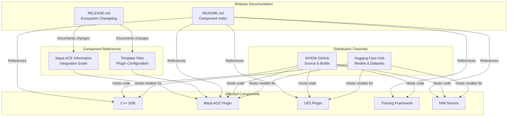
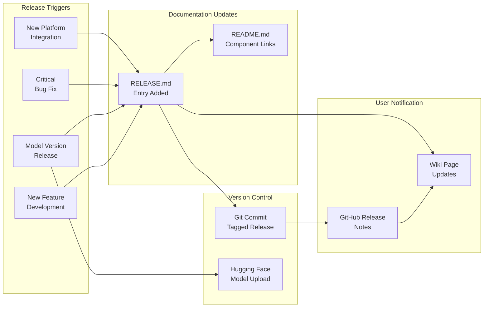

<!-- source: DeepWiki mcp.deepwiki.com · repo NVIDIA/Audio2Face-3D · page 8 Release History · fetched 2026-10-26 -->

# Release History

<details>
<summary>Relevant source files</summary>

The following files were used as context for generating this wiki page:

- [RELEASE.md](RELEASE.md)

</details>


## Purpose and Scope

This page documents the chronological changelog for the Audio2Face-3D ecosystem. It tracks major updates, new feature additions, and significant changes across all components of the system, including the SDK, plugins, models, training framework, and deployment infrastructure.

The release history is maintained in [RELEASE.md:1-6](), which serves as the canonical source for all ecosystem-level changes. For component-specific version information and model updates, see:
- [Pre-trained Models](#5) for Audio2Face-3D and Audio2Emotion model versioning
- [Integration Tools](#3) for SDK, Maya ACE, and UE5 Plugin changes
- [NIM Microservice](#6.1) for deployment service updates

This page focuses on cross-component releases and ecosystem-wide announcements. Individual component repositories may maintain their own detailed changelogs for internal version tracking.

**Sources:** [RELEASE.md:1-6]()

---

## Release Timeline

The following table provides a chronological view of all documented releases:

| Date | Version/Milestone | Components Affected | Summary |
|------|------------------|---------------------|---------|
| 2025-09-16 | Initial Release | Maya ACE Plugin | Added Maya-ACE integration information and template files to the ecosystem |

**Sources:** [RELEASE.md:3-5]()

---

## Release Structure and File Organization



**Diagram: RELEASE.md Integration with Ecosystem Components**

This diagram illustrates how [RELEASE.md:1-6]() serves as the central changelog for ecosystem-wide updates while individual components maintain their own repositories. The file documents changes that affect multiple components or introduce new capabilities to the Audio2Face-3D platform.

**Sources:** [RELEASE.md:1-6]()

---

## Detailed Release Notes

### 2025-09-16: Maya ACE Plugin Integration

**Category:** New Component Addition

**Changes:**
- Added comprehensive Maya ACE (MACE) plugin documentation to the ecosystem
- Introduced template files for Maya integration workflow
- Established connection between Audio2Face-3D models and Autodesk Maya platform

**Components Affected:**
- Maya ACE Plugin (new)
- Integration documentation
- Template file structure

**Technical Details:**

The release added support for Maya-based animation workflows by introducing the Maya ACE plugin. This enables 3D animators using Autodesk Maya to access Audio2Face-3D capabilities directly within their familiar environment. For complete details on the plugin's capabilities, see [Maya ACE Plugin](#3.2).

The template files provide starting configurations for:
- Maya scene setup with Audio2Face-3D compatible rigs
- Blendshape target mappings
- Output format specifications for FBX and keyframe export

**Sources:** [RELEASE.md:3-5]()

---

## Release Process and Component Versioning



**Diagram: Release Documentation Workflow**

This diagram maps the process flow from code changes to user-facing documentation updates. When a significant change occurs (new feature, model update, bug fix, or platform integration), an entry is added to [RELEASE.md:1-6](). This triggers updates to [README.md]() for component references, Git version control commits, and wiki documentation updates.

**Sources:** [RELEASE.md:1-6]()

---

## Release Format Specification

Each release entry in [RELEASE.md:1-6]() follows a standardized format:

```
## YYYY-MM-DD

* Brief description of changes
```

**Format Components:**

| Field | Format | Purpose |
|-------|--------|---------|
| Date Header | `## YYYY-MM-DD` | ISO 8601 date format marking release timestamp |
| Change Entry | `* Description` | Bulleted list item describing the update |

**Example Entry Structure:**

```markdown
## 2025-09-16

* Add Maya-ACE information and template files
```

The format prioritizes:
- **Chronological ordering**: Most recent releases at the top
- **Concise descriptions**: Single-line summaries of changes
- **Component identification**: Clear reference to affected system parts
- **Actionable information**: Links to detailed documentation for complex changes

**Sources:** [RELEASE.md:1-6]()

---

## Change Categories and Impact Assessment

The following table defines the categories of changes tracked in the release history:

| Category | Description | Example | Documentation Reference |
|----------|-------------|---------|------------------------|
| New Component | Addition of a new integration tool or plugin | Maya ACE Plugin (2025-09-16) | [Integration Tools](#3) |
| Model Release | New or updated pre-trained models | Audio2Face-3D v2.3, v3.0 | [Pre-trained Models](#5) |
| SDK Update | Changes to the C++ SDK interface | API extensions, bug fixes | [C++ SDK](#3.1) |
| Training Framework | Updates to model training capabilities | New dataset formats, export options | [Training Framework](#4.1) |
| Deployment | NIM service updates or new deployment patterns | gRPC protocol changes, Docker updates | [NIM Microservice](#6.1) |
| Documentation | Non-code updates to guides and examples | Template files, integration guides | N/A |

**Sources:** [RELEASE.md:3-5]()

---

## Future Release Tracking

As the Audio2Face-3D ecosystem evolves, [RELEASE.md:1-6]() will be updated with:

- **Model Versioning**: New Audio2Face-3D and Audio2Emotion model releases with version numbers
- **API Changes**: Breaking or non-breaking changes to SDK interfaces
- **Platform Support**: Additional DCC tool integrations beyond Maya and Unreal Engine
- **Performance Improvements**: Optimization updates affecting inference speed or quality
- **Deprecation Notices**: End-of-life announcements for older model versions or API methods

Users should monitor this file for critical updates that may affect their integration workflows. For real-time notifications, watch the repository on GitHub or subscribe to release announcements.

**Sources:** [RELEASE.md:1-6]()

---

