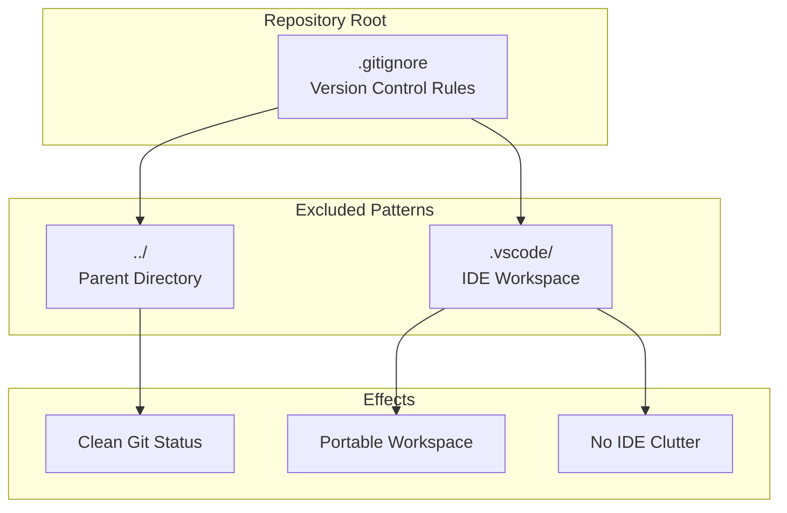
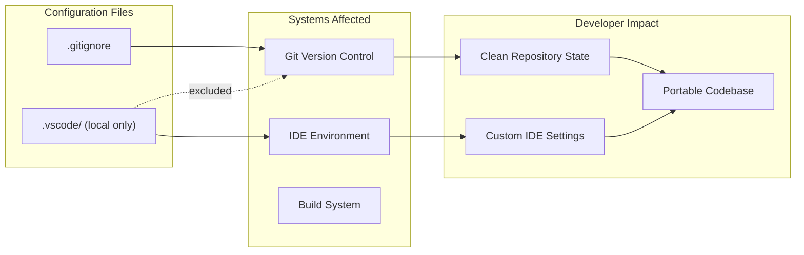

<!-- source: DeepWiki mcp.deepwiki.com · repo NVIDIA/Audio2Face-3D · page 9 Repository Configuration · fetched 2026-10-26 -->

# Repository Configuration

Relevant source files

The following files were used as context for generating this wiki page:

- [.gitignore](.gitignore)

## Purpose and Scope

This document describes the repository-level configuration files that control version control behavior and development environment settings for the Audio2Face-3D codebase. This includes Git ignore patterns and workspace configuration.

For information about deployment configuration and runtime settings, see [Deployment Patterns](#6.2). For model configuration files and JSON model cards, see [Audio2Face-3D Models](#5.1).

---

## Overview

The Audio2Face-3D repository uses minimal configuration files to maintain a clean version control state and ensure consistent development environments across contributors. The primary configuration mechanism is the `.gitignore` file, which controls which files and directories are excluded from Git tracking.

**Sources:** [.gitignore:1-3]()

---

## Version Control Configuration

### Git Ignore Patterns

The repository's version control configuration is defined in the `.gitignore` file at the repository root. This file specifies patterns for files and directories that should not be tracked by Git.

**Diagram: Git Ignore Pattern Structure**

**Sources:** [.gitignore:1-3]()

### Excluded Patterns

The `.gitignore` file defines the following exclusion patterns:

| Pattern | Location | Purpose |
|---------|----------|---------|
| `../` | [.gitignore:1]() | Prevents accidental tracking of parent directory references |
| `.vscode/` | [.gitignore:2]() | Excludes Visual Studio Code workspace settings and preferences |

**Sources:** [.gitignore:1-3]()

#### Parent Directory Exclusion

The `../` pattern in [.gitignore:1]() prevents Git from tracking references to the parent directory. This pattern ensures that:

- Symlinks or references to parent directories are not accidentally committed
- The repository maintains clear boundaries and self-contained structure
- Build artifacts or temporary files created in parent directories remain untracked

**Sources:** [.gitignore:1]()

#### IDE Workspace Exclusion

The `.vscode/` pattern in [.gitignore:2]() excludes Visual Studio Code workspace configuration files. This exclusion:

- Prevents individual developer IDE preferences from affecting other contributors
- Allows each developer to maintain custom workspace settings locally
- Avoids conflicts from different IDE configurations across development environments

Visual Studio Code stores various workspace-specific files in the `.vscode/` directory, including:
- Launch configurations (`launch.json`)
- Task definitions (`tasks.json`)
- Workspace settings (`settings.json`)
- Extension recommendations (`extensions.json`)

**Sources:** [.gitignore:2]()

---

## Configuration File Mapping

**Diagram: Configuration File Relationships**

**Sources:** [.gitignore:1-3]()

---

## Development Environment Guidelines

### Recommended IDE Configuration

While `.vscode/` settings are excluded from version control to allow developer customization, the repository supports development with Visual Studio Code and other IDEs. Developers should configure their local environments according to their preferences without committing these settings.

The exclusion pattern [.gitignore:2]() allows developers to:

1. Create local `.vscode/` directories with custom configurations
2. Set up debugging launch configurations specific to their environment
3. Configure language-specific settings and formatters
4. Install and configure IDE extensions without affecting other contributors

**Sources:** [.gitignore:2]()

### Repository Structure Integrity

The parent directory exclusion pattern [.gitignore:1]() maintains repository structure integrity by:

- Ensuring the repository remains self-contained
- Preventing cross-repository references from being tracked
- Supporting clean cloning and distribution of the codebase
- Avoiding accidental inclusion of build artifacts from parent directories

**Sources:** [.gitignore:1]()

---

## Configuration Management Best Practices

The minimal configuration approach used in this repository follows these principles:

| Principle | Implementation | Benefit |
|-----------|----------------|---------|
| **Minimal Tracking** | Only essential files are tracked | Reduces merge conflicts and repository size |
| **Developer Autonomy** | IDE settings remain local | Each developer can optimize their workflow |
| **Clean State** | Parent directory references excluded | Repository boundaries remain clear |
| **Portability** | No environment-specific files committed | Codebase works across different setups |

**Sources:** [.gitignore:1-3]()

---

## Related Configuration

While this repository maintains minimal configuration files, the broader Audio2Face-3D ecosystem includes configuration in other locations:

- **Model Configuration**: JSON model cards defining model capabilities (see [Audio2Face-3D Models](#5.1))
- **Deployment Configuration**: Docker and NIM configuration files (see [NIM Microservice](#6.1))
- **Build Configuration**: Component-specific build systems in individual repositories (see [NVIDIA Repositories](#7.1))
- **Training Configuration**: Framework settings in the training container (see [Training Framework](#4.1))

**Sources:** [.gitignore:1-3]()

---

## Summary

The Audio2Face-3D repository uses a lightweight configuration strategy with a minimal `.gitignore` file that excludes parent directory references and IDE-specific settings. This approach maintains a clean version control state while providing developers with the flexibility to customize their local development environments.

**Sources:** [.gitignore:1-3]()