# Page: Overview

# Overview

<details>
<summary>Relevant source files</summary>

The following files were used as context for generating this wiki page:

- [README.md](README.md)

</details>


## Purpose and Scope

This document provides a comprehensive introduction to the Audio2Face-3D ecosystem, an advanced system for generating high-fidelity 3D facial animation from audio sources. It covers the purpose of the technology, the complete set of available components, distribution channels, and how these components interact to enable facial animation workflows across different platforms and use cases.

For detailed technical information about specific components, refer to:
- Audio-to-animation pipeline mechanics: [Core Technology](#2)
- Developer and artist tools: [Integration Tools](#3)
- Custom model creation: [Model Training](#4)
- Pre-trained model specifications: [Pre-trained Models](#5)
- Production deployment strategies: [Deployment](#6)

**Sources:** [README.md:1-16]()

## What is Audio2Face-3D?

Audio2Face-3D is a neural network-based system that transforms audio input (either pre-recorded files or real-time streams) into detailed 3D facial animations. The technology performs two parallel analyses on vocal data:

1. **Phonetic Analysis** - Generates accurate lip-sync by analyzing speech sounds
2. **Emotional Tone Analysis** - Infers emotional state to drive facial expressions

The system outputs animation data in three standard formats:
- **Mesh Deformations** - Direct vertex positions for facial geometry
- **Joint Transformations** - Skeletal rig transformations (rotation, translation, scale)
- **Blend Shape Weights** - Morph target weights for blend shape-based rigs

This flexibility enables integration with diverse character rigs and animation pipelines across game engines, digital content creation tools, and custom applications.

**Sources:** [README.md:4-11]()

## Ecosystem Architecture

The Audio2Face-3D ecosystem consists of five primary component categories, distributed across two channels (NVIDIA GitHub repositories and Hugging Face Hub):

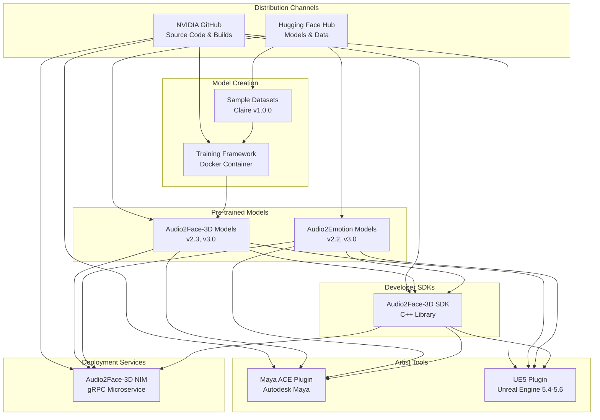

**Sources:** [README.md:17-107]()

## Distribution Model

Audio2Face-3D components are distributed through two distinct channels, each serving a specific purpose:

### NVIDIA GitHub Repositories

NVIDIA's GitHub organization hosts all source code, compiled binaries, and development tooling:

| Repository | Format | License |
|------------|--------|---------|
| `Audio2Face-3D-SDK` | C++ & Python source | MIT |
| `Audio2Face-3D-training-framework` | Python & Docker | Apache |
| `Maya-ACE` | Maya Plugin Module, C++ & Python source | MIT |
| Unreal Engine 5 Plugin | `.uplugin` files, C++ source | MIT |
| Audio2Face-3D NIM | Docker Container | NVIDIA Software License |

### Hugging Face Hub

Hugging Face Hub serves as the centralized model registry for trained neural network weights and datasets:

| Artifact Type | Format | Versions |
|---------------|--------|----------|
| Audio2Face-3D Models | ONNX-TRT + JSON Model Cards | v2.3 (Mark, Claire, James), v3.0 (Diffusion) |
| Audio2Emotion Models | ONNX-TRT + JSON Model Cards | v2.2 (Production), v3.0 (Experimental) |
| Training Datasets | Audio files, blendshape data, geometry caches, transforms | v1.0.0 (Claire) |

This dual-channel architecture decouples code releases from model releases, enabling independent versioning and update cycles.

**Sources:** [README.md:19-107]()

## Component Interaction Flow

The following diagram illustrates how different components consume models and interact with each other:

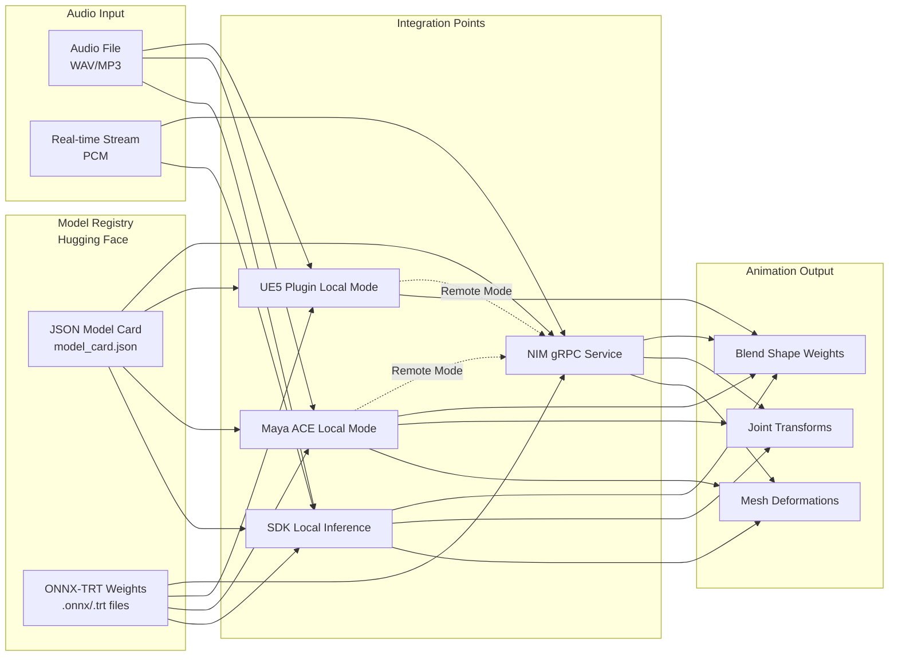

**Sources:** [README.md:115-120](), [README.md:162-169](), [README.md:200-203](), [README.md:217-227]()

## Component Summary

### Development SDKs

**Audio2Face-3D SDK** (`Audio2Face-3D-SDK`)
- Cross-platform C++ library for custom application development
- Real-time inference engine with GPU acceleration (TensorRT) and CPU fallback
- Supports all Audio2Face-3D and Audio2Emotion ONNX-TRT models
- Target users: C++ developers, tools engineers, pipeline developers

**Sources:** [README.md:109-128]()

### Artist Integration Tools

**Maya ACE Plugin** (`Maya-ACE`)
- Autodesk Maya plugin (v2.0) for animation authoring
- User interface for real-time animation preview in Maya viewport
- Exports to Maya keyframes or FBX format
- Supports local inference and remote NIM connections
- Includes Python API for scripting and automation
- Target users: 3D animators, technical directors

**Unreal Engine 5 Plugin** (`nv_ace_reference-ue5.x`)
- Blueprint-integrated plugin for UE 5.4, 5.5, and 5.6
- Sample project includes MetaHuman rigging configuration
- Requires two components: ACE Unreal plugin + Audio2Face-3D Models plugin
- Supports local and remote inference modes
- Full C++ source code available for customization
- Target users: Game developers, virtual production artists

**Sources:** [README.md:152-177](), [README.md:179-210]()

### Model Training

**Training Framework** (`Audio2Face-3D-training-framework`)
- Docker-containerized Python framework (v1.0)
- Creates custom ONNX-TRT models from proprietary animation datasets
- Generates JSON model cards for model metadata
- Supports single-language and multi-language training
- Same framework used to train official Mark, Claire, and James models
- Target users: ML researchers, technical artists, animation directors

**Sample Datasets** (`Audio2Face-3D-Dataset-v1.0.0-claire`)
- Claire dataset (v1.0.0) demonstrates required data format:
  - Audio files (WAV format)
  - Blendshape coefficient data
  - Animated geometry caches
  - Base geometry files
  - Transform files
- Serves as template for structuring custom training data

**Sources:** [README.md:129-151](), [README.md:100-105]()

### Deployment Infrastructure

**Audio2Face-3D NIM**
- Docker-containerized gRPC microservice for large-scale deployment
- Multi-stream support for concurrent inference requests
- Centralizes GPU resources on server infrastructure
- Compatible with all Audio2Face-3D SDK clients
- Enables remote inference for Maya ACE and UE5 Plugin
- Target users: DevOps engineers, cloud administrators, systems integrators

**Sources:** [README.md:211-234]()

## Technology Stack

The following diagram maps high-level capabilities to their underlying technical implementations:

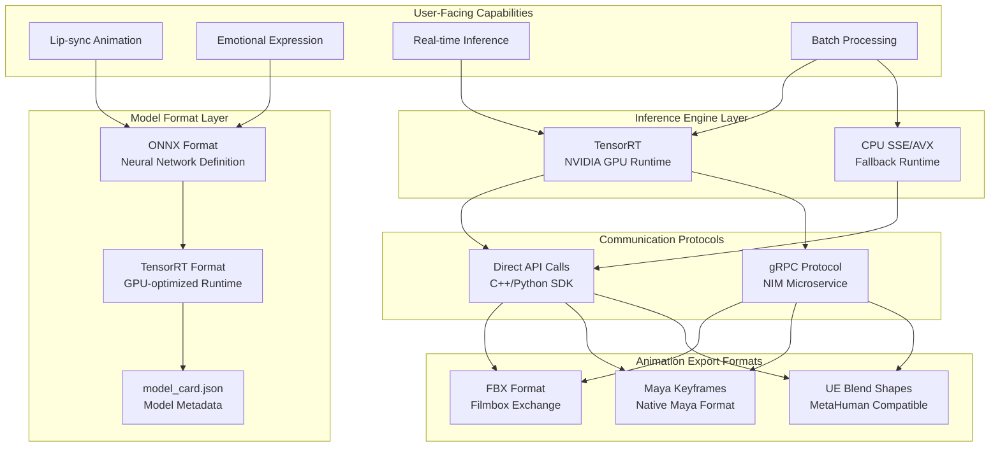

**Sources:** [README.md:83-89](), [README.md:92-97](), [README.md:119-121](), [README.md:144](), [README.md:217-227]()

## Model Versioning Strategy

Audio2Face-3D models follow a semantic versioning scheme with distinct lineages:

| Model Family | Version | Architecture | Status | Use Case |
|--------------|---------|--------------|--------|----------|
| Audio2Face-3D | v2.3 (Mark) | Regression | Production | Male character, English |
| Audio2Face-3D | v2.3.1 (Claire) | Regression | Production | Female character, English |
| Audio2Face-3D | v2.3.1 (James) | Regression | Production | Male character, English |
| Audio2Face-3D | v3.0 | Diffusion | Production | Universal, improved quality |
| Audio2Emotion | v2.2 | Classification | Production | Emotion inference, stable |
| Audio2Emotion | v3.0 | Advanced | Experimental | Emotion inference, research |

All models share the same interface contract defined by their JSON model cards, enabling hot-swapping across all Audio2Face-3D tools without code changes.

**Sources:** [README.md:82-97]()

## Target User Personas

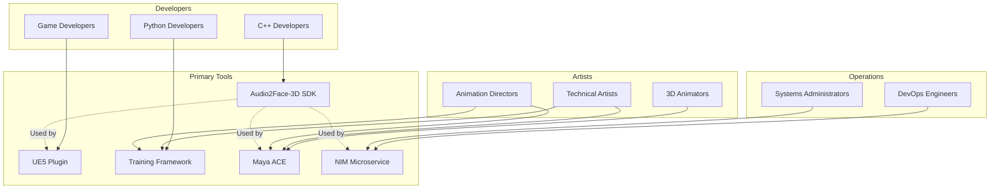

**Sources:** [README.md:111](), [README.md:131](), [README.md:156](), [README.md:181](), [README.md:213]()

## File Format Specifications

Audio2Face-3D components work with the following standardized file formats:

### Model Formats
- **ONNX-TRT** - Neural network weights in ONNX format with TensorRT optimization metadata
- **JSON Model Cards** (`model_card.json`) - Model metadata including input/output specifications, version, and compatibility requirements

### Animation Input
- **WAV** - Waveform audio file format (training datasets)
- **MP3** - Compressed audio format (runtime inference)
- **PCM** - Raw pulse-code modulation streams (real-time inference)

### Animation Output
- **FBX** - Autodesk Filmbox format for cross-application interchange
- **Maya Keyframes** - Native Maya animation curves
- **Geometry Caches** - Alembic or Maya geometry cache formats
- **Blend Shape Weights** - Numeric coefficients for morph target animation

### Training Data
- **Blendshape Data** - Numeric coefficients per frame
- **Geometry Files** - Base mesh topology (OBJ, Alembic)
- **Transform Files** - Joint transformation matrices

**Sources:** [README.md:36](), [README.md:43](), [README.md:50](), [README.md:57](), [README.md:84](), [README.md:102-103](), [README.md:144](), [README.md:169]()

## Workflow Patterns

Audio2Face-3D supports three primary workflow patterns:

### Local Workstation Workflow
1. Download pre-trained models from Hugging Face Hub
2. Install Maya ACE plugin or UE5 plugin
3. Load model via JSON model card
4. Import audio file
5. Generate animation with local GPU inference
6. Export to FBX or native format

### Remote Service Workflow
1. Deploy Audio2Face-3D NIM on server infrastructure
2. Connect Maya ACE or UE5 plugin in remote mode
3. Submit audio via gRPC protocol
4. Receive animation data from centralized service
5. Export to desired format

### Custom Application Workflow
1. Integrate Audio2Face-3D SDK into C++ application
2. Implement model loading from Hugging Face Hub
3. Build custom audio input pipeline
4. Call SDK inference APIs
5. Process animation data in application-specific format

**Sources:** [README.md:123-127](), [README.md:166-169](), [README.md:200-203](), [README.md:217-234]()

## System Requirements

All Audio2Face-3D components share common infrastructure dependencies:

### Hardware Requirements
- **GPU**: NVIDIA GPU with TensorRT support (recommended for real-time performance)
- **CPU**: SSE/AVX-compatible processor (fallback mode)
- **Memory**: Varies by model size and batch processing requirements

### Software Dependencies
- **TensorRT**: NVIDIA TensorRT runtime for GPU inference
- **CUDA**: NVIDIA CUDA toolkit (GPU mode)
- **Docker**: Container runtime (Training Framework and NIM)
- **gRPC**: High-performance RPC framework (NIM communication)

### Platform Support
- **Linux**: Full support for all components
- **Windows**: SDK, Maya ACE, UE5 Plugin support
- **macOS**: SDK and Maya ACE support (CPU-only inference)

**Sources:** [README.md:119-121]()

---

# Page: Core Technology

# Core Technology

<details>
<summary>Relevant source files</summary>

The following files were used as context for generating this wiki page:

- [README.md](README.md)
- [media/Aki_ArchFlow_Banner.png](media/Aki_ArchFlow_Banner.png)

</details>


## Purpose and Scope

This document explains the internal architecture and technical implementation of Audio2Face-3D, focusing on how the system transforms audio input into 3D facial animation output. It covers the audio-to-animation pipeline, the dual-model inference architecture, phonetic and emotional analysis, and the three output format options (mesh deformations, joint transformations, blend shape weights).

For information about integrating these capabilities into applications, see [Integration Tools](#3). For pre-trained model versions and specifications, see [Pre-trained Models](#5). For creating custom models, see [Model Training](#4).

**Sources:** [README.md:1-16]()

---

## Audio-to-Animation Pipeline

The Audio2Face-3D system implements a complete pipeline that transforms audio data into synchronized 3D facial animation through multiple processing stages:

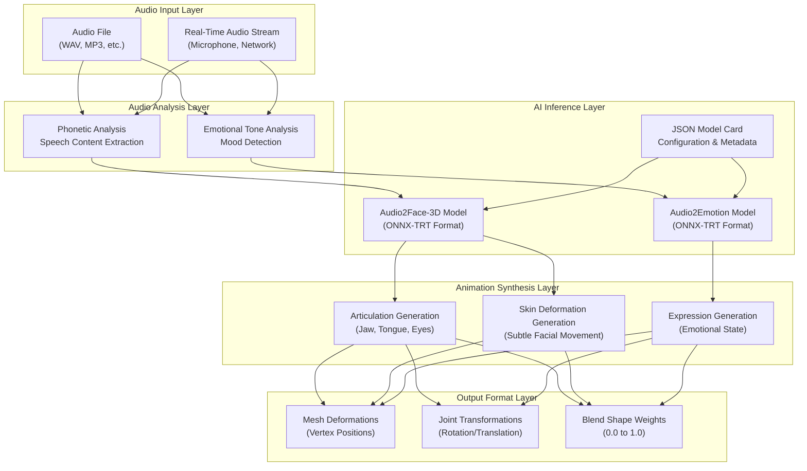

**Pipeline Overview**

The system processes audio through five distinct layers:

1. **Audio Input Layer**: Accepts both pre-recorded audio files and real-time audio streams
2. **Audio Analysis Layer**: Performs parallel phonetic and emotional analysis on the incoming audio
3. **AI Inference Layer**: Two specialized neural networks process the analyzed audio data
4. **Animation Synthesis Layer**: Generates articulation movements, skin deformations, and emotional expressions
5. **Output Format Layer**: Produces animation data in one or more standardized formats compatible with different rigging systems

**Sources:** [README.md:4-11]()

---

## Dual-Model Inference Architecture

Audio2Face-3D employs a dual-model architecture where two specialized neural networks operate in parallel to generate comprehensive facial animation:

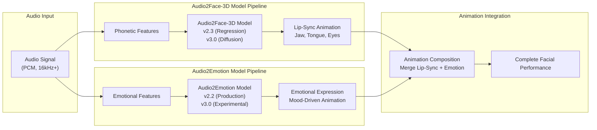

**Model Responsibilities**

| Model | Primary Function | Output Components | Model Versions |
|-------|------------------|-------------------|----------------|
| **Audio2Face-3D** | Generates accurate lip-sync based on phonetic analysis | Jaw motion, tongue position, eye movement, facial skin deformation | v2.3 (regression-based)<br/>v3.0 (diffusion-based) |
| **Audio2Emotion** | Infers emotional state from tone of speech | Emotional expression overlays, mood-driven facial adjustments | v2.2 (production)<br/>v3.0 (experimental) |

Both models operate independently but their outputs are composed to produce a unified facial performance that includes both precise articulation and emotional nuance.

**Sources:** [README.md:6-11](), [README.md:82-98]()

---

## Audio Analysis

The system performs two types of audio analysis that feed into the dual-model inference architecture:

### Phonetic Analysis

The phonetic analysis component extracts speech content from the audio signal to enable accurate lip-sync generation. This analysis identifies:

- **Speech phonemes**: Individual sound units that form spoken words
- **Articulatory features**: Characteristics of speech production (vowels, consonants, etc.)
- **Timing information**: Precise temporal alignment of phonetic events

The phonetic features are fed to the Audio2Face-3D model, which generates synchronized facial movements corresponding to the speech content.

### Emotional Tone Analysis

The emotional tone analysis extracts affective characteristics from the audio signal:

- **Prosodic features**: Pitch variation, rhythm, and intonation patterns
- **Vocal qualities**: Energy, timbre, and spectral characteristics
- **Temporal dynamics**: Changes in emotional state over time

These features drive the Audio2Emotion model to generate expressions that reflect the speaker's emotional state, adding depth and believability to the animation beyond mechanical lip-sync.

**Sources:** [README.md:6-9]()

---

## Model Architecture and Formats

### ONNX-TRT Model Format

All Audio2Face-3D and Audio2Emotion models are distributed in the ONNX-TRT format, which provides:

- **Cross-platform compatibility**: Models can be loaded on different operating systems
- **Hardware acceleration**: Optimized for NVIDIA GPU execution via TensorRT
- **CPU fallback support**: Models can run on systems without compatible GPUs
- **Standardized interface**: Consistent input/output specifications across model versions

### JSON Model Card

Each model is accompanied by a JSON model card that serves as a configuration and metadata file:

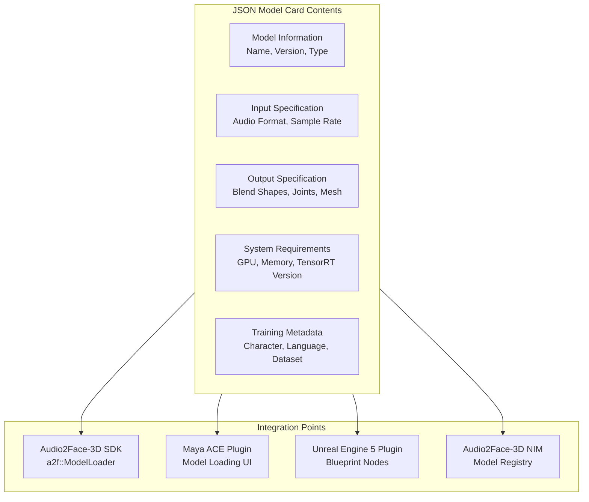

The JSON model card enables:

- **Model discovery**: Tools can scan available models and present them to users
- **Automatic configuration**: Integration tools can adapt to model-specific requirements
- **Version management**: Applications can verify compatibility before loading
- **Custom model support**: User-trained models work seamlessly with all tools if they include a valid model card

**Sources:** [README.md:84-85](), [README.md:144](), [README.md:162]()

---

## Animation Synthesis

The inference models generate three categories of facial animation data:

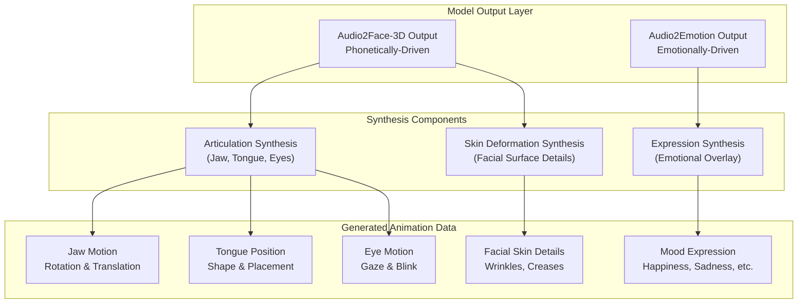

### Articulation Generation

The Audio2Face-3D model generates precise, synchronized motion for primary speech articulators:

- **Jaw movement**: Opening and closing corresponding to vowels and consonants
- **Tongue position**: Shape and placement for different phonemes
- **Eye motion**: Gaze direction and blink timing correlated with speech

### Skin Deformation Generation

Beyond major articulator movement, the system synthesizes subtle facial skin deformations:

- **Natural wrinkles and creases**: Dynamic skin folding around the mouth, eyes, and cheeks
- **Compression and stretching**: Realistic skin behavior during articulation
- **Secondary motion**: Subtle movements that add realism to the performance

### Expression Generation

The Audio2Emotion model produces emotional expression data that overlays the phonetic animation:

- **Mood-driven facial adjustments**: Modifications to neutral articulation based on emotional state
- **Emotional timing**: Temporal correlation between speech content and affective displays
- **Expression blending**: Smooth transitions between different emotional states

**Sources:** [README.md:6-11]()

---

## Output Formats

Audio2Face-3D supports three standardized output formats to accommodate different character rigging systems and animation workflows:

### Output Format Comparison

| Format | Description | Use Cases | Integration Tools |
|--------|-------------|-----------|-------------------|
| **Mesh Deformations** | Direct vertex position modifications | Characters with dense mesh topology; real-time applications requiring direct geometry manipulation | SDK, Maya ACE |
| **Joint Transformations** | Hierarchical bone rotations and translations | Skeletal-rigged characters; standard animation pipelines using FK/IK systems | SDK, Maya ACE |
| **Blend Shape Weights** | Weighted combination of pre-defined shape targets | Blend shape-based facial rigs; MetaHumans; standardized facial animation systems | SDK, Maya ACE, UE5 Plugin |

### Mesh Deformations

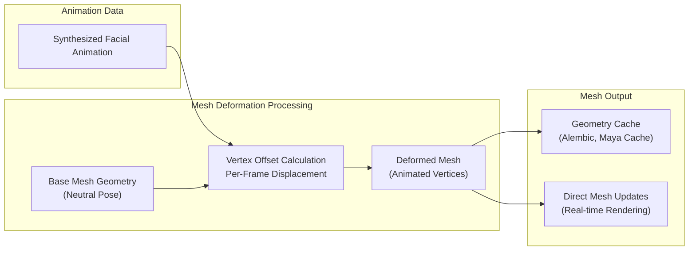

Mesh deformations provide direct control over vertex positions, enabling:

- **Maximum fidelity**: Every vertex can be independently positioned
- **Mesh-level details**: Capture subtle skin deformations not achievable with skeletons alone
- **Cache export**: Can be exported as geometry caches (Alembic, Maya Cache) for offline rendering

### Joint Transformations

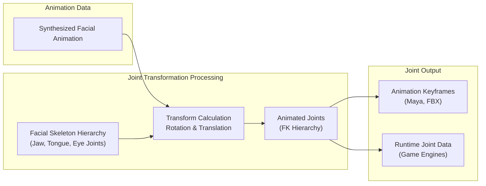

Joint transformations work with skeletal facial rigs:

- **Standard workflow**: Compatible with traditional animation pipelines
- **Hierarchical control**: Parent-child joint relationships maintained
- **Export flexibility**: Can be exported as keyframe animation or FBX files

### Blend Shape Weights

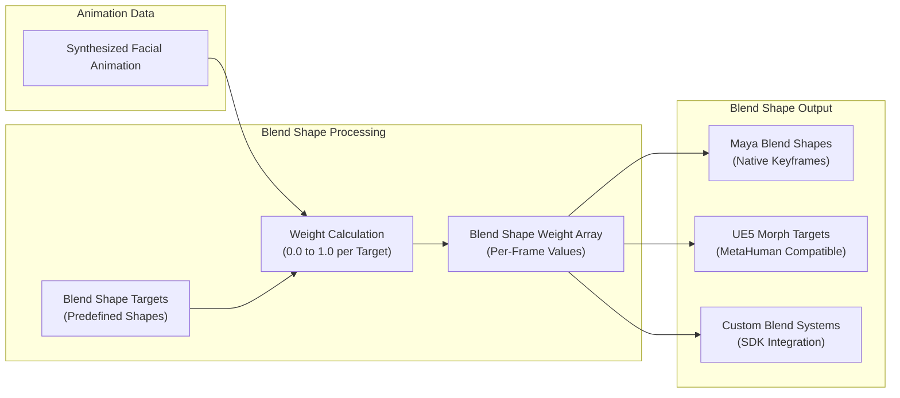

Blend shape weights drive pre-defined facial targets:

- **Industry standard**: Most facial rigs use some form of blend shape system
- **MetaHuman compatibility**: Direct support for Epic Games' MetaHuman characters
- **Normalized values**: Weights range from 0.0 (no influence) to 1.0 (full influence)
- **Multiple target support**: Can drive dozens to hundreds of blend shape targets simultaneously

**Sources:** [README.md:11](), [README.md:169](), [README.md:203]()

---

## Model Versions and Architecture Types

Audio2Face-3D supports multiple model versions with different underlying neural network architectures:

### Audio2Face-3D Model Versions

| Version | Architecture Type | Characteristics | Distribution |
|---------|-------------------|-----------------|--------------|
| **v2.3** | Regression-based | Fast inference, deterministic output, character-specific (Mark, Claire, James) | Hugging Face Hub |
| **v3.0** | Diffusion-based | Higher quality, more natural variation, character-agnostic | Hugging Face Hub |

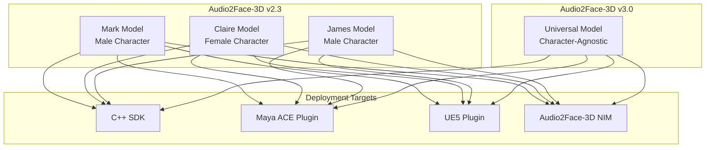

### Audio2Emotion Model Versions

| Version | Status | Characteristics | Distribution |
|---------|--------|-----------------|--------------|
| **v2.2** | Production | Stable, validated for production use | Hugging Face Hub |
| **v3.0** | Experimental | Advanced features, research-oriented | Hugging Face Hub |

All model versions use the same ONNX-TRT format and JSON model card structure, ensuring compatibility across all integration tools. The choice of model version depends on the specific requirements of the project, hardware capabilities, and desired animation characteristics.

**Sources:** [README.md:82-98]()

---

## Technical Data Flow

The following diagram illustrates the complete technical data flow through the Audio2Face-3D system, mapping the abstract pipeline to specific technical formats and processing stages:

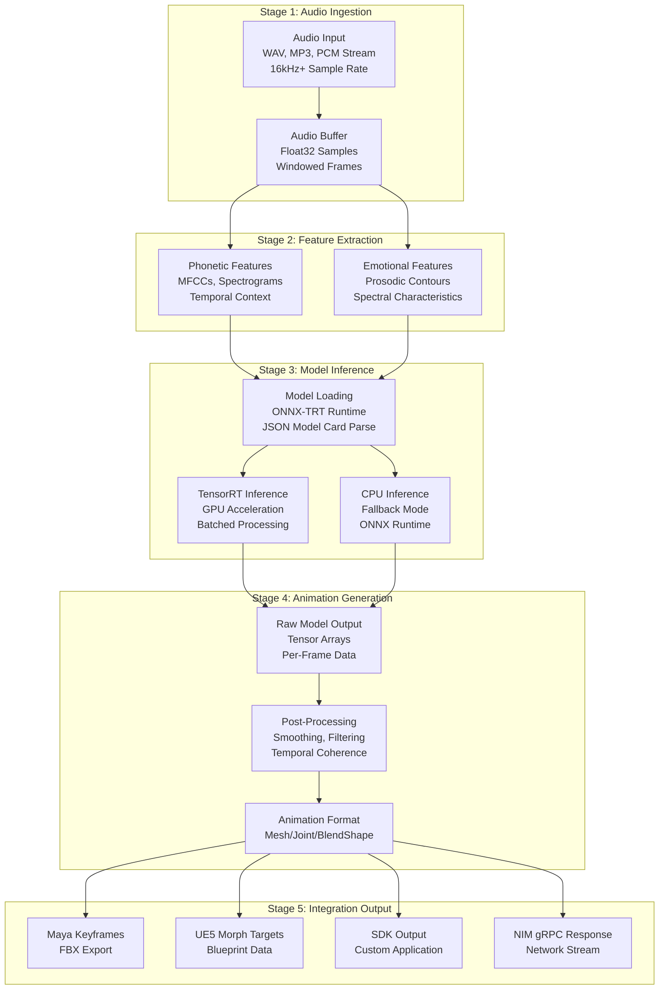

**Processing Stages**

1. **Audio Ingestion**: Raw audio is buffered and prepared for feature extraction
2. **Feature Extraction**: Parallel extraction of phonetic and emotional features
3. **Model Inference**: ONNX-TRT models execute on GPU (with CPU fallback)
4. **Animation Generation**: Raw tensors are post-processed and formatted
5. **Integration Output**: Animation data is delivered in the appropriate format for each tool

**Sources:** [README.md:4-11](), [README.md:119-121](), [README.md:84-85]()

---

## Performance Characteristics

The Audio2Face-3D system is optimized for real-time performance:

### Hardware Acceleration

- **GPU acceleration**: Leverages NVIDIA GPUs via TensorRT for maximum performance
- **CPU fallback**: Provides compatibility with systems lacking compatible GPUs, though at reduced performance
- **Multi-stream support**: Can process multiple concurrent audio streams (especially in NIM deployments)

### Real-Time Capabilities

The system supports real-time inference suitable for:

- Interactive applications (games, virtual assistants)
- Live virtual production
- Real-time preview in content creation tools (Maya ACE, UE5 Plugin)
- Streaming scenarios with low-latency requirements

### Batch Processing

For non-real-time scenarios, the system can be configured for:

- High-throughput batch processing of multiple audio files
- Automated pipeline integration
- Cloud-based rendering services

**Sources:** [README.md:119-121](), [README.md:223-224]()

---

# Page: Integration Tools

# Integration Tools

<details>
<summary>Relevant source files</summary>

The following files were used as context for generating this wiki page:

- [README.md](README.md)

</details>


## Purpose and Scope

This document provides an overview of the three primary integration tools that enable developers and artists to incorporate Audio2Face-3D capabilities into their applications and workflows. These tools—the C++ SDK, Maya ACE Plugin, and Unreal Engine 5 Plugin—serve different user personas and use cases while sharing a common foundation of models and inference capabilities.

For detailed information about specific models used by these tools, see [Pre-trained Models](#5). For deployment infrastructure including the NIM microservice that these tools can connect to, see [Deployment](#6). For information about creating custom models to use with these tools, see [Model Training](#4).

**Sources:** [README.md:17-21](), [README.md:109-233]()

## Integration Tools Ecosystem

The Audio2Face-3D integration tools form a three-tiered architecture designed to serve distinct workflows while maintaining interoperability through shared model formats and optional centralized inference services.

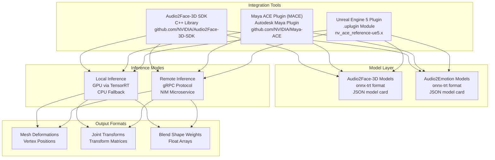

**Diagram: Integration Tools Architecture**

**Sources:** [README.md:109-233](), [README.md:82-89](), [README.md:92-97]()

## Tool Comparison Matrix

The following table summarizes the key characteristics and capabilities of each integration tool:

| Feature | Audio2Face-3D SDK | Maya ACE Plugin | UE5 Plugin |
|---------|-------------------|-----------------|------------|
| **Primary Interface** | C++ and Python APIs | Maya UI and Python nodes | Blueprint nodes |
| **Target Audience** | C++ developers, pipeline engineers | 3D animators, technical directors | Game developers |
| **Distribution Format** | Source code (C++ & Python) | Maya plugin module, source code (C++ & Python) | .uplugin file, C++ source |
| **License** | MIT | MIT | MIT |
| **Local Inference** | Yes (GPU/CPU) | Yes (GPU/CPU) | Yes (GPU/CPU) |
| **Remote Inference** | Yes (via gRPC) | Yes (via gRPC) | Yes (via gRPC) |
| **Model Loading** | Direct API calls | JSON model card | Plugin configuration |
| **Real-time Preview** | Application-dependent | Maya viewport | Unreal viewport |
| **Export Formats** | Application-defined | Maya keyframes, FBX | UE animation assets |
| **Platform Support** | Cross-platform | Windows, Linux (Maya supported platforms) | Windows, Linux (UE5 supported platforms) |
| **Hardware Acceleration** | NVIDIA GPU (TensorRT), CPU fallback | NVIDIA GPU (TensorRT), CPU fallback | NVIDIA GPU (TensorRT), CPU fallback |
| **Customization** | Full source code access | Maya node editing, Python scripting | C++ source code access |

**Sources:** [README.md:109-127](), [README.md:152-177](), [README.md:179-209]()

## Deployment Mode Architecture

All three integration tools support both local and remote inference modes, providing flexibility for different hardware configurations and deployment scenarios.

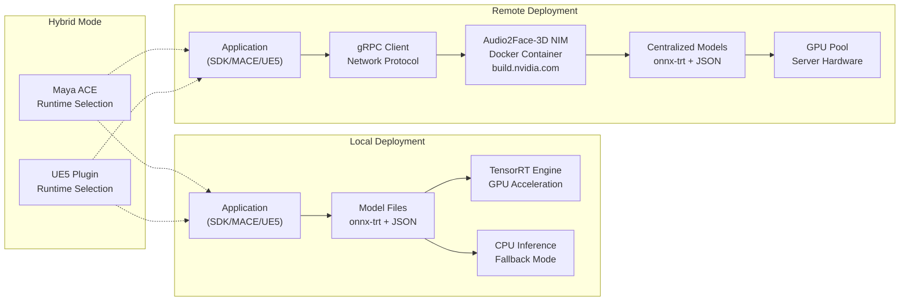

**Diagram: Local vs Remote Inference Deployment Modes**

**Sources:** [README.md:120-121](), [README.md:167](), [README.md:202](), [README.md:211-227]()

## Audio2Face-3D SDK

The Audio2Face-3D SDK provides the foundational C++ library for integrating real-time facial animation inference directly into custom applications. It serves as the lowest-level integration option, offering maximum flexibility and control.

**Repository:** [github.com/NVIDIA/Audio2Face-3D-SDK](https://github.com/NVIDIA/Audio2Face-3D-SDK)

**Key Characteristics:**
- Cross-platform C++ library with Python bindings
- Direct API access to inference engine
- Hardware acceleration via TensorRT on NVIDIA GPUs
- CPU fallback for broader hardware support
- MIT license for commercial and open-source use

**Primary Use Cases:**
- Building custom content creation tools
- Integrating into proprietary game engines
- Developing batch processing pipelines
- Creating platform-specific runtime applications

The SDK is designed for developers who need to build their own user interfaces, export pipelines, or runtime systems. It provides the raw inference capabilities without imposing any specific workflow or file format constraints.

For complete SDK documentation including API reference, build instructions, and integration examples, see [C++ SDK](#3.1).

**Sources:** [README.md:109-127](), [README.md:34-38]()

## Maya ACE Plugin (MACE)

Maya ACE (Animation Character Editor) is a comprehensive plugin that integrates Audio2Face-3D inference capabilities directly into the Autodesk Maya environment. It provides an artist-friendly interface for real-time facial animation authoring.

**Repository:** [github.com/NVIDIA/Maya-ACE](https://github.com/NVIDIA/Maya-ACE)

**Key Characteristics:**
- Native Maya plugin module (.mll on Windows, .so on Linux)
- User interface integrated into Maya's native UI framework
- Python scripting support via Maya command interface
- JSON model card system for loading compatible models
- Dual-mode inference: local execution or remote NIM connection
- Export to Maya keyframes or FBX format

**Primary Use Cases:**
- Real-time animation authoring in Maya viewport
- Previsualization and performance iteration
- Animation pipeline integration for studios
- Configuration file creation for batch processing

MACE bridges the gap between AI-driven animation and traditional keyframe workflows, allowing animators to generate initial performances and then refine them using standard Maya tools.

For detailed MACE documentation including installation, UI walkthrough, and scripting examples, see [Maya ACE Plugin](#3.2).

**Sources:** [README.md:152-177](), [README.md:48-52]()

## Unreal Engine 5 Plugin

The Unreal Engine 5 Plugin delivers real-time facial animation capabilities through Blueprint nodes, enabling game developers to integrate Audio2Face-3D into interactive experiences without C++ programming.

**Distribution:** Binary releases available from [developer.nvidia.com](https://developer.nvidia.com)
- UE 5.6 plugin: `nv_ace_reference-ue5.6-v2.5.0rc3.zip`
- UE 5.5 plugin: `nv_ace_reference-ue5.5-v2.5.0rc3.zip`
- UE 5.4 plugin: `nv_ace_reference-ue5.4-v2.4.0.zip`
- Model plugins: `ace_3.0_a2f_models.zip`, `ace_2.5_v2.3_a2f_models.zip`

**Key Characteristics:**
- Blueprint node interface for visual scripting
- C++ source code available for customization
- MetaHuman facial rig compatibility
- Sample project with complete character setup
- Supports both local inference and remote NIM connection
- Real-time viewport preview

**Primary Use Cases:**
- In-game dialogue systems with dynamic facial animation
- Virtual production and cinematic sequences
- Interactive narrative experiences
- Real-time character performances

The plugin requires two components: the core ACE Unreal plugin (containing the inference engine) and the Audio2Face-3D Models plugin (containing model assets). The sample project demonstrates the complete setup including facial rig mapping for Epic Games MetaHumans.

For comprehensive UE5 plugin documentation including Blueprint reference, rigging setup, and sample project walkthrough, see [Unreal Engine 5 Plugin](#3.3).

**Sources:** [README.md:179-209](), [README.md:55-59](), [README.md:183-190]()

## Tool Selection Guidance

The following decision tree helps determine which integration tool best fits specific project requirements:

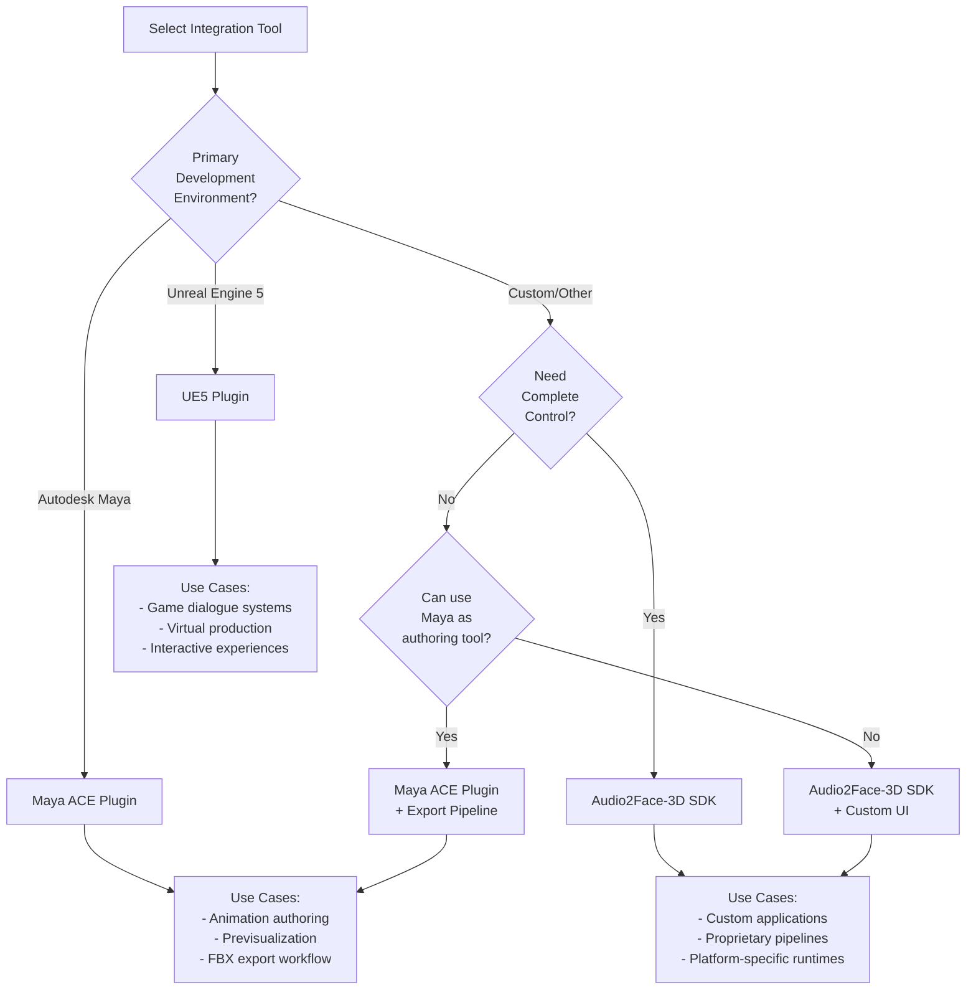

**Diagram: Integration Tool Selection Decision Tree**

**Considerations by Workflow Type:**

| Workflow Type | Recommended Tool | Rationale |
|---------------|------------------|-----------|
| **Film/Animation Production** | Maya ACE Plugin | Native integration with animation workflows, keyframe export, FBX compatibility |
| **Game Development (UE5)** | UE5 Plugin | Direct Blueprint integration, MetaHuman support, real-time preview |
| **Game Development (Other Engines)** | Audio2Face-3D SDK | Full control over integration, custom export formats, engine-specific optimizations |
| **Web/Cloud Applications** | Audio2Face-3D SDK + NIM | Server-side deployment, multi-user support, cross-platform clients |
| **Research & Prototyping** | Maya ACE Plugin | Rapid iteration, visual feedback, no coding required for basic use |
| **Mobile/Console Platforms** | Audio2Face-3D SDK | Platform-specific builds, optimized runtime, custom asset pipelines |

**Sources:** [README.md:123-127](), [README.md:172-177](), [README.md:206-209]()

## Model Compatibility

All three integration tools share a common model format and loading mechanism, ensuring interoperability and consistency across the ecosystem.

**Model Format Specifications:**
- **Primary Format:** ONNX-TensorRT (`.onnx` files optimized for TensorRT inference)
- **Metadata Format:** JSON model card (`.json` file describing model capabilities and requirements)
- **Audio2Face-3D Models:** Versions 2.3 (regression-based) and 3.0 (diffusion-based)
- **Audio2Emotion Models:** Versions 2.2 (production) and 3.0 (experimental)

**Model Loading Mechanisms:**

| Tool | Model Loading Method | Configuration |
|------|---------------------|---------------|
| SDK | Direct API calls (`loadModel()` functions) | Programmatic model path specification |
| Maya ACE | JSON model card selection in UI | UI file browser or Python command with JSON path |
| UE5 Plugin | Plugin configuration and Blueprint nodes | Asset import and Blueprint parameter assignment |

All tools can utilize the same model files downloaded from Hugging Face Hub, enabling studios to standardize on a single set of models across different tools and workflows. Custom models trained with the Training Framework (see [Model Training](#4)) are compatible with all three integration tools without modification.

**Sources:** [README.md:82-89](), [README.md:92-97](), [README.md:168]()

## Output Format Compatibility

The integration tools support multiple output formats to accommodate different character rigging approaches:

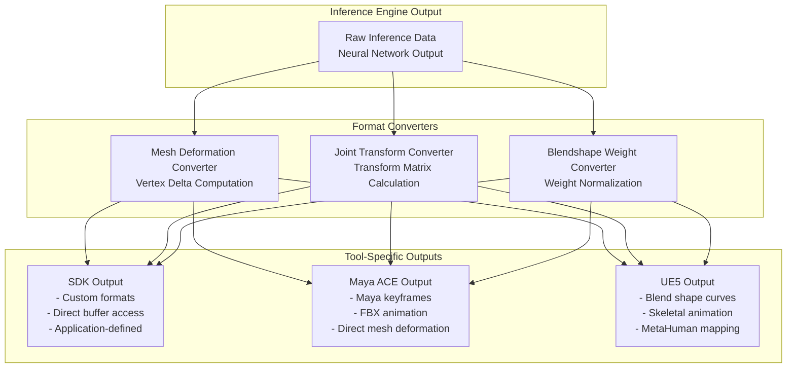

**Diagram: Output Format Pipeline**

**Format Capabilities by Tool:**

- **SDK:** Provides raw access to all output formats through API functions. Applications can process mesh deformations, joint transforms, or blend shape weights according to their specific rigging requirements.

- **Maya ACE:** Converts outputs to Maya-native representations including keyframe animation on transform nodes, blend shape weight animation, or direct mesh deformation on geometry nodes. Exports to FBX preserve animation data for use in other applications.

- **UE5 Plugin:** Integrates with Unreal's skeletal mesh and morph target systems. Blend shape outputs map directly to MetaHuman facial rigs, while joint transforms integrate with standard skeletal animation workflows.

**Sources:** [README.md:6-11](), [README.md:162](), [README.md:169](), [README.md:194]()

---

# Page: C++ SDK

# C++ SDK

<details>
<summary>Relevant source files</summary>

The following files were used as context for generating this wiki page:

- [README.md](README.md)

</details>


## Purpose and Scope

The Audio2Face-3D SDK is a cross-platform C++ library that provides real-time facial animation inference capabilities for integration into custom applications, tools, and production pipelines. This page documents the SDK's architecture, core components, platform support, and integration patterns.

For information about pre-trained models compatible with the SDK, see [Audio2Face-3D Models](#5.1) and [Audio2Emotion Models](#5.2). For deployment options using the SDK in production environments, see [Deployment Patterns](#6.2). For plugin implementations built on top of the SDK, see [Maya ACE Plugin](#3.2) and [Unreal Engine 5 Plugin](#3.3).

**Sources:** [README.md:109-128]()

---

## SDK Architecture Overview

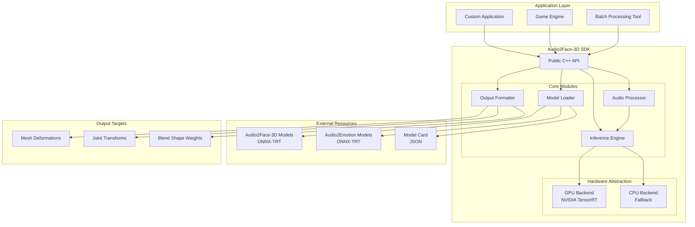

**SDK Architecture Overview**

The SDK provides a layered architecture separating application integration, core processing modules, and hardware abstraction. Applications interact through a unified C++ API that manages model loading, audio processing, and inference execution. The hardware abstraction layer enables GPU acceleration via NVIDIA TensorRT with automatic CPU fallback for broader compatibility.

**Sources:** [README.md:109-128](), [README.md:6-11]()

---

## Core Components

### Model Loader

The Model Loader component handles initialization and configuration of Audio2Face-3D and Audio2Emotion models. It parses JSON model cards to extract model metadata, input/output specifications, and runtime requirements.

**Responsibilities:**
- Parse JSON model card configuration
- Load ONNX-TRT model weights from disk
- Validate model compatibility with SDK version
- Initialize inference session with hardware backend
- Support for multiple model versions (v2.3 regression, v3.0 diffusion)

**Model Card Format:**
| Field | Description |
|-------|-------------|
| Model metadata | Version, character name, language support |
| Input specifications | Audio sample rate, frame size, feature dimensions |
| Output specifications | Blend shape count, joint topology, mesh vertex count |
| Runtime requirements | GPU memory, compute capability, TensorRT version |

**Sources:** [README.md:82-89](), [README.md:92-97](), [README.md:144]()

### Inference Engine

The Inference Engine executes neural network inference to transform audio features into facial animation data. It manages inference sessions, batch processing, and hardware resource allocation.

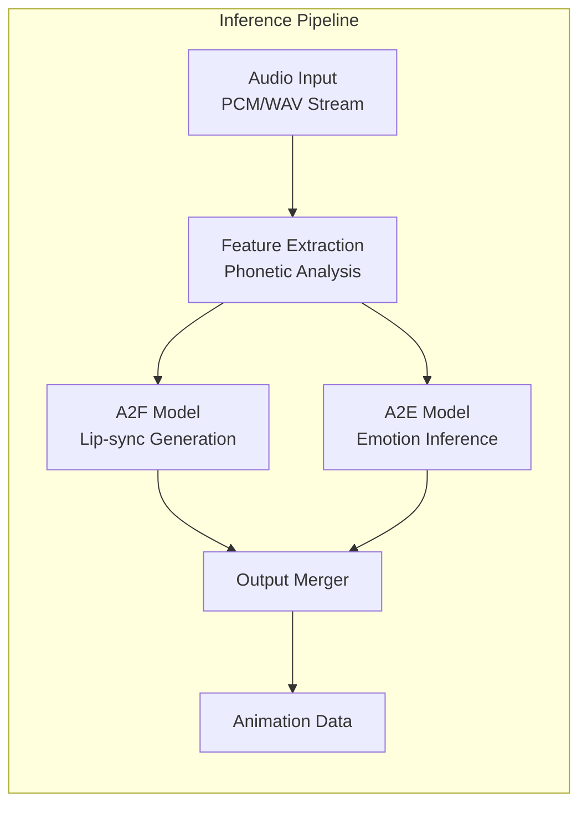

**Inference Pipeline**

The inference engine processes audio through feature extraction and parallel model execution. Audio2Face-3D generates phonetically-driven lip-sync while Audio2Emotion produces emotional expression. Results merge into unified animation data.

**Key Operations:**
- Real-time audio stream processing
- Parallel execution of A2F and A2E models
- Batch inference for offline processing
- Frame-level synchronization with audio timing
- Memory management for continuous streams

**Sources:** [README.md:6-11](), [README.md:120]()

### Audio Processor

The Audio Processor normalizes input audio streams and extracts features required for inference. It handles various audio formats and sample rates.

**Processing Pipeline:**
1. Audio format validation and conversion
2. Sample rate normalization
3. Phonetic feature extraction for lip-sync
4. Spectral analysis for emotional tone
5. Frame buffering for real-time streaming

**Supported Input:**
- File formats: WAV, MP3, AAC
- Sample rates: 16kHz, 22.05kHz, 44.1kHz, 48kHz
- Channels: Mono, Stereo (downmixed to mono)
- Real-time streams: PCM buffers

**Sources:** [README.md:4](), [README.md:8]()

### Output Formatter

The Output Formatter converts raw inference results into application-specific animation formats. It supports three primary output modes.

**Output Modes:**

| Mode | Description | Use Case |
|------|-------------|----------|
| Mesh Deformations | Per-vertex displacement vectors | Direct geometry manipulation, cloth simulation |
| Joint Transforms | Bone rotation/translation matrices | Skeletal rigs, game engines |
| Blend Shape Weights | Scalar weights for morph targets | Maya blend shapes, MetaHumans, ARKit |

**Sources:** [README.md:11](), [README.md:162](), [README.md:194]()

---

## Platform Support and Hardware Acceleration

### Cross-Platform Compatibility

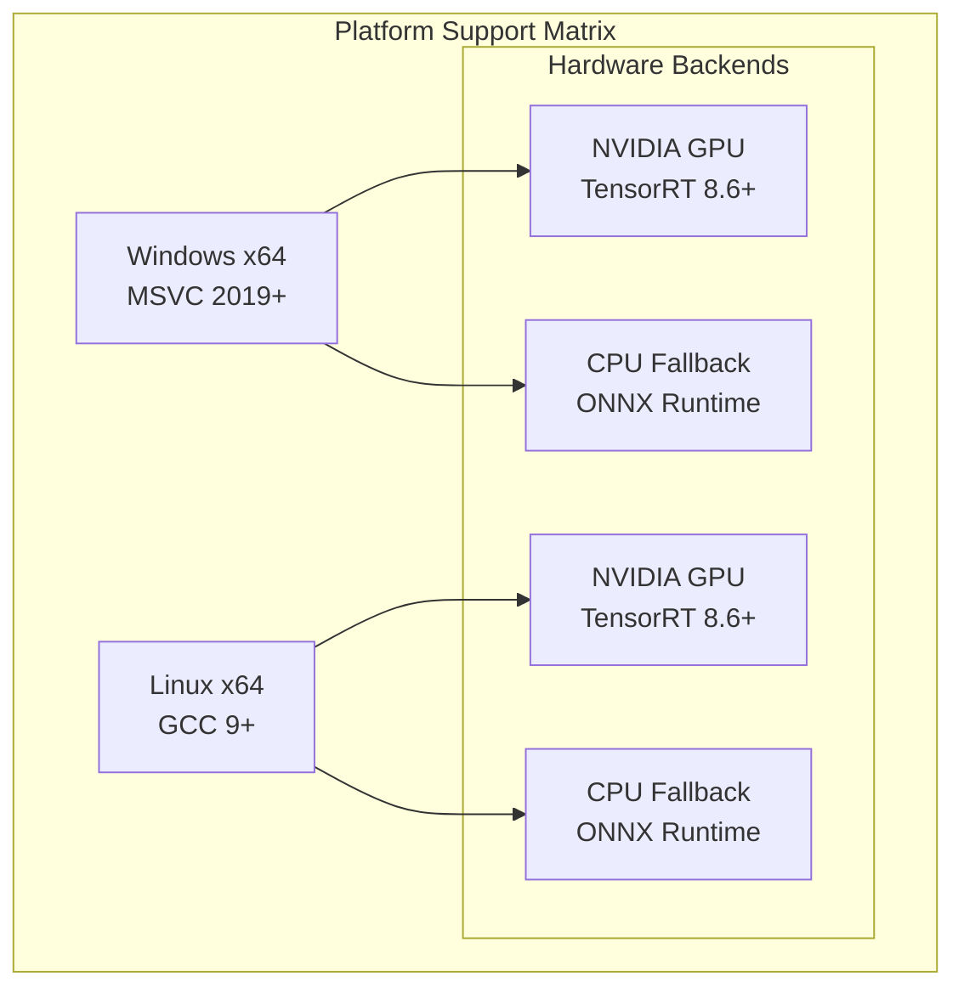

**Platform Support Matrix**

The SDK provides native builds for Windows and Linux x64 platforms with dual hardware backend support. GPU acceleration via TensorRT delivers real-time performance for interactive applications, while CPU fallback ensures compatibility across diverse hardware configurations.

**Compiler Requirements:**
- Windows: MSVC 2019 or later
- Linux: GCC 9 or later, GLIBC 2.31+

**Sources:** [README.md:119](), [README.md:121]()

### GPU Acceleration

**NVIDIA GPU Requirements:**
- Compute Capability: 7.0 or higher (Volta, Turing, Ampere, Ada, Hopper)
- VRAM: 2GB minimum, 4GB recommended for v3.0 diffusion models
- Driver: R525 or later
- CUDA: 11.8 or later
- TensorRT: 8.6 or later

**Performance Characteristics:**
- Real-time inference at 30+ FPS for v2.3 regression models
- Near real-time (15-20 FPS) for v3.0 diffusion models on RTX 3080+
- Low latency (<100ms) for interactive applications

**Sources:** [README.md:121]()

### CPU Fallback

The CPU backend provides functional compatibility when GPU acceleration is unavailable. Performance is reduced but suitable for offline batch processing or development workstations without NVIDIA GPUs.

**CPU Performance:**
- 2-5 FPS on modern multi-core CPUs (Intel i7/i9, AMD Ryzen 7/9)
- Batch processing recommended over real-time streaming
- Multi-threading support for parallel frame processing

**Sources:** [README.md:121]()

---

## Integration Patterns

### Local Inference Integration

```mermaid
sequenceDiagram
    participant App as "Application"
    participant SDK as "SDK API"
    participant Loader as "ModelLoader"
    participant Engine as "InferenceEngine"
    participant GPU as "GPU Backend"
    
    App->>SDK: Initialize SDK
    App->>Loader: LoadModel(modelCard.json)
    Loader->>Loader: Parse JSON config
    Loader->>GPU: Initialize TensorRT session
    GPU-->>Loader: Session handle
    Loader-->>App: Model loaded
    
    loop Real-time Stream
        App->>SDK: ProcessAudioFrame(pcmData)
        SDK->>Engine: RunInference(features)
        Engine->>GPU: Execute neural network
        GPU-->>Engine: Raw predictions
        Engine-->>SDK: Animation data
        SDK-->>App: Blend shape weights
        App->>App: Update character rig
    end
    
    App->>SDK: Shutdown
```

**Local Inference Sequence Diagram**

This pattern demonstrates SDK integration for local, on-device inference. The application initializes the SDK, loads a model via JSON configuration, then processes audio frames in a real-time loop. Each frame triggers GPU inference and returns animation data for immediate character rig updates.

**Integration Steps:**
1. Link SDK library (`libAudio2Face3D.so` or `Audio2Face3D.dll`)
2. Include SDK headers
3. Initialize SDK with hardware preferences
4. Load model from JSON model card
5. Process audio frames or streams
6. Apply animation data to target rig
7. Cleanup and shutdown

**Sources:** [README.md:115](), [README.md:125-127]()

### Batch Processing Integration

For offline workflows, the SDK supports batch mode processing of multiple audio files with optimized throughput.

**Batch Workflow:**
```mermaid
graph LR
    AudioFiles["Audio File List"]
    BatchQueue["Batch Queue"]
    Inference["Parallel Inference<br/>Multi-threaded"]
    OutputCache["Animation Cache"]
    Export["Export to Files"]
    
    AudioFiles --> BatchQueue
    BatchQueue --> Inference
    Inference --> OutputCache
    OutputCache --> Export
```

**Batch Processing Workflow**

Batch mode queues multiple audio files for parallel processing across available CPU cores or GPU streams. Results are cached and exported in bulk, optimizing throughput for production pipelines.

**Optimization Strategies:**
- Multi-threaded CPU inference with thread pool
- GPU stream multiplexing for concurrent inference
- Pre-allocated memory buffers to reduce allocation overhead
- Asynchronous I/O for audio loading and animation export

**Sources:** [README.md:127]()

---

## Model Compatibility

The SDK supports all official Audio2Face-3D and Audio2Emotion models distributed via Hugging Face Hub. Model selection is managed through JSON model card files.

**Model Version Support:**

| Model Family | Version | Architecture | SDK Compatibility |
|--------------|---------|--------------|-------------------|
| Audio2Face-3D Mark | v2.3 | Regression | All SDK versions |
| Audio2Face-3D Claire | v2.3.1 | Regression | All SDK versions |
| Audio2Face-3D James | v2.3.1 | Regression | All SDK versions |
| Audio2Face-3D | v3.0 | Diffusion | SDK v2.0+ |
| Audio2Emotion | v2.2 | Production | All SDK versions |
| Audio2Emotion | v3.0 | Experimental | SDK v2.0+ |

**Custom Model Support:**

The SDK can load custom models trained via the Training Framework, provided they:
- Export to ONNX-TRT format
- Include valid JSON model card
- Match SDK input/output tensor specifications
- Meet TensorRT version compatibility

**Sources:** [README.md:82-97](), [README.md:135-144](), [README.md:168]()

---

## Use Cases

### Game Development

**Real-time NPC Dialogue:**
- Integrate SDK into game engine runtime
- Drive facial animation for in-game conversations
- Synchronize with audio playback system
- Support dynamic dialogue trees with runtime audio

**Cinematic Sequences:**
- Batch process cutscene audio during asset bake
- Export animation as engine-native curves or blend shapes
- Cache results for deterministic playback

**Sources:** [README.md:125]()

### Custom Application Development

**Content Creation Tools:**
- Add Audio2Face-3D as plugin or extension
- Provide UI for model selection and parameter tuning
- Export to application-native animation formats
- Support artist workflows for iteration and refinement

**Pipeline Integration:**
- Build command-line batch processing tools
- Integrate with farm rendering systems
- Support studio-specific file formats and conventions

**Sources:** [README.md:126]()

### Production Deployment

**Automated Animation Services:**
- Deploy SDK in server environments
- Process audio assets at scale
- Integrate with asset management systems
- Support concurrent processing jobs

**Cloud-Native Applications:**
- Package SDK in containerized services
- Expose via REST or gRPC APIs
- Scale horizontally with load balancers
- Monitor performance metrics

**Note:** For pre-built microservice deployment, see [NIM Microservice](#6.1).

**Sources:** [README.md:127](), [README.md:217-233]()

---

## Platform-Specific Considerations

### Windows Development

**Build Requirements:**
- Visual Studio 2019 or later
- Windows 10/11 SDK
- CUDA Toolkit (for GPU support)
- CMake 3.18+

**Runtime Dependencies:**
- Microsoft Visual C++ Redistributable 2019+
- NVIDIA GPU Driver R525+
- TensorRT 8.6+ libraries

**Sources:** [README.md:119]()

### Linux Development

**Build Requirements:**
- GCC 9+ or Clang 10+
- GLIBC 2.31+
- CUDA Toolkit (for GPU support)
- CMake 3.18+

**Runtime Dependencies:**
- NVIDIA GPU Driver R525+
- TensorRT 8.6+ libraries
- ONNX Runtime (for CPU fallback)

**Sources:** [README.md:119]()

---

## Performance Optimization

**GPU Memory Management:**
- Pre-allocate tensor buffers for streaming
- Reuse inference sessions across frames
- Profile memory usage with NVIDIA Nsight Systems
- Reduce batch size for memory-constrained GPUs

**Threading Strategy:**
- Dedicate inference thread separate from audio I/O
- Use lock-free queues for frame handoff
- Minimize mutex contention in real-time loops

**Model Selection:**
- Use v2.3 regression models for maximum FPS
- Reserve v3.0 diffusion for quality-critical applications
- Consider CPU fallback for non-interactive workflows

**Sources:** [README.md:120-121]()

---

## SDK Distribution

The Audio2Face-3D SDK is distributed via NVIDIA GitHub repositories under MIT license. It includes:

**Package Contents:**
- C++ header files
- Compiled libraries (`.so`, `.dll`)
- Python bindings (optional)
- Sample code and integration examples
- CMake build scripts
- Documentation

**Download:** [Audio2Face-3D SDK on GitHub](https://github.com/NVIDIA/Audio2Face-3D-SDK)

**License:** MIT License

**Sources:** [README.md:33-38](), [README.md:113]()

---

# Page: Maya ACE Plugin

# Maya ACE Plugin

<details>
<summary>Relevant source files</summary>

The following files were used as context for generating this wiki page:

- [README.md](README.md)
- [RELEASE.md](RELEASE.md)
- [media/Mace_banner.png](media/Mace_banner.png)

</details>


## Purpose and Scope

This document covers the Maya ACE Plugin (MACE), an Autodesk Maya integration for the Audio2Face-3D system. MACE provides an artist-friendly interface for generating facial animation from audio directly within the Maya environment, supporting both local and remote inference modes.

For information about the underlying C++ SDK that powers MACE's local inference capabilities, see [C++ SDK](#3.1). For details about the remote inference service that MACE can connect to, see [NIM Microservice](#6.1). For information about the pre-trained models that MACE can load, see [Audio2Face-3D Models](#5.1) and [Audio2Emotion Models](#5.2).

**Sources:** [README.md:152-178]()

---

## Overview

Maya ACE (MACE) is a comprehensive plugin that integrates Audio2Face-3D functionality directly into Autodesk Maya's authoring environment. The plugin is distributed as a Maya module containing both C++ compiled components (`.mll` on Windows, `.so` on Linux) and Python scripts that provide the user interface and Maya scene integration.

The plugin allows animators to:
- Generate real-time facial animation from audio files or streams
- Preview animation directly in the Maya viewport
- Export to Maya keyframes or FBX format
- Switch between local GPU-accelerated inference and remote microservice inference
- Load any compatible Audio2Face-3D model via JSON model cards

MACE is version 2.0 and is released under the MIT license. The source code and installation packages are available in the Maya-ACE GitHub repository.

**Sources:** [README.md:48-52](), [README.md:152-178]()

---

## Plugin Architecture

The following diagram illustrates the high-level architecture of the Maya ACE plugin and its relationship to the Maya environment and Audio2Face-3D inference engines:

```mermaid
graph TB
    subgraph "Maya Environment"
        subgraph "MACE Plugin Module"
            UI["Python UI Layer<br/>Maya shelf/menu integration"]
            PyAPI["Python API Layer<br/>Maya commands and nodes"]
            CPP["C++ Plugin Core<br/>.mll/.so binary"]
        end
        
        subgraph "Maya Scene"
            Mesh["Character Meshes"]
            Joints["Joint Hierarchies"]
            BlendShapes["Blend Shape Deformers"]
            AnimCurves["Animation Curves<br/>FCurves/Keyframes"]
        end
        
        Audio["Audio Node<br/>Maya audio playback"]
    end
    
    subgraph "Inference Backends"
        LocalSDK["Audio2Face-3D SDK<br/>Local GPU/CPU"]
        RemoteNIM["Audio2Face-3D NIM<br/>gRPC Service"]
    end
    
    subgraph "Model Assets"
        ModelCard["JSON Model Card<br/>Model configuration"]
        ModelWeights["ONNX-TRT Weights<br/>Neural network"]
    end
    
    UI --> PyAPI
    PyAPI --> CPP
    
    CPP --> LocalSDK
    CPP --> RemoteNIM
    
    LocalSDK --> ModelCard
    LocalSDK --> ModelWeights
    RemoteNIM --> ModelCard
    
    Audio --> CPP
    
    CPP --> Mesh
    CPP --> Joints
    CPP --> BlendShapes
    CPP --> AnimCurves
```

**Plugin Architecture Diagram**: This diagram shows the layered structure of MACE within Maya. The Python UI layer provides shelf buttons and menu items. The Python API layer wraps Maya commands and custom nodes. The C++ core handles performance-critical operations and communicates with either the local SDK or remote NIM service. The plugin writes animation data to Maya scene entities (meshes, joints, blend shapes) and can bake results to animation curves.

**Sources:** [README.md:48-52](), [README.md:160-171]()

---

## Component Breakdown

The Maya ACE plugin consists of several key components:

### C++ Plugin Binary

The compiled binary (`.mll` on Windows, `.so` on Linux/macOS) contains:
- Maya API node implementations (likely extending `MPxNode` for custom dependency graph nodes)
- Maya command implementations (likely extending `MPxCommand` for UI operations)
- Audio2Face-3D SDK integration for local inference
- gRPC client implementation for remote inference
- Audio processing and synchronization logic

### Python Integration Layer

Python scripts provide:
- User interface components integrated into Maya's shelf and menus
- High-level commands for model loading and inference configuration
- Scene setup utilities for character rigging integration
- Export utilities for keyframe baking and FBX output
- Sample scripts demonstrating API usage and pipeline integration

### Model Configuration System

The plugin uses JSON model cards to:
- Specify model metadata (version, capabilities, output format)
- Define required input parameters and preprocessing
- Configure blend shape mappings or joint transformations
- Specify hardware requirements and optimization settings

**Sources:** [README.md:50-52](), [README.md:162-171]()

---

## Data Flow and Inference Pipeline

The following diagram illustrates the complete data flow from audio input through inference to final animation output:

```mermaid
flowchart LR
    subgraph "Input Stage"
        AudioFile["Audio File<br/>.wav/.mp3"]
        AudioNode["Maya Audio Node"]
        Timeline["Maya Timeline<br/>Frame range"]
    end
    
    subgraph "MACE Processing"
        AudioBuffer["Audio Buffer<br/>PCM samples"]
        FrameSync["Frame Synchronization<br/>FPS alignment"]
        InferenceRouter["Inference Router"]
    end
    
    subgraph "Inference Execution"
        LocalPath["Local Inference<br/>SDK + GPU/CPU"]
        RemotePath["Remote Inference<br/>gRPC to NIM"]
    end
    
    subgraph "Output Processing"
        BlendWeights["Blend Shape Weights<br/>Per-frame arrays"]
        JointTransforms["Joint Transforms<br/>Rotation/translation"]
        MeshDeltas["Mesh Deltas<br/>Vertex offsets"]
    end
    
    subgraph "Maya Scene Update"
        BSDeformer["Blend Shape Deformer<br/>Live update"]
        JointNodes["Joint Nodes<br/>Transform attributes"]
        GeomCache["Geometry Cache<br/>Alembic/MDD"]
        Keyframes["Baked Keyframes<br/>Animation curves"]
    end
    
    AudioFile --> AudioNode
    AudioNode --> AudioBuffer
    Timeline --> FrameSync
    AudioBuffer --> FrameSync
    FrameSync --> InferenceRouter
    
    InferenceRouter --> LocalPath
    InferenceRouter --> RemotePath
    
    LocalPath --> BlendWeights
    LocalPath --> JointTransforms
    LocalPath --> MeshDeltas
    
    RemotePath --> BlendWeights
    RemotePath --> JointTransforms
    RemotePath --> MeshDeltas
    
    BlendWeights --> BSDeformer
    JointTransforms --> JointNodes
    MeshDeltas --> GeomCache
    
    BSDeformer --> Keyframes
    JointNodes --> Keyframes
```

**Inference Pipeline Diagram**: This shows the complete data flow from audio input to final animation. Audio is loaded from file and synchronized with Maya's timeline. The inference router directs processing to either local SDK or remote NIM. Results are generated as blend shape weights, joint transforms, or mesh deltas, which update Maya scene entities. Finally, the live animation can be baked to keyframes for export.

**Sources:** [README.md:6-11](), [README.md:166-169]()

---

## Inference Modes

MACE supports two distinct inference modes that can be selected based on deployment requirements:

### Local Inference Mode

In local mode, the plugin uses the Audio2Face-3D SDK directly on the artist's workstation:

| Aspect | Details |
|--------|---------|
| **Execution** | Audio2Face-3D SDK loaded in Maya process |
| **Hardware** | Uses local GPU (TensorRT) or CPU fallback |
| **Models** | Loaded from local disk using model card path |
| **Latency** | Minimal latency, real-time preview |
| **Use Case** | Single-user workstations, offline authoring |
| **Requirements** | NVIDIA GPU recommended, sufficient VRAM |

### Remote Inference Mode

In remote mode, the plugin connects to an Audio2Face-3D NIM microservice:

| Aspect | Details |
|--------|---------|
| **Execution** | gRPC client connects to remote NIM server |
| **Hardware** | Server-side GPU, client can be lightweight |
| **Models** | Managed on NIM server, hot-swappable |
| **Latency** | Network-dependent, suitable for preview |
| **Use Case** | Multi-user studios, cloud workflows, resource sharing |
| **Requirements** | Network access to NIM service endpoint |

The inference mode can be switched in the MACE UI without restarting Maya, allowing artists to choose based on current workflow needs.

**Sources:** [README.md:167](), [README.md:176-177]()

---

## Model Loading and Configuration

```mermaid
graph TB
    subgraph "Model Discovery"
        LocalModels["Local Model Directory<br/>HuggingFace cache or custom"]
        ModelCard["model_card.json<br/>Model metadata"]
    end
    
    subgraph "Model Card Contents"
        Metadata["Model Metadata<br/>name, version, type"]
        IOSpec["Input/Output Spec<br/>audio format, output shape"]
        Mapping["Output Mapping<br/>blend shape names, joint names"]
        Hardware["Hardware Requirements<br/>GPU memory, precision"]
    end
    
    subgraph "MACE Configuration"
        UISelector["Model Selection UI<br/>Browse/select model card"]
        ConfigValidator["Configuration Validator<br/>Check compatibility"]
        LoadEngine["Model Load Engine<br/>Initialize inference"]
    end
    
    subgraph "Inference Engine"
        LocalInference["Local SDK Instance<br/>Loaded model"]
        RemoteInference["Remote NIM Connection<br/>Model selection"]
    end
    
    LocalModels --> ModelCard
    ModelCard --> Metadata
    ModelCard --> IOSpec
    ModelCard --> Mapping
    ModelCard --> Hardware
    
    UISelector --> ModelCard
    ModelCard --> ConfigValidator
    ConfigValidator --> LoadEngine
    
    LoadEngine --> LocalInference
    LoadEngine --> RemoteInference
```

**Model Loading Architecture**: This diagram shows how MACE discovers and loads models. Models are stored locally with JSON model cards that specify metadata, I/O formats, output mappings, and hardware requirements. The UI allows selection of model cards, which are validated for compatibility before loading into either the local SDK or selecting on the remote NIM service.

**Sources:** [README.md:162](), [README.md:168]()

---

## Output Formats and Export Options

MACE supports three primary output formats, each suitable for different rigging approaches:

### 1. Blend Shape Weights

```mermaid
graph LR
    Inference["Audio2Face Inference<br/>Per-frame blend weights"]
    BSTarget["Blend Shape Target<br/>Maya blendShape node"]
    WeightAttrs["Weight Attributes<br/>weight[0], weight[1], ..."]
    AnimCurves["Animation Curves<br/>Keyframed weights"]
    
    Inference --> BSTarget
    BSTarget --> WeightAttrs
    WeightAttrs --> AnimCurves
```

- **Format**: Array of float values per frame, one per blend shape target
- **Maya Integration**: Connects to `blendShape` node weight attributes
- **Export**: Keyframes on weight attributes, compatible with FBX export
- **Use Case**: Standard blend shape facial rigs, MetaHuman-compatible

### 2. Joint Transformations

```mermaid
graph LR
    Inference["Audio2Face Inference<br/>Per-frame joint transforms"]
    JointNodes["Maya Joint Nodes<br/>jaw, tongue, eyes, etc."]
    TransAttrs["Transform Attributes<br/>rotate, translate"]
    AnimCurves["Animation Curves<br/>Keyframed transforms"]
    
    Inference --> JointNodes
    JointNodes --> TransAttrs
    TransAttrs --> AnimCurves
```

- **Format**: Rotation and translation values per joint per frame
- **Maya Integration**: Connects to joint node `rotate` and `translate` attributes
- **Export**: Standard Maya animation, universally compatible
- **Use Case**: Joint-driven facial rigs, game engine export

### 3. Direct Mesh Deformations

```mermaid
graph LR
    Inference["Audio2Face Inference<br/>Per-frame vertex deltas"]
    MeshNode["Maya Mesh Node<br/>Character face geometry"]
    VertexPos["Vertex Positions<br/>Point array updates"]
    GeomCache["Geometry Cache<br/>Alembic/MDD format"]
    
    Inference --> MeshNode
    MeshNode --> VertexPos
    VertexPos --> GeomCache
```

- **Format**: Vertex position deltas per frame
- **Maya Integration**: Direct mesh deformation via custom deformer
- **Export**: Geometry cache (Alembic, MDD) for high-fidelity playback
- **Use Case**: Highest-quality output, VFX workflows, no rig required

**Sources:** [README.md:6-11](), [README.md:162](), [README.md:169]()

---

## Export Capabilities

MACE provides production-ready export options:

### Maya Keyframe Export

- **Format**: Native Maya animation curves (FCurves)
- **Process**: Bakes real-time preview to keyframes on target attributes
- **Sampling**: User-configurable frame rate and keyframe density
- **Filtering**: Optional curve smoothing and keyframe reduction
- **Compatibility**: Works with all Maya animation tools and workflows

### FBX Export

- **Format**: FBX file with embedded animation
- **Contents**: Character geometry, rig, and baked animation
- **Use Cases**: Export to game engines, other DCC applications
- **Options**: Configurable FBX version and export settings
- **Integration**: Uses Maya's native FBX export with MACE presets

**Sources:** [README.md:169]()

---

## User Interface Components

The MACE user interface is fully integrated into Maya's native UI framework:

### Main Control Panel

The primary interface provides:
- **Audio Source Selection**: Browse and load audio files
- **Model Selection**: Browse and load model cards from local or remote sources
- **Inference Mode Toggle**: Switch between local SDK and remote NIM
- **Playback Controls**: Real-time preview with Maya timeline sync
- **Export Options**: Keyframe baking and FBX export configuration

### Maya Shelf Integration

MACE adds a custom shelf with quick-access buttons for:
- Opening the main MACE panel
- Loading last-used model
- Quick export to keyframes
- Sample scene setup utilities

### Menu Integration

MACE extends Maya's menu bar with:
- Model management commands
- Configuration presets
- Pipeline integration utilities
- Help and documentation links

### Node Editor Integration

MACE nodes are visible and editable in Maya's Node Editor, allowing technical users to:
- Inspect node connections and data flow
- Create custom node graphs
- Debug inference and output mapping
- Extend functionality with MEL/Python scripting

**Sources:** [README.md:154-155](), [README.md:162](), [README.md:170]()

---

## Pipeline Integration and Scripting

MACE is designed to integrate into studio pipelines through its scriptable API:

### Python API

The plugin exposes Python commands that can be called from scripts or pipeline tools:

```python
# Pseudocode example based on typical Maya plugin patterns
import maya.cmds as cmds

# Load a model card
cmds.maceLoadModel(modelCard="/path/to/model_card.json")

# Configure inference mode
cmds.maceSetInferenceMode(mode="local")  # or "remote"

# Set audio source
cmds.maceSetAudio(audioFile="/path/to/audio.wav")

# Run inference and bake to keyframes
cmds.maceGenerateAnimation(startFrame=1, endFrame=100, bake=True)
```

### Batch Processing

For automated pipeline workflows, MACE supports:
- Headless Maya execution with MACE commands
- Configuration files for inference settings
- Batch export of multiple audio files to animation
- Integration with render farm or compute cluster workflows

### Custom Node Creation

Technical artists can extend MACE by:
- Accessing MACE nodes in the dependency graph
- Creating custom deformers that read MACE output
- Building higher-level tools on top of the MACE API
- Integrating with proprietary rig systems

**Sources:** [README.md:156](), [README.md:162](), [README.md:175-177]()

---

## Configuration Files for Production

MACE can generate and consume configuration files for advanced workflows:

### Inference Configuration Files

These files specify:
- Model card path and version
- Inference mode (local/remote)
- Remote NIM endpoint (if using remote mode)
- Audio preprocessing settings
- Output mapping configuration

### Use in Batch Pipelines

Configuration files enable:
- Consistent settings across multiple artists
- Version-controlled inference parameters
- Automated batch processing without UI
- Integration with Audio2Face-3D NIM deployments

### Use in NIM Deployments

Studios can:
- Create standardized configurations for NIM services
- Deploy consistent models and settings to cloud infrastructure
- Share configurations between MACE and other Audio2Face-3D tools
- Maintain configuration libraries for different characters/languages

**Sources:** [README.md:177]()

---

## Installation and Setup

The Maya ACE plugin is distributed as a Maya module:

### Installation Process

1. **Download**: Obtain the plugin package from the Maya-ACE GitHub repository
2. **Extract**: Unpack the module to a local directory
3. **Configure Module Path**: Add the module directory to Maya's `MAYA_MODULE_PATH`
4. **Load Plugin**: Maya automatically discovers and loads the plugin on startup
5. **Verify**: Check for MACE shelf and menu items in Maya UI

### System Requirements

| Component | Requirement |
|-----------|-------------|
| **Operating System** | Windows, Linux (Maya supported platforms) |
| **Maya Version** | Compatible with Maya 2020+ (verify specific versions in repository) |
| **GPU (Local Mode)** | NVIDIA GPU with CUDA support, sufficient VRAM for models |
| **CPU (Fallback)** | Multi-core CPU for CPU-based inference |
| **Storage** | Space for plugin binaries and model files |
| **Network (Remote Mode)** | Network access to Audio2Face-3D NIM service |

### Model Setup

After installation, users need to:
1. Download pre-trained models from Hugging Face or train custom models
2. Place model files in an accessible directory
3. Load model cards through the MACE UI
4. Verify model compatibility with target character rig

**Sources:** [README.md:48-52](), [README.md:158]()

---

## Use Cases and Workflows

### 3D Animators: Rapid Animation Authoring

**Workflow:**
1. Load character rig in Maya scene
2. Import audio dialogue file
3. Select appropriate Audio2Face-3D model
4. Generate real-time preview of facial animation
5. Iterate on performance by adjusting audio or model
6. Bake final animation to keyframes
7. Refine with traditional animation tools
8. Export to production pipeline

**Benefits:** Dramatically reduces time spent on lip-sync, allows focus on performance and emotion rather than technical precision.

### Technical Artists: Pipeline Integration

**Workflow:**
1. Test inference configurations with different models
2. Create standardized configuration files for production
3. Develop custom scripts integrating MACE with studio tools
4. Set up batch processing for multiple sequences
5. Integrate with remote NIM infrastructure for scalability
6. Create presets and templates for common character types

**Benefits:** Establishes repeatable, scalable workflow for entire studio; reduces technical barriers for animators.

### Directors & Supervisors: Real-time Review

**Workflow:**
1. Load temp audio or ADR recordings
2. Generate quick facial animation for previs
3. Review performance in real-time during recording sessions
4. Iterate on dialogue timing and delivery
5. Provide immediate feedback to voice actors
6. Export previs animation for editorial

**Benefits:** Enables rapid iteration on performance during production; bridges gap between audio recording and final animation.

### Animation Pipeline: Batch Processing

**Workflow:**
1. Create configuration files for inference settings
2. Set up automated batch processing scripts
3. Process multiple audio files in parallel
4. Deploy to render farm or compute cluster
5. Connect to centralized NIM service for GPU sharing
6. Integrate with asset management and version control

**Benefits:** Scales facial animation production for large-scale projects; leverages centralized GPU resources efficiently.

**Sources:** [README.md:172-177]()

---

## Integration with Other Audio2Face-3D Components

MACE integrates with the broader Audio2Face-3D ecosystem:

### Audio2Face-3D SDK

- MACE uses the SDK for local inference mode
- Shares model format and configuration with SDK
- Can load any model compatible with SDK
- Benefits from SDK performance optimizations

### Audio2Face-3D NIM

- MACE can connect to NIM microservice for remote inference
- Uses same gRPC protocol as other NIM clients
- Shares configuration file format with NIM deployments
- Enables hybrid workflows (local development, remote production)

### Pre-trained Models

- Loads Audio2Face-3D v2.3 regression models (Mark, Claire, James)
- Supports Audio2Face-3D v3.0 diffusion models
- Compatible with Audio2Emotion models for emotional expression
- Can load custom-trained models from Training Framework

### Training Framework

- Custom models trained with Training Framework work with MACE
- Model card format is standardized across ecosystem
- Enables character-specific or language-specific model development
- Training output directly compatible with MACE loading system

**Sources:** [README.md:162](), [README.md:167-168](), [README.md:176-177]()

---

## Technical Architecture Deep Dive

### Maya Plugin System Integration

MACE likely implements the following Maya API patterns:

```mermaid
graph TB
    subgraph "Maya Plugin Framework"
        PluginMain["Plugin Entry Point<br/>initializePlugin()"]
        NodeReg["Node Registration<br/>MPxNode subclasses"]
        CmdReg["Command Registration<br/>MPxCommand subclasses"]
    end
    
    subgraph "MACE Custom Nodes"
        AudioNode["MACE Audio Node<br/>Processes audio input"]
        InferenceNode["MACE Inference Node<br/>Runs A2F model"]
        OutputNode["MACE Output Node<br/>Maps to rig"]
    end
    
    subgraph "MACE Commands"
        LoadModelCmd["Load Model Command<br/>Model card loading"]
        InferCmd["Inference Command<br/>Run prediction"]
        ExportCmd["Export Command<br/>Bake keyframes"]
    end
    
    subgraph "Dependency Graph Integration"
        DGUpdate["DG Update Mechanism<br/>Pull/push data"]
        Connections["Node Connections<br/>Input/output plugs"]
        Evaluation["Evaluation Manager<br/>Parallel/serial"]
    end
    
    PluginMain --> NodeReg
    PluginMain --> CmdReg
    
    NodeReg --> AudioNode
    NodeReg --> InferenceNode
    NodeReg --> OutputNode
    
    CmdReg --> LoadModelCmd
    CmdReg --> InferCmd
    CmdReg --> ExportCmd
    
    AudioNode --> DGUpdate
    InferenceNode --> DGUpdate
    OutputNode --> DGUpdate
    
    AudioNode --> Connections
    InferenceNode --> Connections
    OutputNode --> Connections
    
    DGUpdate --> Evaluation
```

**Maya Plugin Integration**: This diagram shows how MACE integrates with Maya's plugin system. The plugin registers custom nodes (likely extending MPxNode) and commands (likely extending MPxCommand) through the plugin entry point. Custom nodes participate in Maya's dependency graph evaluation, pulling data from inputs and pushing to outputs. The evaluation manager handles update scheduling.

### Inference Engine Architecture

```mermaid
graph TB
    subgraph "MACE Inference Layer"
        InferenceRouter["Inference Router<br/>Mode selection"]
        LocalWrapper["Local SDK Wrapper<br/>C++ SDK integration"]
        RemoteWrapper["Remote NIM Wrapper<br/>gRPC client"]
    end
    
    subgraph "Local Execution"
        SDKCore["Audio2Face-3D SDK Core"]
        ModelLoader["Model Loader<br/>ONNX-TRT loading"]
        TensorRT["TensorRT Engine<br/>GPU inference"]
        CPUFallback["CPU Fallback<br/>ONNX Runtime"]
    end
    
    subgraph "Remote Execution"
        GRPCClient["gRPC Client<br/>Protobuf messages"]
        StreamMgr["Stream Manager<br/>Multi-stream handling"]
        NIMEndpoint["NIM Service Endpoint<br/>Server address"]
    end
    
    subgraph "Common Infrastructure"
        AudioPreproc["Audio Preprocessing<br/>Resampling, normalization"]
        OutputPostproc["Output Postprocessing<br/>Format conversion"]
        Cache["Result Cache<br/>Frame caching"]
    end
    
    InferenceRouter --> LocalWrapper
    InferenceRouter --> RemoteWrapper
    
    LocalWrapper --> SDKCore
    SDKCore --> ModelLoader
    ModelLoader --> TensorRT
    ModelLoader --> CPUFallback
    
    RemoteWrapper --> GRPCClient
    GRPCClient --> StreamMgr
    StreamMgr --> NIMEndpoint
    
    LocalWrapper --> AudioPreproc
    RemoteWrapper --> AudioPreproc
    
    TensorRT --> OutputPostproc
    CPUFallback --> OutputPostproc
    GRPCClient --> OutputPostproc
    
    OutputPostproc --> Cache
```

**Inference Engine Architecture**: This shows the dual-path inference system. The router selects between local and remote modes. Local mode integrates the SDK with TensorRT for GPU inference or ONNX Runtime for CPU fallback. Remote mode uses gRPC to communicate with NIM. Both paths share audio preprocessing and output postprocessing infrastructure. Results are cached for efficient playback.

**Sources:** [README.md:115-122](), [README.md:167](), [README.md:211-227]()

---

## Performance Considerations

### Local Inference Performance

| Factor | Impact | Mitigation |
|--------|--------|------------|
| **GPU Memory** | Large models may exceed VRAM | Use smaller models or CPU fallback |
| **Model Load Time** | Initial load can take seconds | Pre-load models at scene startup |
| **Frame Rate** | Real-time preview requires fast inference | Use TensorRT optimization, lower preview quality |
| **Audio Buffer Size** | Larger buffers increase latency | Tune buffer size for latency vs stability |

### Remote Inference Performance

| Factor | Impact | Mitigation |
|--------|--------|------------|
| **Network Latency** | Round-trip time affects preview | Use local network, increase buffer size |
| **Server Load** | Multiple users compete for resources | Scale NIM instances, queue management |
| **Data Transfer** | Audio/animation data bandwidth | Compress data, batch frames |
| **Connection Stability** | Network issues interrupt workflow | Implement reconnection logic, fallback to local |

### Maya Scene Performance

| Factor | Impact | Mitigation |
|--------|--------|------------|
| **Node Graph Complexity** | Deep graphs slow evaluation | Optimize node connections, reduce dependencies |
| **Keyframe Density** | Many keyframes slow playback | Use keyframe reduction, preview mode |
| **Character Complexity** | High-poly meshes slow deformation | Use proxy geometry for preview |
| **Multiple Characters** | Parallel inference on multiple rigs | Batch processing, stagger evaluation |

**Sources:** [README.md:120-121](), [README.md:167](), [README.md:223-227]()

---

## Troubleshooting and Best Practices

### Model Compatibility

**Issue**: Model fails to load or produces incorrect output

**Solutions**:
- Verify model card version matches MACE version
- Check model output format matches character rig (blend shapes vs joints)
- Ensure GPU has sufficient memory for model
- Test with known-good models (Mark, Claire, James) first

### Inference Failures

**Issue**: Inference crashes or produces no output

**Solutions**:
- Check Maya script editor for error messages
- Verify audio file format is supported (WAV, MP3)
- Ensure character rig is properly selected/connected
- Try CPU fallback if GPU inference fails
- Check remote NIM service is reachable and responsive

### Export Issues

**Issue**: Exported animation is incorrect or incomplete

**Solutions**:
- Verify frame range covers entire audio duration
- Check keyframe baking settings (sample rate, filtering)
- Ensure target attributes are not locked or connected
- Test FBX export settings for target application compatibility

### Performance Optimization

**Best Practices**:
- Pre-load models at session start to avoid delays
- Use proxy geometry for real-time preview
- Process long sequences in batches
- Cache results for repeated playback
- Use remote NIM for GPU-constrained workstations
- Optimize character rigs for evaluation performance

**Sources:** [README.md:162-171](), [README.md:176-177]()

---

## Summary

Maya ACE Plugin (MACE) provides a comprehensive integration of Audio2Face-3D technology into the Autodesk Maya environment. The plugin combines:

- **Artist-Friendly Interface**: Fully integrated Maya UI requiring no coding for standard workflows
- **Flexible Deployment**: Local GPU/CPU inference or remote NIM microservice connection
- **Universal Model Support**: Loads any compatible Audio2Face-3D model via JSON model cards
- **Multiple Output Formats**: Blend shapes, joint transforms, or direct mesh deformation
- **Production-Ready Export**: Native Maya keyframes and FBX export for pipeline integration
- **Scriptable API**: Python commands for pipeline automation and batch processing
- **High Performance**: Real-time preview with optimized inference and GPU acceleration

MACE serves animators, technical directors, and pipeline engineers by bridging the gap between audio dialogue and high-fidelity facial animation within their existing Maya workflows.

**Sources:** [README.md:152-178]()

---

# Page: Unreal Engine 5 Plugin

# Unreal Engine 5 Plugin

<details>
<summary>Relevant source files</summary>

The following files were used as context for generating this wiki page:

- [README.md](README.md)

</details>


This document covers the Audio2Face-3D plugin for Unreal Engine 5, which provides real-time AI-driven facial animation directly within Unreal Engine game development and virtual production workflows. The plugin integrates with UE5 through Blueprint nodes and supports both local and remote inference modes.

For information about the C++ SDK that underlies this plugin's inference capabilities, see [C++ SDK](#3.1). For details on deploying remote inference services that this plugin can connect to, see [NIM Microservice](#6.1). For information about the pre-trained models used by this plugin, see [Audio2Face-3D Models](#5.1) and [Audio2Emotion Models](#5.2).

**Sources:** [README.md:179-210]()

## Overview

The Unreal Engine 5 Plugin enables game developers and virtual production artists to generate facial animation from audio sources directly within the Unreal Editor. The plugin exposes Audio2Face-3D functionality through Blueprint nodes, eliminating the need for C++ programming for standard use cases. It is distributed as two separate components: the core ACE Unreal plugin and the Audio2Face-3D Models plugin.

The plugin supports Unreal Engine versions 5.4, 5.5, and 5.6, with version-specific builds provided for each. A comprehensive sample project demonstrates complete integration with Epic Games' MetaHuman characters, including pre-configured blend shape mappings.

**Sources:** [README.md:179-196]()

## Plugin Architecture

### Component Structure

```mermaid
graph TB
    subgraph "Unreal Engine 5 Plugin System"
        subgraph "Core ACE Plugin"
            BP["Blueprint Nodes"]
            Runtime["Runtime Inference Engine"]
            ModelLoader["Model Loader"]
            AudioProcessor["Audio Processing"]
        end
        
        subgraph "Models Plugin"
            A2F_Models["Audio2Face-3D Models<br/>(v2.3 & v3.0)"]
            A2E_Models["Audio2Emotion Models"]
            ModelCards["JSON Model Cards"]
        end
        
        subgraph "UE5 Integration Layer"
            SkeletalMesh["Skeletal Mesh Component"]
            MorphTargets["Morph Target System"]
            AnimBP["Animation Blueprint"]
        end
    end
    
    subgraph "External Dependencies"
        LocalGPU["Local GPU<br/>TensorRT"]
        RemoteNIM["Remote NIM Service<br/>gRPC"]
    end
    
    BP --> Runtime
    Runtime --> ModelLoader
    Runtime --> AudioProcessor
    
    ModelLoader --> A2F_Models
    ModelLoader --> A2E_Models
    ModelLoader --> ModelCards
    
    Runtime --> LocalGPU
    Runtime --> RemoteNIM
    
    Runtime --> MorphTargets
    MorphTargets --> SkeletalMesh
    MorphTargets --> AnimBP
```

**Diagram: UE5 Plugin Component Architecture**

The plugin is organized into two installation packages. The Core ACE Plugin contains the Blueprint interface, runtime inference engine, model loading subsystem, and audio processing pipeline. The Models Plugin provides the pre-trained Audio2Face-3D and Audio2Emotion models along with their JSON model cards. The runtime inference engine can execute locally using TensorRT on NVIDIA GPUs or connect to a remote NIM service via gRPC. Output is delivered through the Unreal Engine morph target system, which drives skeletal mesh deformations and integrates with Animation Blueprints.

**Sources:** [README.md:179-196](), [README.md:200-204]()

## Installation Components

The plugin requires two separate installations:

| Component | Version | UE Compatibility | Purpose |
|-----------|---------|------------------|---------|
| ACE Unreal Plugin | v2.5.0rc3 | UE 5.5, 5.6 | Core inference engine and Blueprint nodes |
| ACE Unreal Plugin | v2.4.0 | UE 5.4 | Core inference engine and Blueprint nodes |
| Audio2Face-3D 3.0 Models Plugin | - | All versions | Diffusion-based A2F models |
| Audio2Face-3D 2.3 Models Plugin | - | All versions | Regression-based A2F models (Mark, Claire, James) |
| Unreal Sample Project | v1.0.0 | UE 5.x | MetaHuman integration example |

The ACE Unreal Plugin provides the runtime infrastructure, while the Models Plugin contains the neural network weights. Both must be installed for the plugin to function.

**Sources:** [README.md:183-190]()

## Blueprint Integration

### Animation Data Flow

```mermaid
flowchart LR
    subgraph "Blueprint Graph"
        AudioInput["Audio Asset<br/>or Stream"]
        A2F_Node["Audio2Face Blueprint Node"]
        Config["Inference Configuration"]
        BlendShapeOutput["Blend Shape Weights<br/>(Array of Floats)"]
    end
    
    subgraph "Character Setup"
        MorphTargetMap["Morph Target Mapping"]
        SkeletalMeshComp["Skeletal Mesh Component"]
        FaceRig["Face Rig<br/>(MetaHuman or Custom)"]
    end
    
    AudioInput --> A2F_Node
    Config --> A2F_Node
    A2F_Node --> BlendShapeOutput
    
    BlendShapeOutput --> MorphTargetMap
    MorphTargetMap --> SkeletalMeshComp
    SkeletalMeshComp --> FaceRig
```

**Diagram: Blueprint Node Data Flow**

The plugin exposes Audio2Face-3D functionality through Blueprint nodes that accept audio input (either from audio assets or real-time streams) and inference configuration parameters. The nodes output an array of blend shape weights corresponding to facial animation targets. These weights are mapped to the character's skeletal mesh morph targets through a configuration that defines which blend shape drives which morph target. The sample project includes a complete mapping for MetaHuman characters.

**Sources:** [README.md:200-204]()

### Blueprint Node Interface

The Audio2Face Blueprint nodes provide an artist-friendly interface that requires no C++ coding. Standard Blueprint operations include:

- **Audio Source Selection**: Connect audio assets or live audio streams to the inference node
- **Model Selection**: Choose between Audio2Face-3D models (v2.3 regression or v3.0 diffusion) and Audio2Emotion models
- **Inference Mode Configuration**: Toggle between local GPU execution and remote NIM service
- **Output Mapping**: Configure blend shape to morph target mappings for specific character rigs
- **Real-Time Preview**: View animation results directly in the UE5 viewport during playback

**Sources:** [README.md:200-202]()

## Inference Modes

The plugin supports two distinct inference execution patterns, allowing developers to choose between local processing and remote service architecture.

### Local Inference Mode

```mermaid
graph TB
    subgraph "Unreal Engine Process"
        BP_Local["Blueprint Node"]
        LocalEngine["Local Inference Engine"]
        TRT["TensorRT Runtime"]
        ModelCache["Model Cache<br/>(Loaded from Plugin)"]
    end
    
    subgraph "Hardware"
        GPU["NVIDIA GPU<br/>(RTX/Quadro)"]
    end
    
    BP_Local --> LocalEngine
    LocalEngine --> ModelCache
    LocalEngine --> TRT
    TRT --> GPU
    
    GPU -.Result.-> TRT
    TRT -.Blend Shapes.-> LocalEngine
    LocalEngine -.Weights.-> BP_Local
```

**Diagram: Local Inference Execution Path**

In local inference mode, the plugin loads models directly from the installed Models Plugin and executes inference on the local machine's NVIDIA GPU using TensorRT. This mode provides the lowest latency and does not require network connectivity, making it ideal for standalone development workstations and offline workflows.

**Sources:** [README.md:202]()

### Remote Inference Mode

```mermaid
graph TB
    subgraph "Unreal Engine Client"
        BP_Remote["Blueprint Node"]
        gRPCClient["gRPC Client"]
        AudioBuffer["Audio Buffer"]
    end
    
    subgraph "Network"
        Network["gRPC Protocol<br/>(TCP/IP)"]
    end
    
    subgraph "NIM Service (Remote Server)"
        NIMServer["Audio2Face-3D NIM"]
        ServerGPU["Server GPU Pool"]
        ServerModels["Centralized Models"]
    end
    
    BP_Remote --> AudioBuffer
    AudioBuffer --> gRPCClient
    gRPCClient --> Network
    Network --> NIMServer
    
    NIMServer --> ServerModels
    NIMServer --> ServerGPU
    
    ServerGPU -.Inference.-> NIMServer
    NIMServer -.Blend Shapes.-> Network
    Network -.Weights.-> gRPCClient
    gRPCClient -.Result.-> BP_Remote
```

**Diagram: Remote Inference via NIM Service**

Remote inference mode connects to an Audio2Face-3D NIM microservice running on a separate server. The plugin sends audio data over the network using the gRPC protocol and receives blend shape weights in response. This architecture enables teams to centralize GPU resources, support less powerful client machines, and maintain consistent model versions across multiple users. For deployment information, see [NIM Microservice](#6.1).

**Sources:** [README.md:202](), [README.md:216-227]()

## MetaHuman Integration

The plugin provides native support for Epic Games' MetaHuman characters through pre-configured blend shape mappings. The sample project demonstrates a complete rigging setup that maps Audio2Face-3D output to MetaHuman facial controls.

### MetaHuman Blend Shape Mapping

MetaHuman characters expose a standardized set of facial morph targets that control mouth, jaw, tongue, and eye movements. The plugin sample project includes a mapping configuration that translates Audio2Face-3D blend shape outputs to the corresponding MetaHuman morph targets:

- **Jaw and Mouth Controls**: Mouth open/close, lip corner movements, lip pucker/stretch
- **Tongue Controls**: Tongue position and articulation for phoneme accuracy
- **Eye Controls**: Blink, squint, and eye direction (integrated with emotional expression)
- **Subtle Deformations**: Cheek, nose, and skin tension for realistic secondary motion

The mapping is configurable, allowing technical artists to adjust or create custom mappings for modified MetaHuman characters or entirely custom facial rigs.

**Sources:** [README.md:203-204]()

## Sample Project Structure

The Unreal Sample Project provides a reference implementation demonstrating complete integration of the Audio2Face-3D plugin with a MetaHuman character.

### Sample Project Components

```mermaid
graph TB
    subgraph "Sample Project Contents"
        subgraph "Character Assets"
            MetaHuman["MetaHuman Character<br/>(Pre-rigged)"]
            SkeletalMesh["Skeletal Mesh"]
            MorphTargets["Morph Target Set"]
        end
        
        subgraph "Animation Setup"
            BP_Character["Character Blueprint"]
            A2F_Mapping["A2F Blend Shape Map"]
            AnimBP_Sample["Sample Animation BP"]
        end
        
        subgraph "Demo Content"
            AudioSamples["Sample Audio Files"]
            DemoLevel["Demo Level"]
            UI_Demo["Demo UI"]
        end
    end
    
    MetaHuman --> SkeletalMesh
    SkeletalMesh --> MorphTargets
    
    BP_Character --> A2F_Mapping
    A2F_Mapping --> MorphTargets
    BP_Character --> AnimBP_Sample
    
    AudioSamples --> BP_Character
    DemoLevel --> BP_Character
    DemoLevel --> UI_Demo
```

**Diagram: Sample Project Asset Organization**

The sample project includes a pre-configured MetaHuman character with skeletal mesh and morph targets, a Character Blueprint demonstrating Audio2Face-3D node usage, blend shape mapping configuration files, sample audio files for testing, and a demo level with UI controls for switching between inference modes and models.

**Sources:** [README.md:190](), [README.md:203-204]()

## Model Management

### Model Loading and Selection

The plugin accesses models installed via the Audio2Face-3D Models Plugin. Models are identified by their JSON model cards, which specify the model's capabilities, required input format, and output blend shape structure.

```mermaid
graph LR
    subgraph "Model Plugin Directory"
        V3_Models["v3.0 Diffusion Models"]
        V23_Mark["v2.3 Mark Model"]
        V23_Claire["v2.3 Claire Model"]
        V23_James["v2.3 James Model"]
        A2E_Models["Audio2Emotion Models"]
        ModelCards["JSON Model Cards"]
    end
    
    subgraph "Runtime Selection"
        ConfigAsset["Model Configuration Asset"]
        Blueprint["Blueprint Node"]
    end
    
    ModelCards --> ConfigAsset
    V3_Models --> ConfigAsset
    V23_Mark --> ConfigAsset
    V23_Claire --> ConfigAsset
    V23_James --> ConfigAsset
    A2E_Models --> ConfigAsset
    
    ConfigAsset --> Blueprint
```

**Diagram: Model Selection System**

Models are selected at runtime through configuration assets that reference the desired model's JSON card. The plugin supports hot-swapping between models without restarting the editor, allowing artists to compare different models' output on the same audio input. Both Audio2Face-3D models (for lip-sync) and Audio2Emotion models (for emotional expression) can be loaded and used in combination.

**Sources:** [README.md:183-189]()

### Supported Model Versions

| Model Type | Version | Architecture | Use Case |
|------------|---------|--------------|----------|
| Audio2Face-3D | v3.0 | Diffusion-based | Highest quality, slower inference |
| Audio2Face-3D | v2.3 (Mark) | Regression-based | Fast inference, male character |
| Audio2Face-3D | v2.3 (Claire) | Regression-based | Fast inference, female character |
| Audio2Face-3D | v2.3 (James) | Regression-based | Fast inference, neutral character |
| Audio2Emotion | v2.2 | Production model | Emotional state inference |
| Audio2Emotion | v3.0 | Experimental | Enhanced emotion detection |

The regression-based v2.3 models provide faster inference suitable for real-time applications, while the diffusion-based v3.0 model offers higher quality output at the cost of increased latency. For detailed model specifications, see [Audio2Face-3D Models](#5.1) and [Audio2Emotion Models](#5.2).

**Sources:** [README.md:183-189](), [README.md:82-98]()

## Deployment Patterns

### Development Workflow

During development, the plugin typically operates in local inference mode, allowing individual developers to iterate rapidly without network dependencies:

```mermaid
graph LR
    subgraph "Developer Workstation"
        UE5_Editor["Unreal Editor"]
        Plugin["A2F Plugin<br/>(Local Mode)"]
        LocalGPU["Developer GPU"]
        LocalModels["Local Model Cache"]
    end
    
    UE5_Editor --> Plugin
    Plugin --> LocalModels
    Plugin --> LocalGPU
    LocalGPU -.Animation.-> Plugin
    Plugin -.Preview.-> UE5_Editor
```

**Diagram: Development Deployment Pattern**

**Sources:** [README.md:202]()

### Production Deployment

For production builds and distributed teams, the plugin can connect to a centralized NIM service:

```mermaid
graph TB
    subgraph "Development Team"
        Dev1["Developer 1<br/>(UE5 + Plugin)"]
        Dev2["Developer 2<br/>(UE5 + Plugin)"]
        Dev3["Developer 3<br/>(UE5 + Plugin)"]
    end
    
    subgraph "Production Infrastructure"
        NIM["Audio2Face-3D NIM<br/>(Docker Container)"]
        GPUPool["GPU Server Pool"]
        SharedModels["Centralized Model Repository"]
    end
    
    Dev1 -->|gRPC| NIM
    Dev2 -->|gRPC| NIM
    Dev3 -->|gRPC| NIM
    
    NIM --> SharedModels
    NIM --> GPUPool
```

**Diagram: Production Team Deployment Pattern**

This architecture centralizes GPU resources and ensures all team members use consistent model versions. It also enables deployment scenarios where game clients connect to a backend service for facial animation generation. For detailed deployment guidance, see [Deployment Patterns](#6.2).

**Sources:** [README.md:202](), [README.md:216-234]()

## Extensibility

The plugin's full C++ source code is available for developers who need to extend or customize its functionality. Common customization scenarios include:

- **Custom Blend Shape Mappings**: Implementing specialized mappings for non-standard character rigs
- **Custom Audio Processing**: Integrating external audio analysis or preprocessing pipelines
- **Performance Optimization**: Tailoring inference execution for specific hardware configurations
- **Integration with Custom Animation Systems**: Extending the plugin to work with proprietary animation tools
- **Multi-Character Support**: Modifying the plugin to drive multiple characters simultaneously

Developers modifying the plugin source code should follow standard Unreal Engine plugin development practices and ensure compatibility with the target UE5 version.

**Sources:** [README.md:204-205]()

## Use Cases

The Unreal Engine 5 Plugin is designed for two primary application domains:

### Game Development

Game developers use the plugin to create dynamic, audio-driven facial animation for non-player characters (NPCs) and player characters. The Blueprint integration allows designers and artists to set up facial animation without programming, while the local inference mode ensures low latency suitable for interactive gameplay. The MetaHuman integration provides immediate compatibility with Epic's character creation ecosystem.

### Virtual Production and Cinematics

Virtual production teams and cinematic artists use the plugin for rapid generation of facial performances during real-time filmmaking and previsualization workflows. The ability to preview animation directly in the Unreal Editor viewport accelerates iteration cycles, while remote inference mode allows integration with studio-wide animation services. The sample project demonstrates complete production-ready setups.

**Sources:** [README.md:206-210]()

---

# Page: Model Training

# Model Training

<details>
<summary>Relevant source files</summary>

The following files were used as context for generating this wiki page:

- [README.md](README.md)

</details>


## Purpose and Scope

This page provides an introduction to creating custom Audio2Face-3D models using proprietary datasets and character-specific animation data. Custom model training enables developers and studios to generate facial animation models that capture unique character personalities, performance styles, or support specific languages beyond the capabilities of pre-trained models.

For detailed information about:
- The Training Framework setup and workflows, see [Training Framework](#4.1)
- Dataset preparation and format specifications, see [Training Datasets](#4.2)
- Available pre-trained models and their capabilities, see [Pre-trained Models](#5)

**Sources:** [README.md:129-151]()

---

## Why Train Custom Models

Audio2Face-3D provides pre-trained models (Mark, Claire, James) that work well for general English-language facial animation. However, custom training becomes necessary when you need:

| Requirement | Pre-trained Models | Custom Trained Models |
|-------------|-------------------|----------------------|
| **Character Personality** | Generic performance style | Character-specific mannerisms and expressions |
| **Language Support** | English only | Any language or multi-language support |
| **Performance Style** | Standard conversational speech | Specific acting styles (theatrical, whispered, etc.) |
| **Production Control** | Fixed model behavior | Full control over training data and output quality |
| **Research Applications** | Limited customization | Complete flexibility for experimentation |

Custom model training uses the same framework that NVIDIA employed to create the official Mark, Claire, and James models. This ensures production-grade quality and compatibility with all Audio2Face-3D integration tools.

**Sources:** [README.md:135-150]()

---

## Training Ecosystem Overview

The following diagram illustrates how model training fits within the broader Audio2Face-3D ecosystem:

```mermaid
flowchart TB
    subgraph "Data Preparation"
        CharAnim["Character Animation Data<br/>(proprietary lip-sync animations)"]
        AudioFiles["Audio Files<br/>(speech recordings)"]
        GeomData["Geometry Data<br/>(blendshapes, meshes)"]
    end
    
    subgraph "Training Framework"
        Docker["Docker Container<br/>(Python-based framework)"]
        TrainingScript["Training Pipeline<br/>(data processing + model training)"]
        Export["Model Export<br/>(ONNX-TRT conversion)"]
    end
    
    subgraph "Model Artifacts"
        ONNXModel["ONNX-TRT Model<br/>(inference-optimized)"]
        JSONCard["JSON Model Card<br/>(metadata + config)"]
    end
    
    subgraph "Model Distribution"
        HF["Hugging Face Hub<br/>(model registry)"]
    end
    
    subgraph "Consumption Endpoints"
        SDK["Audio2Face-3D SDK"]
        MACE["Maya ACE Plugin"]
        UE5["UE5 Plugin"]
        NIM["Audio2Face-3D NIM"]
    end
    
    CharAnim --> Docker
    AudioFiles --> Docker
    GeomData --> Docker
    
    Docker --> TrainingScript
    TrainingScript --> Export
    
    Export --> ONNXModel
    Export --> JSONCard
    
    ONNXModel --> HF
    JSONCard --> HF
    
    HF --> SDK
    HF --> MACE
    HF --> UE5
    HF --> NIM
```

**Training Workflow Stages:**

1. **Data Preparation:** Character-specific animation data, audio recordings, and geometry information are collected and formatted
2. **Training Framework:** The Docker-based training environment processes the data and trains the neural network
3. **Model Export:** Trained models are converted to ONNX-TRT format with accompanying JSON model cards
4. **Distribution:** Models are published to Hugging Face Hub for version control and distribution
5. **Consumption:** All Audio2Face-3D tools can load custom-trained models using the JSON model card specification

**Sources:** [README.md:17-21](), [README.md:129-144](), [README.md:71-107]()

---

## Training Framework Architecture

```mermaid
graph TB
    subgraph "Input Layer"
        SampleData["Claire Dataset v1.0.0<br/>(Hugging Face)"]
        CustomData["Custom Dataset<br/>(user-provided)"]
    end
    
    subgraph "Training Framework Container"
        DataPrep["Data Preprocessing<br/>(audio analysis, geometry alignment)"]
        ModelArch["Model Architecture<br/>(regression or diffusion)"]
        Training["Training Loop<br/>(optimization, validation)"]
        ONNXExport["ONNX Export<br/>(TensorRT optimization)"]
    end
    
    subgraph "Output Artifacts"
        ModelONNX["model.onnx<br/>(inference engine)"]
        CardJSON["model_card.json<br/>(configuration)"]
    end
    
    subgraph "Validation"
        Testing["Model Testing<br/>(quality assurance)"]
    end
    
    SampleData --> DataPrep
    CustomData --> DataPrep
    
    DataPrep --> ModelArch
    ModelArch --> Training
    Training --> ONNXExport
    
    ONNXExport --> ModelONNX
    ONNXExport --> CardJSON
    
    ModelONNX --> Testing
    CardJSON --> Testing
```

The Training Framework is distributed as a Docker container to ensure consistent Python environments and dependencies across different development systems. This containerized approach eliminates common environment setup issues and provides reproducible training results.

**Key Components:**

- **Data Preprocessing:** Converts raw audio files and animation data into the format required by the neural network
- **Model Architecture:** Supports both regression-based (v2.3) and diffusion-based (v3.0) architectures
- **Training Loop:** Executes the iterative optimization process with validation checkpoints
- **ONNX Export:** Converts the trained PyTorch model to ONNX-TRT format for optimized inference across all platforms

**Sources:** [README.md:129-151](), [README.md:100-105]()

---

## Model Artifact Specifications

After training completes, two critical artifacts are produced:

### ONNX-TRT Model File

The trained neural network in ONNX format with TensorRT optimizations. This file contains:
- Network architecture (layer definitions, weights, biases)
- TensorRT-specific optimizations for GPU inference
- Input/output tensor specifications

File format: `.onnx` extension, binary serialization
Compatibility: All Audio2Face-3D tools (SDK, MACE, UE5, NIM)

### JSON Model Card

A metadata file that describes the model's capabilities and configuration:

```json
{
  "model_version": "1.0.0",
  "architecture": "regression",
  "language_support": ["en-US"],
  "input_sample_rate": 16000,
  "output_format": "blendshapes",
  "training_data": "custom_character",
  "inference_requirements": {
    "min_gpu_memory": "4GB",
    "tensorrt_version": "8.6"
  }
}
```

The JSON model card enables integration tools to:
- Verify model compatibility before loading
- Display model metadata to users
- Configure inference parameters automatically
- Validate hardware requirements

**Sources:** [README.md:144](), [README.md:82-89](), [README.md:162]()

---

## Training to Deployment Pipeline

```mermaid
flowchart LR
    subgraph "Development"
        RecordData["1. Record Training Data<br/>(character animations)"]
        PrepareDataset["2. Prepare Dataset<br/>(format + organize)"]
    end
    
    subgraph "Training"
        RunFramework["3. Run Training Framework<br/>(Docker container)"]
        ValidateModel["4. Validate Model<br/>(test inference)"]
    end
    
    subgraph "Distribution"
        PublishHF["5. Publish to Hugging Face<br/>(model + card)"]
    end
    
    subgraph "Integration"
        LoadInTools["6. Load in Tools<br/>(SDK/MACE/UE5/NIM)"]
        Production["7. Production Use<br/>(generate animations)"]
    end
    
    RecordData --> PrepareDataset
    PrepareDataset --> RunFramework
    RunFramework --> ValidateModel
    ValidateModel --> PublishHF
    PublishHF --> LoadInTools
    LoadInTools --> Production
```

**Pipeline Stages:**

1. **Record Training Data:** Create high-quality lip-synced animations for your character with corresponding audio
2. **Prepare Dataset:** Format data according to the Audio2Face-3D dataset specification (see [Training Datasets](#4.2))
3. **Run Training Framework:** Execute training in the Docker container with your dataset (see [Training Framework](#4.1))
4. **Validate Model:** Test the trained model's inference quality and performance characteristics
5. **Publish to Hugging Face:** Upload the ONNX-TRT model and JSON card to a Hugging Face repository
6. **Load in Tools:** Reference the model in SDK, Maya ACE, UE5 Plugin, or NIM using the JSON model card
7. **Production Use:** Generate facial animations using your custom-trained model

**Sources:** [README.md:135-150]()

---

## Multi-Language Training Support

The Training Framework natively supports training on datasets containing multiple languages. This enables creation of polyglot models that can generate accurate lip-sync for characters speaking different languages:

| Training Approach | Output Model Capability | Use Case |
|------------------|------------------------|----------|
| **Single Language** | One language (e.g., English) | Character with fixed language |
| **Multi-Language** | Multiple languages in one model | Multilingual characters, localization |
| **Language-Specific** | Separate models per language | Maximum quality per language |

Multi-language models are trained on datasets containing audio and animation pairs from all target languages. The model learns the phonetic and visual patterns specific to each language's articulation.

**Sources:** [README.md:143]()

---

## Training Framework vs Pre-trained Models

The decision to train a custom model versus using pre-trained models depends on your project requirements:

### When to Use Pre-trained Models

- English-language content with standard conversational speech
- Rapid prototyping and proof-of-concept development
- Projects without access to character-specific animation data
- Testing and evaluation of Audio2Face-3D capabilities

Pre-trained models available on Hugging Face Hub:
- `Audio2Face-3D-v2.3-Mark` (regression-based, English)
- `Audio2Face-3D-v2.3.1-Claire` (regression-based, English)
- `Audio2Face-3D-v2.3.1-James` (regression-based, English)
- `Audio2Face-3D-v3.0` (diffusion-based, English)

See [Audio2Face-3D Models](#5.1) for detailed model specifications.

### When to Train Custom Models

- Non-English languages or multi-language support required
- Character-specific personality and performance style needed
- Specialized animation requirements (theatrical, whispered, exaggerated)
- Full control over training data and model behavior
- Research and development of novel animation techniques

**Sources:** [README.md:82-89](), [README.md:135-150]()

---

## Model Version Compatibility

Custom-trained models must adhere to the version specifications supported by the consumption tools:

```mermaid
graph LR
    subgraph "Model Versions"
        V23["v2.3 Models<br/>(regression architecture)"]
        V30["v3.0 Models<br/>(diffusion architecture)"]
    end
    
    subgraph "Tool Support"
        SDK_Support["SDK: v2.3 + v3.0"]
        MACE_Support["MACE v2.0: v2.3 + v3.0"]
        UE5_Support["UE5 Plugin v2.5: v2.3 + v3.0"]
        NIM_Support["NIM: v2.3 + v3.0"]
    end
    
    V23 --> SDK_Support
    V23 --> MACE_Support
    V23 --> UE5_Support
    V23 --> NIM_Support
    
    V30 --> SDK_Support
    V30 --> MACE_Support
    V30 --> UE5_Support
    V30 --> NIM_Support
```

The Training Framework (v1.0) can export models in both v2.3 (regression) and v3.0 (diffusion) formats. All current Audio2Face-3D integration tools support both model architectures through their respective JSON model card specifications.

**Sources:** [README.md:34-67](), [README.md:82-89]()

---

## Sample Training Data

NVIDIA provides a sample dataset on Hugging Face Hub to help users understand the complete workflow from data preparation to trained model:

**Claire Dataset v1.0.0** (`nvidia/Audio2Face-3D-Dataset-v1.0.0-claire`)

This dataset includes:
- Audio files (WAV format, speech recordings)
- Blendshape data (character facial expressions)
- Animated geometry caches (mesh deformations over time)
- Geometry files (base character mesh)
- Transform files (skeletal rig transformations)

The Claire dataset demonstrates the exact data format and organization required by the Training Framework. Users can examine this dataset to understand how to structure their own proprietary training data.

For detailed dataset format specifications, see [Training Datasets](#4.2).

**Sources:** [README.md:100-105]()

---

## Integration with Audio2Face-3D Tools

Custom-trained models integrate seamlessly with all Audio2Face-3D tools through the standardized JSON model card interface:

| Tool | Model Loading Method | Configuration |
|------|---------------------|---------------|
| **SDK** | C++ API call with model card path | Programmatic model selection |
| **Maya ACE** | UI dialog for model card selection | Artist-friendly file browser |
| **UE5 Plugin** | Blueprint node with model card asset | Visual scripting integration |
| **NIM** | Docker environment variable or config file | Deployment-time configuration |

All tools validate the JSON model card before loading to ensure:
- Model version compatibility
- Hardware requirement satisfaction (GPU memory, TensorRT version)
- Expected input/output tensor formats

This unified interface means a single custom-trained model can be used across development (SDK), authoring (Maya ACE), game engines (UE5), and production deployment (NIM) without modification.

**Sources:** [README.md:162](), [README.md:168](), [README.md:202](), [README.md:217-227]()

---

# Page: Training Framework

# Training Framework

<details>
<summary>Relevant source files</summary>

The following files were used as context for generating this wiki page:

- [README.md](README.md)

</details>


## Purpose and Scope

This document covers the Audio2Face-3D Training Framework (v1.0), a Python-based system for creating custom Audio2Face-3D models from proprietary animation datasets. The framework is distributed as a Docker container and produces ONNX-TensorRT models with accompanying JSON model cards that are compatible with all Audio2Face-3D integration tools.

For information about using pre-trained models, see [Pre-trained Models](#5). For dataset format specifications, see [Training Datasets](#4.2). For deploying trained models, see [Deployment](#6).

**Target Audience:** 3D animators, animation technical and art directors, Python scripters, ML researchers

**Sources:** [README.md:129-151]()

## System Architecture

### Component Overview

The Training Framework operates as a self-contained Docker environment that processes character-specific animation data and outputs production-ready inference models. NVIDIA uses this same framework to train the official Mark, Claire, and James pre-trained models.

```mermaid
graph TB
    subgraph "Input Layer"
        Audio["Audio Files<br/>.wav format"]
        Blendshapes["Blendshape Data<br/>Animation curves"]
        GeomCache["Geometry Caches<br/>Animated meshes"]
        Transforms["Transform Files<br/>Joint data"]
    end
    
    subgraph "Training Framework Container"
        DataPrep["Data Preparation<br/>Python modules"]
        Training["Model Training<br/>PyTorch pipeline"]
        Export["Model Export<br/>ONNX conversion"]
    end
    
    subgraph "Output Layer"
        ONNX["ONNX-TRT Model<br/>Optimized inference"]
        ModelCard["JSON Model Card<br/>Model metadata"]
    end
    
    Audio --> DataPrep
    Blendshapes --> DataPrep
    GeomCache --> DataPrep
    Transforms --> DataPrep
    
    DataPrep --> Training
    Training --> Export
    
    Export --> ONNX
    Export --> ModelCard
```

**Sources:** [README.md:41-45](), [README.md:129-151]()

### Docker Container Architecture

The framework is packaged as a Docker container to ensure reproducible training environments across different hardware and operating systems.

```mermaid
graph LR
    subgraph "Host System"
        Dataset["Dataset Directory<br/>Mounted volume"]
        Output["Output Directory<br/>Mounted volume"]
        GPU["NVIDIA GPU<br/>CUDA drivers"]
    end
    
    subgraph "Docker Container"
        PythonEnv["Python Environment<br/>Dependencies"]
        TrainingScripts["Training Scripts<br/>Framework modules"]
        TensorRT["TensorRT Tools<br/>Model optimization"]
    end
    
    Dataset -->|"Volume mount"| PythonEnv
    GPU -->|"nvidia-docker"| TrainingScripts
    TrainingScripts --> TensorRT
    TensorRT -->|"Volume mount"| Output
```

**Sources:** [README.md:42-43](), [README.md:142]()

## Training Workflow

### End-to-End Pipeline

The training process follows a standardized pipeline from raw animation data to deployable models.

```mermaid
flowchart TD
    Start["Dataset Preparation<br/>Audio + Animation sync"]
    
    Validate["Data Validation<br/>Check format compliance"]
    
    Preprocess["Preprocessing<br/>Feature extraction"]
    
    Train["Model Training<br/>Neural network optimization"]
    
    Evaluate["Evaluation<br/>Performance metrics"]
    
    Convert["ONNX Conversion<br/>Export for inference"]
    
    Optimize["TensorRT Optimization<br/>Hardware acceleration"]
    
    Card["Model Card Generation<br/>JSON metadata"]
    
    Package["Package Output<br/>Model + Card"]
    
    Start --> Validate
    Validate --> Preprocess
    Preprocess --> Train
    Train --> Evaluate
    Evaluate -->|"Meets criteria"| Convert
    Evaluate -->|"Needs improvement"| Train
    Convert --> Optimize
    Optimize --> Card
    Card --> Package
```

**Sources:** [README.md:135-144]()

### Training Phases

| Phase | Purpose | Key Outputs |
|-------|---------|-------------|
| **Data Validation** | Verify dataset structure and completeness | Validation report |
| **Preprocessing** | Extract audio features and normalize animation data | Processed tensors |
| **Training** | Optimize neural network weights | Checkpoint files |
| **Evaluation** | Measure model performance on validation set | Metrics (loss, accuracy) |
| **Export** | Convert trained model to ONNX format | `.onnx` file |
| **Optimization** | Apply TensorRT optimizations for inference | `.onnx-trt` file |
| **Model Card** | Generate metadata and configuration | `.json` file |

**Sources:** [README.md:144]()

## Input Requirements

### Dataset Structure

The framework expects datasets with synchronized audio and animation data. The Claire sample dataset on Hugging Face demonstrates the required format.

```mermaid
graph TB
    subgraph "Dataset Root"
        AudioDir["audio/<br/>WAV files"]
        BlendDir["blendshapes/<br/>Animation curves"]
        GeomDir["geometry_caches/<br/>Mesh sequences"]
        TransDir["transforms/<br/>Joint data"]
        MetaFile["metadata.json<br/>Dataset index"]
    end
    
    subgraph "Data Associations"
        Sample1["Sample 001"]
        Sample2["Sample 002"]
        SampleN["Sample N"]
    end
    
    AudioDir --> Sample1
    BlendDir --> Sample1
    GeomDir --> Sample1
    TransDir --> Sample1
    
    AudioDir --> Sample2
    BlendDir --> Sample2
    GeomDir --> Sample2
    TransDir --> Sample2
    
    AudioDir --> SampleN
    BlendDir --> SampleN
    GeomDir --> SampleN
    TransDir --> SampleN
    
    MetaFile --> Sample1
    MetaFile --> Sample2
    MetaFile --> SampleN
```

**Sources:** [README.md:100-104]()

### Audio Requirements

Audio files serve as the input signal for model training and must be synchronized with the corresponding animation data.

| Property | Specification |
|----------|---------------|
| **Format** | WAV (uncompressed) |
| **Sample Rate** | 16 kHz or higher recommended |
| **Channels** | Mono or stereo |
| **Bit Depth** | 16-bit or 32-bit |
| **Content** | Spoken dialogue with visible lip movement |

**Sources:** [README.md:102]()

### Animation Data Requirements

Animation data captures the ground truth facial performance that the model will learn to replicate from audio alone.

| Data Type | Purpose | Format |
|-----------|---------|--------|
| **Blendshape Data** | Target blend shape weights per frame | Curve data, CSV, or binary |
| **Geometry Caches** | Animated mesh sequences for validation | Alembic (.abc) or similar |
| **Transform Files** | Joint transformations for skeletal rigs | Matrix data per frame |

**Sources:** [README.md:102]()

## Multi-Language Support

### Language-Specific Training

The framework natively supports training models on single or multiple languages, enabling localization and multilingual character performance.

```mermaid
graph TB
    subgraph "Single Language Training"
        SL_Data["Language-specific<br/>Dataset"]
        SL_Model["Optimized Model<br/>Single language"]
        
        SL_Data --> SL_Model
    end
    
    subgraph "Multi-Language Training"
        ML_EN["English Dataset"]
        ML_ES["Spanish Dataset"]
        ML_FR["French Dataset"]
        ML_Other["Other Languages"]
        
        ML_Combined["Combined Training"]
        ML_Model["Multilingual Model<br/>General performance"]
        
        ML_EN --> ML_Combined
        ML_ES --> ML_Combined
        ML_FR --> ML_Combined
        ML_Other --> ML_Combined
        ML_Combined --> ML_Model
    end
```

**Sources:** [README.md:143]()

### Language Training Strategy

| Strategy | Advantages | Use Cases |
|----------|------------|-----------|
| **Single Language** | Higher accuracy for target language; Smaller model size | Character speaks only one language; Performance-critical applications |
| **Multi-Language** | Broader language support; Better generalization | Multilingual characters; Localization workflows |
| **Transfer Learning** | Leverage pre-trained models; Faster convergence | Fine-tuning for new languages; Limited training data |

**Sources:** [README.md:143](), [README.md:149]()

## Model Export

### ONNX-TensorRT Format

Trained models are exported in ONNX format and optimized with TensorRT for maximum inference performance on NVIDIA GPUs.

```mermaid
graph LR
    subgraph "Training Output"
        PyTorchModel["PyTorch Model<br/>.pth checkpoint"]
    end
    
    subgraph "Export Pipeline"
        ONNXExport["ONNX Export<br/>torch.onnx.export"]
        TRTOptimize["TensorRT Optimization<br/>FP16/INT8 quantization"]
    end
    
    subgraph "Deployment Artifacts"
        ONNXFile["model.onnx<br/>Portable format"]
        TRTFile["model.onnx-trt<br/>Optimized for NVIDIA GPUs"]
    end
    
    PyTorchModel --> ONNXExport
    ONNXExport --> ONNXFile
    ONNXFile --> TRTOptimize
    TRTOptimize --> TRTFile
```

**Sources:** [README.md:144](), [README.md:84]()

### JSON Model Card

Each exported model includes a JSON model card that describes its capabilities, requirements, and configuration. This card enables seamless loading across all Audio2Face-3D integration tools.

```mermaid
graph TB
    subgraph "Model Card Contents"
        Identity["Model Identity<br/>Name, version, author"]
        Capabilities["Capabilities<br/>Languages, output types"]
        Technical["Technical Specs<br/>Input/output shapes"]
        Requirements["Requirements<br/>Runtime dependencies"]
        Metadata["Metadata<br/>Training details"]
    end
    
    subgraph "Integration Points"
        SDK["Audio2Face-3D SDK<br/>Model loading"]
        MACE["Maya ACE Plugin<br/>Model selection"]
        UE5["UE5 Plugin<br/>Model configuration"]
        NIM["Audio2Face-3D NIM<br/>Service deployment"]
    end
    
    Identity --> SDK
    Capabilities --> SDK
    Technical --> SDK
    Requirements --> SDK
    Metadata --> SDK
    
    SDK --> MACE
    SDK --> UE5
    SDK --> NIM
```

**Sources:** [README.md:144](), [README.md:162](), [README.md:168]()

## Integration with Audio2Face-3D Ecosystem

### Model Lifecycle

Trained models flow through the ecosystem from training to deployment across multiple integration points.

```mermaid
flowchart LR
    subgraph "Training Phase"
        TF["Training Framework<br/>Docker container"]
        Dataset["Proprietary Dataset<br/>Character-specific"]
    end
    
    subgraph "Distribution"
        LocalExport["Local Export<br/>File system"]
        HFHub["Hugging Face Hub<br/>Optional publishing"]
    end
    
    subgraph "Consumption"
        SDK_Use["SDK Applications<br/>Custom tools"]
        MACE_Use["Maya ACE<br/>Animation authoring"]
        UE5_Use["UE5 Plugin<br/>Game integration"]
        NIM_Use["NIM Service<br/>Cloud deployment"]
    end
    
    Dataset --> TF
    TF --> LocalExport
    TF --> HFHub
    
    LocalExport --> SDK_Use
    LocalExport --> MACE_Use
    LocalExport --> UE5_Use
    LocalExport --> NIM_Use
    
    HFHub --> SDK_Use
    HFHub --> MACE_Use
    HFHub --> UE5_Use
    HFHub --> NIM_Use
```

**Sources:** [README.md:129-151](), [README.md:82-89]()

### Official Pre-trained Models

NVIDIA uses the Training Framework to create the official pre-trained models available on Hugging Face.

| Model | Version | Type | Training Focus |
|-------|---------|------|----------------|
| **Mark** | v2.3 | Regression | General English lip-sync |
| **Claire** | v2.3.1 | Regression | Female character, English |
| **James** | v2.3.1 | Regression | Male character, English |
| **v3.0** | v3.0 | Diffusion | Advanced quality, multi-language |

**Sources:** [README.md:135](), [README.md:86-89]()

## Docker Container Usage

### Container Invocation

The Training Framework runs as a Docker container with volume mounts for input datasets and output models.

| Mount Point | Purpose | Example Path |
|-------------|---------|--------------|
| **Dataset Volume** | Read access to training data | `/data/claire_dataset` |
| **Output Volume** | Write access for trained models | `/output/models` |
| **Config Volume** | Optional training configuration | `/config/training_params.yaml` |

**Sources:** [README.md:42-43](), [README.md:142]()

### GPU Requirements

The framework requires NVIDIA GPU support via `nvidia-docker` or Docker with `--gpus` flag for hardware-accelerated training.

```mermaid
graph TB
    subgraph "Host Requirements"
        CUDA["CUDA Drivers<br/>11.0+"]
        Docker["Docker Engine<br/>20.10+"]
        NvidiaDocker["nvidia-docker2 or<br/>Docker with GPU support"]
    end
    
    subgraph "Container Runtime"
        ContainerGPU["GPU Access<br/>Inside container"]
        PyTorchCUDA["PyTorch with CUDA<br/>Training acceleration"]
        TensorRTEngine["TensorRT Engine<br/>Model optimization"]
    end
    
    CUDA --> NvidiaDocker
    Docker --> NvidiaDocker
    NvidiaDocker --> ContainerGPU
    ContainerGPU --> PyTorchCUDA
    ContainerGPU --> TensorRTEngine
```

**Sources:** [README.md:42-43]()

## Training Use Cases

### Character-Specific Performance

Train models that capture unique character personalities, speaking styles, and performance characteristics.

| Objective | Training Approach | Output |
|-----------|------------------|--------|
| **Specific personality** | Dataset with consistent character voice | Model captures character's unique speech patterns |
| **Performance style** | Animation with specific performance direction | Model replicates artistic style choices |
| **Visual style** | Geometry and rig-specific animations | Model optimized for character topology |

**Sources:** [README.md:148]()

### Localization and Multilingual Support

Create models that support dialogue in multiple languages for international content distribution.

| Objective | Training Approach | Output |
|-----------|------------------|--------|
| **Single language** | Monolingual dataset | Highest accuracy for target language |
| **Multiple languages** | Combined multilingual dataset | Broad language support |
| **Regional variants** | Dialect-specific recordings | Accent-aware models |

**Sources:** [README.md:149]()

### Research and Specialized Applications

Build highly specialized models for unique research objectives or production requirements.

| Objective | Training Approach | Output |
|-----------|------------------|--------|
| **Novel output formats** | Custom animation data structures | Experimental model architectures |
| **Performance constraints** | Optimized for specific hardware | Lightweight or high-speed models |
| **Domain-specific** | Specialized datasets (singing, non-speech) | Task-specific models |

**Sources:** [README.md:150]()

## System Requirements

### Development Environment

| Component | Requirement |
|-----------|-------------|
| **Operating System** | Linux (Ubuntu 20.04+ recommended), Windows WSL2, macOS |
| **Docker** | Docker Engine 20.10+ with GPU support |
| **NVIDIA Driver** | 470.x or newer |
| **CUDA** | 11.0 or newer |
| **GPU Memory** | 16 GB VRAM minimum (24+ GB recommended) |
| **System RAM** | 32 GB minimum |
| **Storage** | 100+ GB for datasets and checkpoints |

**Sources:** [README.md:42-43]()

### Python Environment

The Docker container includes all necessary Python dependencies pre-installed.

| Package | Purpose |
|---------|---------|
| **PyTorch** | Neural network training |
| **ONNX** | Model export format |
| **TensorRT** | Inference optimization |
| **NumPy** | Numerical operations |
| **Audio processing libraries** | Feature extraction from audio |

**Sources:** [README.md:42]()

## Output Compatibility

### Integration with Audio2Face-3D Tools

Models exported by the Training Framework are compatible with all Audio2Face-3D integration tools through the standardized ONNX-TRT format and JSON model card.

```mermaid
graph TB
    subgraph "Trained Model Output"
        ModelONNX["model.onnx-trt"]
        ModelJSON["model_card.json"]
    end
    
    subgraph "Loading Mechanism"
        LoadSDK["SDK Model Loading<br/>C++ API"]
        LoadMACE["MACE Model Loading<br/>JSON card reader"]
        LoadUE5["UE5 Model Loading<br/>Plugin interface"]
        LoadNIM["NIM Model Loading<br/>Service configuration"]
    end
    
    subgraph "Runtime Execution"
        InferSDK["SDK Inference<br/>Custom applications"]
        InferMACE["Maya Inference<br/>Animation authoring"]
        InferUE5["UE5 Inference<br/>Game runtime"]
        InferNIM["NIM Inference<br/>gRPC service"]
    end
    
    ModelONNX --> LoadSDK
    ModelJSON --> LoadSDK
    
    ModelONNX --> LoadMACE
    ModelJSON --> LoadMACE
    
    ModelONNX --> LoadUE5
    ModelJSON --> LoadUE5
    
    ModelONNX --> LoadNIM
    ModelJSON --> LoadNIM
    
    LoadSDK --> InferSDK
    LoadMACE --> InferMACE
    LoadUE5 --> InferUE5
    LoadNIM --> InferNIM
```

**Sources:** [README.md:144](), [README.md:162](), [README.md:168]()

### Model Version Compatibility

| Model Type | SDK Support | MACE Support | UE5 Support | NIM Support |
|------------|-------------|--------------|-------------|-------------|
| **v2.3 Regression** | ✓ | ✓ | ✓ | ✓ |
| **v3.0 Diffusion** | ✓ | ✓ | ✓ | ✓ |
| **Custom Trained** | ✓ | ✓ | ✓ | ✓ |

**Sources:** [README.md:86-89](), [README.md:162](), [README.md:196]()

## Distribution

### Local Model Storage

Trained models can be stored locally and referenced by file path in integration tools.

**Sources:** [README.md:144]()

### Hugging Face Hub Publication

Models can optionally be published to Hugging Face Hub for sharing and distribution, following the same pattern as the official pre-trained models.

```mermaid
graph LR
    subgraph "Local Development"
        TrainedModel["Trained Model<br/>ONNX + JSON"]
    end
    
    subgraph "Hugging Face Hub"
        HFRepo["Model Repository<br/>Version controlled"]
        HFDownload["Download Interface<br/>Public or private"]
    end
    
    subgraph "Consumption"
        DirectLoad["Direct Loading<br/>Integration tools"]
        CollabShare["Team Sharing<br/>Studio workflows"]
        PublicDist["Public Distribution<br/>Community models"]
    end
    
    TrainedModel -->|"Optional upload"| HFRepo
    HFRepo --> HFDownload
    
    TrainedModel --> DirectLoad
    HFDownload --> CollabShare
    HFDownload --> PublicDist
```

**Sources:** [README.md:82-89](), [README.md:144]()

## Related Documentation

- For pre-trained model specifications, see [Audio2Face-3D Models](#5.1)
- For dataset format details, see [Training Datasets](#4.2)
- For model deployment at scale, see [NIM Microservice](#6.1)
- For using trained models in Maya, see [Maya ACE Plugin](#3.2)
- For UE5 integration, see [Unreal Engine 5 Plugin](#3.3)
- For C++ integration, see [C++ SDK](#3.1)

**Sources:** [README.md:129-151]()

---

# Page: Training Datasets

# Training Datasets

<details>
<summary>Relevant source files</summary>

The following files were used as context for generating this wiki page:

- [README.md](README.md)

</details>


## Purpose and Scope

This document describes the training data format and structure used by the Audio2Face-3D Training Framework. It covers the sample Claire dataset available on Hugging Face Hub, the required data components for training custom models, and guidelines for preparing proprietary datasets.

For information about the training process itself, including Docker container usage and model export, see [Training Framework](#4.1). For information about the resulting pre-trained models, see [Audio2Face-3D Models](#5.1).

**Sources:** [README.md:100-105]()

---

## Overview

Training datasets for Audio2Face-3D consist of synchronized audio recordings paired with corresponding facial animation data. These datasets enable the training framework to learn the relationship between acoustic features and facial movements, resulting in models that can generate realistic lip-sync and facial performances from audio input.

The official sample dataset is the **Claire Dataset v1.0.0**, distributed via Hugging Face Hub under an evaluation-only license. This dataset demonstrates the complete data structure required by the training framework and serves as a reference implementation for creating custom datasets.

**Sources:** [README.md:100-105](), [README.md:135-137]()

---

## Dataset Components Architecture

```mermaid
graph TB
    subgraph "Training Dataset Structure"
        AudioFiles["Audio Files<br/>.wav format"]
        BlendshapeData["Blendshape Data<br/>Weights per frame"]
        GeometryCaches["Animated Geometry Caches<br/>Mesh sequences"]
        GeometryFiles["Geometry Files<br/>Base mesh topology"]
        TransformFiles["Transform Files<br/>Joint/bone transforms"]
    end
    
    subgraph "Training Framework Input"
        DataLoader["Data Loader"]
    end
    
    subgraph "Trained Output"
        ModelONNX["ONNX-TRT Model"]
        ModelCard["JSON Model Card"]
    end
    
    AudioFiles --> DataLoader
    BlendshapeData --> DataLoader
    GeometryCaches --> DataLoader
    GeometryFiles --> DataLoader
    TransformFiles --> DataLoader
    
    DataLoader --> ModelONNX
    DataLoader --> ModelCard
    
    AudioFiles -.temporal sync.-> BlendshapeData
    AudioFiles -.temporal sync.-> GeometryCaches
    AudioFiles -.temporal sync.-> TransformFiles
```

**Sources:** [README.md:102](), [README.md:141-144]()

---

## Claire Dataset Format

The Claire Dataset v1.0.0 provides a complete reference implementation of the data structure required by the Audio2Face-3D Training Framework. This dataset was used to train the official Claire v2.3.1 pre-trained model.

### Dataset Location

- **Repository:** `nvidia/Audio2Face-3D-Dataset-v1.0.0-claire` on Hugging Face Hub
- **License:** Custom (evaluation only)
- **Format:** Audio files, blendshape data, animated geometry caches, geometry files, and transform files

### Purpose

The Claire dataset serves three primary functions:

1. **Training Reference:** Demonstrates the exact file formats and data structures expected by the training framework
2. **Validation Baseline:** Provides a known-good dataset for validating custom training pipelines
3. **Format Template:** Acts as a template for structuring proprietary datasets

**Sources:** [README.md:100-105](), [README.md:87-88]()

---

## Dataset Component Specifications

### Audio Files

Audio files provide the acoustic input that drives facial animation generation. The training framework analyzes these files to extract phonetic and prosodic features.

**Format Requirements:**
- **File Format:** WAV (`.wav`)
- **Sample Rate:** Consistent across all files in the dataset
- **Channels:** Mono or stereo (framework-dependent)
- **Bit Depth:** 16-bit or 24-bit PCM recommended

**Purpose:** Audio files serve as the primary input feature set. The framework extracts speech characteristics including phoneme timing, pitch, energy, and emotional tone.

### Blendshape Data

Blendshape data represents facial animation as weighted combinations of predefined facial poses. Each frame contains normalized weight values for all blendshape targets.

**Data Structure:**
- **Format:** Frame-by-frame weight vectors
- **Synchronization:** Temporally aligned with audio at the target animation framerate
- **Value Range:** Typically normalized to [0.0, 1.0] or [-1.0, 1.0] depending on blendshape convention
- **Dimensionality:** Fixed number of blendshape channels per character rig

**Purpose:** Blendshape weights provide the ground-truth animation data that the model learns to predict from audio features.

### Animated Geometry Caches

Geometry caches store per-frame vertex positions representing the deformed facial mesh over time. These provide dense spatial information about facial surface movement.

**Data Structure:**
- **Format:** Sequential mesh frames
- **Synchronization:** Frame-locked with audio and blendshape data
- **Topology:** Consistent vertex count and connectivity across all frames
- **Precision:** Floating-point vertex coordinates

**Purpose:** Geometry caches capture subtle skin deformations and wrinkles that may not be fully represented by blendshape weights alone. They provide high-fidelity training targets for models that output direct mesh deformations.

### Geometry Files

Geometry files define the base mesh topology and structure of the character's face in its neutral pose.

**Data Structure:**
- **Format:** Static mesh representation
- **Components:** Vertex positions, face topology, UV coordinates
- **Purpose:** Establishes the reference topology for all animated geometry caches

**Purpose:** The base geometry defines the character's facial structure and serves as the neutral reference frame. It ensures all animated frames share consistent vertex ordering and connectivity.

### Transform Files

Transform files contain joint or bone transformation data for skeletal animation of facial features (jaw, eyes, tongue, etc.).

**Data Structure:**
- **Format:** Per-frame transformation matrices or rotation/translation vectors
- **Synchronization:** Temporally aligned with audio and other animation data
- **Hierarchy:** Joint parent-child relationships and naming conventions
- **Transforms:** Position, rotation, and optionally scale for each joint

**Purpose:** Transform data enables training models that output skeletal animation rather than direct mesh deformation or blendshape weights. This is particularly important for jaw motion and eye movement.

**Sources:** [README.md:102]()

---

## Dataset Organization and Workflow

```mermaid
graph LR
    subgraph "Data Collection Phase"
        Recording["Audio Recording<br/>Session"]
        Performance["Facial Performance<br/>Capture/Animation"]
    end
    
    subgraph "Data Processing Phase"
        AudioProc["Audio<br/>Processing"]
        AnimProc["Animation<br/>Processing"]
        Sync["Temporal<br/>Synchronization"]
    end
    
    subgraph "Dataset Files"
        WAV["WAV Files"]
        BS["Blendshape<br/>Data"]
        GC["Geometry<br/>Caches"]
        GF["Geometry<br/>Files"]
        TF["Transform<br/>Files"]
    end
    
    subgraph "Training Framework"
        Loader["Dataset Loader"]
        Validator["Data Validator"]
    end
    
    Recording --> AudioProc
    Performance --> AnimProc
    
    AudioProc --> Sync
    AnimProc --> Sync
    
    Sync --> WAV
    Sync --> BS
    Sync --> GC
    Sync --> TF
    AnimProc --> GF
    
    WAV --> Loader
    BS --> Loader
    GC --> Loader
    GF --> Loader
    TF --> Loader
    
    Loader --> Validator
```

**Sources:** [README.md:135-144]()

---

## Custom Dataset Requirements

### Temporal Synchronization

All dataset components must be precisely synchronized in time:

- **Audio-Animation Alignment:** Animation data must be frame-locked to the audio timeline
- **Framerate Consistency:** All animation data (blendshapes, geometry caches, transforms) must use the same framerate
- **Frame Offset Tracking:** Any offset between audio start time and animation start time must be documented

### Data Quality Standards

Training datasets should meet the following quality criteria:

| Component | Quality Requirement |
|-----------|-------------------|
| Audio | Clean recordings with minimal background noise, consistent volume levels |
| Blendshape Data | Smooth weight transitions, valid value ranges, no interpolation artifacts |
| Geometry Caches | Consistent topology, no mesh corruption, smooth vertex motion |
| Geometry Files | Valid topology, manifold meshes, consistent coordinate system |
| Transform Files | Valid transformation matrices, consistent joint hierarchy |

### Volume and Coverage

Effective training datasets require:

- **Phonetic Coverage:** Sufficient examples of all phonemes in the target language(s)
- **Emotional Range:** Varied emotional expressions and speaking styles if emotional inference is desired
- **Dataset Size:** Adequate sample count for model generalization (framework-specific recommendations)
- **Speaker Consistency:** All samples should represent the same character or performance style

**Sources:** [README.md:141-150]()

---

## Integration with Training Framework

```mermaid
graph TB
    subgraph "Dataset on Hugging Face"
        HF_Claire["Claire Dataset v1.0.0<br/>nvidia/Audio2Face-3D-Dataset-v1.0.0-claire"]
    end
    
    subgraph "Training Framework Container"
        DatasetConfig["Dataset Configuration<br/>JSON/YAML"]
        PreprocessPipeline["Preprocessing Pipeline"]
        FeatureExtractor["Audio Feature Extractor"]
        AnimationParser["Animation Data Parser"]
        TrainingLoop["Training Loop"]
    end
    
    subgraph "Output Artifacts"
        TrainedModel["ONNX-TRT Model"]
        ModelCardJSON["JSON Model Card"]
    end
    
    HF_Claire --> DatasetConfig
    
    DatasetConfig --> PreprocessPipeline
    PreprocessPipeline --> FeatureExtractor
    PreprocessPipeline --> AnimationParser
    
    FeatureExtractor --> TrainingLoop
    AnimationParser --> TrainingLoop
    
    TrainingLoop --> TrainedModel
    TrainingLoop --> ModelCardJSON
```

The Training Framework expects datasets to be structured according to the format demonstrated by the Claire dataset. The framework provides:

- **Dataset Loaders:** Automated parsing of audio and animation data files
- **Validation Tools:** Verification of temporal synchronization and data integrity
- **Preprocessing Pipelines:** Normalization and feature extraction from raw dataset files
- **Configuration Templates:** JSON/YAML schemas for specifying dataset paths and parameters

**Sources:** [README.md:135-144]()

---

## Dataset Access and Distribution

### Hugging Face Hub Integration

Sample datasets are distributed via Hugging Face Hub to enable:

- **Version Control:** Tracked dataset revisions and updates
- **Access Management:** License enforcement and download tracking
- **Large File Support:** Efficient storage and transfer of geometry caches and audio files
- **Integration:** Direct dataset loading from training framework Docker containers

### Claire Dataset Access

| Property | Value |
|----------|-------|
| Repository ID | `nvidia/Audio2Face-3D-Dataset-v1.0.0-claire` |
| Platform | Hugging Face Datasets |
| License | Custom (evaluation only) |
| Components | Audio files, blendshape data, animated geometry caches, geometry files, transform files |
| Trained Model | Claire v2.3.1 |

**Sources:** [README.md:100-105](), [README.md:21]()

---

## Custom Dataset Creation Workflow

For creating proprietary datasets to train character-specific or language-specific models:

### Step 1: Audio Recording
Record clean audio samples with the target speaker or language content. Ensure consistent recording quality and comprehensive phonetic coverage.

### Step 2: Animation Production
Create corresponding facial animation through:
- **Performance Capture:** Record facial motion capture synchronized with audio
- **Manual Animation:** Hand-animate facial performances in Maya or other DCC tools
- **Hybrid Approach:** Capture base performance and refine with manual animation

### Step 3: Data Export
Export animation data in the required formats:
- Blendshape weights as numerical arrays
- Geometry caches as mesh sequences
- Transform hierarchies as matrix or vector data
- Base geometry as static mesh files

### Step 4: Synchronization
Ensure precise temporal alignment between audio and all animation data components. Document framerates and any time offsets.

### Step 5: Validation
Use the Training Framework's validation tools to verify:
- File format correctness
- Temporal synchronization accuracy
- Data completeness and consistency
- Value range validity

### Step 6: Training
Load the validated dataset into the Training Framework Docker container and initiate the training process as described in [Training Framework](#4.1).

**Sources:** [README.md:135-150]()

---

## Dataset Versioning and Model Lineage

```mermaid
graph LR
    subgraph "Dataset Evolution"
        Claire_v1_0_0["Claire Dataset<br/>v1.0.0"]
    end
    
    subgraph "Training Framework Versions"
        TF_v1_0["Training Framework<br/>v1.0"]
    end
    
    subgraph "Resulting Models"
        Claire_v2_3["Claire v2.3"]
        Claire_v2_3_1["Claire v2.3.1"]
    end
    
    Claire_v1_0_0 --> TF_v1_0
    TF_v1_0 --> Claire_v2_3
    TF_v1_0 --> Claire_v2_3_1
```

The sample datasets maintain version numbers that track with the trained models they produce. The Claire Dataset v1.0.0 was used to train the Claire v2.3 and v2.3.1 regression models available on Hugging Face Hub.

**Sources:** [README.md:42](), [README.md:87-88](), [README.md:104]()

---

## Summary

Training datasets for Audio2Face-3D consist of temporally synchronized audio files paired with multiple forms of facial animation data: blendshape weights, geometry caches, base geometry definitions, and skeletal transforms. The Claire Dataset v1.0.0 provides a complete reference implementation of this structure and is available on Hugging Face Hub for evaluation purposes. Custom datasets following this format can be used with the Training Framework to create character-specific or language-specific models.

**Sources:** [README.md:100-105](), [README.md:135-150]()

---

# Page: Pre-trained Models

# Pre-trained Models

<details>
<summary>Relevant source files</summary>

The following files were used as context for generating this wiki page:

- [README.md](README.md)

</details>


## Purpose and Scope

This page provides an overview of the official pre-trained models distributed via Hugging Face Hub for the Audio2Face-3D ecosystem. It covers model families, versioning strategy, format specifications, licensing, and selection guidance. For detailed documentation on specific model types, see [Audio2Face-3D Models](#5.1) and [Audio2Emotion Models](#5.2).

The pre-trained models enable developers and artists to generate facial animation without requiring custom training. All models are distributed through Hugging Face Hub as a centralized model registry, separate from the source code repositories maintained on GitHub.

**Sources:** [README.md:17-21](), [README.md:71-106]()

## Model Distribution Architecture

All pre-trained models are hosted on Hugging Face Hub rather than GitHub repositories. This separation enables independent versioning of models and tooling, allowing model updates without requiring changes to integration tools.

### Hugging Face Model Registry

```mermaid
graph TB
    subgraph HF["Hugging Face Hub"]
        subgraph A2F["Audio2Face-3D Models"]
            V30["nvidia/Audio2Face-3D-v3.0<br/>Diffusion-based"]
            Mark["nvidia/Audio2Face-3D-v2.3-Mark<br/>Regression"]
            Claire["nvidia/Audio2Face-3D-v2.3.1-Claire<br/>Regression"]
            James["nvidia/Audio2Face-3D-v2.3.1-James<br/>Regression"]
        end
        
        subgraph A2E["Audio2Emotion Models"]
            A2E22["nvidia/Audio2Emotion-v2.2<br/>Production"]
            A2E30["nvidia/Audio2Emotion-v3.0<br/>Experimental"]
        end
        
        subgraph Data["Training Datasets"]
            ClaireDat["nvidia/Audio2Face-3D-Dataset-v1.0.0-claire"]
        end
    end
    
    subgraph Consumers["Model Consumers"]
        SDK["Audio2Face-3D SDK"]
        MACE["Maya ACE Plugin"]
        UE5["UE5 Plugin"]
        NIM["A2F NIM Service"]
        Training["Training Framework"]
    end
    
    V30 --> SDK
    V30 --> MACE
    V30 --> UE5
    V30 --> NIM
    
    Mark --> SDK
    Mark --> MACE
    Mark --> UE5
    Mark --> NIM
    
    Claire --> SDK
    Claire --> MACE
    Claire --> UE5
    Claire --> NIM
    
    James --> SDK
    James --> MACE
    James --> UE5
    James --> NIM
    
    A2E22 --> SDK
    A2E22 --> MACE
    A2E22 --> UE5
    A2E22 --> NIM
    
    A2E30 --> SDK
    A2E30 --> MACE
    A2E30 --> UE5
    A2E30 --> NIM
    
    ClaireDat --> Training
```

**Hugging Face Model Repository Structure**

Each model is distributed as a separate Hugging Face repository with a standardized naming convention:
- `nvidia/Audio2Face-3D-v{version}-{character}` for character-specific regression models
- `nvidia/Audio2Face-3D-v{version}` for universal models
- `nvidia/Audio2Emotion-v{version}` for emotion inference models

All integration tools (SDK, Maya ACE, UE5 Plugin, NIM) support loading any compatible model from these repositories. This allows users to select models based on their specific requirements without tool modifications.

**Sources:** [README.md:71-106](), [README.md:82-97]()

## Model Format Specification

All Audio2Face-3D pre-trained models use a standardized two-part format: ONNX-TRT model weights and a JSON model card.

### Model Package Structure

```mermaid
graph LR
    subgraph ModelRepo["Model Repository on HuggingFace"]
        subgraph Files["Repository Files"]
            ONNX["*.onnx / *.trt<br/>Model Weights"]
            JSON["model_card.json<br/>Metadata & Config"]
            README["README.md<br/>Documentation"]
        end
    end
    
    subgraph Consumer["Tool/Application"]
        Loader["Model Loader"]
        Parser["JSON Parser"]
        Engine["Inference Engine"]
    end
    
    JSON --> Parser
    Parser --> Loader
    ONNX --> Loader
    Loader --> Engine
    
    Engine --> Output["Animation Data"]
```

**Model Card (JSON)**

The JSON model card contains:
- Model metadata (version, type, character)
- Input/output specifications
- Hardware requirements
- Blend shape or joint mappings
- Performance characteristics
- License information

The model card enables tools to programmatically validate compatibility and configure the inference pipeline without hardcoding model-specific logic.

**ONNX-TRT Format**

Models are exported in ONNX (Open Neural Network Exchange) format optimized for TensorRT inference. This format provides:
- Hardware-accelerated inference on NVIDIA GPUs
- Cross-platform compatibility
- Optimized performance for real-time applications

**Sources:** [README.md:82-97](), [README.md:144](), [README.md:168]()

## Model Families

The Audio2Face-3D ecosystem includes two distinct model families, each serving a different aspect of facial animation generation.

| Model Family | Purpose | Versions Available | License Type |
|--------------|---------|-------------------|--------------|
| **Audio2Face-3D** | Generates lip-sync facial animation from phonetic analysis | v2.3 (Mark, Claire, James)<br/>v3.0 (Universal) | NVIDIA Open Model |
| **Audio2Emotion** | Infers emotional state from audio tone | v2.2 (Production)<br/>v3.0 (Experimental) | Custom (A2F use only) |

### Audio2Face-3D Models

These models generate the core facial animation, including:
- Jaw articulation synchronized to speech
- Tongue movement for accurate phoneme formation
- Eye motion and blink patterns
- Subtle facial skin deformations

Output formats:
- Direct mesh deformations
- Joint transformations
- Blend shape weights

### Audio2Emotion Models

These models analyze the emotional tone of speech and generate:
- Emotional expression overlays
- Mood-driven facial configurations
- Affective state transitions

Audio2Emotion models are designed to work in conjunction with Audio2Face-3D models, where the lip-sync animation is combined with emotional expression for complete performances.

**Sources:** [README.md:6-11](), [README.md:82-97]()

## Version Comparison

### Audio2Face-3D Model Versions

| Version | Type | Characters | Description | Release Status |
|---------|------|------------|-------------|----------------|
| **v2.3** | Regression | Mark | Male character, general purpose | Stable |
| **v2.3.1** | Regression | Claire | Female character, optimized performance | Stable |
| **v2.3.1** | Regression | James | Male character, alternative performance style | Stable |
| **v3.0** | Diffusion | Universal | Character-agnostic, higher quality output | Latest |

**Regression Models (v2.3 Series)**

Character-specific models trained on individual performance datasets:
- Faster inference speed
- Deterministic output
- Optimized for specific character topology
- Suitable for real-time applications

**Diffusion Models (v3.0)**

Universal model supporting any character rig:
- Higher quality animation synthesis
- Character-agnostic topology support
- Increased computational requirements
- Advanced temporal coherence

### Audio2Emotion Model Versions

| Version | Status | Characteristics |
|---------|--------|-----------------|
| **v2.2** | Production | Validated for production use, stable output |
| **v3.0** | Experimental | Enhanced emotional range, research grade |

**Sources:** [README.md:82-89](), [README.md:92-97]()

## Model Selection Guide

Selecting the appropriate model depends on use case requirements, hardware constraints, and quality targets.

### Decision Matrix

```mermaid
flowchart TD
    Start["Select Model"] --> Type{"Model Type?"}
    
    Type -->|Lip-sync| A2F["Audio2Face-3D"]
    Type -->|Emotion| A2E["Audio2Emotion"]
    
    A2F --> CharQ{"Character-Specific<br/>or Universal?"}
    CharQ -->|Specific Character| RegQ{"Which Character<br/>Personality?"}
    CharQ -->|Any Character| V30["Use v3.0<br/>Diffusion Model"]
    
    RegQ -->|Male General| Mark["v2.3 Mark"]
    RegQ -->|Female| Claire["v2.3.1 Claire"]
    RegQ -->|Male Alternative| James["v2.3.1 James"]
    
    A2E --> StableQ{"Production Ready<br/>Required?"}
    StableQ -->|Yes| E22["v2.2<br/>Production"]
    StableQ -->|No| E30["v3.0<br/>Experimental"]
    
    V30 --> Check["Verify GPU<br/>Resources"]
    Mark --> Check
    Claire --> Check
    James --> Check
    E22 --> Check
    E30 --> Check
```

### Selection Criteria

**For Real-Time Applications:**
- Use v2.3 regression models (Mark, Claire, or James)
- Lower latency and consistent frame rates
- Suitable for interactive experiences and game engines

**For High-Quality Offline Rendering:**
- Use v3.0 diffusion models
- Superior animation quality
- Acceptable for batch processing where speed is secondary

**For Production Deployment:**
- Audio2Face-3D: v2.3.1 Claire or James (most recent regression updates)
- Audio2Emotion: v2.2 (production validated)

**For Research and Experimentation:**
- Audio2Face-3D: v3.0 (latest diffusion approach)
- Audio2Emotion: v3.0 (experimental features)

**Sources:** [README.md:82-97]()

## Model Integration Pattern

All Audio2Face-3D integration tools support loading models via their JSON model cards, enabling dynamic model selection at runtime.

### Tool-Model Integration Flow

```mermaid
sequenceDiagram
    participant User
    participant Tool as "SDK/MACE/UE5/NIM"
    participant HF as "Hugging Face Hub"
    participant Loader as "Model Loader"
    participant Engine as "Inference Engine"
    
    User->>Tool: Specify model repository
    Tool->>HF: Download model files
    HF->>Tool: ONNX-TRT + JSON card
    Tool->>Loader: Parse model_card.json
    Loader->>Loader: Validate compatibility
    Loader->>Engine: Load ONNX-TRT weights
    Engine->>Tool: Model ready
    Tool->>User: Inference available
    
    User->>Tool: Provide audio input
    Tool->>Engine: Process audio
    Engine->>Tool: Animation output
    Tool->>User: Mesh/Joint/Blendshape data
```

### Model Loading Methods

Each integration tool provides mechanisms to load models from Hugging Face:

**SDK (C++ Library)**
- Programmatic API for model loading
- Supports local file paths and Hugging Face repository IDs
- Hardware acceleration configuration

**Maya ACE Plugin**
- UI-based model selector
- Loads via JSON model card specification
- Supports both local and remote inference modes

**UE5 Plugin**
- Blueprint nodes for model configuration
- Separate model plugin packages for different versions
- Editor-time and runtime loading

**NIM Microservice**
- Container environment variables specify model repositories
- Hot-swappable model updates without service restart
- Centralized model caching

**Sources:** [README.md:115-121](), [README.md:162-169](), [README.md:196-204](), [README.md:217-227]()

## Licensing

Pre-trained models have different license terms than the source code repositories.

| Model Type | License | Restrictions |
|------------|---------|--------------|
| Audio2Face-3D Models (v2.3, v3.0) | NVIDIA Open Model | Open weights, commercial use allowed |
| Audio2Emotion Models (v2.2, v3.0) | Custom | Use restricted to Audio2Face-3D applications only |
| Training Sample Datasets | Custom | Evaluation use only, no redistribution |

The Audio2Emotion models have usage restrictions that limit their application to Audio2Face-3D workflows. They cannot be used independently or in other facial animation systems.

**Sources:** [README.md:82-97](), [README.md:100-104]()

## Model Repository Access

### Hugging Face Repository URLs

**Audio2Face-3D Models:**
- v3.0 Universal: `https://huggingface.co/nvidia/Audio2Face-3D-v3.0`
- v2.3 Mark: `https://huggingface.co/nvidia/Audio2Face-3D-v2.3-Mark`
- v2.3.1 Claire: `https://huggingface.co/nvidia/Audio2Face-3D-v2.3.1-Claire`
- v2.3.1 James: `https://huggingface.co/nvidia/Audio2Face-3D-v2.3.1-James`

**Audio2Emotion Models:**
- v2.2 Production: `https://huggingface.co/nvidia/Audio2Emotion-v2.2`
- v3.0 Experimental: `https://huggingface.co/nvidia/Audio2Emotion-v3.0`

### Download Methods

Models can be accessed via:
1. **Direct Download:** Through Hugging Face web interface
2. **Hugging Face CLI:** Using `huggingface-cli download` command
3. **Programmatic Access:** Via integration tool APIs that handle downloads automatically
4. **NIM Container:** Automatic download during container initialization

**Sources:** [README.md:86-97]()

## Model Performance Characteristics

Model performance varies based on architecture type and inference hardware.

### Inference Performance Comparison

| Model | Architecture | Typical Latency | GPU Memory | Best For |
|-------|--------------|-----------------|------------|----------|
| Mark v2.3 | Regression | <10ms | ~500MB | Real-time male characters |
| Claire v2.3.1 | Regression | <10ms | ~500MB | Real-time female characters |
| James v2.3.1 | Regression | <10ms | ~500MB | Real-time male characters (alt) |
| Universal v3.0 | Diffusion | ~50-100ms | ~2GB | High-quality offline rendering |
| Audio2Emotion v2.2 | CNN | <5ms | ~200MB | Real-time emotion inference |
| Audio2Emotion v3.0 | Transformer | ~20ms | ~800MB | High-quality emotion analysis |

Performance characteristics are approximate and depend on:
- GPU model (RTX 3000/4000 series recommended)
- TensorRT optimization level
- Input audio sampling rate
- Batch size configuration

**Sources:** [README.md:82-97](), [README.md:120-121]()

## Custom Model Training

Users can create custom models using the Training Framework with their own datasets. The training process produces models in the same ONNX-TRT + JSON format, ensuring compatibility with all integration tools.

Custom models enable:
- Character-specific animation styles
- Language-specific phoneme modeling
- Proprietary performance capture data integration
- Specialized animation quality targets

For details on creating custom models, see [Training Framework](#4.1) and [Training Datasets](#4.2).

**Sources:** [README.md:135-150]()

---

# Page: Audio2Face-3D Models

# Audio2Face-3D Models

<details>
<summary>Relevant source files</summary>

The following files were used as context for generating this wiki page:

- [README.md](README.md)

</details>


This document describes the pre-trained Audio2Face-3D models available for download from Hugging Face Hub. These models generate lip-sync animation from audio input using neural network inference. For information about Audio2Emotion models, which infer emotional state from audio, see [Audio2Emotion Models](#5.2). For guidance on training custom models, see [Training Framework](#4.1).

**Sources:** [README.md:82-89]()

---

## Model Versions Overview

Audio2Face-3D models are available in two major versions, each using a different neural network architecture:

| Version | Architecture | Character Models | Status | Key Characteristics |
|---------|--------------|------------------|--------|---------------------|
| v2.3 / v2.3.1 | Regression-based | Mark, Claire, James | Production | Fast inference, deterministic output, character-specific training |
| v3.0 | Diffusion-based | Universal | Production | Higher fidelity, stochastic generation, character-agnostic |

**Sources:** [README.md:82-89]()

---

## Model Distribution Architecture

The following diagram illustrates how Audio2Face-3D models are distributed and consumed across the ecosystem:

```mermaid
graph TB
    subgraph HuggingFaceHub["Hugging Face Hub"]
        V23Mark["Audio2Face-3D-v2.3-Mark"]
        V231Claire["Audio2Face-3D-v2.3.1-Claire"]
        V231James["Audio2Face-3D-v2.3.1-James"]
        V30["Audio2Face-3D-v3.0"]
    end
    
    subgraph ModelComponents["Model Components"]
        ONNX["model.onnx"]
        TRT["TensorRT Engines"]
        JSON["model_card.json"]
    end
    
    subgraph ConsumptionTools["Consumption Tools"]
        SDK["Audio2Face-3D SDK"]
        MACE["Maya ACE Plugin"]
        UE5["UE5 Plugin"]
        NIM["Audio2Face-3D NIM"]
    end
    
    V23Mark --> ModelComponents
    V231Claire --> ModelComponents
    V231James --> ModelComponents
    V30 --> ModelComponents
    
    ModelComponents --> SDK
    ModelComponents --> MACE
    ModelComponents --> UE5
    ModelComponents --> NIM
```

**Sources:** [README.md:82-89](), [README.md:109-234]()

---

## Model Format and Structure

All Audio2Face-3D models are distributed in ONNX-TRT format with accompanying metadata. Each model repository contains:

```mermaid
graph LR
    subgraph ModelRepository["Model Repository on Hugging Face"]
        ONNX["model.onnx<br/>Neural Network Weights"]
        JSON["model_card.json<br/>Metadata & Configuration"]
        TRT["Optional: Pre-built<br/>TensorRT Engines"]
    end
    
    subgraph JSONContents["model_card.json Contents"]
        Version["Model Version"]
        Character["Character Name"]
        InputSpec["Input Specifications"]
        OutputSpec["Output Specifications"]
        License["License Information"]
    end
    
    JSON --> JSONContents
```

### Model Card Specification

The `model_card.json` file provides critical metadata required for model loading and inference configuration. This JSON file is referenced by all consuming tools to understand model capabilities and requirements.

**File Format Components:**

- **ONNX Weights**: Neural network parameters in Open Neural Network Exchange format
- **TensorRT Engines**: GPU-optimized inference engines (platform-specific)
- **Model Card**: JSON metadata describing model characteristics and interface

**Sources:** [README.md:83-84](), [README.md:144](), [README.md:168]()

---

## v2.3 Regression-Based Models

The v2.3 model family uses regression neural networks trained on character-specific animation datasets. Each model is optimized for a particular facial topology and performance style.

### Character-Specific Models

```mermaid
graph TB
    subgraph AvailableModels["v2.3 Model Variants"]
        Mark["Audio2Face-3D-v2.3-Mark<br/>Character: Mark<br/>Version: 2.3"]
        Claire["Audio2Face-3D-v2.3.1-Claire<br/>Character: Claire<br/>Version: 2.3.1"]
        James["Audio2Face-3D-v2.3.1-James<br/>Character: James<br/>Version: 2.3.1"]
    end
    
    subgraph Architecture["Regression Architecture"]
        AudioInput["Audio Features"]
        Regressor["Regression Network"]
        BlendShapes["Blend Shape Weights<br/>Direct Output"]
    end
    
    Mark --> Architecture
    Claire --> Architecture
    James --> Architecture
    
    AudioInput --> Regressor
    Regressor --> BlendShapes
```

### Model Characteristics

| Model | Repository Name | Version | Key Features |
|-------|----------------|---------|--------------|
| Mark | `Audio2Face-3D-v2.3-Mark` | 2.3 | Original production model |
| Claire | `Audio2Face-3D-v2.3.1-Claire` | 2.3.1 | Refined training pipeline |
| James | `Audio2Face-3D-v2.3.1-James` | 2.3.1 | Refined training pipeline |

### Inference Characteristics

- **Output Type**: Deterministic (same audio produces same animation)
- **Inference Speed**: Optimized for real-time performance
- **Character Dependency**: Trained on specific character topology
- **Format**: Open Weights, ONNX-TRT compatible

**Sources:** [README.md:86-89](), [README.md:135-136]()

---

## v3.0 Diffusion-Based Models

The v3.0 model uses a diffusion-based architecture, representing a significant advancement in animation quality and flexibility.

### Diffusion Architecture

```mermaid
graph TB
    subgraph V30Model["Audio2Face-3D-v3.0"]
        UniversalModel["Universal Character Model<br/>Character-Agnostic Architecture"]
    end
    
    subgraph DiffusionPipeline["Diffusion Process"]
        AudioFeatures["Audio Features<br/>Phonetic Analysis"]
        NoiseSchedule["Noise Schedule<br/>Iterative Refinement"]
        Denoiser["Denoising Network<br/>Conditional Generation"]
        FinalAnimation["High-Fidelity Animation<br/>Stochastic Output"]
    end
    
    UniversalModel --> DiffusionPipeline
    AudioFeatures --> NoiseSchedule
    NoiseSchedule --> Denoiser
    Denoiser --> FinalAnimation
```

### Model Characteristics

| Attribute | Specification |
|-----------|--------------|
| Repository | `Audio2Face-3D-v3.0` |
| Architecture | Diffusion-based generative model |
| Character Support | Universal (character-agnostic) |
| Output Quality | Higher fidelity than v2.3 |
| Output Type | Stochastic (variation between runs) |
| Inference Cost | Higher computational requirements |

### Technical Advantages

- **Character Agnostic**: Single model works across different facial topologies
- **Higher Fidelity**: Captures subtle performance nuances
- **Generative Variability**: Produces natural variation across inference runs
- **Advanced Training**: Leverages diffusion model training techniques

**Sources:** [README.md:83](), [README.md:86]()

---

## Model Loading and Integration

All Audio2Face-3D consuming tools load models using a consistent pattern based on the `model_card.json` file.

### Model Loading Flow

```mermaid
graph TB
    subgraph UserAction["User Action"]
        SelectModel["Select Model via<br/>model_card.json"]
    end
    
    subgraph LoadingProcess["Loading Process"]
        ParseJSON["Parse model_card.json<br/>Extract Metadata"]
        LoadONNX["Load model.onnx<br/>Neural Network Weights"]
        BuildTRT["Build/Load TensorRT Engine<br/>GPU Optimization"]
        ValidateIO["Validate Input/Output<br/>Specifications"]
    end
    
    subgraph Runtime["Runtime Inference"]
        Ready["Model Ready<br/>for Inference"]
    end
    
    SelectModel --> ParseJSON
    ParseJSON --> LoadONNX
    LoadONNX --> BuildTRT
    BuildTRT --> ValidateIO
    ValidateIO --> Ready
```

### Tool-Specific Integration

The following table shows how different tools reference and load models:

| Tool | Model Loading Method | Configuration |
|------|---------------------|---------------|
| SDK | Direct API call with model path | C++ API accepts `model_card.json` path |
| Maya ACE | UI model selection | Plugin reads `model_card.json` via UI |
| UE5 Plugin | Blueprint node configuration | Plugin package bundles models |
| NIM | Container environment variable | Service loads model at startup |

**Sources:** [README.md:115](), [README.md:162-168](), [README.md:196](), [README.md:217]()

---

## Model Selection Guidance

Selecting the appropriate model depends on use case requirements, hardware constraints, and desired output characteristics.

### Decision Matrix

```mermaid
graph TB
    Start["Model Selection"]
    
    NeedDeterministic{"Require<br/>Deterministic<br/>Output?"}
    CharacterSpecific{"Have Character-<br/>Specific Training<br/>Data?"}
    HighFidelity{"Require Highest<br/>Fidelity?"}
    ComputeBudget{"High Compute<br/>Budget?"}
    
    UseV23Custom["Train Custom v2.3<br/>Regression Model"]
    UseV23Pretrained["Use v2.3 Pretrained<br/>Mark/Claire/James"]
    UseV30["Use v3.0<br/>Diffusion Model"]
    
    Start --> NeedDeterministic
    NeedDeterministic -->|Yes| CharacterSpecific
    NeedDeterministic -->|No| HighFidelity
    
    CharacterSpecific -->|Yes| UseV23Custom
    CharacterSpecific -->|No| UseV23Pretrained
    
    HighFidelity -->|Yes| ComputeBudget
    HighFidelity -->|No| UseV23Pretrained
    
    ComputeBudget -->|Yes| UseV30
    ComputeBudget -->|No| UseV23Pretrained
```

### Use Case Recommendations

| Use Case | Recommended Model | Rationale |
|----------|------------------|-----------|
| Real-time game dialogue | v2.3 (any character) | Fast inference, low latency, deterministic |
| Film production | v3.0 | Highest quality, artistic variation acceptable |
| Batch processing pipeline | v2.3 custom-trained | Deterministic output, production consistency |
| Interactive web avatars | v2.3 (any character) | Real-time performance on varied hardware |
| Research & experimentation | v3.0 | Access to latest architecture |
| Multi-language localization | v2.3 custom-trained | Language-specific model training |

**Sources:** [README.md:123-128](), [README.md:141-150]()

---

## License and Distribution

All Audio2Face-3D models are distributed under the **NVIDIA Open Model License** through Hugging Face Hub.

### Model Repository URLs

| Model | Repository URL |
|-------|---------------|
| v3.0 Universal | `https://huggingface.co/nvidia/Audio2Face-3D-v3.0` |
| v2.3 Mark | `https://huggingface.co/nvidia/Audio2Face-3D-v2.3-Mark` |
| v2.3.1 Claire | `https://huggingface.co/nvidia/Audio2Face-3D-v2.3.1-Claire` |
| v2.3.1 James | `https://huggingface.co/nvidia/Audio2Face-3D-v2.3.1-James` |

### Download and Access

Models can be downloaded directly from Hugging Face or accessed programmatically by Audio2Face-3D tools. For detailed download procedures and integration with specific tools, see [Hugging Face Hub](#7.2).

**Sources:** [README.md:82-89]()

---

## Model Training and Customization

While this section covers pre-trained models, users can create custom Audio2Face-3D models using their own datasets. The Training Framework uses the same architecture as the official models and exports compatible ONNX-TRT and JSON model card files.

For complete training documentation, see [Training Framework](#4.1) and [Training Datasets](#4.2).

**Sources:** [README.md:135-150]()

---

# Page: Audio2Emotion Models

# Audio2Emotion Models

<details>
<summary>Relevant source files</summary>

The following files were used as context for generating this wiki page:

- [README.md](README.md)

</details>


## Purpose and Scope

This document describes the Audio2Emotion (A2E) models, which are specialized neural networks that infer emotional state from audio input. These models analyze the tone, prosody, and acoustic characteristics of speech to generate emotional expression parameters that drive facial animation.

Audio2Emotion models work in parallel with Audio2Face-3D lip-sync models (see [Audio2Face-3D Models](#5.1)) to produce complete facial performances. While Audio2Face-3D generates accurate lip-sync based on phonetic content, Audio2Emotion adds emotional nuance by controlling broader facial expressions that convey the speaker's mood and emotional state.

**Sources:** [README.md:8-9](), [README.md:92-97]()

---

## Model Architecture Overview

The Audio2Emotion system processes audio through an emotional tone analysis pipeline, producing expression parameters that can be applied to facial rigs via mesh deformations, joint transformations, or blend shape weights.

```mermaid
graph TB
    subgraph "Audio Input"
        AudioStream["Audio Stream<br/>(WAV/Real-time)"]
    end
    
    subgraph "Preprocessing"
        ToneAnalysis["Emotional Tone Analysis<br/>Acoustic Feature Extraction"]
    end
    
    subgraph "Audio2Emotion Inference"
        A2E_v22["Audio2Emotion v2.2<br/>(Production Model)"]
        A2E_v30["Audio2Emotion v3.0<br/>(Experimental Model)"]
    end
    
    subgraph "Output Parameters"
        Expression["Emotional Expression Parameters"]
        BlendShapes["Blend Shape Weights"]
        Transforms["Joint/Mesh Deformations"]
    end
    
    subgraph "Integration Points"
        SDK["Audio2Face-3D SDK"]
        MACE["Maya ACE Plugin"]
        UE5["UE5 Plugin"]
        NIM["Audio2Face-3D NIM"]
    end
    
    AudioStream --> ToneAnalysis
    ToneAnalysis --> A2E_v22
    ToneAnalysis --> A2E_v30
    
    A2E_v22 --> Expression
    A2E_v30 --> Expression
    
    Expression --> BlendShapes
    Expression --> Transforms
    
    BlendShapes --> SDK
    BlendShapes --> MACE
    BlendShapes --> UE5
    BlendShapes --> NIM
    
    Transforms --> SDK
    Transforms --> MACE
    Transforms --> UE5
    Transforms --> NIM
```

**Sources:** [README.md:6-11](), [README.md:92-97]()

---

## Available Model Versions

Two versions of the Audio2Emotion model are distributed via Hugging Face Hub, each serving different production and research needs.

### Model Version Comparison

| Version | Status | Use Case | Characteristics | Hugging Face Repository |
|---------|--------|----------|-----------------|------------------------|
| v2.2 | Production | Stable deployment scenarios | Production-tested, reliable emotional inference | [nvidia/Audio2Emotion-v2.2](https://huggingface.co/nvidia/Audio2Emotion-v2.2) |
| v3.0 | Experimental | Research and testing | Advanced features, may include newer techniques | [nvidia/Audio2Emotion-v3.0](https://huggingface.co/nvidia/Audio2Emotion-v3.0) |

**Sources:** [README.md:92-97]()

### Version Selection Guidance

- **v2.2 (Production)**: Recommended for production pipelines, commercial projects, and scenarios requiring stable, predictable results. This version has been validated for reliability across diverse audio inputs.

- **v3.0 (Experimental)**: Suitable for research projects, experimental workflows, and advanced users who want to evaluate newer emotional inference capabilities. May exhibit different behavior or require additional tuning.

**Sources:** [README.md:92-97]()

---

## Technical Specifications

### Model Format and Structure

Both Audio2Emotion model versions are distributed in the same technical format used across the Audio2Face-3D ecosystem:

| Specification | Details |
|---------------|---------|
| Format | ONNX-TRT (TensorRT-optimized ONNX) |
| Inference Engine | TensorRT for GPU acceleration, ONNX Runtime for CPU fallback |
| Model Card | JSON metadata file describing model capabilities and configuration |
| Distribution | Hugging Face Hub model repositories |

**Sources:** [README.md:94]()

### Model Card Metadata

Each Audio2Emotion model includes a JSON model card containing:

- Model version and creation date
- Input audio format requirements
- Output parameter specification
- Recommended inference settings
- Compatibility information for integration tools

**Sources:** [README.md:144](), [README.md:168]()

---

## Integration with Audio2Face-3D Pipeline

Audio2Emotion models function as a complementary component in the complete Audio2Face-3D system, working alongside lip-sync models to generate comprehensive facial performances.

```mermaid
flowchart LR
    subgraph "Parallel Processing"
        Audio["Audio Input"]
        
        subgraph "Phonetic Path"
            PhoneticAnalysis["Phonetic Analysis"]
            A2F["Audio2Face-3D Model<br/>(Lip-sync)"]
            LipSync["Lip-sync Animation"]
        end
        
        subgraph "Emotional Path"
            EmotionAnalysis["Emotional Tone Analysis"]
            A2E["Audio2Emotion Model"]
            Expression["Emotional Expression"]
        end
    end
    
    subgraph "Animation Synthesis"
        Combine["Animation Combination"]
        FinalRig["Character Rig<br/>(Mesh/Joints/Blendshapes)"]
    end
    
    Audio --> PhoneticAnalysis
    Audio --> EmotionAnalysis
    
    PhoneticAnalysis --> A2F
    EmotionAnalysis --> A2E
    
    A2F --> LipSync
    A2E --> Expression
    
    LipSync --> Combine
    Expression --> Combine
    
    Combine --> FinalRig
```

### Parallel Inference Architecture

The Audio2Face-3D system processes audio through two independent neural network paths:

1. **Phonetic Path (Audio2Face-3D)**: Analyzes speech content to generate precise jaw, tongue, and eye movements for accurate lip-sync
2. **Emotional Path (Audio2Emotion)**: Analyzes emotional tone to generate broader facial expressions conveying mood

These two animation streams are synthesized at the output stage, producing a complete facial performance that combines technical accuracy (lip-sync) with emotional authenticity (expression).

**Sources:** [README.md:6-11]()

---

## Loading and Using Audio2Emotion Models

All Audio2Face-3D integration tools support loading and using Audio2Emotion models through their respective interfaces.

### Integration Point Support Matrix

| Tool | A2E Model Loading | Configuration Method | Local Inference | Remote Inference |
|------|-------------------|---------------------|-----------------|------------------|
| Audio2Face-3D SDK | ✓ | C++ API | ✓ | N/A |
| Maya ACE Plugin | ✓ | JSON model card | ✓ | ✓ (via NIM) |
| UE5 Plugin | ✓ | Blueprint nodes | ✓ | ✓ (via NIM) |
| Audio2Face-3D NIM | ✓ | Container configuration | ✓ | N/A (is the server) |

**Sources:** [README.md:109-233]()

### Model Loading Process

Audio2Emotion models are loaded using their JSON model card, which specifies the model path and configuration:

1. Download the desired model version from Hugging Face Hub
2. Extract the model files (ONNX-TRT weights and JSON card)
3. Reference the JSON model card path in the integration tool
4. The tool automatically loads the model and configures inference parameters

**Sources:** [README.md:162](), [README.md:168]()

---

## Deployment Patterns

Audio2Emotion models can be deployed in multiple configurations depending on workflow requirements.

```mermaid
graph TB
    subgraph "Local Deployment"
        LocalApp["Integration Tool<br/>(SDK/Maya/UE5)"]
        LocalA2E["Audio2Emotion Model<br/>(Loaded Locally)"]
        LocalGPU["GPU (TensorRT)"]
        LocalCPU["CPU (ONNX Runtime)"]
        
        LocalApp --> LocalA2E
        LocalA2E --> LocalGPU
        LocalA2E --> LocalCPU
    end
    
    subgraph "Remote Deployment via NIM"
        RemoteClients["Multiple Clients<br/>(Maya/UE5/Web/Mobile)"]
        NIM["Audio2Face-3D NIM<br/>(gRPC Server)"]
        CentralA2E["Audio2Emotion Models<br/>(Hot-swappable)"]
        GPUPool["Centralized GPU Pool"]
        
        RemoteClients -->|"gRPC Protocol"| NIM
        NIM --> CentralA2E
        CentralA2E --> GPUPool
    end
    
    subgraph "Hybrid Deployment"
        HybridTool["Maya ACE / UE5 Plugin"]
        
        HybridTool -.->|"Mode: Local"| LocalA2E
        HybridTool -.->|"Mode: Remote"| NIM
    end
```

### Local Deployment

In local deployment, the Audio2Emotion model runs on the same workstation as the integration tool. Inference uses GPU acceleration when available, falling back to CPU for broader hardware compatibility.

**Use Cases:**
- Individual animator workstations
- Offline batch processing
- Development and testing environments

**Sources:** [README.md:115-122](), [README.md:167]()

### Remote Deployment

Remote deployment centralizes Audio2Emotion inference in an Audio2Face-3D NIM microservice. Multiple clients connect via gRPC to share a centralized GPU resource pool.

**Use Cases:**
- Multi-user studio environments
- Web-based avatar applications
- Resource-constrained client devices
- Large-scale batch processing

**Sources:** [README.md:211-233]()

### Hybrid Deployment

Maya ACE and the UE5 Plugin support switching between local and remote inference modes, allowing users to choose based on current workflow needs.

**Sources:** [README.md:167](), [README.md:202]()

---

## Licensing and Distribution

### License Terms

Audio2Emotion models are distributed under a custom license that restricts their use to Audio2Face-3D workflows only. The models cannot be used independently or integrated with non-Audio2Face-3D systems.

**License:** Custom (use allowed with Audio2Face only)

**Sources:** [README.md:95]()

### Distribution Channels

| Version | Hugging Face Repository | Format |
|---------|------------------------|--------|
| v2.2 (Production) | [nvidia/Audio2Emotion-v2.2](https://huggingface.co/nvidia/Audio2Emotion-v2.2) | ONNX-TRT + JSON card |
| v3.0 (Experimental) | [nvidia/Audio2Emotion-v3.0](https://huggingface.co/nvidia/Audio2Emotion-v3.0) | ONNX-TRT + JSON card |

All models are distributed as "Open Weights" via Hugging Face Hub, allowing download and use within the constraints of the license agreement. See [Hugging Face Hub](#7.2) for detailed download procedures.

**Sources:** [README.md:71-106](), [README.md:92-97]()

---

## Model Lifecycle and Versioning

Audio2Emotion models follow a versioning scheme aligned with the broader Audio2Face-3D ecosystem.

```mermaid
graph LR
    subgraph "Model Development"
        Training["Training Framework"]
        Export["ONNX-TRT Export"]
        ModelCard["JSON Model Card Generation"]
    end
    
    subgraph "Hugging Face Hub"
        HF["Model Repository"]
        v22["Audio2Emotion v2.2<br/>(Production)"]
        v30["Audio2Emotion v3.0<br/>(Experimental)"]
    end
    
    subgraph "Consumption Tools"
        SDK_Use["SDK"]
        MACE_Use["Maya ACE"]
        UE5_Use["UE5 Plugin"]
        NIM_Use["NIM"]
    end
    
    Training --> Export
    Export --> ModelCard
    ModelCard --> HF
    
    HF --> v22
    HF --> v30
    
    v22 --> SDK_Use
    v22 --> MACE_Use
    v22 --> UE5_Use
    v22 --> NIM_Use
    
    v30 --> SDK_Use
    v30 --> MACE_Use
    v30 --> UE5_Use
    v30 --> NIM_Use
```

### Version Evolution

- **v2.2**: Current production-stable version, recommended for all commercial and production workflows
- **v3.0**: Experimental version incorporating newer emotional inference techniques, subject to change

Future versions will be released to Hugging Face Hub as they become available, maintaining backward compatibility with existing integration tools through the JSON model card abstraction.

**Sources:** [README.md:92-97](), [README.md:128-150]()

---

# Page: Deployment

# Deployment

<details>
<summary>Relevant source files</summary>

The following files were used as context for generating this wiki page:

- [README.md](README.md)

</details>


This document provides an overview of deployment options for Audio2Face-3D, covering the range from single-user workstation installations to large-scale cloud infrastructure. It explains the fundamental deployment modes, hardware acceleration options, and how different Audio2Face-3D components support various deployment patterns.

For detailed information on the Audio2Face-3D NIM microservice for large-scale deployments, see [NIM Microservice](#6.1). For architectural guidance on specific deployment patterns including local, remote, and hybrid configurations, see [Deployment Patterns](#6.2).

**Sources:** [README.md:1-16]()

## Deployment Modes

Audio2Face-3D supports two fundamental deployment modes that determine where inference computation occurs and how components communicate.

### Local Deployment

In local deployment, the Audio2Face-3D inference engine runs directly on the same machine as the client application. The integration tool (SDK, Maya ACE, or UE5 Plugin) loads models from disk and executes inference using the local hardware. This mode uses in-process function calls for minimal latency.

**Characteristics:**
- Models loaded from local filesystem
- Inference executed on local GPU or CPU
- No network communication overhead
- Single-user operation
- Hardware requirements must be met on each workstation

### Remote Deployment

In remote deployment, inference is delegated to a separate Audio2Face-3D NIM microservice running on a dedicated server. Client applications communicate with the NIM via the gRPC protocol over a network connection. The server centralizes GPU resources and can serve multiple concurrent clients.

**Characteristics:**
- Models loaded on remote server
- Inference executed on server GPU pool
- Network latency from gRPC communication
- Multi-user, multi-stream support
- Client machines have minimal hardware requirements

**Sources:** [README.md:109-127](), [README.md:211-234]()

## Hardware Acceleration

```mermaid
graph LR
    subgraph "Inference Engine"
        IE["Audio2Face Inference"]
    end
    
    subgraph "Acceleration Options"
        GPU["GPU Acceleration<br/>NVIDIA TensorRT"]
        CPU["CPU Fallback<br/>ONNX Runtime"]
    end
    
    subgraph "Hardware Requirements"
        NVIDIA_GPU["NVIDIA GPU<br/>Recommended"]
        ANY_CPU["Any CPU<br/>Compatibility"]
    end
    
    IE --> GPU
    IE --> CPU
    
    GPU --> NVIDIA_GPU
    CPU --> ANY_CPU
```

**Hardware Acceleration Options**

Audio2Face-3D supports two execution backends that provide different performance and compatibility tradeoffs:

| Backend | Technology | Performance | Hardware Requirement |
|---------|-----------|-------------|---------------------|
| GPU Acceleration | NVIDIA TensorRT | Real-time, low-latency | NVIDIA GPU |
| CPU Fallback | ONNX Runtime | Slower, higher latency | Any x86-64 CPU |

The GPU acceleration path uses TensorRT for optimized inference on NVIDIA GPUs, delivering real-time performance suitable for interactive applications. The CPU fallback path uses ONNX Runtime, providing broader hardware compatibility at the cost of reduced performance.

All Audio2Face-3D components (SDK, Maya ACE, UE5 Plugin, NIM) support both acceleration options. The selection is typically automatic based on available hardware, with GPU preferred when available.

**Sources:** [README.md:119-121]()

## Component Deployment Support

Different Audio2Face-3D integration tools support different combinations of deployment modes and acceleration options:

| Component | Local Deployment | Remote Deployment | GPU Acceleration | CPU Fallback |
|-----------|-----------------|-------------------|------------------|--------------|
| **Audio2Face-3D SDK** | ✓ | N/A (builds clients) | ✓ | ✓ |
| **Maya ACE Plugin** | ✓ | ✓ | ✓ | ✓ |
| **UE5 Plugin** | ✓ | ✓ | ✓ | ✓ |
| **Audio2Face-3D NIM** | N/A (is server) | ✓ (serves clients) | ✓ | ✓ |

The SDK provides the low-level library used by all other components. Maya ACE and the UE5 Plugin support both local and remote modes, allowing artists to choose based on their workstation capabilities and project requirements. The NIM is specifically designed for remote deployment scenarios.

**Sources:** [README.md:109-234]()

## Deployment Communication Flow

### Local Deployment Flow

```mermaid
flowchart TD
    subgraph "Client Application Process"
        App["Application<br/>(Maya/UE5/Custom)"]
        SDK["Audio2Face SDK Library"]
        ModelLoader["Model Loader"]
        InferenceEngine["Inference Engine"]
    end
    
    subgraph "Local Resources"
        ModelFiles["Model Files<br/>.onnx + .json"]
        LocalGPU["Local GPU"]
        LocalCPU["Local CPU"]
    end
    
    App -->|"Function Call"| SDK
    SDK --> ModelLoader
    ModelLoader -->|"Load from Disk"| ModelFiles
    SDK --> InferenceEngine
    InferenceEngine -->|"Execute"| LocalGPU
    InferenceEngine -->|"Fallback"| LocalCPU
```

In local deployment, all components run within the same process. The application makes direct function calls to the Audio2Face SDK library, which loads models from the local filesystem and executes inference using local hardware resources.

### Remote Deployment Flow

```mermaid
flowchart TD
    subgraph "Client Machine"
        ClientApp["Client Application<br/>(Maya/UE5/Web App)"]
        gRPCClient["gRPC Client"]
    end
    
    subgraph "Network"
        Network["Network Connection<br/>TCP/IP"]
    end
    
    subgraph "Server Machine (NIM Container)"
        gRPCServer["gRPC Server"]
        NIM["Audio2Face-3D NIM"]
        ServerModelLoader["Model Loader"]
        ServerInference["Inference Engine"]
        ServerGPU["Server GPU Pool"]
    end
    
    subgraph "Server Storage"
        ServerModels["Centralized Models<br/>.onnx + .json"]
    end
    
    ClientApp -->|"API Call"| gRPCClient
    gRPCClient -->|"gRPC Protocol"| Network
    Network -->|"gRPC Protocol"| gRPCServer
    gRPCServer --> NIM
    NIM --> ServerModelLoader
    ServerModelLoader -->|"Load Once"| ServerModels
    NIM --> ServerInference
    ServerInference --> ServerGPU
```

In remote deployment, the client application communicates with the Audio2Face-3D NIM microservice over a network connection using the gRPC protocol. The NIM loads models once into server memory and can serve multiple concurrent client requests, centralizing GPU resources.

**Sources:** [README.md:217-226]()

## Multi-Stream Deployment Architecture

```mermaid
graph TB
    subgraph "Multiple Clients"
        Client1["Client 1<br/>Web Avatar"]
        Client2["Client 2<br/>Maya Session"]
        Client3["Client 3<br/>UE5 Instance"]
        ClientN["Client N<br/>Mobile App"]
    end
    
    subgraph "NIM Microservice"
        gRPC["gRPC Server<br/>Multi-Stream Handler"]
        Stream1["Inference Stream 1"]
        Stream2["Inference Stream 2"]
        Stream3["Inference Stream 3"]
        StreamN["Inference Stream N"]
    end
    
    subgraph "Shared Resources"
        Models["Loaded Models<br/>Memory Cache"]
        GPUPool["GPU Pool<br/>Concurrent Execution"]
    end
    
    Client1 -->|"gRPC"| gRPC
    Client2 -->|"gRPC"| gRPC
    Client3 -->|"gRPC"| gRPC
    ClientN -->|"gRPC"| gRPC
    
    gRPC --> Stream1
    gRPC --> Stream2
    gRPC --> Stream3
    gRPC --> StreamN
    
    Stream1 --> Models
    Stream2 --> Models
    Stream3 --> Models
    StreamN --> Models
    
    Stream1 --> GPUPool
    Stream2 --> GPUPool
    Stream3 --> GPUPool
    StreamN --> GPUPool
```

The Audio2Face-3D NIM supports multi-stream deployment, where a single NIM instance handles concurrent inference requests from multiple independent clients. Each client establishes its own gRPC connection and inference stream, while the NIM shares loaded models and GPU resources across all streams. This architecture enables efficient resource utilization for scenarios like studio-wide animation services, web-based digital humans serving many simultaneous users, or batch processing pipelines.

**Sources:** [README.md:223-233]()

## Deployment Mode Selection Guide

The choice between local and remote deployment depends on several factors:

**Use Local Deployment When:**
- Single user or small team
- Powerful workstations with NVIDIA GPUs available
- Minimal network latency required
- Offline operation needed
- Simple setup preferred

**Use Remote Deployment When:**
- Multiple concurrent users
- Centralized GPU resources available
- Client machines have limited hardware
- Cloud-native architecture required
- Batch processing at scale
- Cross-platform clients (web, mobile)

**Hybrid Approach:**

Maya ACE and the UE5 Plugin support switching between local and remote modes at runtime, enabling a hybrid deployment strategy. Studios can provision artists with local inference for development and iteration, while using a centralized NIM for final production rendering or team collaboration.

**Sources:** [README.md:152-177](), [README.md:179-209](), [README.md:211-234]()

## Container-Based Deployment

```mermaid
graph TB
    subgraph "Host System"
        Docker["Docker Engine"]
    end
    
    subgraph "NIM Container"
        BaseImage["NVIDIA Base Image<br/>CUDA + TensorRT"]
        A2FNIM["Audio2Face-3D NIM<br/>Microservice Binary"]
        gRPCEndpoint["gRPC Endpoint<br/>Port Exposed"]
        ModelMount["Model Volume Mount<br/>/models"]
    end
    
    subgraph "External Resources"
        GPUDriver["NVIDIA GPU Driver<br/>nvidia-docker2"]
        ModelStorage["Model Storage<br/>Host or Network"]
    end
    
    Docker --> NIM Container
    GPUDriver --> Docker
    ModelStorage -->|"Volume Mount"| ModelMount
    
    A2FNIM --> gRPCEndpoint
    A2FNIM --> ModelMount
```

The Audio2Face-3D NIM is distributed as a Docker container for consistent, reproducible deployment across different environments. The container includes the complete runtime environment with CUDA, TensorRT, and the NIM microservice binary. Models are mounted into the container via Docker volumes, allowing dynamic model updates without rebuilding the container.

Container deployment requires:
- Docker Engine with NVIDIA Container Toolkit (`nvidia-docker2`)
- NVIDIA GPU drivers on host system
- Network access for gRPC communication
- Volume mount for model files

**Sources:** [README.md:61-66](), [README.md:211-217]()

## Platform and Format Support

All deployment modes support the same Audio2Face-3D model formats and output capabilities:

**Model Formats:**
- ONNX-TensorRT models (`.onnx` files)
- JSON model cards (`.json` metadata)
- Compatible with v2.3 regression and v3.0 diffusion models
- Audio2Face-3D and Audio2Emotion models

**Output Formats:**
- Direct mesh deformations
- Joint transformations
- Blend shape weights

**Platform Support:**
- Windows (SDK, Maya ACE, UE5 Plugin - local mode)
- Linux (SDK, NIM, all remote deployments)
- Cross-platform clients via gRPC (when using NIM)

The SDK provides cross-platform C++ libraries, while the NIM runs exclusively on Linux in Docker containers. Maya ACE and the UE5 Plugin inherit platform support from their host applications (Autodesk Maya and Unreal Engine).

**Sources:** [README.md:6-11](), [README.md:119](), [README.md:82-97]()

---

# Page: NIM Microservice

# NIM Microservice

<details>
<summary>Relevant source files</summary>

The following files were used as context for generating this wiki page:

- [README.md](README.md)

</details>


## Purpose and Scope

This document describes the Audio2Face-3D NIM (NVIDIA Inference Microservice), a containerized deployment solution for serving Audio2Face-3D models at scale. The NIM microservice exposes the inference engine via gRPC protocol, enabling multiple concurrent clients to generate facial animation from audio in production environments.

For information about local inference using the C++ library, see [C++ SDK](#3.1). For guidance on choosing between local and remote deployment architectures, see [Deployment Patterns](#6.2). For details on the models that can be loaded into NIM, see [Audio2Face-3D Models](#5.1) and [Audio2Emotion Models](#5.2).

**Sources:** [README.md:211-234]()

## System Overview

The Audio2Face-3D NIM is a Docker-based microservice that centralizes Audio2Face-3D inference capabilities on a GPU-equipped server. Client applications communicate with the service over gRPC, submitting audio data and receiving facial animation outputs. This architecture decouples inference hardware from client devices, enabling lightweight clients (web browsers, mobile devices, thin workstations) to access GPU-accelerated facial animation generation.

```mermaid
graph TB
    subgraph "Client Layer"
        WebClient["Web Application<br/>(Browser)"]
        MobileClient["Mobile Application<br/>(iOS/Android)"]
        MayaClient["Maya ACE<br/>(Remote Mode)"]
        UE5Client["UE5 Plugin<br/>(Remote Mode)"]
        CustomClient["Custom Application<br/>(SDK-based)"]
    end
    
    subgraph "Network"
        gRPC["gRPC Protocol<br/>TCP/IP"]
    end
    
    subgraph "NIM Container (Docker)"
        NIMService["Audio2Face-3D NIM Service"]
        StreamManager["Multi-Stream Manager"]
        ModelLoader["Model Loader"]
        InferenceEngine["Inference Engine"]
        
        NIMService --> StreamManager
        StreamManager --> InferenceEngine
        ModelLoader --> InferenceEngine
    end
    
    subgraph "Resources"
        Models["Pre-trained Models<br/>ONNX-TRT + JSON Cards"]
        GPU["GPU Hardware<br/>TensorRT Acceleration"]
    end
    
    WebClient --> gRPC
    MobileClient --> gRPC
    MayaClient --> gRPC
    UE5Client --> gRPC
    CustomClient --> gRPC
    
    gRPC --> NIMService
    
    ModelLoader --> Models
    InferenceEngine --> GPU
```

**Sources:** [README.md:211-234](), [README.md:61-67]()

## Target Audience and Access

The NIM microservice is designed for Linux system administrators, cloud engineers, and DevOps personnel responsible for deploying production-scale AI services.

| Audience | Primary Use Case |
|----------|-----------------|
| Linux System Administrators | Server deployment and maintenance |
| Cloud Engineers | Multi-tenant cloud deployments |
| DevOps Teams | CI/CD integration and scaling |
| Studio Technical Directors | Centralized studio animation services |

The service is distributed as a Docker container and is available at [build.nvidia.com/nvidia/audio2face-3d](https://build.nvidia.com/nvidia/audio2face-3d).

**Sources:** [README.md:213-215]()

## Deployment Architecture

### Container Structure

The NIM is packaged as a Docker container that encapsulates:
- The Audio2Face-3D inference engine
- TensorRT runtime for GPU acceleration
- gRPC server implementation
- Model loading and management subsystem
- Multi-stream request handling

The container follows the NVIDIA Inference Microservice standard, ensuring compatibility with NVIDIA's deployment ecosystem and tooling.

```mermaid
graph TB
    subgraph "Docker Container"
        subgraph "Application Layer"
            gRPCServer["gRPC Server"]
            APIEndpoints["API Endpoints"]
        end
        
        subgraph "Inference Layer"
            SessionManager["Session Manager"]
            StreamHandler["Stream Handler"]
            ModelRegistry["Model Registry"]
        end
        
        subgraph "Execution Layer"
            A2FEngine["Audio2Face-3D Engine"]
            A2EEngine["Audio2Emotion Engine"]
            TensorRT["TensorRT Runtime"]
        end
        
        gRPCServer --> APIEndpoints
        APIEndpoints --> SessionManager
        SessionManager --> StreamHandler
        StreamHandler --> A2FEngine
        StreamHandler --> A2EEngine
        ModelRegistry --> A2FEngine
        ModelRegistry --> A2EEngine
        A2FEngine --> TensorRT
        A2EEngine --> TensorRT
    end
    
    subgraph "External Mounts"
        ModelVolume["Model Volume<br/>/models"]
        ConfigVolume["Config Volume<br/>/config"]
    end
    
    ModelVolume --> ModelRegistry
    ConfigVolume --> gRPCServer
```

**Sources:** [README.md:62-66](), [README.md:217-219]()

### Resource Requirements

The NIM container requires:
- NVIDIA GPU with TensorRT support
- Docker runtime with GPU passthrough (nvidia-docker)
- Sufficient VRAM for loaded models (varies by model version)
- Network accessibility for gRPC clients

**Sources:** [README.md:226]()

## gRPC Protocol Interface

The NIM exposes its functionality through a gRPC API, providing high-performance, low-latency communication between clients and the inference service. The protocol supports:

- **Streaming Audio Input**: Clients can send audio data in real-time chunks
- **Streaming Animation Output**: The service returns animation data as it is generated
- **Bidirectional Communication**: Supports full-duplex streaming for interactive applications
- **Session Management**: Multiple concurrent sessions per client or across clients

### Protocol Benefits

| Feature | Description | Benefit |
|---------|-------------|---------|
| Binary Protocol | Compact binary serialization | Lower bandwidth, faster transmission |
| HTTP/2 Transport | Multiplexed connections | Efficient connection pooling |
| Strongly Typed | Protocol buffer definitions | Type safety, cross-language support |
| Streaming Support | Native bidirectional streaming | Real-time audio processing |

**Sources:** [README.md:225]()

## Multi-Stream Architecture

The NIM supports concurrent processing of multiple audio streams, enabling:

1. **Multi-User Scenarios**: Different users generate facial animation simultaneously
2. **Multi-Character Workflows**: Single client processes multiple characters concurrently
3. **Batch Processing**: Parallel processing of multiple audio files

```mermaid
graph LR
    subgraph "Client Applications"
        Client1["Client 1<br/>User A"]
        Client2["Client 2<br/>User B"]
        Client3["Client 3<br/>Batch Job"]
    end
    
    subgraph "NIM Service"
        RequestRouter["Request Router"]
        
        subgraph "Stream Processors"
            Stream1["Stream Processor 1"]
            Stream2["Stream Processor 2"]
            Stream3["Stream Processor 3"]
            StreamN["Stream Processor N"]
        end
        
        GPUScheduler["GPU Scheduler"]
    end
    
    subgraph "GPU Resources"
        GPU["GPU Memory & Compute"]
    end
    
    Client1 -->|"gRPC Stream A"| RequestRouter
    Client2 -->|"gRPC Stream B"| RequestRouter
    Client3 -->|"gRPC Streams C1-CN"| RequestRouter
    
    RequestRouter --> Stream1
    RequestRouter --> Stream2
    RequestRouter --> Stream3
    RequestRouter --> StreamN
    
    Stream1 --> GPUScheduler
    Stream2 --> GPUScheduler
    Stream3 --> GPUScheduler
    StreamN --> GPUScheduler
    
    GPUScheduler --> GPU
```

**Sources:** [README.md:224]()

## Model Loading and Management

The NIM supports dynamic model loading using JSON model cards, the same format used by the SDK, Maya ACE, and UE5 Plugin. This enables:

- Loading Audio2Face-3D models (v2.3 regression or v3.0 diffusion)
- Loading Audio2Emotion models (v2.2 production or v3.0 experimental)
- Switching between models without container restart
- Supporting custom-trained models from the Training Framework

### Model Card Integration

The service reads model metadata from JSON model cards to configure:
- Model architecture and version
- Input/output specifications
- Blend shape mappings
- Language support metadata

**Sources:** [README.md:144](), [README.md:168]()

## Integration Patterns

### Maya ACE Remote Mode

Maya ACE can connect to the NIM instead of performing local inference:

```mermaid
graph LR
    Maya["Maya ACE Plugin"]
    ConfigFile["Maya Config<br/>Remote Server URL"]
    NIM["Audio2Face-3D NIM"]
    GPU["Remote GPU"]
    
    Maya --> ConfigFile
    ConfigFile -->|"gRPC"| NIM
    NIM --> GPU
    NIM -->|"Animation Data"| Maya
```

This pattern enables artists on thin clients to access GPU-accelerated inference from a centralized server.

**Sources:** [README.md:167]()

### UE5 Plugin Remote Mode

The Unreal Engine 5 Plugin supports remote inference configuration:

```mermaid
graph LR
    UE5["UE5 Plugin<br/>Blueprint Nodes"]
    Settings["Plugin Settings<br/>Server Endpoint"]
    NIM["Audio2Face-3D NIM"]
    GPU["Remote GPU"]
    
    UE5 --> Settings
    Settings -->|"gRPC"| NIM
    NIM --> GPU
    NIM -->|"Blend Shapes"| UE5
```

Game developers can test with local inference during development and deploy with NIM for production.

**Sources:** [README.md:202]()

### Custom SDK Applications

Applications built with the C++ SDK can optionally connect to NIM instead of performing local inference by implementing a gRPC client.

**Sources:** [README.md:115]()

## Production Use Cases

### Web-Based Digital Humans

The NIM enables browser-based applications to access GPU-accelerated facial animation without client-side GPU requirements:

```mermaid
graph TB
    Browser["Web Browser<br/>JavaScript Client"]
    WebServer["Web Application Server"]
    NIM["Audio2Face-3D NIM"]
    
    Browser -->|"WebSocket/REST"| WebServer
    WebServer -->|"gRPC"| NIM
    NIM -->|"Animation Data"| WebServer
    WebServer -->|"JSON/Binary"| Browser
```

**Use Cases:**
- Interactive web avatars
- Customer service chatbots with animated faces
- Online gaming platforms
- Virtual event platforms

**Sources:** [README.md:230]()

### Multi-Platform Game Runtime

Games deployed across platforms (console, mobile, PC) can use a centralized NIM service as a backend:

| Platform | Local Processing | Network Connection | NIM Benefit |
|----------|------------------|-------------------|-------------|
| Mobile | Limited GPU | 4G/5G/WiFi | Offload heavy inference |
| Console | Fixed Hardware | Broadband | Consistent quality |
| PC | Variable GPU | Broadband | Guaranteed performance |
| Cloud Gaming | Server-side | LAN | Minimal latency |

**Sources:** [README.md:231]()

### Studio Animation Pipeline

Animation studios can deploy NIM as a centralized service accessible to all artists:

```mermaid
graph TB
    subgraph "Artist Workstations"
        Maya1["Maya ACE - Artist 1"]
        Maya2["Maya ACE - Artist 2"]
        Maya3["Maya ACE - Artist 3"]
    end
    
    subgraph "Render Farm"
        BatchJob1["Batch Job 1"]
        BatchJob2["Batch Job 2"]
    end
    
    subgraph "Centralized Infrastructure"
        LoadBalancer["Load Balancer"]
        NIM1["NIM Instance 1"]
        NIM2["NIM Instance 2"]
        GPU1["GPU Pool 1"]
        GPU2["GPU Pool 2"]
    end
    
    Maya1 -->|"gRPC"| LoadBalancer
    Maya2 -->|"gRPC"| LoadBalancer
    Maya3 -->|"gRPC"| LoadBalancer
    BatchJob1 -->|"gRPC"| LoadBalancer
    BatchJob2 -->|"gRPC"| LoadBalancer
    
    LoadBalancer --> NIM1
    LoadBalancer --> NIM2
    
    NIM1 --> GPU1
    NIM2 --> GPU2
```

This democratizes access to GPU resources and ensures consistent model versions across the team.

**Sources:** [README.md:232]()

### Automated Batch Processing

The NIM can process thousands of audio files in parallel for large-scale production:

**Workflow:**
1. Submit batch of audio files to NIM via gRPC
2. NIM processes multiple streams concurrently
3. Animation data returned as files or database records
4. Integrate into larger rendering pipeline

**Performance Characteristics:**
- Multi-stream parallelism maximizes GPU utilization
- Horizontal scaling via multiple NIM instances
- Queue management for large job volumes

**Sources:** [README.md:233]()

## Licensing

The NIM is distributed under the [NVIDIA Software License Agreement and Product Specific Terms for AI Products](https://www.nvidia.com/en-us/agreements/enterprise-software/product-specific-terms-for-ai-products/), which differs from the MIT license used by the SDK, Maya ACE, and UE5 Plugin.

**Sources:** [README.md:65]()

## Comparison: Local vs Remote Inference

| Aspect | Local Inference (SDK) | Remote Inference (NIM) |
|--------|---------------------|----------------------|
| Deployment | Per-workstation installation | Centralized server deployment |
| GPU Requirements | Each client needs GPU | Shared GPU resources |
| Network Dependency | None | Requires stable network connection |
| Latency | Lowest (no network) | Network-dependent |
| Model Management | Per-client model files | Centralized model repository |
| Scalability | Limited by client hardware | Horizontally scalable |
| Cost Model | Fixed per-seat | Variable based on usage |
| Best For | Single-user, local workflows | Multi-user, production deployments |

The choice between local and remote inference depends on:
- Number of concurrent users
- Available client hardware
- Network infrastructure
- Production scale requirements
- Budget and licensing considerations

**Sources:** [README.md:167](), [README.md:202](), [README.md:217-234]()

---

# Page: Deployment Patterns

# Deployment Patterns

<details>
<summary>Relevant source files</summary>

The following files were used as context for generating this wiki page:

- [README.md](README.md)

</details>


## Purpose and Scope

This page provides architectural guidance for deploying Audio2Face-3D inference capabilities in production environments. It covers three fundamental deployment patterns: **Local Deployment** (single-user, on-device inference), **Remote Deployment** (centralized NIM-based microservice), and **Hybrid Deployment** (tools that can switch between local and remote modes).

For information about the Audio2Face-3D NIM microservice specifically, see [NIM Microservice](#6.1). For details about individual integration tools, see [Integration Tools](#3).

**Sources:** [README.md:1-234]()

---

## Deployment Pattern Overview

Audio2Face-3D supports three distinct deployment architectures, each optimized for different use cases, scale requirements, and hardware configurations. All patterns utilize the same core inference engine and model formats but differ in where inference executes and how resources are provisioned.

```mermaid
graph TB
    subgraph "Pattern Selection"
        UseCase["Use Case Requirements"]
        Hardware["Hardware Constraints"]
        Scale["Scale & Concurrency"]
    end
    
    subgraph "Deployment Patterns"
        Local["Local Deployment<br/>Single workstation"]
        Remote["Remote Deployment<br/>Centralized service"]
        Hybrid["Hybrid Deployment<br/>Switchable mode"]
    end
    
    UseCase --> Local
    UseCase --> Remote
    UseCase --> Hybrid
    
    Hardware --> Local
    Hardware --> Remote
    Hardware --> Hybrid
    
    Scale --> Local
    Scale --> Remote
    Scale --> Hybrid
    
    subgraph "Implementation Components"
        SDK["Audio2Face-3D SDK<br/>C++ library"]
        NIM["Audio2Face-3D NIM<br/>Docker container"]
        MACE["Maya ACE Plugin"]
        UE5["UE5 Plugin"]
    end
    
    Local --> SDK
    Remote --> NIM
    Hybrid --> MACE
    Hybrid --> UE5
    
    MACE -.can use.-> SDK
    MACE -.can use.-> NIM
    UE5 -.can use.-> SDK
    UE5 -.can use.-> NIM
```

**Sources:** [README.md:96-234]()

---

## Local Deployment Pattern

### Architecture

Local deployment runs the Audio2Face-3D inference engine directly on the user's workstation or target device. This pattern loads models from disk, executes inference on local hardware (GPU or CPU), and returns animation data to the application in the same process or via local inter-process communication.

```mermaid
flowchart TB
    subgraph "User Workstation"
        App["Application Layer<br/>Maya/UE5/Custom App"]
        
        subgraph "Audio2Face-3D SDK"
            ModelLoader["Model Loader<br/>JSON card parser"]
            InferenceEngine["Inference Engine<br/>ONNX-TRT runtime"]
        end
        
        subgraph "Model Storage"
            ModelFiles["Model Files<br/>.onnx files"]
            ModelCard["Model Card<br/>.json metadata"]
        end
        
        subgraph "Hardware Layer"
            GPU["GPU Device<br/>CUDA/TensorRT"]
            CPU["CPU Fallback<br/>ONNX Runtime"]
        end
    end
    
    App --> ModelLoader
    ModelLoader --> ModelFiles
    ModelLoader --> ModelCard
    ModelLoader --> InferenceEngine
    
    InferenceEngine --> GPU
    InferenceEngine --> CPU
    
    GPU -.animation data.-> App
    CPU -.animation data.-> App
```

**Sources:** [README.md:109-127](), [README.md:119-122]()

### Implementation via SDK

The Audio2Face-3D SDK is the primary mechanism for local deployment. Applications link against the C++ library and invoke inference directly in their process space.

**Key SDK Features for Local Deployment:**
- **Cross-platform support:** Windows, Linux compatibility
- **Hardware acceleration:** Automatic GPU detection with CPU fallback
- **Low-latency inference:** Optimized for real-time applications
- **Thread safety:** Supports concurrent inference requests within a single process

**Sources:** [README.md:109-127](), [README.md:119-122]()

### Hardware Requirements

| Component | Minimum | Recommended |
|-----------|---------|-------------|
| GPU | NVIDIA GPU with CUDA support | NVIDIA RTX series (Ampere or newer) |
| GPU Memory | 4 GB VRAM | 8+ GB VRAM |
| System RAM | 8 GB | 16+ GB |
| CPU | Multi-core x64 processor | 8+ core processor (for CPU fallback) |
| Storage | 500 MB for models | SSD for faster model loading |

**Sources:** [README.md:119-122]()

### Use Cases

**Optimal scenarios for local deployment:**

1. **Content creation workstations** - 3D animators and artists working in Maya or standalone applications
2. **Single-user applications** - Custom tools where only one user performs inference at a time
3. **Offline processing** - Batch rendering pipelines without network dependencies
4. **Low-latency requirements** - Real-time interactive applications requiring <50ms inference time
5. **Secure environments** - Air-gapped systems where network access is restricted

**Sources:** [README.md:123-127]()

---

## Remote Deployment Pattern

### Architecture

Remote deployment centralizes the Audio2Face-3D inference engine in a server environment, exposing it as a network service via the gRPC protocol. Clients connect to the service over the network, send audio data, and receive animation results without requiring local GPU resources or model files.

```mermaid
flowchart TB
    subgraph "Client Layer"
        Client1["Client 1<br/>Web app"]
        Client2["Client 2<br/>Mobile app"]
        Client3["Client 3<br/>Desktop app"]
        ClientN["Client N<br/>Batch processor"]
    end
    
    subgraph "Network Layer"
        gRPC["gRPC Protocol<br/>TLS encrypted"]
    end
    
    subgraph "Audio2Face-3D NIM Server"
        subgraph "Docker Container"
            gRPCServer["gRPC Server<br/>Multi-threaded"]
            StreamMgr["Stream Manager<br/>Concurrent sessions"]
            InferencePool["Inference Pool<br/>Model instances"]
        end
        
        subgraph "Model Storage"
            Models["Centralized Models<br/>ONNX-TRT files"]
            Cache["Model Cache<br/>Hot-loaded"]
        end
        
        subgraph "GPU Infrastructure"
            GPU1["GPU 1"]
            GPU2["GPU 2"]
            GPUN["GPU N"]
        end
    end
    
    Client1 --> gRPC
    Client2 --> gRPC
    Client3 --> gRPC
    ClientN --> gRPC
    
    gRPC --> gRPCServer
    gRPCServer --> StreamMgr
    StreamMgr --> InferencePool
    
    InferencePool --> Models
    InferencePool --> Cache
    
    InferencePool --> GPU1
    InferencePool --> GPU2
    InferencePool --> GPUN
    
    GPU1 -.animation.-> StreamMgr
    GPU2 -.animation.-> StreamMgr
    GPUN -.animation.-> StreamMgr
    StreamMgr -.animation.-> gRPCServer
    gRPCServer --> gRPC
```

**Sources:** [README.md:211-234]()

### Implementation via NIM

The Audio2Face-3D NIM (NVIDIA Inference Microservice) provides the remote deployment implementation. It is distributed as a Docker container that packages the inference engine, gRPC server, and all dependencies.

**Key NIM Features for Remote Deployment:**
- **Multi-stream support:** Handles concurrent audio streams from multiple clients
- **gRPC protocol:** High-performance, low-latency communication
- **Docker packaging:** Consistent deployment across environments
- **Centralized resources:** GPU pool shared across all clients
- **Model hot-swapping:** Load different models without restarting the service

**Sources:** [README.md:211-234](), [README.md:223-226]()

### Scaling Considerations

| Scale Dimension | Single GPU | Multi-GPU | Cloud Deployment |
|----------------|------------|-----------|------------------|
| Concurrent streams | 1-10 | 10-100 | 100+ |
| Deployment | Single Docker container | Multiple containers | Kubernetes cluster |
| Load balancing | Not required | Container orchestration | K8s service mesh |
| GPU allocation | 1 GPU per container | N GPUs per container | Auto-scaling GPU nodes |
| Model storage | Local disk | Shared volume | Object storage (S3) |

**Sources:** [README.md:223-226]()

### Use Cases

**Optimal scenarios for remote deployment:**

1. **Multi-user environments** - Studios with multiple artists needing simultaneous access
2. **Web applications** - Browser-based avatars and interactive experiences
3. **Mobile/embedded clients** - Devices without sufficient GPU resources
4. **Cloud-native services** - SaaS platforms requiring elastic scaling
5. **Batch processing at scale** - Generating thousands of animations across a render farm
6. **Resource centralization** - Sharing expensive GPU hardware across a team

**Sources:** [README.md:228-233]()

---

## Hybrid Deployment Pattern

### Architecture

Hybrid deployment allows applications to switch between local and remote inference modes at runtime or via configuration. This pattern is implemented by the Maya ACE Plugin and UE5 Plugin, which abstract the inference backend behind a common interface.

```mermaid
flowchart TB
    subgraph "Application Layer"
        MACE["Maya ACE Plugin"]
        UE5["UE5 Plugin"]
    end
    
    subgraph "Configuration"
        LocalConfig["Local Mode Config<br/>model path on disk"]
        RemoteConfig["Remote Mode Config<br/>NIM server URL"]
    end
    
    subgraph "Inference Abstraction"
        InferenceAPI["Inference API<br/>Mode-agnostic interface"]
    end
    
    subgraph "Local Backend"
        LocalSDK["Audio2Face-3D SDK<br/>In-process inference"]
        LocalGPU["Local GPU"]
    end
    
    subgraph "Remote Backend"
        gRPCClient["gRPC Client<br/>Network communication"]
        NIMService["Audio2Face-3D NIM<br/>Remote server"]
    end
    
    MACE --> LocalConfig
    MACE --> RemoteConfig
    UE5 --> LocalConfig
    UE5 --> RemoteConfig
    
    LocalConfig --> InferenceAPI
    RemoteConfig --> InferenceAPI
    
    InferenceAPI -->|local mode| LocalSDK
    InferenceAPI -->|remote mode| gRPCClient
    
    LocalSDK --> LocalGPU
    gRPCClient --> NIMService
    
    LocalGPU -.animation.-> MACE
    LocalGPU -.animation.-> UE5
    NIMService -.animation.-> gRPCClient
    gRPCClient -.animation.-> MACE
    gRPCClient -.animation.-> UE5
```

**Sources:** [README.md:152-177](), [README.md:179-209](), [README.md:167](), [README.md:202]()

### Mode Selection

Both Maya ACE and the UE5 Plugin support runtime mode selection based on configuration:

**Local Mode:**
- Loads models from local file system path
- Executes inference using the embedded SDK
- Requires local GPU or CPU resources
- No network dependencies

**Remote Mode:**
- Connects to NIM server via gRPC endpoint (URL + port)
- Sends audio data over network
- Receives animation results from remote service
- Minimal local resource requirements

**Sources:** [README.md:167](), [README.md:202]()

### Maya ACE Implementation

The Maya ACE Plugin provides both local and remote inference capabilities through its node-based architecture.

**Local inference workflow:**
1. User specifies model JSON card path in plugin UI
2. Plugin loads model via SDK on plugin initialization
3. Audio data processed in Maya process space
4. Animation keyframes written directly to Maya scene

**Remote inference workflow:**
1. User specifies NIM server URL in plugin UI
2. Plugin establishes gRPC connection on demand
3. Audio data streamed to remote server
4. Received animation data written as Maya keyframes

**Sources:** [README.md:152-177](), [README.md:166-167]()

### UE5 Plugin Implementation

The UE5 Plugin exposes inference mode selection through Blueprint nodes, allowing game developers to configure the backend without C++ code.

**Blueprint Integration:**
- `Local Inference` node: Loads model from Content directory path
- `Remote Inference` node: Connects to NIM server URL
- Mode can be changed at runtime through Blueprint logic
- Sample project demonstrates both configurations with MetaHuman

**Sources:** [README.md:179-209](), [README.md:200-202]()

### Use Cases

**Optimal scenarios for hybrid deployment:**

1. **Development vs production** - Local during development, remote for production builds
2. **Variable hardware** - Local on high-end workstations, remote for lower-spec machines
3. **Network reliability** - Fallback to local mode when network is unavailable
4. **Studio pipelines** - Artists choose based on current task (preview locally, render remotely)
5. **Iterative workflows** - Quick local testing, then batch processing via remote service

**Sources:** [README.md:175-177](), [README.md:206-209]()

---

## Deployment Pattern Comparison

### Feature Matrix

| Feature | Local Deployment | Remote Deployment | Hybrid Deployment |
|---------|-----------------|-------------------|-------------------|
| **Implementation** | SDK integration | NIM microservice | MACE, UE5 Plugin |
| **Hardware requirements** | GPU/CPU on device | GPU on server only | Flexible |
| **Network dependency** | None | Required | Optional |
| **Latency** | <50ms | 50-200ms (network dependent) | Mode-dependent |
| **Concurrent users** | 1 | Unlimited (resource-limited) | 1 (local) or many (remote) |
| **Model storage** | Local disk | Centralized server | Both supported |
| **GPU sharing** | No | Yes | Mode-dependent |
| **Scaling** | Vertical (better GPU) | Horizontal (more servers) | Both |
| **Deployment complexity** | Low | High | Medium |
| **Operational cost** | Per-device hardware | Shared infrastructure | Variable |

**Sources:** [README.md:109-234]()

### Selection Decision Tree

```mermaid
flowchart TD
    Start["Deployment Pattern Selection"]
    
    Users["Multiple concurrent users?"]
    Hardware["Local GPU available?"]
    Network["Reliable network connectivity?"]
    Flexibility["Need mode switching?"]
    
    Start --> Users
    
    Users -->|Yes| Network
    Users -->|No| Hardware
    
    Network -->|Yes| Remote["Remote Deployment<br/>Use NIM microservice"]
    Network -->|No| Hardware
    
    Hardware -->|Yes| Flexibility
    Hardware -->|No| Remote
    
    Flexibility -->|Yes| Hybrid["Hybrid Deployment<br/>Use MACE or UE5 Plugin"]
    Flexibility -->|No| Local["Local Deployment<br/>Use SDK directly"]
```

**Sources:** [README.md:1-234]()

### Cost and Performance Trade-offs

**Local Deployment:**
- **Cost:** High upfront (GPU per device), low operational
- **Performance:** Best latency, limited concurrency
- **Maintenance:** Distributed model updates

**Remote Deployment:**
- **Cost:** Shared infrastructure, operational hosting fees
- **Performance:** Higher latency, excellent concurrency
- **Maintenance:** Centralized model updates

**Hybrid Deployment:**
- **Cost:** Flexible (start local, scale to remote)
- **Performance:** Best-of-both-worlds approach
- **Maintenance:** Requires managing both modes

**Sources:** [README.md:1-234]()

---

## Configuration Examples

### Local Deployment Configuration

When using the SDK for local deployment, applications specify model paths directly:

**Model loading pattern:**
```
Model JSON card: /path/to/model/model_card.json
Model ONNX file: /path/to/model/model.onnx
```

The SDK parses the JSON model card to discover model metadata, input/output specifications, and required dependencies.

**Sources:** [README.md:109-127](), [README.md:168]()

### Remote Deployment Configuration

NIM-based deployments require specifying the gRPC service endpoint:

**Client configuration:**
```
Protocol: gRPC
Host: audio2face-nim.example.com
Port: 50051
TLS: Enabled (recommended)
```

Multiple clients connect to the same endpoint. The NIM service manages request queuing and GPU allocation internally.

**Sources:** [README.md:217-226](), [README.md:225]()

### Hybrid Mode Switching

Maya ACE and UE5 Plugin support configuration files or UI-based mode selection:

**Configuration parameters:**
- `inference_mode`: "local" or "remote"
- `model_path`: File path (local mode)
- `server_url`: gRPC endpoint (remote mode)
- `server_port`: gRPC port (remote mode)

Applications can change modes without code modifications by updating configuration.

**Sources:** [README.md:167](), [README.md:202]()

---

## Summary

Audio2Face-3D's deployment flexibility enables adoption across diverse production scenarios:

- **Local Deployment** optimizes for single-user, low-latency applications with dedicated hardware
- **Remote Deployment** enables multi-user, cloud-native, and resource-constrained scenarios via NIM
- **Hybrid Deployment** provides deployment flexibility through Maya ACE and UE5 Plugin

The choice depends on user count, hardware availability, network topology, and operational requirements. Many organizations start with local deployment for development and transition to remote or hybrid patterns for production scale.

**Sources:** [README.md:1-234]()

---

# Page: Distribution Channels

# Distribution Channels

<details>
<summary>Relevant source files</summary>

The following files were used as context for generating this wiki page:

- [README.md](README.md)

</details>


This document explains how Audio2Face-3D components are distributed across two primary channels: NVIDIA GitHub repositories and Hugging Face Hub. It covers the architectural rationale for the dual-channel strategy, component-to-channel mappings, access methods, and versioning practices.

For detailed information about specific NVIDIA repositories, see [NVIDIA Repositories](#7.1). For Hugging Face model and dataset access, see [Hugging Face Hub](#7.2).

**Sources:** [README.md:17-21]()

## Distribution Architecture

The Audio2Face-3D ecosystem separates distribution into two independent channels based on content type and licensing requirements. This architecture enables independent versioning, specialized access controls, and optimized delivery mechanisms for each asset class.

```mermaid
graph TB
    subgraph "NVIDIA GitHub Repositories"
        SDK["Audio2Face-3D SDK<br/>github.com/NVIDIA/Audio2Face-3D-SDK"]
        TF["Audio2Face-3D Training Framework<br/>github.com/NVIDIA/Audio2Face-3D-training-framework"]
        MACE["Maya-ACE<br/>github.com/NVIDIA/Maya-ACE"]
        UE5_Repo["Unreal Engine 5 Plugin<br/>developer.nvidia.com (packaged)"]
        NIM_Repo["Audio2Face-3D NIM<br/>build.nvidia.com"]
    end
    
    subgraph "Hugging Face Hub"
        A2F_v30["Audio2Face-3D v3.0<br/>nvidia/Audio2Face-3D-v3.0"]
        A2F_Mark["Audio2Face-3D v2.3 Mark<br/>nvidia/Audio2Face-3D-v2.3-Mark"]
        A2F_Claire["Audio2Face-3D v2.3.1 Claire<br/>nvidia/Audio2Face-3D-v2.3.1-Claire"]
        A2F_James["Audio2Face-3D v2.3.1 James<br/>nvidia/Audio2Face-3D-v2.3.1-James"]
        A2E_v22["Audio2Emotion v2.2<br/>nvidia/Audio2Emotion-v2.2"]
        A2E_v30["Audio2Emotion v3.0<br/>nvidia/Audio2Emotion-v3.0"]
        Dataset["Training Sample Data<br/>nvidia/Audio2Face-3D-Dataset-v1.0.0-claire"]
    end
    
    subgraph "Consumption Points"
        Apps["User Applications"]
    end
    
    SDK --> Apps
    MACE --> Apps
    UE5_Repo --> Apps
    TF --> Apps
    NIM_Repo --> Apps
    
    A2F_v30 --> SDK
    A2F_Mark --> SDK
    A2F_Claire --> SDK
    A2F_James --> SDK
    A2E_v22 --> SDK
    A2E_v30 --> SDK
    
    A2F_v30 --> MACE
    A2F_Mark --> MACE
    A2F_Claire --> MACE
    A2F_James --> MACE
    A2E_v22 --> MACE
    A2E_v30 --> MACE
    
    A2F_v30 --> UE5_Repo
    A2F_Mark --> UE5_Repo
    A2F_Claire --> UE5_Repo
    A2F_James --> UE5_Repo
    A2E_v22 --> UE5_Repo
    A2E_v30 --> UE5_Repo
    
    A2F_v30 --> NIM_Repo
    A2F_Mark --> NIM_Repo
    A2F_Claire --> NIM_Repo
    A2F_James --> NIM_Repo
    A2E_v22 --> NIM_Repo
    A2E_v30 --> NIM_Repo
    
    Dataset --> TF
```

**Distribution Channel Mapping**

| Channel | Content Type | Format | Primary Purpose |
|---------|-------------|--------|-----------------|
| NVIDIA GitHub | Source code, SDKs, plugins | C++, Python, build artifacts | Development, integration, deployment tools |
| Hugging Face Hub | Pre-trained models, datasets | ONNX-TRT, audio files, animation data | Trained neural networks, training data |

**Sources:** [README.md:17-21](), [README.md:23-68](), [README.md:71-106]()

## Component Distribution Matrix

The following table maps each Audio2Face-3D component to its distribution channel, format, license, and access method:

| Component | Distribution Channel | Repository/Collection | Format | License | Access Method |
|-----------|---------------------|----------------------|--------|---------|---------------|
| Audio2Face-3D SDK | NVIDIA GitHub | `NVIDIA/Audio2Face-3D-SDK` | C++ source, Python bindings | MIT | `git clone` or GitHub releases |
| Training Framework | NVIDIA GitHub | `NVIDIA/Audio2Face-3D-training-framework` | Python source, Docker container | Apache | `git clone` or Docker Hub |
| Maya ACE | NVIDIA GitHub | `NVIDIA/Maya-ACE` | C++ source, Python scripts, `.mod` file | MIT | `git clone` or GitHub releases |
| UE5 Plugin | NVIDIA Developer | `developer.nvidia.com/downloads` | `.uplugin`, C++ source (packaged) | MIT | Direct download (zip) |
| Audio2Face-3D NIM | build.nvidia.com | `build.nvidia.com/nvidia/audio2face-3d` | Docker container | NVIDIA AI Products | Docker pull (requires NGC credentials) |
| Audio2Face-3D v3.0 | Hugging Face Hub | `nvidia/Audio2Face-3D-v3.0` | ONNX-TRT, JSON model card | NVIDIA Open Model | Hugging Face CLI or web download |
| Audio2Face-3D v2.3 Mark | Hugging Face Hub | `nvidia/Audio2Face-3D-v2.3-Mark` | ONNX-TRT, JSON model card | NVIDIA Open Model | Hugging Face CLI or web download |
| Audio2Face-3D v2.3.1 Claire | Hugging Face Hub | `nvidia/Audio2Face-3D-v2.3.1-Claire` | ONNX-TRT, JSON model card | NVIDIA Open Model | Hugging Face CLI or web download |
| Audio2Face-3D v2.3.1 James | Hugging Face Hub | `nvidia/Audio2Face-3D-v2.3.1-James` | ONNX-TRT, JSON model card | NVIDIA Open Model | Hugging Face CLI or web download |
| Audio2Emotion v2.2 | Hugging Face Hub | `nvidia/Audio2Emotion-v2.2` | ONNX-TRT, JSON model card | Custom (A2F only) | Hugging Face CLI or web download |
| Audio2Emotion v3.0 | Hugging Face Hub | `nvidia/Audio2Emotion-v3.0` | ONNX-TRT, JSON model card | Custom (A2F only) | Hugging Face CLI or web download |
| Training Sample Data (Claire) | Hugging Face Hub | `nvidia/Audio2Face-3D-Dataset-v1.0.0-claire` | Audio, blendshapes, geometry caches | Custom (evaluation only) | Hugging Face CLI or web download |

**Sources:** [README.md:25-68](), [README.md:73-106]()

## Dependency Flow

This diagram illustrates how components from different distribution channels depend on each other at runtime:

```mermaid
graph LR
    subgraph "GitHub_Code"
        SDK_Code["SDK C++ Library<br/>(Audio2Face-3D-SDK)"]
        MACE_Code["Maya ACE Plugin<br/>(Maya-ACE)"]
        UE5_Code["UE5 Plugin<br/>(ACE Unreal)"]
        NIM_Code["NIM Container<br/>(build.nvidia.com)"]
        TF_Code["Training Framework<br/>(training-framework)"]
    end
    
    subgraph "HuggingFace_Models"
        A2F_Models["Audio2Face-3D Models<br/>(v2.3, v3.0)"]
        A2E_Models["Audio2Emotion Models<br/>(v2.2, v3.0)"]
    end
    
    subgraph "HuggingFace_Data"
        Training_Data["Claire Dataset<br/>(v1.0.0-claire)"]
    end
    
    SDK_Code -->|"loads at runtime"| A2F_Models
    SDK_Code -->|"loads at runtime"| A2E_Models
    
    MACE_Code -->|"loads at runtime"| A2F_Models
    MACE_Code -->|"loads at runtime"| A2E_Models
    
    UE5_Code -->|"loads at runtime"| A2F_Models
    UE5_Code -->|"loads at runtime"| A2E_Models
    
    NIM_Code -->|"loads at startup"| A2F_Models
    NIM_Code -->|"loads at startup"| A2E_Models
    
    TF_Code -->|"reads during training"| Training_Data
    TF_Code -->|"produces"| A2F_Models
```

**Sources:** [README.md:113-127](), [README.md:133-150](), [README.md:158-177](), [README.md:183-204](), [README.md:215-233]()

## License Segregation Strategy

The dual-channel distribution enables distinct licensing for different asset types:

**NVIDIA GitHub Repositories (Code)**

| Repository | License | Redistribution Rights | Commercial Use |
|------------|---------|----------------------|----------------|
| Audio2Face-3D SDK | MIT | Permitted | Permitted |
| Training Framework | Apache 2.0 | Permitted | Permitted |
| Maya ACE | MIT | Permitted | Permitted |
| UE5 Plugin | MIT | Permitted | Permitted |
| Audio2Face-3D NIM | NVIDIA AI Products EULA | Restricted | Permitted (with agreement) |

**Hugging Face Hub (Models and Data)**

| Asset | License | Redistribution Rights | Commercial Use |
|-------|---------|----------------------|----------------|
| Audio2Face-3D Models (all versions) | NVIDIA Open Model | Permitted | Permitted |
| Audio2Emotion v2.2, v3.0 | Custom (use with A2F only) | Restricted | Permitted (A2F applications only) |
| Claire Training Dataset | Custom (evaluation only) | Prohibited | Prohibited |

**Sources:** [README.md:30-31](), [README.md:44](), [README.md:51](), [README.md:58](), [README.md:65](), [README.md:78](), [README.md:95](), [README.md:103]()

## Version Independence

The separation of code and models into different distribution channels enables independent versioning:

```mermaid
graph TB
    subgraph "Code_Versioning"
        SDK_v1["SDK v1.x<br/>(GitHub releases)"]
        MACE_v2["MACE v2.0<br/>(GitHub tag)"]
        UE5_v25["UE5 Plugin v2.5<br/>(packaged build)"]
    end
    
    subgraph "Model_Versioning"
        A2F_v23["A2F v2.3<br/>(HuggingFace)"]
        A2F_v30["A2F v3.0<br/>(HuggingFace)"]
        A2E_v22["A2E v2.2<br/>(HuggingFace)"]
        A2E_v30["A2E v3.0<br/>(HuggingFace)"]
    end
    
    SDK_v1 -->|"compatible with"| A2F_v23
    SDK_v1 -->|"compatible with"| A2F_v30
    SDK_v1 -->|"compatible with"| A2E_v22
    SDK_v1 -->|"compatible with"| A2E_v30
    
    MACE_v2 -->|"compatible with"| A2F_v23
    MACE_v2 -->|"compatible with"| A2F_v30
    MACE_v2 -->|"compatible with"| A2E_v22
    MACE_v2 -->|"compatible with"| A2E_v30
    
    UE5_v25 -->|"compatible with"| A2F_v23
    UE5_v25 -->|"compatible with"| A2F_v30
    UE5_v25 -->|"compatible with"| A2E_v22
    UE5_v25 -->|"compatible with"| A2E_v30
```

This architecture allows:
- Code updates (bug fixes, new features) without model retraining
- Model updates (improved accuracy, new characters) without code changes
- Users can upgrade models independently of integration tools
- Experimental models (A2E v3.0) can coexist with production models (A2E v2.2)

**Sources:** [README.md:83-89](), [README.md:93-97](), [README.md:49](), [README.md:56]()

## Access Pattern Examples

**GitHub Repository Access (SDK Example)**

```bash
# Clone the SDK repository
git clone https://github.com/NVIDIA/Audio2Face-3D-SDK.git

# Access specific release
wget https://github.com/NVIDIA/Audio2Face-3D-SDK/releases/download/v1.0/sdk-package.tar.gz
```

**Hugging Face Hub Access (Model Example)**

```bash
# Using Hugging Face CLI
huggingface-cli download nvidia/Audio2Face-3D-v3.0

# Using Python huggingface_hub library
from huggingface_hub import snapshot_download
snapshot_download(repo_id="nvidia/Audio2Face-3D-v3.0")
```

**Direct Download Access (UE5 Plugin Example)**

The UE5 plugin and packaged model archives are distributed via direct download from `developer.nvidia.com`:

- ACE Unreal 5.6 Plugin: `developer.nvidia.com/downloads/assets/ace/nv_ace_reference-ue5.6-v2.5.0rc3.zip`
- Audio2Face-3D 3.0 Models Plugin: `developer.nvidia.com/downloads/assets/ace/ace_3.0_a2f_models.zip`

**Sources:** [README.md:113](), [README.md:86-89](), [README.md:185-189]()

## Distribution Channel Selection Matrix

| Use Case | Recommended Channel | Rationale |
|----------|-------------------|-----------|
| Integrate A2F into custom C++ application | SDK from GitHub + Models from HF | Source code build flexibility, latest model compatibility |
| Animate characters in Maya | MACE from GitHub + Models from HF | Plugin source for customization, model selection per character |
| Develop UE5 game with facial animation | UE5 Plugin from nvidia.com + Models from nvidia.com | Pre-packaged integration, minimal setup |
| Train custom model for proprietary character | Training Framework from GitHub + Data from HF | Source code for custom data loaders, sample data as reference |
| Deploy multi-user cloud service | NIM from build.nvidia.com + Models from HF | Container for scalability, model hot-swapping |
| Research new animation techniques | Training Framework from GitHub + SDK from GitHub + Models from HF | Full source access, model introspection, custom inference |

**Sources:** [README.md:111-127](), [README.md:156-177](), [README.md:181-204](), [README.md:131-150](), [README.md:213-233]()

## Model Card Interoperability

All tools that consume Audio2Face-3D models rely on a standardized JSON model card format. This file is distributed alongside each model on Hugging Face Hub and defines:

- Model input/output specifications
- Expected audio sample rate
- Output blendshape count and topology
- Supported inference backends (ONNX-TRT)
- Version compatibility information

The model card enables any tool from the GitHub distribution channel (SDK, MACE, UE5 Plugin, NIM) to dynamically load and configure any compatible model from the Hugging Face channel without code modifications.

**Sources:** [README.md:144](), [README.md:168]()

---

# Page: NVIDIA Repositories

# NVIDIA Repositories

<details>
<summary>Relevant source files</summary>

The following files were used as context for generating this wiki page:

- [README.md](README.md)

</details>


## Purpose and Scope

This page provides a comprehensive index of all NVIDIA GitHub repositories that comprise the Audio2Face-3D ecosystem. These repositories contain source code, build scripts, plugins, and deployment containers for integrating Audio2Face-3D capabilities into various workflows.

For pre-trained models and training datasets distributed via Hugging Face Hub, see [Hugging Face Hub](#7.2). For detailed documentation on individual components, refer to their respective pages: [C++ SDK](#3.1), [Maya ACE Plugin](#3.2), [Unreal Engine 5 Plugin](#3.3), [Training Framework](#4.1), and [NIM Microservice](#6.1).

**Sources:** [README.md:23-68]()

---

## Repository Overview

The Audio2Face-3D ecosystem is distributed across five primary NVIDIA repositories, each targeting specific developer personas and use cases. All repositories except NIM use permissive open-source licenses (MIT or Apache 2.0), enabling broad commercial and research use.

```mermaid
graph TB
    subgraph "NVIDIA GitHub Repositories"
        SDK["Audio2Face-3D SDK<br/>github.com/NVIDIA/Audio2Face-3D-SDK"]
        TF["Training Framework<br/>github.com/NVIDIA/Audio2Face-3D-training-framework"]
        MACE["Maya ACE<br/>github.com/NVIDIA/Maya-ACE"]
        UE5["UE5 Plugin<br/>developer.nvidia.com/ace"]
        NIM["Audio2Face-3D NIM<br/>build.nvidia.com/nvidia/audio2face-3d"]
    end
    
    subgraph "Source Formats"
        CPP["C++ Source Code"]
        Python["Python Source Code"]
        Docker["Docker Container"]
        Plugin_Maya["Maya Plugin Module"]
        Plugin_UE["Unreal .uplugin"]
    end
    
    subgraph "Licenses"
        MIT["MIT License"]
        Apache["Apache 2.0"]
        NVIDIA_Lic["NVIDIA Software License"]
    end
    
    SDK --> CPP
    SDK --> Python
    SDK --> MIT
    
    TF --> Python
    TF --> Docker
    TF --> Apache
    
    MACE --> CPP
    MACE --> Python
    MACE --> Plugin_Maya
    MACE --> MIT
    
    UE5 --> CPP
    UE5 --> Plugin_UE
    UE5 --> MIT
    
    NIM --> Docker
    NIM --> NVIDIA_Lic
```

**Sources:** [README.md:25-68]()

---

## Repository Matrix

The following table summarizes all NVIDIA repositories with their technical specifications and licensing:

| Repository | Primary Format | Secondary Format | License | Target Audience |
|------------|---------------|------------------|---------|-----------------|
| **Audio2Face-3D SDK** | C++ Source Code | Python Bindings | MIT | C++ developers, pipeline engineers |
| **Training Framework** | Python Source Code | Docker Container | Apache 2.0 | ML researchers, technical artists |
| **Maya ACE (MACE)** | Maya Plugin Module | C++ & Python Source | MIT | 3D animators, technical directors |
| **UE5 Plugin** | Unreal .uplugin | C++ Source Code | MIT | Game developers using UE5 |
| **Audio2Face-3D NIM** | Docker Container | gRPC Service | NVIDIA Software License | DevOps engineers, cloud admins |

**Sources:** [README.md:25-68]()

---

## Repository Dependency Graph

This diagram shows how the repositories depend on and interact with each other:

```mermaid
graph LR
    subgraph "Development Repositories"
        SDK["Audio2Face-3D-SDK<br/>C++ Library"]
        TF["Audio2Face-3D-training-framework<br/>Model Creation"]
    end
    
    subgraph "Integration Plugins"
        MACE["Maya-ACE<br/>Maya Plugin"]
        UE5["ace_reference<br/>UE5 Plugin"]
    end
    
    subgraph "Deployment Container"
        NIM["Audio2Face-3D NIM<br/>Docker Microservice"]
    end
    
    subgraph "External Dependencies"
        HF_Models["Hugging Face Models<br/>onnx-trt format"]
        HF_Data["Hugging Face Datasets<br/>Training Data"]
    end
    
    TF --> HF_Models
    HF_Data --> TF
    
    HF_Models --> SDK
    HF_Models --> MACE
    HF_Models --> UE5
    HF_Models --> NIM
    
    SDK -.Build Dependency.-> MACE
    SDK -.Build Dependency.-> UE5
    SDK -.Runtime Core.-> NIM
    
    MACE -.Remote Mode.-> NIM
    UE5 -.Remote Mode.-> NIM
```

**Sources:** [README.md:23-234]()

---

## Audio2Face-3D SDK

**Repository:** [https://github.com/NVIDIA/Audio2Face-3D-SDK](https://github.com/NVIDIA/Audio2Face-3D-SDK)

**Format:** Source Code - C++ & Python

**License:** MIT

The Audio2Face-3D SDK is a cross-platform C++ library providing real-time inference capabilities for generating facial animation from audio. It serves as the foundational component used by both the Maya ACE plugin and Unreal Engine 5 plugin.

### Key Capabilities

- **Cross-platform C++ library** with Python bindings
- **Real-time inference engine** optimized for low-latency applications
- **Hardware acceleration** via NVIDIA GPUs with CPU fallback support
- **Model loading** from JSON model cards and ONNX-TRT weights

### Target Use Cases

The SDK is designed for developers building custom applications, plugins, or batch processing tools that require direct integration of Audio2Face-3D capabilities.

For comprehensive SDK documentation including API reference and integration examples, see [C++ SDK](#3.1).

**Sources:** [README.md:109-128]()

---

## Audio2Face-3D Training Framework

**Repository:** [https://github.com/NVIDIA/Audio2Face-3D-training-framework](https://github.com/NVIDIA/Audio2Face-3D-training-framework)

**Format:** Source Code - Python & Docker Container

**License:** Apache 2.0

The Training Framework provides the complete toolset for creating custom Audio2Face-3D models from proprietary datasets. This is the same framework NVIDIA used to train the official Mark, Claire, and James models.

### Key Capabilities

- **Custom model training** from scratch using proprietary animation data
- **Docker-based environment** for reproducible training workflows
- **Multi-language support** for training on datasets in single or multiple languages
- **Standardized export** to ONNX-TRT format with JSON model cards

### Output Format

Trained models are exported in two components:
- **ONNX-TRT model weights** (`.onnx` files optimized for TensorRT)
- **JSON model card** (metadata describing model capabilities and configuration)

These outputs are compatible with all Audio2Face-3D tools (SDK, MACE, UE5 Plugin, NIM).

For detailed training workflows, dataset preparation, and export procedures, see [Training Framework](#4.1). For information on training datasets, see [Training Datasets](#4.2).

**Sources:** [README.md:129-151]()

---

## Maya ACE Plugin (MACE)

**Repository:** [https://github.com/NVIDIA/Maya-ACE](https://github.com/NVIDIA/Maya-ACE)

**Format:** Autodesk Maya Plugin Module, Source Code C++ and Python

**License:** MIT

MACE integrates Audio2Face-3D capabilities directly into the Autodesk Maya environment, providing an artist-friendly interface for generating real-time facial animation.

### Key Capabilities

- **Real-time viewport preview** of facial animation
- **Dual inference modes:** local execution or remote connection to Audio2Face-3D NIM
- **Model loading** via JSON model cards (supports both pre-trained and custom models)
- **Flexible output formats:** mesh deformations, object transformations, or blend shape weights
- **Production export** as Maya keyframes or FBX format

### Plugin Architecture

```mermaid
graph TB
    subgraph "Maya ACE Components"
        UI["Maya UI Panel<br/>Python Qt Interface"]
        Nodes["Maya DG Nodes<br/>C++ Implementation"]
        Scripts["Sample Scripts<br/>Python API Examples"]
    end
    
    subgraph "Inference Backends"
        Local["Local Inference<br/>Audio2Face-3D SDK"]
        Remote["Remote Inference<br/>gRPC to NIM"]
    end
    
    subgraph "Output Targets"
        Mesh["Mesh Deformations"]
        Joints["Object Transforms"]
        Blends["Blend Shape Weights"]
    end
    
    UI --> Nodes
    Scripts --> Nodes
    
    Nodes --> Local
    Nodes --> Remote
    
    Local --> Mesh
    Local --> Joints
    Local --> Blends
    
    Remote --> Mesh
    Remote --> Joints
    Remote --> Blends
```

For complete installation instructions, UI workflow, and integration examples, see [Maya ACE Plugin](#3.2).

**Sources:** [README.md:152-178]()

---

## Unreal Engine 5 Plugin

**Download Links:**
- [ACE Unreal 5.6 Plugin](https://developer.nvidia.com/downloads/assets/ace/nv_ace_reference-ue5.6-v2.5.0rc3.zip)
- [ACE Unreal 5.5 Plugin](https://developer.nvidia.com/downloads/assets/ace/nv_ace_reference-ue5.5-v2.5.0rc3.zip)
- [ACE Unreal 5.4 Plugin](https://developer.nvidia.com/downloads/assets/ace/nv_ace_reference-ue5.4-v2.4.0.zip)
- [Audio2Face-3D 3.0 Models Plugin](https://developer.nvidia.com/downloads/assets/ace/ace_3.0_a2f_models.zip)
- [Audio2Face-3D 2.3 Models Plugin](https://developer.nvidia.com/downloads/assets/ace/ace_2.5_v2.3_a2f_models.zip)
- [Unreal Sample Project](https://developer.nvidia.com/downloads/assets/ace/aceunrealsample-1.0.0.7z)

**Format:** Unreal Engine (.uplugin) & Source Code C++

**License:** MIT

The UE5 plugin brings real-time AI-driven facial animation into Unreal Engine game development workflows via Blueprint integration.

### Installation Components

The UE5 solution requires two separate plugin installations:
1. **Core ACE Unreal Plugin** - Engine-version specific (5.4, 5.5, or 5.6)
2. **Audio2Face-3D Models Plugin** - Version specific (v2.3 or v3.0 models)

### Key Capabilities

- **Blueprint node integration** for artist-friendly workflows (no C++ required)
- **Real-time character rigging** within the Unreal Engine editor
- **Dual inference modes:** local execution or remote connection to NIM
- **MetaHuman support** with pre-configured sample project
- **Full C++ source code** available for custom extensions

### Plugin Architecture

```mermaid
graph LR
    subgraph "UE5 Plugin Components"
        BP["Blueprint Nodes<br/>Animation Interface"]
        CPP["C++ Plugin Core<br/>.uplugin"]
        Models["Models Plugin<br/>ace_3.0_a2f_models.zip"]
    end
    
    subgraph "Sample Assets"
        Sample["aceunrealsample-1.0.0.7z<br/>MetaHuman Demo"]
    end
    
    subgraph "Runtime Backends"
        Local_UE["Local SDK<br/>On-device Inference"]
        Remote_UE["Remote NIM<br/>gRPC Connection"]
    end
    
    BP --> CPP
    Models --> CPP
    Sample -.Demonstrates.-> BP
    
    CPP --> Local_UE
    CPP --> Remote_UE
```

For Blueprint integration examples, MetaHuman rigging, and deployment configuration, see [Unreal Engine 5 Plugin](#3.3).

**Sources:** [README.md:179-210]()

---

## Audio2Face-3D NIM

**Repository:** [https://build.nvidia.com/nvidia/audio2face-3d](https://build.nvidia.com/nvidia/audio2face-3d)

**Format:** Docker Container

**License:** [NVIDIA Software License Agreement and Product Specific Terms for AI Products](https://www.nvidia.com/en-us/agreements/enterprise-software/product-specific-terms-for-ai-products/)

The Audio2Face-3D NIM (NVIDIA Inference Microservice) is a containerized microservice designed for large-scale, multi-user deployments. It exposes Audio2Face-3D inference via the gRPC protocol.

### Key Capabilities

- **Large-scale concurrent inference** for production environments
- **Multi-stream processing** supporting multiple simultaneous audio streams
- **gRPC protocol** for high-performance client-server communication
- **Centralized GPU resources** serving multiple client applications
- **Hot-swappable models** loaded from Hugging Face Hub

### NIM Service Architecture

```mermaid
graph TB
    subgraph "NIM Container"
        gRPC["gRPC Server<br/>Port 50051"]
        Engine["Inference Engine<br/>Audio2Face-3D Core"]
        ModelManager["Model Manager<br/>HuggingFace Integration"]
    end
    
    subgraph "Client Applications"
        MACE_Client["Maya ACE<br/>Remote Mode"]
        UE5_Client["UE5 Plugin<br/>Remote Mode"]
        Web["Web Applications<br/>Custom Clients"]
        Mobile["Mobile Apps<br/>Custom Clients"]
    end
    
    subgraph "GPU Resources"
        GPU["NVIDIA GPU Pool<br/>TensorRT Optimization"]
    end
    
    MACE_Client -->|gRPC| gRPC
    UE5_Client -->|gRPC| gRPC
    Web -->|gRPC| gRPC
    Mobile -->|gRPC| gRPC
    
    gRPC --> Engine
    Engine --> ModelManager
    Engine --> GPU
    ModelManager --> GPU
```

### Deployment Requirements

- **Docker runtime** with NVIDIA Container Toolkit
- **NVIDIA GPU** with TensorRT support
- **Network configuration** for gRPC port (default 50051)

For Docker deployment instructions, configuration options, and scaling strategies, see [NIM Microservice](#6.1). For architectural patterns using NIM, see [Deployment Patterns](#6.2).

**Sources:** [README.md:211-234]()

---

## Repository Licensing Summary

The Audio2Face-3D repositories use three distinct licenses based on their use cases:

| License Type | Repositories | Permissions | Restrictions |
|-------------|--------------|-------------|--------------|
| **MIT** | SDK, MACE, UE5 Plugin | Commercial use, modification, distribution, private use | Liability disclaimer, license/copyright notice required |
| **Apache 2.0** | Training Framework | Commercial use, modification, distribution, patent grant | License/copyright notice required, state changes |
| **NVIDIA Software License** | NIM | Use with NVIDIA hardware, deployment in production | Proprietary license, see agreement for full terms |

The MIT and Apache 2.0 licenses enable unrestricted commercial use, modification, and redistribution of source code. The NIM container uses a proprietary NVIDIA license with specific terms for AI products.

**Sources:** [README.md:25-68]()

---

## Build and Installation Patterns

### Source Code Repositories

For repositories distributed as source code (SDK, Training Framework, MACE), typical installation patterns include:

1. **Clone the repository** from GitHub
2. **Install dependencies** (varies by platform and repository)
3. **Build from source** using provided build scripts
4. **Link or install** into target environment

Specific build instructions are provided in each repository's README and installation guides.

### Plugin Packages

The UE5 Plugin is distributed as pre-built packages (`.zip` files) containing compiled binaries for specific Unreal Engine versions. Installation involves:

1. **Download version-specific plugin packages**
2. **Extract to Unreal Engine plugins directory**
3. **Enable plugin** in Unreal Engine project settings
4. **Load model plugin** separately (v2.3 or v3.0)

### Container Deployment

The NIM microservice is distributed as a Docker container image. Deployment involves:

1. **Pull Docker image** from NVIDIA NGC registry
2. **Configure environment variables** for model selection and ports
3. **Run container** with GPU access enabled
4. **Verify gRPC endpoint** is accessible to clients

For detailed build and installation instructions specific to each component, refer to their individual documentation pages: [C++ SDK](#3.1), [Maya ACE Plugin](#3.2), [Unreal Engine 5 Plugin](#3.3), [Training Framework](#4.1), and [NIM Microservice](#6.1).

**Sources:** [README.md:23-234]()

---

# Page: Hugging Face Hub

# Hugging Face Hub

<details>
<summary>Relevant source files</summary>

The following files were used as context for generating this wiki page:

- [README.md](README.md)

</details>


## Purpose and Scope

This document describes how pre-trained models and training datasets for the Audio2Face-3D ecosystem are distributed via Hugging Face Hub. It covers the types of content available (Audio2Face-3D models, Audio2Emotion models, and sample datasets), their versioning schemes, file formats, licensing terms, and how they integrate with the various Audio2Face-3D tools.

For information about source code and packaged builds, see [NVIDIA Repositories](#7.1). For detailed documentation on specific model types, see [Audio2Face-3D Models](#5.1) and [Audio2Emotion Models](#5.2). For training dataset structure and usage, see [Training Datasets](#4.2).

**Sources:** [README.md:71-106]()

## Content Categories

The Hugging Face Hub serves as the central model registry and dataset repository for the Audio2Face-3D ecosystem. Content is organized into three primary categories:

| Category | Description | Format | License |
|----------|-------------|--------|---------|
| **Audio2Face-3D Models** | Pre-trained models for generating lip-sync animation | onnx-trt + JSON model card | NVIDIA Open Model License |
| **Audio2Emotion Models** | Models for inferring emotional state from audio | onnx-trt + JSON model card | Custom (use allowed with Audio2Face only) |
| **Training Sample Data** | Example datasets for training custom models | Audio files, blendshape data, geometry caches | Custom (evaluation only) |

All content is distributed under the `nvidia` organization namespace on Hugging Face Hub, with models following the naming convention `Audio2Face-3D-vX.Y-Character` or `Audio2Emotion-vX.Y`.

**Sources:** [README.md:71-106]()

## Hugging Face Hub Content Structure

```mermaid
graph TB
    subgraph HF["Hugging Face Hub (nvidia org)"]
        subgraph A2F_Models["Audio2Face-3D Models"]
            V30["Audio2Face-3D-v3.0<br/>(Diffusion-based)"]
            Mark["Audio2Face-3D-v2.3-Mark<br/>(Regression)"]
            Claire["Audio2Face-3D-v2.3.1-Claire<br/>(Regression)"]
            James["Audio2Face-3D-v2.3.1-James<br/>(Regression)"]
        end
        
        subgraph A2E_Models["Audio2Emotion Models"]
            A2E_22["Audio2Emotion-v2.2<br/>(Production)"]
            A2E_30["Audio2Emotion-v3.0<br/>(Experimental)"]
        end
        
        subgraph Datasets["Training Datasets"]
            Claire_Data["Audio2Face-3D-Dataset-v1.0.0-claire"]
        end
    end
    
    subgraph Format["Model Format"]
        ONNX["ONNX-TRT Files<br/>(Neural network weights)"]
        JSON["JSON Model Card<br/>(Metadata and configuration)"]
    end
    
    subgraph Dataset_Format["Dataset Format"]
        Audio_Files["Audio Files<br/>(.wav)"]
        Blendshape["Blendshape Data<br/>(Animation curves)"]
        Geo_Cache["Geometry Caches<br/>(Mesh sequences)"]
        Transform["Transform Files<br/>(Joint/object transforms)"]
    end
    
    V30 --> ONNX
    Mark --> ONNX
    Claire --> ONNX
    James --> ONNX
    A2E_22 --> ONNX
    A2E_30 --> ONNX
    
    V30 --> JSON
    Mark --> JSON
    Claire --> JSON
    James --> JSON
    A2E_22 --> JSON
    A2E_30 --> JSON
    
    Claire_Data --> Audio_Files
    Claire_Data --> Blendshape
    Claire_Data --> Geo_Cache
    Claire_Data --> Transform
```

**Sources:** [README.md:71-106]()

## Audio2Face-3D Model Versions

The Audio2Face-3D models generate lip-sync animation from audio input. Two major versions are available, representing different neural network architectures.

### Version 2.3 Series (Regression-Based)

Character-specific models trained using regression-based neural networks. Each model is optimized for a particular performance style.

| Repository | Character | Version | Description |
|------------|-----------|---------|-------------|
| `nvidia/Audio2Face-3D-v2.3-Mark` | Mark | v2.3 | Male character, neutral performance style |
| `nvidia/Audio2Face-3D-v2.3.1-Claire` | Claire | v2.3.1 | Female character, expressive performance style |
| `nvidia/Audio2Face-3D-v2.3.1-James` | James | v2.3.1 | Male character, subtle performance style |

### Version 3.0 (Diffusion-Based)

| Repository | Architecture | Description |
|------------|--------------|-------------|
| `nvidia/Audio2Face-3D-v3.0` | Diffusion | Next-generation model with improved quality and generalization |

All v2.3 models use identical output formats and can be loaded interchangeably by any Audio2Face-3D tool via their JSON model card files. Version 3.0 introduces diffusion-based generation for enhanced realism.

**Sources:** [README.md:82-89]()

## Audio2Emotion Model Versions

Audio2Emotion models infer emotional state from audio to generate emotion-driven facial expressions. These work alongside Audio2Face-3D models to add affective animation.

| Repository | Version | Status | Description |
|------------|---------|--------|-------------|
| `nvidia/Audio2Emotion-v2.2` | v2.2 | Production | Stable model for production workflows |
| `nvidia/Audio2Emotion-v3.0` | v3.0 | Experimental | Latest research model with experimental features |

Both versions output emotional state parameters that can be consumed by facial animation systems to drive expression blend shapes or procedural animation systems.

**Sources:** [README.md:91-98]()

## Training Datasets

Sample datasets demonstrate the required format for training custom Audio2Face-3D models using the Training Framework (see [Training Framework](#4.1)).

### Claire Dataset v1.0.0

| Repository | Content | File Types |
|------------|---------|------------|
| `nvidia/Audio2Face-3D-Dataset-v1.0.0-claire` | Example training data for the Claire character | Audio files (.wav), blendshape data, animated geometry caches, geometry files, transform files |

This dataset illustrates the data structure required for training:
- Synchronized audio recordings
- Corresponding facial animation data (blendshapes or mesh deformations)
- Character geometry and rig configuration
- Transform data for joint-based rigs

The dataset is licensed for evaluation purposes only and demonstrates the format expected by the Training Framework.

**Sources:** [README.md:99-105]()

## Model Format Specification

### ONNX-TRT Files

All pre-trained models are distributed in ONNX-TRT format:
- **ONNX**: Open Neural Network Exchange format for neural network interoperability
- **TensorRT Optimization**: NVIDIA TensorRT optimizations for GPU inference performance

The ONNX-TRT files contain the trained neural network weights and are loaded by the Audio2Face-3D inference engine.

### JSON Model Card

Each model includes a JSON model card that specifies:
- Model metadata (version, character name, training date)
- Input/output tensor specifications
- Required blendshape names and ordering
- Performance characteristics and hardware requirements
- Compatibility information

The JSON model card enables all Audio2Face-3D tools (SDK, Maya ACE, UE5 Plugin, NIM) to load models dynamically without code changes.

**Sources:** [README.md:82-98](), [README.md:142-144]()

## Integration with Audio2Face-3D Tools

```mermaid
graph LR
    subgraph HF["Hugging Face Hub"]
        A2F_Models["Audio2Face-3D Models<br/>v2.3 & v3.0"]
        A2E_Models["Audio2Emotion Models<br/>v2.2 & v3.0"]
        Datasets["Training Datasets"]
    end
    
    subgraph SDK_Integration["SDK Integration"]
        SDK_Load["a2x::ModelLoader"]
        SDK_Inference["a2x::InferenceEngine"]
    end
    
    subgraph MACE_Integration["Maya ACE Integration"]
        MACE_UI["Model Card UI Loader"]
        MACE_Node["a2fNode (Maya dependency graph)"]
    end
    
    subgraph UE5_Integration["UE5 Plugin Integration"]
        UE5_BP["Blueprint Nodes"]
        UE5_Anim["Animation Blueprint Integration"]
    end
    
    subgraph NIM_Integration["NIM Integration"]
        NIM_Config["Model Configuration"]
        NIM_gRPC["gRPC Inference Service"]
    end
    
    subgraph Training_Integration["Training Framework Integration"]
        TF_Input["Dataset Loader"]
        TF_Export["Model Export Pipeline"]
    end
    
    A2F_Models --> SDK_Load
    A2E_Models --> SDK_Load
    A2F_Models --> MACE_UI
    A2E_Models --> MACE_UI
    A2F_Models --> UE5_BP
    A2E_Models --> UE5_BP
    A2F_Models --> NIM_Config
    A2E_Models --> NIM_Config
    Datasets --> TF_Input
    
    SDK_Load --> SDK_Inference
    MACE_UI --> MACE_Node
    UE5_BP --> UE5_Anim
    NIM_Config --> NIM_gRPC
    TF_Export --> A2F_Models
    TF_Export --> A2E_Models
```

**Sources:** [README.md:17-22](), [README.md:109-233]()

### Tool-Specific Integration Details

| Tool | Model Loading Method | Model Selection | Model Format Requirements |
|------|---------------------|-----------------|---------------------------|
| **SDK** | Direct API calls to load ONNX-TRT files and JSON model cards | Programmatic via `a2x::ModelLoader` class | ONNX-TRT + JSON model card |
| **Maya ACE** | UI-based model card selection with file browser | Interactive via plugin UI or MEL/Python scripts | ONNX-TRT + JSON model card |
| **UE5 Plugin** | Blueprint node configuration with asset picker | Blueprint visual scripting or C++ code | ONNX-TRT + JSON model card |
| **NIM** | Configuration file or environment variable specification | Docker container configuration | ONNX-TRT + JSON model card |
| **Training Framework** | Dataset path specification in training configuration | Python configuration files | Audio files, blendshape data, geometry caches |

All tools support loading any compatible model version (v2.3 or v3.0) via standardized JSON model cards, enabling model switching without code changes.

**Sources:** [README.md:109-233]()

## Download Procedures

### Direct Download via Web Interface

1. Navigate to the desired model repository on Hugging Face Hub (e.g., `https://huggingface.co/nvidia/Audio2Face-3D-v3.0`)
2. Click the "Files and versions" tab
3. Download ONNX-TRT files and JSON model card files
4. Place files in the location expected by your Audio2Face-3D tool

### Download via Hugging Face CLI

```bash
# Install Hugging Face CLI
pip install huggingface_hub

# Download a specific model
huggingface-cli download nvidia/Audio2Face-3D-v3.0

# Download to specific directory
huggingface-cli download nvidia/Audio2Face-3D-v3.0 --local-dir ./models/a2f-v3.0
```

### Programmatic Download via Python API

```python
from huggingface_hub import snapshot_download

# Download entire model repository
snapshot_download(
    repo_id="nvidia/Audio2Face-3D-v3.0",
    local_dir="./models/a2f-v3.0"
)

# Download specific files only
from huggingface_hub import hf_hub_download

model_path = hf_hub_download(
    repo_id="nvidia/Audio2Face-3D-v3.0",
    filename="model.onnx"
)
```

**Sources:** [README.md:71-106]()

## Model Selection Guidelines

### Choosing Between v2.3 and v3.0

| Criterion | v2.3 (Regression) | v3.0 (Diffusion) |
|-----------|-------------------|------------------|
| **Quality** | High-quality, production-proven | Enhanced realism and detail |
| **Performance** | Lower inference latency | Higher computational cost |
| **Character Specificity** | Character-specific models (Mark, Claire, James) | Single universal model |
| **Maturity** | Production-ready, widely tested | Newer architecture, evolving |
| **Best For** | Real-time applications, established pipelines | Offline rendering, maximum quality |

### Choosing Between Audio2Emotion Versions

| Criterion | v2.2 (Production) | v3.0 (Experimental) |
|-----------|-------------------|---------------------|
| **Stability** | Production-tested and validated | Research model with experimental features |
| **Compatibility** | Fully compatible with all tools | May require specific SDK versions |
| **Best For** | Production workflows, critical projects | Research, testing new features |

**Sources:** [README.md:82-98]()

## Licensing and Terms of Use

### Audio2Face-3D Models
- **License:** NVIDIA Open Model License
- **Usage:** Open weights, can be used for commercial and non-commercial applications
- **Format:** onnx-trt with JSON model card

### Audio2Emotion Models
- **License:** Custom (use allowed with Audio2Face only)
- **Restrictions:** Models are restricted to use with Audio2Face-3D tools and workflows
- **Format:** onnx-trt with JSON model card

### Training Datasets
- **License:** Custom (evaluation only)
- **Restrictions:** Sample datasets are provided for evaluation and understanding data format requirements
- **Format:** Audio files, blendshape data, animated geometry caches, geometry files, transform files

Always review the specific license file included in each Hugging Face repository for complete terms and conditions.

**Sources:** [README.md:71-106]()

## Version Compatibility Matrix

| Tool Version | Compatible A2F Models | Compatible A2E Models |
|--------------|----------------------|----------------------|
| SDK (all versions) | v2.3, v3.0 | v2.2, v3.0 |
| Maya ACE v2.0 | v2.3, v3.0 | v2.2, v3.0 |
| UE5 Plugin v2.5 | v2.3, v3.0 | v2.2, v3.0 |
| UE5 Plugin v2.4 | v2.3 | v2.2 |
| NIM (all versions) | v2.3, v3.0 | v2.2, v3.0 |
| Training Framework v1.0 | Exports v2.3-compatible models | N/A (does not train A2E) |

All tools load models dynamically via JSON model cards, allowing users to switch between models without updating tool versions, provided the model version is supported.

**Sources:** [README.md:23-106]()

---

# Page: Release History

# Release History

<details>
<summary>Relevant source files</summary>

The following files were used as context for generating this wiki page:

- [RELEASE.md](RELEASE.md)

</details>


## Purpose and Scope

This page documents the chronological changelog for the Audio2Face-3D ecosystem. It tracks major updates, new feature additions, and significant changes across all components of the system, including the SDK, plugins, models, training framework, and deployment infrastructure.

The release history is maintained in [RELEASE.md:1-6](), which serves as the canonical source for all ecosystem-level changes. For component-specific version information and model updates, see:
- [Pre-trained Models](#5) for Audio2Face-3D and Audio2Emotion model versioning
- [Integration Tools](#3) for SDK, Maya ACE, and UE5 Plugin changes
- [NIM Microservice](#6.1) for deployment service updates

This page focuses on cross-component releases and ecosystem-wide announcements. Individual component repositories may maintain their own detailed changelogs for internal version tracking.

**Sources:** [RELEASE.md:1-6]()

---

## Release Timeline

The following table provides a chronological view of all documented releases:

| Date | Version/Milestone | Components Affected | Summary |
|------|------------------|---------------------|---------|
| 2025-09-16 | Initial Release | Maya ACE Plugin | Added Maya-ACE integration information and template files to the ecosystem |

**Sources:** [RELEASE.md:3-5]()

---

## Release Structure and File Organization

```mermaid
graph TB
    subgraph "Release Documentation"
        RELEASE["RELEASE.md<br/>Ecosystem Changelog"]
        README["README.md<br/>Component Index"]
    end
    
    subgraph "Component References"
        MACE_Info["Maya-ACE Information<br/>Integration Guide"]
        MACE_Templates["Template Files<br/>Plugin Configuration"]
    end
    
    subgraph "Distribution Channels"
        GitHub["NVIDIA GitHub<br/>Source & Builds"]
        HuggingFace["Hugging Face Hub<br/>Models & Datasets"]
    end
    
    subgraph "Affected Components"
        SDK["C++ SDK"]
        MACE["Maya ACE Plugin"]
        UE5["UE5 Plugin"]
        Training["Training Framework"]
        NIM["NIM Service"]
    end
    
    RELEASE -->|"Documents changes"| MACE_Info
    RELEASE -->|"Documents changes"| MACE_Templates
    
    MACE_Info --> MACE
    MACE_Templates --> MACE
    
    README -->|"References"| SDK
    README -->|"References"| MACE
    README -->|"References"| UE5
    README -->|"References"| Training
    README -->|"References"| NIM
    
    GitHub -->|"Hosts code"| SDK
    GitHub -->|"Hosts code"| MACE
    GitHub -->|"Hosts code"| UE5
    GitHub -->|"Hosts code"| Training
    GitHub -->|"Hosts code"| NIM
    
    HuggingFace -->|"Hosts models for"| SDK
    HuggingFace -->|"Hosts models for"| MACE
    HuggingFace -->|"Hosts models for"| UE5
    HuggingFace -->|"Hosts models for"| NIM
```

**Diagram: RELEASE.md Integration with Ecosystem Components**

This diagram illustrates how [RELEASE.md:1-6]() serves as the central changelog for ecosystem-wide updates while individual components maintain their own repositories. The file documents changes that affect multiple components or introduce new capabilities to the Audio2Face-3D platform.

**Sources:** [RELEASE.md:1-6]()

---

## Detailed Release Notes

### 2025-09-16: Maya ACE Plugin Integration

**Category:** New Component Addition

**Changes:**
- Added comprehensive Maya ACE (MACE) plugin documentation to the ecosystem
- Introduced template files for Maya integration workflow
- Established connection between Audio2Face-3D models and Autodesk Maya platform

**Components Affected:**
- Maya ACE Plugin (new)
- Integration documentation
- Template file structure

**Technical Details:**

The release added support for Maya-based animation workflows by introducing the Maya ACE plugin. This enables 3D animators using Autodesk Maya to access Audio2Face-3D capabilities directly within their familiar environment. For complete details on the plugin's capabilities, see [Maya ACE Plugin](#3.2).

The template files provide starting configurations for:
- Maya scene setup with Audio2Face-3D compatible rigs
- Blendshape target mappings
- Output format specifications for FBX and keyframe export

**Sources:** [RELEASE.md:3-5]()

---

## Release Process and Component Versioning

```mermaid
graph LR
    subgraph "Release Triggers"
        NewFeature["New Feature<br/>Development"]
        ModelUpdate["Model Version<br/>Release"]
        BugFix["Critical<br/>Bug Fix"]
        Integration["New Platform<br/>Integration"]
    end
    
    subgraph "Documentation Updates"
        RELEASE_Update["RELEASE.md<br/>Entry Added"]
        README_Update["README.md<br/>Component Links"]
    end
    
    subgraph "Version Control"
        Git_Commit["Git Commit<br/>Tagged Release"]
        HF_Upload["Hugging Face<br/>Model Upload"]
    end
    
    subgraph "User Notification"
        GitHub_Release["GitHub Release<br/>Notes"]
        Docs_Update["Wiki Page<br/>Updates"]
    end
    
    NewFeature --> RELEASE_Update
    ModelUpdate --> RELEASE_Update
    BugFix --> RELEASE_Update
    Integration --> RELEASE_Update
    
    RELEASE_Update --> README_Update
    RELEASE_Update --> Git_Commit
    
    ModelUpdate --> HF_Upload
    
    Git_Commit --> GitHub_Release
    GitHub_Release --> Docs_Update
    
    RELEASE_Update --> Docs_Update
```

**Diagram: Release Documentation Workflow**

This diagram maps the process flow from code changes to user-facing documentation updates. When a significant change occurs (new feature, model update, bug fix, or platform integration), an entry is added to [RELEASE.md:1-6](). This triggers updates to [README.md]() for component references, Git version control commits, and wiki documentation updates.

**Sources:** [RELEASE.md:1-6]()

---

## Release Format Specification

Each release entry in [RELEASE.md:1-6]() follows a standardized format:

```
## YYYY-MM-DD

* Brief description of changes
```

**Format Components:**

| Field | Format | Purpose |
|-------|--------|---------|
| Date Header | `## YYYY-MM-DD` | ISO 8601 date format marking release timestamp |
| Change Entry | `* Description` | Bulleted list item describing the update |

**Example Entry Structure:**

```markdown
## 2025-09-16

* Add Maya-ACE information and template files
```

The format prioritizes:
- **Chronological ordering**: Most recent releases at the top
- **Concise descriptions**: Single-line summaries of changes
- **Component identification**: Clear reference to affected system parts
- **Actionable information**: Links to detailed documentation for complex changes

**Sources:** [RELEASE.md:1-6]()

---

## Change Categories and Impact Assessment

The following table defines the categories of changes tracked in the release history:

| Category | Description | Example | Documentation Reference |
|----------|-------------|---------|------------------------|
| New Component | Addition of a new integration tool or plugin | Maya ACE Plugin (2025-09-16) | [Integration Tools](#3) |
| Model Release | New or updated pre-trained models | Audio2Face-3D v2.3, v3.0 | [Pre-trained Models](#5) |
| SDK Update | Changes to the C++ SDK interface | API extensions, bug fixes | [C++ SDK](#3.1) |
| Training Framework | Updates to model training capabilities | New dataset formats, export options | [Training Framework](#4.1) |
| Deployment | NIM service updates or new deployment patterns | gRPC protocol changes, Docker updates | [NIM Microservice](#6.1) |
| Documentation | Non-code updates to guides and examples | Template files, integration guides | N/A |

**Sources:** [RELEASE.md:3-5]()

---

## Future Release Tracking

As the Audio2Face-3D ecosystem evolves, [RELEASE.md:1-6]() will be updated with:

- **Model Versioning**: New Audio2Face-3D and Audio2Emotion model releases with version numbers
- **API Changes**: Breaking or non-breaking changes to SDK interfaces
- **Platform Support**: Additional DCC tool integrations beyond Maya and Unreal Engine
- **Performance Improvements**: Optimization updates affecting inference speed or quality
- **Deprecation Notices**: End-of-life announcements for older model versions or API methods

Users should monitor this file for critical updates that may affect their integration workflows. For real-time notifications, watch the repository on GitHub or subscribe to release announcements.

**Sources:** [RELEASE.md:1-6]()

---

# Page: Repository Configuration

# Repository Configuration

<details>
<summary>Relevant source files</summary>

The following files were used as context for generating this wiki page:

- [.gitignore](.gitignore)

</details>


## Purpose and Scope

This document describes the repository-level configuration files that control version control behavior and development environment settings for the Audio2Face-3D codebase. This includes Git ignore patterns and workspace configuration.

For information about deployment configuration and runtime settings, see [Deployment Patterns](#6.2). For model configuration files and JSON model cards, see [Audio2Face-3D Models](#5.1).

---

## Overview

The Audio2Face-3D repository uses minimal configuration files to maintain a clean version control state and ensure consistent development environments across contributors. The primary configuration mechanism is the `.gitignore` file, which controls which files and directories are excluded from Git tracking.

**Sources:** [.gitignore:1-3]()

---

## Version Control Configuration

### Git Ignore Patterns

The repository's version control configuration is defined in the `.gitignore` file at the repository root. This file specifies patterns for files and directories that should not be tracked by Git.

```mermaid
graph TB
    subgraph "Repository Root"
        gitignore[".gitignore<br/>Version Control Rules"]
    end
    
    subgraph "Excluded Patterns"
        parent["../<br/>Parent Directory"]
        vscode[".vscode/<br/>IDE Workspace"]
    end
    
    subgraph "Effects"
        clean["Clean Git Status"]
        portable["Portable Workspace"]
        noclutter["No IDE Clutter"]
    end
    
    gitignore --> parent
    gitignore --> vscode
    
    parent --> clean
    vscode --> noclutter
    vscode --> portable
```

**Diagram: Git Ignore Pattern Structure**

**Sources:** [.gitignore:1-3]()

### Excluded Patterns

The `.gitignore` file defines the following exclusion patterns:

| Pattern | Location | Purpose |
|---------|----------|---------|
| `../` | [.gitignore:1]() | Prevents accidental tracking of parent directory references |
| `.vscode/` | [.gitignore:2]() | Excludes Visual Studio Code workspace settings and preferences |

**Sources:** [.gitignore:1-3]()

#### Parent Directory Exclusion

The `../` pattern in [.gitignore:1]() prevents Git from tracking references to the parent directory. This pattern ensures that:

- Symlinks or references to parent directories are not accidentally committed
- The repository maintains clear boundaries and self-contained structure
- Build artifacts or temporary files created in parent directories remain untracked

**Sources:** [.gitignore:1]()

#### IDE Workspace Exclusion

The `.vscode/` pattern in [.gitignore:2]() excludes Visual Studio Code workspace configuration files. This exclusion:

- Prevents individual developer IDE preferences from affecting other contributors
- Allows each developer to maintain custom workspace settings locally
- Avoids conflicts from different IDE configurations across development environments

Visual Studio Code stores various workspace-specific files in the `.vscode/` directory, including:
- Launch configurations (`launch.json`)
- Task definitions (`tasks.json`)
- Workspace settings (`settings.json`)
- Extension recommendations (`extensions.json`)

**Sources:** [.gitignore:2]()

---

## Configuration File Mapping

```mermaid
graph LR
    subgraph "Configuration Files"
        gitignore[".gitignore"]
        vscode_local[".vscode/ (local only)"]
    end
    
    subgraph "Systems Affected"
        git["Git Version Control"]
        ide["IDE Environment"]
        build["Build System"]
    end
    
    subgraph "Developer Impact"
        clean_repo["Clean Repository State"]
        custom_ide["Custom IDE Settings"]
        portable["Portable Codebase"]
    end
    
    gitignore --> git
    vscode_local -.excluded.-> git
    vscode_local --> ide
    
    git --> clean_repo
    ide --> custom_ide
    clean_repo --> portable
    custom_ide --> portable
```

**Diagram: Configuration File Relationships**

**Sources:** [.gitignore:1-3]()

---

## Development Environment Guidelines

### Recommended IDE Configuration

While `.vscode/` settings are excluded from version control to allow developer customization, the repository supports development with Visual Studio Code and other IDEs. Developers should configure their local environments according to their preferences without committing these settings.

The exclusion pattern [.gitignore:2]() allows developers to:

1. Create local `.vscode/` directories with custom configurations
2. Set up debugging launch configurations specific to their environment
3. Configure language-specific settings and formatters
4. Install and configure IDE extensions without affecting other contributors

**Sources:** [.gitignore:2]()

### Repository Structure Integrity

The parent directory exclusion pattern [.gitignore:1]() maintains repository structure integrity by:

- Ensuring the repository remains self-contained
- Preventing cross-repository references from being tracked
- Supporting clean cloning and distribution of the codebase
- Avoiding accidental inclusion of build artifacts from parent directories

**Sources:** [.gitignore:1]()

---

## Configuration Management Best Practices

The minimal configuration approach used in this repository follows these principles:

| Principle | Implementation | Benefit |
|-----------|----------------|---------|
| **Minimal Tracking** | Only essential files are tracked | Reduces merge conflicts and repository size |
| **Developer Autonomy** | IDE settings remain local | Each developer can optimize their workflow |
| **Clean State** | Parent directory references excluded | Repository boundaries remain clear |
| **Portability** | No environment-specific files committed | Codebase works across different setups |

**Sources:** [.gitignore:1-3]()

---

## Related Configuration

While this repository maintains minimal configuration files, the broader Audio2Face-3D ecosystem includes configuration in other locations:

- **Model Configuration**: JSON model cards defining model capabilities (see [Audio2Face-3D Models](#5.1))
- **Deployment Configuration**: Docker and NIM configuration files (see [NIM Microservice](#6.1))
- **Build Configuration**: Component-specific build systems in individual repositories (see [NVIDIA Repositories](#7.1))
- **Training Configuration**: Framework settings in the training container (see [Training Framework](#4.1))

**Sources:** [.gitignore:1-3]()

---

## Summary

The Audio2Face-3D repository uses a lightweight configuration strategy with a minimal `.gitignore` file that excludes parent directory references and IDE-specific settings. This approach maintains a clean version control state while providing developers with the flexibility to customize their local development environments.

**Sources:** [.gitignore:1-3]()