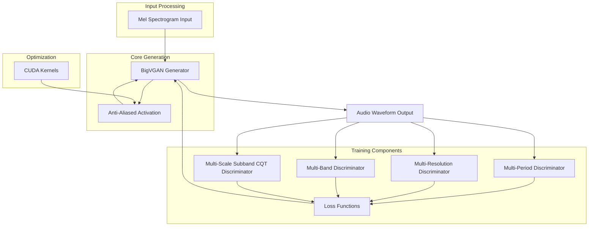
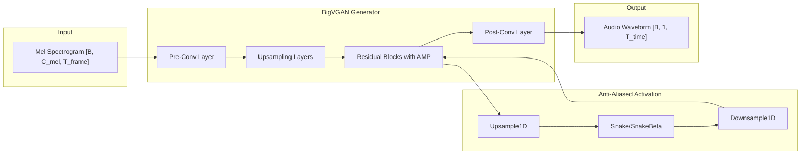

<!-- source: DeepWiki mcp.deepwiki.com · repo NVIDIA/BigVGAN · page 1 Overview · fetched 2026-10-26 -->

# Overview

Relevant source files

The following files were used as context for generating this wiki page:

- [README.md](README.md)

This document provides an introduction to BigVGAN, a universal neural vocoder system developed by NVIDIA for high-fidelity audio synthesis. BigVGAN transforms mel spectrograms into high-quality audio waveforms, with particular emphasis on achieving state-of-the-art quality while maintaining efficient inference capabilities.

For detailed information about architecture specifics, see [Architecture](#2), about usage instructions, see [Usage](#4), and about CUDA optimizations, see [CUDA Optimizations](#5).

## Purpose and Scope

BigVGAN is a GAN-based vocoder designed to generate high-quality audio from mel spectrograms. It can be used across various applications including text-to-speech (TTS) systems, voice conversion, and audio synthesis. The system introduces several innovations over previous neural vocoders:

1. Anti-aliased activations to reduce artifacts
2. Large-scale training methodology to improve generalizability 
3. Optimized CUDA kernels for faster inference
4. Multiple model variants supporting different audio configurations

Sources: [README.md:1-5](), [README.md:210-217]()

## High-Level Architecture

### BigVGAN System Overview

Sources: [README.md:24-27]()

### Audio Processing Pipeline

Sources: [README.md:47-80]()

## Key Components

### 1. BigVGAN Generator

The generator is the core component responsible for transforming mel spectrograms into audio waveforms. It consists of:

- Pre-convolutional layer that processes the input mel spectrogram
- Multiple upsampling layers to increase temporal resolution
- Residual blocks with Anti-aliased Multi-Periodicity (AMP) modules
- Post-convolutional layer to generate the final audio waveform

The generator supports various configurations with different upsampling ratios (256x, 512x) to handle various sampling rates (22kHz, 24kHz, 44kHz).

For more details about the generator architecture, see [BigVGAN Generator](#2.1).

Sources: [README.md:58-61](), [README.md:189-198]()

### 2. Discriminator Architectures

During training, BigVGAN uses multiple discriminators to evaluate different aspects of audio quality:

- **Multi-Period Discriminator (MPD)**: Analyzes periodic patterns in audio
- **Multi-Resolution Discriminator (MRD)**: Evaluates audio quality at different resolutions
- **Multi-Band Discriminator (MBD)**: Focuses on different frequency bands
- **Multi-Scale Subband CQT Discriminator (CQTD)**: Advanced discriminator for improved quality

For more details about discriminator architectures, see [Discriminator Architectures](#2.2).

Sources: [README.md:25](), [README.md:264-266]()

### 3. Anti-Aliased Activation System

A key innovation in BigVGAN is its anti-aliased activation mechanism:

- Combines upsampling, activation function, and downsampling operations
- Uses Snake and SnakeBeta activation functions for improved audio quality
- Implemented in both PyTorch and optimized CUDA versions
- Reduces aliasing artifacts in generated audio

For more details about anti-aliased activations, see [Anti-Aliased Activation](#2.3).

Sources: [README.md:15-17](), [README.md:146-151]()

### 4. Mel Spectrogram Processing

The system includes components for processing audio into mel spectrograms:

- Loads and resamples audio files to the target sampling rate
- Computes Short-Time Fourier Transform (STFT)
- Applies mel filterbanks and dynamic range compression
- Provides utilities for generating and manipulating mel spectrograms

For details about mel spectrogram generation, see [Mel Spectrogram Generation](#3.1).

Sources: [README.md:70-71]()

## Model Variants and Performance

BigVGAN offers multiple pre-trained model variants with different configurations:

| Model Type | Sampling Rate | Mel Bands | Max Freq | Upsampling Ratio | Parameters |
|------------|---------------|-----------|----------|------------------|------------|
| BigVGAN-v2 | 44 kHz        | 128       | 22050 Hz | 512x             | 122M       |
| BigVGAN-v2 | 44 kHz        | 128       | 22050 Hz | 256x             | 112M       |
| BigVGAN-v2 | 24 kHz        | 100       | 12000 Hz | 256x             | 112M       |
| BigVGAN-v2 | 22 kHz        | 80        | 11025 Hz | 256x             | 112M       |
| BigVGAN    | 24 kHz        | 100       | 12000 Hz | 256x             | 112M       |
| BigVGAN base | 24 kHz      | 100       | 12000 Hz | 256x             | 14M        |

The models demonstrate strong performance on objective metrics:

| Model      | PESQ(↑) | M-STFT(↓) | MCD(↓) | Periodicity(↓) | V/UV F1(↑) |
|------------|---------|-----------|--------|----------------|------------|
| BigVGAN-v2 | 4.362   | 0.7026    | 0.2903 | 0.0593         | 0.9793     |
| BigVGAN    | 4.256   | 0.7409    | 0.2988 | 0.0809         | 0.9698     |

Sources: [README.md:189-198](), [README.md:222-227]()

## CUDA Optimizations

BigVGAN includes CUDA-optimized kernels for faster inference:

- Fused upsampling + activation + downsampling kernel for anti-aliased activation
- 1.5-3x speedup on NVIDIA A100 GPUs compared to PyTorch implementation
- Achieves up to 240x real-time factor on A100 GPUs

The table below demonstrates the performance benefits of the CUDA kernel:

| GPU           | Mel Frames | CUDA Kernel | Speed (kHz) | Real-time Factor |
|---------------|------------|-------------|-------------|------------------|
| NVIDIA A100   | 256        | False       | 1672.1      | 69.7x            |
|               |            | True        | 3916.5      | 163.2x           |
| NVIDIA A100   | 16384      | False       | 1973.8      | 82.2x            |
|               |            | True        | 5761.7      | 240.1x           |

Sources: [README.md:24](), [README.md:145-183](), [README.md:231-252]()

## Integration with Hugging Face

BigVGAN can be easily used through Hugging Face Hub integration:

- Pre-trained models are available on Hugging Face
- Simple API for loading models and generating audio
- Interactive demo for testing the models

For more information about using BigVGAN through Hugging Face, see [Inference Guide](#4.2).

Sources: [README.md:21](), [README.md:46-80](), [README.md:186-198]()

---

