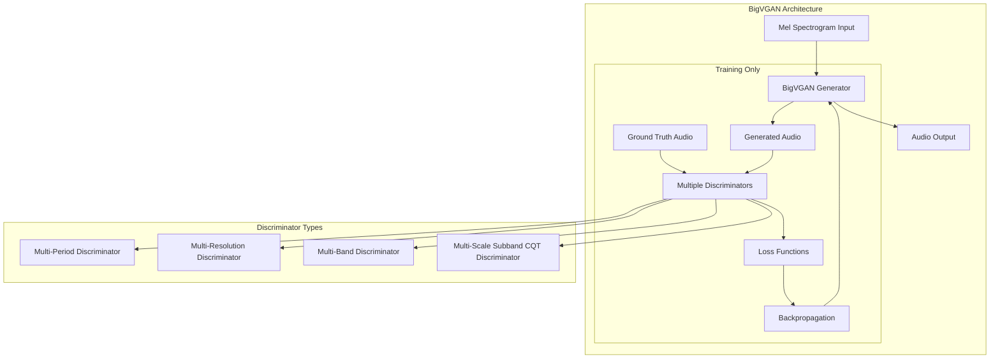
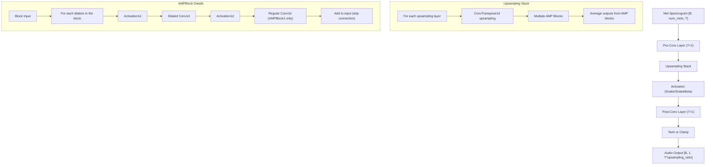
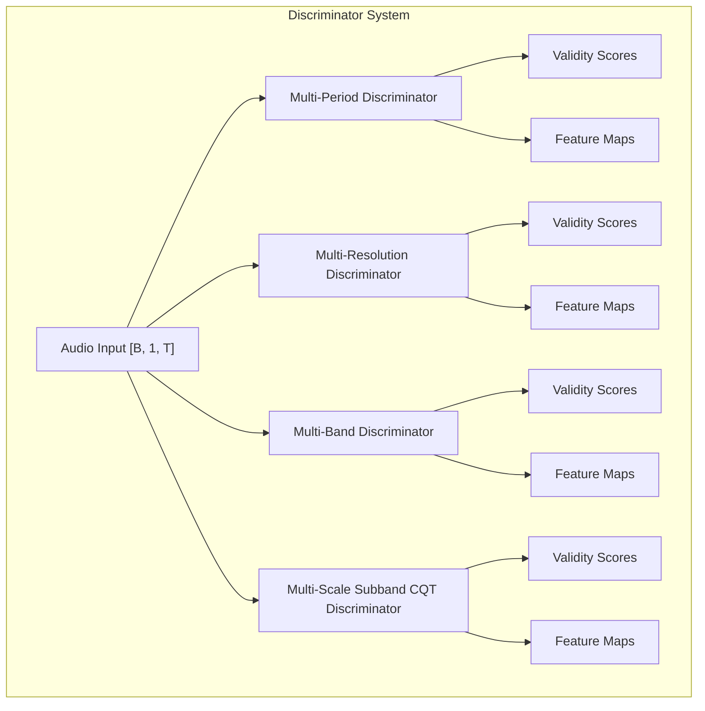
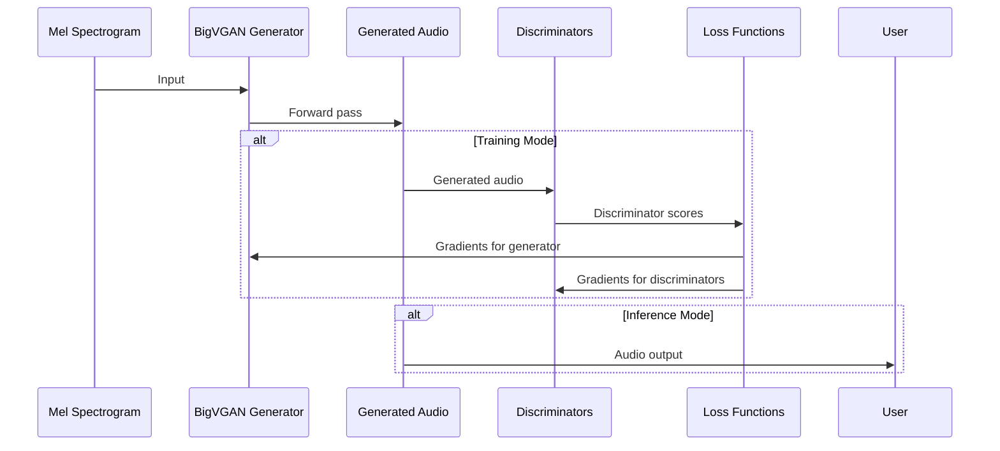

<!-- source: DeepWiki mcp.deepwiki.com · repo NVIDIA/BigVGAN · page 2 Architecture · fetched 2026-10-26 -->

# Architecture

Relevant source files

The following files were used as context for generating this wiki page:

- [README.md](README.md)
- [bigvgan.py](bigvgan.py)
- [discriminators.py](discriminators.py)

This document provides a comprehensive overview of the BigVGAN neural vocoder architecture. BigVGAN is a GAN-based model designed to convert mel spectrograms into high-fidelity audio waveforms. This page covers the key architectural components, their interactions, and the unique features that make BigVGAN effective as a universal neural vocoder.

For details about specific implementation of the generator, see [BigVGAN Generator](#2.1). For anti-aliased activation mechanisms, see [Anti-Aliased Activation](#2.3). For information about training the model, see [Training Guide](#4.1).

## System Overview

BigVGAN follows a generative adversarial network (GAN) architecture with a generator and multiple discriminators. The generator transforms mel spectrograms into raw audio waveforms, while the discriminators evaluate the quality and realism of the generated audio compared to ground truth.

### Core System Architecture

Sources: [bigvgan.py](), [discriminators.py]()

## Generator Architecture

The BigVGAN generator transforms mel spectrograms into audio waveforms through a series of upsampling and residual blocks with anti-aliased activation functions.

Sources: [bigvgan.py:244-388]()

### Key Components

The generator consists of these main components:

1. **Pre-Conv Layer**: 
   - Processes the input mel spectrogram with an initial convolution
   - Implemented in [bigvgan.py:286-288]()

2. **Upsampling Layers**: 
   - A series of transposed convolution layers that progressively increase the temporal resolution
   - Each layer upsamples by a factor defined in the config
   - Implemented in [bigvgan.py:301-317]()

3. **Residual Blocks with AMP**: 
   - AMP (Anti-aliased Multi-Periodicity) blocks using specialized activation functions
   - Two variants exist: `AMPBlock1` and `AMPBlock2`
   - Implemented in [bigvgan.py:31-242]()

4. **Post-Conv Layer**: 
   - Final processing with a Snake/SnakeBeta activation followed by a convolution layer
   - Outputs the waveform, typically with a tanh activation
   - Implemented in [bigvgan.py:345-385]()

### AMPBlock Variants

BigVGAN offers two variants of AMP blocks:

| Feature | AMPBlock1 | AMPBlock2 |
|---------|-----------|-----------|
| Architecture | Two convolution layers per dilation | One convolution layer per dilation |
| Implementation | [bigvgan.py:31-148]() | [bigvgan.py:150-242]() |
| Activation | Anti-aliased Snake/SnakeBeta | Anti-aliased Snake/SnakeBeta |
| Skip connection | Yes | Yes |

Sources: [bigvgan.py:31-242]()

## Discriminator Architecture

BigVGAN employs multiple discriminator architectures to capture different aspects of audio quality:

Sources: [discriminators.py]()

### Multi-Period Discriminator (MPD)

Operates on audio reshaped into 2D patterns with different period values:

- Reshapes waveform using different periods defined in `mpd_reshapes`
- Applies 2D convolutions to each reshaped representation
- Implemented in [discriminators.py:21-140]()

### Multi-Resolution Discriminator (MRD)

Analyzes audio using multiple STFT resolutions:

- Transforms audio into spectrograms using different FFT parameters
- Processes each spectrogram with 2D convolutions
- Implemented in [discriminators.py:143-277]()

### Multi-Band Discriminator (MBD)

Focuses on different frequency bands:

- Splits the spectrogram into multiple frequency bands
- Processes each band with separate convolutional pathways
- Combines features across bands for final discrimination
- Implemented in [discriminators.py:283-403]()

### Multi-Scale Subband CQT Discriminator (CQTD)

Analyzes audio using Constant-Q Transform at multiple scales:

- Applies CQT transform with different hop lengths and bins per octave
- Processes the complex CQT outputs with 2D convolutions
- New in BigVGAN-v2, adapted from Amphion
- Implemented in [discriminators.py:408-619]()

Sources: [discriminators.py](), [README.md:24-25]()

## Data Flow and Processing

The overall data flow in BigVGAN follows this pattern:

During inference, only the generator portion is used, transforming mel spectrograms directly to audio waveforms.

## Technical Implementation Details

### Architecture Hyperparameters

BigVGAN's architecture is controlled by configuration parameters that define its structure:

| Parameter | Description | Example Values |
|-----------|-------------|----------------|
| `upsample_rates` | Upsampling rates for each layer | `[8, 8, 2, 2]` |
| `upsample_kernel_sizes` | Kernel sizes for each upsampling layer | `[16, 16, 4, 4]` |
| `upsample_initial_channel` | Initial number of channels | `512` |
| `resblock_kernel_sizes` | Kernel sizes for residual blocks | `[3, 7, 11]` |
| `resblock_dilation_sizes` | Dilation rates for residual blocks | `[[1,3,5], [1,3,5], [1,3,5]]` |
| `resblock` | Type of residual block to use | `"1"` or `"2"` |
| `activation` | Activation function type | `"snake"` or `"snakebeta"` |

Sources: [README.md:186-201](), [bigvgan.py:267-360]()

### CUDA Optimization

BigVGAN-v2 introduced custom CUDA kernels for accelerated inference:

- Fused upsampling + activation + downsampling operations
- Provides 1.5-3x speedup compared to PyTorch implementation
- Enabled via the `use_cuda_kernel` parameter
- Only used during inference, not training

Sources: [README.md:24-26](), [README.md:144-182]()

## Model Configurations

BigVGAN is available in multiple configurations for different audio quality and computational requirements:

| Model | Sampling Rate | Mel Bands | Max Frequency | Upsampling Ratio | Parameters |
|-------|---------------|-----------|--------------|------------------|------------|
| BigVGAN-v2 (44kHz) | 44 kHz | 128 | 22050 Hz | 512x | 122M |
| BigVGAN-v2 (24kHz) | 24 kHz | 100 | 12000 Hz | 256x | 112M |
| BigVGAN-v2 (22kHz) | 22 kHz | 80 | 11025 Hz | 256x | 112M |
| BigVGAN base | 22-24 kHz | 80-100 | 8000-12000 Hz | 256x | 14M |

Sources: [README.md:186-201]()

## Summary

The BigVGAN architecture combines:

1. A powerful generator with anti-aliased periodicity-based activation functions
2. Multiple complementary discriminators for different audio characteristics
3. Optimized CUDA kernels for efficient inference
4. Flexible configuration options for different audio quality requirements

This architecture enables BigVGAN to serve as a universal neural vocoder for high-quality audio synthesis across a wide range of applications.

Sources: [bigvgan.py](), [discriminators.py](), [README.md]()

---

