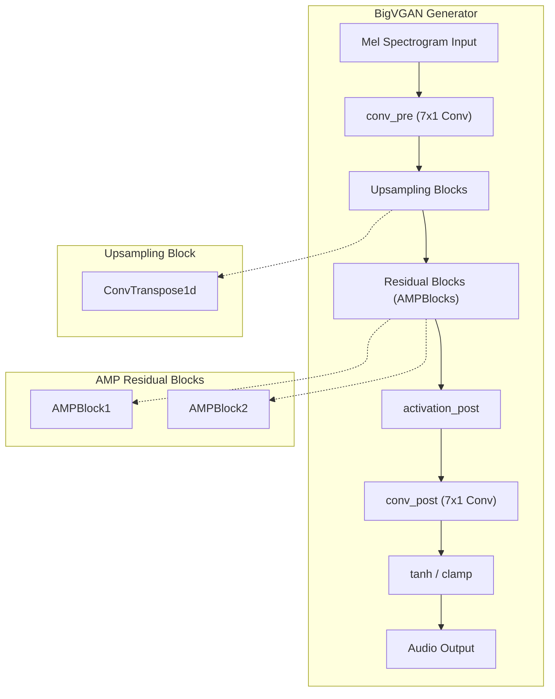
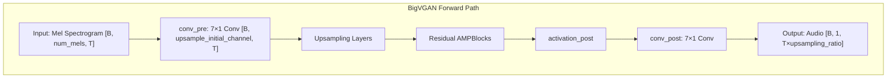
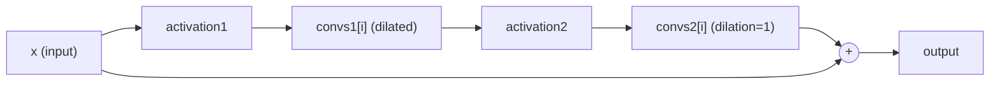
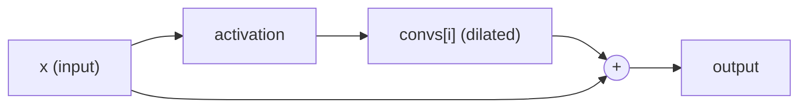
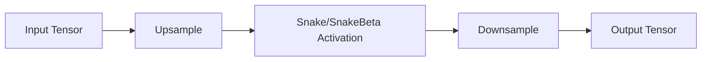

<!-- source: DeepWiki mcp.deepwiki.com · repo NVIDIA/BigVGAN · page 2.1 BigVGAN Generator · fetched 2026-10-26 -->

# BigVGAN Generator

<details>
<summary>Relevant source files</summary>

The following files were used as context for generating this wiki page:

- [README.md](README.md)
- [bigvgan.py](bigvgan.py)

</details>


## Purpose and Scope

The BigVGAN Generator is the core component of the BigVGAN neural vocoder system that transforms mel spectrograms into high-fidelity audio waveforms. It features anti-aliased periodic activations for residual blocks to reduce aliasing artifacts and improve audio quality. This document covers the architecture, components, and data flow of the generator model specifically. For information about the discriminator architectures used during training, see [Discriminator Architectures](#2.2). For details on the anti-aliased activation system, see [Anti-Aliased Activation](#2.3).

Sources: [README.md:1-28](), [bigvgan.py:254-257]()

## Architecture Overview

The BigVGAN Generator follows a convolutional architecture with upsampling layers and residual blocks utilizing anti-aliased activations. Below is a diagram of its overall structure:



Sources: [bigvgan.py:267-387]()

## Core Components

### BigVGAN Class

The `BigVGAN` class is the main generator module that implements the neural vocoder. It has the following key components:

1. **Pre-conv layer**: A 7×1 convolution that processes the input mel spectrogram.
2. **Upsampling layers**: A series of transposed convolutions that progressively increase the temporal resolution.
3. **Residual blocks**: AMP (Anti-aliased Multi-Periodicity) blocks that apply specialized activation functions.
4. **Post-conv layer**: A final 7×1 convolution followed by a tanh activation or clamping operation.



Sources: [bigvgan.py:244-401]()

### Initialization and Key Parameters

The BigVGAN Generator is configured using a set of hyperparameters (`h`) that define its structure:

| Parameter | Description |
|-----------|-------------|
| `num_mels` | Number of mel spectrogram bands in the input |
| `upsample_initial_channel` | Initial number of channels before downsampling |
| `upsample_rates` | List of upsampling rates for each transposed convolution |
| `upsample_kernel_sizes` | Kernel sizes for each transposed convolution |
| `resblock_kernel_sizes` | Kernel sizes for convolutions in residual blocks |
| `resblock_dilation_sizes` | Dilation rates for convolutions in residual blocks |
| `resblock` | Type of residual block to use (`"1"` for AMPBlock1, `"2"` for AMPBlock2) |
| `activation` | Activation function to use (`"snake"` or `"snakebeta"`) |
| `snake_logscale` | Whether to use logarithmic scale for activation parameters |
| `use_cuda_kernel` | Whether to use optimized CUDA kernels for activation (inference only) |

Sources: [bigvgan.py:267-282](), [bigvgan.py:404-493]()

### AMPBlocks (Anti-aliased Multi-Periodicity Blocks)

AMPBlocks are specialized residual blocks that incorporate anti-aliased activation functions to reduce aliasing artifacts. The BigVGAN Generator supports two types of AMPBlocks:

#### AMPBlock1

`AMPBlock1` contains two sets of convolution layers:
- `convs1`: Convolutions with specified dilations
- `convs2`: Additional convolutions with fixed dilation=1

Each convolution is preceded by an anti-aliased activation function. This configuration provides additional processing capacity.



Sources: [bigvgan.py:31-148]()

#### AMPBlock2

`AMPBlock2` is a simpler version with only one set of convolution layers:
- `convs`: Convolutions with specified dilations

Like AMPBlock1, each convolution is preceded by an anti-aliased activation function.



Sources: [bigvgan.py:150-241]()

### Activation Functions

BigVGAN uses specialized periodic activation functions that are anti-aliased to improve audio quality:

1. **Snake**: A periodic activation function with trainable parameters that control periodicity.
2. **SnakeBeta**: An enhanced version of Snake that provides better convergence properties.

Both activation functions are implemented using the `Activation1d` module, which applies anti-aliasing through upsampling, activation, and downsampling steps.



Sources: [bigvgan.py:104-126](), [bigvgan.py:204-231](), [bigvgan.py:332-345]()

## Data Flow

The complete data flow through the BigVGAN Generator is shown below:

```mermaid
flowchart TD
    subgraph "Data Flow Through BigVGAN Generator"
        input["Input: Mel Spectrogram [B, num_mels, T_frames]"]
        
        subgraph "Initial Processing"
            conv_pre["conv_pre: 7×1 Conv"]
        end
        
        subgraph "Upsampling Stage"
            for_ups["For each upsampling layer (i)"]
            trans_conv["TransposedConv1d (ups[i])"]
        end
        
        subgraph "Residual Processing"
            for_res["For each kernel (j)"]
            res_block["AMPBlock (resblocks[i*num_kernels+j])"]
            avg["Average contributions (xs / num_kernels)"]
        end
        
        subgraph "Final Processing"
            act_post["activation_post"]
            conv_post["conv_post: 7×1 Conv"]
            tanh["tanh/clamp to [-1,1]"]
        end
        
        output["Output: Audio Waveform [B, 1, T_samples]"]
        
        input --> conv_pre
        conv_pre --> for_ups
        for_ups --> trans_conv
        trans_conv --> for_res
        for_res --> res_block
        res_block --> avg
        avg --> |"Next upsampling layer\nor final processing"| act_post
        act_post --> conv_post
        conv_post --> tanh
        tanh --> output
    end
```



Sources: [bigvgan.py:361-387]()

## CUDA Optimization

The BigVGAN Generator supports optimized CUDA kernels for the anti-aliased activation functions, which can significantly accelerate inference speed (1.5-3x faster). This optimization is available through the `use_cuda_kernel` parameter.

The CUDA implementation replaces the PyTorch implementation of `Activation1d` with an optimized CUDA kernel that fuses the upsampling, activation, and downsampling operations into a single operation.

| Implementation | Speed on A100 GPU (16384 frames) | VRAM Usage |
|----------------|----------------------------------|------------|
| PyTorch        | 1973.8 kHz (82.2x real-time)     | 5.0 GB     |
| CUDA Kernel    | 5761.7 kHz (240.1x real-time)    | 4.4 GB     |

Sources: [README.md:144-252](), [bigvgan.py:95-102](), [bigvgan.py:195-202]()

## Generator Initialization and Usage

Below is the typical usage pattern for initializing and using the BigVGAN Generator:

1. **Creation and initialization**:
```python
# Load hyperparameters from config file
h = load_hparams_from_json('config.json')
# Create generator (with optional CUDA optimization)
generator = BigVGAN(h, use_cuda_kernel=False)
```

2. **Loading pretrained weights**:
```python
# From Hugging Face Hub
model = BigVGAN.from_pretrained('nvidia/bigvgan_v2_24khz_100band_256x')
# Or local checkpoint
checkpoint = torch.load('bigvgan_generator.pt')
model.load_state_dict(checkpoint['generator'])
```

3. **Inference**:
```python
# Remove weight norm for faster inference
model.remove_weight_norm()
model = model.eval().to(device)
# Forward pass
with torch.inference_mode():
    audio = model(mel_spectrogram)
```

Sources: [README.md:47-80](), [bigvgan.py:389-493]()

## Available Configurations

The BigVGAN Generator comes in multiple configurations that vary by sampling rate, mel band count, and upsampling ratio:

| Model | Sampling Rate | Mel Bands | Upsampling Ratio | Parameters |
|-------|---------------|-----------|------------------|------------|
| BigVGAN v2 44kHz | 44 kHz | 128 | 512x | 122M |
| BigVGAN v2 44kHz | 44 kHz | 128 | 256x | 112M |
| BigVGAN v2 24kHz | 24 kHz | 100 | 256x | 112M |
| BigVGAN v2 22kHz | 22 kHz | 80 | 256x | 112M |
| BigVGAN Base | 24/22 kHz | 100/80 | 256x | 14M |

Sources: [README.md:184-200]()

---

