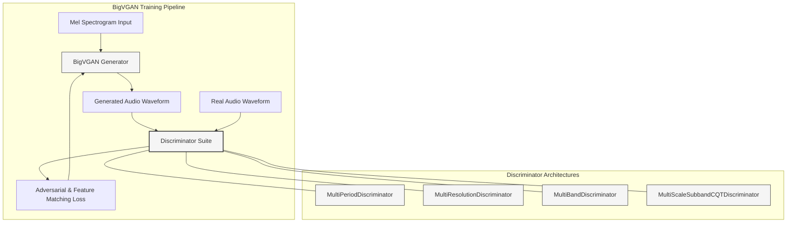
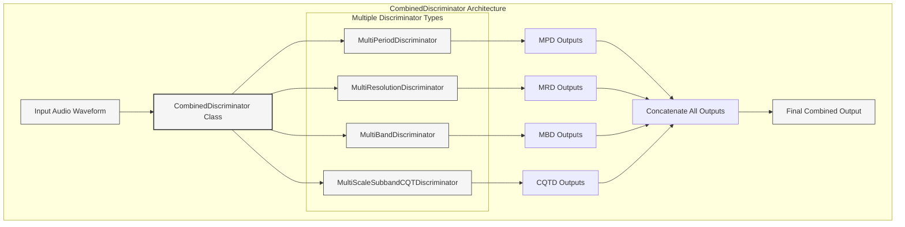

<!-- source: DeepWiki mcp.deepwiki.com · repo NVIDIA/BigVGAN · page 2.2 Discriminator Architectures · fetched 2026-10-26 -->

# Discriminator Architectures

Relevant source files

The following files were used as context for generating this wiki page:

- [README.md](README.md)
- [discriminators.py](discriminators.py)

This page documents the discriminator architectures used in BigVGAN's adversarial training framework. Discriminators are critical components that evaluate audio quality by distinguishing between real and generated audio samples, providing feedback signals that guide the generator's training. For information about the generator architecture, see [BigVGAN Generator](#2.1).

## Overview of Discriminator Role in BigVGAN

BigVGAN implements multiple discriminator architectures, each specializing in different aspects of audio quality assessment. These discriminators work together to provide comprehensive feedback that helps the generator produce high-fidelity audio.

Sources: [discriminators.py:21-652]()

## Multi-Period Discriminator (MPD)

The Multi-Period Discriminator operates directly on raw waveforms and consists of multiple sub-discriminators, each analyzing patterns at different periodic intervals.

```mermaid
graph TD
    subgraph "MultiPeriodDiscriminator Architecture"
        Audio["Input Audio Waveform"]
        MPD["MultiPeriodDiscriminator Class"]
        
        Audio --> MPD
        
        subgraph "Multiple Period Discriminators"
            P1["DiscriminatorP (period=2)"]
            P2["DiscriminatorP (period=3)"]
            P3["DiscriminatorP (period=5)"]
            P4["DiscriminatorP (period=7)"]
            P5["DiscriminatorP (period=11)"]
            
            MPD --> P1
            MPD --> P2
            MPD --> P3
            MPD --> P4
            MPD --> P5
        end
        
        subgraph "For Each DiscriminatorP"
            Reshape["Reshape to 2D (B,C,T/period,period)"]
            Conv1["Conv2D Layer 1 (32*d_mult channels)"]
            Conv2["Conv2D Layer 2 (128*d_mult channels)"]
            Conv3["Conv2D Layer 3 (512*d_mult channels)"]
            Conv4["Conv2D Layer 4 (1024*d_mult channels)"]
            Conv5["Conv2D Layer 5 (1024*d_mult channels)"]
            ConvPost["Conv2D Post (1 channel)"]
            
            P3 --> Reshape
            Reshape --> Conv1
            Conv1 --> Conv2
            Conv2 --> Conv3
            Conv3 --> Conv4
            Conv4 --> Conv5
            Conv5 --> ConvPost
        end
        
        FeatMaps["Feature Maps (for feature matching)"]
        Scores["Discrimination Scores"]
        
        ConvPost --> FeatMaps
        ConvPost --> Scores
    end

    style MPD fill:#f5f5f5,stroke:#333,stroke-width:2px
    style Audio fill:#f5f5f5,stroke:#333,stroke-width:1px
    style FeatMaps fill:#f5f5f5,stroke:#333,stroke-width:1px
    style Scores fill:#f5f5f5,stroke:#333,stroke-width:1px
```

The MPD works by:

1. Taking raw audio waveforms as input
2. Applying multiple discriminators with different period values (reshaping dimensions)
3. Each discriminator performs 2D convolutions on reshaped waveforms
4. Processing through a series of convolutional layers with LeakyReLU activations
5. Collecting feature maps from each layer for feature matching loss
6. Outputting final discrimination scores

The period value determines how the 1D waveform is reshaped into a 2D representation. For example, with a period of 2, a waveform of length 1000 would be reshaped to (500, 2).

Sources: [discriminators.py:21-140]()

## Multi-Resolution Discriminator (MRD)

The Multi-Resolution Discriminator analyzes spectrograms rather than raw waveforms, capturing time-frequency characteristics at different resolutions.

```mermaid
graph TD
    subgraph "MultiResolutionDiscriminator Architecture"
        Audio["Input Audio Waveform"]
        MRD["MultiResolutionDiscriminator Class"]
        
        Audio --> MRD
        
        subgraph "Multiple Resolution Discriminators"
            R1["DiscriminatorR (FFT size 1024)"]
            R2["DiscriminatorR (FFT size 2048)"]
            R3["DiscriminatorR (FFT size 512)"]
            
            MRD --> R1
            MRD --> R2
            MRD --> R3
        end
        
        subgraph "For Each DiscriminatorR"
            STFT["STFT Transform"]
            MagSpec["Magnitude Spectrogram"]
            Conv1["Conv2D Layer 1 (32*d_mult channels)"]
            Conv2["Conv2D Layer 2 (32*d_mult channels)"]
            Conv3["Conv2D Layer 3 (32*d_mult channels)"]
            Conv4["Conv2D Layer 4 (32*d_mult channels)"]
            Conv5["Conv2D Layer 5 (32*d_mult channels)"]
            ConvPost["Conv2D Post (1 channel)"]
            
            R1 --> STFT
            STFT --> MagSpec
            MagSpec --> Conv1
            Conv1 --> Conv2
            Conv2 --> Conv3
            Conv3 --> Conv4
            Conv4 --> Conv5
            Conv5 --> ConvPost
        end
        
        FeatMaps["Feature Maps (for feature matching)"]
        Scores["Discrimination Scores"]
        
        ConvPost --> FeatMaps
        ConvPost --> Scores
    end

    style MRD fill:#f5f5f5,stroke:#333,stroke-width:2px
    style Audio fill:#f5f5f5,stroke:#333,stroke-width:1px
    style MagSpec fill:#f5f5f5,stroke:#333,stroke-width:1px
    style FeatMaps fill:#f5f5f5,stroke:#333,stroke-width:1px
    style Scores fill:#f5f5f5,stroke:#333,stroke-width:1px
```

The MRD works by:

1. Taking raw audio waveforms as input
2. Applying multiple discriminators with different STFT parameters
3. Each discriminator computes a magnitude spectrogram using STFT
4. Processing through a series of 2D convolutional layers with LeakyReLU activations
5. Collecting feature maps from each layer for feature matching loss
6. Outputting final discrimination scores

Different FFT sizes allow the discriminator to analyze audio at different time-frequency trade-offs, capturing both fine temporal details and precise frequency information.

Sources: [discriminators.py:143-277]()

## Multi-Band Discriminator (MBD)

The Multi-Band Discriminator divides the audio spectrum into multiple frequency bands and analyzes each band separately, allowing specialized focus on different frequency regions.

```mermaid
graph TD
    subgraph "MultiBandDiscriminator Architecture"
        Audio["Input Audio Waveform"]
        MBD["MultiBandDiscriminator Class"]
        
        Audio --> MBD
        
        subgraph "Multiple Scales"
            B1["DiscriminatorB (window=2048)"]
            B2["DiscriminatorB (window=1024)"]
            B3["DiscriminatorB (window=512)"]
            
            MBD --> B1
            MBD --> B2
            MBD --> B3
        end
        
        subgraph "For Each DiscriminatorB"
            Spectrogram["Compute Spectrogram"]
            
            subgraph "Frequency Bands"
                Band1["Band1 (0.0-0.1)"]
                Band2["Band2 (0.1-0.25)"]
                Band3["Band3 (0.25-0.5)"]
                Band4["Band4 (0.5-0.75)"]
                Band5["Band5 (0.75-1.0)"]
            end
            
            B1 --> Spectrogram
            Spectrogram --> Band1
            Spectrogram --> Band2
            Spectrogram --> Band3
            Spectrogram --> Band4
            Spectrogram --> Band5
            
            subgraph "For Each Band"
                Conv1["Conv2D Layer 1"]
                Conv2["Conv2D Layer 2"]
                Conv3["Conv2D Layer 3"]
                Conv4["Conv2D Layer 4"]
                Conv5["Conv2D Layer 5"]
            end
            
            Band1 --> Conv1
            Band2 --> Conv1
            Band3 --> Conv1
            Band4 --> Conv1
            Band5 --> Conv1
            
            Conv1 --> Conv2
            Conv2 --> Conv3
            Conv3 --> Conv4
            Conv4 --> Conv5
            
            Combine["Concatenate Band Features"]
            ConvPost["Conv2D Post (1 channel)"]
            
            Conv5 --> Combine
            Combine --> ConvPost
        end
        
        FeatMaps["Feature Maps (for feature matching)"]
        Scores["Discrimination Scores"]
        
        ConvPost --> FeatMaps
        ConvPost --> Scores
    end

    style MBD fill:#f5f5f5,stroke:#333,stroke-width:2px
    style Audio fill:#f5f5f5,stroke:#333,stroke-width:1px
    style FeatMaps fill:#f5f5f5,stroke:#333,stroke-width:1px
    style Scores fill:#f5f5f5,stroke:#333,stroke-width:1px
```

The MBD works by:

1. Taking raw audio waveforms as input
2. Computing spectrograms at multiple resolutions (window sizes)
3. For each spectrogram, dividing the frequency range into multiple bands
4. Processing each band through the same convolutional architecture
5. Combining features from all bands and applying a final convolution
6. Collecting feature maps for feature matching loss
7. Outputting final discrimination scores

This architecture allows the discriminator to focus on specific frequency ranges, which is particularly useful for detecting artifacts in different parts of the spectrum.

Sources: [discriminators.py:280-403]()

## Multi-Scale Subband CQT Discriminator (CQTD)

The Multi-Scale Subband CQT Discriminator uses the Constant-Q Transform (CQT), which has a logarithmic frequency scale similar to human auditory perception, making it particularly well-suited for audio quality assessment.

```mermaid
graph TD
    subgraph "MultiScaleSubbandCQTDiscriminator Architecture"
        Audio["Input Audio Waveform"]
        CQTD["MultiScaleSubbandCQTDiscriminator Class"]
        
        Audio --> CQTD
        
        subgraph "Multiple CQT Scales"
            C1["DiscriminatorCQT (hop=512, bins=24)"]
            C2["DiscriminatorCQT (hop=256, bins=36)"]
            C3["DiscriminatorCQT (hop=256, bins=48)"]
            
            CQTD --> C1
            CQTD --> C2
            CQTD --> C3
        end
        
        subgraph "For Each DiscriminatorCQT"
            Resample["Resample to 2x sampling rate"]
            CQT["CQT Transform"]
            SplitComp["Split into Amplitude and Phase"]
            
            subgraph "Octave Processing"
                Oct1["Octave 1 Processing"]
                Oct2["Octave 2 Processing"]
                OctN["Octave N Processing"]
                CombineOct["Combine Octaves"]
            end
            
            C1 --> Resample
            Resample --> CQT
            CQT --> SplitComp
            SplitComp --> Oct1
            SplitComp --> Oct2
            SplitComp --> OctN
            Oct1 --> CombineOct
            Oct2 --> CombineOct
            OctN --> CombineOct
            
            Conv1["Conv2D Layer 1"]
            Conv2["Conv2D Layer with Dilation=1"]
            Conv3["Conv2D Layer with Dilation=2"]
            Conv4["Conv2D Layer with Dilation=4"]
            Conv5["Conv2D Final Layer"]
            ConvPost["Conv2D Post (1 channel)"]
            
            CombineOct --> Conv1
            Conv1 --> Conv2
            Conv2 --> Conv3
            Conv3 --> Conv4
            Conv4 --> Conv5
            Conv5 --> ConvPost
        end
        
        FeatMaps["Feature Maps (for feature matching)"]
        Scores["Discrimination Scores"]
        
        ConvPost --> FeatMaps
        ConvPost --> Scores
    end

    style CQTD fill:#f5f5f5,stroke:#333,stroke-width:2px
    style Audio fill:#f5f5f5,stroke:#333,stroke-width:1px
    style CQT fill:#f5f5f5,stroke:#333,stroke-width:1px
    style FeatMaps fill:#f5f5f5,stroke:#333,stroke-width:1px
    style Scores fill:#f5f5f5,stroke:#333,stroke-width:1px
```

The CQTD works by:

1. Taking raw audio waveforms as input
2. Resampling the audio to twice the sampling rate (for higher frequency resolution)
3. Computing CQT transforms with different hop lengths and bins per octave
4. Splitting the complex CQT output into amplitude and phase components
5. Processing each octave separately with initial convolutions
6. Combining octave outputs and applying a series of dilated convolutions
7. Collecting feature maps for feature matching loss
8. Outputting final discrimination scores

The CQT's logarithmic frequency scale provides better resolution in lower frequencies (where human hearing is more sensitive) while maintaining reasonable computational requirements at higher frequencies.

Sources: [discriminators.py:406-618]()

## Combined Discriminator

BigVGAN can combine multiple discriminator architectures into a single discriminator chain, allowing it to leverage the strengths of each architecture.

The CombinedDiscriminator works by:

1. Taking raw audio waveforms as input
2. Passing the input through multiple discriminator architectures
3. Collecting the outputs (scores and feature maps) from each discriminator
4. Concatenating the outputs to form a comprehensive evaluation
5. The combined outputs are used for adversarial and feature matching losses

This approach provides a more robust evaluation of audio quality by leveraging different analysis methods, each with its own strengths in detecting specific types of artifacts.

Sources: [discriminators.py:622-651]()

## Discriminator Configuration Parameters

BigVGAN provides configuration options for each discriminator architecture through the configuration file. Below are the key parameters for each discriminator type:

| Discriminator | Parameter | Description | Default/Example |
|---------------|-----------|-------------|----------------|
| MPD | `mpd_reshapes` | List of period values | `[2, 3, 5, 7, 11]` |
| MPD | `discriminator_channel_mult` | Channel multiplier for network width | `1` |
| MPD | `use_spectral_norm` | Whether to use spectral normalization | `false` |
| MRD | `resolutions` | List of STFT parameters (n_fft, hop_length, win_length) | `[[1024, 120, 600], [2048, 240, 1200], [512, 50, 240]]` |
| MRD | `mrd_use_spectral_norm` | Whether to use spectral normalization for MRD | `false` |
| MRD | `mrd_channel_mult` | Channel multiplier specific to MRD | `1` |
| MBD | `mbd_fft_sizes` | List of FFT sizes for multi-band discriminator | `[2048, 1024, 512]` |
| CQTD | `cqtd_filters` | Initial number of filters | `32` |
| CQTD | `cqtd_max_filters` | Maximum number of filters | `1024` |
| CQTD | `cqtd_filters_scale` | Scale factor for filters | `1` |
| CQTD | `cqtd_dilations` | Dilation rates for convolutions | `[1, 2, 4]` |
| CQTD | `cqtd_hop_lengths` | Hop lengths for CQT transforms | `[512, 256, 256]` |
| CQTD | `cqtd_n_octaves` | Number of octaves for CQT | `[9, 9, 9]` |
| CQTD | `cqtd_bins_per_octaves` | Bins per octave for CQT | `[24, 36, 48]` |
| CQTD | `cqtd_normalize_volume` | Whether to normalize volume in CQTD | `false` |

Sources: [discriminators.py:21-652](), [README.md:24-27]()

## Evolution in BigVGAN-v2

In BigVGAN-v2, the discriminator architecture was improved by incorporating the multi-scale subband CQT discriminator, which has shown better performance for audio quality assessment. As noted in the README:

> "Improved discriminator and loss: BigVGAN-v2 is trained using a [multi-scale sub-band CQT discriminator](https://arxiv.org/abs/2311.14957) and a [multi-scale mel spectrogram loss](https://arxiv.org/abs/2306.06546)."

This addition helps the generator produce higher quality audio with fewer artifacts, especially for non-speech audio like environmental sounds and instruments.

Sources: [README.md:24-27]()

---

