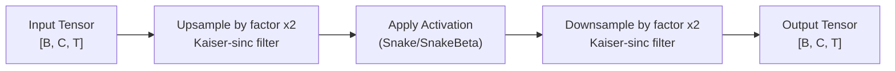
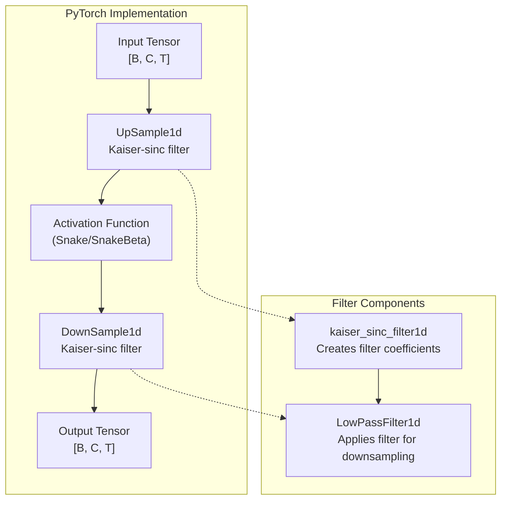
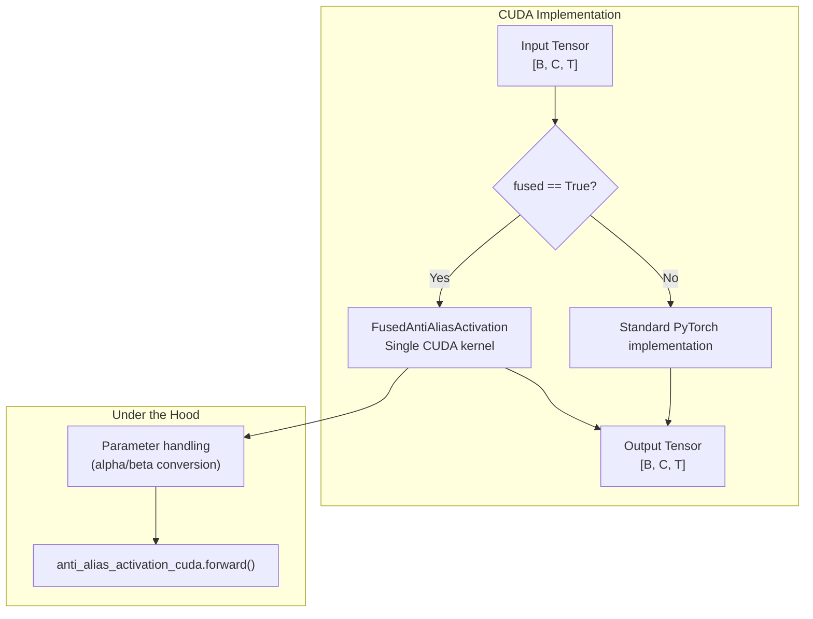
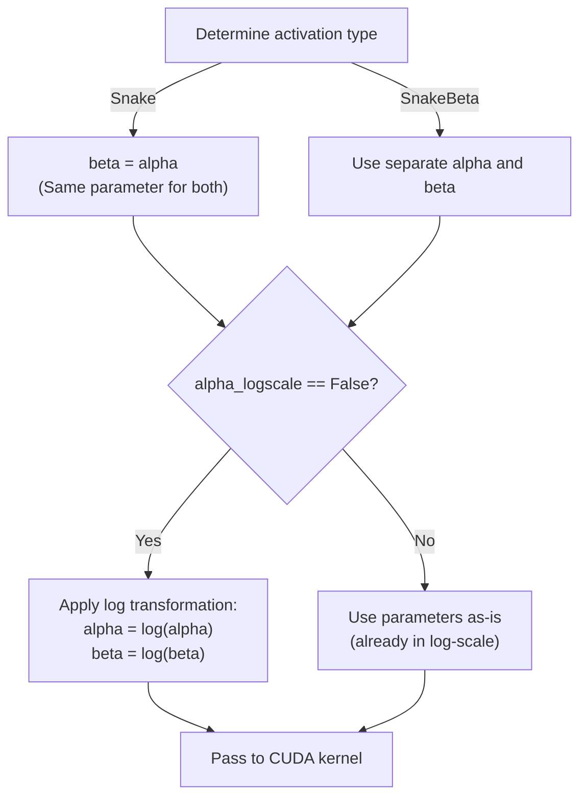
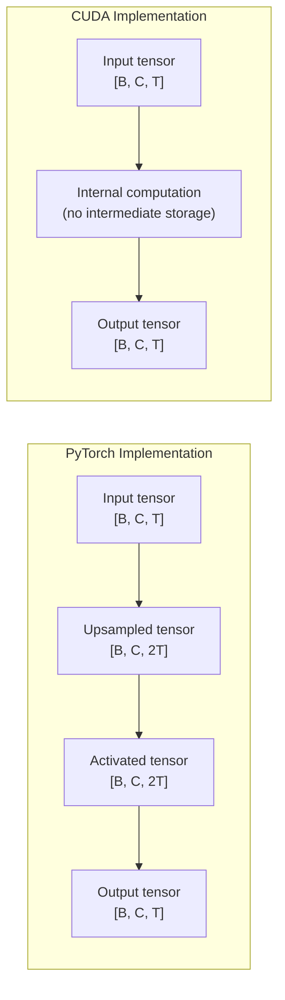
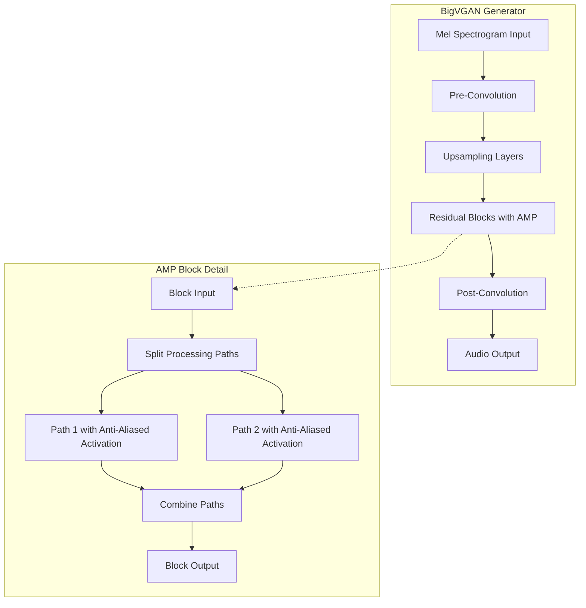

<!-- source: DeepWiki mcp.deepwiki.com · repo NVIDIA/BigVGAN · page 2.3 Anti-Aliased Activation · fetched 2026-10-26 -->

# Anti-Aliased Activation

<details>
<summary>Relevant source files</summary>

The following files were used as context for generating this wiki page:

- [README.md](README.md)
- [alias_free_activation/cuda/activation1d.py](alias_free_activation/cuda/activation1d.py)
- [alias_free_activation/cuda/compat.h](alias_free_activation/cuda/compat.h)
- [alias_free_activation/cuda/type_shim.h](alias_free_activation/cuda/type_shim.h)
- [alias_free_activation/torch/__init__.py](alias_free_activation/torch/__init__.py)
- [alias_free_activation/torch/act.py](alias_free_activation/torch/act.py)
- [alias_free_activation/torch/filter.py](alias_free_activation/torch/filter.py)
- [alias_free_activation/torch/resample.py](alias_free_activation/torch/resample.py)

</details>


## Purpose

Anti-aliased activation is a critical component in BigVGAN that reduces aliasing artifacts during audio synthesis. Aliasing occurs when high-frequency components in a signal are not properly sampled, leading to distortion in the generated audio. The anti-aliased activation technique minimizes these artifacts by applying activation functions at a higher resolution with proper filtering.

This document explains the implementation and usage of anti-aliased activation in BigVGAN. For information about the overall architecture of BigVGAN, see [Architecture](#2).

Sources: [alias_free_activation/torch/act.py]()(adapter), [README.md:16-17]()

## Concept and Workflow

Anti-aliased activation in BigVGAN follows a three-step process:

1. **Upsampling**: The input tensor is upsampled to a higher resolution using a Kaiser-sinc filter
2. **Activation**: A non-linear activation function (Snake or SnakeBeta) is applied to the upsampled tensor
3. **Downsampling**: The activated tensor is downsampled back to the original resolution using a Kaiser-sinc filter

This approach mitigates aliasing by ensuring the activation function operates on a higher-resolution signal, where high-frequency artifacts can be properly filtered out during downsampling.



Sources: [alias_free_activation/torch/act.py:8-30](), [alias_free_activation/torch/resample.py:10-58]()

## Implementations

BigVGAN provides two implementations of anti-aliased activation:

### PyTorch Implementation

The PyTorch implementation is defined in the `Activation1d` class in `alias_free_activation/torch/act.py` and performs the three steps sequentially:



Key implementation details:
- `UpSample1d` applies a transposed convolution with the Kaiser-sinc filter
- Activation functions preserve the higher temporal resolution
- `DownSample1d` applies a standard convolution with the same filter at the appropriate stride

Sources: [alias_free_activation/torch/act.py:8-30](), [alias_free_activation/torch/resample.py:10-58](), [alias_free_activation/torch/filter.py:30-102]()

### CUDA-Optimized Implementation

The CUDA-optimized implementation, defined in `alias_free_activation/cuda/activation1d.py`, fuses the three operations into a single CUDA kernel for improved performance:



Key implementation details:
- Uses a custom CUDA kernel to perform all three operations in a single GPU call
- Assumes filter size 12, replication padding, and specific parameter formats
- Significantly reduces memory bandwidth usage by eliminating intermediate tensor storage

Sources: [alias_free_activation/cuda/activation1d.py:14-77]()

## Activation Functions

Two main activation functions are used with anti-aliasing in BigVGAN:

### Snake Activation

```
Snake(x) = x + sin²(alpha * x)
```
Where `alpha` is a learnable parameter.

### SnakeBeta Activation

```
SnakeBeta(x) = x + beta * sin²(alpha * x)
```
Where both `alpha` and `beta` are learnable parameters.

Both activations typically use log-scale parameterization in BigVGAN, meaning the parameters are stored in log-space and exponentiated during computation. The CUDA kernel expects log-scale inputs, so a log transformation is applied when needed:



Sources: [alias_free_activation/cuda/activation1d.py:61-76]()

## Technical Implementation Details

### Upsampling Process

The upsampling operation:
1. Pads the input tensor using replication mode
2. Applies a transposed convolution with the Kaiser-sinc filter, with weights scaled by the upsampling ratio
3. Removes padding from the result to maintain the correct output size

The Kaiser-sinc filter is constructed to preserve frequency content below the Nyquist frequency of the target sample rate.

Sources: [alias_free_activation/torch/filter.py:30-62](), [alias_free_activation/torch/resample.py:10-38]()

### Downsampling Process

The downsampling operation:
1. Pads the input tensor using replication mode
2. Applies a convolution with the Kaiser-sinc filter at stride = downsampling ratio
3. Returns the filtered and downsampled result

Sources: [alias_free_activation/torch/filter.py:65-102](), [alias_free_activation/torch/resample.py:41-58]()

### Memory Efficiency of the CUDA Implementation



The CUDA implementation eliminates the need to store large intermediate tensors, resulting in:
- Lower memory usage (especially important for long audio sequences)
- Reduced memory bandwidth requirements
- Fewer kernel launches

Sources: [alias_free_activation/cuda/activation1d.py:14-33](), [README.md:150-163]()

## Integration with BigVGAN Architecture

Anti-aliased activation is a core component in the BigVGAN generator, used within residual blocks containing Anti-aliased Multi-Periodicity (AMP) modules:



The anti-aliased activations help the model handle complex patterns in audio generation while minimizing artifacts, especially at high frequencies.

Sources: [README.md:9-28]()

## Performance Benefits

The CUDA-optimized implementation provides significant performance improvements over the PyTorch implementation:

| GPU | PyTorch Implementation | CUDA Implementation | Speedup | Real-time Factor |
|-----|------------------------|---------------------|---------|-----------------|
| NVIDIA A100 | 1672.1 kHz | 3916.5 kHz | 2.34x | 163.2x |
| NVIDIA RTX 3080 | 841.1 kHz | 1598.1 kHz | 1.90x | 66.6x |
| NVIDIA RTX 2080 Ti | 515.6 kHz | 811.3 kHz | 1.57x | 33.8x |

For longer inputs (16384 frames), the speedup can reach up to 2.92x on an A100 GPU, with reduced VRAM usage compared to the PyTorch implementation.

Sources: [README.md:233-246]()

## Usage

### Using CUDA-Optimized Implementation in BigVGAN

```python
# When initializing a new model
from bigvgan import BigVGAN
model = BigVGAN(h, use_cuda_kernel=True)

# Or when loading a pretrained model
model = BigVGAN.from_pretrained('nvidia/bigvgan_v2_24khz_100band_256x', use_cuda_kernel=True)
```

### Using in Inference Scripts

You can enable the CUDA kernel when running inference:

```bash
python inference.py --checkpoint_file /path/to/model.pt --input_wavs_dir /input/dir --output_dir /output/dir --use_cuda_kernel
```

### Testing CUDA Kernel Correctness

Before using the CUDA-optimized implementation in production, you can verify its correctness:

```bash
python tests/test_cuda_vs_torch_model.py --checkpoint_file /path/to/model.pt
```

A successful test will output: `[Success] test CUDA fused vs. plain torch BigVGAN inference`

Sources: [README.md:156-181]()

## Conclusion

Anti-aliased activation is a crucial component of BigVGAN that significantly improves audio quality by reducing aliasing artifacts. The CUDA-optimized implementation provides substantial performance benefits without compromising quality, making it suitable for real-time applications.

By properly handling high-frequency components through this upsampling-activation-downsampling process, BigVGAN produces cleaner, more natural-sounding audio with fewer artifacts, contributing to its state-of-the-art performance in neural vocoding tasks.

Sources: [README.md:9-28](), [alias_free_activation/cuda/activation1d.py:14-19]()

---

