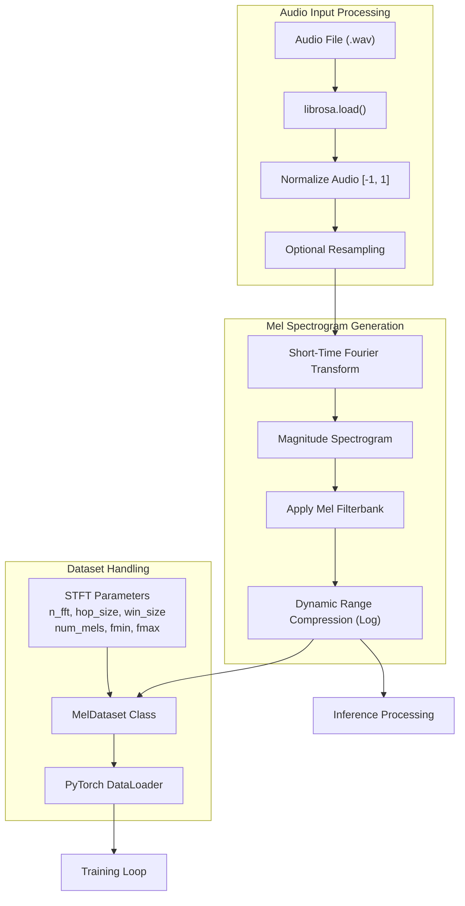
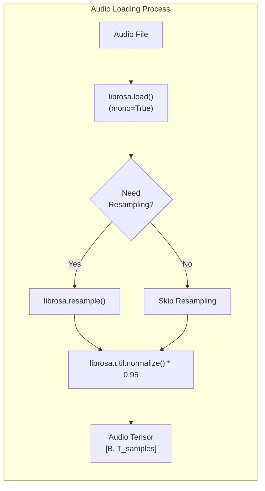
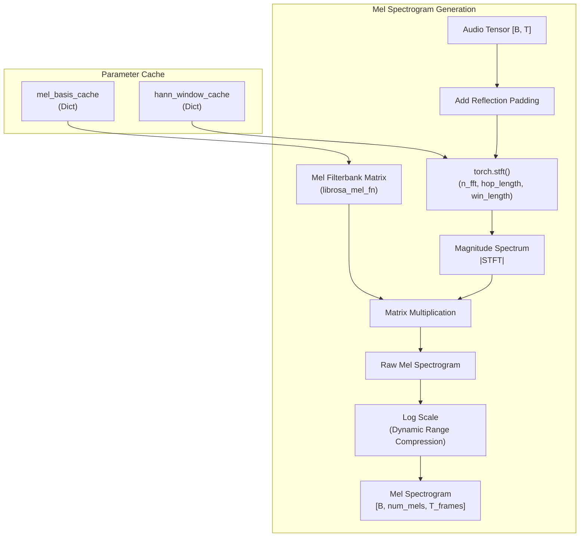
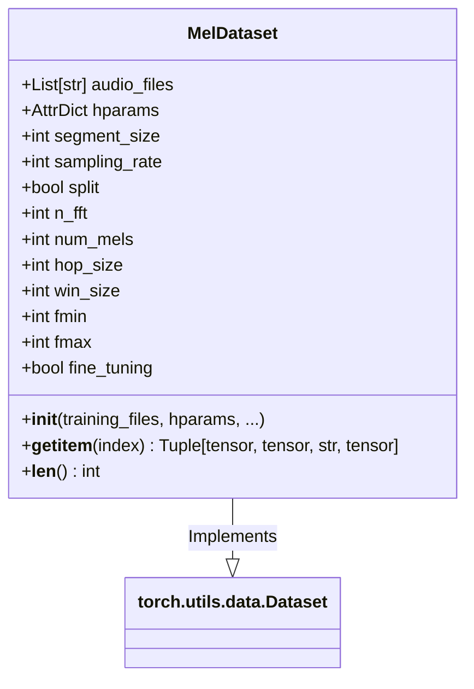
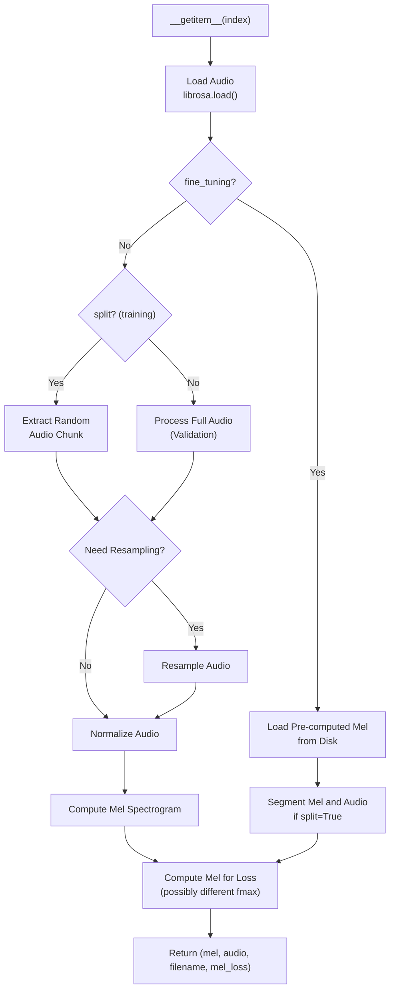
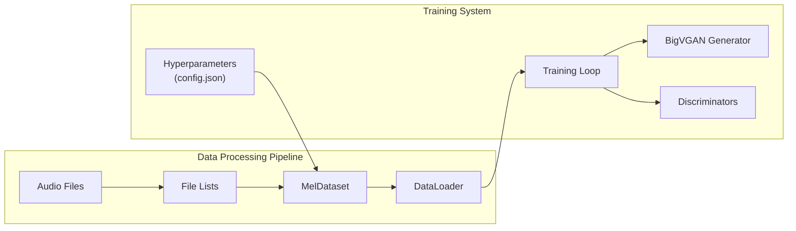

<!-- source: DeepWiki mcp.deepwiki.com · repo NVIDIA/BigVGAN · page 3 Data Processing · fetched 2026-10-26 -->

# Data Processing

<details>
<summary>Relevant source files</summary>

The following files were used as context for generating this wiki page:

- [README.md](README.md)
- [meldataset.py](meldataset.py)

</details>


This page documents the data processing pipeline in BigVGAN, focusing on how audio data is loaded, preprocessed, and converted into mel spectrograms for neural vocoder training and inference. For information about model architecture, see [Architecture](#2).

## Overview

BigVGAN's data processing pipeline handles audio files from various sources, applying normalization, resampling, and mel spectrogram extraction to prepare inputs for the generator. The process ensures consistent representation regardless of the source audio characteristics.



Sources: [meldataset.py:1-397]()

## Audio Loading and Normalization

Audio is loaded using `librosa.load()`, which converts files to mono and normalizes amplitude values to the range [-1, 1]. For training, the audio is further normalized with `librosa.util.normalize` and scaled by 0.95 to prevent clipping.

Key processing steps:
- Audio loading with automatic conversion to mono
- Volume normalization
- Optional resampling when source sampling rate differs
- Segment extraction for training (random chunks) or validation (full audio)



Sources: [meldataset.py:237-303]()

## Mel Spectrogram Generation

The conversion from raw audio to mel spectrograms involves multiple steps, implemented in the `mel_spectrogram()` function:

1. Padding the audio signal
2. Computing the Short-Time Fourier Transform (STFT)
3. Converting to magnitude spectrum
4. Applying mel filterbank
5. Dynamic range compression (log scaling)

The process uses caching for both mel basis and Hann windows to improve efficiency during training.



Sources: [meldataset.py:51-120](), [meldataset.py:123-143]()

## Dynamic Range Compression

The mel spectrogram undergoes dynamic range compression to emphasize quieter components:

```python
def dynamic_range_compression(x, C=1, clip_val=1e-5):
    return np.log(np.clip(x, a_min=clip_val, a_max=None) * C)
```

This creates a more balanced representation by applying logarithmic scaling to the spectrogram values. The process has both numpy and PyTorch implementations for different contexts.

| Function | Input | Implementation | Description |
|----------|-------|----------------|-------------|
| `dynamic_range_compression` | NumPy array | NumPy | Log scaling with clipping |
| `dynamic_range_compression_torch` | PyTorch tensor | PyTorch | Log scaling with clipping |
| `dynamic_range_decompression` | NumPy array | NumPy | Inverse operation (exp) |
| `dynamic_range_decompression_torch` | PyTorch tensor | PyTorch | Inverse operation (exp) |

Sources: [meldataset.py:23-44]()

## MelDataset Class

The `MelDataset` class handles loading and processing of audio files for training and validation. It implements the PyTorch `Dataset` interface and processes audio on-the-fly.

Key features:
- Flexible handling of training and validation data
- Support for random segmentation during training
- On-the-fly resampling for mixed sample rate datasets
- Automatic audio normalization
- Pre-computed mel spectrogram support for fine-tuning



Sources: [meldataset.py:182-396]()

## Dataset Loading Logic

The dataset loading logic handles two main paths:

1. **Standard Training Mode**:
   - Random audio chunk extraction for training
   - Full audio processing for validation
   - On-the-fly mel spectrogram computation

2. **Fine-tuning Mode**:
   - Pre-computed mel spectrograms
   - Strict sample rate requirements
   - Synchronized mel-audio segment extraction



Sources: [meldataset.py:234-394]()

## Dataset File Management

BigVGAN uses text files listing the audio paths for training and validation. The `get_dataset_filelist` function parses these files to create lists of audio file paths:

```python
def get_dataset_filelist(a):
    training_files = []
    validation_files = []
    list_unseen_validation_files = []
    
    # Load training files
    with open(a.input_training_file, "r", encoding="utf-8") as fi:
        training_files = [
            os.path.join(a.input_wavs_dir, x.split("|")[0] + ".wav")
            for x in fi.read().split("\n")
            if len(x) > 0
        ]
        
    # ... (similar for validation and unseen validation)
    
    return training_files, validation_files, list_unseen_validation_files
```

The file lists follow a specific format where each line contains at least a file identifier that will be combined with `.wav` to form the complete path.

Sources: [meldataset.py:146-179]()

## Convenience Functions

BigVGAN provides several convenience functions for working with mel spectrograms:

1. `get_mel_spectrogram(wav, h)` - A wrapper around `mel_spectrogram()` that takes hyperparameters from a config object
2. `spectral_normalize_torch(magnitudes)` - Wrapper for dynamic range compression
3. `spectral_de_normalize_torch(magnitudes)` - Wrapper for dynamic range decompression

These functions simplify common operations throughout the codebase.

Sources: [meldataset.py:123-143](), [meldataset.py:39-44]()

## Integration with Training Pipeline

The data processing pipeline integrates with the training loop by providing processed data through the PyTorch DataLoader:



Sources: [README.md:109-118](), [meldataset.py:182-396]()

## Inference Support

For inference, the data processing pipeline handles:
1. Loading existing audio files
2. Converting them to mel spectrograms
3. Providing the mel spectrograms to the generator model

BigVGAN supports two inference modes:
- `inference.py`: Computes mel spectrograms from audio files before generation
- `inference_e2e.py`: Loads pre-computed mel spectrograms directly

Sources: [README.md:125-142]()

---

