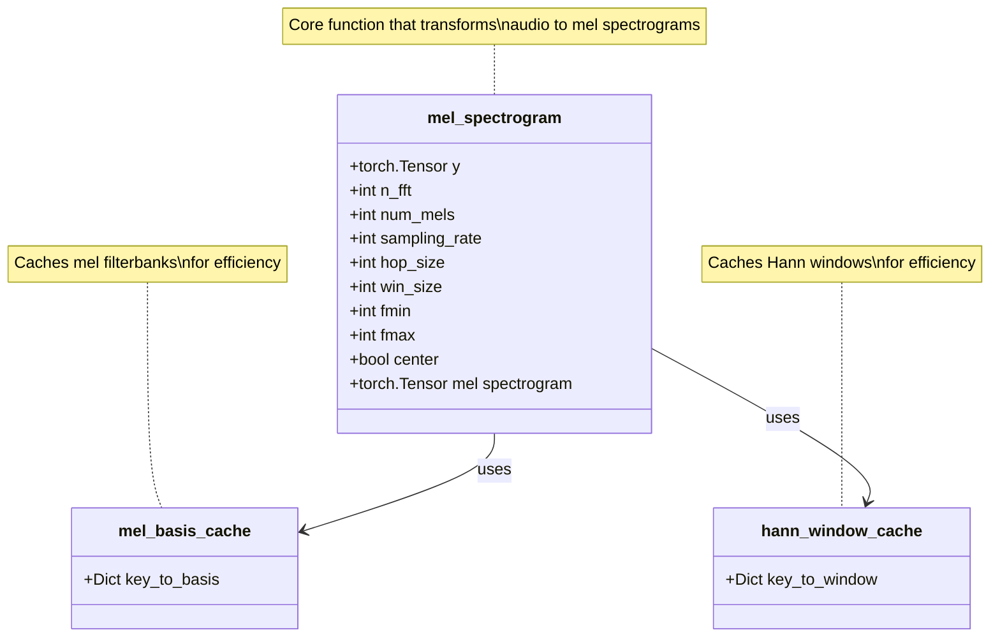
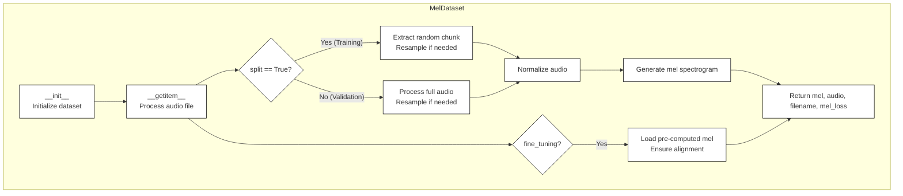
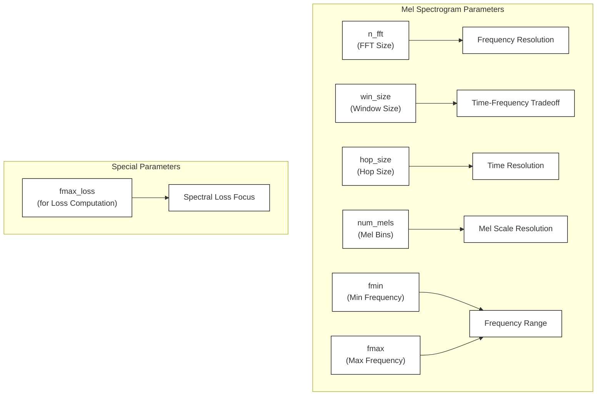

<!-- source: DeepWiki mcp.deepwiki.com · repo NVIDIA/BigVGAN · page 3.1 Mel Spectrogram Generation · fetched 2026-10-26 -->

# Mel Spectrogram Generation

Relevant source files

The following files were used as context for generating this wiki page:

- [meldataset.py](meldataset.py)

This document explains how the BigVGAN vocoder transforms audio waveforms into mel spectrograms for training and inference. Mel spectrograms serve as the input representation to the BigVGAN generator, which then transforms them back into high-fidelity audio waveforms. For information about how these mel spectrograms are used during training, see [Dataset Handling](#3.2).

## Overview

Mel spectrogram generation is a critical preprocessing step in neural vocoder systems. The process transforms raw audio waveforms into time-frequency representations that better align with human auditory perception through the mel scale.

Sources: [meldataset.py:51-120]()

## Core Implementation

The `mel_spectrogram` function in BigVGAN provides a complete implementation for converting audio waveforms to mel spectrograms, with caching mechanisms for efficient processing.

Sources: [meldataset.py:51-120]()

### Mel Spectrogram Generation Steps

1. **Input Validation**: The function first checks if the input waveform has values within the expected range [-1.0, 1.0].

2. **Caching Mechanism**: To avoid redundant computations, the function maintains caches for mel filterbanks and Hann windows based on the parameters provided.

3. **Padding**: The waveform is padded using reflection padding to ensure consistent results at the edges.

4. **STFT Computation**: Short-Time Fourier Transform is applied to convert the time-domain signal to a frequency-domain representation.

5. **Mel Filtering**: The magnitude spectrum is transformed to the mel scale using a pre-computed filterbank.

6. **Dynamic Range Compression**: Logarithmic scaling is applied to compress the dynamic range of the spectrogram.

Sources: [meldataset.py:51-120](), [meldataset.py:23-44]()

### Key Parameters

| Parameter | Description | Typical Value |
|-----------|-------------|---------------|
| `n_fft` | FFT size for spectral analysis | 1024 |
| `num_mels` | Number of mel bins | 80 |
| `sampling_rate` | Audio sampling rate in Hz | 24000 |
| `hop_size` | Step size between STFT windows | 256 |
| `win_size` | STFT window size | 1024 |
| `fmin` | Minimum frequency for mel filterbank | 0 |
| `fmax` | Maximum frequency for mel filterbank | 12000 |

Sources: [meldataset.py:51-120]()

## MelDataset Implementation

The `MelDataset` class manages audio data loading and mel spectrogram generation for both training and inference. It inherits from `torch.utils.data.Dataset` and provides functionality for on-the-fly spectrogram generation.

Sources: [meldataset.py:182-396]()

### Training vs. Validation Mode

In training mode (`split=True`), the dataset:
1. Extracts a random segment from each audio file
2. Resamples the segment if its sampling rate differs from the target
3. Normalizes the audio volume
4. Generates the corresponding mel spectrogram

In validation mode (`split=False`), the dataset:
1. Processes the entire audio file
2. Trims the audio to ensure its length is a multiple of `hop_size`
3. Normalizes the audio volume
4. Generates the corresponding mel spectrogram

Sources: [meldataset.py:246-315]()

### Fine-tuning Support

The `MelDataset` class also supports fine-tuning mode where pre-computed mel spectrograms are loaded instead of being generated on-the-fly:

1. In fine-tuning mode, audio files must already be at the target sampling rate
2. Pre-computed mel spectrograms are loaded from disk
3. For training, random segments of the mel spectrogram and corresponding audio are extracted
4. Padding is applied if necessary to ensure consistent dimensions

Sources: [meldataset.py:318-375]()

## Mel Spectrogram Configurations

The following diagram shows the relationship between key spectrogram parameters and their effect on the mel spectrogram representation:

Sources: [meldataset.py:51-120](), [meldataset.py:182-396]()

### Dynamic Range Compression

BigVGAN applies logarithmic scaling to compress the dynamic range of mel spectrograms, making them more suitable for neural network processing:

Sources: [meldataset.py:23-44](), [meldataset.py:117-118]()

## Caching Mechanisms

To improve computational efficiency, BigVGAN implements caching for frequently used components:

1. **Mel Basis Cache**: Stores precomputed mel filterbanks indexed by their configuration parameters
2. **Hann Window Cache**: Stores Hann windows for STFT computation indexed by configuration

These caches avoid redundant computations when processing multiple audio files with the same configuration.

Sources: [meldataset.py:47-48](), [meldataset.py:86-96]()

## Error Handling

The `MelDataset` class includes robust error handling to ensure training stability:

1. For regular training, if audio loading fails, the dataset will substitute a random sample
2. For fine-tuning mode, errors are raised immediately to ensure dataset integrity
3. Audio files are validated during initialization to ensure they exist

Sources: [meldataset.py:228-232](), [meldataset.py:386-393]()

---

