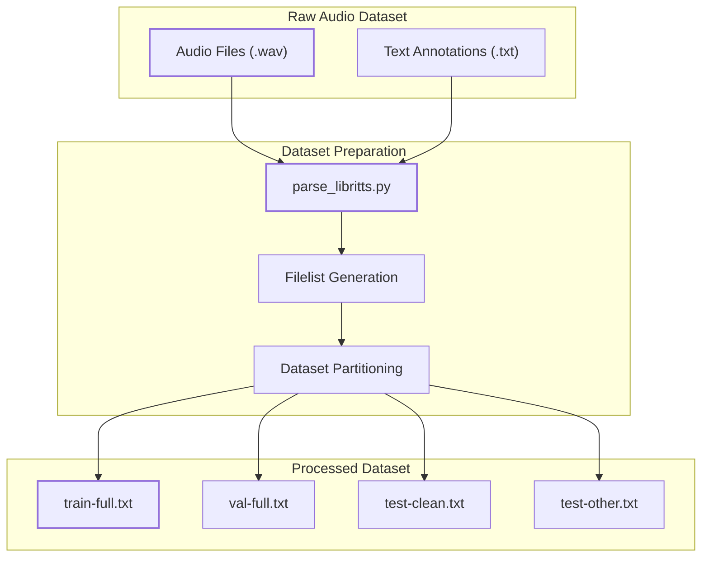
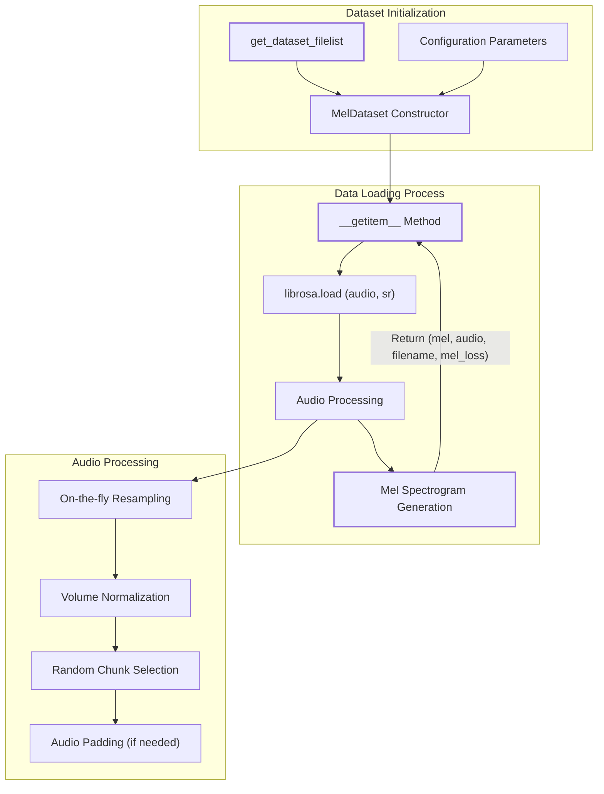
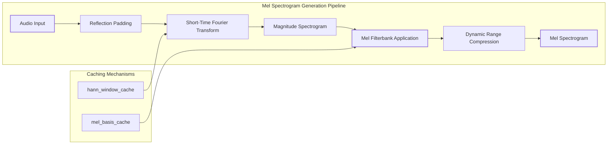
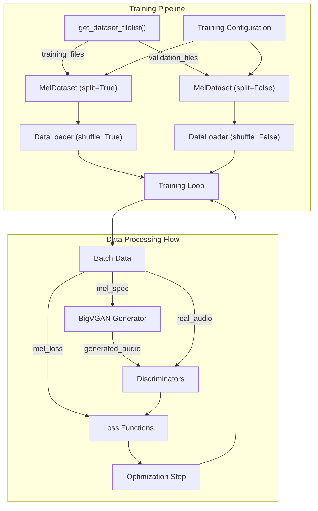

<!-- source: DeepWiki mcp.deepwiki.com · repo NVIDIA/BigVGAN · page 3.2 Dataset Handling · fetched 2026-10-26 -->

# Dataset Handling

<details>
<summary>Relevant source files</summary>

The following files were used as context for generating this wiki page:

- [filelists/LibriTTS/parse_libritts.py](filelists/LibriTTS/parse_libritts.py)
- [filelists/LibriTTS/test-clean.txt](filelists/LibriTTS/test-clean.txt)
- [filelists/LibriTTS/test-other.txt](filelists/LibriTTS/test-other.txt)
- [filelists/LibriTTS/train-full.txt](filelists/LibriTTS/train-full.txt)
- [filelists/LibriTTS/val-full.txt](filelists/LibriTTS/val-full.txt)
- [meldataset.py](meldataset.py)

</details>


This document describes how BigVGAN handles datasets for training and validation, focusing on audio data preparation, processing pipelines, and mel spectrogram generation. For information about mel spectrogram generation details, see [Mel Spectrogram Generation](#3.1).

## Overview

BigVGAN's dataset handling system provides mechanisms for loading audio files, preparing mel spectrograms, and creating optimized data batches for training and validation. The system is designed to handle large audio datasets efficiently, with support for on-the-fly audio resampling, normalization, and segment extraction.

The primary dataset used for training BigVGAN is LibriTTS, a multi-speaker English corpus of audiobook recordings, though the implementation can work with other audio datasets as well.

Sources:
- [meldataset.py:182-196]()
- [filelists/LibriTTS/parse_libritts.py:33-77]()

## Dataset Preparation Pipeline



### LibriTTS Dataset Structure

LibriTTS is organized with the following subsets:
- `train-clean-100` + `train-clean-360` + `train-other-500`: Used for training
- `dev-clean`, `dev-other`, `test-clean`, `test-other`: Used for validation and testing

The audio files are organized hierarchically by speaker ID and chapter ID.

### Filelist Generation

The `parse_libritts.py` script processes the LibriTTS dataset by:
1. Scanning all WAV files in the dataset directories
2. Reading corresponding text annotations from normalized text files
3. Creating file lists that pair audio paths with their transcriptions
4. Splitting the data into training, validation, and test sets

The generated file lists have the format: `path/to/audio|transcription_text`

Sources:
- [filelists/LibriTTS/parse_libritts.py:7-24]()
- [filelists/LibriTTS/parse_libritts.py:27-32]()
- [filelists/LibriTTS/parse_libritts.py:52-75]()

## Dataset Loading and Processing



### The MelDataset Class

The `MelDataset` class serves as the primary interface for loading and processing audio data for BigVGAN. It inherits from `torch.utils.data.Dataset` and implements the standard dataset interface.

#### Initialization

The `MelDataset` initialization accepts parameters controlling:
- Audio file list
- Hyperparameters for preprocessing
- Segment size for training chunks
- Sampling rate and resampling options
- Mel spectrogram generation parameters
- Fine-tuning settings

During initialization, the dataset validates all file paths to ensure integrity.

Sources:
- [meldataset.py:182-233]()

#### Data Retrieval Process

The `__getitem__` method implements the data loading logic:

1. Load audio file using `librosa.load` (which ensures mono and proper scaling)
2. Apply audio processing:
   - For training (`split=True`): Extract random segment of specified length
   - For validation (`split=False`): Process full audio clip
3. Perform on-the-fly resampling if source sampling rate differs from target
4. Normalize audio volume to consistent level
5. Generate mel spectrograms for both input and loss computation
6. Return tuple of (mel, audio, filename, mel_loss)

The method includes robust error handling to skip problematic files during training.

Sources:
- [meldataset.py:234-393]()

### Mel Spectrogram Generation



Mel spectrograms are generated using the `mel_spectrogram` function which:

1. Applies reflection padding to the input signal
2. Computes the Short-Time Fourier Transform (STFT) using PyTorch
3. Calculates the magnitude spectrogram
4. Applies a mel filterbank to convert to mel scale
5. Applies dynamic range compression (log scaling)

For efficiency, the function caches mel filterbanks and Hann windows for repeated use based on configuration parameters.

Sources:
- [meldataset.py:51-120]()
- [meldataset.py:123-143]()

## Key Features and Special Considerations

### On-the-fly Resampling

The dataset handler supports on-the-fly resampling when source audio sampling rate doesn't match the target rate:

1. Detects original sampling rate using `librosa.load`
2. Adjusts segment size proportionally for random chunking
3. Resamples using `librosa.resample` to target rate
4. Trims resampled audio if necessary to ensure exact length

This allows training on datasets with mixed sampling rates while maintaining consistent output sizes.

Sources:
- [meldataset.py:249-253]()
- [meldataset.py:275-284]()
- [meldataset.py:287-292]()

### Audio Normalization

All audio is normalized to a consistent volume level:

```
audio = librosa.util.normalize(audio) * 0.95
```

This establishes a consistent input range for the model and helps stabilize training.

Sources:
- [meldataset.py:298-298]()

### Segment Size and Padding

The dataset handler supports two modes:
- Training mode (`split=True`): Extracts random segments of fixed length
- Validation mode (`split=False`): Processes full audio clips

For training, if an audio file is shorter than the required segment size, the handler pads the audio to match the target length. For validation, audio is trimmed to ensure length is a multiple of hop size.

Sources:
- [meldataset.py:258-272]()
- [meldataset.py:293-295]()

### Fine-tuning Mode

BigVGAN supports a special fine-tuning mode where instead of generating mel spectrograms on-the-fly, it uses pre-computed mel spectrograms:

1. Loads pre-computed mel spectrograms from disk
2. Ensures alignment with corresponding audio
3. Performs segment extraction for training if needed
4. Enforces strict validation of audio format and length

This mode is useful when fine-tuning the model on specific data, such as TTS-generated mel spectrograms.

Sources:
- [meldataset.py:320-362]()

### Error Handling

The dataset implementation includes robust error handling to prevent training interruptions:

1. Validates all files during initialization
2. Handles load errors during training by substituting random samples
3. Provides detailed error messages when appropriate
4. Is more strict in fine-tuning mode to ensure data quality

Sources:
- [meldataset.py:385-393]()

## Dataset Handling During Training



### Training Flow

1. Dataset file lists are generated by `get_dataset_filelist` function
2. Training and validation datasets are created using `MelDataset` with different `split` parameters
3. DataLoaders wrap these datasets to provide batching, shuffling, and multiprocessing
4. During training, each batch contains:
   - Mel spectrograms as model input
   - Corresponding audio waveforms as ground truth
   - File paths for logging purposes
   - Additional mel spectrograms for loss computation

Sources:
- [meldataset.py:146-179]()

## Table of MelDataset Parameters

| Parameter | Description | Default | Notes |
|-----------|-------------|---------|-------|
| `training_files` | List of audio file paths | - | Required |
| `hparams` | Configuration parameters | - | Required |
| `segment_size` | Audio segment length for training | - | Required |
| `n_fft` | FFT size for spectrogram | - | Required |
| `num_mels` | Number of mel frequency bins | - | Required |
| `hop_size` | Hop length for STFT | - | Required |
| `win_size` | Window size for STFT | - | Required |
| `sampling_rate` | Target audio sampling rate | - | Required |
| `fmin` | Minimum frequency for mel filter | - | Required |
| `fmax` | Maximum frequency for mel filter | None | Optional |
| `split` | Enable random chunking for training | True | Set False for validation |
| `shuffle` | Shuffle audio files | True | Set False for reproducibility |
| `device` | Computation device | None | Default is CPU |
| `fmax_loss` | Max frequency for loss computation | None | Can differ from `fmax` |
| `fine_tuning` | Enable fine-tuning mode | False | Uses pre-computed mels |
| `base_mels_path` | Path to pre-computed mels | None | Required if `fine_tuning=True` |
| `is_seen` | Whether dataset is from seen speakers | True | For logging/debugging |

Sources:
- [meldataset.py:182-226]()

---

