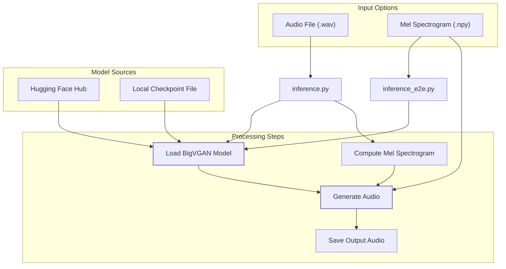
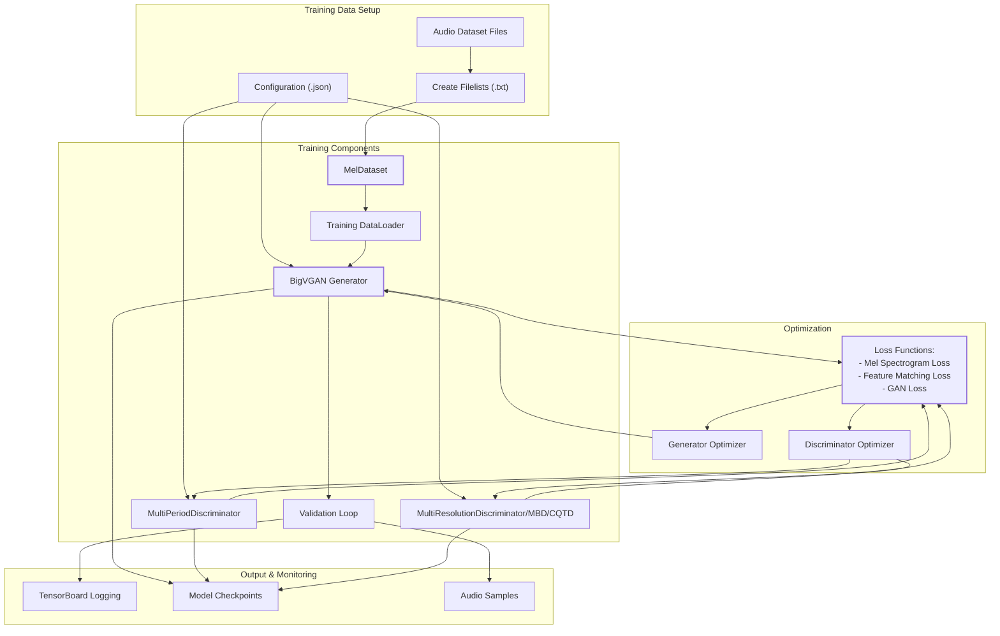
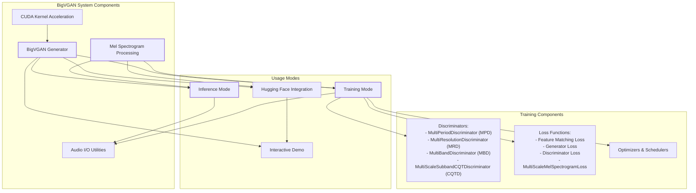

<!-- source: DeepWiki mcp.deepwiki.com · repo NVIDIA/BigVGAN · page 4 Usage · fetched 2026-10-26 -->

# Usage

<details>
<summary>Relevant source files</summary>

The following files were used as context for generating this wiki page:

- [README.md](README.md)
- [inference.py](inference.py)
- [loss.py](loss.py)
- [train.py](train.py)

</details>


This page provides a comprehensive guide on how to use the BigVGAN neural vocoder for both inference (audio generation) and training. BigVGAN is a universal neural vocoder that converts mel spectrograms to high-fidelity audio waveforms. For information about the architecture and technical details of the model, see [Architecture](#2).

## Inference with BigVGAN

BigVGAN offers multiple ways to generate audio from mel spectrograms, ranging from easy-to-use Hugging Face Hub integration to customizable inference scripts.

### Using Hugging Face Hub

The simplest way to use BigVGAN is through Hugging Face Hub integration, which provides pre-trained models ready for inference.

```python
import torch
import bigvgan
import librosa
from meldataset import get_mel_spectrogram

# Load model from Hugging Face Hub
model = bigvgan.BigVGAN.from_pretrained('nvidia/bigvgan_v2_24khz_100band_256x', use_cuda_kernel=False)

# Remove weight norm and set to eval mode
model.remove_weight_norm()
model = model.eval().to('cuda')

# Load audio file and compute mel spectrogram
wav_path = '/path/to/your/audio.wav'
wav, sr = librosa.load(wav_path, sr=model.h.sampling_rate, mono=True)
wav = torch.FloatTensor(wav).unsqueeze(0)

# Compute mel spectrogram from the audio
mel = get_mel_spectrogram(wav, model.h).to('cuda')

# Generate waveform from mel
with torch.inference_mode():
    wav_gen = model(mel)
wav_gen_float = wav_gen.squeeze(0).cpu()
```

Sources: [README.md:46-80]()

### Using Local Checkpoint Files

For more control or when working with custom-trained models, you can use the `inference.py` script:

```bash
python inference.py \
--checkpoint_file /path/to/your/bigvgan_v2_24khz_100band_256x/bigvgan_generator.pt \
--input_wavs_dir /path/to/your/input_wav \
--output_dir /path/to/your/output_wav
```

This script takes wav files from `--input_wavs_dir`, computes mel spectrograms, and generates synthesized audio that is saved to `--output_dir`.

Sources: [README.md:122-130](), [inference.py:23-55]()

### End-to-End Inference from Mel Spectrograms

If you already have pre-computed mel spectrograms (saved as `.npy` files), you can use the `inference_e2e.py` script:

```bash
python inference_e2e.py \
--checkpoint_file /path/to/your/bigvgan_v2_24khz_100band_256x/bigvgan_generator.pt \
--input_mels_dir /path/to/your/input_mel \
--output_dir /path/to/your/output_wav
```

Sources: [README.md:132-142]()

## Inference Workflow Diagram



Sources: [inference.py:23-55](), [README.md:46-142]()

## Using CUDA Kernel for Accelerated Inference

BigVGAN provides a custom CUDA kernel for accelerated inference through a fused implementation of anti-aliased activation:

```python
# Enable CUDA kernel when instantiating the model
generator = BigVGAN(h, use_cuda_kernel=True)
```

You can also pass `--use_cuda_kernel` to the inference scripts:

```bash
python inference.py \
--checkpoint_file /path/to/your/bigvgan_generator.pt \
--input_wavs_dir /path/to/your/input_wav \
--output_dir /path/to/your/output_wav \
--use_cuda_kernel
```

The first time the CUDA kernel is used, it will build using `nvcc` and `ninja`. The kernel is saved to `alias_free_activation/cuda/build` and loaded automatically in subsequent runs.

To verify the correctness of the CUDA kernel implementation, you can run:

```bash
python tests/test_cuda_vs_torch_model.py \
--checkpoint_file /path/to/your/bigvgan_generator.pt
```

Sources: [README.md:144-184]()

## Training BigVGAN

Training a BigVGAN model involves preparing a dataset, setting up the training configuration, and monitoring the training progress.

### Dataset Preparation

Create symbolic links to your dataset and prepare filelists with relative paths:

```bash
cd filelists/LibriTTS && \
ln -s /path/to/your/LibriTTS/train-clean-100 train-clean-100 && \
ln -s /path/to/your/LibriTTS/train-clean-360 train-clean-360 && \
ln -s /path/to/your/LibriTTS/train-other-500 train-other-500 && \
ln -s /path/to/your/LibriTTS/dev-clean dev-clean && \
ln -s /path/to/your/LibriTTS/dev-other dev-other && \
ln -s /path/to/your/LibriTTS/test-clean test-clean && \
ln -s /path/to/your/LibriTTS/test-other test-other && \
cd ../..
```

Sources: [README.md:93-105]()

### Training Command

Launch training with a configuration file and dataset paths:

```bash
python train.py \
--config configs/bigvgan_v2_24khz_100band_256x.json \
--input_wavs_dir filelists/LibriTTS \
--input_training_file filelists/LibriTTS/train-full.txt \
--input_validation_file filelists/LibriTTS/val-full.txt \
--list_input_unseen_wavs_dir filelists/LibriTTS filelists/LibriTTS \
--list_input_unseen_validation_file filelists/LibriTTS/dev-clean.txt filelists/LibriTTS/dev-other.txt \
--checkpoint_path exp/bigvgan_v2_24khz_100band_256x
```

Sources: [README.md:107-118](), [train.py:668-777]()

## Training Workflow Diagram



Sources: [train.py:56-457](), [README.md:107-118]()

### Key Training Arguments

| Argument | Description | Default |
|----------|-------------|---------|
| `--config` | JSON configuration file path | Required |
| `--input_wavs_dir` | Directory containing audio files | Required |
| `--input_training_file` | Text file with training file paths | Required |
| `--input_validation_file` | Text file with validation file paths | Required |
| `--checkpoint_path` | Directory to save model checkpoints | Required |
| `--training_epochs` | Number of training epochs | 100000 |
| `--stdout_interval` | How often to print progress | 5 |
| `--checkpoint_interval` | How often to save checkpoints | 50000 |
| `--validation_interval` | How often to run validation | 50000 |
| `--summary_interval` | How often to log to TensorBoard | 100 |
| `--freeze_step` | Number of initial steps to freeze discriminator | 0 |
| `--debug` | Skip validation during training | False |
| `--save_audio` | Save audio samples to disk | False |

Sources: [train.py:671-742]()

### Multi-GPU Training

The training script automatically detects available GPUs and distributes the training across them:

```python
if h.num_gpus > 1:
    mp.spawn(train, nprocs=h.num_gpus, args=(a, h,))
else:
    train(0, a, h)
```

The batch size is automatically divided by the number of GPUs to maintain the same effective batch size:

```python
if torch.cuda.is_available():
    torch.cuda.manual_seed(h.seed)
    h.num_gpus = torch.cuda.device_count()
    h.batch_size = int(h.batch_size / h.num_gpus)
    print(f"Batch size per GPU: {h.batch_size}")
```

Sources: [train.py:754-773]()

### Monitoring Training Progress

The training script logs various metrics to TensorBoard:

1. Generator and discriminator losses
2. Mel spectrogram errors
3. Audio samples (both ground truth and generated)
4. Spectrograms and spectrogram differences
5. Gradient norms and learning rates

You can visualize these metrics using TensorBoard:

```bash
tensorboard --logdir=exp/bigvgan_v2_24khz_100band_256x/logs
```

Sources: [train.py:599-621](), [train.py:271-275]()

## Fine-tuning Pre-trained Models

You can fine-tune existing BigVGAN models on your own dataset:

1. Download the checkpoints from Hugging Face Hub (both generator and discriminator/optimizer states)
2. Place them in your checkpoint directory
3. Resume training using your dataset

```bash
python train.py \
--config configs/bigvgan_v2_24khz_100band_256x.json \
--input_wavs_dir /path/to/your/dataset \
--input_training_file /path/to/your/train_filelist.txt \
--input_validation_file /path/to/your/val_filelist.txt \
--checkpoint_path /path/to/dir/with/checkpoints \
--fine_tuning True
```

Sources: [README.md:204-209]()

## Available Pretrained Models

BigVGAN provides several pretrained models through Hugging Face Hub with different configurations:

| Model Name | Sampling Rate | Mel Bands | fmax | Upsampling Ratio | Parameters |
|------------|---------------|-----------|------|------------------|------------|
| bigvgan_v2_44khz_128band_512x | 44 kHz | 128 | 22050 | 512 | 122M |
| bigvgan_v2_44khz_128band_256x | 44 kHz | 128 | 22050 | 256 | 112M |
| bigvgan_v2_24khz_100band_256x | 24 kHz | 100 | 12000 | 256 | 112M |
| bigvgan_v2_22khz_80band_256x | 22 kHz | 80 | 11025 | 256 | 112M |
| bigvgan_v2_22khz_80band_fmax8k_256x | 22 kHz | 80 | 8000 | 256 | 112M |
| bigvgan_24khz_100band | 24 kHz | 100 | 12000 | 256 | 112M |
| bigvgan_base_24khz_100band | 24 kHz | 100 | 12000 | 256 | 14M |
| bigvgan_22khz_80band | 22 kHz | 80 | 8000 | 256 | 112M |
| bigvgan_base_22khz_80band | 22 kHz | 80 | 8000 | 256 | 14M |

To use a specific model, replace the model name in the `from_pretrained()` call:

```python
model = bigvgan.BigVGAN.from_pretrained('nvidia/bigvgan_v2_44khz_128band_512x', use_cuda_kernel=True)
```

Sources: [README.md:184-202]()

## Interactive Local Demo

BigVGAN provides an interactive demo using Gradio:

```bash
pip install -r demo/requirements.txt
python demo/app.py
```

This allows you to test different models and inputs through a web interface.

Sources: [README.md:82-89]()

## Performance Benchmarks

The CUDA kernel acceleration provides significant speedups compared to the PyTorch implementation:

| GPU | Input Frames | CUDA Kernel | Speed (kHz) | Real-time Factor | VRAM (GB) |
|-----|--------------|-------------|-------------|------------------|-----------|
| NVIDIA A100 | 256 | False | 1672.1 | 69.7x | 1.3 |
|  |  | True | 3916.5 | 163.2x | 1.3 |
|  | 2048 | False | 1899.6 | 79.2x | 1.7 |
|  |  | True | 5330.1 | 222.1x | 1.7 |
| NVIDIA GeForce RTX 3080 | 256 | False | 841.1 | 35.0x | 1.3 |
|  |  | True | 1598.1 | 66.6x | 1.3 |
| NVIDIA GeForce RTX 2080 Ti | 256 | False | 515.6 | 21.5x | 1.3 |
|  |  | True | 811.3 | 33.8x | 1.3 |

Sources: [README.md:229-252]()

## BigVGAN Usage Components Diagram



Sources: [README.md](), [train.py](), [inference.py](), [loss.py]()

---

