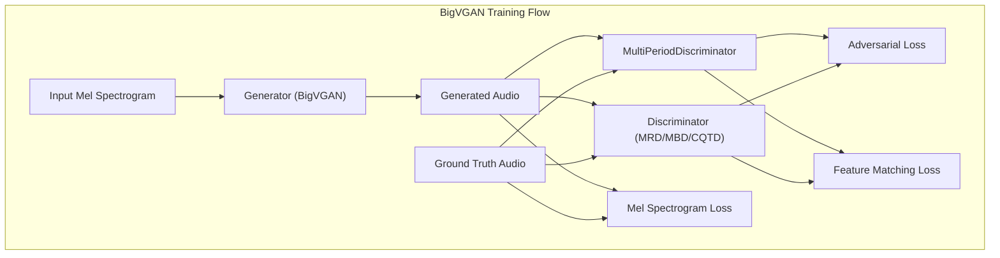
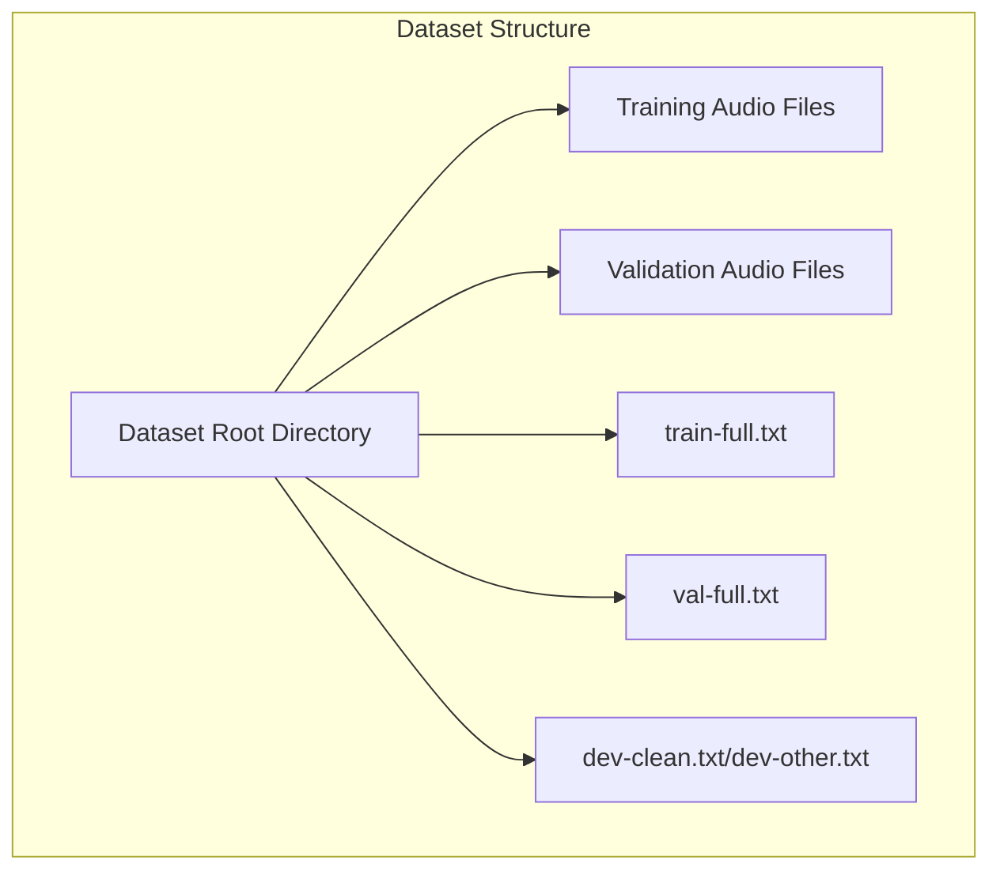
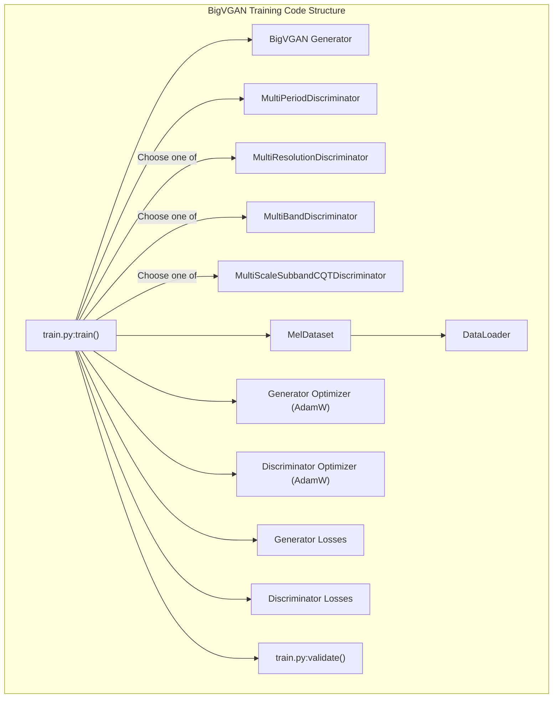

<!-- source: DeepWiki mcp.deepwiki.com · repo NVIDIA/BigVGAN · page 4.1 Training Guide · fetched 2026-10-26 -->

# Training Guide

<details>
<summary>Relevant source files</summary>

The following files were used as context for generating this wiki page:

- [README.md](README.md)
- [configs/bigvgan_22khz_80band.json](configs/bigvgan_22khz_80band.json)
- [configs/bigvgan_24khz_100band.json](configs/bigvgan_24khz_100band.json)
- [configs/bigvgan_base_22khz_80band.json](configs/bigvgan_base_22khz_80band.json)
- [configs/bigvgan_base_24khz_100band.json](configs/bigvgan_base_24khz_100band.json)
- [train.py](train.py)

</details>


## Purpose

This guide provides detailed instructions for training the BigVGAN neural vocoder system. It covers the training workflow, configuration options, command-line arguments, and best practices for achieving high-quality results. This document focuses specifically on the training process - for inference usage see [Inference Guide](#4.2), and for understanding the architecture refer to [Architecture](#2).

## Training Overview

BigVGAN is trained using a GAN (Generative Adversarial Network) approach with a generator that converts mel spectrograms to waveforms and multiple discriminators that distinguish between real and generated audio.



Sources: [train.py:56-666](), [README.md:92-118]()

## Prerequisites

Before training BigVGAN, ensure you have:

1. **Python Environment**: Python 3.10 with PyTorch 2.3.1 and CUDA support
2. **Dataset**: Audio dataset such as LibriTTS, VCTK, or other high-quality audio
3. **File Lists**: Text files containing paths to training and validation audio files
4. **Configuration File**: JSON file with model architecture and training parameters

## Dataset Preparation

The training process requires a dataset with a specific directory structure and file lists:



Create symbolic links to your dataset in the `filelists` directory:

```
cd filelists/LibriTTS
ln -s /path/to/your/LibriTTS/train-clean-100 train-clean-100
ln -s /path/to/your/LibriTTS/train-clean-360 train-clean-360
ln -s /path/to/your/LibriTTS/train-other-500 train-other-500
ln -s /path/to/your/LibriTTS/dev-clean dev-clean
ln -s /path/to/your/LibriTTS/dev-other dev-other
ln -s /path/to/your/LibriTTS/test-clean test-clean
ln -s /path/to/your/LibriTTS/test-other test-other
cd ../..
```

Sources: [README.md:92-105]()

## Configuration Files

BigVGAN uses JSON configuration files to define model architecture and training parameters. These files are located in the `configs` directory.

### Key Configuration Parameters

| Parameter | Description | Example |
|-----------|-------------|---------|
| `batch_size` | Number of samples per batch | 4, 32 |
| `learning_rate` | Initial learning rate | 0.0001 |
| `lr_decay` | Learning rate decay rate | 0.9999996 |
| `sampling_rate` | Audio sampling rate in Hz | 22050, 24000, 44100 |
| `num_mels` | Number of mel bands | 80, 100, 128 |
| `segment_size` | Audio segment length in samples | 8192, 65536 |
| `activation` | Activation function type | "snakebeta" |
| `upsample_rates` | Upsampling rates for each layer | [4,4,2,2,2,2] |
| `upsample_initial_channel` | Initial channel count | 512, 1536 |
| `clip_grad_norm` | Gradient clipping threshold | 100, 500 |

Sources: [configs/bigvgan_24khz_100band.json:1-45](), [configs/bigvgan_base_24khz_100band.json:1-45](), [configs/bigvgan_22khz_80band.json:1-45](), [README.md:210-216]()

### Available Configurations

Different configurations are provided for various use cases:

| Model | Sampling Rate | Mel Bands | Parameters | Purpose |
|-------|--------------|-----------|------------|---------|
| BigVGAN | 24 kHz | 100 | 112M | High-quality speech synthesis |
| BigVGAN-base | 24 kHz | 100 | 14M | Lightweight speech synthesis |
| BigVGAN | 22 kHz | 80 | 112M | Standard TTS applications |
| BigVGAN-base | 22 kHz | 80 | 14M | Lightweight TTS applications |
| BigVGAN-v2 | 24-44 kHz | 80-128 | 112-122M | Improved universal vocoder |

Sources: [README.md:187-199]()

## Training Commands

To start training, use the `train.py` script with appropriate command-line arguments:

```
python train.py \
--config configs/bigvgan_v2_24khz_100band_256x.json \
--input_wavs_dir filelists/LibriTTS \
--input_training_file filelists/LibriTTS/train-full.txt \
--input_validation_file filelists/LibriTTS/val-full.txt \
--list_input_unseen_wavs_dir filelists/LibriTTS filelists/LibriTTS \
--list_input_unseen_validation_file filelists/LibriTTS/dev-clean.txt filelists/LibriTTS/dev-other.txt \
--checkpoint_path exp/bigvgan_v2_24khz_100band_256x
```

### Command-Line Arguments

| Argument | Description | Default |
|----------|-------------|---------|
| `--config` | Configuration JSON file path | Required |
| `--input_wavs_dir` | Root directory for audio files | "LibriTTS" |
| `--input_training_file` | Training file list | Required |
| `--input_validation_file` | Validation file list | Required |
| `--list_input_unseen_wavs_dir` | Root directories for unseen validation | Required |
| `--list_input_unseen_validation_file` | Unseen validation file lists | Required |
| `--checkpoint_path` | Directory to save checkpoints | "exp/bigvgan" |
| `--training_epochs` | Maximum number of epochs | 100000 |
| `--stdout_interval` | Steps between console logging | 5 |
| `--checkpoint_interval` | Steps between saving checkpoints | 50000 |
| `--summary_interval` | Steps between TensorBoard logging | 100 |
| `--validation_interval` | Steps between validation runs | 50000 |
| `--freeze_step` | Steps to freeze discriminator training | 0 |
| `--debug` | Skip validation loop during training | False |
| `--evaluate` | Run evaluation only and exit | False |
| `--save_audio` | Save audio samples to disk | False |

Sources: [train.py:671-743](), [README.md:109-117]()

## Training Process in Detail

The training process consists of several components working together:



Sources: [train.py:56-666]()

### Major Training Phases

1. **Initialization**:
   - Load configuration and parse arguments
   - Initialize generator and discriminators
   - Set up optimizers and schedulers
   - Load datasets and dataloaders
   - Resume from checkpoint if available

2. **Training Loop**:
   - Forward pass: Generate audio from mel spectrograms
   - Calculate losses:
     - Mel spectrogram loss
     - Adversarial losses
     - Feature matching losses
   - Update discriminators
   - Update generator
   - Log metrics and samples to TensorBoard
   - Save checkpoints periodically

3. **Validation**:
   - Evaluate on validation sets (both seen and unseen)
   - Calculate metrics: mel error, PESQ, MRSTFT
   - Log audio samples and spectrograms
   - Track model performance over time

Sources: [train.py:56-666](), [train.py:281-427]()

## Model Training Details

### Generator and Discriminator Setup

The training process initializes several models:

1. **Generator**: BigVGAN model for converting mel spectrograms to audio
2. **Discriminators**:
   - MultiPeriodDiscriminator (MPD): Always used
   - One of the following (configurable):
     - MultiResolutionDiscriminator (MRD): Used in BigVGAN-v1
     - MultiBandDiscriminator (MBD): Option in BigVGAN-v2
     - MultiScaleSubbandCQTDiscriminator (CQTD): Option in BigVGAN-v2

These discriminators help the model learn different aspects of audio quality.

Sources: [train.py:72-91]()

### Loss Functions

BigVGAN uses multiple loss components:

1. **Mel Spectrogram Loss**:
   - Single-scale L1 loss between generated and ground truth mel spectrograms (BigVGAN-v1)
   - Multi-scale mel spectrogram loss (BigVGAN-v2)

2. **Adversarial Losses**:
   - Generator: Encourages generator to produce realistic audio
   - Discriminator: Helps discriminator distinguish real from generated audio

3. **Feature Matching Loss**:
   - Matches intermediate features between real and generated audio
   - Helps stabilize training and improve audio quality

Sources: [train.py:486-553](), [loss.py]()

### Optimization

The training process uses:

- AdamW optimizer with configurable learning rates
- Learning rate scheduling with exponential decay
- Gradient clipping to prevent exploding gradients
- Optional discriminator freezing during early training steps

Sources: [train.py:146-164](), [train.py:504-516]()

## Monitoring and Evaluation

### TensorBoard Logging

During training, several metrics and samples are logged to TensorBoard:

1. **Losses**:
   - Generator total loss
   - Mel spectrogram error
   - Feature matching losses
   - Adversarial losses

2. **Training Progress**:
   - Learning rates
   - Gradient norms
   - Epoch number

3. **Audio and Visualizations**:
   - Ground truth audio
   - Generated audio
   - Mel spectrograms
   - Spectrogram error visualizations

Sources: [train.py:600-621](), [train.py:347-417]()

### Validation Metrics

The model performance is evaluated using several metrics:

1. **Mel Spectrogram Error**: L1 distance between generated and ground truth mels
2. **PESQ** (Perceptual Evaluation of Speech Quality): Speech quality metric
3. **MRSTFT** (Multi-Resolution STFT Loss): Measures time-frequency differences

Validation is performed on both seen and unseen datasets to assess generalization.

Sources: [train.py:281-427](), [README.md:219-227]()

## Advanced Training Options

### Multi-GPU Training

BigVGAN supports distributed training across multiple GPUs:

- Automatically adjusts batch size per GPU
- Uses PyTorch's DistributedDataParallel
- Configure via the `num_gpus` parameter in the configuration file

Sources: [train.py:57-64](), [train.py:141-144](), [train.py:763-772]()

### Fine-tuning Pretrained Models

To fine-tune an existing model:

1. Download pretrained checkpoints (both generator and discriminator)
2. Place them in your checkpoint directory
3. Use the same `--checkpoint_path` when launching training
4. The training will automatically resume from the latest checkpoint

Sources: [README.md:205-208](), [train.py:115-138]()

## Best Practices and Tips

### Training Stability

1. **Gradient Clipping**:
   - For early training with small batch sizes, use lower `clip_grad_norm` (e.g., 100)
   - Increase to the default (500) after around 20,000 steps

2. **Discriminator Freezing**:
   - The `--freeze_step` parameter allows freezing the discriminator for initial steps
   - During this phase, the generator uses only regression loss (mel spectrogram loss)

3. **Batch Size and Segment Size**:
   - BigVGAN-v2 was trained with batch_size=32 and segment_size=65536
   - When training on a single GPU, you may need to reduce these values
   - The default configs use batch_size=4 to fit on a single A100 GPU

Sources: [README.md:210-216](), [train.py:502-503](), [train.py:506-520](), [train.py:544-552]()

### Hardware Requirements

Training BigVGAN requires significant GPU resources:

- Full-size models (112M-122M parameters) benefit from multiple high-end GPUs
- Base models (14M parameters) can be trained on a single GPU
- Memory usage depends on batch size, segment size, and model configuration

Sources: [README.md:210-216]()

## Conclusion

Training BigVGAN requires careful configuration and monitoring but yields high-quality neural vocoding results. Following this guide should help you train a successful BigVGAN model for your specific audio generation needs.

Remember to monitor the training process via TensorBoard and validate performance on both seen and unseen datasets to ensure generalization. For larger-scale training, consider using distributed training across multiple GPUs.

---

