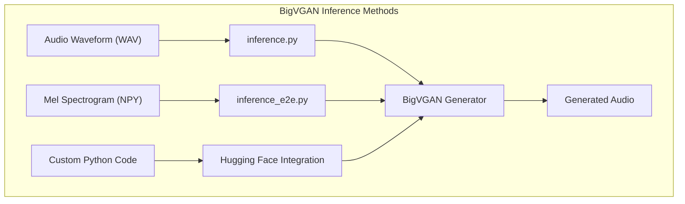
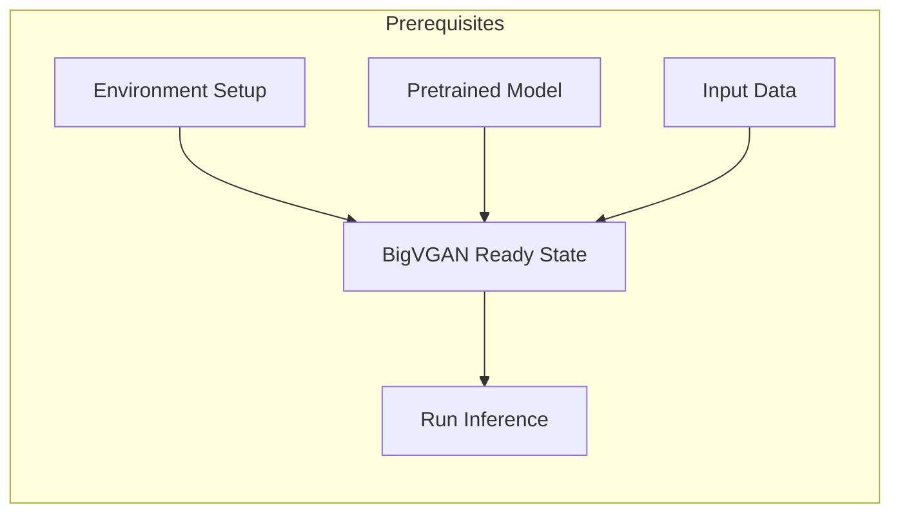
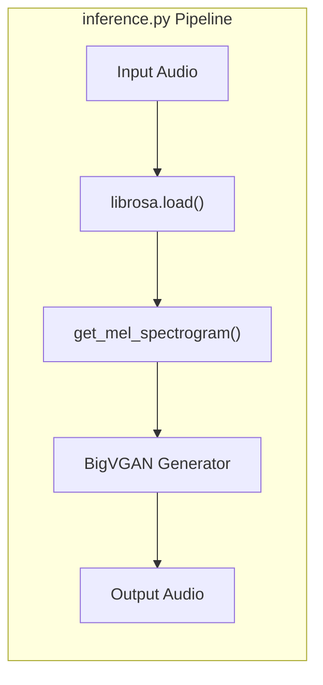
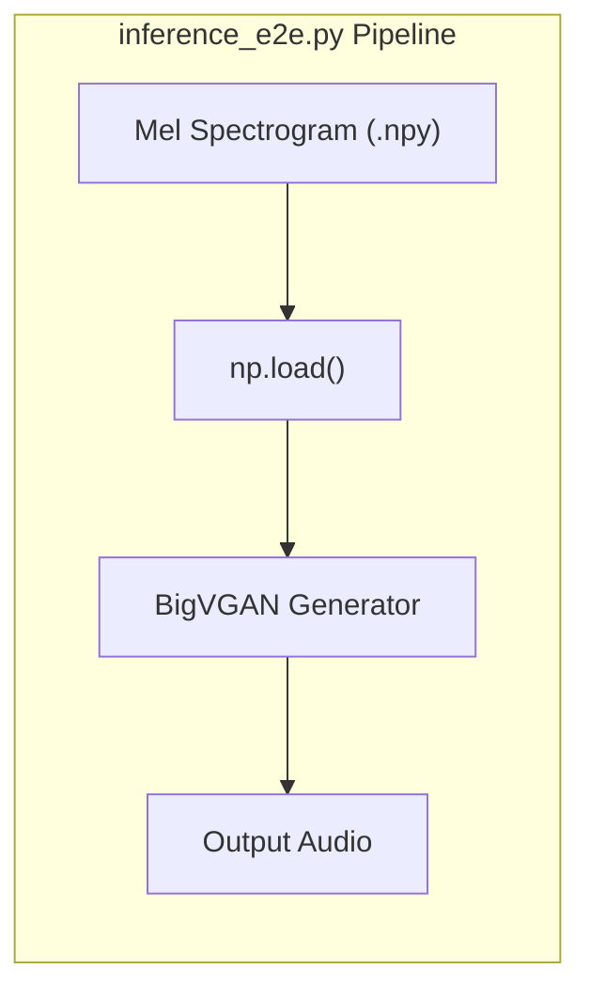
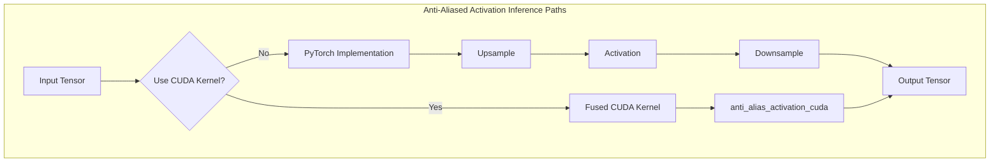
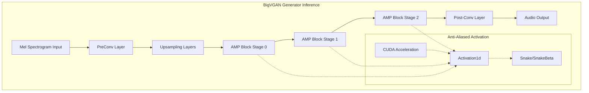

<!-- source: DeepWiki mcp.deepwiki.com · repo NVIDIA/BigVGAN · page 4.2 Inference Guide · fetched 2026-10-26 -->

# Inference Guide

<details>
<summary>Relevant source files</summary>

The following files were used as context for generating this wiki page:

- [README.md](README.md)
- [inference.py](inference.py)
- [inference_e2e.py](inference_e2e.py)
- [loss.py](loss.py)
- [utils.py](utils.py)

</details>


## Purpose and Scope

This guide provides comprehensive instructions for using BigVGAN's inference capabilities to generate high-quality audio from mel spectrograms. It covers multiple inference methods including direct script execution, end-to-end inference, and using the Hugging Face integration. For information about training the model, see [Training Guide](#4.1).

## Inference Overview

BigVGAN provides several approaches for audio synthesis inference, depending on your inputs and requirements:



Sources: [README.md:46-80](), [inference.py:23-55](), [inference_e2e.py:38-68]()

## Prerequisites

Before running inference with BigVGAN, ensure you have:

1. An installed and configured BigVGAN environment
2. A pretrained model checkpoint (`.pt` file)
3. Input data (either audio files or mel spectrograms)



Sources: [README.md:29-44]()

## Inference Methods

### 1. Hugging Face Integration (Quickstart)

The most convenient way to run inference is using the Hugging Face integration. This method allows you to load pretrained models directly from the Hugging Face Hub.

```python
import torch
import bigvgan
import librosa
from meldataset import get_mel_spectrogram

# Load the model from Hugging Face Hub
model = bigvgan.BigVGAN.from_pretrained('nvidia/bigvgan_v2_24khz_100band_256x', use_cuda_kernel=False)
model.remove_weight_norm()
model = model.eval().to('cuda')

# Load and process audio
wav, sr = librosa.load('/path/to/audio.wav', sr=model.h.sampling_rate, mono=True)
wav = torch.FloatTensor(wav).unsqueeze(0)
mel = get_mel_spectrogram(wav, model.h).to('cuda')

# Generate audio
with torch.inference_mode():
    wav_gen = model(mel)
```

Sources: [README.md:46-80]()

### 2. Using inference.py (Audio to Audio)

This method takes audio files as input, computes mel spectrograms, and then generates audio using the BigVGAN model.



To use this method:

1. Prepare your input audio files
2. Run the inference script:

```bash
python inference.py \
  --checkpoint_file /path/to/your/bigvgan_generator.pt \
  --input_wavs_dir /path/to/your/input_wav \
  --output_dir /path/to/your/output_wav \
  --use_cuda_kernel True  # Optional, for faster inference
```

The script performs the following steps:
1. Loads the BigVGAN generator model from the checkpoint
2. Processes each audio file in the input directory:
   - Loads and resamples the audio to the model's sampling rate
   - Computes a mel spectrogram from the audio
   - Generates audio using the model
   - Saves the generated audio to the output directory

Sources: [inference.py:23-55](), [inference.py:58-89]()

### 3. Using inference_e2e.py (Mel to Audio)

This method takes pre-computed mel spectrograms (saved as `.npy` files) as input and generates audio directly.



To use this method:

1. Prepare your mel spectrograms as `.npy` files (must have shape `[1, channel, frame]` or `[channel, frame]`)
2. Run the end-to-end inference script:

```bash
python inference_e2e.py \
  --checkpoint_file /path/to/your/bigvgan_generator.pt \
  --input_mels_dir /path/to/your/input_mel \
  --output_dir /path/to/your/output_wav \
  --use_cuda_kernel True  # Optional, for faster inference
```

This script:
1. Loads the BigVGAN generator model from the checkpoint
2. Processes each mel spectrogram file in the input directory:
   - Loads the mel spectrogram from the `.npy` file
   - Generates audio using the model
   - Saves the generated audio to the output directory

**Important**: The mel spectrogram parameters (sampling rate, mel bands, etc.) must match those used to train the model.

Sources: [inference_e2e.py:38-68](), [inference_e2e.py:71-102]()

### 4. Using the BigVGAN Model in Custom Code

For more advanced use cases, you can incorporate BigVGAN into your own code:

```python
import torch
from bigvgan import BigVGAN
from env import AttrDict
import json
import os

# Load config
with open('config.json') as f:
    json_config = json.loads(f.read())
h = AttrDict(json_config)

# Initialize model
model = BigVGAN(h, use_cuda_kernel=True).to('cuda')

# Load checkpoint
checkpoint = torch.load('/path/to/checkpoint.pt')
model.load_state_dict(checkpoint['generator'])
model.eval()
model.remove_weight_norm()

# Generate audio from mel spectrogram
with torch.no_grad():
    audio = model(mel_spectrogram)  # mel_spectrogram shape: [B, C, T]
```

Sources: [inference.py:23-35](), [inference_e2e.py:38-49]()

## Performance Optimization with CUDA Kernels

BigVGAN provides a custom CUDA implementation of the anti-aliased activation functions that can significantly accelerate inference.



To enable CUDA kernel acceleration:

1. Pass the `use_cuda_kernel=True` parameter when initializing the BigVGAN model
2. For inference scripts, use the `--use_cuda_kernel` flag

Performance benefits:

| GPU                        | Mel Frame Length | Speedup with CUDA Kernel | Real-time Factor |
|----------------------------|------------------|--------------------------|------------------|
| NVIDIA A100                | 2048             | 2.8x faster              | 222.1x           |
| NVIDIA GeForce RTX 3080    | 2048             | 2.1x faster              | 82.1x            |
| NVIDIA GeForce RTX 2080 Ti | 2048             | 1.8x faster              | 42.6x            |

When applied for the first time, the CUDA kernel is compiled using `nvcc` and saved for future use.

Sources: [README.md:145-178](), [README.md:229-252]()

## Available Pretrained Models

BigVGAN provides various pretrained models with different configurations:

| Model Name                     | Sampling Rate | Mel Bands | Max Frequency | Upsampling Ratio |
|--------------------------------|---------------|-----------|---------------|------------------|
| bigvgan_v2_44khz_128band_512x  | 44 kHz        | 128       | 22050 Hz      | 512              |
| bigvgan_v2_44khz_128band_256x  | 44 kHz        | 128       | 22050 Hz      | 256              |
| bigvgan_v2_24khz_100band_256x  | 24 kHz        | 100       | 12000 Hz      | 256              |
| bigvgan_v2_22khz_80band_256x   | 22 kHz        | 80        | 11025 Hz      | 256              |
| bigvgan_24khz_100band          | 24 kHz        | 100       | 12000 Hz      | 256              |
| bigvgan_base_24khz_100band     | 24 kHz        | 100       | 12000 Hz      | 256              |

These models can be loaded directly using the Hugging Face integration or by downloading the checkpoint files.

Sources: [README.md:184-204]()

## Detailed Inference Process

The following diagram shows the detailed inference process within the BigVGAN generator:



During inference, the model processes the input mel spectrogram through several stages:

1. An initial pre-convolution layer to project the mel spectrogram into a higher-dimensional space
2. A series of upsampling layers to increase the temporal resolution
3. Multiple AMP (Anti-aliased Multi-Periodicity) blocks with anti-aliased activation functions
4. A final post-convolution layer to produce the audio waveform

The anti-aliased activation functions are a critical component that can be accelerated using custom CUDA kernels.

Sources: [inference.py:23-55](), [inference_e2e.py:38-68]()

## Troubleshooting

### Common Issues and Solutions

1. **Incorrect audio quality or artifacts:**
   - Ensure the input mel spectrogram parameters match those used to train the model
   - Check that the model's sampling rate matches your desired output

2. **CUDA kernel compilation issues:**
   - Verify `nvcc` is installed and in your PATH
   - Make sure the CUDA version matches your PyTorch CUDA version
   - Try running `test_cuda_vs_torch_model.py` to verify kernel correctness

3. **Memory issues:**
   - When processing long audio files, try processing in smaller chunks
   - Reduce batch size if processing multiple files simultaneously

4. **Slow inference:**
   - Enable CUDA kernels with the `use_cuda_kernel=True` parameter
   - Process larger batches if memory allows
   - Ensure you're running on GPU by checking `device` assignments

Sources: [README.md:145-178]()

## Best Practices

For optimal results when using BigVGAN for inference:

1. **Match training conditions:**
   - Use the same mel spectrogram parameters as during training
   - Check the model config for correct parameters (sampling rate, hop size, etc.)

2. **Preprocess appropriately:**
   - Normalize input audio to the range [-1, 1]
   - Ensure correct sampling rate before computing mel spectrograms

3. **Use optimized inference:**
   - Enable CUDA kernels when possible
   - Remove weight normalization before inference with `model.remove_weight_norm()`
   - Use `torch.inference_mode()` or `torch.no_grad()` for faster inference

4. **Post-process generated audio:**
   - Use `MAX_WAV_VALUE` (32768) to scale the output to 16-bit PCM range
   - Consider applying a gentle high-pass filter to remove any DC offset

Sources: [inference.py:33-35](), [inference_e2e.py:48-50](), [utils.py:95-99]()

---

