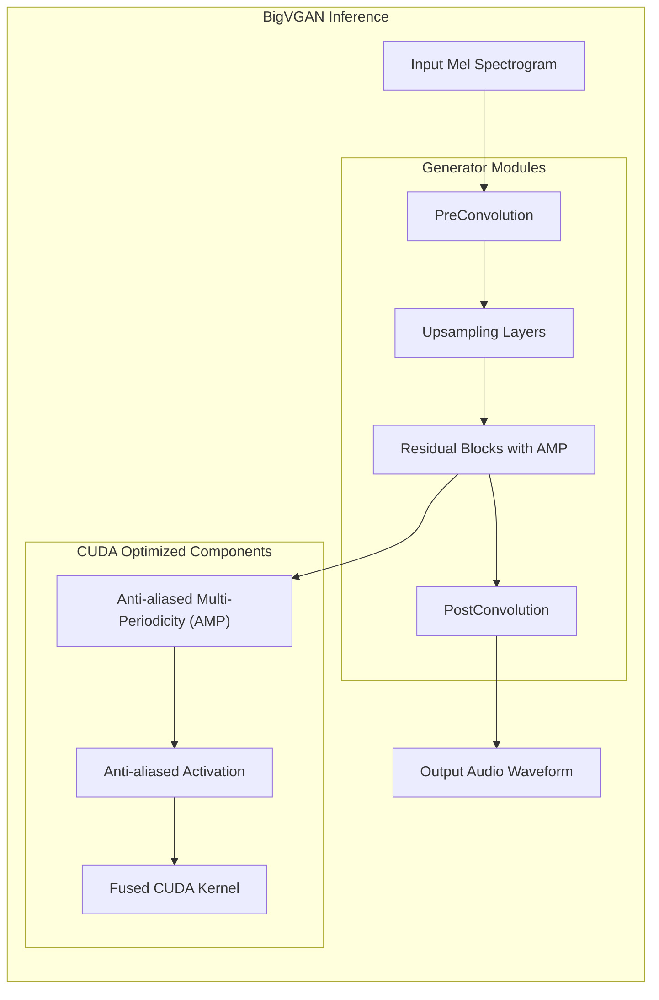
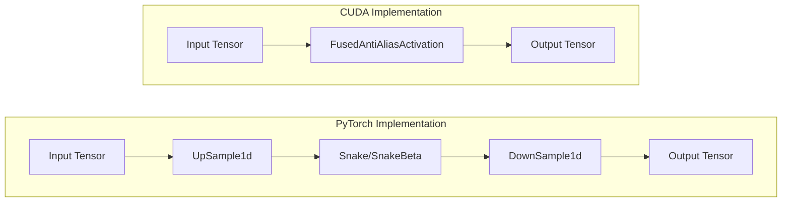
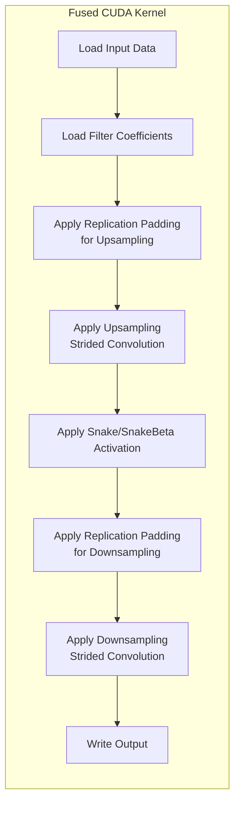
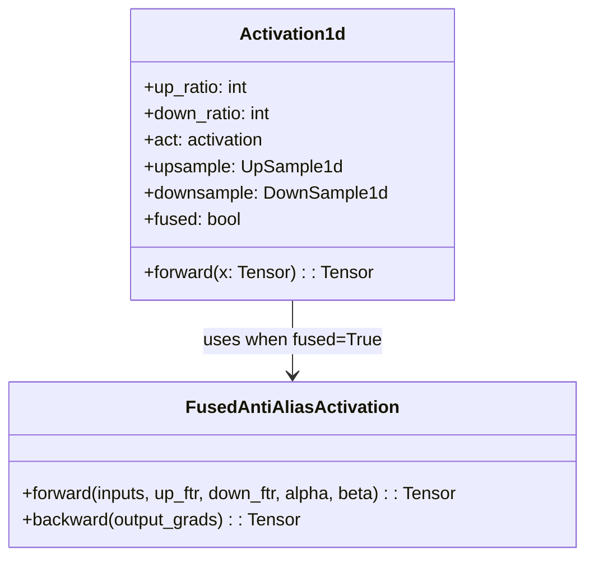
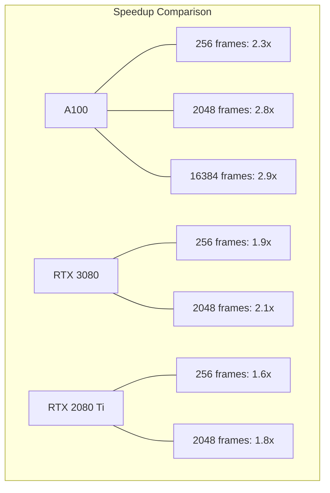

<!-- source: DeepWiki mcp.deepwiki.com · repo NVIDIA/BigVGAN · page 5 CUDA Optimizations · fetched 2026-10-26 -->

# CUDA Optimizations

<details>
<summary>Relevant source files</summary>

The following files were used as context for generating this wiki page:

- [README.md](README.md)
- [alias_free_activation/cuda/activation1d.py](alias_free_activation/cuda/activation1d.py)
- [alias_free_activation/cuda/anti_alias_activation_cuda.cu](alias_free_activation/cuda/anti_alias_activation_cuda.cu)

</details>


This document provides a technical overview of the CUDA optimizations implemented in BigVGAN to accelerate inference. The primary focus is on the custom CUDA kernel for anti-aliased activation functions that significantly improves inference speed while maintaining output quality. For detailed information about the Anti-Aliased Activation architecture, see [Anti-Aliased Activation](#2.3).

## Overview

BigVGAN incorporates custom CUDA kernels that fuse multiple operations into single, optimized kernels to reduce memory transfers and improve computational efficiency. The key optimization is a fused kernel that combines upsampling, activation function, and downsampling operations into a single CUDA kernel, resulting in 1.5-3x faster inference speeds compared to the standard PyTorch implementation.



Sources: [README.md:22-27](), [alias_free_activation/cuda/activation1d.py:1-77]()

## Anti-Aliased Activation Pipeline

The anti-aliased activation pipeline consists of three sequential operations:

1. **Upsampling**: Increases the resolution of the input signal by a factor of 2
2. **Activation Function**: Applies a non-linear activation (Snake or SnakeBeta)
3. **Downsampling**: Reduces the resolution back to the original size

In the standard PyTorch implementation, these operations are performed separately, requiring intermediate tensors to be stored in memory. The CUDA optimization fuses these three operations into a single kernel, eliminating the need for storing intermediate results and reducing memory transfers.



Sources: [alias_free_activation/cuda/activation1d.py:35-77]()

## CUDA Kernel Implementation

The CUDA kernel implementation combines upsampling, activation, and downsampling operations into a single kernel function to optimize memory access patterns and reduce global memory transactions.

### Key Features

1. **Fused Operations**: The kernel combines upsampling convolution, non-linear activation, and downsampling convolution in a single pass
2. **In-register Processing**: Intermediate results are stored in registers, reducing global memory access
3. **Optimized Memory Access**: Uses shared memory and registers for frequently accessed data
4. **Replication Padding**: Handles boundary conditions with replication padding matching the PyTorch implementation
5. **Block-based Processing**: Processes data in chunks to optimize for GPU architecture



Sources: [alias_free_activation/cuda/anti_alias_activation_cuda.cu:44-178]()

### Implementation Details

The CUDA kernel implementation contains several hardcoded parameters to maximize performance:

| Parameter | Value | Description |
|-----------|-------|-------------|
| FILTER_SIZE | 12 | Size of filter for upsampling/downsampling |
| HALF_FILTER_SIZE | 6 | Half of the filter size |
| UPSAMPLE_REPLICATION_PAD | 5 | Padding size for upsampling |
| DOWNSAMPLE_REPLICATION_PAD_LEFT | 5 | Left padding for downsampling |
| DOWNSAMPLE_REPLICATION_PAD_RIGHT | 6 | Right padding for downsampling |
| BUFFER_SIZE | 32 | Processing buffer size |

The kernel processes data in blocks, with each thread handling a portion of the input sequence. It implements a sequence of operations:

1. Loads input data and filter coefficients
2. Applies replication padding for upsampling
3. Performs upsampling convolution
4. Applies activation function (Snake/SnakeBeta)
5. Applies replication padding for downsampling
6. Performs downsampling convolution
7. Writes output to global memory

Sources: [alias_free_activation/cuda/anti_alias_activation_cuda.cu:33-42](), [alias_free_activation/cuda/anti_alias_activation_cuda.cu:44-178]()

## Integration with BigVGAN

The `Activation1d` class in BigVGAN provides a unified interface for both PyTorch and CUDA implementations, allowing seamless switching between them.



When the `fused` parameter is set to `True`, the `Activation1d` class uses the CUDA implementation. Otherwise, it falls back to the standard PyTorch implementation.

Sources: [alias_free_activation/cuda/activation1d.py:35-77]()

## Usage

To use the CUDA-optimized kernel in BigVGAN, set the `use_cuda_kernel` parameter to `True` when instantiating the model:

```python
# Load model with CUDA optimization
generator = BigVGAN(h, use_cuda_kernel=True)
```

For inference scripts, you can pass the `--use_cuda_kernel` flag:

```bash
python inference.py --checkpoint_file /path/to/checkpoint.pt --use_cuda_kernel
```

When the optimization is applied for the first time, it builds the kernel using `nvcc` and `ninja`. After successful compilation, the kernel is saved to `alias_free_activation/cuda/build` for future use.

Sources: [README.md:147-154]()

## Performance Benchmarks

The CUDA optimizations provide significant performance improvements, especially for longer sequences. The following table shows benchmark results for the `bigvgan_v2_24khz_100band_256x` model:

| GPU | Mel Frames | CUDA Kernel | Speed (kHz) | Real-time Factor | VRAM (GB) |
|-----|------------|-------------|-------------|------------------|-----------|
| NVIDIA A100 | 256 | No | 1672.1 | 69.7x | 1.3 |
| NVIDIA A100 | 256 | Yes | 3916.5 | 163.2x | 1.3 |
| NVIDIA A100 | 2048 | No | 1899.6 | 79.2x | 1.7 |
| NVIDIA A100 | 2048 | Yes | 5330.1 | 222.1x | 5.0 |
| NVIDIA A100 | 16384 | No | 1973.8 | 82.2x | 5.0 |
| NVIDIA A100 | 16384 | Yes | 5761.7 | 240.1x | 4.4 |
| NVIDIA RTX 3080 | 256 | No | 841.1 | 35.0x | 1.3 |
| NVIDIA RTX 3080 | 256 | Yes | 1598.1 | 66.6x | 1.3 |
| NVIDIA RTX 2080 Ti | 256 | No | 515.6 | 21.5x | 1.3 |
| NVIDIA RTX 2080 Ti | 256 | Yes | 811.3 | 33.8x | 1.3 |

Key observations:
- The CUDA kernel provides ~2.3x speedup on A100 GPUs
- Performance improvements are consistent across different sequence lengths
- VRAM usage is comparable or sometimes lower with the CUDA kernel



Sources: [README.md:232-252]()

## Verification and Testing

BigVGAN provides a test script to verify the correctness of the CUDA kernel implementation by comparing its output with the standard PyTorch implementation:

```bash
python tests/test_cuda_vs_torch_model.py --checkpoint_file /path/to/your/bigvgan_generator.pt
```

The test loads both implementations and compares their outputs, ensuring that the CUDA optimization maintains numerical accuracy while improving performance.

Sources: [README.md:159-182]()

## Limitations and Requirements

The CUDA optimization has some limitations and requirements:

1. **CUDA Compatibility**: Requires CUDA toolkit version compatible with PyTorch build
2. **Build Tools**: Requires `nvcc` and `ninja` for compilation
3. **Fixed Hyperparameters**: The CUDA kernel uses hardcoded hyperparameters that must match the model configuration
4. **Inference Only**: The CUDA optimization is currently only implemented for inference, not training

The CUDA kernel implementation hardcodes certain parameters like filter size and padding, which must match the model's configuration. Changing these parameters in the model without updating the CUDA kernel may lead to incorrect results.

Sources: [alias_free_activation/cuda/activation1d.py:15-19](), [alias_free_activation/cuda/anti_alias_activation_cuda.cu:33-42]()

---

