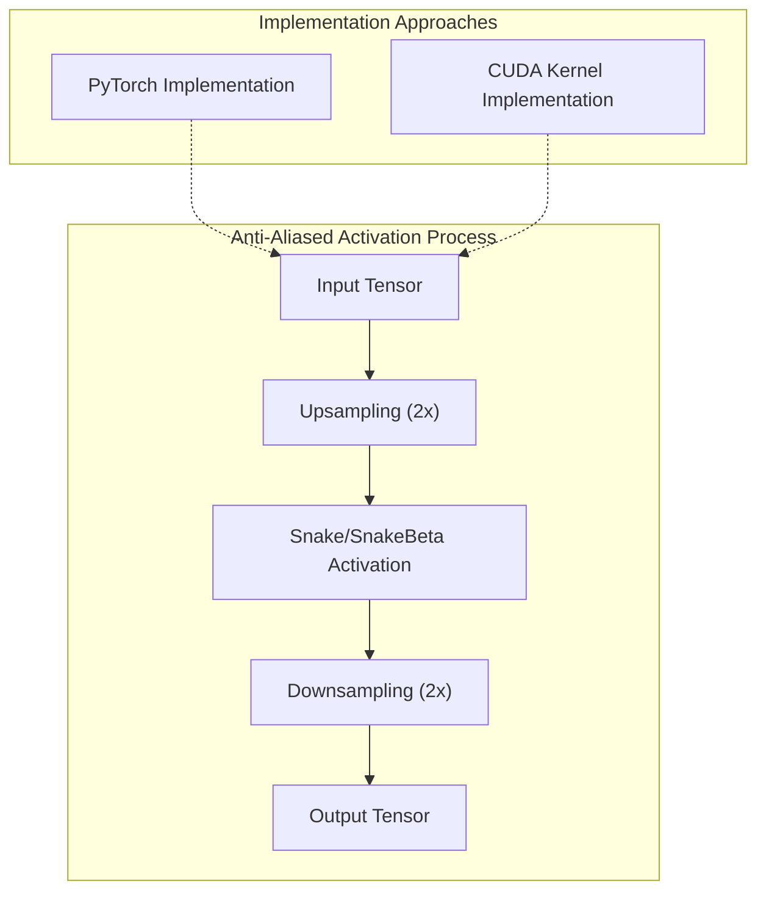
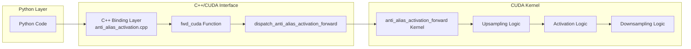
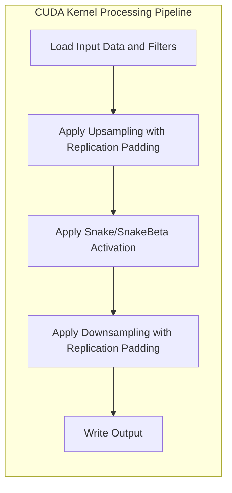
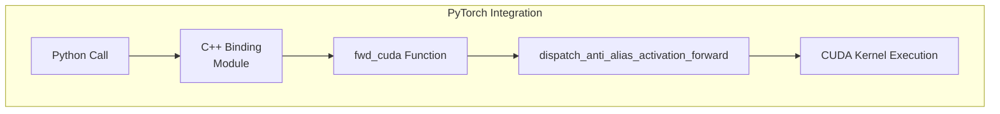

<!-- source: DeepWiki mcp.deepwiki.com · repo NVIDIA/BigVGAN · page 5.1 CUDA Kernel Implementation · fetched 2026-10-26 -->

# CUDA Kernel Implementation

<details>
<summary>Relevant source files</summary>

The following files were used as context for generating this wiki page:

- [alias_free_activation/cuda/anti_alias_activation.cpp](alias_free_activation/cuda/anti_alias_activation.cpp)
- [alias_free_activation/cuda/anti_alias_activation_cuda.cu](alias_free_activation/cuda/anti_alias_activation_cuda.cu)
- [alias_free_activation/cuda/load.py](alias_free_activation/cuda/load.py)

</details>


This document provides a detailed technical explanation of the custom CUDA kernel implementation used in BigVGAN for accelerating anti-aliased activation functions. For an overview of the anti-aliased activation system itself, see [Anti-Aliased Activation](#2.3).

## 1. Purpose and Overview

The custom CUDA kernel implementation in BigVGAN provides a highly optimized version of the anti-aliased activation functions that are critical to the generator's performance and audio quality. These functions combine upsampling, activation, and downsampling operations into a single fused kernel to significantly improve computational efficiency during both training and inference.



Sources: [alias_free_activation/cuda/anti_alias_activation_cuda.cu:43-179]()

## 2. Kernel Implementation Architecture

The CUDA kernel architecture consists of several components that work together to efficiently process audio data through the anti-aliased activation pipeline:



Sources: [alias_free_activation/cuda/anti_alias_activation.cpp:18-23](), [alias_free_activation/cuda/anti_alias_activation_cuda.cu:212-246](), [alias_free_activation/cuda/anti_alias_activation_cuda.cu:181-209]()

## 3. Kernel Parameters and Memory Layout

The anti-aliased activation CUDA kernel operates on 3D tensors with the following dimensions:

| Parameter | Description |
|-----------|-------------|
| `dst` | Output tensor pointer |
| `src` | Input tensor pointer |
| `up_ftr` | Upsampling filter coefficients |
| `down_ftr` | Downsampling filter coefficients |
| `alpha` | Alpha parameter for Snake activation |
| `beta` | Beta parameter for Snake activation |
| `batch_size` | Number of audio samples in batch |
| `channels` | Number of channels per sample |
| `seq_len` | Sequence length (time dimension) |

The kernel uses a 3D grid of thread blocks where:
- Z dimension = batch size
- Y dimension = number of channels
- X dimension = sequence length blocks

Sources: [alias_free_activation/cuda/anti_alias_activation_cuda.cu:43-53](), [alias_free_activation/cuda/anti_alias_activation_cuda.cu:181-209]()

## 4. Kernel Implementation Details

### 4.1 Hard-coded Parameters

The kernel uses several hard-coded parameters that define buffer sizes and filter characteristics:

```
ELEMENTS_PER_LDG_STG = 1      # Elements per load/store operation
BUFFER_SIZE = 32              # Processing buffer size
FILTER_SIZE = 12              # Size of the FIR filters
HALF_FILTER_SIZE = 6          # Half of the filter size
UPSAMPLE_REPLICATION_PAD = 5  # Padding for upsampling
DOWNSAMPLE_REPLICATION_PAD_LEFT = 5   # Left padding for downsampling
DOWNSAMPLE_REPLICATION_PAD_RIGHT = 6  # Right padding for downsampling
```

Sources: [alias_free_activation/cuda/anti_alias_activation_cuda.cu:33-41]()

### 4.2 Processing Pipeline

The kernel implements a complete anti-aliased activation pipeline consisting of four main steps:



Sources: [alias_free_activation/cuda/anti_alias_activation_cuda.cu:43-179]()

### 4.3 Upsampling Implementation

The upsampling process:
1. Loads input data into a buffer
2. Applies replication padding to handle boundary conditions
3. Performs a strided convolution with the upsampling filter to double the sequence length

This process is implemented in the kernel with careful handling of edge cases to ensure proper replication padding:

```
1. Load data from global memory
2. Apply replication padding for indices < 0 or >= seq_len
3. Apply upsampling convolution (stride=1, effectively doubles length)
```

Sources: [alias_free_activation/cuda/anti_alias_activation_cuda.cu:79-132]()

### 4.4 Activation Function

The kernel applies the SnakeBeta activation function to the upsampled data. The activation is defined as:

```
output = input + (1.0/beta) * sin²(alpha * input)
```

Where `alpha` and `beta` are channel-specific parameters that are passed to the kernel.

Sources: [alias_free_activation/cuda/anti_alias_activation_cuda.cu:134-140]()

### 4.5 Downsampling Implementation

The downsampling process:
1. Applies replication padding to the activated data
2. Performs a strided convolution with the downsampling filter (stride=2) to reduce the sequence length

This returns the data to its original sequence length, but with the anti-aliased activation applied.

Sources: [alias_free_activation/cuda/anti_alias_activation_cuda.cu:142-166]()

## 5. Integration with PyTorch

The CUDA kernel is integrated with PyTorch through a series of wrapper functions and the PyTorch C++ extension mechanism.

### 5.1 C++ Interface

The C++ wrapper function `fwd_cuda` serves as the interface between PyTorch and the CUDA kernel:



Sources: [alias_free_activation/cuda/anti_alias_activation.cpp:18-23](), [alias_free_activation/cuda/anti_alias_activation_cuda.cu:212-246]()

### 5.2 Dynamic Loading

The CUDA extension is dynamically loaded at runtime using the PyTorch C++ extension mechanism:

1. The `load.py` script detects the CUDA capability of the current device
2. It compiles the CUDA kernel with appropriate flags for the detected architecture
3. It loads the compiled extension and makes it available to Python

Sources: [alias_free_activation/cuda/load.py:17-65]()

## 6. Performance Considerations

The CUDA kernel implementation provides significant performance improvements over the equivalent PyTorch operations for several reasons:

### 6.1 Memory Access Optimization

The kernel uses carefully managed shared memory and register usage to minimize global memory accesses. It employs the following techniques:

1. Buffered processing to maximize data reuse
2. Coalesced memory access patterns where possible
3. Strategic register allocation for frequently accessed values

### 6.2 Computation Optimization

The kernel fuses multiple operations (upsampling, activation, downsampling) into a single kernel launch, which:

1. Eliminates intermediate tensor allocations and synchronization overhead
2. Reduces memory bandwidth requirements
3. Improves computational throughput

### 6.3 Parallel Processing Model

The kernel uses a block-based parallel processing model:

| Dimension | Purpose |
|-----------|---------|
| Blocks X  | Divides sequence length into manageable chunks |
| Blocks Y  | Processes different channels in parallel |
| Blocks Z  | Processes different batch items in parallel |
| Threads X | Each thread processes a fixed buffer of elements |

Sources: [alias_free_activation/cuda/anti_alias_activation_cuda.cu:197-207]()

## 7. Usage in BigVGAN

This CUDA kernel is a critical performance optimization in BigVGAN's generator architecture:

1. It accelerates the anti-aliased activation functions in AMPBlocks
2. It enables faster training and real-time inference capabilities
3. It maintains the high audio quality of the original implementation while improving performance

For detailed integration with the generator architecture, see [BigVGAN Generator](#2.1).

Sources: [alias_free_activation/cuda/anti_alias_activation_cuda.cu:212-246]()

---

