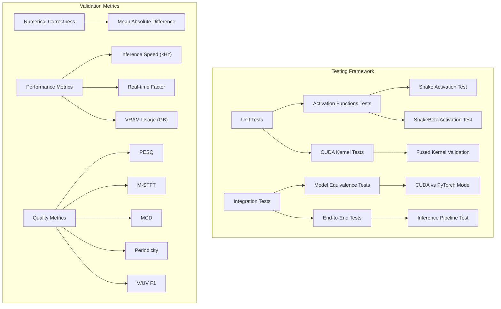
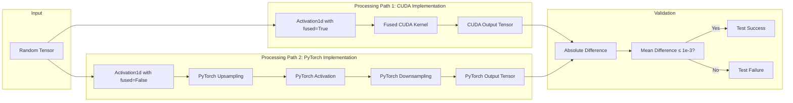
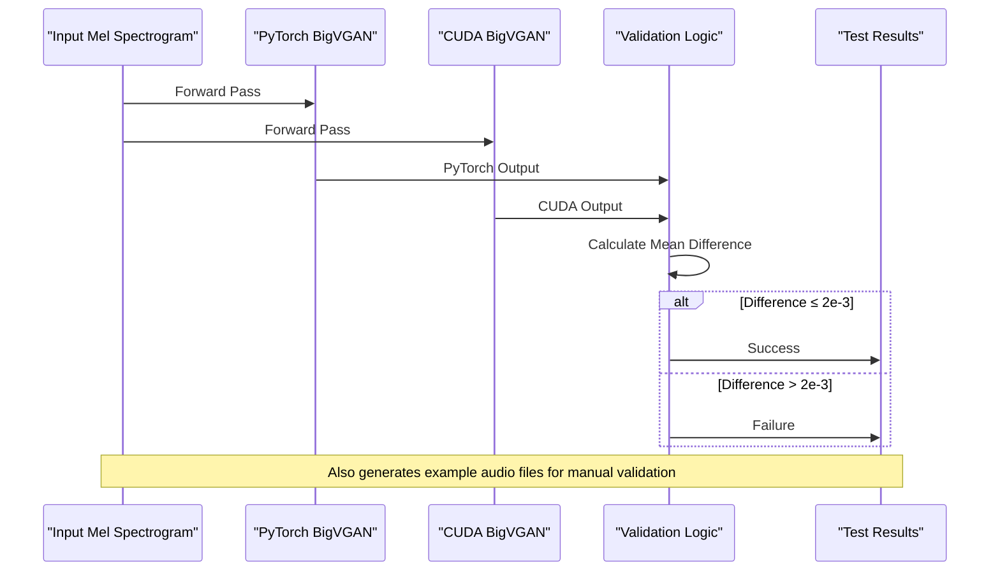
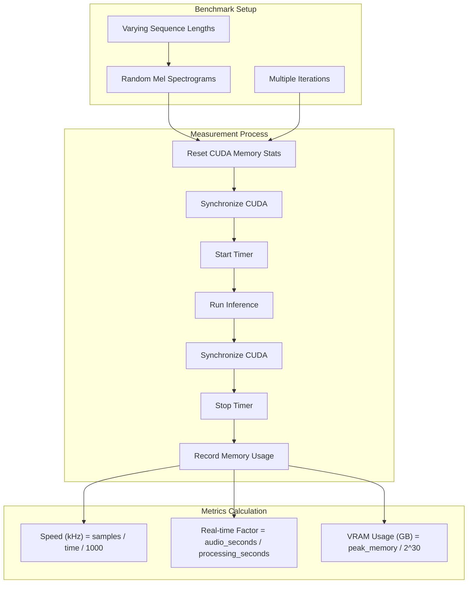
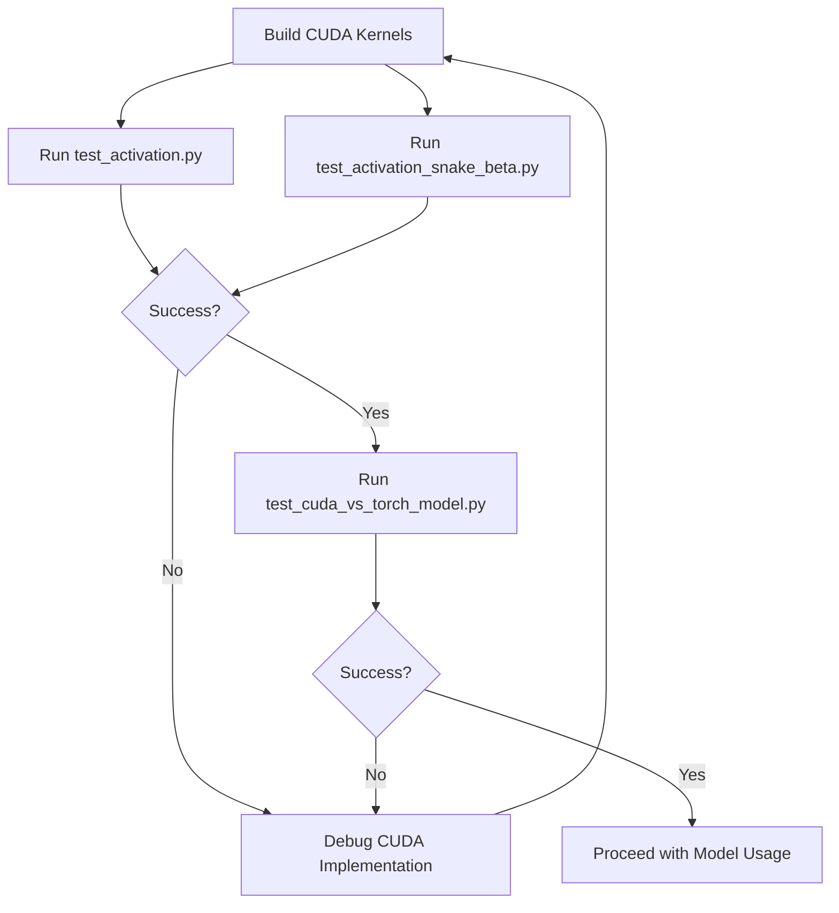

<!-- source: DeepWiki mcp.deepwiki.com · repo NVIDIA/BigVGAN · page 6 Testing and Validation · fetched 2026-10-26 -->

# Testing and Validation

<details>
<summary>Relevant source files</summary>

The following files were used as context for generating this wiki page:

- [README.md](README.md)
- [tests/test_activation.py](tests/test_activation.py)
- [tests/test_activation_snake_beta.py](tests/test_activation_snake_beta.py)
- [tests/test_cuda_vs_torch_model.py](tests/test_cuda_vs_torch_model.py)

</details>


This document outlines the testing and validation framework implemented in the BigVGAN neural vocoder system. It covers the test suite structure, validation methodologies, and performance benchmarking approaches used to ensure correctness and quality of both model implementations and CUDA optimizations.

For information about model architecture, see [Architecture](#2), and for information about CUDA optimizations, see [CUDA Optimizations](#5).

## 1. Testing Architecture

BigVGAN employs a comprehensive testing framework designed to validate both functional correctness and performance characteristics. The testing architecture focuses on two primary areas: validation of model implementations and acceleration optimizations.



Sources: [tests/test_activation.py](), [tests/test_activation_snake_beta.py](), [tests/test_cuda_vs_torch_model.py](), [README.md:214-227]()

## 2. Activation Function Testing

The BigVGAN system relies heavily on specialized activation functions (Snake and SnakeBeta) with anti-aliased implementations. Dedicated test modules validate that the CUDA-accelerated versions of these functions produce numerically equivalent results compared to their PyTorch counterparts.



The test process:
1. Generates random input tensors
2. Processes them through both CUDA and PyTorch implementations
3. Computes the absolute difference between outputs
4. Validates that the mean difference is below a threshold (1e-3)

### 2.1 Snake Activation Testing

The `test_activation.py` module specifically tests the Snake activation function, ensuring that the optimized CUDA implementation produces outputs that are numerically equivalent to the standard PyTorch implementation.

Sources: [tests/test_activation.py:23-57]()

### 2.2 SnakeBeta Activation Testing

Similarly, `test_activation_snake_beta.py` performs the same validation for the SnakeBeta activation function, which is the recommended activation used in the BigVGAN model.

Sources: [tests/test_activation_snake_beta.py:23-57]()

## 3. Model-level Validation

Beyond individual activation functions, BigVGAN includes comprehensive testing at the model level to ensure that the CUDA-optimized version of the model produces equivalent outputs to the standard PyTorch implementation.

### 3.1 CUDA vs PyTorch Model Comparison

The `test_cuda_vs_torch_model.py` script provides a thorough test suite for validating the equivalence of two BigVGAN model implementations:

1. Plain PyTorch BigVGAN generator
2. CUDA-optimized BigVGAN generator with fused kernels



The test performs the following steps:
1. Loads both model implementations with the same weights
2. Processes identical random mel spectrograms through both models
3. Computes the absolute difference between the generated audio outputs
4. Validates that the mean difference is below a threshold (2e-3)
5. Generates sample audio files for additional manual validation

Sources: [tests/test_cuda_vs_torch_model.py:95-127](), [tests/test_cuda_vs_torch_model.py:191-221]()

## 4. Performance Benchmarking

BigVGAN includes performance benchmarking capabilities to measure the computational efficiency of different model implementations, particularly comparing the CUDA-optimized version against the standard PyTorch implementation.

### 4.1 Benchmarking Methodology

The benchmarking process measures key performance metrics including:

1. Inference speed (kHz) - how many audio samples can be generated per second
2. Real-time factor - how much faster than real-time the model can generate audio
3. VRAM usage - peak GPU memory consumption during inference



Benchmarks are typically run with different mel spectrogram frame counts (256, 2048, 16384) to evaluate performance across various input lengths.

Sources: [tests/test_cuda_vs_torch_model.py:129-189](), [README.md:229-252]()

### 4.2 Benchmark Results

The README provides comprehensive benchmark results showing substantial performance improvements when using the CUDA-optimized implementation:

| GPU                       | num_mel_frame | use_cuda_kernel | Speed (kHz) | Real-time Factor | VRAM (GB) |
|---------------------------|---------------|-----------------|-------------|------------------|-----------|
| NVIDIA A100               | 256           | False           | 1672.1      | 69.7x            | 1.3       |
|                           | 256           | True            | 3916.5      | 163.2x           | 1.3       |
|                           | 2048          | False           | 1899.6      | 79.2x            | 1.7       |
|                           | 2048          | True            | 5330.1      | 222.1x           | 1.7       |
|                           | 16384         | False           | 1973.8      | 82.2x            | 5.0       |
|                           | 16384         | True            | 5761.7      | 240.1x           | 4.4       |
| NVIDIA GeForce RTX 3080   | 256           | False           | 841.1       | 35.0x            | 1.3       |
|                           | 256           | True            | 1598.1      | 66.6x            | 1.3       |
| NVIDIA GeForce RTX 2080 Ti| 256           | False           | 515.6       | 21.5x            | 1.3       |
|                           | 256           | True            | 811.3       | 33.8x            | 1.3       |

Key observations:
- CUDA-optimized kernels provide 1.5-3x speed improvement across all tested GPUs
- Performance gains are more pronounced with longer input sequences
- CUDA optimization generally reduces peak memory usage for longer sequences

Sources: [README.md:229-252]()

## 5. Quality Evaluation

BigVGAN employs several objective metrics to evaluate the quality of generated audio, particularly for speech synthesis applications.

### 5.1 Objective Quality Metrics

The following metrics are used to evaluate audio quality:

1. **PESQ (Perceptual Evaluation of Speech Quality)** - A standardized measure of speech quality; higher values indicate better quality (range: 1-5)
2. **M-STFT (Multi-resolution STFT)** - Measures the spectral distance between generated and reference audio; lower values indicate better quality
3. **MCD (Mel Cepstral Distortion)** - Measures the distortion in the cepstral domain; lower values indicate better quality
4. **Periodicity** - Measures accuracy in periodic components of speech; lower values indicate better quality
5. **V/UV F1 (Voiced/Unvoiced F1 Score)** - Measures accuracy in voiced/unvoiced classification; higher values indicate better quality

The BigVGAN-v2 model demonstrates improved metrics compared to the original BigVGAN model:

| Model     | Dataset                 | Steps | PESQ(↑)  | M-STFT(↓) | MCD(↓)   | Periodicity(↓) | V/UV F1(↑) |
|-----------|-------------------------|-------|----------|-----------|----------|----------------|------------|
| BigVGAN   | LibriTTS                | 1M    | 4.027    | 0.7997    | 0.3745   | 0.1018         | 0.9598     |
| BigVGAN   | LibriTTS                | 5M    | 4.256    | 0.7409    | 0.2988   | 0.0809         | 0.9698     |
| BigVGAN-v2| Large-scale Compilation | 3M    | 4.359    | 0.7134    | 0.3060   | 0.0621         | 0.9777     |
| BigVGAN-v2| Large-scale Compilation | 5M    | 4.362    | 0.7026    | 0.2903   | 0.0593         | 0.9793     |

Sources: [README.md:218-227]()

### 5.2 Auditory Testing

The system also generates example audio files for manual auditory inspection. The test suite creates three audio files:
1. Original input audio
2. Audio generated by the standard PyTorch model
3. Audio generated by the CUDA-optimized model

This allows for subjective quality assessment and confirmation that the CUDA optimizations do not introduce perceptible artifacts.

Sources: [tests/test_cuda_vs_torch_model.py:191-221]()

## 6. Test Execution Workflow

The test suite can be run manually to validate model implementations, particularly when using the CUDA-optimized kernels. Below is the recommended test execution workflow:



The recommended approach is to first validate the CUDA kernel correctness with:

```
python tests/test_cuda_vs_torch_model.py --checkpoint_file /path/to/your/bigvgan_generator.pt
```

A successful test will output:
```
[Success] test CUDA fused vs. plain torch BigVGAN inference
 > mean_difference=0.0007238413265440613
```

If the test fails, it indicates a potential issue with the CUDA implementation that needs to be addressed before using the optimized model.

Sources: [README.md:156-161](), [tests/test_cuda_vs_torch_model.py:112-127]()

## 7. Summary

The testing and validation framework for BigVGAN provides robust mechanisms to ensure:

1. **Correctness** - Numerical equivalence between standard PyTorch and CUDA-optimized implementations
2. **Performance** - Quantified speedups and memory efficiency improvements
3. **Quality** - Validation through objective metrics and example audio generation

These testing methods provide confidence that the CUDA optimizations deliver substantial performance improvements without sacrificing output quality, which is critical for a neural vocoder system.

Sources: [README.md:23-27](), [tests/test_cuda_vs_torch_model.py]()

---

