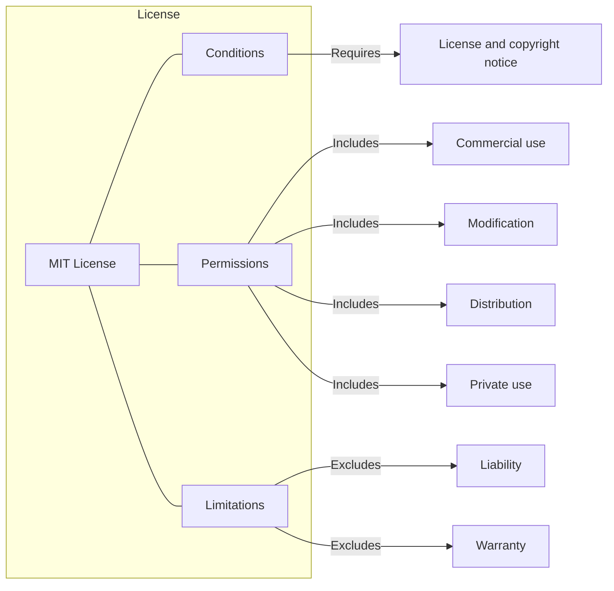
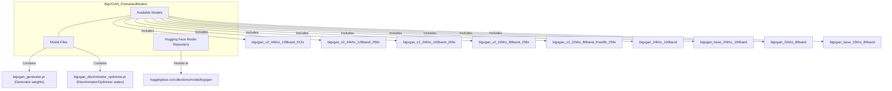
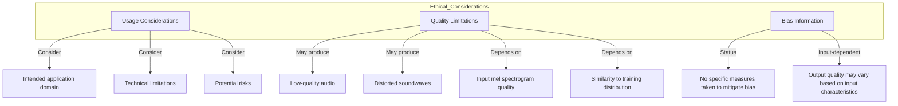

<!-- source: DeepWiki mcp.deepwiki.com · repo NVIDIA/BigVGAN · page 7 License and Model Card · fetched 2026-10-26 -->

# License and Model Card

<details>
<summary>Relevant source files</summary>

The following files were used as context for generating this wiki page:

- [LICENSE](LICENSE)
- [README.md](README.md)
- [nv-modelcard++/bias.md](nv-modelcard++/bias.md)
- [nv-modelcard++/explainability.md](nv-modelcard++/explainability.md)

</details>


This page provides comprehensive information about the licensing of the BigVGAN codebase, details on the model cards for pretrained models, and ethical considerations related to their use. For information about using the pretrained models, see [Usage](#4).

## License Information

BigVGAN is released under the MIT License, which is a permissive open-source license that allows for reuse with minimal restrictions.



### Key License Terms

The MIT License for BigVGAN provides the following permissions:
- Free use of the software for any purpose
- Permission to modify, distribute, or sell the code
- Ability to include the code in proprietary software

The only condition is that the original copyright notice and license text must be included in all copies or substantial portions of the software.

### License Text Location

The full license text can be found in the [LICENSE](LICENSE) file at the root of the repository.

Sources: [LICENSE:1-22]()

## Model Card Information

Model cards provide essential information about the pretrained BigVGAN models, including their capabilities, limitations, and intended use cases.

```mermaid
graph TD
    subgraph "BigVGAN_ModelCard"
        MI["Model Information"]
        IA["Intended Application"]
        TL["Technical Limitations"]
        PM["Performance Metrics"]
        PR["Potential Risks"]
        LE["Licensing"]
    end
    
    MI -->|"Contains"| MT["Model Type: CNN"]
    MI -->|"Contains"| MO["Output: Audio Waveform"]
    MI -->|"Contains"| MW["Works by: Generating waveform from mel spectrogram"]
    
    IA -->|"Domain"| IAD["Speech synthesis"]
    IA -->|"Users"| IAU["Developers generating waveforms from AI-generated mel spectrograms"]
    
    TL -->|"Limitations"| TLL["May not perform well on synthetic mel spectrograms outside training distribution"]
    
    PM -->|"Measures"| PMM1["PESQ"]
    PM -->|"Measures"| PMM2["VISQOL"]
    PM -->|"Measures"| PMM3["Multi-resolution STFT"]
    PM -->|"Measures"| PMM4["Mel cepstral distortion (MCD)"]
    PM -->|"Measures"| PMM5["Periodicity RMSE"]
    PM -->|"Measures"| PMM6["Voice/Unvoiced F1 Score"]
    
    PR -->|"Risk"| PRR["May generate low-quality or distorted soundwaves"]
    
    LE -->|"Licensed under"| MIT["MIT License"]
```



### Model Card Contents

BigVGAN model cards contain the following key information:

1. **Intended Application & Domain**: Speech synthesis and audio waveform generation from mel spectrograms.
2. **Model Type**: Convolutional Neural Network (CNN).
3. **Intended Users**: Developers working with AI-generated mel spectrograms.
4. **Output Format**: Audio waveform.
5. **Technical Limitations**: May not perform well on synthetically-generated mel spectrograms that deviate significantly from training data.
6. **Performance Metrics**: PESQ, VISQOL, Multi-resolution STFT, MCD, Periodicity RMSE, V/UV F1.
7. **Potential Risks**: Possibility of generating low-quality or distorted soundwaves.

Sources: [nv-modelcard++/explainability.md:1-13]()

## Pretrained Models

BigVGAN provides multiple pretrained models with different configurations, all released under the MIT License.



### Available Pretrained Models

The following pretrained models are available on the [Hugging Face Collections](https://huggingface.co/collections/nvidia/bigvgan-66959df3d97fd7d98d97dc9a):

| Model Name | Sampling Rate | Mel band | fmax | Upsampling Ratio | Params | Dataset | Steps | Fine-Tuned |
|:----------:|:-------------:|:--------:|:-----:|:----------------:|:------:|:--------------------------:|:-----:|:----------:|
| bigvgan_v2_44khz_128band_512x | 44 kHz | 128 | 22050 | 512 | 122M | Large-scale Compilation | 5M | No |
| bigvgan_v2_44khz_128band_256x | 44 kHz | 128 | 22050 | 256 | 112M | Large-scale Compilation | 5M | No |
| bigvgan_v2_24khz_100band_256x | 24 kHz | 100 | 12000 | 256 | 112M | Large-scale Compilation | 5M | No |
| bigvgan_v2_22khz_80band_256x | 22 kHz | 80 | 11025 | 256 | 112M | Large-scale Compilation | 5M | No |
| bigvgan_v2_22khz_80band_fmax8k_256x | 22 kHz | 80 | 8000 | 256 | 112M | Large-scale Compilation | 5M | No |
| bigvgan_24khz_100band | 24 kHz | 100 | 12000 | 256 | 112M | LibriTTS | 5M | No |
| bigvgan_base_24khz_100band | 24 kHz | 100 | 12000 | 256 | 14M | LibriTTS | 5M | No |
| bigvgan_22khz_80band | 22 kHz | 80 | 8000 | 256 | 112M | LibriTTS + VCTK + LJSpeech | 5M | No |
| bigvgan_base_22khz_80band | 22 kHz | 80 | 8000 | 256 | 14M | LibriTTS + VCTK + LJSpeech | 5M | No |

All pretrained models are released under the MIT License, with the requirement to include the license and copyright notice when redistributing them.

Sources: [README.md:184-202]()

## Using Pretrained Models

When using pretrained BigVGAN models, you should:

1. Follow the MIT License requirements
2. Include proper attribution to NVIDIA
3. Consider the model's limitations and appropriate use cases

### Using Models with Hugging Face Hub

BigVGAN models can be easily loaded from Hugging Face Hub:

```python
model = bigvgan.BigVGAN.from_pretrained('nvidia/bigvgan_v2_24khz_100band_256x', use_cuda_kernel=False)
```

Sources: [README.md:46-80]()

## Ethical Considerations and Bias



### Bias Considerations

According to the model card documentation:

- No specific measures have been taken to mitigate against unwanted bias in the model
- No participation from adversely impacted groups in model design and testing has been documented

Users should be aware that the model's performance may vary depending on the characteristics of the input mel spectrograms and their similarity to the training data distribution.

### Limitations and Responsible Use

When using BigVGAN models, consider:

1. The model may not perform well on synthetic mel spectrograms that significantly deviate from its training data
2. There is a risk of generating low-quality or distorted audio output
3. Performance metrics (PESQ, VISQOL, etc.) provided in the model cards should be considered when evaluating the model's suitability for specific applications

Users are encouraged to verify the model's performance on their specific use cases before deployment in production systems.

Sources: [nv-modelcard++/bias.md:1-5](), [nv-modelcard++/explainability.md:1-13]()

## References

BigVGAN acknowledges the following projects that contributed to its development:

- HiFi-GAN (for generator and multi-period discriminator)
- Snake (for periodic activation)
- Alias-free-torch (for anti-aliasing)
- Julius (for low-pass filter)
- UnivNet (for multi-resolution discriminator)
- descript-audio-codec and vocos (for multi-band multi-scale STFT discriminator and multi-scale mel spectrogram loss)
- Amphion (for multi-scale sub-band CQT discriminator)

Sources: [README.md:258-266]()