# Page: Overview

# Overview

<details>
<summary>Relevant source files</summary>

The following files were used as context for generating this wiki page:

- [README.md](README.md)

</details>


This document provides an introduction to BigVGAN, a universal neural vocoder system developed by NVIDIA for high-fidelity audio synthesis. BigVGAN transforms mel spectrograms into high-quality audio waveforms, with particular emphasis on achieving state-of-the-art quality while maintaining efficient inference capabilities.

For detailed information about architecture specifics, see [Architecture](#2), about usage instructions, see [Usage](#4), and about CUDA optimizations, see [CUDA Optimizations](#5).

## Purpose and Scope

BigVGAN is a GAN-based vocoder designed to generate high-quality audio from mel spectrograms. It can be used across various applications including text-to-speech (TTS) systems, voice conversion, and audio synthesis. The system introduces several innovations over previous neural vocoders:

1. Anti-aliased activations to reduce artifacts
2. Large-scale training methodology to improve generalizability 
3. Optimized CUDA kernels for faster inference
4. Multiple model variants supporting different audio configurations

Sources: [README.md:1-5](), [README.md:210-217]()

## High-Level Architecture

### BigVGAN System Overview

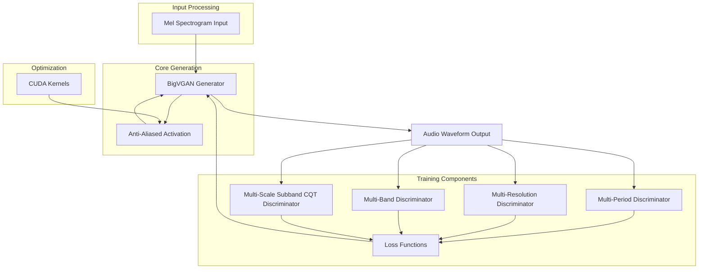

Sources: [README.md:24-27]()

### Audio Processing Pipeline

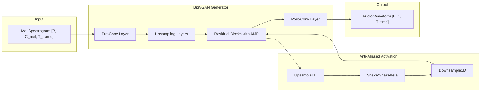

Sources: [README.md:47-80]()

## Key Components

### 1. BigVGAN Generator

The generator is the core component responsible for transforming mel spectrograms into audio waveforms. It consists of:

- Pre-convolutional layer that processes the input mel spectrogram
- Multiple upsampling layers to increase temporal resolution
- Residual blocks with Anti-aliased Multi-Periodicity (AMP) modules
- Post-convolutional layer to generate the final audio waveform

The generator supports various configurations with different upsampling ratios (256x, 512x) to handle various sampling rates (22kHz, 24kHz, 44kHz).

For more details about the generator architecture, see [BigVGAN Generator](#2.1).

Sources: [README.md:58-61](), [README.md:189-198]()

### 2. Discriminator Architectures

During training, BigVGAN uses multiple discriminators to evaluate different aspects of audio quality:

- **Multi-Period Discriminator (MPD)**: Analyzes periodic patterns in audio
- **Multi-Resolution Discriminator (MRD)**: Evaluates audio quality at different resolutions
- **Multi-Band Discriminator (MBD)**: Focuses on different frequency bands
- **Multi-Scale Subband CQT Discriminator (CQTD)**: Advanced discriminator for improved quality

For more details about discriminator architectures, see [Discriminator Architectures](#2.2).

Sources: [README.md:25](), [README.md:264-266]()

### 3. Anti-Aliased Activation System

A key innovation in BigVGAN is its anti-aliased activation mechanism:

- Combines upsampling, activation function, and downsampling operations
- Uses Snake and SnakeBeta activation functions for improved audio quality
- Implemented in both PyTorch and optimized CUDA versions
- Reduces aliasing artifacts in generated audio

For more details about anti-aliased activations, see [Anti-Aliased Activation](#2.3).

Sources: [README.md:15-17](), [README.md:146-151]()

### 4. Mel Spectrogram Processing

The system includes components for processing audio into mel spectrograms:

- Loads and resamples audio files to the target sampling rate
- Computes Short-Time Fourier Transform (STFT)
- Applies mel filterbanks and dynamic range compression
- Provides utilities for generating and manipulating mel spectrograms

For details about mel spectrogram generation, see [Mel Spectrogram Generation](#3.1).

Sources: [README.md:70-71]()

## Model Variants and Performance

BigVGAN offers multiple pre-trained model variants with different configurations:

| Model Type | Sampling Rate | Mel Bands | Max Freq | Upsampling Ratio | Parameters |
|------------|---------------|-----------|----------|------------------|------------|
| BigVGAN-v2 | 44 kHz        | 128       | 22050 Hz | 512x             | 122M       |
| BigVGAN-v2 | 44 kHz        | 128       | 22050 Hz | 256x             | 112M       |
| BigVGAN-v2 | 24 kHz        | 100       | 12000 Hz | 256x             | 112M       |
| BigVGAN-v2 | 22 kHz        | 80        | 11025 Hz | 256x             | 112M       |
| BigVGAN    | 24 kHz        | 100       | 12000 Hz | 256x             | 112M       |
| BigVGAN base | 24 kHz      | 100       | 12000 Hz | 256x             | 14M        |

The models demonstrate strong performance on objective metrics:

| Model      | PESQ(↑) | M-STFT(↓) | MCD(↓) | Periodicity(↓) | V/UV F1(↑) |
|------------|---------|-----------|--------|----------------|------------|
| BigVGAN-v2 | 4.362   | 0.7026    | 0.2903 | 0.0593         | 0.9793     |
| BigVGAN    | 4.256   | 0.7409    | 0.2988 | 0.0809         | 0.9698     |

Sources: [README.md:189-198](), [README.md:222-227]()

## CUDA Optimizations

BigVGAN includes CUDA-optimized kernels for faster inference:

- Fused upsampling + activation + downsampling kernel for anti-aliased activation
- 1.5-3x speedup on NVIDIA A100 GPUs compared to PyTorch implementation
- Achieves up to 240x real-time factor on A100 GPUs

The table below demonstrates the performance benefits of the CUDA kernel:

| GPU           | Mel Frames | CUDA Kernel | Speed (kHz) | Real-time Factor |
|---------------|------------|-------------|-------------|------------------|
| NVIDIA A100   | 256        | False       | 1672.1      | 69.7x            |
|               |            | True        | 3916.5      | 163.2x           |
| NVIDIA A100   | 16384      | False       | 1973.8      | 82.2x            |
|               |            | True        | 5761.7      | 240.1x           |

Sources: [README.md:24](), [README.md:145-183](), [README.md:231-252]()

## Integration with Hugging Face

BigVGAN can be easily used through Hugging Face Hub integration:

- Pre-trained models are available on Hugging Face
- Simple API for loading models and generating audio
- Interactive demo for testing the models

For more information about using BigVGAN through Hugging Face, see [Inference Guide](#4.2).

Sources: [README.md:21](), [README.md:46-80](), [README.md:186-198]()

---

# Page: Architecture

# Architecture

<details>
<summary>Relevant source files</summary>

The following files were used as context for generating this wiki page:

- [README.md](README.md)
- [bigvgan.py](bigvgan.py)
- [discriminators.py](discriminators.py)

</details>


This document provides a comprehensive overview of the BigVGAN neural vocoder architecture. BigVGAN is a GAN-based model designed to convert mel spectrograms into high-fidelity audio waveforms. This page covers the key architectural components, their interactions, and the unique features that make BigVGAN effective as a universal neural vocoder.

For details about specific implementation of the generator, see [BigVGAN Generator](#2.1). For anti-aliased activation mechanisms, see [Anti-Aliased Activation](#2.3). For information about training the model, see [Training Guide](#4.1).

## System Overview

BigVGAN follows a generative adversarial network (GAN) architecture with a generator and multiple discriminators. The generator transforms mel spectrograms into raw audio waveforms, while the discriminators evaluate the quality and realism of the generated audio compared to ground truth.

### Core System Architecture

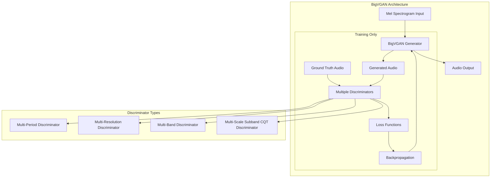

Sources: [bigvgan.py](), [discriminators.py]()

## Generator Architecture

The BigVGAN generator transforms mel spectrograms into audio waveforms through a series of upsampling and residual blocks with anti-aliased activation functions.

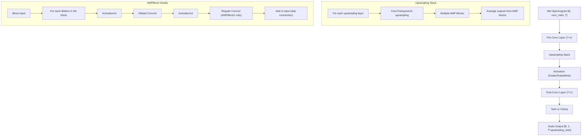

Sources: [bigvgan.py:244-388]()

### Key Components

The generator consists of these main components:

1. **Pre-Conv Layer**: 
   - Processes the input mel spectrogram with an initial convolution
   - Implemented in [bigvgan.py:286-288]()

2. **Upsampling Layers**: 
   - A series of transposed convolution layers that progressively increase the temporal resolution
   - Each layer upsamples by a factor defined in the config
   - Implemented in [bigvgan.py:301-317]()

3. **Residual Blocks with AMP**: 
   - AMP (Anti-aliased Multi-Periodicity) blocks using specialized activation functions
   - Two variants exist: `AMPBlock1` and `AMPBlock2`
   - Implemented in [bigvgan.py:31-242]()

4. **Post-Conv Layer**: 
   - Final processing with a Snake/SnakeBeta activation followed by a convolution layer
   - Outputs the waveform, typically with a tanh activation
   - Implemented in [bigvgan.py:345-385]()

### AMPBlock Variants

BigVGAN offers two variants of AMP blocks:

| Feature | AMPBlock1 | AMPBlock2 |
|---------|-----------|-----------|
| Architecture | Two convolution layers per dilation | One convolution layer per dilation |
| Implementation | [bigvgan.py:31-148]() | [bigvgan.py:150-242]() |
| Activation | Anti-aliased Snake/SnakeBeta | Anti-aliased Snake/SnakeBeta |
| Skip connection | Yes | Yes |

Sources: [bigvgan.py:31-242]()

## Discriminator Architecture

BigVGAN employs multiple discriminator architectures to capture different aspects of audio quality:

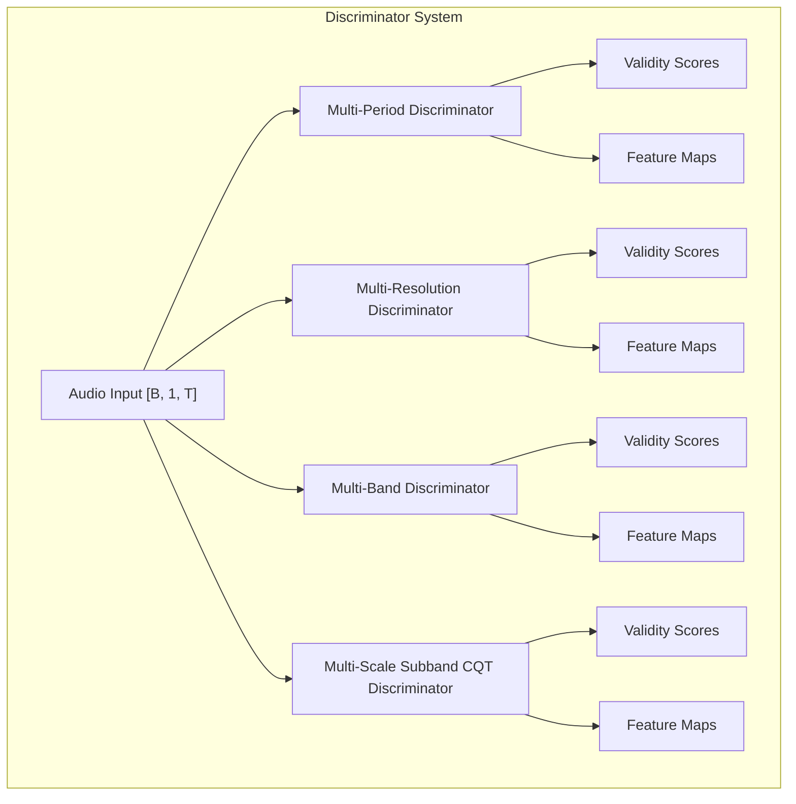

Sources: [discriminators.py]()

### Multi-Period Discriminator (MPD)

Operates on audio reshaped into 2D patterns with different period values:

- Reshapes waveform using different periods defined in `mpd_reshapes`
- Applies 2D convolutions to each reshaped representation
- Implemented in [discriminators.py:21-140]()

### Multi-Resolution Discriminator (MRD)

Analyzes audio using multiple STFT resolutions:

- Transforms audio into spectrograms using different FFT parameters
- Processes each spectrogram with 2D convolutions
- Implemented in [discriminators.py:143-277]()

### Multi-Band Discriminator (MBD)

Focuses on different frequency bands:

- Splits the spectrogram into multiple frequency bands
- Processes each band with separate convolutional pathways
- Combines features across bands for final discrimination
- Implemented in [discriminators.py:283-403]()

### Multi-Scale Subband CQT Discriminator (CQTD)

Analyzes audio using Constant-Q Transform at multiple scales:

- Applies CQT transform with different hop lengths and bins per octave
- Processes the complex CQT outputs with 2D convolutions
- New in BigVGAN-v2, adapted from Amphion
- Implemented in [discriminators.py:408-619]()

Sources: [discriminators.py](), [README.md:24-25]()

## Data Flow and Processing

The overall data flow in BigVGAN follows this pattern:

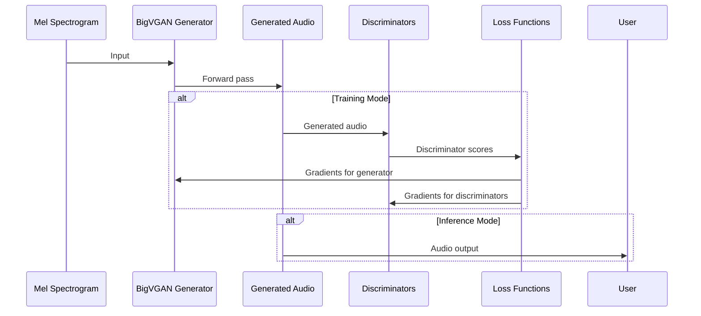

During inference, only the generator portion is used, transforming mel spectrograms directly to audio waveforms.

## Technical Implementation Details

### Architecture Hyperparameters

BigVGAN's architecture is controlled by configuration parameters that define its structure:

| Parameter | Description | Example Values |
|-----------|-------------|----------------|
| `upsample_rates` | Upsampling rates for each layer | `[8, 8, 2, 2]` |
| `upsample_kernel_sizes` | Kernel sizes for each upsampling layer | `[16, 16, 4, 4]` |
| `upsample_initial_channel` | Initial number of channels | `512` |
| `resblock_kernel_sizes` | Kernel sizes for residual blocks | `[3, 7, 11]` |
| `resblock_dilation_sizes` | Dilation rates for residual blocks | `[[1,3,5], [1,3,5], [1,3,5]]` |
| `resblock` | Type of residual block to use | `"1"` or `"2"` |
| `activation` | Activation function type | `"snake"` or `"snakebeta"` |

Sources: [README.md:186-201](), [bigvgan.py:267-360]()

### CUDA Optimization

BigVGAN-v2 introduced custom CUDA kernels for accelerated inference:

- Fused upsampling + activation + downsampling operations
- Provides 1.5-3x speedup compared to PyTorch implementation
- Enabled via the `use_cuda_kernel` parameter
- Only used during inference, not training

Sources: [README.md:24-26](), [README.md:144-182]()

## Model Configurations

BigVGAN is available in multiple configurations for different audio quality and computational requirements:

| Model | Sampling Rate | Mel Bands | Max Frequency | Upsampling Ratio | Parameters |
|-------|---------------|-----------|--------------|------------------|------------|
| BigVGAN-v2 (44kHz) | 44 kHz | 128 | 22050 Hz | 512x | 122M |
| BigVGAN-v2 (24kHz) | 24 kHz | 100 | 12000 Hz | 256x | 112M |
| BigVGAN-v2 (22kHz) | 22 kHz | 80 | 11025 Hz | 256x | 112M |
| BigVGAN base | 22-24 kHz | 80-100 | 8000-12000 Hz | 256x | 14M |

Sources: [README.md:186-201]()

## Summary

The BigVGAN architecture combines:

1. A powerful generator with anti-aliased periodicity-based activation functions
2. Multiple complementary discriminators for different audio characteristics
3. Optimized CUDA kernels for efficient inference
4. Flexible configuration options for different audio quality requirements

This architecture enables BigVGAN to serve as a universal neural vocoder for high-quality audio synthesis across a wide range of applications.

Sources: [bigvgan.py](), [discriminators.py](), [README.md]()

---

# Page: BigVGAN Generator

# BigVGAN Generator

<details>
<summary>Relevant source files</summary>

The following files were used as context for generating this wiki page:

- [README.md](README.md)
- [bigvgan.py](bigvgan.py)

</details>


## Purpose and Scope

The BigVGAN Generator is the core component of the BigVGAN neural vocoder system that transforms mel spectrograms into high-fidelity audio waveforms. It features anti-aliased periodic activations for residual blocks to reduce aliasing artifacts and improve audio quality. This document covers the architecture, components, and data flow of the generator model specifically. For information about the discriminator architectures used during training, see [Discriminator Architectures](#2.2). For details on the anti-aliased activation system, see [Anti-Aliased Activation](#2.3).

Sources: [README.md:1-28](), [bigvgan.py:254-257]()

## Architecture Overview

The BigVGAN Generator follows a convolutional architecture with upsampling layers and residual blocks utilizing anti-aliased activations. Below is a diagram of its overall structure:

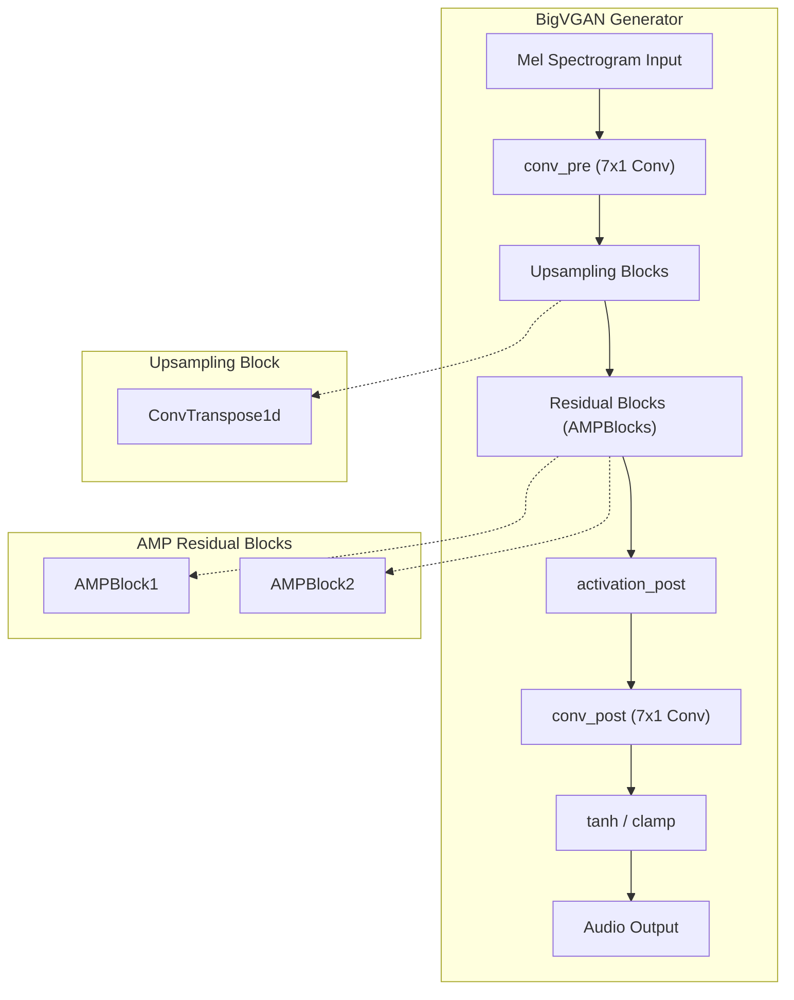

Sources: [bigvgan.py:267-387]()

## Core Components

### BigVGAN Class

The `BigVGAN` class is the main generator module that implements the neural vocoder. It has the following key components:

1. **Pre-conv layer**: A 7×1 convolution that processes the input mel spectrogram.
2. **Upsampling layers**: A series of transposed convolutions that progressively increase the temporal resolution.
3. **Residual blocks**: AMP (Anti-aliased Multi-Periodicity) blocks that apply specialized activation functions.
4. **Post-conv layer**: A final 7×1 convolution followed by a tanh activation or clamping operation.

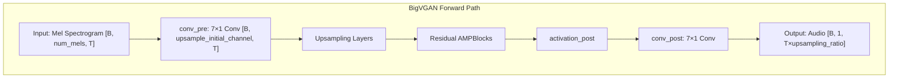

Sources: [bigvgan.py:244-401]()

### Initialization and Key Parameters

The BigVGAN Generator is configured using a set of hyperparameters (`h`) that define its structure:

| Parameter | Description |
|-----------|-------------|
| `num_mels` | Number of mel spectrogram bands in the input |
| `upsample_initial_channel` | Initial number of channels before downsampling |
| `upsample_rates` | List of upsampling rates for each transposed convolution |
| `upsample_kernel_sizes` | Kernel sizes for each transposed convolution |
| `resblock_kernel_sizes` | Kernel sizes for convolutions in residual blocks |
| `resblock_dilation_sizes` | Dilation rates for convolutions in residual blocks |
| `resblock` | Type of residual block to use (`"1"` for AMPBlock1, `"2"` for AMPBlock2) |
| `activation` | Activation function to use (`"snake"` or `"snakebeta"`) |
| `snake_logscale` | Whether to use logarithmic scale for activation parameters |
| `use_cuda_kernel` | Whether to use optimized CUDA kernels for activation (inference only) |

Sources: [bigvgan.py:267-282](), [bigvgan.py:404-493]()

### AMPBlocks (Anti-aliased Multi-Periodicity Blocks)

AMPBlocks are specialized residual blocks that incorporate anti-aliased activation functions to reduce aliasing artifacts. The BigVGAN Generator supports two types of AMPBlocks:

#### AMPBlock1

`AMPBlock1` contains two sets of convolution layers:
- `convs1`: Convolutions with specified dilations
- `convs2`: Additional convolutions with fixed dilation=1

Each convolution is preceded by an anti-aliased activation function. This configuration provides additional processing capacity.

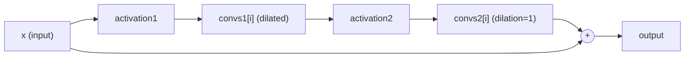

Sources: [bigvgan.py:31-148]()

#### AMPBlock2

`AMPBlock2` is a simpler version with only one set of convolution layers:
- `convs`: Convolutions with specified dilations

Like AMPBlock1, each convolution is preceded by an anti-aliased activation function.

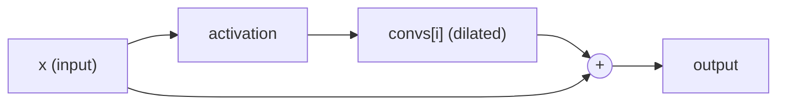

Sources: [bigvgan.py:150-241]()

### Activation Functions

BigVGAN uses specialized periodic activation functions that are anti-aliased to improve audio quality:

1. **Snake**: A periodic activation function with trainable parameters that control periodicity.
2. **SnakeBeta**: An enhanced version of Snake that provides better convergence properties.

Both activation functions are implemented using the `Activation1d` module, which applies anti-aliasing through upsampling, activation, and downsampling steps.

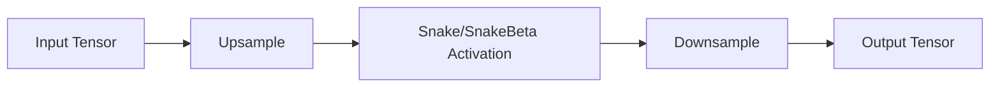

Sources: [bigvgan.py:104-126](), [bigvgan.py:204-231](), [bigvgan.py:332-345]()

## Data Flow

The complete data flow through the BigVGAN Generator is shown below:

```mermaid
flowchart TD
    subgraph "Data Flow Through BigVGAN Generator"
        input["Input: Mel Spectrogram [B, num_mels, T_frames]"]
        
        subgraph "Initial Processing"
            conv_pre["conv_pre: 7×1 Conv"]
        end
        
        subgraph "Upsampling Stage"
            for_ups["For each upsampling layer (i)"]
            trans_conv["TransposedConv1d (ups[i])"]
        end
        
        subgraph "Residual Processing"
            for_res["For each kernel (j)"]
            res_block["AMPBlock (resblocks[i*num_kernels+j])"]
            avg["Average contributions (xs / num_kernels)"]
        end
        
        subgraph "Final Processing"
            act_post["activation_post"]
            conv_post["conv_post: 7×1 Conv"]
            tanh["tanh/clamp to [-1,1]"]
        end
        
        output["Output: Audio Waveform [B, 1, T_samples]"]
        
        input --> conv_pre
        conv_pre --> for_ups
        for_ups --> trans_conv
        trans_conv --> for_res
        for_res --> res_block
        res_block --> avg
        avg --> |"Next upsampling layer\nor final processing"| act_post
        act_post --> conv_post
        conv_post --> tanh
        tanh --> output
    end
```

Sources: [bigvgan.py:361-387]()

## CUDA Optimization

The BigVGAN Generator supports optimized CUDA kernels for the anti-aliased activation functions, which can significantly accelerate inference speed (1.5-3x faster). This optimization is available through the `use_cuda_kernel` parameter.

The CUDA implementation replaces the PyTorch implementation of `Activation1d` with an optimized CUDA kernel that fuses the upsampling, activation, and downsampling operations into a single operation.

| Implementation | Speed on A100 GPU (16384 frames) | VRAM Usage |
|----------------|----------------------------------|------------|
| PyTorch        | 1973.8 kHz (82.2x real-time)     | 5.0 GB     |
| CUDA Kernel    | 5761.7 kHz (240.1x real-time)    | 4.4 GB     |

Sources: [README.md:144-252](), [bigvgan.py:95-102](), [bigvgan.py:195-202]()

## Generator Initialization and Usage

Below is the typical usage pattern for initializing and using the BigVGAN Generator:

1. **Creation and initialization**:
```python
# Load hyperparameters from config file
h = load_hparams_from_json('config.json')
# Create generator (with optional CUDA optimization)
generator = BigVGAN(h, use_cuda_kernel=False)
```

2. **Loading pretrained weights**:
```python
# From Hugging Face Hub
model = BigVGAN.from_pretrained('nvidia/bigvgan_v2_24khz_100band_256x')
# Or local checkpoint
checkpoint = torch.load('bigvgan_generator.pt')
model.load_state_dict(checkpoint['generator'])
```

3. **Inference**:
```python
# Remove weight norm for faster inference
model.remove_weight_norm()
model = model.eval().to(device)
# Forward pass
with torch.inference_mode():
    audio = model(mel_spectrogram)
```

Sources: [README.md:47-80](), [bigvgan.py:389-493]()

## Available Configurations

The BigVGAN Generator comes in multiple configurations that vary by sampling rate, mel band count, and upsampling ratio:

| Model | Sampling Rate | Mel Bands | Upsampling Ratio | Parameters |
|-------|---------------|-----------|------------------|------------|
| BigVGAN v2 44kHz | 44 kHz | 128 | 512x | 122M |
| BigVGAN v2 44kHz | 44 kHz | 128 | 256x | 112M |
| BigVGAN v2 24kHz | 24 kHz | 100 | 256x | 112M |
| BigVGAN v2 22kHz | 22 kHz | 80 | 256x | 112M |
| BigVGAN Base | 24/22 kHz | 100/80 | 256x | 14M |

Sources: [README.md:184-200]()

---

# Page: Discriminator Architectures

# Discriminator Architectures

<details>
<summary>Relevant source files</summary>

The following files were used as context for generating this wiki page:

- [README.md](README.md)
- [discriminators.py](discriminators.py)

</details>


This page documents the discriminator architectures used in BigVGAN's adversarial training framework. Discriminators are critical components that evaluate audio quality by distinguishing between real and generated audio samples, providing feedback signals that guide the generator's training. For information about the generator architecture, see [BigVGAN Generator](#2.1).

## Overview of Discriminator Role in BigVGAN

BigVGAN implements multiple discriminator architectures, each specializing in different aspects of audio quality assessment. These discriminators work together to provide comprehensive feedback that helps the generator produce high-fidelity audio.

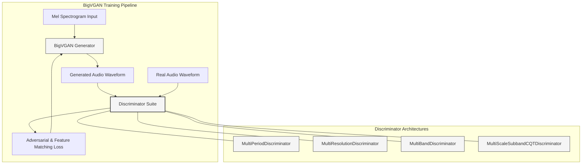

Sources: [discriminators.py:21-652]()

## Multi-Period Discriminator (MPD)

The Multi-Period Discriminator operates directly on raw waveforms and consists of multiple sub-discriminators, each analyzing patterns at different periodic intervals.

```mermaid
graph TD
    subgraph "MultiPeriodDiscriminator Architecture"
        Audio["Input Audio Waveform"]
        MPD["MultiPeriodDiscriminator Class"]
        
        Audio --> MPD
        
        subgraph "Multiple Period Discriminators"
            P1["DiscriminatorP (period=2)"]
            P2["DiscriminatorP (period=3)"]
            P3["DiscriminatorP (period=5)"]
            P4["DiscriminatorP (period=7)"]
            P5["DiscriminatorP (period=11)"]
            
            MPD --> P1
            MPD --> P2
            MPD --> P3
            MPD --> P4
            MPD --> P5
        end
        
        subgraph "For Each DiscriminatorP"
            Reshape["Reshape to 2D (B,C,T/period,period)"]
            Conv1["Conv2D Layer 1 (32*d_mult channels)"]
            Conv2["Conv2D Layer 2 (128*d_mult channels)"]
            Conv3["Conv2D Layer 3 (512*d_mult channels)"]
            Conv4["Conv2D Layer 4 (1024*d_mult channels)"]
            Conv5["Conv2D Layer 5 (1024*d_mult channels)"]
            ConvPost["Conv2D Post (1 channel)"]
            
            P3 --> Reshape
            Reshape --> Conv1
            Conv1 --> Conv2
            Conv2 --> Conv3
            Conv3 --> Conv4
            Conv4 --> Conv5
            Conv5 --> ConvPost
        end
        
        FeatMaps["Feature Maps (for feature matching)"]
        Scores["Discrimination Scores"]
        
        ConvPost --> FeatMaps
        ConvPost --> Scores
    end

    style MPD fill:#f5f5f5,stroke:#333,stroke-width:2px
    style Audio fill:#f5f5f5,stroke:#333,stroke-width:1px
    style FeatMaps fill:#f5f5f5,stroke:#333,stroke-width:1px
    style Scores fill:#f5f5f5,stroke:#333,stroke-width:1px
```

The MPD works by:

1. Taking raw audio waveforms as input
2. Applying multiple discriminators with different period values (reshaping dimensions)
3. Each discriminator performs 2D convolutions on reshaped waveforms
4. Processing through a series of convolutional layers with LeakyReLU activations
5. Collecting feature maps from each layer for feature matching loss
6. Outputting final discrimination scores

The period value determines how the 1D waveform is reshaped into a 2D representation. For example, with a period of 2, a waveform of length 1000 would be reshaped to (500, 2).

Sources: [discriminators.py:21-140]()

## Multi-Resolution Discriminator (MRD)

The Multi-Resolution Discriminator analyzes spectrograms rather than raw waveforms, capturing time-frequency characteristics at different resolutions.

```mermaid
graph TD
    subgraph "MultiResolutionDiscriminator Architecture"
        Audio["Input Audio Waveform"]
        MRD["MultiResolutionDiscriminator Class"]
        
        Audio --> MRD
        
        subgraph "Multiple Resolution Discriminators"
            R1["DiscriminatorR (FFT size 1024)"]
            R2["DiscriminatorR (FFT size 2048)"]
            R3["DiscriminatorR (FFT size 512)"]
            
            MRD --> R1
            MRD --> R2
            MRD --> R3
        end
        
        subgraph "For Each DiscriminatorR"
            STFT["STFT Transform"]
            MagSpec["Magnitude Spectrogram"]
            Conv1["Conv2D Layer 1 (32*d_mult channels)"]
            Conv2["Conv2D Layer 2 (32*d_mult channels)"]
            Conv3["Conv2D Layer 3 (32*d_mult channels)"]
            Conv4["Conv2D Layer 4 (32*d_mult channels)"]
            Conv5["Conv2D Layer 5 (32*d_mult channels)"]
            ConvPost["Conv2D Post (1 channel)"]
            
            R1 --> STFT
            STFT --> MagSpec
            MagSpec --> Conv1
            Conv1 --> Conv2
            Conv2 --> Conv3
            Conv3 --> Conv4
            Conv4 --> Conv5
            Conv5 --> ConvPost
        end
        
        FeatMaps["Feature Maps (for feature matching)"]
        Scores["Discrimination Scores"]
        
        ConvPost --> FeatMaps
        ConvPost --> Scores
    end

    style MRD fill:#f5f5f5,stroke:#333,stroke-width:2px
    style Audio fill:#f5f5f5,stroke:#333,stroke-width:1px
    style MagSpec fill:#f5f5f5,stroke:#333,stroke-width:1px
    style FeatMaps fill:#f5f5f5,stroke:#333,stroke-width:1px
    style Scores fill:#f5f5f5,stroke:#333,stroke-width:1px
```

The MRD works by:

1. Taking raw audio waveforms as input
2. Applying multiple discriminators with different STFT parameters
3. Each discriminator computes a magnitude spectrogram using STFT
4. Processing through a series of 2D convolutional layers with LeakyReLU activations
5. Collecting feature maps from each layer for feature matching loss
6. Outputting final discrimination scores

Different FFT sizes allow the discriminator to analyze audio at different time-frequency trade-offs, capturing both fine temporal details and precise frequency information.

Sources: [discriminators.py:143-277]()

## Multi-Band Discriminator (MBD)

The Multi-Band Discriminator divides the audio spectrum into multiple frequency bands and analyzes each band separately, allowing specialized focus on different frequency regions.

```mermaid
graph TD
    subgraph "MultiBandDiscriminator Architecture"
        Audio["Input Audio Waveform"]
        MBD["MultiBandDiscriminator Class"]
        
        Audio --> MBD
        
        subgraph "Multiple Scales"
            B1["DiscriminatorB (window=2048)"]
            B2["DiscriminatorB (window=1024)"]
            B3["DiscriminatorB (window=512)"]
            
            MBD --> B1
            MBD --> B2
            MBD --> B3
        end
        
        subgraph "For Each DiscriminatorB"
            Spectrogram["Compute Spectrogram"]
            
            subgraph "Frequency Bands"
                Band1["Band1 (0.0-0.1)"]
                Band2["Band2 (0.1-0.25)"]
                Band3["Band3 (0.25-0.5)"]
                Band4["Band4 (0.5-0.75)"]
                Band5["Band5 (0.75-1.0)"]
            end
            
            B1 --> Spectrogram
            Spectrogram --> Band1
            Spectrogram --> Band2
            Spectrogram --> Band3
            Spectrogram --> Band4
            Spectrogram --> Band5
            
            subgraph "For Each Band"
                Conv1["Conv2D Layer 1"]
                Conv2["Conv2D Layer 2"]
                Conv3["Conv2D Layer 3"]
                Conv4["Conv2D Layer 4"]
                Conv5["Conv2D Layer 5"]
            end
            
            Band1 --> Conv1
            Band2 --> Conv1
            Band3 --> Conv1
            Band4 --> Conv1
            Band5 --> Conv1
            
            Conv1 --> Conv2
            Conv2 --> Conv3
            Conv3 --> Conv4
            Conv4 --> Conv5
            
            Combine["Concatenate Band Features"]
            ConvPost["Conv2D Post (1 channel)"]
            
            Conv5 --> Combine
            Combine --> ConvPost
        end
        
        FeatMaps["Feature Maps (for feature matching)"]
        Scores["Discrimination Scores"]
        
        ConvPost --> FeatMaps
        ConvPost --> Scores
    end

    style MBD fill:#f5f5f5,stroke:#333,stroke-width:2px
    style Audio fill:#f5f5f5,stroke:#333,stroke-width:1px
    style FeatMaps fill:#f5f5f5,stroke:#333,stroke-width:1px
    style Scores fill:#f5f5f5,stroke:#333,stroke-width:1px
```

The MBD works by:

1. Taking raw audio waveforms as input
2. Computing spectrograms at multiple resolutions (window sizes)
3. For each spectrogram, dividing the frequency range into multiple bands
4. Processing each band through the same convolutional architecture
5. Combining features from all bands and applying a final convolution
6. Collecting feature maps for feature matching loss
7. Outputting final discrimination scores

This architecture allows the discriminator to focus on specific frequency ranges, which is particularly useful for detecting artifacts in different parts of the spectrum.

Sources: [discriminators.py:280-403]()

## Multi-Scale Subband CQT Discriminator (CQTD)

The Multi-Scale Subband CQT Discriminator uses the Constant-Q Transform (CQT), which has a logarithmic frequency scale similar to human auditory perception, making it particularly well-suited for audio quality assessment.

```mermaid
graph TD
    subgraph "MultiScaleSubbandCQTDiscriminator Architecture"
        Audio["Input Audio Waveform"]
        CQTD["MultiScaleSubbandCQTDiscriminator Class"]
        
        Audio --> CQTD
        
        subgraph "Multiple CQT Scales"
            C1["DiscriminatorCQT (hop=512, bins=24)"]
            C2["DiscriminatorCQT (hop=256, bins=36)"]
            C3["DiscriminatorCQT (hop=256, bins=48)"]
            
            CQTD --> C1
            CQTD --> C2
            CQTD --> C3
        end
        
        subgraph "For Each DiscriminatorCQT"
            Resample["Resample to 2x sampling rate"]
            CQT["CQT Transform"]
            SplitComp["Split into Amplitude and Phase"]
            
            subgraph "Octave Processing"
                Oct1["Octave 1 Processing"]
                Oct2["Octave 2 Processing"]
                OctN["Octave N Processing"]
                CombineOct["Combine Octaves"]
            end
            
            C1 --> Resample
            Resample --> CQT
            CQT --> SplitComp
            SplitComp --> Oct1
            SplitComp --> Oct2
            SplitComp --> OctN
            Oct1 --> CombineOct
            Oct2 --> CombineOct
            OctN --> CombineOct
            
            Conv1["Conv2D Layer 1"]
            Conv2["Conv2D Layer with Dilation=1"]
            Conv3["Conv2D Layer with Dilation=2"]
            Conv4["Conv2D Layer with Dilation=4"]
            Conv5["Conv2D Final Layer"]
            ConvPost["Conv2D Post (1 channel)"]
            
            CombineOct --> Conv1
            Conv1 --> Conv2
            Conv2 --> Conv3
            Conv3 --> Conv4
            Conv4 --> Conv5
            Conv5 --> ConvPost
        end
        
        FeatMaps["Feature Maps (for feature matching)"]
        Scores["Discrimination Scores"]
        
        ConvPost --> FeatMaps
        ConvPost --> Scores
    end

    style CQTD fill:#f5f5f5,stroke:#333,stroke-width:2px
    style Audio fill:#f5f5f5,stroke:#333,stroke-width:1px
    style CQT fill:#f5f5f5,stroke:#333,stroke-width:1px
    style FeatMaps fill:#f5f5f5,stroke:#333,stroke-width:1px
    style Scores fill:#f5f5f5,stroke:#333,stroke-width:1px
```

The CQTD works by:

1. Taking raw audio waveforms as input
2. Resampling the audio to twice the sampling rate (for higher frequency resolution)
3. Computing CQT transforms with different hop lengths and bins per octave
4. Splitting the complex CQT output into amplitude and phase components
5. Processing each octave separately with initial convolutions
6. Combining octave outputs and applying a series of dilated convolutions
7. Collecting feature maps for feature matching loss
8. Outputting final discrimination scores

The CQT's logarithmic frequency scale provides better resolution in lower frequencies (where human hearing is more sensitive) while maintaining reasonable computational requirements at higher frequencies.

Sources: [discriminators.py:406-618]()

## Combined Discriminator

BigVGAN can combine multiple discriminator architectures into a single discriminator chain, allowing it to leverage the strengths of each architecture.

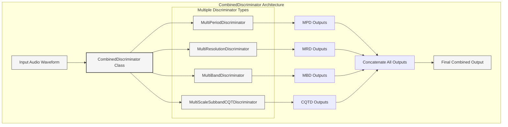

The CombinedDiscriminator works by:

1. Taking raw audio waveforms as input
2. Passing the input through multiple discriminator architectures
3. Collecting the outputs (scores and feature maps) from each discriminator
4. Concatenating the outputs to form a comprehensive evaluation
5. The combined outputs are used for adversarial and feature matching losses

This approach provides a more robust evaluation of audio quality by leveraging different analysis methods, each with its own strengths in detecting specific types of artifacts.

Sources: [discriminators.py:622-651]()

## Discriminator Configuration Parameters

BigVGAN provides configuration options for each discriminator architecture through the configuration file. Below are the key parameters for each discriminator type:

| Discriminator | Parameter | Description | Default/Example |
|---------------|-----------|-------------|----------------|
| MPD | `mpd_reshapes` | List of period values | `[2, 3, 5, 7, 11]` |
| MPD | `discriminator_channel_mult` | Channel multiplier for network width | `1` |
| MPD | `use_spectral_norm` | Whether to use spectral normalization | `false` |
| MRD | `resolutions` | List of STFT parameters (n_fft, hop_length, win_length) | `[[1024, 120, 600], [2048, 240, 1200], [512, 50, 240]]` |
| MRD | `mrd_use_spectral_norm` | Whether to use spectral normalization for MRD | `false` |
| MRD | `mrd_channel_mult` | Channel multiplier specific to MRD | `1` |
| MBD | `mbd_fft_sizes` | List of FFT sizes for multi-band discriminator | `[2048, 1024, 512]` |
| CQTD | `cqtd_filters` | Initial number of filters | `32` |
| CQTD | `cqtd_max_filters` | Maximum number of filters | `1024` |
| CQTD | `cqtd_filters_scale` | Scale factor for filters | `1` |
| CQTD | `cqtd_dilations` | Dilation rates for convolutions | `[1, 2, 4]` |
| CQTD | `cqtd_hop_lengths` | Hop lengths for CQT transforms | `[512, 256, 256]` |
| CQTD | `cqtd_n_octaves` | Number of octaves for CQT | `[9, 9, 9]` |
| CQTD | `cqtd_bins_per_octaves` | Bins per octave for CQT | `[24, 36, 48]` |
| CQTD | `cqtd_normalize_volume` | Whether to normalize volume in CQTD | `false` |

Sources: [discriminators.py:21-652](), [README.md:24-27]()

## Evolution in BigVGAN-v2

In BigVGAN-v2, the discriminator architecture was improved by incorporating the multi-scale subband CQT discriminator, which has shown better performance for audio quality assessment. As noted in the README:

> "Improved discriminator and loss: BigVGAN-v2 is trained using a [multi-scale sub-band CQT discriminator](https://arxiv.org/abs/2311.14957) and a [multi-scale mel spectrogram loss](https://arxiv.org/abs/2306.06546)."

This addition helps the generator produce higher quality audio with fewer artifacts, especially for non-speech audio like environmental sounds and instruments.

Sources: [README.md:24-27]()

---

# Page: Anti-Aliased Activation

# Anti-Aliased Activation

<details>
<summary>Relevant source files</summary>

The following files were used as context for generating this wiki page:

- [README.md](README.md)
- [alias_free_activation/cuda/activation1d.py](alias_free_activation/cuda/activation1d.py)
- [alias_free_activation/cuda/compat.h](alias_free_activation/cuda/compat.h)
- [alias_free_activation/cuda/type_shim.h](alias_free_activation/cuda/type_shim.h)
- [alias_free_activation/torch/__init__.py](alias_free_activation/torch/__init__.py)
- [alias_free_activation/torch/act.py](alias_free_activation/torch/act.py)
- [alias_free_activation/torch/filter.py](alias_free_activation/torch/filter.py)
- [alias_free_activation/torch/resample.py](alias_free_activation/torch/resample.py)

</details>


## Purpose

Anti-aliased activation is a critical component in BigVGAN that reduces aliasing artifacts during audio synthesis. Aliasing occurs when high-frequency components in a signal are not properly sampled, leading to distortion in the generated audio. The anti-aliased activation technique minimizes these artifacts by applying activation functions at a higher resolution with proper filtering.

This document explains the implementation and usage of anti-aliased activation in BigVGAN. For information about the overall architecture of BigVGAN, see [Architecture](#2).

Sources: [alias_free_activation/torch/act.py]()(adapter), [README.md:16-17]()

## Concept and Workflow

Anti-aliased activation in BigVGAN follows a three-step process:

1. **Upsampling**: The input tensor is upsampled to a higher resolution using a Kaiser-sinc filter
2. **Activation**: A non-linear activation function (Snake or SnakeBeta) is applied to the upsampled tensor
3. **Downsampling**: The activated tensor is downsampled back to the original resolution using a Kaiser-sinc filter

This approach mitigates aliasing by ensuring the activation function operates on a higher-resolution signal, where high-frequency artifacts can be properly filtered out during downsampling.

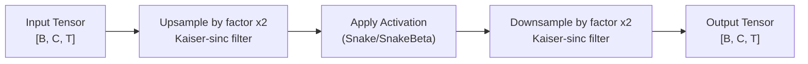

Sources: [alias_free_activation/torch/act.py:8-30](), [alias_free_activation/torch/resample.py:10-58]()

## Implementations

BigVGAN provides two implementations of anti-aliased activation:

### PyTorch Implementation

The PyTorch implementation is defined in the `Activation1d` class in `alias_free_activation/torch/act.py` and performs the three steps sequentially:

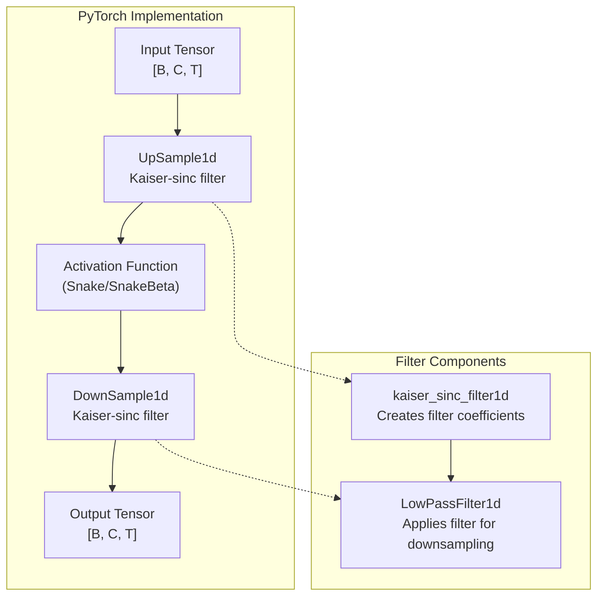

Key implementation details:
- `UpSample1d` applies a transposed convolution with the Kaiser-sinc filter
- Activation functions preserve the higher temporal resolution
- `DownSample1d` applies a standard convolution with the same filter at the appropriate stride

Sources: [alias_free_activation/torch/act.py:8-30](), [alias_free_activation/torch/resample.py:10-58](), [alias_free_activation/torch/filter.py:30-102]()

### CUDA-Optimized Implementation

The CUDA-optimized implementation, defined in `alias_free_activation/cuda/activation1d.py`, fuses the three operations into a single CUDA kernel for improved performance:

```mermaid
flowchart TD
    subgraph "CUDA Implementation"
        Input["Input Tensor\n[B, C, T]"] --> Check{"fused == True?"}
        Check -->|"Yes"| FusedOp["FusedAntiAliasActivation\nSingle CUDA kernel"]
        Check -->|"No"| StandardOp["Standard PyTorch implementation"]
        FusedOp --> Output["Output Tensor\n[B, C, T]"]
        StandardOp --> Output
    end
    
    subgraph "Under the Hood"
        FusedKernel["anti_alias_activation_cuda.forward()"]
        ParamHandling["Parameter handling\n(alpha/beta conversion)"]
        
        FusedOp --> ParamHandling
        ParamHandling --> FusedKernel
    end
```

Key implementation details:
- Uses a custom CUDA kernel to perform all three operations in a single GPU call
- Assumes filter size 12, replication padding, and specific parameter formats
- Significantly reduces memory bandwidth usage by eliminating intermediate tensor storage

Sources: [alias_free_activation/cuda/activation1d.py:14-77]()

## Activation Functions

Two main activation functions are used with anti-aliasing in BigVGAN:

### Snake Activation

```
Snake(x) = x + sin²(alpha * x)
```
Where `alpha` is a learnable parameter.

### SnakeBeta Activation

```
SnakeBeta(x) = x + beta * sin²(alpha * x)
```
Where both `alpha` and `beta` are learnable parameters.

Both activations typically use log-scale parameterization in BigVGAN, meaning the parameters are stored in log-space and exponentiated during computation. The CUDA kernel expects log-scale inputs, so a log transformation is applied when needed:

```mermaid
flowchart TD
    ActType["Determine activation type"] -->|"Snake"| Snake["beta = alpha\n(Same parameter for both)"]
    ActType -->|"SnakeBeta"| SnakeBeta["Use separate alpha and beta"]
    
    Snake --> LogCheck{"alpha_logscale == False?"}
    SnakeBeta --> LogCheck
    
    LogCheck -->|"Yes"| Log["Apply log transformation:\nalpha = log(alpha)\nbeta = log(beta)"]
    LogCheck -->|"No"| NoLog["Use parameters as-is\n(already in log-scale)"]
    
    Log --> CUDA["Pass to CUDA kernel"]
    NoLog --> CUDA
```

Sources: [alias_free_activation/cuda/activation1d.py:61-76]()

## Technical Implementation Details

### Upsampling Process

The upsampling operation:
1. Pads the input tensor using replication mode
2. Applies a transposed convolution with the Kaiser-sinc filter, with weights scaled by the upsampling ratio
3. Removes padding from the result to maintain the correct output size

The Kaiser-sinc filter is constructed to preserve frequency content below the Nyquist frequency of the target sample rate.

Sources: [alias_free_activation/torch/filter.py:30-62](), [alias_free_activation/torch/resample.py:10-38]()

### Downsampling Process

The downsampling operation:
1. Pads the input tensor using replication mode
2. Applies a convolution with the Kaiser-sinc filter at stride = downsampling ratio
3. Returns the filtered and downsampled result

Sources: [alias_free_activation/torch/filter.py:65-102](), [alias_free_activation/torch/resample.py:41-58]()

### Memory Efficiency of the CUDA Implementation

```mermaid
flowchart LR
    subgraph "PyTorch Implementation"
        direction TB
        PT1["Input tensor\n[B, C, T]"] --> PT2["Upsampled tensor\n[B, C, 2T]"]
        PT2 --> PT3["Activated tensor\n[B, C, 2T]"]
        PT3 --> PT4["Output tensor\n[B, C, T]"]
    end
    
    subgraph "CUDA Implementation"
        direction TB
        CUDA1["Input tensor\n[B, C, T]"] --> CUDA2["Internal computation\n(no intermediate storage)"]
        CUDA2 --> CUDA3["Output tensor\n[B, C, T]"]
    end
```

The CUDA implementation eliminates the need to store large intermediate tensors, resulting in:
- Lower memory usage (especially important for long audio sequences)
- Reduced memory bandwidth requirements
- Fewer kernel launches

Sources: [alias_free_activation/cuda/activation1d.py:14-33](), [README.md:150-163]()

## Integration with BigVGAN Architecture

Anti-aliased activation is a core component in the BigVGAN generator, used within residual blocks containing Anti-aliased Multi-Periodicity (AMP) modules:

```mermaid
flowchart TD
    subgraph "BigVGAN Generator"
        Input["Mel Spectrogram Input"] --> PreConv["Pre-Convolution"]
        PreConv --> Upsample["Upsampling Layers"]
        Upsample --> ResBlocks["Residual Blocks with AMP"]
        ResBlocks --> PostConv["Post-Convolution"]
        PostConv --> Output["Audio Output"]
    end
    
    subgraph "AMP Block Detail"
        ResIn["Block Input"] --> Split["Split Processing Paths"]
        Split --> Path1["Path 1 with Anti-Aliased Activation"]
        Split --> Path2["Path 2 with Anti-Aliased Activation"]
        Path1 --> Combine["Combine Paths"]
        Path2 --> Combine
        Combine --> ResOut["Block Output"]
    end
    
    ResBlocks -.-> ResIn
```

The anti-aliased activations help the model handle complex patterns in audio generation while minimizing artifacts, especially at high frequencies.

Sources: [README.md:9-28]()

## Performance Benefits

The CUDA-optimized implementation provides significant performance improvements over the PyTorch implementation:

| GPU | PyTorch Implementation | CUDA Implementation | Speedup | Real-time Factor |
|-----|------------------------|---------------------|---------|-----------------|
| NVIDIA A100 | 1672.1 kHz | 3916.5 kHz | 2.34x | 163.2x |
| NVIDIA RTX 3080 | 841.1 kHz | 1598.1 kHz | 1.90x | 66.6x |
| NVIDIA RTX 2080 Ti | 515.6 kHz | 811.3 kHz | 1.57x | 33.8x |

For longer inputs (16384 frames), the speedup can reach up to 2.92x on an A100 GPU, with reduced VRAM usage compared to the PyTorch implementation.

Sources: [README.md:233-246]()

## Usage

### Using CUDA-Optimized Implementation in BigVGAN

```python
# When initializing a new model
from bigvgan import BigVGAN
model = BigVGAN(h, use_cuda_kernel=True)

# Or when loading a pretrained model
model = BigVGAN.from_pretrained('nvidia/bigvgan_v2_24khz_100band_256x', use_cuda_kernel=True)
```

### Using in Inference Scripts

You can enable the CUDA kernel when running inference:

```bash
python inference.py --checkpoint_file /path/to/model.pt --input_wavs_dir /input/dir --output_dir /output/dir --use_cuda_kernel
```

### Testing CUDA Kernel Correctness

Before using the CUDA-optimized implementation in production, you can verify its correctness:

```bash
python tests/test_cuda_vs_torch_model.py --checkpoint_file /path/to/model.pt
```

A successful test will output: `[Success] test CUDA fused vs. plain torch BigVGAN inference`

Sources: [README.md:156-181]()

## Conclusion

Anti-aliased activation is a crucial component of BigVGAN that significantly improves audio quality by reducing aliasing artifacts. The CUDA-optimized implementation provides substantial performance benefits without compromising quality, making it suitable for real-time applications.

By properly handling high-frequency components through this upsampling-activation-downsampling process, BigVGAN produces cleaner, more natural-sounding audio with fewer artifacts, contributing to its state-of-the-art performance in neural vocoding tasks.

Sources: [README.md:9-28](), [alias_free_activation/cuda/activation1d.py:14-19]()

---

# Page: Data Processing

# Data Processing

<details>
<summary>Relevant source files</summary>

The following files were used as context for generating this wiki page:

- [README.md](README.md)
- [meldataset.py](meldataset.py)

</details>


This page documents the data processing pipeline in BigVGAN, focusing on how audio data is loaded, preprocessed, and converted into mel spectrograms for neural vocoder training and inference. For information about model architecture, see [Architecture](#2).

## Overview

BigVGAN's data processing pipeline handles audio files from various sources, applying normalization, resampling, and mel spectrogram extraction to prepare inputs for the generator. The process ensures consistent representation regardless of the source audio characteristics.

```mermaid
flowchart TD
    subgraph "Audio Input Processing"
        AudioFile["Audio File (.wav)"] --> LibrosaLoad["librosa.load()"]
        LibrosaLoad --> AudioNormalize["Normalize Audio [-1, 1]"]
        AudioNormalize --> OptionalResampling["Optional Resampling"]
    end

    subgraph "Mel Spectrogram Generation"
        OptionalResampling --> STFT["Short-Time Fourier Transform"]
        STFT --> MagSpec["Magnitude Spectrogram"]
        MagSpec --> MelFilterbank["Apply Mel Filterbank"]
        MelFilterbank --> LogCompression["Dynamic Range Compression (Log)"]
    end

    subgraph "Dataset Handling"
        LogCompression --> MelDatasetClass["MelDataset Class"]
        ConfigParams["STFT Parameters\nn_fft, hop_size, win_size\nnum_mels, fmin, fmax"] --> MelDatasetClass
        MelDatasetClass --> DataLoader["PyTorch DataLoader"]
    end

    DataLoader --> TrainingLoop["Training Loop"]
    LogCompression --> InferenceProcessing["Inference Processing"]
```

Sources: [meldataset.py:1-397]()

## Audio Loading and Normalization

Audio is loaded using `librosa.load()`, which converts files to mono and normalizes amplitude values to the range [-1, 1]. For training, the audio is further normalized with `librosa.util.normalize` and scaled by 0.95 to prevent clipping.

Key processing steps:
- Audio loading with automatic conversion to mono
- Volume normalization
- Optional resampling when source sampling rate differs
- Segment extraction for training (random chunks) or validation (full audio)

```mermaid
flowchart LR
    subgraph "Audio Loading Process"
        AudioFile["Audio File"] --> LibrosaLoad["librosa.load()\n(mono=True)"]
        LibrosaLoad --> ResampleCheck{"Need\nResampling?"}
        ResampleCheck -- "Yes" --> Resample["librosa.resample()"]
        ResampleCheck -- "No" --> Skip["Skip Resampling"]
        Resample --> Normalize["librosa.util.normalize() * 0.95"]
        Skip --> Normalize
        Normalize --> AudioTensor["Audio Tensor\n[B, T_samples]"]
    end
```

Sources: [meldataset.py:237-303]()

## Mel Spectrogram Generation

The conversion from raw audio to mel spectrograms involves multiple steps, implemented in the `mel_spectrogram()` function:

1. Padding the audio signal
2. Computing the Short-Time Fourier Transform (STFT)
3. Converting to magnitude spectrum
4. Applying mel filterbank
5. Dynamic range compression (log scaling)

The process uses caching for both mel basis and Hann windows to improve efficiency during training.

```mermaid
flowchart TD
    subgraph "Mel Spectrogram Generation"
        Audio["Audio Tensor [B, T]"] --> Padding["Add Reflection Padding"]
        Padding --> STFT["torch.stft()\n(n_fft, hop_length, win_length)"]
        
        MelBasis["Mel Filterbank Matrix\n(librosa_mel_fn)"] --> MatrixMult["Matrix Multiplication"]
        STFT --> MagSpec["Magnitude Spectrum\n|STFT|"]
        MagSpec --> MatrixMult
        
        MatrixMult --> MelSpec["Raw Mel Spectrogram"]
        MelSpec --> LogScale["Log Scale\n(Dynamic Range Compression)"]
        LogScale --> OutputMel["Mel Spectrogram\n[B, num_mels, T_frames]"]
    end
    
    subgraph "Parameter Cache"
        MelBasisCache["mel_basis_cache\n(Dict)"] --> MelBasis
        WindowCache["hann_window_cache\n(Dict)"] --> STFT
    end
```

Sources: [meldataset.py:51-120](), [meldataset.py:123-143]()

## Dynamic Range Compression

The mel spectrogram undergoes dynamic range compression to emphasize quieter components:

```python
def dynamic_range_compression(x, C=1, clip_val=1e-5):
    return np.log(np.clip(x, a_min=clip_val, a_max=None) * C)
```

This creates a more balanced representation by applying logarithmic scaling to the spectrogram values. The process has both numpy and PyTorch implementations for different contexts.

| Function | Input | Implementation | Description |
|----------|-------|----------------|-------------|
| `dynamic_range_compression` | NumPy array | NumPy | Log scaling with clipping |
| `dynamic_range_compression_torch` | PyTorch tensor | PyTorch | Log scaling with clipping |
| `dynamic_range_decompression` | NumPy array | NumPy | Inverse operation (exp) |
| `dynamic_range_decompression_torch` | PyTorch tensor | PyTorch | Inverse operation (exp) |

Sources: [meldataset.py:23-44]()

## MelDataset Class

The `MelDataset` class handles loading and processing of audio files for training and validation. It implements the PyTorch `Dataset` interface and processes audio on-the-fly.

Key features:
- Flexible handling of training and validation data
- Support for random segmentation during training
- On-the-fly resampling for mixed sample rate datasets
- Automatic audio normalization
- Pre-computed mel spectrogram support for fine-tuning

```mermaid
classDiagram
    class MelDataset {
        +List[str] audio_files
        +AttrDict hparams
        +int segment_size
        +int sampling_rate
        +bool split
        +int n_fft
        +int num_mels
        +int hop_size
        +int win_size
        +int fmin
        +int fmax
        +bool fine_tuning
        +__init__(training_files, hparams, ...)
        +__getitem__(index) Tuple[tensor, tensor, str, tensor]
        +__len__() int
    }
    
    MelDataset --|> torch.utils.data.Dataset : Implements
```

Sources: [meldataset.py:182-396]()

## Dataset Loading Logic

The dataset loading logic handles two main paths:

1. **Standard Training Mode**:
   - Random audio chunk extraction for training
   - Full audio processing for validation
   - On-the-fly mel spectrogram computation

2. **Fine-tuning Mode**:
   - Pre-computed mel spectrograms
   - Strict sample rate requirements
   - Synchronized mel-audio segment extraction

```mermaid
flowchart TD
    Start["__getitem__(index)"] --> LoadAudio["Load Audio\nlibrosa.load()"]
    LoadAudio --> FineTuningCheck{"fine_tuning?"}
    
    FineTuningCheck -- "Yes" --> LoadPrecomputedMel["Load Pre-computed Mel\nfrom Disk"]
    FineTuningCheck -- "No" --> SplitCheck{"split? (training)"}
    
    SplitCheck -- "Yes" --> ExtractRandomChunk["Extract Random\nAudio Chunk"]
    SplitCheck -- "No" --> ProcessFullAudio["Process Full Audio\n(Validation)"]
    
    ExtractRandomChunk --> ResampleCheck{"Need Resampling?"}
    ProcessFullAudio --> ResampleCheck
    
    ResampleCheck -- "Yes" --> ResampleAudio["Resample Audio"]
    ResampleCheck -- "No" --> NormalizeAudio["Normalize Audio"]
    ResampleAudio --> NormalizeAudio
    
    NormalizeAudio --> ComputeMel["Compute Mel Spectrogram"]
    LoadPrecomputedMel --> SegmentMel["Segment Mel and Audio\nif split=True"]
    
    ComputeMel --> ComputeMelLoss["Compute Mel for Loss\n(possibly different fmax)"]
    SegmentMel --> ComputeMelLoss
    
    ComputeMelLoss --> Return["Return (mel, audio, filename, mel_loss)"]
```

Sources: [meldataset.py:234-394]()

## Dataset File Management

BigVGAN uses text files listing the audio paths for training and validation. The `get_dataset_filelist` function parses these files to create lists of audio file paths:

```python
def get_dataset_filelist(a):
    training_files = []
    validation_files = []
    list_unseen_validation_files = []
    
    # Load training files
    with open(a.input_training_file, "r", encoding="utf-8") as fi:
        training_files = [
            os.path.join(a.input_wavs_dir, x.split("|")[0] + ".wav")
            for x in fi.read().split("\n")
            if len(x) > 0
        ]
        
    # ... (similar for validation and unseen validation)
    
    return training_files, validation_files, list_unseen_validation_files
```

The file lists follow a specific format where each line contains at least a file identifier that will be combined with `.wav` to form the complete path.

Sources: [meldataset.py:146-179]()

## Convenience Functions

BigVGAN provides several convenience functions for working with mel spectrograms:

1. `get_mel_spectrogram(wav, h)` - A wrapper around `mel_spectrogram()` that takes hyperparameters from a config object
2. `spectral_normalize_torch(magnitudes)` - Wrapper for dynamic range compression
3. `spectral_de_normalize_torch(magnitudes)` - Wrapper for dynamic range decompression

These functions simplify common operations throughout the codebase.

Sources: [meldataset.py:123-143](), [meldataset.py:39-44]()

## Integration with Training Pipeline

The data processing pipeline integrates with the training loop by providing processed data through the PyTorch DataLoader:

```mermaid
flowchart LR
    subgraph "Data Processing Pipeline"
        Files["Audio Files"] --> FileList["File Lists"]
        FileList --> MelDataset["MelDataset"]
        MelDataset --> DataLoader["DataLoader"]
    end
    
    subgraph "Training System"
        DataLoader --> TrainingLoop["Training Loop"]
        TrainingLoop --> GeneratorModel["BigVGAN Generator"]
        TrainingLoop --> Discriminators["Discriminators"]
        ConfigParams["Hyperparameters\n(config.json)"] --> MelDataset
    end
```

Sources: [README.md:109-118](), [meldataset.py:182-396]()

## Inference Support

For inference, the data processing pipeline handles:
1. Loading existing audio files
2. Converting them to mel spectrograms
3. Providing the mel spectrograms to the generator model

BigVGAN supports two inference modes:
- `inference.py`: Computes mel spectrograms from audio files before generation
- `inference_e2e.py`: Loads pre-computed mel spectrograms directly

Sources: [README.md:125-142]()

---

# Page: Mel Spectrogram Generation

# Mel Spectrogram Generation

<details>
<summary>Relevant source files</summary>

The following files were used as context for generating this wiki page:

- [meldataset.py](meldataset.py)

</details>


This document explains how the BigVGAN vocoder transforms audio waveforms into mel spectrograms for training and inference. Mel spectrograms serve as the input representation to the BigVGAN generator, which then transforms them back into high-fidelity audio waveforms. For information about how these mel spectrograms are used during training, see [Dataset Handling](#3.2).

## Overview

Mel spectrogram generation is a critical preprocessing step in neural vocoder systems. The process transforms raw audio waveforms into time-frequency representations that better align with human auditory perception through the mel scale.

```mermaid
flowchart LR
    A["Audio Waveform"] --> B["STFT\n(Short-Time Fourier Transform)"]
    B --> C["Magnitude Spectrum"]
    C --> D["Apply Mel Filterbank"]
    D --> E["Dynamic Range Compression"]
    E --> F["Mel Spectrogram"]
    
    style A fill:white,stroke:black
    style B fill:white,stroke:black
    style C fill:white,stroke:black
    style D fill:white,stroke:black
    style E fill:white,stroke:black
    style F fill:white,stroke:black
```

Sources: [meldataset.py:51-120]()

## Core Implementation

The `mel_spectrogram` function in BigVGAN provides a complete implementation for converting audio waveforms to mel spectrograms, with caching mechanisms for efficient processing.

```mermaid
classDiagram
    class mel_spectrogram {
        +torch.Tensor y
        +int n_fft
        +int num_mels
        +int sampling_rate
        +int hop_size
        +int win_size
        +int fmin
        +int fmax
        +bool center
        +torch.Tensor mel spectrogram
    }
    
    class mel_basis_cache {
        +Dict key_to_basis
    }
    
    class hann_window_cache {
        +Dict key_to_window
    }
    
    mel_spectrogram --> mel_basis_cache : uses
    mel_spectrogram --> hann_window_cache : uses
    
    note for mel_spectrogram "Core function that transforms\naudio to mel spectrograms"
    note for mel_basis_cache "Caches mel filterbanks\nfor efficiency"
    note for hann_window_cache "Caches Hann windows\nfor efficiency"
```

Sources: [meldataset.py:51-120]()

### Mel Spectrogram Generation Steps

1. **Input Validation**: The function first checks if the input waveform has values within the expected range [-1.0, 1.0].

2. **Caching Mechanism**: To avoid redundant computations, the function maintains caches for mel filterbanks and Hann windows based on the parameters provided.

3. **Padding**: The waveform is padded using reflection padding to ensure consistent results at the edges.

4. **STFT Computation**: Short-Time Fourier Transform is applied to convert the time-domain signal to a frequency-domain representation.

5. **Mel Filtering**: The magnitude spectrum is transformed to the mel scale using a pre-computed filterbank.

6. **Dynamic Range Compression**: Logarithmic scaling is applied to compress the dynamic range of the spectrogram.

Sources: [meldataset.py:51-120](), [meldataset.py:23-44]()

### Key Parameters

| Parameter | Description | Typical Value |
|-----------|-------------|---------------|
| `n_fft` | FFT size for spectral analysis | 1024 |
| `num_mels` | Number of mel bins | 80 |
| `sampling_rate` | Audio sampling rate in Hz | 24000 |
| `hop_size` | Step size between STFT windows | 256 |
| `win_size` | STFT window size | 1024 |
| `fmin` | Minimum frequency for mel filterbank | 0 |
| `fmax` | Maximum frequency for mel filterbank | 12000 |

Sources: [meldataset.py:51-120]()

## MelDataset Implementation

The `MelDataset` class manages audio data loading and mel spectrogram generation for both training and inference. It inherits from `torch.utils.data.Dataset` and provides functionality for on-the-fly spectrogram generation.

```mermaid
flowchart TD
    subgraph "MelDataset"
        A["__init__\nInitialize dataset"] --> B["__getitem__\nProcess audio file"]
        B --> C{"split == True?"}
        C -->|"Yes (Training)"| D["Extract random chunk\nResample if needed"]
        C -->|"No (Validation)"| E["Process full audio\nResample if needed"]
        D --> F["Normalize audio"]
        E --> F
        F --> G["Generate mel spectrogram"]
        G --> H["Return mel, audio, filename, mel_loss"]
        
        I{"fine_tuning?"}
        B --> I
        I -->|"Yes"| J["Load pre-computed mel\nEnsure alignment"]
        J --> H
    end
    
    style A fill:white,stroke:black
    style B fill:white,stroke:black
    style C fill:white,stroke:black
    style D fill:white,stroke:black
    style E fill:white,stroke:black
    style F fill:white,stroke:black
    style G fill:white,stroke:black
    style H fill:white,stroke:black
    style I fill:white,stroke:black
    style J fill:white,stroke:black
```

Sources: [meldataset.py:182-396]()

### Training vs. Validation Mode

In training mode (`split=True`), the dataset:
1. Extracts a random segment from each audio file
2. Resamples the segment if its sampling rate differs from the target
3. Normalizes the audio volume
4. Generates the corresponding mel spectrogram

In validation mode (`split=False`), the dataset:
1. Processes the entire audio file
2. Trims the audio to ensure its length is a multiple of `hop_size`
3. Normalizes the audio volume
4. Generates the corresponding mel spectrogram

Sources: [meldataset.py:246-315]()

### Fine-tuning Support

The `MelDataset` class also supports fine-tuning mode where pre-computed mel spectrograms are loaded instead of being generated on-the-fly:

1. In fine-tuning mode, audio files must already be at the target sampling rate
2. Pre-computed mel spectrograms are loaded from disk
3. For training, random segments of the mel spectrogram and corresponding audio are extracted
4. Padding is applied if necessary to ensure consistent dimensions

Sources: [meldataset.py:318-375]()

## Mel Spectrogram Configurations

The following diagram shows the relationship between key spectrogram parameters and their effect on the mel spectrogram representation:

```mermaid
graph TD
    subgraph "Mel Spectrogram Parameters"
        n_fft["n_fft\n(FFT Size)"] --> spec_resolution["Frequency Resolution"]
        win_size["win_size\n(Window Size)"] --> time_frequency["Time-Frequency Tradeoff"]
        hop_size["hop_size\n(Hop Size)"] --> time_resolution["Time Resolution"]
        num_mels["num_mels\n(Mel Bins)"] --> mel_resolution["Mel Scale Resolution"]
        fmin["fmin\n(Min Frequency)"] --> freq_range["Frequency Range"]
        fmax["fmax\n(Max Frequency)"] --> freq_range
    end
    
    subgraph "Special Parameters"
        fmax_loss["fmax_loss\n(for Loss Computation)"] --> spec_loss["Spectral Loss Focus"]
    end
    
    style n_fft fill:white,stroke:black
    style win_size fill:white,stroke:black
    style hop_size fill:white,stroke:black
    style num_mels fill:white,stroke:black
    style fmin fill:white,stroke:black
    style fmax fill:white,stroke:black
    style fmax_loss fill:white,stroke:black
    style spec_resolution fill:white,stroke:black
    style time_frequency fill:white,stroke:black
    style time_resolution fill:white,stroke:black
    style mel_resolution fill:white,stroke:black
    style freq_range fill:white,stroke:black
    style spec_loss fill:white,stroke:black
```

Sources: [meldataset.py:51-120](), [meldataset.py:182-396]()

### Dynamic Range Compression

BigVGAN applies logarithmic scaling to compress the dynamic range of mel spectrograms, making them more suitable for neural network processing:

```mermaid
flowchart LR
    A["Mel Filterbank Output"] --> B["spectral_normalize_torch"]
    B --> C["dynamic_range_compression_torch"]
    C --> D["torch.log with clipping"]
    D --> E["Compressed Mel Spectrogram"]
    
    style A fill:white,stroke:black
    style B fill:white,stroke:black
    style C fill:white,stroke:black
    style D fill:white,stroke:black
    style E fill:white,stroke:black
```

Sources: [meldataset.py:23-44](), [meldataset.py:117-118]()

## Caching Mechanisms

To improve computational efficiency, BigVGAN implements caching for frequently used components:

1. **Mel Basis Cache**: Stores precomputed mel filterbanks indexed by their configuration parameters
2. **Hann Window Cache**: Stores Hann windows for STFT computation indexed by configuration

These caches avoid redundant computations when processing multiple audio files with the same configuration.

Sources: [meldataset.py:47-48](), [meldataset.py:86-96]()

## Error Handling

The `MelDataset` class includes robust error handling to ensure training stability:

1. For regular training, if audio loading fails, the dataset will substitute a random sample
2. For fine-tuning mode, errors are raised immediately to ensure dataset integrity
3. Audio files are validated during initialization to ensure they exist

Sources: [meldataset.py:228-232](), [meldataset.py:386-393]()

---

# Page: Dataset Handling

# Dataset Handling

<details>
<summary>Relevant source files</summary>

The following files were used as context for generating this wiki page:

- [filelists/LibriTTS/parse_libritts.py](filelists/LibriTTS/parse_libritts.py)
- [filelists/LibriTTS/test-clean.txt](filelists/LibriTTS/test-clean.txt)
- [filelists/LibriTTS/test-other.txt](filelists/LibriTTS/test-other.txt)
- [filelists/LibriTTS/train-full.txt](filelists/LibriTTS/train-full.txt)
- [filelists/LibriTTS/val-full.txt](filelists/LibriTTS/val-full.txt)
- [meldataset.py](meldataset.py)

</details>


This document describes how BigVGAN handles datasets for training and validation, focusing on audio data preparation, processing pipelines, and mel spectrogram generation. For information about mel spectrogram generation details, see [Mel Spectrogram Generation](#3.1).

## Overview

BigVGAN's dataset handling system provides mechanisms for loading audio files, preparing mel spectrograms, and creating optimized data batches for training and validation. The system is designed to handle large audio datasets efficiently, with support for on-the-fly audio resampling, normalization, and segment extraction.

The primary dataset used for training BigVGAN is LibriTTS, a multi-speaker English corpus of audiobook recordings, though the implementation can work with other audio datasets as well.

Sources:
- [meldataset.py:182-196]()
- [filelists/LibriTTS/parse_libritts.py:33-77]()

## Dataset Preparation Pipeline

```mermaid
flowchart TD
    subgraph "Raw Audio Dataset"
        RawAudio["Audio Files (.wav)"]
        TextAnnotations["Text Annotations (.txt)"]
    end

    subgraph "Dataset Preparation"
        ParseLibriTTS["parse_libritts.py"]
        FileLists["Filelist Generation"]
        Partitioning["Dataset Partitioning"]
    end

    subgraph "Processed Dataset"
        TrainFilelist["train-full.txt"]
        ValFilelist["val-full.txt"]
        TestCleanFilelist["test-clean.txt"]
        TestOtherFilelist["test-other.txt"]
    end

    RawAudio --> ParseLibriTTS
    TextAnnotations --> ParseLibriTTS
    ParseLibriTTS --> FileLists
    FileLists --> Partitioning
    Partitioning --> TrainFilelist
    Partitioning --> ValFilelist
    Partitioning --> TestCleanFilelist
    Partitioning --> TestOtherFilelist

    style RawAudio stroke-width:2px
    style ParseLibriTTS stroke-width:2px
    style TrainFilelist stroke-width:2px
```

### LibriTTS Dataset Structure

LibriTTS is organized with the following subsets:
- `train-clean-100` + `train-clean-360` + `train-other-500`: Used for training
- `dev-clean`, `dev-other`, `test-clean`, `test-other`: Used for validation and testing

The audio files are organized hierarchically by speaker ID and chapter ID.

### Filelist Generation

The `parse_libritts.py` script processes the LibriTTS dataset by:
1. Scanning all WAV files in the dataset directories
2. Reading corresponding text annotations from normalized text files
3. Creating file lists that pair audio paths with their transcriptions
4. Splitting the data into training, validation, and test sets

The generated file lists have the format: `path/to/audio|transcription_text`

Sources:
- [filelists/LibriTTS/parse_libritts.py:7-24]()
- [filelists/LibriTTS/parse_libritts.py:27-32]()
- [filelists/LibriTTS/parse_libritts.py:52-75]()

## Dataset Loading and Processing

```mermaid
flowchart TD
    subgraph "Dataset Initialization"
        FileLists["get_dataset_filelist"]
        Config["Configuration Parameters"]
        MelDataset["MelDataset Constructor"]
    end

    subgraph "Data Loading Process"
        GetItem["__getitem__ Method"]
        LoadAudio["librosa.load (audio, sr)"]
        AudioProcessing["Audio Processing"]
        MelGeneration["Mel Spectrogram Generation"]
    end

    subgraph "Audio Processing"
        Resample["On-the-fly Resampling"]
        Normalize["Volume Normalization"]
        RandomChunk["Random Chunk Selection"]
        Padding["Audio Padding (if needed)"]
    end

    FileLists --> MelDataset
    Config --> MelDataset
    MelDataset --> GetItem
    GetItem --> LoadAudio
    LoadAudio --> AudioProcessing
    AudioProcessing --> Resample
    Resample --> Normalize
    Normalize --> RandomChunk
    RandomChunk --> Padding
    AudioProcessing --> MelGeneration
    MelGeneration --> |"Return (mel, audio, filename, mel_loss)"| GetItem

    style FileLists stroke-width:2px
    style MelDataset stroke-width:2px
    style GetItem stroke-width:2px
    style MelGeneration stroke-width:2px
```

### The MelDataset Class

The `MelDataset` class serves as the primary interface for loading and processing audio data for BigVGAN. It inherits from `torch.utils.data.Dataset` and implements the standard dataset interface.

#### Initialization

The `MelDataset` initialization accepts parameters controlling:
- Audio file list
- Hyperparameters for preprocessing
- Segment size for training chunks
- Sampling rate and resampling options
- Mel spectrogram generation parameters
- Fine-tuning settings

During initialization, the dataset validates all file paths to ensure integrity.

Sources:
- [meldataset.py:182-233]()

#### Data Retrieval Process

The `__getitem__` method implements the data loading logic:

1. Load audio file using `librosa.load` (which ensures mono and proper scaling)
2. Apply audio processing:
   - For training (`split=True`): Extract random segment of specified length
   - For validation (`split=False`): Process full audio clip
3. Perform on-the-fly resampling if source sampling rate differs from target
4. Normalize audio volume to consistent level
5. Generate mel spectrograms for both input and loss computation
6. Return tuple of (mel, audio, filename, mel_loss)

The method includes robust error handling to skip problematic files during training.

Sources:
- [meldataset.py:234-393]()

### Mel Spectrogram Generation

```mermaid
flowchart LR
    subgraph "Mel Spectrogram Generation Pipeline"
        Audio["Audio Input"]
        Padding["Reflection Padding"]
        STFT["Short-Time Fourier Transform"]
        MagSpec["Magnitude Spectrogram"]
        MelFilterbank["Mel Filterbank Application"]
        LogCompression["Dynamic Range Compression"]
        MelSpec["Mel Spectrogram"]
    end

    subgraph "Caching Mechanisms"
        MelBasisCache["mel_basis_cache"]
        HannWindowCache["hann_window_cache"]
    end

    Audio --> Padding
    Padding --> STFT
    STFT --> MagSpec
    MagSpec --> MelFilterbank
    MelFilterbank --> LogCompression
    LogCompression --> MelSpec
    
    MelBasisCache --> MelFilterbank
    HannWindowCache --> STFT

    style Audio stroke-width:2px
    style MelSpec stroke-width:2px
    style MelFilterbank stroke-width:2px
```

Mel spectrograms are generated using the `mel_spectrogram` function which:

1. Applies reflection padding to the input signal
2. Computes the Short-Time Fourier Transform (STFT) using PyTorch
3. Calculates the magnitude spectrogram
4. Applies a mel filterbank to convert to mel scale
5. Applies dynamic range compression (log scaling)

For efficiency, the function caches mel filterbanks and Hann windows for repeated use based on configuration parameters.

Sources:
- [meldataset.py:51-120]()
- [meldataset.py:123-143]()

## Key Features and Special Considerations

### On-the-fly Resampling

The dataset handler supports on-the-fly resampling when source audio sampling rate doesn't match the target rate:

1. Detects original sampling rate using `librosa.load`
2. Adjusts segment size proportionally for random chunking
3. Resamples using `librosa.resample` to target rate
4. Trims resampled audio if necessary to ensure exact length

This allows training on datasets with mixed sampling rates while maintaining consistent output sizes.

Sources:
- [meldataset.py:249-253]()
- [meldataset.py:275-284]()
- [meldataset.py:287-292]()

### Audio Normalization

All audio is normalized to a consistent volume level:

```
audio = librosa.util.normalize(audio) * 0.95
```

This establishes a consistent input range for the model and helps stabilize training.

Sources:
- [meldataset.py:298-298]()

### Segment Size and Padding

The dataset handler supports two modes:
- Training mode (`split=True`): Extracts random segments of fixed length
- Validation mode (`split=False`): Processes full audio clips

For training, if an audio file is shorter than the required segment size, the handler pads the audio to match the target length. For validation, audio is trimmed to ensure length is a multiple of hop size.

Sources:
- [meldataset.py:258-272]()
- [meldataset.py:293-295]()

### Fine-tuning Mode

BigVGAN supports a special fine-tuning mode where instead of generating mel spectrograms on-the-fly, it uses pre-computed mel spectrograms:

1. Loads pre-computed mel spectrograms from disk
2. Ensures alignment with corresponding audio
3. Performs segment extraction for training if needed
4. Enforces strict validation of audio format and length

This mode is useful when fine-tuning the model on specific data, such as TTS-generated mel spectrograms.

Sources:
- [meldataset.py:320-362]()

### Error Handling

The dataset implementation includes robust error handling to prevent training interruptions:

1. Validates all files during initialization
2. Handles load errors during training by substituting random samples
3. Provides detailed error messages when appropriate
4. Is more strict in fine-tuning mode to ensure data quality

Sources:
- [meldataset.py:385-393]()

## Dataset Handling During Training

```mermaid
flowchart TD
    subgraph "Training Pipeline"
        Config["Training Configuration"]
        GetFileLists["get_dataset_filelist()"]
        TrainDataset["MelDataset (split=True)"]
        ValDataset["MelDataset (split=False)"]
        TrainDataloader["DataLoader (shuffle=True)"]
        ValDataloader["DataLoader (shuffle=False)"]
        TrainingLoop["Training Loop"]
    end

    subgraph "Data Processing Flow"
        BatchData["Batch Data"]
        Generator["BigVGAN Generator"]
        Discriminator["Discriminators"]
        LossFunctions["Loss Functions"]
        Optimization["Optimization Step"]
    end

    GetFileLists --> |"training_files"| TrainDataset
    GetFileLists --> |"validation_files"| ValDataset
    Config --> TrainDataset
    Config --> ValDataset
    TrainDataset --> TrainDataloader
    ValDataset --> ValDataloader
    TrainDataloader --> TrainingLoop
    ValDataloader --> TrainingLoop
    
    TrainingLoop --> BatchData
    BatchData --> |"mel_spec"| Generator
    Generator --> |"generated_audio"| Discriminator
    BatchData --> |"real_audio"| Discriminator
    BatchData --> |"mel_loss"| LossFunctions
    Discriminator --> LossFunctions
    LossFunctions --> Optimization
    Optimization --> TrainingLoop

    style GetFileLists stroke-width:2px
    style TrainDataset stroke-width:2px
    style TrainingLoop stroke-width:2px
    style Generator stroke-width:2px
```

### Training Flow

1. Dataset file lists are generated by `get_dataset_filelist` function
2. Training and validation datasets are created using `MelDataset` with different `split` parameters
3. DataLoaders wrap these datasets to provide batching, shuffling, and multiprocessing
4. During training, each batch contains:
   - Mel spectrograms as model input
   - Corresponding audio waveforms as ground truth
   - File paths for logging purposes
   - Additional mel spectrograms for loss computation

Sources:
- [meldataset.py:146-179]()

## Table of MelDataset Parameters

| Parameter | Description | Default | Notes |
|-----------|-------------|---------|-------|
| `training_files` | List of audio file paths | - | Required |
| `hparams` | Configuration parameters | - | Required |
| `segment_size` | Audio segment length for training | - | Required |
| `n_fft` | FFT size for spectrogram | - | Required |
| `num_mels` | Number of mel frequency bins | - | Required |
| `hop_size` | Hop length for STFT | - | Required |
| `win_size` | Window size for STFT | - | Required |
| `sampling_rate` | Target audio sampling rate | - | Required |
| `fmin` | Minimum frequency for mel filter | - | Required |
| `fmax` | Maximum frequency for mel filter | None | Optional |
| `split` | Enable random chunking for training | True | Set False for validation |
| `shuffle` | Shuffle audio files | True | Set False for reproducibility |
| `device` | Computation device | None | Default is CPU |
| `fmax_loss` | Max frequency for loss computation | None | Can differ from `fmax` |
| `fine_tuning` | Enable fine-tuning mode | False | Uses pre-computed mels |
| `base_mels_path` | Path to pre-computed mels | None | Required if `fine_tuning=True` |
| `is_seen` | Whether dataset is from seen speakers | True | For logging/debugging |

Sources:
- [meldataset.py:182-226]()

---

# Page: Usage

# Usage

<details>
<summary>Relevant source files</summary>

The following files were used as context for generating this wiki page:

- [README.md](README.md)
- [inference.py](inference.py)
- [loss.py](loss.py)
- [train.py](train.py)

</details>


This page provides a comprehensive guide on how to use the BigVGAN neural vocoder for both inference (audio generation) and training. BigVGAN is a universal neural vocoder that converts mel spectrograms to high-fidelity audio waveforms. For information about the architecture and technical details of the model, see [Architecture](#2).

## Inference with BigVGAN

BigVGAN offers multiple ways to generate audio from mel spectrograms, ranging from easy-to-use Hugging Face Hub integration to customizable inference scripts.

### Using Hugging Face Hub

The simplest way to use BigVGAN is through Hugging Face Hub integration, which provides pre-trained models ready for inference.

```python
import torch
import bigvgan
import librosa
from meldataset import get_mel_spectrogram

# Load model from Hugging Face Hub
model = bigvgan.BigVGAN.from_pretrained('nvidia/bigvgan_v2_24khz_100band_256x', use_cuda_kernel=False)

# Remove weight norm and set to eval mode
model.remove_weight_norm()
model = model.eval().to('cuda')

# Load audio file and compute mel spectrogram
wav_path = '/path/to/your/audio.wav'
wav, sr = librosa.load(wav_path, sr=model.h.sampling_rate, mono=True)
wav = torch.FloatTensor(wav).unsqueeze(0)

# Compute mel spectrogram from the audio
mel = get_mel_spectrogram(wav, model.h).to('cuda')

# Generate waveform from mel
with torch.inference_mode():
    wav_gen = model(mel)
wav_gen_float = wav_gen.squeeze(0).cpu()
```

Sources: [README.md:46-80]()

### Using Local Checkpoint Files

For more control or when working with custom-trained models, you can use the `inference.py` script:

```bash
python inference.py \
--checkpoint_file /path/to/your/bigvgan_v2_24khz_100band_256x/bigvgan_generator.pt \
--input_wavs_dir /path/to/your/input_wav \
--output_dir /path/to/your/output_wav
```

This script takes wav files from `--input_wavs_dir`, computes mel spectrograms, and generates synthesized audio that is saved to `--output_dir`.

Sources: [README.md:122-130](), [inference.py:23-55]()

### End-to-End Inference from Mel Spectrograms

If you already have pre-computed mel spectrograms (saved as `.npy` files), you can use the `inference_e2e.py` script:

```bash
python inference_e2e.py \
--checkpoint_file /path/to/your/bigvgan_v2_24khz_100band_256x/bigvgan_generator.pt \
--input_mels_dir /path/to/your/input_mel \
--output_dir /path/to/your/output_wav
```

Sources: [README.md:132-142]()

## Inference Workflow Diagram

```mermaid
flowchart TD
    subgraph "Input Options"
        AudioFile["Audio File (.wav)"]
        MelFile["Mel Spectrogram (.npy)"]
    end

    subgraph "Processing Steps"
        LoadModel["Load BigVGAN Model"]
        ComputeMel["Compute Mel Spectrogram"]
        Generate["Generate Audio"]
        SaveOutput["Save Output Audio"]
    end

    subgraph "Model Sources"
        HFHub["Hugging Face Hub"]
        LocalCheckpoint["Local Checkpoint File"]
    end

    AudioFile --> inference.py
    MelFile --> inference_e2e.py
    
    HFHub --> LoadModel
    LocalCheckpoint --> LoadModel
    
    inference.py --> LoadModel
    inference.py --> ComputeMel
    inference_e2e.py --> LoadModel
    
    ComputeMel --> Generate
    MelFile --> Generate
    LoadModel --> Generate
    Generate --> SaveOutput
    
    style LoadModel stroke-width:2px
    style Generate stroke-width:2px
```

Sources: [inference.py:23-55](), [README.md:46-142]()

## Using CUDA Kernel for Accelerated Inference

BigVGAN provides a custom CUDA kernel for accelerated inference through a fused implementation of anti-aliased activation:

```python
# Enable CUDA kernel when instantiating the model
generator = BigVGAN(h, use_cuda_kernel=True)
```

You can also pass `--use_cuda_kernel` to the inference scripts:

```bash
python inference.py \
--checkpoint_file /path/to/your/bigvgan_generator.pt \
--input_wavs_dir /path/to/your/input_wav \
--output_dir /path/to/your/output_wav \
--use_cuda_kernel
```

The first time the CUDA kernel is used, it will build using `nvcc` and `ninja`. The kernel is saved to `alias_free_activation/cuda/build` and loaded automatically in subsequent runs.

To verify the correctness of the CUDA kernel implementation, you can run:

```bash
python tests/test_cuda_vs_torch_model.py \
--checkpoint_file /path/to/your/bigvgan_generator.pt
```

Sources: [README.md:144-184]()

## Training BigVGAN

Training a BigVGAN model involves preparing a dataset, setting up the training configuration, and monitoring the training progress.

### Dataset Preparation

Create symbolic links to your dataset and prepare filelists with relative paths:

```bash
cd filelists/LibriTTS && \
ln -s /path/to/your/LibriTTS/train-clean-100 train-clean-100 && \
ln -s /path/to/your/LibriTTS/train-clean-360 train-clean-360 && \
ln -s /path/to/your/LibriTTS/train-other-500 train-other-500 && \
ln -s /path/to/your/LibriTTS/dev-clean dev-clean && \
ln -s /path/to/your/LibriTTS/dev-other dev-other && \
ln -s /path/to/your/LibriTTS/test-clean test-clean && \
ln -s /path/to/your/LibriTTS/test-other test-other && \
cd ../..
```

Sources: [README.md:93-105]()

### Training Command

Launch training with a configuration file and dataset paths:

```bash
python train.py \
--config configs/bigvgan_v2_24khz_100band_256x.json \
--input_wavs_dir filelists/LibriTTS \
--input_training_file filelists/LibriTTS/train-full.txt \
--input_validation_file filelists/LibriTTS/val-full.txt \
--list_input_unseen_wavs_dir filelists/LibriTTS filelists/LibriTTS \
--list_input_unseen_validation_file filelists/LibriTTS/dev-clean.txt filelists/LibriTTS/dev-other.txt \
--checkpoint_path exp/bigvgan_v2_24khz_100band_256x
```

Sources: [README.md:107-118](), [train.py:668-777]()

## Training Workflow Diagram

```mermaid
flowchart TD
    subgraph "Training Data Setup"
        RawData["Audio Dataset Files"]
        Filelists["Create Filelists (.txt)"]
        Config["Configuration (.json)"]
    end

    subgraph "Training Components"
        Generator["BigVGAN Generator"]
        MPD["MultiPeriodDiscriminator"]
        MRD["MultiResolutionDiscriminator/MBD/CQTD"]
        Dataset["MelDataset"]
        DataLoader["Training DataLoader"]
        Validation["Validation Loop"]
    end

    subgraph "Optimization"
        OptimizerG["Generator Optimizer"]
        OptimizerD["Discriminator Optimizer"]
        LossFunc["Loss Functions:
        - Mel Spectrogram Loss
        - Feature Matching Loss
        - GAN Loss"]
    end

    subgraph "Output & Monitoring"
        Tensorboard["TensorBoard Logging"]
        Checkpoints["Model Checkpoints"]
        Audio["Audio Samples"]
    end

    RawData --> Filelists
    Filelists --> Dataset
    Config --> Generator
    Config --> MPD
    Config --> MRD
    
    Dataset --> DataLoader
    DataLoader --> Generator
    Generator --> LossFunc
    MPD --> LossFunc
    MRD --> LossFunc
    
    LossFunc --> OptimizerG
    LossFunc --> OptimizerD
    OptimizerG --> Generator
    OptimizerD --> MPD
    OptimizerD --> MRD
    
    Generator --> Validation
    Validation --> Tensorboard
    Generator --> Checkpoints
    MPD --> Checkpoints
    MRD --> Checkpoints
    Validation --> Audio
    
    style Generator stroke-width:2px
    style LossFunc stroke-width:2px
    style Dataset stroke-width:2px
```

Sources: [train.py:56-457](), [README.md:107-118]()

### Key Training Arguments

| Argument | Description | Default |
|----------|-------------|---------|
| `--config` | JSON configuration file path | Required |
| `--input_wavs_dir` | Directory containing audio files | Required |
| `--input_training_file` | Text file with training file paths | Required |
| `--input_validation_file` | Text file with validation file paths | Required |
| `--checkpoint_path` | Directory to save model checkpoints | Required |
| `--training_epochs` | Number of training epochs | 100000 |
| `--stdout_interval` | How often to print progress | 5 |
| `--checkpoint_interval` | How often to save checkpoints | 50000 |
| `--validation_interval` | How often to run validation | 50000 |
| `--summary_interval` | How often to log to TensorBoard | 100 |
| `--freeze_step` | Number of initial steps to freeze discriminator | 0 |
| `--debug` | Skip validation during training | False |
| `--save_audio` | Save audio samples to disk | False |

Sources: [train.py:671-742]()

### Multi-GPU Training

The training script automatically detects available GPUs and distributes the training across them:

```python
if h.num_gpus > 1:
    mp.spawn(train, nprocs=h.num_gpus, args=(a, h,))
else:
    train(0, a, h)
```

The batch size is automatically divided by the number of GPUs to maintain the same effective batch size:

```python
if torch.cuda.is_available():
    torch.cuda.manual_seed(h.seed)
    h.num_gpus = torch.cuda.device_count()
    h.batch_size = int(h.batch_size / h.num_gpus)
    print(f"Batch size per GPU: {h.batch_size}")
```

Sources: [train.py:754-773]()

### Monitoring Training Progress

The training script logs various metrics to TensorBoard:

1. Generator and discriminator losses
2. Mel spectrogram errors
3. Audio samples (both ground truth and generated)
4. Spectrograms and spectrogram differences
5. Gradient norms and learning rates

You can visualize these metrics using TensorBoard:

```bash
tensorboard --logdir=exp/bigvgan_v2_24khz_100band_256x/logs
```

Sources: [train.py:599-621](), [train.py:271-275]()

## Fine-tuning Pre-trained Models

You can fine-tune existing BigVGAN models on your own dataset:

1. Download the checkpoints from Hugging Face Hub (both generator and discriminator/optimizer states)
2. Place them in your checkpoint directory
3. Resume training using your dataset

```bash
python train.py \
--config configs/bigvgan_v2_24khz_100band_256x.json \
--input_wavs_dir /path/to/your/dataset \
--input_training_file /path/to/your/train_filelist.txt \
--input_validation_file /path/to/your/val_filelist.txt \
--checkpoint_path /path/to/dir/with/checkpoints \
--fine_tuning True
```

Sources: [README.md:204-209]()

## Available Pretrained Models

BigVGAN provides several pretrained models through Hugging Face Hub with different configurations:

| Model Name | Sampling Rate | Mel Bands | fmax | Upsampling Ratio | Parameters |
|------------|---------------|-----------|------|------------------|------------|
| bigvgan_v2_44khz_128band_512x | 44 kHz | 128 | 22050 | 512 | 122M |
| bigvgan_v2_44khz_128band_256x | 44 kHz | 128 | 22050 | 256 | 112M |
| bigvgan_v2_24khz_100band_256x | 24 kHz | 100 | 12000 | 256 | 112M |
| bigvgan_v2_22khz_80band_256x | 22 kHz | 80 | 11025 | 256 | 112M |
| bigvgan_v2_22khz_80band_fmax8k_256x | 22 kHz | 80 | 8000 | 256 | 112M |
| bigvgan_24khz_100band | 24 kHz | 100 | 12000 | 256 | 112M |
| bigvgan_base_24khz_100band | 24 kHz | 100 | 12000 | 256 | 14M |
| bigvgan_22khz_80band | 22 kHz | 80 | 8000 | 256 | 112M |
| bigvgan_base_22khz_80band | 22 kHz | 80 | 8000 | 256 | 14M |

To use a specific model, replace the model name in the `from_pretrained()` call:

```python
model = bigvgan.BigVGAN.from_pretrained('nvidia/bigvgan_v2_44khz_128band_512x', use_cuda_kernel=True)
```

Sources: [README.md:184-202]()

## Interactive Local Demo

BigVGAN provides an interactive demo using Gradio:

```bash
pip install -r demo/requirements.txt
python demo/app.py
```

This allows you to test different models and inputs through a web interface.

Sources: [README.md:82-89]()

## Performance Benchmarks

The CUDA kernel acceleration provides significant speedups compared to the PyTorch implementation:

| GPU | Input Frames | CUDA Kernel | Speed (kHz) | Real-time Factor | VRAM (GB) |
|-----|--------------|-------------|-------------|------------------|-----------|
| NVIDIA A100 | 256 | False | 1672.1 | 69.7x | 1.3 |
|  |  | True | 3916.5 | 163.2x | 1.3 |
|  | 2048 | False | 1899.6 | 79.2x | 1.7 |
|  |  | True | 5330.1 | 222.1x | 1.7 |
| NVIDIA GeForce RTX 3080 | 256 | False | 841.1 | 35.0x | 1.3 |
|  |  | True | 1598.1 | 66.6x | 1.3 |
| NVIDIA GeForce RTX 2080 Ti | 256 | False | 515.6 | 21.5x | 1.3 |
|  |  | True | 811.3 | 33.8x | 1.3 |

Sources: [README.md:229-252]()

## BigVGAN Usage Components Diagram

```mermaid
graph TD
    subgraph "BigVGAN System Components"
        Generator["BigVGAN Generator"]
        MelProc["Mel Spectrogram Processing"]
        AudioIO["Audio I/O Utilities"]
        CUDAKernel["CUDA Kernel Acceleration"]
    end
    
    subgraph "Usage Modes"
        HF["Hugging Face Integration"]
        TrainMode["Training Mode"]
        InfMode["Inference Mode"]
        Demo["Interactive Demo"]
    end
    
    subgraph "Training Components"
        Discriminators["Discriminators:
        - MultiPeriodDiscriminator (MPD)
        - MultiResolutionDiscriminator (MRD)
        - MultiBandDiscriminator (MBD)
        - MultiScaleSubbandCQTDiscriminator (CQTD)"]
        LossFunctions["Loss Functions:
        - Feature Matching Loss
        - Generator Loss
        - Discriminator Loss
        - MultiScaleMelSpectrogramLoss"]
        Optimizers["Optimizers & Schedulers"]
    end
    
    Generator --> InfMode
    Generator --> TrainMode
    Generator --> HF
    Generator --> Demo
    
    InfMode --> AudioIO
    TrainMode --> AudioIO
    
    MelProc --> InfMode
    MelProc --> TrainMode
    MelProc --> HF
    
    CUDAKernel --> Generator
    
    TrainMode --> Discriminators
    TrainMode --> LossFunctions
    TrainMode --> Optimizers
    
    HF --> Demo
    
    style Generator stroke-width:2px
    style MelProc stroke-width:2px
    style InfMode stroke-width:2px
    style TrainMode stroke-width:2px
```

Sources: [README.md](), [train.py](), [inference.py](), [loss.py]()

---

# Page: Training Guide

# Training Guide

<details>
<summary>Relevant source files</summary>

The following files were used as context for generating this wiki page:

- [README.md](README.md)
- [configs/bigvgan_22khz_80band.json](configs/bigvgan_22khz_80band.json)
- [configs/bigvgan_24khz_100band.json](configs/bigvgan_24khz_100band.json)
- [configs/bigvgan_base_22khz_80band.json](configs/bigvgan_base_22khz_80band.json)
- [configs/bigvgan_base_24khz_100band.json](configs/bigvgan_base_24khz_100band.json)
- [train.py](train.py)

</details>


## Purpose

This guide provides detailed instructions for training the BigVGAN neural vocoder system. It covers the training workflow, configuration options, command-line arguments, and best practices for achieving high-quality results. This document focuses specifically on the training process - for inference usage see [Inference Guide](#4.2), and for understanding the architecture refer to [Architecture](#2).

## Training Overview

BigVGAN is trained using a GAN (Generative Adversarial Network) approach with a generator that converts mel spectrograms to waveforms and multiple discriminators that distinguish between real and generated audio.

```mermaid
graph TD
    subgraph "BigVGAN Training Flow"
        Input["Input Mel Spectrogram"]
        GT["Ground Truth Audio"]
        Generator["Generator (BigVGAN)"]
        MPD["MultiPeriodDiscriminator"]
        MRD["Discriminator (MRD/MBD/CQTD)"]
        MelLoss["Mel Spectrogram Loss"]
        AdvLoss["Adversarial Loss"]
        FMLoss["Feature Matching Loss"]
        Output["Generated Audio"]
        
        Input --> Generator
        Generator --> Output
        Output --> MPD
        Output --> MRD
        Output --> MelLoss
        GT --> MPD
        GT --> MRD
        GT --> MelLoss
        MPD --> AdvLoss
        MRD --> AdvLoss
        MPD --> FMLoss
        MRD --> FMLoss
    end
```

Sources: [train.py:56-666](), [README.md:92-118]()

## Prerequisites

Before training BigVGAN, ensure you have:

1. **Python Environment**: Python 3.10 with PyTorch 2.3.1 and CUDA support
2. **Dataset**: Audio dataset such as LibriTTS, VCTK, or other high-quality audio
3. **File Lists**: Text files containing paths to training and validation audio files
4. **Configuration File**: JSON file with model architecture and training parameters

## Dataset Preparation

The training process requires a dataset with a specific directory structure and file lists:

```mermaid
graph TD
    subgraph "Dataset Structure"
        Dataset["Dataset Root Directory"]
        TrainFiles["Training Audio Files"]
        ValFiles["Validation Audio Files"]
        TrainList["train-full.txt"]
        ValList["val-full.txt"]
        DevList["dev-clean.txt/dev-other.txt"]
        
        Dataset --> TrainFiles
        Dataset --> ValFiles
        Dataset --> TrainList
        Dataset --> ValList
        Dataset --> DevList
    end
```

Create symbolic links to your dataset in the `filelists` directory:

```
cd filelists/LibriTTS
ln -s /path/to/your/LibriTTS/train-clean-100 train-clean-100
ln -s /path/to/your/LibriTTS/train-clean-360 train-clean-360
ln -s /path/to/your/LibriTTS/train-other-500 train-other-500
ln -s /path/to/your/LibriTTS/dev-clean dev-clean
ln -s /path/to/your/LibriTTS/dev-other dev-other
ln -s /path/to/your/LibriTTS/test-clean test-clean
ln -s /path/to/your/LibriTTS/test-other test-other
cd ../..
```

Sources: [README.md:92-105]()

## Configuration Files

BigVGAN uses JSON configuration files to define model architecture and training parameters. These files are located in the `configs` directory.

### Key Configuration Parameters

| Parameter | Description | Example |
|-----------|-------------|---------|
| `batch_size` | Number of samples per batch | 4, 32 |
| `learning_rate` | Initial learning rate | 0.0001 |
| `lr_decay` | Learning rate decay rate | 0.9999996 |
| `sampling_rate` | Audio sampling rate in Hz | 22050, 24000, 44100 |
| `num_mels` | Number of mel bands | 80, 100, 128 |
| `segment_size` | Audio segment length in samples | 8192, 65536 |
| `activation` | Activation function type | "snakebeta" |
| `upsample_rates` | Upsampling rates for each layer | [4,4,2,2,2,2] |
| `upsample_initial_channel` | Initial channel count | 512, 1536 |
| `clip_grad_norm` | Gradient clipping threshold | 100, 500 |

Sources: [configs/bigvgan_24khz_100band.json:1-45](), [configs/bigvgan_base_24khz_100band.json:1-45](), [configs/bigvgan_22khz_80band.json:1-45](), [README.md:210-216]()

### Available Configurations

Different configurations are provided for various use cases:

| Model | Sampling Rate | Mel Bands | Parameters | Purpose |
|-------|--------------|-----------|------------|---------|
| BigVGAN | 24 kHz | 100 | 112M | High-quality speech synthesis |
| BigVGAN-base | 24 kHz | 100 | 14M | Lightweight speech synthesis |
| BigVGAN | 22 kHz | 80 | 112M | Standard TTS applications |
| BigVGAN-base | 22 kHz | 80 | 14M | Lightweight TTS applications |
| BigVGAN-v2 | 24-44 kHz | 80-128 | 112-122M | Improved universal vocoder |

Sources: [README.md:187-199]()

## Training Commands

To start training, use the `train.py` script with appropriate command-line arguments:

```
python train.py \
--config configs/bigvgan_v2_24khz_100band_256x.json \
--input_wavs_dir filelists/LibriTTS \
--input_training_file filelists/LibriTTS/train-full.txt \
--input_validation_file filelists/LibriTTS/val-full.txt \
--list_input_unseen_wavs_dir filelists/LibriTTS filelists/LibriTTS \
--list_input_unseen_validation_file filelists/LibriTTS/dev-clean.txt filelists/LibriTTS/dev-other.txt \
--checkpoint_path exp/bigvgan_v2_24khz_100band_256x
```

### Command-Line Arguments

| Argument | Description | Default |
|----------|-------------|---------|
| `--config` | Configuration JSON file path | Required |
| `--input_wavs_dir` | Root directory for audio files | "LibriTTS" |
| `--input_training_file` | Training file list | Required |
| `--input_validation_file` | Validation file list | Required |
| `--list_input_unseen_wavs_dir` | Root directories for unseen validation | Required |
| `--list_input_unseen_validation_file` | Unseen validation file lists | Required |
| `--checkpoint_path` | Directory to save checkpoints | "exp/bigvgan" |
| `--training_epochs` | Maximum number of epochs | 100000 |
| `--stdout_interval` | Steps between console logging | 5 |
| `--checkpoint_interval` | Steps between saving checkpoints | 50000 |
| `--summary_interval` | Steps between TensorBoard logging | 100 |
| `--validation_interval` | Steps between validation runs | 50000 |
| `--freeze_step` | Steps to freeze discriminator training | 0 |
| `--debug` | Skip validation loop during training | False |
| `--evaluate` | Run evaluation only and exit | False |
| `--save_audio` | Save audio samples to disk | False |

Sources: [train.py:671-743](), [README.md:109-117]()

## Training Process in Detail

The training process consists of several components working together:

```mermaid
graph TD
    subgraph "BigVGAN Training Code Structure"
        train["train.py:train()"]
        validate["train.py:validate()"]
        
        Generator["BigVGAN Generator"]
        MPD["MultiPeriodDiscriminator"]
        MRD["MultiResolutionDiscriminator"]
        MBD["MultiBandDiscriminator"]
        CQTD["MultiScaleSubbandCQTDiscriminator"]
        
        MelDataset["MelDataset"]
        DataLoader["DataLoader"]
        
        OptimizerG["Generator Optimizer (AdamW)"]
        OptimizerD["Discriminator Optimizer (AdamW)"]
        
        LossG["Generator Losses"]
        LossD["Discriminator Losses"]
        
        train --> Generator
        train --> MPD
        train --> |"Choose one of"|MRD
        train --> |"Choose one of"|MBD
        train --> |"Choose one of"|CQTD
        train --> MelDataset
        MelDataset --> DataLoader
        train --> OptimizerG
        train --> OptimizerD
        train --> LossG
        train --> LossD
        train --> validate
    end
```

Sources: [train.py:56-666]()

### Major Training Phases

1. **Initialization**:
   - Load configuration and parse arguments
   - Initialize generator and discriminators
   - Set up optimizers and schedulers
   - Load datasets and dataloaders
   - Resume from checkpoint if available

2. **Training Loop**:
   - Forward pass: Generate audio from mel spectrograms
   - Calculate losses:
     - Mel spectrogram loss
     - Adversarial losses
     - Feature matching losses
   - Update discriminators
   - Update generator
   - Log metrics and samples to TensorBoard
   - Save checkpoints periodically

3. **Validation**:
   - Evaluate on validation sets (both seen and unseen)
   - Calculate metrics: mel error, PESQ, MRSTFT
   - Log audio samples and spectrograms
   - Track model performance over time

Sources: [train.py:56-666](), [train.py:281-427]()

## Model Training Details

### Generator and Discriminator Setup

The training process initializes several models:

1. **Generator**: BigVGAN model for converting mel spectrograms to audio
2. **Discriminators**:
   - MultiPeriodDiscriminator (MPD): Always used
   - One of the following (configurable):
     - MultiResolutionDiscriminator (MRD): Used in BigVGAN-v1
     - MultiBandDiscriminator (MBD): Option in BigVGAN-v2
     - MultiScaleSubbandCQTDiscriminator (CQTD): Option in BigVGAN-v2

These discriminators help the model learn different aspects of audio quality.

Sources: [train.py:72-91]()

### Loss Functions

BigVGAN uses multiple loss components:

1. **Mel Spectrogram Loss**:
   - Single-scale L1 loss between generated and ground truth mel spectrograms (BigVGAN-v1)
   - Multi-scale mel spectrogram loss (BigVGAN-v2)

2. **Adversarial Losses**:
   - Generator: Encourages generator to produce realistic audio
   - Discriminator: Helps discriminator distinguish real from generated audio

3. **Feature Matching Loss**:
   - Matches intermediate features between real and generated audio
   - Helps stabilize training and improve audio quality

Sources: [train.py:486-553](), [loss.py]()

### Optimization

The training process uses:

- AdamW optimizer with configurable learning rates
- Learning rate scheduling with exponential decay
- Gradient clipping to prevent exploding gradients
- Optional discriminator freezing during early training steps

Sources: [train.py:146-164](), [train.py:504-516]()

## Monitoring and Evaluation

### TensorBoard Logging

During training, several metrics and samples are logged to TensorBoard:

1. **Losses**:
   - Generator total loss
   - Mel spectrogram error
   - Feature matching losses
   - Adversarial losses

2. **Training Progress**:
   - Learning rates
   - Gradient norms
   - Epoch number

3. **Audio and Visualizations**:
   - Ground truth audio
   - Generated audio
   - Mel spectrograms
   - Spectrogram error visualizations

Sources: [train.py:600-621](), [train.py:347-417]()

### Validation Metrics

The model performance is evaluated using several metrics:

1. **Mel Spectrogram Error**: L1 distance between generated and ground truth mels
2. **PESQ** (Perceptual Evaluation of Speech Quality): Speech quality metric
3. **MRSTFT** (Multi-Resolution STFT Loss): Measures time-frequency differences

Validation is performed on both seen and unseen datasets to assess generalization.

Sources: [train.py:281-427](), [README.md:219-227]()

## Advanced Training Options

### Multi-GPU Training

BigVGAN supports distributed training across multiple GPUs:

- Automatically adjusts batch size per GPU
- Uses PyTorch's DistributedDataParallel
- Configure via the `num_gpus` parameter in the configuration file

Sources: [train.py:57-64](), [train.py:141-144](), [train.py:763-772]()

### Fine-tuning Pretrained Models

To fine-tune an existing model:

1. Download pretrained checkpoints (both generator and discriminator)
2. Place them in your checkpoint directory
3. Use the same `--checkpoint_path` when launching training
4. The training will automatically resume from the latest checkpoint

Sources: [README.md:205-208](), [train.py:115-138]()

## Best Practices and Tips

### Training Stability

1. **Gradient Clipping**:
   - For early training with small batch sizes, use lower `clip_grad_norm` (e.g., 100)
   - Increase to the default (500) after around 20,000 steps

2. **Discriminator Freezing**:
   - The `--freeze_step` parameter allows freezing the discriminator for initial steps
   - During this phase, the generator uses only regression loss (mel spectrogram loss)

3. **Batch Size and Segment Size**:
   - BigVGAN-v2 was trained with batch_size=32 and segment_size=65536
   - When training on a single GPU, you may need to reduce these values
   - The default configs use batch_size=4 to fit on a single A100 GPU

Sources: [README.md:210-216](), [train.py:502-503](), [train.py:506-520](), [train.py:544-552]()

### Hardware Requirements

Training BigVGAN requires significant GPU resources:

- Full-size models (112M-122M parameters) benefit from multiple high-end GPUs
- Base models (14M parameters) can be trained on a single GPU
- Memory usage depends on batch size, segment size, and model configuration

Sources: [README.md:210-216]()

## Conclusion

Training BigVGAN requires careful configuration and monitoring but yields high-quality neural vocoding results. Following this guide should help you train a successful BigVGAN model for your specific audio generation needs.

Remember to monitor the training process via TensorBoard and validate performance on both seen and unseen datasets to ensure generalization. For larger-scale training, consider using distributed training across multiple GPUs.

---

# Page: Inference Guide

# Inference Guide

<details>
<summary>Relevant source files</summary>

The following files were used as context for generating this wiki page:

- [README.md](README.md)
- [inference.py](inference.py)
- [inference_e2e.py](inference_e2e.py)
- [loss.py](loss.py)
- [utils.py](utils.py)

</details>


## Purpose and Scope

This guide provides comprehensive instructions for using BigVGAN's inference capabilities to generate high-quality audio from mel spectrograms. It covers multiple inference methods including direct script execution, end-to-end inference, and using the Hugging Face integration. For information about training the model, see [Training Guide](#4.1).

## Inference Overview

BigVGAN provides several approaches for audio synthesis inference, depending on your inputs and requirements:

```mermaid
flowchart TD
    subgraph "BigVGAN Inference Methods"
        A["Audio Waveform (WAV)"] --> B["inference.py"]
        C["Mel Spectrogram (NPY)"] --> D["inference_e2e.py"]
        E["Custom Python Code"] --> F["Hugging Face Integration"]
        
        B --> G["BigVGAN Generator"]
        D --> G
        F --> G
        
        G --> H["Generated Audio"]
    end
```

Sources: [README.md:46-80](), [inference.py:23-55](), [inference_e2e.py:38-68]()

## Prerequisites

Before running inference with BigVGAN, ensure you have:

1. An installed and configured BigVGAN environment
2. A pretrained model checkpoint (`.pt` file)
3. Input data (either audio files or mel spectrograms)

```mermaid
flowchart LR
    subgraph "Prerequisites"
        A["Environment Setup"] --> D["BigVGAN Ready State"]
        B["Pretrained Model"] --> D
        C["Input Data"] --> D
        
        D --> E["Run Inference"]
    end
```

Sources: [README.md:29-44]()

## Inference Methods

### 1. Hugging Face Integration (Quickstart)

The most convenient way to run inference is using the Hugging Face integration. This method allows you to load pretrained models directly from the Hugging Face Hub.

```python
import torch
import bigvgan
import librosa
from meldataset import get_mel_spectrogram

# Load the model from Hugging Face Hub
model = bigvgan.BigVGAN.from_pretrained('nvidia/bigvgan_v2_24khz_100band_256x', use_cuda_kernel=False)
model.remove_weight_norm()
model = model.eval().to('cuda')

# Load and process audio
wav, sr = librosa.load('/path/to/audio.wav', sr=model.h.sampling_rate, mono=True)
wav = torch.FloatTensor(wav).unsqueeze(0)
mel = get_mel_spectrogram(wav, model.h).to('cuda')

# Generate audio
with torch.inference_mode():
    wav_gen = model(mel)
```

Sources: [README.md:46-80]()

### 2. Using inference.py (Audio to Audio)

This method takes audio files as input, computes mel spectrograms, and then generates audio using the BigVGAN model.

```mermaid
flowchart LR
    subgraph "inference.py Pipeline"
        A["Input Audio"] --> B["librosa.load()"]
        B --> C["get_mel_spectrogram()"]
        C --> D["BigVGAN Generator"]
        D --> E["Output Audio"]
    end
```

To use this method:

1. Prepare your input audio files
2. Run the inference script:

```bash
python inference.py \
  --checkpoint_file /path/to/your/bigvgan_generator.pt \
  --input_wavs_dir /path/to/your/input_wav \
  --output_dir /path/to/your/output_wav \
  --use_cuda_kernel True  # Optional, for faster inference
```

The script performs the following steps:
1. Loads the BigVGAN generator model from the checkpoint
2. Processes each audio file in the input directory:
   - Loads and resamples the audio to the model's sampling rate
   - Computes a mel spectrogram from the audio
   - Generates audio using the model
   - Saves the generated audio to the output directory

Sources: [inference.py:23-55](), [inference.py:58-89]()

### 3. Using inference_e2e.py (Mel to Audio)

This method takes pre-computed mel spectrograms (saved as `.npy` files) as input and generates audio directly.

```mermaid
flowchart LR
    subgraph "inference_e2e.py Pipeline"
        A["Mel Spectrogram (.npy)"] --> B["np.load()"]
        B --> C["BigVGAN Generator"]
        C --> D["Output Audio"]
    end
```

To use this method:

1. Prepare your mel spectrograms as `.npy` files (must have shape `[1, channel, frame]` or `[channel, frame]`)
2. Run the end-to-end inference script:

```bash
python inference_e2e.py \
  --checkpoint_file /path/to/your/bigvgan_generator.pt \
  --input_mels_dir /path/to/your/input_mel \
  --output_dir /path/to/your/output_wav \
  --use_cuda_kernel True  # Optional, for faster inference
```

This script:
1. Loads the BigVGAN generator model from the checkpoint
2. Processes each mel spectrogram file in the input directory:
   - Loads the mel spectrogram from the `.npy` file
   - Generates audio using the model
   - Saves the generated audio to the output directory

**Important**: The mel spectrogram parameters (sampling rate, mel bands, etc.) must match those used to train the model.

Sources: [inference_e2e.py:38-68](), [inference_e2e.py:71-102]()

### 4. Using the BigVGAN Model in Custom Code

For more advanced use cases, you can incorporate BigVGAN into your own code:

```python
import torch
from bigvgan import BigVGAN
from env import AttrDict
import json
import os

# Load config
with open('config.json') as f:
    json_config = json.loads(f.read())
h = AttrDict(json_config)

# Initialize model
model = BigVGAN(h, use_cuda_kernel=True).to('cuda')

# Load checkpoint
checkpoint = torch.load('/path/to/checkpoint.pt')
model.load_state_dict(checkpoint['generator'])
model.eval()
model.remove_weight_norm()

# Generate audio from mel spectrogram
with torch.no_grad():
    audio = model(mel_spectrogram)  # mel_spectrogram shape: [B, C, T]
```

Sources: [inference.py:23-35](), [inference_e2e.py:38-49]()

## Performance Optimization with CUDA Kernels

BigVGAN provides a custom CUDA implementation of the anti-aliased activation functions that can significantly accelerate inference.

```mermaid
flowchart TD
    subgraph "Anti-Aliased Activation Inference Paths"
        A["Input Tensor"] --> B{"Use CUDA Kernel?"}
        B -->|"Yes"| C["Fused CUDA Kernel"]
        B -->|"No"| D["PyTorch Implementation"]
        
        D --> E["Upsample"]
        E --> F["Activation"]
        F --> G["Downsample"]
        
        C --> H["anti_alias_activation_cuda"]
        
        G --> I["Output Tensor"]
        H --> I
    end
```

To enable CUDA kernel acceleration:

1. Pass the `use_cuda_kernel=True` parameter when initializing the BigVGAN model
2. For inference scripts, use the `--use_cuda_kernel` flag

Performance benefits:

| GPU                        | Mel Frame Length | Speedup with CUDA Kernel | Real-time Factor |
|----------------------------|------------------|--------------------------|------------------|
| NVIDIA A100                | 2048             | 2.8x faster              | 222.1x           |
| NVIDIA GeForce RTX 3080    | 2048             | 2.1x faster              | 82.1x            |
| NVIDIA GeForce RTX 2080 Ti | 2048             | 1.8x faster              | 42.6x            |

When applied for the first time, the CUDA kernel is compiled using `nvcc` and saved for future use.

Sources: [README.md:145-178](), [README.md:229-252]()

## Available Pretrained Models

BigVGAN provides various pretrained models with different configurations:

| Model Name                     | Sampling Rate | Mel Bands | Max Frequency | Upsampling Ratio |
|--------------------------------|---------------|-----------|---------------|------------------|
| bigvgan_v2_44khz_128band_512x  | 44 kHz        | 128       | 22050 Hz      | 512              |
| bigvgan_v2_44khz_128band_256x  | 44 kHz        | 128       | 22050 Hz      | 256              |
| bigvgan_v2_24khz_100band_256x  | 24 kHz        | 100       | 12000 Hz      | 256              |
| bigvgan_v2_22khz_80band_256x   | 22 kHz        | 80        | 11025 Hz      | 256              |
| bigvgan_24khz_100band          | 24 kHz        | 100       | 12000 Hz      | 256              |
| bigvgan_base_24khz_100band     | 24 kHz        | 100       | 12000 Hz      | 256              |

These models can be loaded directly using the Hugging Face integration or by downloading the checkpoint files.

Sources: [README.md:184-204]()

## Detailed Inference Process

The following diagram shows the detailed inference process within the BigVGAN generator:

```mermaid
flowchart TD
    subgraph "BigVGAN Generator Inference"
        A["Mel Spectrogram Input"] --> B["PreConv Layer"]
        B --> C["Upsampling Layers"]
        C --> D["AMP Block Stage 0"]
        D --> E["AMP Block Stage 1"]
        E --> F["AMP Block Stage 2"]
        F --> G["Post-Conv Layer"]
        G --> H["Audio Output"]
        
        subgraph "Anti-Aliased Activation"
            I["Activation1d"]
            J["Snake/SnakeBeta"]
            K["CUDA Acceleration"]
        end
        
        D -.-> I
        E -.-> I
        F -.-> I
        I -.-> J
        K -.-> I
    end
```

During inference, the model processes the input mel spectrogram through several stages:

1. An initial pre-convolution layer to project the mel spectrogram into a higher-dimensional space
2. A series of upsampling layers to increase the temporal resolution
3. Multiple AMP (Anti-aliased Multi-Periodicity) blocks with anti-aliased activation functions
4. A final post-convolution layer to produce the audio waveform

The anti-aliased activation functions are a critical component that can be accelerated using custom CUDA kernels.

Sources: [inference.py:23-55](), [inference_e2e.py:38-68]()

## Troubleshooting

### Common Issues and Solutions

1. **Incorrect audio quality or artifacts:**
   - Ensure the input mel spectrogram parameters match those used to train the model
   - Check that the model's sampling rate matches your desired output

2. **CUDA kernel compilation issues:**
   - Verify `nvcc` is installed and in your PATH
   - Make sure the CUDA version matches your PyTorch CUDA version
   - Try running `test_cuda_vs_torch_model.py` to verify kernel correctness

3. **Memory issues:**
   - When processing long audio files, try processing in smaller chunks
   - Reduce batch size if processing multiple files simultaneously

4. **Slow inference:**
   - Enable CUDA kernels with the `use_cuda_kernel=True` parameter
   - Process larger batches if memory allows
   - Ensure you're running on GPU by checking `device` assignments

Sources: [README.md:145-178]()

## Best Practices

For optimal results when using BigVGAN for inference:

1. **Match training conditions:**
   - Use the same mel spectrogram parameters as during training
   - Check the model config for correct parameters (sampling rate, hop size, etc.)

2. **Preprocess appropriately:**
   - Normalize input audio to the range [-1, 1]
   - Ensure correct sampling rate before computing mel spectrograms

3. **Use optimized inference:**
   - Enable CUDA kernels when possible
   - Remove weight normalization before inference with `model.remove_weight_norm()`
   - Use `torch.inference_mode()` or `torch.no_grad()` for faster inference

4. **Post-process generated audio:**
   - Use `MAX_WAV_VALUE` (32768) to scale the output to 16-bit PCM range
   - Consider applying a gentle high-pass filter to remove any DC offset

Sources: [inference.py:33-35](), [inference_e2e.py:48-50](), [utils.py:95-99]()

---

# Page: CUDA Optimizations

# CUDA Optimizations

<details>
<summary>Relevant source files</summary>

The following files were used as context for generating this wiki page:

- [README.md](README.md)
- [alias_free_activation/cuda/activation1d.py](alias_free_activation/cuda/activation1d.py)
- [alias_free_activation/cuda/anti_alias_activation_cuda.cu](alias_free_activation/cuda/anti_alias_activation_cuda.cu)

</details>


This document provides a technical overview of the CUDA optimizations implemented in BigVGAN to accelerate inference. The primary focus is on the custom CUDA kernel for anti-aliased activation functions that significantly improves inference speed while maintaining output quality. For detailed information about the Anti-Aliased Activation architecture, see [Anti-Aliased Activation](#2.3).

## Overview

BigVGAN incorporates custom CUDA kernels that fuse multiple operations into single, optimized kernels to reduce memory transfers and improve computational efficiency. The key optimization is a fused kernel that combines upsampling, activation function, and downsampling operations into a single CUDA kernel, resulting in 1.5-3x faster inference speeds compared to the standard PyTorch implementation.

```mermaid
graph TD
    subgraph "BigVGAN Inference"
        direction TB
        input["Input Mel Spectrogram"]
        output["Output Audio Waveform"]
        
        subgraph "Generator Modules"
            direction TB
            preconv["PreConvolution"]
            upsampling["Upsampling Layers"]
            resblocks["Residual Blocks with AMP"]
            postconv["PostConvolution"]
        end
        
        subgraph "CUDA Optimized Components"
            direction TB
            amp["Anti-aliased Multi-Periodicity (AMP)"]
            activation["Anti-aliased Activation"]
            cuda_kernel["Fused CUDA Kernel"]
        end
        
        input --> preconv
        preconv --> upsampling
        upsampling --> resblocks
        resblocks --> postconv
        postconv --> output
        
        resblocks --> amp
        amp --> activation
        activation --> cuda_kernel
    end
```

Sources: [README.md:22-27](), [alias_free_activation/cuda/activation1d.py:1-77]()

## Anti-Aliased Activation Pipeline

The anti-aliased activation pipeline consists of three sequential operations:

1. **Upsampling**: Increases the resolution of the input signal by a factor of 2
2. **Activation Function**: Applies a non-linear activation (Snake or SnakeBeta)
3. **Downsampling**: Reduces the resolution back to the original size

In the standard PyTorch implementation, these operations are performed separately, requiring intermediate tensors to be stored in memory. The CUDA optimization fuses these three operations into a single kernel, eliminating the need for storing intermediate results and reducing memory transfers.

```mermaid
graph LR
    subgraph "PyTorch Implementation"
        direction LR
        input1["Input Tensor"] --> upsample["UpSample1d"]
        upsample --> activate["Snake/SnakeBeta"]
        activate --> downsample["DownSample1d"]
        downsample --> output1["Output Tensor"]
    end
    
    subgraph "CUDA Implementation"
        direction LR
        input2["Input Tensor"] --> fused["FusedAntiAliasActivation"]
        fused --> output2["Output Tensor"]
    end
```

Sources: [alias_free_activation/cuda/activation1d.py:35-77]()

## CUDA Kernel Implementation

The CUDA kernel implementation combines upsampling, activation, and downsampling operations into a single kernel function to optimize memory access patterns and reduce global memory transactions.

### Key Features

1. **Fused Operations**: The kernel combines upsampling convolution, non-linear activation, and downsampling convolution in a single pass
2. **In-register Processing**: Intermediate results are stored in registers, reducing global memory access
3. **Optimized Memory Access**: Uses shared memory and registers for frequently accessed data
4. **Replication Padding**: Handles boundary conditions with replication padding matching the PyTorch implementation
5. **Block-based Processing**: Processes data in chunks to optimize for GPU architecture

```mermaid
flowchart TD
    subgraph "Fused CUDA Kernel"
        direction TB
        loadData["Load Input Data"]
        loadFilters["Load Filter Coefficients"]
        padUpsampling["Apply Replication Padding\nfor Upsampling"]
        upConv["Apply Upsampling\nStrided Convolution"]
        activation["Apply Snake/SnakeBeta Activation"]
        padDownsampling["Apply Replication Padding\nfor Downsampling"]
        downConv["Apply Downsampling\nStrided Convolution"]
        writeOutput["Write Output"]
        
        loadData --> loadFilters
        loadFilters --> padUpsampling
        padUpsampling --> upConv
        upConv --> activation
        activation --> padDownsampling
        padDownsampling --> downConv
        downConv --> writeOutput
    end
```

Sources: [alias_free_activation/cuda/anti_alias_activation_cuda.cu:44-178]()

### Implementation Details

The CUDA kernel implementation contains several hardcoded parameters to maximize performance:

| Parameter | Value | Description |
|-----------|-------|-------------|
| FILTER_SIZE | 12 | Size of filter for upsampling/downsampling |
| HALF_FILTER_SIZE | 6 | Half of the filter size |
| UPSAMPLE_REPLICATION_PAD | 5 | Padding size for upsampling |
| DOWNSAMPLE_REPLICATION_PAD_LEFT | 5 | Left padding for downsampling |
| DOWNSAMPLE_REPLICATION_PAD_RIGHT | 6 | Right padding for downsampling |
| BUFFER_SIZE | 32 | Processing buffer size |

The kernel processes data in blocks, with each thread handling a portion of the input sequence. It implements a sequence of operations:

1. Loads input data and filter coefficients
2. Applies replication padding for upsampling
3. Performs upsampling convolution
4. Applies activation function (Snake/SnakeBeta)
5. Applies replication padding for downsampling
6. Performs downsampling convolution
7. Writes output to global memory

Sources: [alias_free_activation/cuda/anti_alias_activation_cuda.cu:33-42](), [alias_free_activation/cuda/anti_alias_activation_cuda.cu:44-178]()

## Integration with BigVGAN

The `Activation1d` class in BigVGAN provides a unified interface for both PyTorch and CUDA implementations, allowing seamless switching between them.

```mermaid
classDiagram
    class Activation1d {
        +up_ratio: int
        +down_ratio: int
        +act: activation
        +upsample: UpSample1d
        +downsample: DownSample1d
        +fused: bool
        +forward(x: Tensor): Tensor
    }
    
    class FusedAntiAliasActivation {
        +forward(inputs, up_ftr, down_ftr, alpha, beta): Tensor
        +backward(output_grads): Tensor
    }
    
    Activation1d --> FusedAntiAliasActivation: uses when fused=True
```

When the `fused` parameter is set to `True`, the `Activation1d` class uses the CUDA implementation. Otherwise, it falls back to the standard PyTorch implementation.

Sources: [alias_free_activation/cuda/activation1d.py:35-77]()

## Usage

To use the CUDA-optimized kernel in BigVGAN, set the `use_cuda_kernel` parameter to `True` when instantiating the model:

```python
# Load model with CUDA optimization
generator = BigVGAN(h, use_cuda_kernel=True)
```

For inference scripts, you can pass the `--use_cuda_kernel` flag:

```bash
python inference.py --checkpoint_file /path/to/checkpoint.pt --use_cuda_kernel
```

When the optimization is applied for the first time, it builds the kernel using `nvcc` and `ninja`. After successful compilation, the kernel is saved to `alias_free_activation/cuda/build` for future use.

Sources: [README.md:147-154]()

## Performance Benchmarks

The CUDA optimizations provide significant performance improvements, especially for longer sequences. The following table shows benchmark results for the `bigvgan_v2_24khz_100band_256x` model:

| GPU | Mel Frames | CUDA Kernel | Speed (kHz) | Real-time Factor | VRAM (GB) |
|-----|------------|-------------|-------------|------------------|-----------|
| NVIDIA A100 | 256 | No | 1672.1 | 69.7x | 1.3 |
| NVIDIA A100 | 256 | Yes | 3916.5 | 163.2x | 1.3 |
| NVIDIA A100 | 2048 | No | 1899.6 | 79.2x | 1.7 |
| NVIDIA A100 | 2048 | Yes | 5330.1 | 222.1x | 5.0 |
| NVIDIA A100 | 16384 | No | 1973.8 | 82.2x | 5.0 |
| NVIDIA A100 | 16384 | Yes | 5761.7 | 240.1x | 4.4 |
| NVIDIA RTX 3080 | 256 | No | 841.1 | 35.0x | 1.3 |
| NVIDIA RTX 3080 | 256 | Yes | 1598.1 | 66.6x | 1.3 |
| NVIDIA RTX 2080 Ti | 256 | No | 515.6 | 21.5x | 1.3 |
| NVIDIA RTX 2080 Ti | 256 | Yes | 811.3 | 33.8x | 1.3 |

Key observations:
- The CUDA kernel provides ~2.3x speedup on A100 GPUs
- Performance improvements are consistent across different sequence lengths
- VRAM usage is comparable or sometimes lower with the CUDA kernel

```mermaid
graph LR
    subgraph "Speedup Comparison"
        direction LR
        A100["A100"] --- A100_256["256 frames: 2.3x"]
        A100 --- A100_2048["2048 frames: 2.8x"] 
        A100 --- A100_16384["16384 frames: 2.9x"]
        
        RTX3080["RTX 3080"] --- RTX3080_256["256 frames: 1.9x"]
        RTX3080 --- RTX3080_2048["2048 frames: 2.1x"]
        
        RTX2080Ti["RTX 2080 Ti"] --- RTX2080Ti_256["256 frames: 1.6x"]
        RTX2080Ti --- RTX2080Ti_2048["2048 frames: 1.8x"]
    end
```

Sources: [README.md:232-252]()

## Verification and Testing

BigVGAN provides a test script to verify the correctness of the CUDA kernel implementation by comparing its output with the standard PyTorch implementation:

```bash
python tests/test_cuda_vs_torch_model.py --checkpoint_file /path/to/your/bigvgan_generator.pt
```

The test loads both implementations and compares their outputs, ensuring that the CUDA optimization maintains numerical accuracy while improving performance.

Sources: [README.md:159-182]()

## Limitations and Requirements

The CUDA optimization has some limitations and requirements:

1. **CUDA Compatibility**: Requires CUDA toolkit version compatible with PyTorch build
2. **Build Tools**: Requires `nvcc` and `ninja` for compilation
3. **Fixed Hyperparameters**: The CUDA kernel uses hardcoded hyperparameters that must match the model configuration
4. **Inference Only**: The CUDA optimization is currently only implemented for inference, not training

The CUDA kernel implementation hardcodes certain parameters like filter size and padding, which must match the model's configuration. Changing these parameters in the model without updating the CUDA kernel may lead to incorrect results.

Sources: [alias_free_activation/cuda/activation1d.py:15-19](), [alias_free_activation/cuda/anti_alias_activation_cuda.cu:33-42]()

---

# Page: CUDA Kernel Implementation

# CUDA Kernel Implementation

<details>
<summary>Relevant source files</summary>

The following files were used as context for generating this wiki page:

- [alias_free_activation/cuda/anti_alias_activation.cpp](alias_free_activation/cuda/anti_alias_activation.cpp)
- [alias_free_activation/cuda/anti_alias_activation_cuda.cu](alias_free_activation/cuda/anti_alias_activation_cuda.cu)
- [alias_free_activation/cuda/load.py](alias_free_activation/cuda/load.py)

</details>


This document provides a detailed technical explanation of the custom CUDA kernel implementation used in BigVGAN for accelerating anti-aliased activation functions. For an overview of the anti-aliased activation system itself, see [Anti-Aliased Activation](#2.3).

## 1. Purpose and Overview

The custom CUDA kernel implementation in BigVGAN provides a highly optimized version of the anti-aliased activation functions that are critical to the generator's performance and audio quality. These functions combine upsampling, activation, and downsampling operations into a single fused kernel to significantly improve computational efficiency during both training and inference.

```mermaid
graph TD
    subgraph "Anti-Aliased Activation Process"
        input["Input Tensor"] --> upsample["Upsampling (2x)"]
        upsample --> activate["Snake/SnakeBeta Activation"]
        activate --> downsample["Downsampling (2x)"]
        downsample --> output["Output Tensor"]
    end
    
    subgraph "Implementation Approaches"
        pytorch["PyTorch Implementation"] -.-> input
        cuda["CUDA Kernel Implementation"] -.-> input
    end
```

Sources: [alias_free_activation/cuda/anti_alias_activation_cuda.cu:43-179]()

## 2. Kernel Implementation Architecture

The CUDA kernel architecture consists of several components that work together to efficiently process audio data through the anti-aliased activation pipeline:

```mermaid
graph LR
    subgraph "Python Layer"
        py["Python Code"]
    end
    
    subgraph "C++/CUDA Interface"
        cpp["C++ Binding Layer<br>anti_alias_activation.cpp"]
        fwd["fwd_cuda Function"]
        dispatch["dispatch_anti_alias_activation_forward"]
    end
    
    subgraph "CUDA Kernel"
        kernel["anti_alias_activation_forward Kernel"]
        upsample["Upsampling Logic"]
        activation["Activation Logic"]
        downsample["Downsampling Logic"]
    end
    
    py --> cpp
    cpp --> fwd
    fwd --> dispatch
    dispatch --> kernel
    kernel --> upsample
    upsample --> activation
    activation --> downsample
```

Sources: [alias_free_activation/cuda/anti_alias_activation.cpp:18-23](), [alias_free_activation/cuda/anti_alias_activation_cuda.cu:212-246](), [alias_free_activation/cuda/anti_alias_activation_cuda.cu:181-209]()

## 3. Kernel Parameters and Memory Layout

The anti-aliased activation CUDA kernel operates on 3D tensors with the following dimensions:

| Parameter | Description |
|-----------|-------------|
| `dst` | Output tensor pointer |
| `src` | Input tensor pointer |
| `up_ftr` | Upsampling filter coefficients |
| `down_ftr` | Downsampling filter coefficients |
| `alpha` | Alpha parameter for Snake activation |
| `beta` | Beta parameter for Snake activation |
| `batch_size` | Number of audio samples in batch |
| `channels` | Number of channels per sample |
| `seq_len` | Sequence length (time dimension) |

The kernel uses a 3D grid of thread blocks where:
- Z dimension = batch size
- Y dimension = number of channels
- X dimension = sequence length blocks

Sources: [alias_free_activation/cuda/anti_alias_activation_cuda.cu:43-53](), [alias_free_activation/cuda/anti_alias_activation_cuda.cu:181-209]()

## 4. Kernel Implementation Details

### 4.1 Hard-coded Parameters

The kernel uses several hard-coded parameters that define buffer sizes and filter characteristics:

```
ELEMENTS_PER_LDG_STG = 1      # Elements per load/store operation
BUFFER_SIZE = 32              # Processing buffer size
FILTER_SIZE = 12              # Size of the FIR filters
HALF_FILTER_SIZE = 6          # Half of the filter size
UPSAMPLE_REPLICATION_PAD = 5  # Padding for upsampling
DOWNSAMPLE_REPLICATION_PAD_LEFT = 5   # Left padding for downsampling
DOWNSAMPLE_REPLICATION_PAD_RIGHT = 6  # Right padding for downsampling
```

Sources: [alias_free_activation/cuda/anti_alias_activation_cuda.cu:33-41]()

### 4.2 Processing Pipeline

The kernel implements a complete anti-aliased activation pipeline consisting of four main steps:

```mermaid
flowchart TB
    subgraph "CUDA Kernel Processing Pipeline"
        direction TB
        A["Load Input Data and Filters"] --> B
        B["Apply Upsampling with Replication Padding"] --> C
        C["Apply Snake/SnakeBeta Activation"] --> D
        D["Apply Downsampling with Replication Padding"] --> E
        E["Write Output"]
    end
```

Sources: [alias_free_activation/cuda/anti_alias_activation_cuda.cu:43-179]()

### 4.3 Upsampling Implementation

The upsampling process:
1. Loads input data into a buffer
2. Applies replication padding to handle boundary conditions
3. Performs a strided convolution with the upsampling filter to double the sequence length

This process is implemented in the kernel with careful handling of edge cases to ensure proper replication padding:

```
1. Load data from global memory
2. Apply replication padding for indices < 0 or >= seq_len
3. Apply upsampling convolution (stride=1, effectively doubles length)
```

Sources: [alias_free_activation/cuda/anti_alias_activation_cuda.cu:79-132]()

### 4.4 Activation Function

The kernel applies the SnakeBeta activation function to the upsampled data. The activation is defined as:

```
output = input + (1.0/beta) * sin²(alpha * input)
```

Where `alpha` and `beta` are channel-specific parameters that are passed to the kernel.

Sources: [alias_free_activation/cuda/anti_alias_activation_cuda.cu:134-140]()

### 4.5 Downsampling Implementation

The downsampling process:
1. Applies replication padding to the activated data
2. Performs a strided convolution with the downsampling filter (stride=2) to reduce the sequence length

This returns the data to its original sequence length, but with the anti-aliased activation applied.

Sources: [alias_free_activation/cuda/anti_alias_activation_cuda.cu:142-166]()

## 5. Integration with PyTorch

The CUDA kernel is integrated with PyTorch through a series of wrapper functions and the PyTorch C++ extension mechanism.

### 5.1 C++ Interface

The C++ wrapper function `fwd_cuda` serves as the interface between PyTorch and the CUDA kernel:

```mermaid
flowchart LR
    subgraph "PyTorch Integration"
        direction LR
        A["Python Call"] --> B["C++ Binding<br>Module"]
        B --> C["fwd_cuda Function"]
        C --> D["dispatch_anti_alias_activation_forward"]
        D --> E["CUDA Kernel Execution"]
    end
```

Sources: [alias_free_activation/cuda/anti_alias_activation.cpp:18-23](), [alias_free_activation/cuda/anti_alias_activation_cuda.cu:212-246]()

### 5.2 Dynamic Loading

The CUDA extension is dynamically loaded at runtime using the PyTorch C++ extension mechanism:

1. The `load.py` script detects the CUDA capability of the current device
2. It compiles the CUDA kernel with appropriate flags for the detected architecture
3. It loads the compiled extension and makes it available to Python

Sources: [alias_free_activation/cuda/load.py:17-65]()

## 6. Performance Considerations

The CUDA kernel implementation provides significant performance improvements over the equivalent PyTorch operations for several reasons:

### 6.1 Memory Access Optimization

The kernel uses carefully managed shared memory and register usage to minimize global memory accesses. It employs the following techniques:

1. Buffered processing to maximize data reuse
2. Coalesced memory access patterns where possible
3. Strategic register allocation for frequently accessed values

### 6.2 Computation Optimization

The kernel fuses multiple operations (upsampling, activation, downsampling) into a single kernel launch, which:

1. Eliminates intermediate tensor allocations and synchronization overhead
2. Reduces memory bandwidth requirements
3. Improves computational throughput

### 6.3 Parallel Processing Model

The kernel uses a block-based parallel processing model:

| Dimension | Purpose |
|-----------|---------|
| Blocks X  | Divides sequence length into manageable chunks |
| Blocks Y  | Processes different channels in parallel |
| Blocks Z  | Processes different batch items in parallel |
| Threads X | Each thread processes a fixed buffer of elements |

Sources: [alias_free_activation/cuda/anti_alias_activation_cuda.cu:197-207]()

## 7. Usage in BigVGAN

This CUDA kernel is a critical performance optimization in BigVGAN's generator architecture:

1. It accelerates the anti-aliased activation functions in AMPBlocks
2. It enables faster training and real-time inference capabilities
3. It maintains the high audio quality of the original implementation while improving performance

For detailed integration with the generator architecture, see [BigVGAN Generator](#2.1).

Sources: [alias_free_activation/cuda/anti_alias_activation_cuda.cu:212-246]()

---

# Page: Testing and Validation

# Testing and Validation

<details>
<summary>Relevant source files</summary>

The following files were used as context for generating this wiki page:

- [README.md](README.md)
- [tests/test_activation.py](tests/test_activation.py)
- [tests/test_activation_snake_beta.py](tests/test_activation_snake_beta.py)
- [tests/test_cuda_vs_torch_model.py](tests/test_cuda_vs_torch_model.py)

</details>


This document outlines the testing and validation framework implemented in the BigVGAN neural vocoder system. It covers the test suite structure, validation methodologies, and performance benchmarking approaches used to ensure correctness and quality of both model implementations and CUDA optimizations.

For information about model architecture, see [Architecture](#2), and for information about CUDA optimizations, see [CUDA Optimizations](#5).

## 1. Testing Architecture

BigVGAN employs a comprehensive testing framework designed to validate both functional correctness and performance characteristics. The testing architecture focuses on two primary areas: validation of model implementations and acceleration optimizations.

```mermaid
flowchart TD
    subgraph "Testing Framework"
        A["Unit Tests"] --> C["Activation Functions Tests"]
        A --> D["CUDA Kernel Tests"]
        B["Integration Tests"] --> E["Model Equivalence Tests"]
        B --> F["End-to-End Tests"]
        
        C --> G["Snake Activation Test"]
        C --> H["SnakeBeta Activation Test"]
        D --> I["Fused Kernel Validation"]
        E --> J["CUDA vs PyTorch Model"]
        F --> K["Inference Pipeline Test"]
    end

    subgraph "Validation Metrics"
        L["Numerical Correctness"] --> M["Mean Absolute Difference"]
        N["Performance Metrics"] --> O["Inference Speed (kHz)"]
        N --> P["Real-time Factor"]
        N --> Q["VRAM Usage (GB)"]
        R["Quality Metrics"] --> S["PESQ"]
        R --> T["M-STFT"]
        R --> U["MCD"]
        R --> V["Periodicity"]
        R --> W["V/UV F1"]
    end
```

Sources: [tests/test_activation.py](), [tests/test_activation_snake_beta.py](), [tests/test_cuda_vs_torch_model.py](), [README.md:214-227]()

## 2. Activation Function Testing

The BigVGAN system relies heavily on specialized activation functions (Snake and SnakeBeta) with anti-aliased implementations. Dedicated test modules validate that the CUDA-accelerated versions of these functions produce numerically equivalent results compared to their PyTorch counterparts.

```mermaid
flowchart LR
    subgraph "Input"
        A["Random Tensor"]
    end

    subgraph "Processing Path 1: CUDA Implementation"
        B["Activation1d with fused=True"]
        C["Fused CUDA Kernel"]
        D["CUDA Output Tensor"]
        B --> C --> D
    end

    subgraph "Processing Path 2: PyTorch Implementation"
        E["Activation1d with fused=False"]
        F["PyTorch Upsampling"]
        G["PyTorch Activation"]
        H["PyTorch Downsampling"]
        I["PyTorch Output Tensor"]
        E --> F --> G --> H --> I
    end

    subgraph "Validation"
        J["Absolute Difference"]
        K["Mean Difference ≤ 1e-3?"]
        L["Test Success"]
        M["Test Failure"]
        J --> K
        K -->|"Yes"| L
        K -->|"No"| M
    end

    A --> B
    A --> E
    D --> J
    I --> J
```

The test process:
1. Generates random input tensors
2. Processes them through both CUDA and PyTorch implementations
3. Computes the absolute difference between outputs
4. Validates that the mean difference is below a threshold (1e-3)

### 2.1 Snake Activation Testing

The `test_activation.py` module specifically tests the Snake activation function, ensuring that the optimized CUDA implementation produces outputs that are numerically equivalent to the standard PyTorch implementation.

Sources: [tests/test_activation.py:23-57]()

### 2.2 SnakeBeta Activation Testing

Similarly, `test_activation_snake_beta.py` performs the same validation for the SnakeBeta activation function, which is the recommended activation used in the BigVGAN model.

Sources: [tests/test_activation_snake_beta.py:23-57]()

## 3. Model-level Validation

Beyond individual activation functions, BigVGAN includes comprehensive testing at the model level to ensure that the CUDA-optimized version of the model produces equivalent outputs to the standard PyTorch implementation.

### 3.1 CUDA vs PyTorch Model Comparison

The `test_cuda_vs_torch_model.py` script provides a thorough test suite for validating the equivalence of two BigVGAN model implementations:

1. Plain PyTorch BigVGAN generator
2. CUDA-optimized BigVGAN generator with fused kernels

```mermaid
sequenceDiagram
    participant Input as "Input Mel Spectrogram"
    participant PTModel as "PyTorch BigVGAN"
    participant CUDAModel as "CUDA BigVGAN"
    participant Validator as "Validation Logic"
    participant Output as "Test Results"
    
    Input ->> PTModel: Forward Pass
    Input ->> CUDAModel: Forward Pass
    PTModel ->> Validator: PyTorch Output
    CUDAModel ->> Validator: CUDA Output
    Validator ->> Validator: Calculate Mean Difference
    
    alt Difference ≤ 2e-3
        Validator ->> Output: Success
    else Difference > 2e-3
        Validator ->> Output: Failure
    end
    
    Note over Input,Output: Also generates example audio files for manual validation
```

The test performs the following steps:
1. Loads both model implementations with the same weights
2. Processes identical random mel spectrograms through both models
3. Computes the absolute difference between the generated audio outputs
4. Validates that the mean difference is below a threshold (2e-3)
5. Generates sample audio files for additional manual validation

Sources: [tests/test_cuda_vs_torch_model.py:95-127](), [tests/test_cuda_vs_torch_model.py:191-221]()

## 4. Performance Benchmarking

BigVGAN includes performance benchmarking capabilities to measure the computational efficiency of different model implementations, particularly comparing the CUDA-optimized version against the standard PyTorch implementation.

### 4.1 Benchmarking Methodology

The benchmarking process measures key performance metrics including:

1. Inference speed (kHz) - how many audio samples can be generated per second
2. Real-time factor - how much faster than real-time the model can generate audio
3. VRAM usage - peak GPU memory consumption during inference

```mermaid
flowchart TD
    subgraph "Benchmark Setup"
        A["Random Mel Spectrograms"]
        B["Multiple Iterations"]
        C["Varying Sequence Lengths"]
    end
    
    subgraph "Measurement Process"
        D["Reset CUDA Memory Stats"]
        E["Synchronize CUDA"]
        F["Start Timer"]
        G["Run Inference"]
        H["Synchronize CUDA"]
        I["Stop Timer"]
        J["Record Memory Usage"]
        
        D --> E --> F --> G --> H --> I --> J
    end
    
    subgraph "Metrics Calculation"
        K["Speed (kHz) = samples / time / 1000"]
        L["Real-time Factor = audio_seconds / processing_seconds"]
        M["VRAM Usage (GB) = peak_memory / 2^30"]
    end
    
    A --> D
    B --> D
    C --> A
    J --> K
    J --> L
    J --> M
```

Benchmarks are typically run with different mel spectrogram frame counts (256, 2048, 16384) to evaluate performance across various input lengths.

Sources: [tests/test_cuda_vs_torch_model.py:129-189](), [README.md:229-252]()

### 4.2 Benchmark Results

The README provides comprehensive benchmark results showing substantial performance improvements when using the CUDA-optimized implementation:

| GPU                       | num_mel_frame | use_cuda_kernel | Speed (kHz) | Real-time Factor | VRAM (GB) |
|---------------------------|---------------|-----------------|-------------|------------------|-----------|
| NVIDIA A100               | 256           | False           | 1672.1      | 69.7x            | 1.3       |
|                           | 256           | True            | 3916.5      | 163.2x           | 1.3       |
|                           | 2048          | False           | 1899.6      | 79.2x            | 1.7       |
|                           | 2048          | True            | 5330.1      | 222.1x           | 1.7       |
|                           | 16384         | False           | 1973.8      | 82.2x            | 5.0       |
|                           | 16384         | True            | 5761.7      | 240.1x           | 4.4       |
| NVIDIA GeForce RTX 3080   | 256           | False           | 841.1       | 35.0x            | 1.3       |
|                           | 256           | True            | 1598.1      | 66.6x            | 1.3       |
| NVIDIA GeForce RTX 2080 Ti| 256           | False           | 515.6       | 21.5x            | 1.3       |
|                           | 256           | True            | 811.3       | 33.8x            | 1.3       |

Key observations:
- CUDA-optimized kernels provide 1.5-3x speed improvement across all tested GPUs
- Performance gains are more pronounced with longer input sequences
- CUDA optimization generally reduces peak memory usage for longer sequences

Sources: [README.md:229-252]()

## 5. Quality Evaluation

BigVGAN employs several objective metrics to evaluate the quality of generated audio, particularly for speech synthesis applications.

### 5.1 Objective Quality Metrics

The following metrics are used to evaluate audio quality:

1. **PESQ (Perceptual Evaluation of Speech Quality)** - A standardized measure of speech quality; higher values indicate better quality (range: 1-5)
2. **M-STFT (Multi-resolution STFT)** - Measures the spectral distance between generated and reference audio; lower values indicate better quality
3. **MCD (Mel Cepstral Distortion)** - Measures the distortion in the cepstral domain; lower values indicate better quality
4. **Periodicity** - Measures accuracy in periodic components of speech; lower values indicate better quality
5. **V/UV F1 (Voiced/Unvoiced F1 Score)** - Measures accuracy in voiced/unvoiced classification; higher values indicate better quality

The BigVGAN-v2 model demonstrates improved metrics compared to the original BigVGAN model:

| Model     | Dataset                 | Steps | PESQ(↑)  | M-STFT(↓) | MCD(↓)   | Periodicity(↓) | V/UV F1(↑) |
|-----------|-------------------------|-------|----------|-----------|----------|----------------|------------|
| BigVGAN   | LibriTTS                | 1M    | 4.027    | 0.7997    | 0.3745   | 0.1018         | 0.9598     |
| BigVGAN   | LibriTTS                | 5M    | 4.256    | 0.7409    | 0.2988   | 0.0809         | 0.9698     |
| BigVGAN-v2| Large-scale Compilation | 3M    | 4.359    | 0.7134    | 0.3060   | 0.0621         | 0.9777     |
| BigVGAN-v2| Large-scale Compilation | 5M    | 4.362    | 0.7026    | 0.2903   | 0.0593         | 0.9793     |

Sources: [README.md:218-227]()

### 5.2 Auditory Testing

The system also generates example audio files for manual auditory inspection. The test suite creates three audio files:
1. Original input audio
2. Audio generated by the standard PyTorch model
3. Audio generated by the CUDA-optimized model

This allows for subjective quality assessment and confirmation that the CUDA optimizations do not introduce perceptible artifacts.

Sources: [tests/test_cuda_vs_torch_model.py:191-221]()

## 6. Test Execution Workflow

The test suite can be run manually to validate model implementations, particularly when using the CUDA-optimized kernels. Below is the recommended test execution workflow:

```mermaid
flowchart TD
    A["Build CUDA Kernels"] --> B["Run test_activation.py"]
    A --> C["Run test_activation_snake_beta.py"]
    B --> D{Success?}
    C --> D
    D -->|No| E["Debug CUDA Implementation"]
    D -->|Yes| F["Run test_cuda_vs_torch_model.py"]
    F --> G{Success?}
    G -->|No| E
    G -->|Yes| H["Proceed with Model Usage"]
    E --> A
```

The recommended approach is to first validate the CUDA kernel correctness with:

```
python tests/test_cuda_vs_torch_model.py --checkpoint_file /path/to/your/bigvgan_generator.pt
```

A successful test will output:
```
[Success] test CUDA fused vs. plain torch BigVGAN inference
 > mean_difference=0.0007238413265440613
```

If the test fails, it indicates a potential issue with the CUDA implementation that needs to be addressed before using the optimized model.

Sources: [README.md:156-161](), [tests/test_cuda_vs_torch_model.py:112-127]()

## 7. Summary

The testing and validation framework for BigVGAN provides robust mechanisms to ensure:

1. **Correctness** - Numerical equivalence between standard PyTorch and CUDA-optimized implementations
2. **Performance** - Quantified speedups and memory efficiency improvements
3. **Quality** - Validation through objective metrics and example audio generation

These testing methods provide confidence that the CUDA optimizations deliver substantial performance improvements without sacrificing output quality, which is critical for a neural vocoder system.

Sources: [README.md:23-27](), [tests/test_cuda_vs_torch_model.py]()

---

# Page: License and Model Card

# License and Model Card

<details>
<summary>Relevant source files</summary>

The following files were used as context for generating this wiki page:

- [LICENSE](LICENSE)
- [README.md](README.md)
- [nv-modelcard++/bias.md](nv-modelcard++/bias.md)
- [nv-modelcard++/explainability.md](nv-modelcard++/explainability.md)

</details>


This page provides comprehensive information about the licensing of the BigVGAN codebase, details on the model cards for pretrained models, and ethical considerations related to their use. For information about using the pretrained models, see [Usage](#4).

## License Information

BigVGAN is released under the MIT License, which is a permissive open-source license that allows for reuse with minimal restrictions.

```mermaid
graph LR
    subgraph "License"
        MIT["MIT License"]
        C["Copyright © 2024 NVIDIA"]
        P["Permissions"]
        C["Conditions"]
        L["Limitations"]
    end
    
    P -->|"Includes"| P1["Commercial use"]
    P -->|"Includes"| P2["Modification"]
    P -->|"Includes"| P3["Distribution"]
    P -->|"Includes"| P4["Private use"]
    
    C -->|"Requires"| C1["License and copyright notice"]
    
    L -->|"Excludes"| L1["Liability"]
    L -->|"Excludes"| L2["Warranty"]
    
    MIT --- C
    MIT --- P
    MIT --- L
```

### Key License Terms

The MIT License for BigVGAN provides the following permissions:
- Free use of the software for any purpose
- Permission to modify, distribute, or sell the code
- Ability to include the code in proprietary software

The only condition is that the original copyright notice and license text must be included in all copies or substantial portions of the software.

### License Text Location

The full license text can be found in the [LICENSE](LICENSE) file at the root of the repository.

Sources: [LICENSE:1-22]()

## Model Card Information

Model cards provide essential information about the pretrained BigVGAN models, including their capabilities, limitations, and intended use cases.

```mermaid
graph TD
    subgraph "BigVGAN_ModelCard"
        MI["Model Information"]
        IA["Intended Application"]
        TL["Technical Limitations"]
        PM["Performance Metrics"]
        PR["Potential Risks"]
        LE["Licensing"]
    end
    
    MI -->|"Contains"| MT["Model Type: CNN"]
    MI -->|"Contains"| MO["Output: Audio Waveform"]
    MI -->|"Contains"| MW["Works by: Generating waveform from mel spectrogram"]
    
    IA -->|"Domain"| IAD["Speech synthesis"]
    IA -->|"Users"| IAU["Developers generating waveforms from AI-generated mel spectrograms"]
    
    TL -->|"Limitations"| TLL["May not perform well on synthetic mel spectrograms outside training distribution"]
    
    PM -->|"Measures"| PMM1["PESQ"]
    PM -->|"Measures"| PMM2["VISQOL"]
    PM -->|"Measures"| PMM3["Multi-resolution STFT"]
    PM -->|"Measures"| PMM4["Mel cepstral distortion (MCD)"]
    PM -->|"Measures"| PMM5["Periodicity RMSE"]
    PM -->|"Measures"| PMM6["Voice/Unvoiced F1 Score"]
    
    PR -->|"Risk"| PRR["May generate low-quality or distorted soundwaves"]
    
    LE -->|"Licensed under"| MIT["MIT License"]
```

### Model Card Contents

BigVGAN model cards contain the following key information:

1. **Intended Application & Domain**: Speech synthesis and audio waveform generation from mel spectrograms.
2. **Model Type**: Convolutional Neural Network (CNN).
3. **Intended Users**: Developers working with AI-generated mel spectrograms.
4. **Output Format**: Audio waveform.
5. **Technical Limitations**: May not perform well on synthetically-generated mel spectrograms that deviate significantly from training data.
6. **Performance Metrics**: PESQ, VISQOL, Multi-resolution STFT, MCD, Periodicity RMSE, V/UV F1.
7. **Potential Risks**: Possibility of generating low-quality or distorted soundwaves.

Sources: [nv-modelcard++/explainability.md:1-13]()

## Pretrained Models

BigVGAN provides multiple pretrained models with different configurations, all released under the MIT License.

```mermaid
graph TD
    subgraph "BigVGAN_PretrainedModels"
        Repo["Hugging Face Model Repository"]
        Models["Available Models"]
        Files["Model Files"]
    end
    
    Repo -->|"Hosted at"| HF["huggingface.co/collections/nvidia/bigvgan"]
    
    Models -->|"Includes"| M1["bigvgan_v2_44khz_128band_512x"]
    Models -->|"Includes"| M2["bigvgan_v2_44khz_128band_256x"]
    Models -->|"Includes"| M3["bigvgan_v2_24khz_100band_256x"]
    Models -->|"Includes"| M4["bigvgan_v2_22khz_80band_256x"]
    Models -->|"Includes"| M5["bigvgan_v2_22khz_80band_fmax8k_256x"]
    Models -->|"Includes"| M6["bigvgan_24khz_100band"]
    Models -->|"Includes"| M7["bigvgan_base_24khz_100band"]
    Models -->|"Includes"| M8["bigvgan_22khz_80band"]
    Models -->|"Includes"| M9["bigvgan_base_22khz_80band"]
    
    Files -->|"Contains"| F1["bigvgan_generator.pt (Generator weights)"]
    Files -->|"Contains"| F2["bigvgan_discriminator_optimizer.pt (Discriminator/Optimizer states)"]
    
    Models --- Files
```

### Available Pretrained Models

The following pretrained models are available on the [Hugging Face Collections](https://huggingface.co/collections/nvidia/bigvgan-66959df3d97fd7d98d97dc9a):

| Model Name | Sampling Rate | Mel band | fmax | Upsampling Ratio | Params | Dataset | Steps | Fine-Tuned |
|:----------:|:-------------:|:--------:|:-----:|:----------------:|:------:|:--------------------------:|:-----:|:----------:|
| bigvgan_v2_44khz_128band_512x | 44 kHz | 128 | 22050 | 512 | 122M | Large-scale Compilation | 5M | No |
| bigvgan_v2_44khz_128band_256x | 44 kHz | 128 | 22050 | 256 | 112M | Large-scale Compilation | 5M | No |
| bigvgan_v2_24khz_100band_256x | 24 kHz | 100 | 12000 | 256 | 112M | Large-scale Compilation | 5M | No |
| bigvgan_v2_22khz_80band_256x | 22 kHz | 80 | 11025 | 256 | 112M | Large-scale Compilation | 5M | No |
| bigvgan_v2_22khz_80band_fmax8k_256x | 22 kHz | 80 | 8000 | 256 | 112M | Large-scale Compilation | 5M | No |
| bigvgan_24khz_100band | 24 kHz | 100 | 12000 | 256 | 112M | LibriTTS | 5M | No |
| bigvgan_base_24khz_100band | 24 kHz | 100 | 12000 | 256 | 14M | LibriTTS | 5M | No |
| bigvgan_22khz_80band | 22 kHz | 80 | 8000 | 256 | 112M | LibriTTS + VCTK + LJSpeech | 5M | No |
| bigvgan_base_22khz_80band | 22 kHz | 80 | 8000 | 256 | 14M | LibriTTS + VCTK + LJSpeech | 5M | No |

All pretrained models are released under the MIT License, with the requirement to include the license and copyright notice when redistributing them.

Sources: [README.md:184-202]()

## Using Pretrained Models

When using pretrained BigVGAN models, you should:

1. Follow the MIT License requirements
2. Include proper attribution to NVIDIA
3. Consider the model's limitations and appropriate use cases

### Using Models with Hugging Face Hub

BigVGAN models can be easily loaded from Hugging Face Hub:

```python
model = bigvgan.BigVGAN.from_pretrained('nvidia/bigvgan_v2_24khz_100band_256x', use_cuda_kernel=False)
```

Sources: [README.md:46-80]()

## Ethical Considerations and Bias

```mermaid
graph TD
    subgraph "Ethical_Considerations"
        Usage["Usage Considerations"]
        Quality["Quality Limitations"]
        Bias["Bias Information"]
    end
    
    Usage -->|"Consider"| U1["Intended application domain"]
    Usage -->|"Consider"| U2["Technical limitations"]
    Usage -->|"Consider"| U3["Potential risks"]
    
    Quality -->|"May produce"| Q1["Low-quality audio"]
    Quality -->|"May produce"| Q2["Distorted soundwaves"]
    Quality -->|"Depends on"| Q3["Input mel spectrogram quality"]
    Quality -->|"Depends on"| Q4["Similarity to training distribution"]
    
    Bias -->|"Status"| B1["No specific measures taken to mitigate bias"]
    Bias -->|"Input-dependent"| B2["Output quality may vary based on input characteristics"]
```

### Bias Considerations

According to the model card documentation:

- No specific measures have been taken to mitigate against unwanted bias in the model
- No participation from adversely impacted groups in model design and testing has been documented

Users should be aware that the model's performance may vary depending on the characteristics of the input mel spectrograms and their similarity to the training data distribution.

### Limitations and Responsible Use

When using BigVGAN models, consider:

1. The model may not perform well on synthetic mel spectrograms that significantly deviate from its training data
2. There is a risk of generating low-quality or distorted audio output
3. Performance metrics (PESQ, VISQOL, etc.) provided in the model cards should be considered when evaluating the model's suitability for specific applications

Users are encouraged to verify the model's performance on their specific use cases before deployment in production systems.

Sources: [nv-modelcard++/bias.md:1-5](), [nv-modelcard++/explainability.md:1-13]()

## References

BigVGAN acknowledges the following projects that contributed to its development:

- HiFi-GAN (for generator and multi-period discriminator)
- Snake (for periodic activation)
- Alias-free-torch (for anti-aliasing)
- Julius (for low-pass filter)
- UnivNet (for multi-resolution discriminator)
- descript-audio-codec and vocos (for multi-band multi-scale STFT discriminator and multi-scale mel spectrogram loss)
- Amphion (for multi-scale sub-band CQT discriminator)

Sources: [README.md:258-266]()