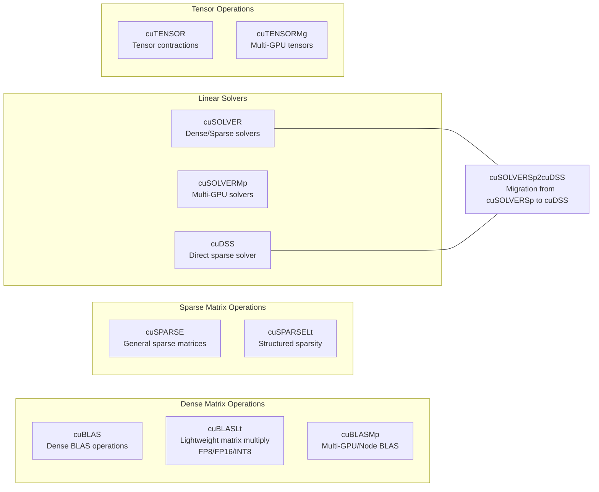
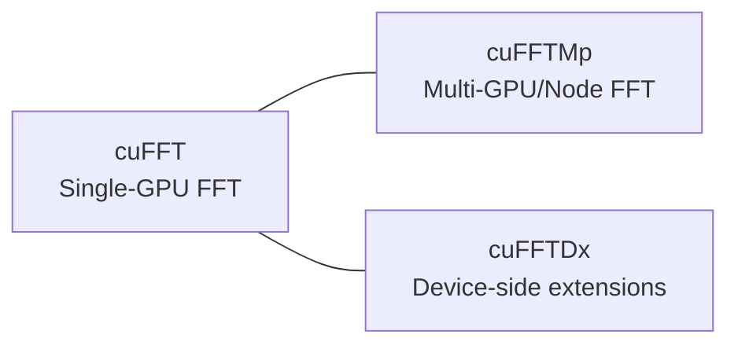
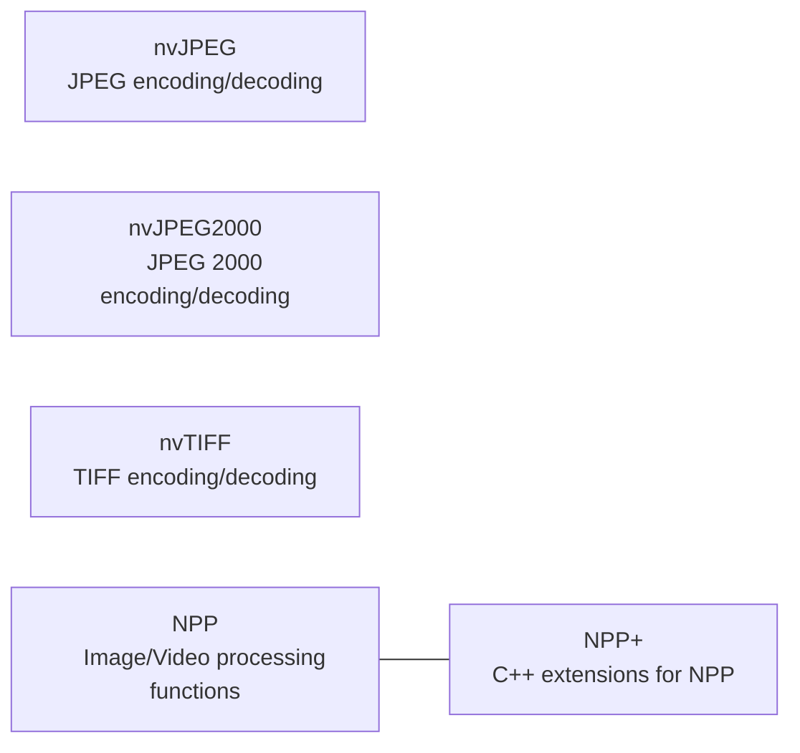
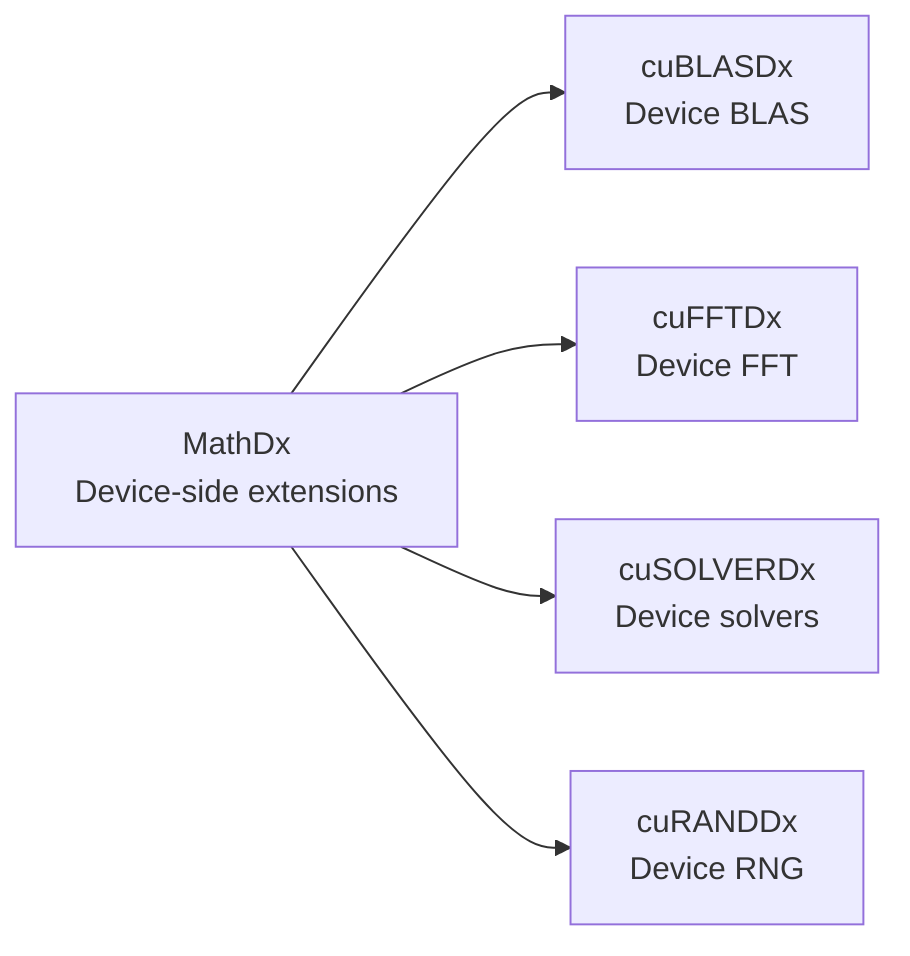
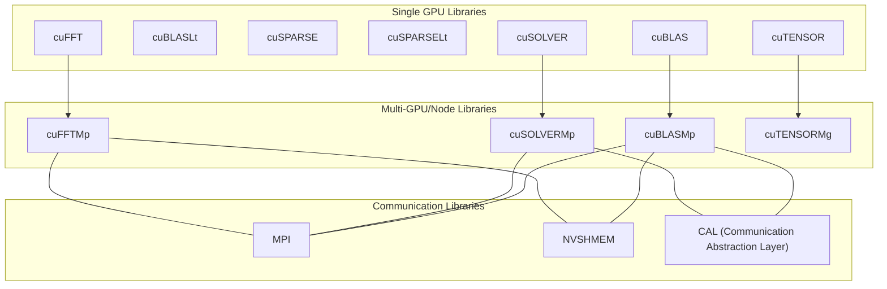
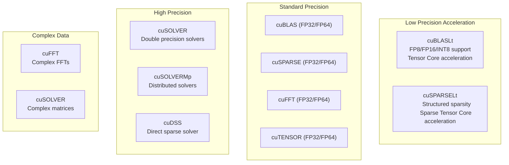
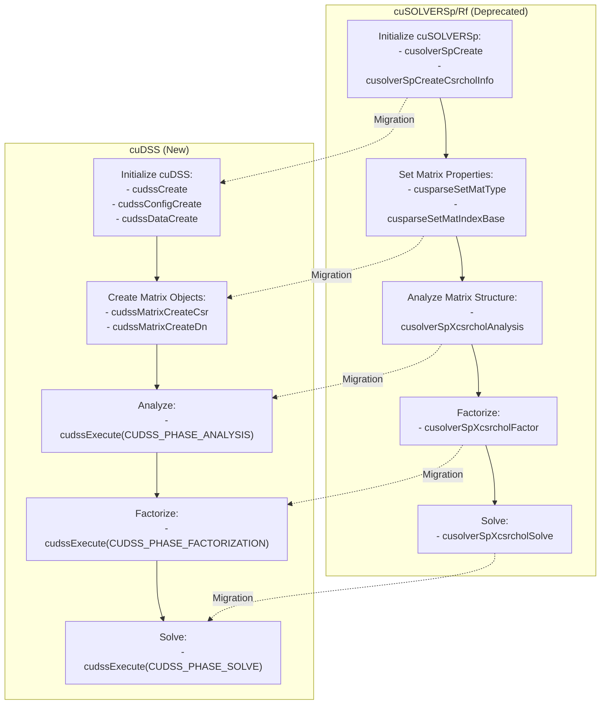

<!-- source: DeepWiki mcp.deepwiki.com · repo NVIDIA/CUDALibrarySamples · page 1 CUDA Library Samples Overview · fetched 2026-10-26 -->

# CUDA Library Samples Overview

Relevant source files

The following files were used as context for generating this wiki page:

- [README.md](README.md)
- [cuSOLVERSp2cuDSS/CMakeLists.txt](cuSOLVERSp2cuDSS/CMakeLists.txt)
- [cuSOLVERSp2cuDSS/README.md](cuSOLVERSp2cuDSS/README.md)
- [cuSOLVERSp2cuDSS/cuSolverRf2cuDSS.hpp](cuSOLVERSp2cuDSS/cuSolverRf2cuDSS.hpp)
- [cuSOLVERSp2cuDSS/cuSolverRf2cuDSS_double.cpp](cuSOLVERSp2cuDSS/cuSolverRf2cuDSS_double.cpp)
- [cuSOLVERSp2cuDSS/cuSolverSp2cuDSS.hpp](cuSOLVERSp2cuDSS/cuSolverSp2cuDSS.hpp)
- [cuSOLVERSp2cuDSS/cuSolverSp2cuDSS_dcomplex.cpp](cuSOLVERSp2cuDSS/cuSolverSp2cuDSS_dcomplex.cpp)
- [cuSOLVERSp2cuDSS/cuSolverSp2cuDSS_double.cpp](cuSOLVERSp2cuDSS/cuSolverSp2cuDSS_double.cpp)
- [cuSOLVERSp2cuDSS/cuSolverSp2cuDSS_float.cpp](cuSOLVERSp2cuDSS/cuSolverSp2cuDSS_float.cpp)
- [cuSOLVERSp2cuDSS/cuSolverSp2cuDSS_scomplex.cpp](cuSOLVERSp2cuDSS/cuSolverSp2cuDSS_scomplex.cpp)
- [cuSOLVERSp2cuDSS/test_complex.mtx](cuSOLVERSp2cuDSS/test_complex.mtx)
- [cuSOLVERSp2cuDSS/test_real.mtx](cuSOLVERSp2cuDSS/test_real.mtx)

The CUDA Library Samples repository provides comprehensive examples demonstrating NVIDIA's GPU-accelerated libraries for high-performance computing. This collection covers a wide range of computational domains including linear algebra, signal processing, image processing, and data compression. These samples serve as practical reference implementations for developers looking to leverage GPU acceleration in their applications.

## Purpose and Scope

This repository contains working code examples for each CUDA library, demonstrating typical use cases and best practices. These samples are designed to:

1. Demonstrate the proper usage of CUDA library APIs
2. Showcase performance optimization techniques
3. Provide functional examples that can be adapted for real-world applications
4. Illustrate transitions between different libraries and their versions

For specific information about individual libraries, please refer to their dedicated pages in this wiki (e.g., [Linear Algebra Libraries](#2) for cuBLAS, cuBLASLt, cuSOLVER, etc.).

Sources: [README.md:1-21]()

## Library Categories

The repository organizes libraries into functional categories reflecting their primary computational domains:

```mermaid
graph TD
    cuda["CUDA Library Samples"]
    cuda --> math["Mathematics Libraries"]
    cuda --> image["Image Processing Libraries"]
    cuda --> data["Data Compression"]
    
    math --> la["Linear Algebra"]
    math --> fft["Fourier Transforms"]
    math --> rand["Random Number Generation"]
    math --> dx["Developer Extensions (MathDx)"]
    
    la --> cublas["cuBLAS - Basic Linear Algebra"]
    la --> cublaslt["cuBLASLt - Lightweight Matrix Multiply"]
    la --> cublasmp["cuBLASMp - Multi-GPU BLAS"]
    la --> cusolver["cuSOLVER - Equation Solvers"]
    la --> cusolvermp["cuSOLVERMp - Multi-GPU Solvers"]
    la --> cusparse["cuSPARSE - Sparse Matrix Operations"]
    la --> cusparselt["cuSPARSELt - Structured Sparse Operations"]
    la --> cudss["cuDSS - Direct Sparse Solver"]
    la --> cutensor["cuTENSOR - Tensor Linear Algebra"]
    la --> cutensormg["cuTENSORMg - Multi-GPU Tensor Operations"]
    
    fft --> cufft["cuFFT - Fast Fourier Transform"]
    fft --> cufftmp["cuFFTMp - Multi-GPU FFT"]
    
    rand --> curand["cuRAND - Random Number Generation"]
    
    image --> nvjpeg["nvJPEG - JPEG Processing"]
    image --> nvjpeg2000["nvJPEG2000 - JPEG 2000 Processing"]
    image --> nvtiff["nvTIFF - TIFF Processing"]
    image --> npp["NPP - Image/Video Processing"]
    image --> nppplus["NPP+ - C++ Extensions for NPP"]
    
    data --> nvcomp["nvCOMP - Data Compression"]
    
    dx --> cublasdx["cuBLASDx - Device-side BLAS Extensions"]
    dx --> cufftdx["cuFFTDx - Device-side FFT Extensions"]
    dx --> cusolverdx["cuSOLVERDx - Device-side Solver Extensions"]
    dx --> curanddx["cuRANDDx - Device-side Random Number Extensions"]
    
    crypto[Cryptography] --- cuda
    crypto --> cupqc["cuPQC - Post-Quantum Cryptography"]
```

Sources: [README.md:24-49]()

## Key Components and Functionality

The repository includes examples for several major library groups:

### 1. Linear Algebra Libraries

These libraries form the core of GPU-accelerated mathematical computations:

The linear algebra libraries cover dense operations (cuBLAS family), sparse operations (cuSPARSE family), and linear solvers (cuSOLVER family and cuDSS). The repository contains specific samples for transitioning between deprecated APIs like cuSOLVERSp and newer ones like cuDSS.

Sources: [README.md:27-32](), [README.md:36-42](), [cuSOLVERSp2cuDSS/README.md:1-17]()

### 2. Signal Processing Libraries

For frequency domain operations:

Sources: [README.md:33-34]()

### 3. Image Processing Libraries

For various image format handling and processing:

Sources: [README.md:44-48]()

### 4. Developer Extensions (MathDx)

Low-level, device-side implementations of core mathematical operations:

Sources: [README.md:30](), [README.md:34]()

## Multi-GPU and Multi-Node Support

Several libraries provide multi-GPU and multi-node implementations for scaling beyond a single GPU:

The Multi-GPU libraries (with "Mp" suffix) enable scaling computations across multiple GPUs and nodes, using various communication libraries like MPI, NVSHMEM, and CAL.

Sources: [README.md:28-29](), [README.md:33](), [README.md:38](), [README.md:43]()

## Precision and Type Support

CUDA libraries support various numerical precisions to balance performance and accuracy requirements:

Libraries like cuBLASLt provide special support for low-precision operations that leverage Tensor Cores for significant performance gains.

Sources: [README.md:28]()

## Repository Structure and Organization

Each CUDA library has its own dedicated directory containing sample applications:

| Directory | Description |
|-----------|-------------|
| `cuBLAS/` | Basic Linear Algebra Subprograms examples |
| `cuBLASLt/` | Lightweight matrix multiplication examples |
| `cuBLASMp/` | Multi-process BLAS examples |
| `cuDSS/` | Direct sparse solver examples |
| `cuFFT/` | Fast Fourier Transform examples |
| `cuFFTMp/` | Multi-process FFT examples |
| `cuPQC/` | Post-Quantum Cryptography examples |
| `cuRAND/` | Random number generation examples |
| `cuSOLVER/` | Dense and sparse solver examples |
| `cuSOLVERMp/` | Multi-process solver examples |
| `cuSOLVERSp2cuDSS/` | Migration from cuSOLVERSp to cuDSS |
| `cuSPARSE/` | Sparse matrix operations examples |
| `cuSPARSELt/` | Structured sparse matrix operations |
| `cuTENSOR/` | Tensor linear algebra examples |
| `cuTENSORMg/` | Multi-GPU tensor operations |
| `MathDx/` | Device-side extensions (cuBLASDx, cuFFTDx, etc.) |
| `NPP/` | Image and video processing examples |
| `NPP+/` | C++ extensions for NPP |
| `nvJPEG/` | JPEG encode/decode examples |
| `nvJPEG2000/` | JPEG2000 encode/decode examples |
| `nvTIFF/` | TIFF encode/decode examples |
| `nvCOMP/` | Data compression examples |

Sources: [README.md:27-49]()

## Example: Migration Between Libraries

The repository includes specific examples for transitioning between APIs. For instance, the `cuSOLVERSp2cuDSS` directory contains samples demonstrating how to migrate code from the deprecated cuSOLVERSp/Rf APIs to the newer cuDSS library:

The example includes code for both the old (cuSOLVERSp/Rf) and new (cuDSS) APIs, with detailed comments explaining the transition process.

Sources: [cuSOLVERSp2cuDSS/README.md:1-162](), [cuSOLVERSp2cuDSS/cuSolverSp2cuDSS.hpp:291-344](), [cuSOLVERSp2cuDSS/cuSolverRf2cuDSS.hpp:290-338]()

## Performance Considerations

Different libraries are optimized for specific use cases:

1. **Tensor Core Acceleration**: Libraries like cuBLASLt and cuSPARSELt are optimized for Tensor Core operations on supported hardware
2. **Multi-GPU Scaling**: Libraries with "Mp" suffix provide scaling across multiple GPUs and nodes
3. **Low Precision Optimization**: Support for FP8/FP16/INT8 operations for improved performance
4. **Structured Sparsity**: Specialized libraries for efficient sparse matrix operations

For specific performance optimization guidance, see the [Performance Optimization](#7) page.

Sources: [README.md:27-29]()

## Getting Started

To use these samples:

1. Clone the repository from [GitHub](https://github.com/NVIDIA/CUDALibrarySamples)
2. Explore the directory for the specific CUDA library you're interested in
3. Follow the READMEs within each directory for build and execution instructions

Most examples use CMake as their build system. For a more detailed guide, see the [Getting Started](#6) page.

Sources: [README.md:53-59]()

## Additional Resources

For more detailed information about the CUDA libraries:

- [CUDA Toolkit Documentation](https://docs.nvidia.com/cuda/)
- [NVIDIA Developer Zone](https://developer.nvidia.com/)
- [GPU Accelerated Libraries](https://developer.nvidia.com/gpu-accelerated-libraries)
- [CUDA Samples Repository](https://github.com/NVIDIA/cuda-samples)

Sources: [README.md:53-59]()

---

