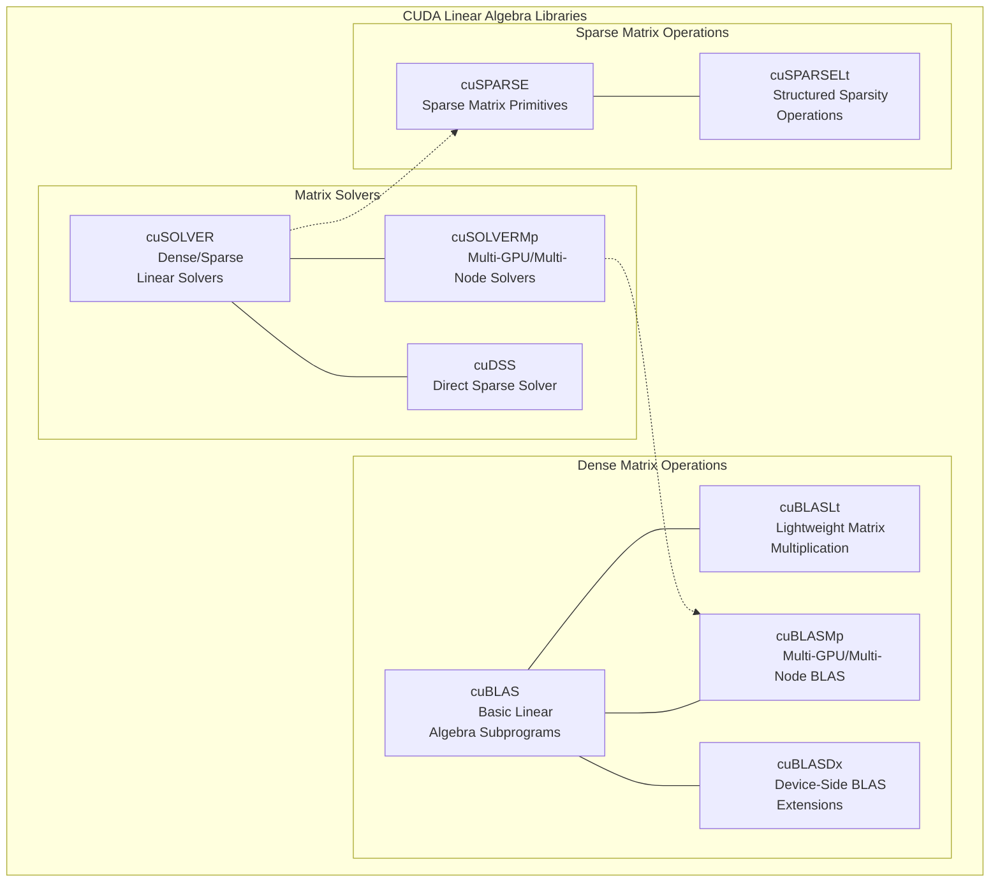
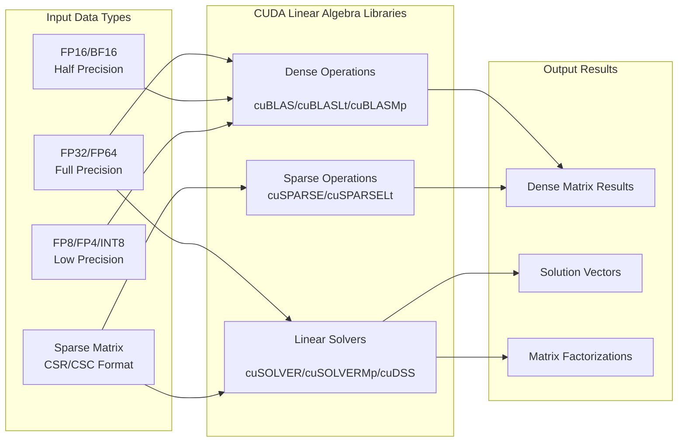
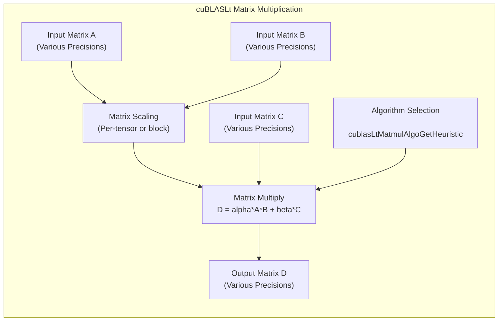
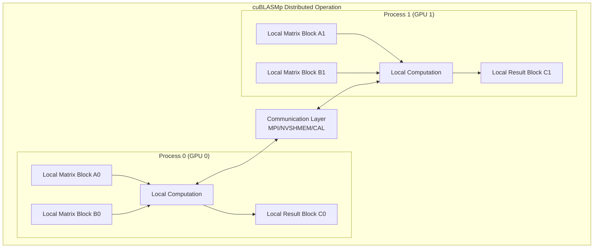
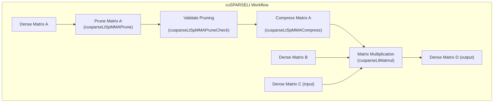
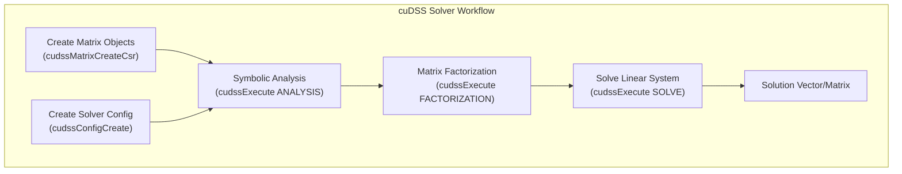
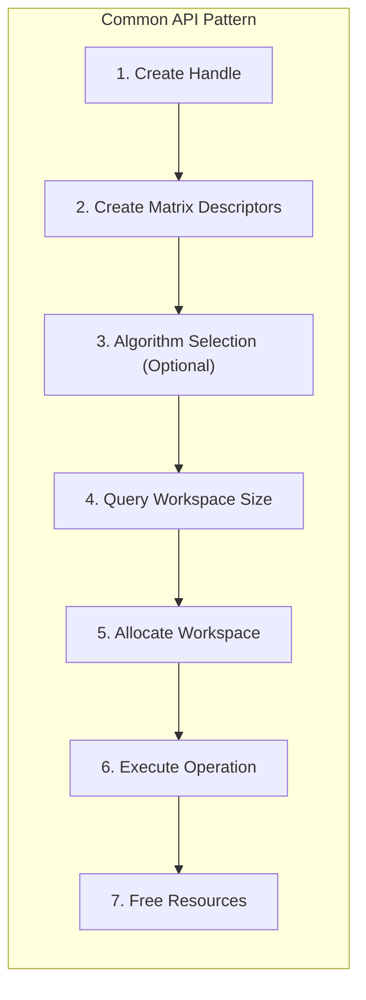
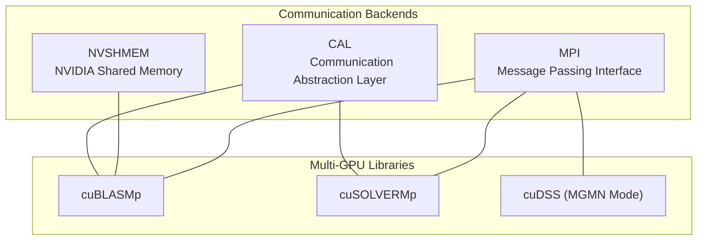

<!-- source: DeepWiki mcp.deepwiki.com · repo NVIDIA/CUDALibrarySamples · page 2 Linear Algebra Libraries · fetched 2026-10-26 -->

# Linear Algebra Libraries

<details>
<summary>Relevant source files</summary>

The following files were used as context for generating this wiki page:

- [README.md](README.md)
- [cuBLASLt/Common/helpers.h](cuBLASLt/Common/helpers.h)
- [cuBLASLt/LtFp8Matmul/main.cpp](cuBLASLt/LtFp8Matmul/main.cpp)
- [cuBLASLt/LtFp8Matmul/sample_cublasLt_LtFp8Matmul.cu](cuBLASLt/LtFp8Matmul/sample_cublasLt_LtFp8Matmul.cu)
- [cuBLASLt/LtFp8Matmul/sample_cublasLt_LtFp8Matmul.h](cuBLASLt/LtFp8Matmul/sample_cublasLt_LtFp8Matmul.h)
- [cuBLASLt/LtMxfp8Matmul/main.cpp](cuBLASLt/LtMxfp8Matmul/main.cpp)
- [cuBLASLt/LtMxfp8Matmul/sample_cublasLt_LtMxfp8Matmul.cu](cuBLASLt/LtMxfp8Matmul/sample_cublasLt_LtMxfp8Matmul.cu)
- [cuBLASLt/LtMxfp8Matmul/sample_cublasLt_LtMxfp8Matmul.h](cuBLASLt/LtMxfp8Matmul/sample_cublasLt_LtMxfp8Matmul.h)
- [cuBLASLt/LtNvfp4Matmul/main.cpp](cuBLASLt/LtNvfp4Matmul/main.cpp)
- [cuBLASLt/LtNvfp4Matmul/sample_cublasLt_LtNvfp4Matmul.cu](cuBLASLt/LtNvfp4Matmul/sample_cublasLt_LtNvfp4Matmul.cu)
- [cuBLASLt/LtNvfp4Matmul/sample_cublasLt_LtNvfp4Matmul.h](cuBLASLt/LtNvfp4Matmul/sample_cublasLt_LtNvfp4Matmul.h)
- [cuBLASMp/CMakeLists.txt](cuBLASMp/CMakeLists.txt)
- [cuBLASMp/README.md](cuBLASMp/README.md)
- [cuBLASMp/helpers.h](cuBLASMp/helpers.h)
- [cuBLASMp/matrix_generator.hxx](cuBLASMp/matrix_generator.hxx)
- [cuBLASMp/pgeadd.cu](cuBLASMp/pgeadd.cu)
- [cuBLASMp/pgemm.cu](cuBLASMp/pgemm.cu)
- [cuBLASMp/pmatmul.cu](cuBLASMp/pmatmul.cu)
- [cuBLASMp/pmatmul_ar.cu](cuBLASMp/pmatmul_ar.cu)
- [cuBLASMp/psyrk.cu](cuBLASMp/psyrk.cu)
- [cuBLASMp/ptradd.cu](cuBLASMp/ptradd.cu)
- [cuBLASMp/ptrsm.cu](cuBLASMp/ptrsm.cu)
- [cuDSS/README.md](cuDSS/README.md)
- [cuDSS/get_set/CMakeLists.txt](cuDSS/get_set/CMakeLists.txt)
- [cuDSS/get_set/get_set.cpp](cuDSS/get_set/get_set.cpp)
- [cuDSS/memory_handler/CMakeLists.txt](cuDSS/memory_handler/CMakeLists.txt)
- [cuDSS/memory_handler/memory_handler.cpp](cuDSS/memory_handler/memory_handler.cpp)
- [cuDSS/simple/CMakeLists.txt](cuDSS/simple/CMakeLists.txt)
- [cuDSS/simple/simple.cpp](cuDSS/simple/simple.cpp)
- [cuDSS/simple_batch/CMakeLists.txt](cuDSS/simple_batch/CMakeLists.txt)
- [cuDSS/simple_batch/simple_batch.cpp](cuDSS/simple_batch/simple_batch.cpp)
- [cuDSS/simple_complex/CMakeLists.txt](cuDSS/simple_complex/CMakeLists.txt)
- [cuDSS/simple_complex/simple_complex.cpp](cuDSS/simple_complex/simple_complex.cpp)
- [cuDSS/simple_hybrid_memory_mode/CMakeLists.txt](cuDSS/simple_hybrid_memory_mode/CMakeLists.txt)
- [cuDSS/simple_hybrid_memory_mode/simple_hybrid_memory_mode.cpp](cuDSS/simple_hybrid_memory_mode/simple_hybrid_memory_mode.cpp)
- [cuDSS/simple_mgmn_mode/CMakeLists.txt](cuDSS/simple_mgmn_mode/CMakeLists.txt)
- [cuSOLVERSp2cuDSS/CMakeLists.txt](cuSOLVERSp2cuDSS/CMakeLists.txt)
- [cuSOLVERSp2cuDSS/README.md](cuSOLVERSp2cuDSS/README.md)
- [cuSOLVERSp2cuDSS/cuSolverRf2cuDSS.hpp](cuSOLVERSp2cuDSS/cuSolverRf2cuDSS.hpp)
- [cuSOLVERSp2cuDSS/cuSolverRf2cuDSS_double.cpp](cuSOLVERSp2cuDSS/cuSolverRf2cuDSS_double.cpp)
- [cuSOLVERSp2cuDSS/cuSolverSp2cuDSS.hpp](cuSOLVERSp2cuDSS/cuSolverSp2cuDSS.hpp)
- [cuSOLVERSp2cuDSS/cuSolverSp2cuDSS_dcomplex.cpp](cuSOLVERSp2cuDSS/cuSolverSp2cuDSS_dcomplex.cpp)
- [cuSOLVERSp2cuDSS/cuSolverSp2cuDSS_double.cpp](cuSOLVERSp2cuDSS/cuSolverSp2cuDSS_double.cpp)
- [cuSOLVERSp2cuDSS/cuSolverSp2cuDSS_float.cpp](cuSOLVERSp2cuDSS/cuSolverSp2cuDSS_float.cpp)
- [cuSOLVERSp2cuDSS/cuSolverSp2cuDSS_scomplex.cpp](cuSOLVERSp2cuDSS/cuSolverSp2cuDSS_scomplex.cpp)
- [cuSOLVERSp2cuDSS/test_complex.mtx](cuSOLVERSp2cuDSS/test_complex.mtx)
- [cuSOLVERSp2cuDSS/test_real.mtx](cuSOLVERSp2cuDSS/test_real.mtx)
- [cuSPARSELt/matmul/CMakeLists.txt](cuSPARSELt/matmul/CMakeLists.txt)
- [cuSPARSELt/matmul/Makefile](cuSPARSELt/matmul/Makefile)
- [cuSPARSELt/matmul/README.md](cuSPARSELt/matmul/README.md)
- [cuSPARSELt/matmul/matmul_example.cpp](cuSPARSELt/matmul/matmul_example.cpp)
- [cuSPARSELt/matmul_advanced/CMakeLists.txt](cuSPARSELt/matmul_advanced/CMakeLists.txt)
- [cuSPARSELt/matmul_advanced/Makefile](cuSPARSELt/matmul_advanced/Makefile)
- [cuSPARSELt/matmul_advanced/README.md](cuSPARSELt/matmul_advanced/README.md)
- [cuSPARSELt/matmul_advanced/matmul_advanced_example.cpp](cuSPARSELt/matmul_advanced/matmul_advanced_example.cpp)

</details>


This page provides an overview of the CUDA linear algebra libraries available in the NVIDIA CUDA Library Samples repository. These libraries deliver high-performance GPU-accelerated implementations of key linear algebra operations that form the backbone of many scientific computing, machine learning, and data science applications.

For information about signal processing libraries, see page [Signal Processing Libraries](#3).

## Library Hierarchy and Relationships

The CUDA linear algebra libraries are organized into several families based on their specialization and purpose.



Sources: [README.md:26-43]()

## Library Feature Comparison

The following table summarizes the key characteristics of the CUDA linear algebra libraries:

| Library | Matrix Type | Precision Support | Multi-GPU | Key Features |
|---------|-------------|-------------------|-----------|--------------|
| cuBLAS | Dense | FP16/FP32/FP64/Complex | No | Standard BLAS operations |
| cuBLASLt | Dense | FP4/FP8/FP16/FP32/BF16/INT8 | No | Tensor Core acceleration, low precision |
| cuBLASMp | Dense | FP16/FP32/FP64 | Yes | Distributed matrix operations |
| cuSOLVER | Dense/Sparse | FP32/FP64/Complex | No | Matrix factorizations, eigensolvers |
| cuSOLVERMp | Dense | FP32/FP64/Complex | Yes | Distributed solvers |
| cuSPARSE | Sparse | FP32/FP64/Complex | No | General sparse matrix operations |
| cuSPARSELt | Structured Sparse | FP16/FP8/INT8/BF16 | No | 50% structured sparsity, Tensor Cores |
| cuDSS | Sparse | FP32/FP64/Complex | Yes* | Direct sparse solver, hybrid memory mode |

*cuDSS supports multi-GPU through its MGMN (Multi-GPU Multi-Node) mode

Sources: [README.md:26-43](), [cuSPARSELt/matmul/README.md:5-16](), [cuSPARSELt/matmul_advanced/README.md:5-17](), [cuDSS/README.md:25-30]()

## Data Flow and Precision Paths

The following diagram illustrates the typical data flow patterns and precision paths when using these libraries:



Sources: [cuBLASLt/Common/helpers.h:31-72](), [cuSPARSELt/matmul/matmul_example.cpp:25-41](), [cuSPARSELt/matmul_advanced/matmul_advanced_example.cpp:30-42]()

## Dense Linear Algebra Libraries

### cuBLAS
The basic linear algebra subprograms (BLAS) library for dense matrices. It provides standard BLAS operations such as vector-vector (Level 1), matrix-vector (Level 2), and matrix-matrix (Level 3) operations.

### cuBLASLt
A lightweight matrix multiplication-focused API that enables tensor core operations and supports advanced features such as:

- Low precision matrix multiplication (FP16, FP8, FP4, INT8)
- Block scaling for mixed precision operations
- Tensor Core acceleration
- Algorithm selection for performance optimization



Sample code: The `LtFp8Matmul` function showcases FP8 matrix multiplication with tensor cores:
[cuBLASLt/LtFp8Matmul/sample_cublasLt_LtFp8Matmul.cu:40-141]()

Similarly, there's support for even lower precision with FP4:
[cuBLASLt/LtNvfp4Matmul/sample_cublasLt_LtNvfp4Matmul.cu:40-140]()

Sources: [cuBLASLt/LtFp8Matmul/sample_cublasLt_LtFp8Matmul.h:32-57](), [cuBLASLt/LtNvfp4Matmul/sample_cublasLt_LtNvfp4Matmul.h:34-65](), [cuBLASLt/Common/helpers.h:109-247]()

### cuBLASMp
Multi-GPU and multi-node implementation of BLAS operations, enabling distributed matrix computations across multiple GPUs and multiple compute nodes. Key features include:

- Distributed matrix operations (GEMM, TRSM, SYRK, GEADD, etc.)
- Support for MPI, NVSHMEM, and CAL (Communication Abstraction Layer)
- Process grid configuration for optimized data distribution
- Support for different communication backends



Sample operations offered by cuBLASMp include:
- Matrix multiplication: `cublasMpGemm`, `cublasMpMatmul`
- Triangular solve: `cublasMpTrsm`
- Symmetric rank-k update: `cublasMpSyrk`
- Matrix addition: `cublasMpGeadd`, `cublasMpTradd`

Sources: [cuBLASMp/README.md:8-21](), [cuBLASMp/CMakeLists.txt:62-68](), [cuBLASMp/pgemm.cu:197-257](), [cuBLASMp/pmatmul.cu:227-269](), [cuBLASMp/ptrsm.cu:202-223]()

## Sparse Linear Algebra Libraries

### cuSPARSE
General sparse matrix operations library supporting various sparse matrix formats (CSR, CSC, COO, etc.) and operations.

### cuSPARSELt
A lightweight library for structured sparse matrix operations that leverage Tensor Cores. Key features include:

- Support for 50% structured sparsity
- Sparse-dense matrix multiplication
- Tensor Core acceleration for sparse operations
- FP16, FP8, INT8, BF16 precision support
- Prune, compress and compute workflow



Advanced features include:
- Batched computation
- Split-K algorithm for parallel computation
- ReLU activation function
- Bias addition

Sources: [cuSPARSELt/matmul/matmul_example.cpp:237-289](), [cuSPARSELt/matmul_advanced/matmul_advanced_example.cpp:307-318](), [cuSPARSELt/matmul/README.md:5-16](), [cuSPARSELt/matmul_advanced/README.md:5-17]()

### cuSOLVER and cuSOLVERMp
cuSOLVER provides dense and sparse linear solvers, matrix factorizations, and eigensolvers. cuSOLVERMp extends these capabilities to multi-GPU environments.

### cuDSS (Direct Sparse Solver)
A modern GPU-accelerated direct sparse solver designed to replace cuSOLVERSp/Rf. Key features include:

- Efficient sparse linear system solving
- Support for symmetric, unsymmetric, and complex matrices
- Hybrid host/device memory mode for large problems
- Multi-GPU multi-node (MGMN) mode
- Memory-optimized operations



Sample usage pattern:
1. Create matrix objects using `cudssMatrixCreateCsr` or other appropriate creation functions
2. Set up solver configuration with `cudssConfigCreate`
3. Perform symbolic analysis phase with `cudssExecute(CUDSS_PHASE_ANALYSIS)`
4. Perform numerical factorization with `cudssExecute(CUDSS_PHASE_FACTORIZATION)`
5. Solve the system with `cudssExecute(CUDSS_PHASE_SOLVE)`

Sources: [cuDSS/simple/simple.cpp:103-268](), [cuDSS/get_set/get_set.cpp:218-242](), [cuDSS/README.md:13-52]()

## When to Use Which Library

| If you need to... | Consider using... |
|-------------------|-------------------|
| Perform standard dense matrix operations | cuBLAS |
| Accelerate matrix multiplication with low precision | cuBLASLt |
| Scale operations across multiple GPUs | cuBLASMp or cuSOLVERMp |
| Work with general sparse matrices | cuSPARSE |
| Leverage structured sparsity (e.g., in neural networks) | cuSPARSELt |
| Solve dense linear systems or find eigenvalues | cuSOLVER |
| Solve large sparse linear systems efficiently | cuDSS |

## Common API Patterns

Despite the diversity of libraries, there are common API patterns across the CUDA linear algebra ecosystem:



This pattern is evident in libraries like cuBLASLt:
1. Create handle: `cublasLtCreate(&handle)`
2. Create matrix descriptors: `cublasLtMatrixLayoutCreate()`
3. Select algorithm: `cublasLtMatmulAlgoGetHeuristic()`
4. Query workspace size (often implicit in algorithm selection)
5. Allocate workspace if needed
6. Execute operation: `cublasLtMatmul()`
7. Free resources: `cublasLtDestroy()`, `cublasLtMatrixLayoutDestroy()`

And similar patterns appear in cuDSS:
1. Create handle: `cudssCreate(&handle)`
2. Create matrix objects: `cudssMatrixCreateCsr()`
3. Set algorithm options: `cudssConfigSet()`
4. Implicit buffer sizing
5. Execute operations: `cudssExecute()`
6. Free resources: `cudssDestroy()`, `cudssMatrixDestroy()`

Sources: [cuBLASLt/LtFp8Matmul/sample_cublasLt_LtFp8Matmul.cu:61-141](), [cuSPARSELt/matmul/matmul_example.cpp:193-296](), [cuDSS/simple/simple.cpp:199-250]()

## Low Precision Operations

A key feature across several libraries is support for low precision operations, enabling significant performance improvements through Tensor Core acceleration:

| Precision | Data Type | Libraries | Notes |
|-----------|-----------|-----------|-------|
| FP64 | Double | cuBLAS, cuSOLVER, cuDSS | Full precision, highest accuracy |
| FP32 | Float | All | Standard precision |
| FP16 | Half | cuBLAS, cuBLASLt, cuSPARSELt | Tensor Core acceleration |
| BF16 | BFloat16 | cuBLASLt, cuSPARSELt | Extended dynamic range |
| FP8 | __nv_fp8_e4m3 | cuBLASLt, cuSPARSELt | Very low precision |
| FP4 | __nv_fp4_e2m1 | cuBLASLt | Extremely low precision |
| INT8 | int8_t | cuBLASLt, cuSPARSELt | Quantized integer operations |

For mixed precision operations, scaling factors are often used to maintain numerical stability, as seen in the cuBLASLt API:

```
LtFp8Matmul(cublasLtHandle_t ltHandle,
           int m, int n, int k,
           const float *alpha,           /* host pointer */
           const float *a_scale,         /* device pointer */
           const __nv_fp8_e4m3 *A,
           int lda,
           const float *b_scale,         /* device pointer */
           const __nv_fp8_e4m3 *B,
           int ldb,
           const float *beta,
           const float *c_scale,         /* device pointer */
           __nv_bfloat16 *C,
           int ldc,
           const float *d_scale,         /* device pointer */
           __nv_fp8_e4m3 *D,
           int ldd,
           float *amax_d,                /* device pointer */
           void *workspace,
           size_t workspaceSize)
```

Sources: [cuBLASLt/Common/helpers.h:31-72](), [cuBLASLt/LtFp8Matmul/sample_cublasLt_LtFp8Matmul.h:32-57](), [cuBLASLt/LtNvfp4Matmul/sample_cublasLt_LtNvfp4Matmul.h:34-65](), [cuSPARSELt/matmul/matmul_example.cpp:30-41]()

## Distributed Computing Support

Libraries like cuBLASMp and cuSOLVERMp enable distributed operations using different communication backends:



Key distributed computing concepts:
- Process grid: 2D arrangement of processes for matrix distribution
- Data distribution: Block-cyclic distribution of matrices
- Communication: Collective operations for data exchange

Sources: [cuBLASMp/CMakeLists.txt:62-68](), [cuBLASMp/README.md:49-83](), [cuBLASMp/pgemm.cu:183-197](), [cuDSS/README.md:25-30]()

---

