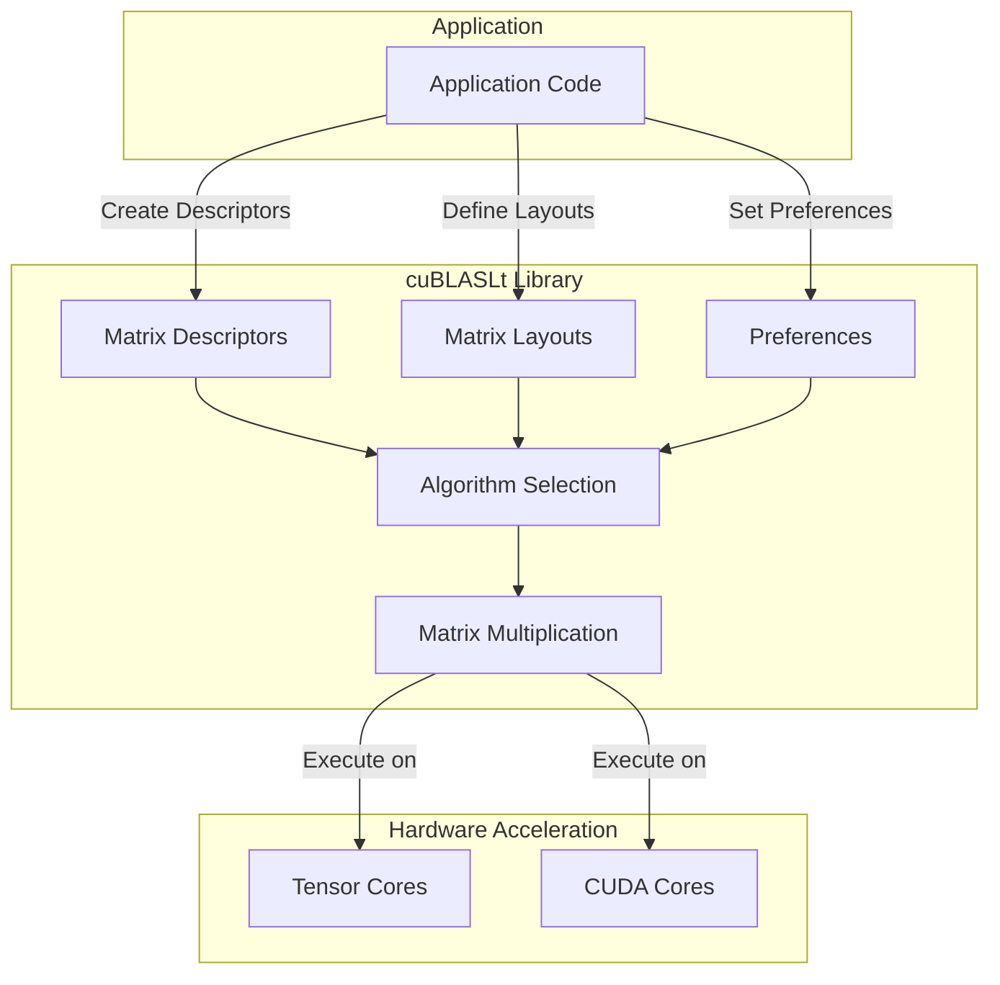
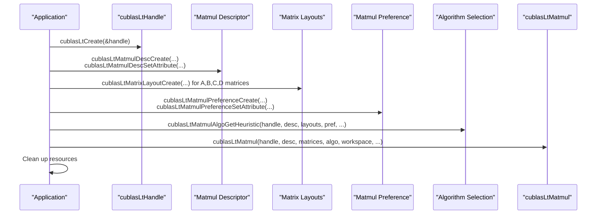
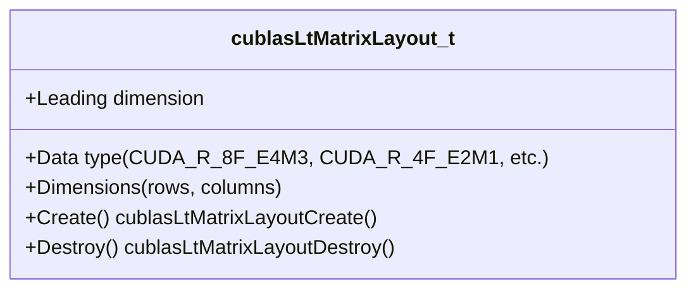
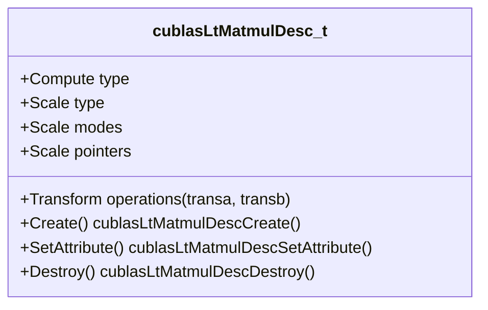
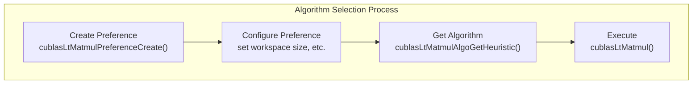
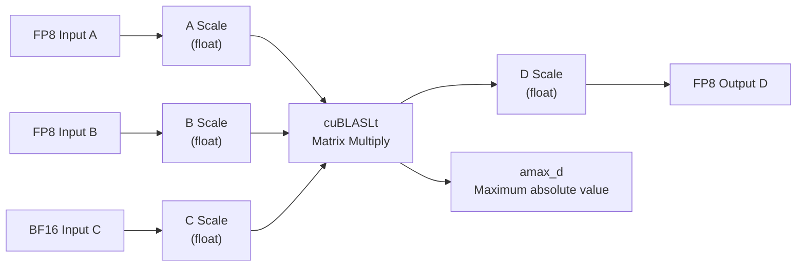
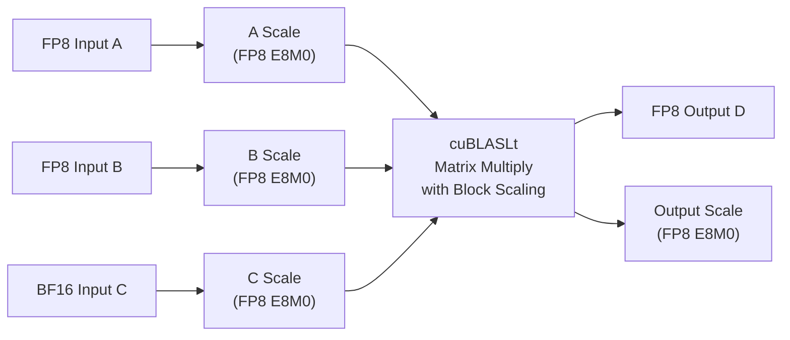
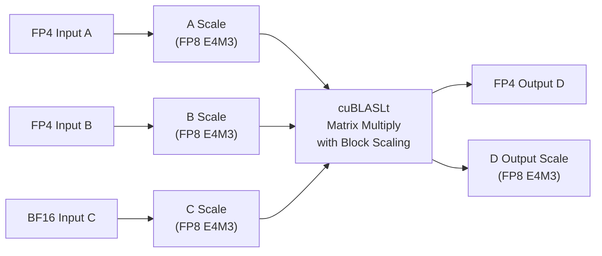
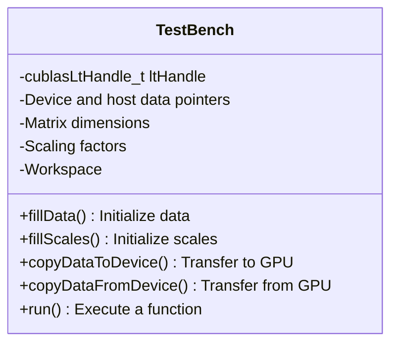

<!-- source: DeepWiki mcp.deepwiki.com · repo NVIDIA/CUDALibrarySamples · page 2.1 cuBLASLt - Lightweight Matrix Multiplication · fetched 2026-10-26 -->

# cuBLASLt - Lightweight Matrix Multiplication

Relevant source files

The following files were used as context for generating this wiki page:

- [cuBLASLt/Common/helpers.h](cuBLASLt/Common/helpers.h)
- [cuBLASLt/LtFp8Matmul/main.cpp](cuBLASLt/LtFp8Matmul/main.cpp)
- [cuBLASLt/LtFp8Matmul/sample_cublasLt_LtFp8Matmul.cu](cuBLASLt/LtFp8Matmul/sample_cublasLt_LtFp8Matmul.cu)
- [cuBLASLt/LtFp8Matmul/sample_cublasLt_LtFp8Matmul.h](cuBLASLt/LtFp8Matmul/sample_cublasLt_LtFp8Matmul.h)
- [cuBLASLt/LtMxfp8Matmul/main.cpp](cuBLASLt/LtMxfp8Matmul/main.cpp)
- [cuBLASLt/LtMxfp8Matmul/sample_cublasLt_LtMxfp8Matmul.cu](cuBLASLt/LtMxfp8Matmul/sample_cublasLt_LtMxfp8Matmul.cu)
- [cuBLASLt/LtMxfp8Matmul/sample_cublasLt_LtMxfp8Matmul.h](cuBLASLt/LtMxfp8Matmul/sample_cublasLt_LtMxfp8Matmul.h)
- [cuBLASLt/LtNvfp4Matmul/main.cpp](cuBLASLt/LtNvfp4Matmul/main.cpp)
- [cuBLASLt/LtNvfp4Matmul/sample_cublasLt_LtNvfp4Matmul.cu](cuBLASLt/LtNvfp4Matmul/sample_cublasLt_LtNvfp4Matmul.cu)
- [cuBLASLt/LtNvfp4Matmul/sample_cublasLt_LtNvfp4Matmul.h](cuBLASLt/LtNvfp4Matmul/sample_cublasLt_LtNvfp4Matmul.h)

## Purpose and Scope

This document provides a technical overview of cuBLASLt, a specialized CUDA library that offers lightweight, high-performance matrix multiplication operations. cuBLASLt is particularly focused on low-precision compute formats (FP16, FP8, FP4, INT8) with Tensor Core acceleration to deliver maximum performance for matrix multiplication workloads.

For general linear algebra operations beyond matrix multiplication, see [Linear Algebra Libraries](#2). For distributed multi-GPU BLAS operations, see [cuBLASMp - Distributed BLAS Operations](#2.2).

## Architecture Overview

cuBLASLt is designed specifically for matrix multiplication operations with a focus on performance and support for various precision formats. It provides a more streamlined API compared to the full cuBLAS library while maintaining performance optimization capabilities.

Sources: [cuBLASLt/LtFp8Matmul/sample_cublasLt_LtFp8Matmul.cu:65-96](), [cuBLASLt/LtNvfp4Matmul/sample_cublasLt_LtNvfp4Matmul.cu:66-96]()

## Key Components and Workflow

The cuBLASLt API revolves around several key objects that must be created and configured before performing matrix multiplication:

Sources: [cuBLASLt/LtFp8Matmul/sample_cublasLt_LtFp8Matmul.cu:61-129](), [cuBLASLt/LtNvfp4Matmul/sample_cublasLt_LtNvfp4Matmul.cu:65-140]()

## Supported Data Types

cuBLASLt supports various precision formats, with special emphasis on low-precision formats that can leverage Tensor Cores for acceleration:

| Data Type | Description | Supported in |
|-----------|-------------|--------------|
| __nv_fp8_e4m3 | 8-bit floating point (4-bit exponent, 3-bit mantissa) | LtFp8Matmul, LtMxfp8Matmul |
| __nv_fp4_e2m1 | 4-bit floating point (2-bit exponent, 1-bit mantissa) | LtNvfp4Matmul |
| __nv_bfloat16 | Brain floating point (16-bit) | All examples as output type |
| __half | 16-bit floating point | Supporting examples |
| float | 32-bit floating point | Used for scaling and computation |

Sources: [cuBLASLt/LtFp8Matmul/sample_cublasLt_LtFp8Matmul.h:35-58](), [cuBLASLt/LtNvfp4Matmul/sample_cublasLt_LtNvfp4Matmul.h:34-65](), [cuBLASLt/Common/helpers.h:36-39]()

## Matrix Representation and Layouts

cuBLASLt represents matrices through the `cublasLtMatrixLayout_t` object, which defines the dimensions, data type, and memory layout of the matrix:

Sources: [cuBLASLt/LtFp8Matmul/sample_cublasLt_LtFp8Matmul.cu:86-89](), [cuBLASLt/LtNvfp4Matmul/sample_cublasLt_LtNvfp4Matmul.cu:97-100]()

## Matrix Operation Configuration

A key component of cuBLASLt is the matrix multiplication descriptor, which defines the operation parameters:

Sources: [cuBLASLt/LtFp8Matmul/sample_cublasLt_LtFp8Matmul.cu:71-82](), [cuBLASLt/LtNvfp4Matmul/sample_cublasLt_LtNvfp4Matmul.cu:76-93]()

## Special Features

### Scaling Modes

cuBLASLt supports various scaling modes for efficient low-precision operations:

| Scaling Mode | Description |
|--------------|-------------|
| CUBLASLT_MATMUL_MATRIX_SCALE_SCALAR_32F | Single scalar value for the entire matrix |
| CUBLASLT_MATMUL_MATRIX_SCALE_VEC32_UE8M0 | Vector scaling with 32-element blocks, using FP8 E8M0 format |
| CUBLASLT_MATMUL_MATRIX_SCALE_VEC16_UE4M3 | Vector scaling with 16-element blocks, using FP8 E4M3 format |

Sources: [cuBLASLt/Common/helpers.h:88-107](), [cuBLASLt/LtMxfp8Matmul/sample_cublasLt_LtMxfp8Matmul.cu:82-84]()

### Algorithm Selection

cuBLASLt provides algorithm selection capabilities through the `cublasLtMatmulPreference_t` and `cublasLtMatmulAlgoGetHeuristic` functions:

Sources: [cuBLASLt/LtFp8Matmul/sample_cublasLt_LtFp8Matmul.cu:94-103](), [cuBLASLt/LtNvfp4Matmul/sample_cublasLt_LtNvfp4Matmul.cu:102-114]()

## Example Usage Patterns

cuBLASLt samples demonstrate different matrix multiplication operations based on data types and scaling methods:

### FP8 Matrix Multiplication

This example shows how to perform matrix multiplication using the FP8 data type with tensor scaling:

Sources: [cuBLASLt/LtFp8Matmul/sample_cublasLt_LtFp8Matmul.h:35-58](), [cuBLASLt/LtFp8Matmul/sample_cublasLt_LtFp8Matmul.cu:40-59]()

### MXFP8 Matrix Multiplication (Mixed Precision FP8)

This example demonstrates matrix multiplication with block scaling using E8M0 format for scaling factors:

Sources: [cuBLASLt/LtMxfp8Matmul/sample_cublasLt_LtMxfp8Matmul.h:35-61](), [cuBLASLt/LtMxfp8Matmul/sample_cublasLt_LtMxfp8Matmul.cu:40-63]()

### NVFP4 Matrix Multiplication

This example shows matrix multiplication with the 4-bit FP4 data type:

Sources: [cuBLASLt/LtNvfp4Matmul/sample_cublasLt_LtNvfp4Matmul.h:34-65](), [cuBLASLt/LtNvfp4Matmul/sample_cublasLt_LtNvfp4Matmul.cu:40-65]()

## Test Bench Helper

The samples include a `TestBench` template class that simplifies setting up and running cuBLASLt operations:

Sources: [cuBLASLt/Common/helpers.h:109-247]()

## Performance Considerations

1. **Workspace**: cuBLASLt can use a workspace buffer to enable more efficient algorithms, like split-K. The size of this workspace affects which algorithms are available.

2. **Algorithm Selection**: The `cublasLtMatmulAlgoGetHeuristic` function allows cuBLASLt to choose the most efficient algorithm based on matrix dimensions and hardware capabilities.

3. **Scaling Factors**: Proper use of scaling factors is crucial for maintaining numerical precision when using low-precision data types.

4. **Block Scaling**: For very low precision formats like FP4 and some FP8 operations, block scaling is essential for preserving a useful dynamic range.

Sources: [cuBLASLt/LtFp8Matmul/sample_cublasLt_LtFp8Matmul.cu:94-103](), [cuBLASLt/Common/helpers.h:88-107]()

## Best Practices

1. Always check the return status of cuBLASLt functions to ensure operations completed successfully.

2. Provide adequate workspace memory to enable the most efficient algorithms.

3. Properly align matrix data for best performance, ideally using `cudaMalloc` for matrix storage.

4. Clean up resources by destroying descriptors, layouts, and preferences once they are no longer needed.

5. For low precision types, carefully manage scaling factors to maintain numerical accuracy.

Sources: [cuBLASLt/LtFp8Matmul/sample_cublasLt_LtFp8Matmul.cu:123-128](), [cuBLASLt/LtNvfp4Matmul/sample_cublasLt_LtNvfp4Matmul.cu:134-139]()

## Related Pages

- [Low Precision Matrix Multiplication with cuBLASLt](#2.1.1)
- [Algorithm Selection with cuBLASLt](#2.1.2)
- [cuBLASMp - Distributed BLAS Operations](#2.2)

---

