<!-- source: DeepWiki mcp.deepwiki.com · repo NVIDIA/CUDALibrarySamples · page 2.2 cuBLASMp - Distributed BLAS Operations · fetched 2026-10-26 -->

# cuBLASMp - Distributed BLAS Operations

<details>
<summary>Relevant source files</summary>

The following files were used as context for generating this wiki page:

- [cuBLASMp/CMakeLists.txt](cuBLASMp/CMakeLists.txt)
- [cuBLASMp/README.md](cuBLASMp/README.md)
- [cuBLASMp/helpers.h](cuBLASMp/helpers.h)
- [cuBLASMp/matrix_generator.hxx](cuBLASMp/matrix_generator.hxx)
- [cuBLASMp/pgeadd.cu](cuBLASMp/pgeadd.cu)
- [cuBLASMp/pgemm.cu](cuBLASMp/pgemm.cu)
- [cuBLASMp/pmatmul.cu](cuBLASMp/pmatmul.cu)
- [cuBLASMp/pmatmul_ar.cu](cuBLASMp/pmatmul_ar.cu)
- [cuBLASMp/psyrk.cu](cuBLASMp/psyrk.cu)
- [cuBLASMp/ptradd.cu](cuBLASMp/ptradd.cu)
- [cuBLASMp/ptrsm.cu](cuBLASMp/ptrsm.cu)

</details>


## Purpose and Scope

This document provides a detailed overview of cuBLASMp, NVIDIA's distributed implementation of Basic Linear Algebra Subprograms (BLAS) operations. cuBLASMp enables highly efficient execution of BLAS operations across multiple GPUs and multiple nodes, making it suitable for large-scale high-performance computing applications. This library is part of NVIDIA's suite of GPU-accelerated linear algebra libraries and specifically targets distributed computing environments.

For information about single-GPU matrix multiplication, see [cuBLASLt - Lightweight Matrix Multiplication](#2.1). For distributed linear solvers, see [cuSOLVERMp - Distributed Linear Solvers](#2.6).

## Overview

cuBLASMp provides distributed versions of common BLAS operations optimized for NVIDIA GPUs. It integrates with MPI for inter-node communication and supports NVSHMEM for efficient GPU-to-GPU communication. The library also uses the Communication Abstraction Layer (CAL) to provide a unified communication interface.

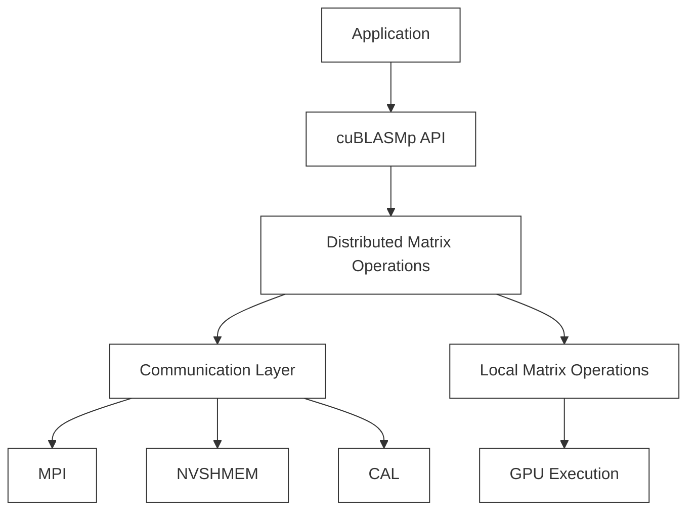

Sources: [cuBLASMp/pgemm.cu:4-45](), [cuBLASMp/pmatmul.cu:29-46](), [cuBLASMp/README.md:48-63]()

## Key Components

### Process Grid

cuBLASMp organizes processes in a 2D grid, similar to ScaLAPACK and other distributed BLAS implementations. The grid can be organized in row-major or column-major order.

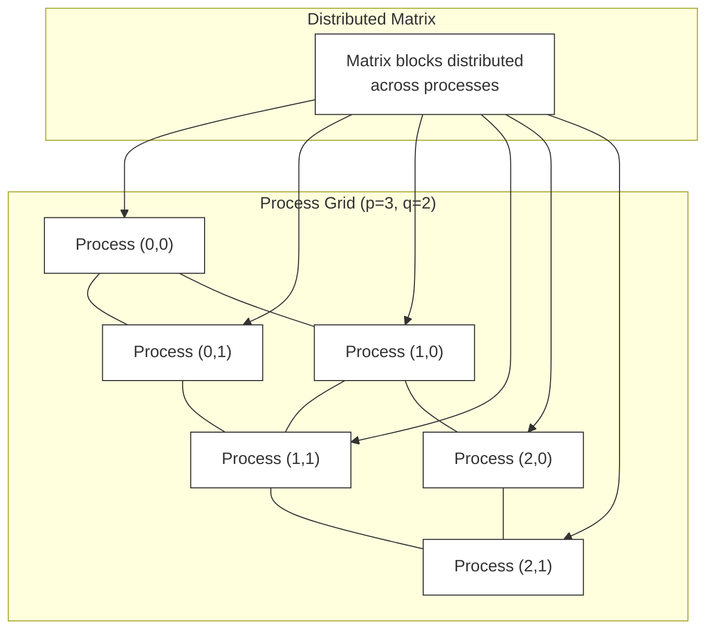

Sources: [cuBLASMp/pgemm.cu:106-107](), [cuBLASMp/helpers.h:91-114]()

### Matrix Distribution

Matrices are distributed in blocks across the process grid. Each process owns a subset of the matrix blocks based on its position in the grid.

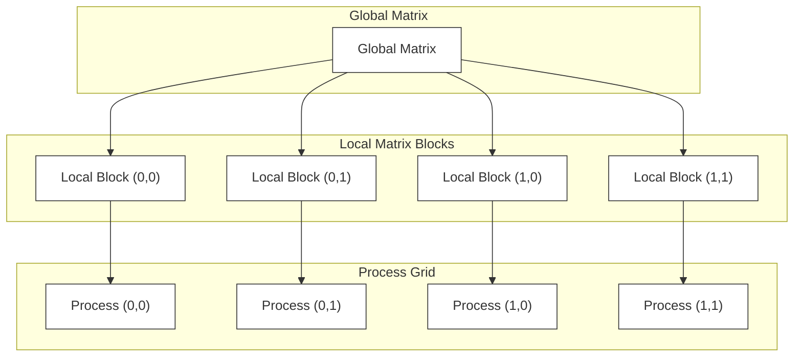

Sources: [cuBLASMp/matrix_generator.hxx:36-91](), [cuBLASMp/pgemm.cu:152-175]()

## Core Concepts

### Descriptors

cuBLASMp uses several descriptor types to manage distributed operations:

#### cublasMpHandle_t

The main handle for cuBLASMp operations, initialized with a CUDA stream.

#### cublasMpGrid_t

Represents the process grid configuration for distributed operations.

#### cublasMpMatrixDescriptor_t

Describes a distributed matrix, including its global dimensions, block sizes, and distribution across the process grid.

#### cublasMpMatmulDescriptor_t

Used for the advanced matrix multiplication interface, allowing control over algorithm selection and communication patterns.

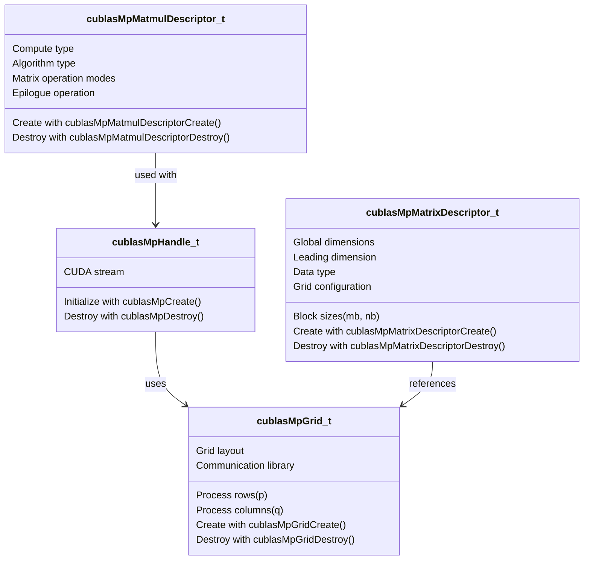

Sources: [cuBLASMp/pgemm.cu:131-138](), [cuBLASMp/pmatmul.cu:89-97](), [cuBLASMp/pmatmul.cu:180-188]()

## Supported Operations

cuBLASMp supports the following distributed BLAS operations:

| Function | Description | File Example |
|----------|-------------|--------------|
| `cublasMpGemm` | General matrix-matrix multiplication | pgemm.cu |
| `cublasMpMatmul` | Advanced matrix multiplication with different algorithms | pmatmul.cu, pmatmul_ar.cu |
| `cublasMpTrsm` | Triangular solve with multiple right-hand sides | ptrsm.cu |
| `cublasMpSyrk` | Symmetric rank-k update | psyrk.cu |
| `cublasMpGeadd` | General matrix addition | pgeadd.cu |
| `cublasMpTradd` | Triangular matrix addition | ptradd.cu |

Sources: [cuBLASMp/CMakeLists.txt:62-68](), [cuBLASMp/README.md:9-21]()

### Distributed GEMM

The distributed general matrix multiplication (GEMM) operation computes:

```
C = alpha * op(A) * op(B) + beta * C
```

where op(X) can be X or X^T (transpose), and alpha and beta are scalars.

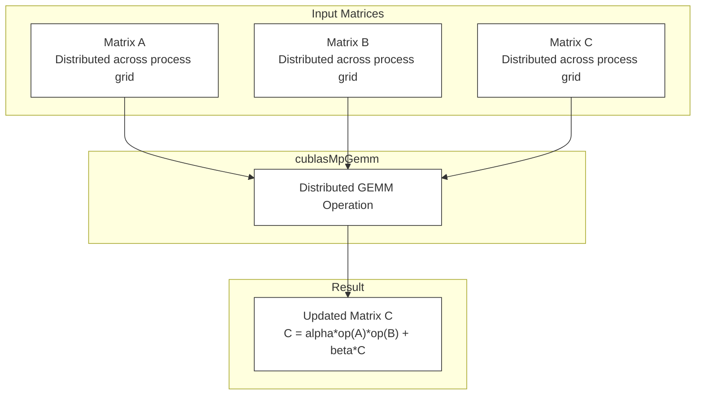

Sources: [cuBLASMp/pgemm.cu:232-257]()

### Advanced Matrix Multiplication with cublasMpMatmul

The `cublasMpMatmul` function provides more control over the matrix multiplication algorithm and communication patterns. It supports different algorithm types:

- `CUBLASMP_MATMUL_ALGO_TYPE_SPLIT_P2P`: Uses point-to-point communication between processes
- `CUBLASMP_MATMUL_ALGO_TYPE_SPLIT_MULTICAST`: Uses multicast operations for communication

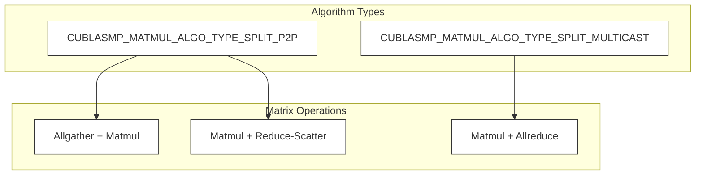

Sources: [cuBLASMp/pmatmul.cu:180](), [cuBLASMp/pmatmul.cu:334](), [cuBLASMp/pmatmul_ar.cu:145-146]()

### Communication Patterns

cuBLASMp uses different communication patterns depending on the operation and algorithm selected:

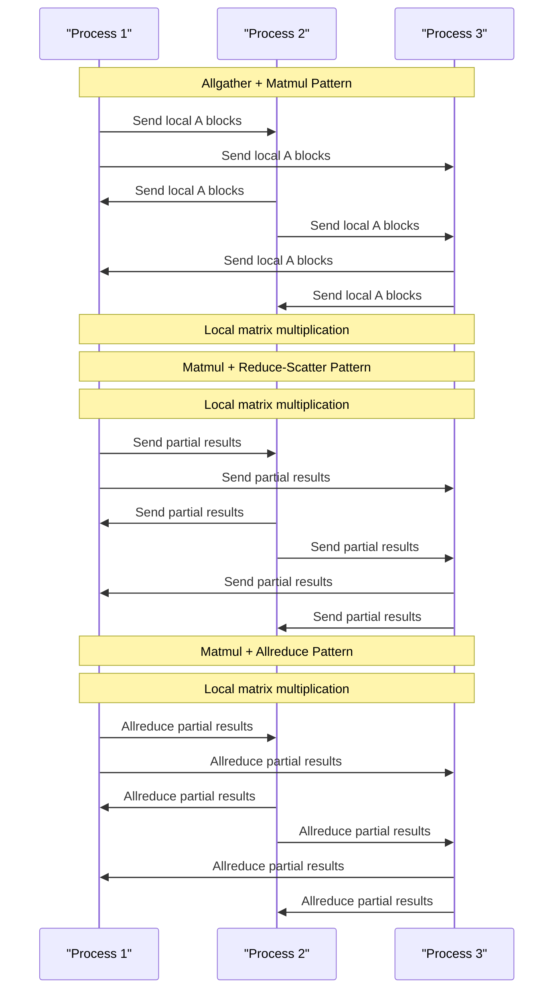

Sources: [cuBLASMp/pmatmul.cu:117-275](), [cuBLASMp/pmatmul_ar.cu:116-235]()

## Usage Guide

### Initialization and Setup

To use cuBLASMp, you need to:

1. Initialize MPI
2. Create a CAL communication context
3. Initialize a cuBLASMp handle
4. Create a process grid
5. Create matrix descriptors

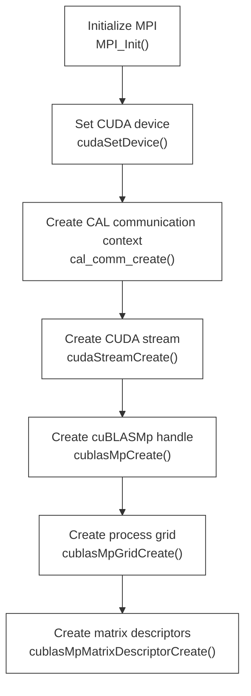

Sources: [cuBLASMp/pgemm.cu:81-196](), [cuBLASMp/pmatmul.cu:61-178]()

### Typical Workflow

The typical workflow for a cuBLASMp operation involves:

1. Set up the input and output matrices
2. Create descriptors for the matrices
3. Allocate workspace memory
4. Call the operation function
5. Clean up resources

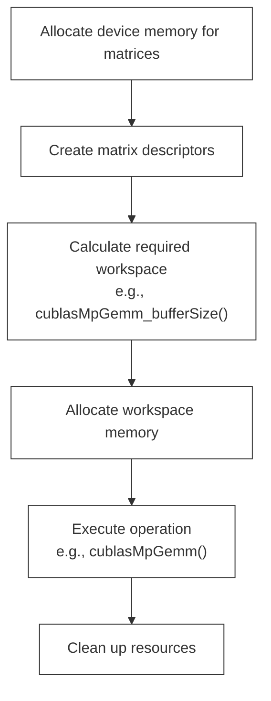

Sources: [cuBLASMp/pgemm.cu:176-288](), [cuBLASMp/ptrsm.cu:154-255]()

### Example: Matrix Multiplication (GEMM)

The steps for performing a distributed matrix multiplication:

1. Initialize MPI and set up the environment
2. Allocate and initialize matrices on each process
3. Create matrix descriptors
4. Determine workspace requirements
5. Allocate workspace memory
6. Execute the GEMM operation
7. Clean up resources

Key functions involved:
- `cublasMpCreate`: Create a cuBLASMp handle
- `cublasMpGridCreate`: Create a process grid
- `cublasMpMatrixDescriptorCreate`: Create matrix descriptors
- `cublasMpGemm_bufferSize`: Determine workspace requirements
- `cublasMpGemm`: Execute the GEMM operation
- `cublasMpMatrixDescriptorDestroy`: Destroy matrix descriptors
- `cublasMpGridDestroy`: Destroy the process grid
- `cublasMpDestroy`: Destroy the cuBLASMp handle

Sources: [cuBLASMp/pgemm.cu:48-298]()

### Advanced Matrix Multiplication

For more control over the matrix multiplication algorithm and communication patterns, use the `cublasMpMatmul` function:

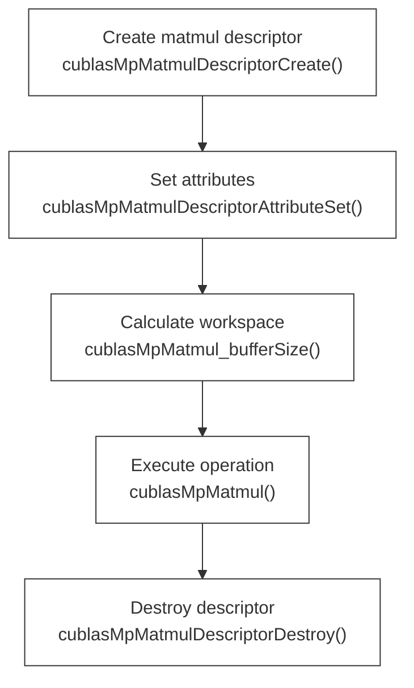

Sources: [cuBLASMp/pmatmul.cu:182-267](), [cuBLASMp/pmatmul_ar.cu:148-222]()

## Supported Data Types and Compute Types

cuBLASMp supports various data types for input and output matrices, as well as different compute types for the internal calculations:

| Input/Output Data Type | CUDA Data Type | Description |
|------------------------|---------------|-------------|
| `__half` | `CUDA_R_16F` | 16-bit floating-point (FP16) |
| `float` | `CUDA_R_32F` | 32-bit floating-point (FP32) |
| `double` | `CUDA_R_64F` | 64-bit floating-point (FP64) |

| Compute Type | cuBLAS Compute Type | Description |
|--------------|---------------------|-------------|
| `float` | `CUBLAS_COMPUTE_32F` | 32-bit floating-point computation |
| `double` | `CUBLAS_COMPUTE_64F` | 64-bit floating-point computation |

Sources: [cuBLASMp/pgemm.cu:50-55](), [cuBLASMp/pmatmul.cu:52-57](), [cuBLASMp/ptrsm.cu:189]()

## Performance Considerations

### Block Sizes

The block size parameters (mb, nb) affect both performance and communication overhead. Optimal block sizes depend on the matrix dimensions, the number of processes, and the hardware configuration.

### Process Grid Configuration

The process grid configuration (p, q) can significantly impact performance. For matrices with m ≈ n, a square process grid (p ≈ q) is often optimal. For rectangular matrices, the process grid should generally reflect the matrix aspect ratio.

### Algorithm Selection

Different algorithms have different communication patterns and performance characteristics:
- `SPLIT_P2P`: Generally better for smaller clusters or when processes have good point-to-point connectivity
- `SPLIT_MULTICAST`: Can be more efficient for larger clusters with efficient collective operations

### Communication Libraries

cuBLASMp can use different communication libraries:
- MPI: Widely available but may have higher overhead
- NVSHMEM: Can provide lower latency for GPU-to-GPU communication
- CAL: Provides a unified interface to different communication backends

Sources: [cuBLASMp/pmatmul.cu:180](), [cuBLASMp/pmatmul.cu:334](), [cuBLASMp/pmatmul_ar.cu:145-146](), [cuBLASMp/README.md:50]()

## Prerequisites and Dependencies

To use cuBLASMp, you need:

1. CUDA Toolkit
2. MPI implementation (e.g., HPC-X)
3. NVSHMEM
4. CAL (Communication Abstraction Layer)
5. GDRCOPY
6. C++11 compatible compiler

Sources: [cuBLASMp/README.md:48-63](), [cuBLASMp/CMakeLists.txt:11-20]()

## Sample Applications

The CUDA Library Samples repository includes several examples demonstrating the use of cuBLASMp:

| Sample | Description |
|--------|-------------|
| `pmatmul.cu` | Basic distributed matrix multiplication with different communication patterns |
| `pmatmul_ar.cu` | Matrix multiplication with allreduce |
| `pgemm.cu` | Standard distributed GEMM operation |
| `ptrsm.cu` | Triangular solve with multiple right-hand sides |
| `psyrk.cu` | Symmetric rank-k update |
| `pgeadd.cu` | General matrix addition |
| `ptradd.cu` | Triangular matrix addition |

Sources: [cuBLASMp/README.md:9-21](), [cuBLASMp/CMakeLists.txt:62-68]()

## Relation to Other NVIDIA Libraries

cuBLASMp is part of NVIDIA's suite of GPU-accelerated linear algebra libraries:

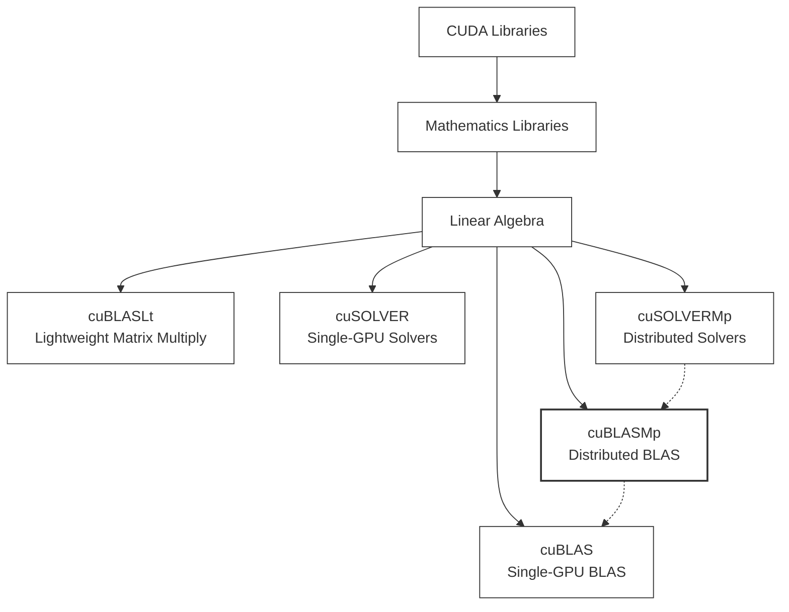

Sources: [cuBLASMp/README.md:42-44]()

---

