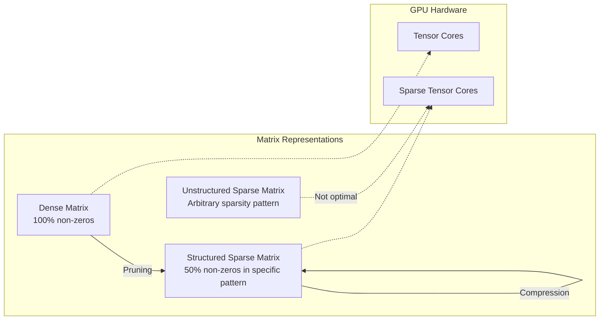
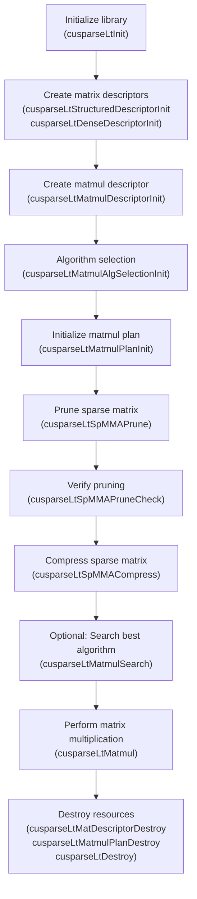
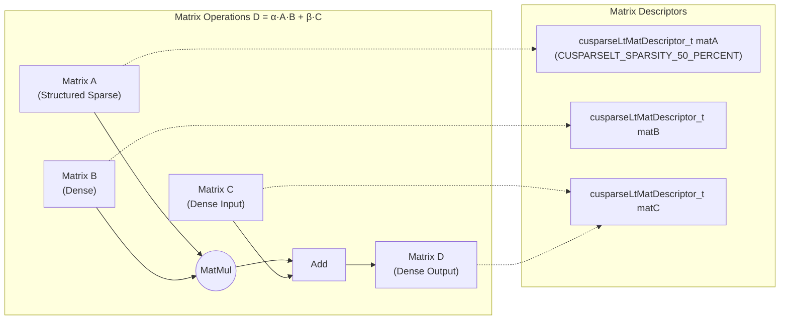
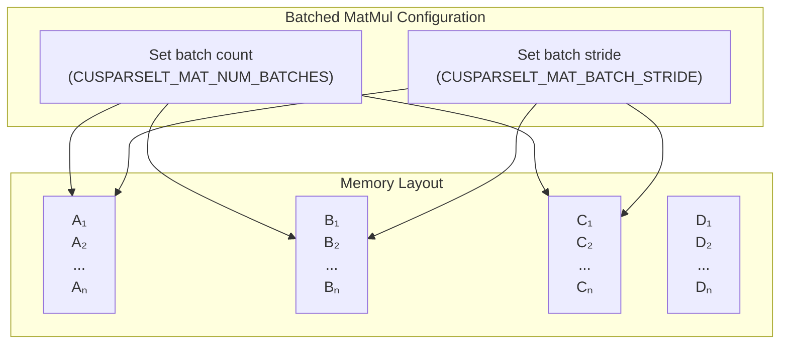
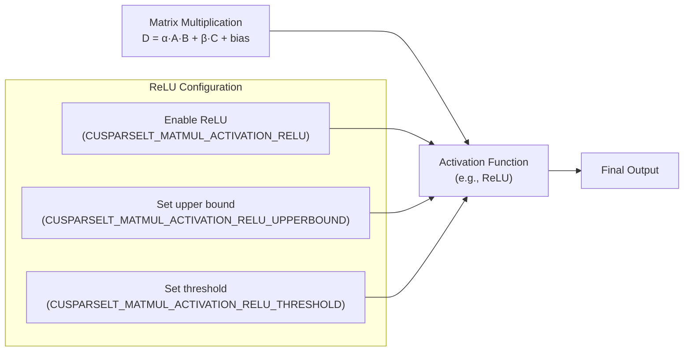
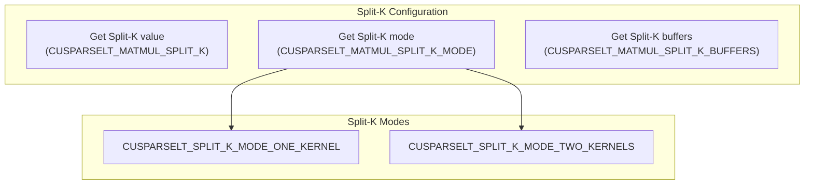
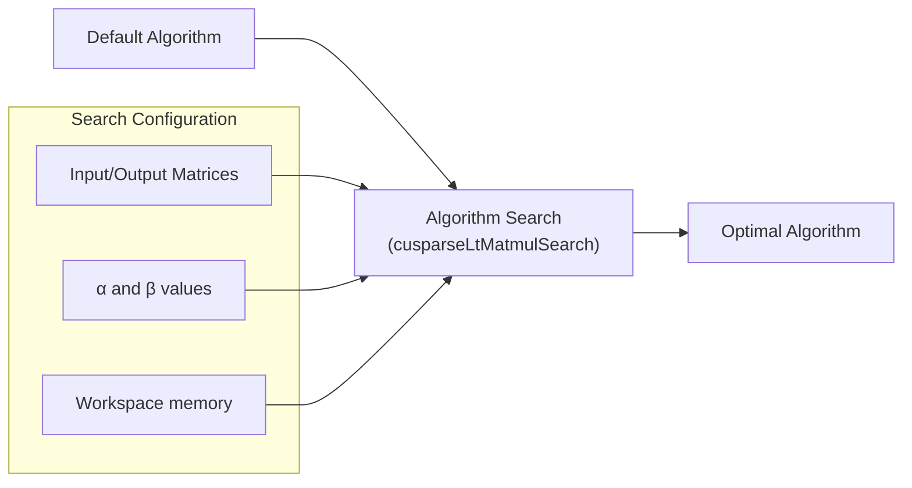
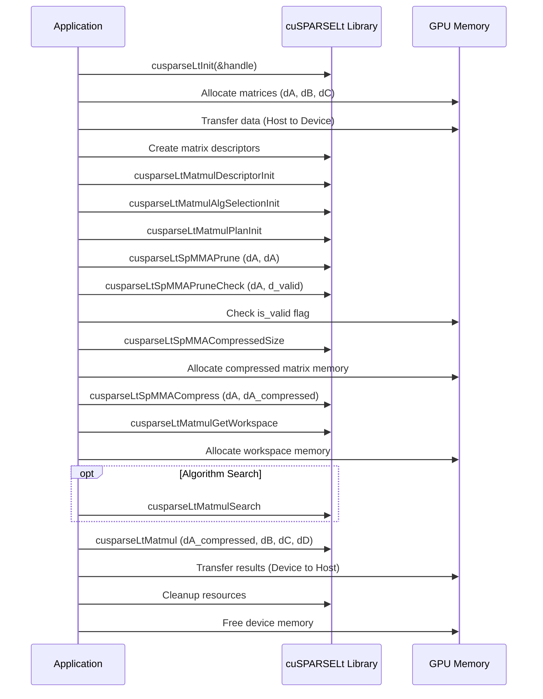

<!-- source: DeepWiki mcp.deepwiki.com · repo NVIDIA/CUDALibrarySamples · page 2.3 cuSPARSELt - Structured Sparse Matrix Operations · fetched 2026-10-26 -->

# cuSPARSELt - Structured Sparse Matrix Operations

<details>
<summary>Relevant source files</summary>

The following files were used as context for generating this wiki page:

- [cuSPARSELt/README.md](cuSPARSELt/README.md)
- [cuSPARSELt/matmul/CMakeLists.txt](cuSPARSELt/matmul/CMakeLists.txt)
- [cuSPARSELt/matmul/Makefile](cuSPARSELt/matmul/Makefile)
- [cuSPARSELt/matmul/README.md](cuSPARSELt/matmul/README.md)
- [cuSPARSELt/matmul/matmul_example.cpp](cuSPARSELt/matmul/matmul_example.cpp)
- [cuSPARSELt/matmul_advanced/CMakeLists.txt](cuSPARSELt/matmul_advanced/CMakeLists.txt)
- [cuSPARSELt/matmul_advanced/Makefile](cuSPARSELt/matmul_advanced/Makefile)
- [cuSPARSELt/matmul_advanced/README.md](cuSPARSELt/matmul_advanced/README.md)
- [cuSPARSELt/matmul_advanced/matmul_advanced_example.cpp](cuSPARSELt/matmul_advanced/matmul_advanced_example.cpp)

</details>


## Purpose and Scope

This document provides a detailed overview of cuSPARSELt, a CUDA library specifically designed for accelerating structured sparse matrix operations using NVIDIA Tensor Cores. cuSPARSELt focuses on optimizing performance for sparse matrices with structured sparsity patterns, enabling significant computation savings while maintaining high throughput. 

For general sparse matrix operations with arbitrary sparsity patterns, see [cuSPARSE - Sparse Matrix Operations](#2.7).

Sources: [cuSPARSELt/README.md]()

## Structured Sparsity Overview

Structured sparsity provides a middle ground between dense matrix operations and completely unstructured sparse matrices. In cuSPARSELt, matrices follow specific sparsity patterns (typically 50% structured sparsity) that can be efficiently processed by Sparse Tensor Cores on NVIDIA GPUs.



### Key Benefits

- **Computational Efficiency**: Reduces computation by up to 2x by skipping operations on zero elements
- **Memory Bandwidth Savings**: Structured compression format reduces memory requirements
- **Tensor Core Acceleration**: Leverages specialized Sparse Tensor Core hardware
- **Minimal Accuracy Impact**: Structured pruning preserves model accuracy in AI applications

Sources: [cuSPARSELt/matmul/README.md](), [cuSPARSELt/matmul_advanced/README.md]()

## Hardware Support

cuSPARSELt is supported on NVIDIA GPUs with the following compute capabilities:

| Compute Capability | GPU Architecture Examples |
|-------------------|---------------------------|
| SM 8.0 | NVIDIA A100 |
| SM 8.6 | NVIDIA RTX 3090, A2 |
| SM 8.7 | NVIDIA A30, A10 |
| SM 8.9 | NVIDIA RTX 4090, L4 |
| SM 9.0 | NVIDIA H100 |
| SM 10.0 | NVIDIA GB200, B100 |
| SM 12.0 | NVIDIA Blackwell generation |

The library will verify hardware compatibility at runtime and return an appropriate error code if the device is not supported.

Sources: [cuSPARSELt/matmul/matmul_example.cpp:108-124](), [cuSPARSELt/matmul_advanced/matmul_advanced_example.cpp:140-157]()

## Basic Workflow

The typical workflow for using cuSPARSELt involves the following steps:



Sources: [cuSPARSELt/matmul/matmul_example.cpp:199-296](), [cuSPARSELt/matmul_advanced/matmul_advanced_example.cpp:241-410]()

## Data Types and Precision

cuSPARSELt supports multiple data types for input matrices and computation:

| Matrix Data Types | Compute Types | Description |
|-------------------|---------------|-------------|
| `CUDA_R_16F` (FP16) | `CUSPARSE_COMPUTE_32F` | Half precision matrices, float computation |
| `CUDA_R_8I` (INT8) | `CUSPARSE_COMPUTE_32I` | 8-bit integer matrices, int32 computation |
| `CUDA_R_8F_E4M3` (FP8) | `CUSPARSE_COMPUTE_32F` | 8-bit float matrices (e4m3), float computation |
| `CUDA_R_16BF` (BF16) | `CUSPARSE_COMPUTE_32F` | BFloat16 matrices, float computation |

The code examples demonstrate the use of template helpers to map C++ types to CUDA data types:

```mermaid
classDiagram
    class "cuda_type<T>" {
        +cudaDataType value
    }
    class "cusparse_compute_type<T>" {
        +cusparseComputeType value
    }
    
    "cuda_type<T>" <|-- "cuda_type<__half>"
    "cuda_type<T>" <|-- "cuda_type<__nv_bfloat16>"
    "cuda_type<T>" <|-- "cuda_type<__nv_fp8_e4m3>"
    "cuda_type<T>" <|-- "cuda_type<int8_t>"
    "cuda_type<T>" <|-- "cuda_type<int>"
    
    "cusparse_compute_type<T>" <|-- "cusparse_compute_type<float>"
    "cusparse_compute_type<T>" <|-- "cusparse_compute_type<int>"
```

Sources: [cuSPARSELt/matmul/matmul_example.cpp:43-82](), [cuSPARSELt/matmul_advanced/matmul_advanced_example.cpp:48-92]()

## Key Components

### Matrix Descriptors

Three types of matrix descriptors are used:

1. **Structured Sparse Matrix (A)**: Created with `cusparseLtStructuredDescriptorInit`
2. **Dense Input Matrix (B)**: Created with `cusparseLtDenseDescriptorInit`
3. **Dense Output Matrix (C/D)**: Created with `cusparseLtDenseDescriptorInit`

These descriptors store information about matrix dimensions, layout, and data types.



Sources: [cuSPARSELt/matmul/matmul_example.cpp:203-216](), [cuSPARSELt/matmul_advanced/matmul_advanced_example.cpp:249-261]()

### Pruning and Compression

Structured sparsity requires two key operations:

1. **Pruning**: Removes values according to structured sparsity patterns (typically 50% of values)
2. **Compression**: Compacts the pruned matrix to reduce memory footprint

The pruning operation is performed with `cusparseLtSpMMAPrune`, followed by a validation check with `cusparseLtSpMMAPruneCheck`. After successful pruning, the matrix is compressed with `cusparseLtSpMMACompress`.

Sources: [cuSPARSELt/matmul/matmul_example.cpp:238-263](), [cuSPARSELt/matmul_advanced/matmul_advanced_example.cpp:362-388]()

## Advanced Features

### Matrix Layouts and Operations

cuSPARSELt supports both row-major and column-major matrix layouts, as well as transpose operations:

| Layout Option | Description |
|---------------|-------------|
| `CUSPARSE_ORDER_ROW` | Row-major layout |
| `CUSPARSE_ORDER_COL` | Column-major layout |
| `CUSPARSE_OPERATION_NON_TRANSPOSE` | Use matrix as-is |
| `CUSPARSE_OPERATION_TRANSPOSE` | Use transposed matrix |

Sources: [cuSPARSELt/matmul/matmul_example.cpp:132-134](), [cuSPARSELt/matmul_advanced/matmul_advanced_example.cpp:167-169]()

### Batched Operations

cuSPARSELt supports batched matrix multiplication, allowing multiple matrix multiplications to be performed in a single operation. This is particularly useful for deep learning workloads.



The batch attributes are set using `cusparseLtMatDescSetAttribute` with:
- `CUSPARSELT_MAT_NUM_BATCHES`: Number of matrices in the batch
- `CUSPARSELT_MAT_BATCH_STRIDE`: Stride between consecutive matrices (can be zero for broadcasting)

Sources: [cuSPARSELt/matmul_advanced/matmul_advanced_example.cpp:263-288]()

### Activation Functions

cuSPARSELt supports fusion of activation functions with matrix multiplication. The ReLU activation function can be enabled and configured as shown below:



Sources: [cuSPARSELt/matmul_advanced/matmul_advanced_example.cpp:303-318]()

### Bias Addition

cuSPARSELt supports adding a bias vector to the matrix multiplication results. This is particularly useful for neural network operations.

The bias pointer is set using `cusparseLtMatmulDescSetAttribute` with `CUSPARSELT_MATMUL_BIAS_POINTER`.

Sources: [cuSPARSELt/matmul_advanced/matmul_advanced_example.cpp:321-330]()

### Split-K Algorithm

cuSPARSELt supports the Split-K algorithm for matrix multiplication, which divides the K dimension across multiple threads or thread blocks to improve parallelism.



Sources: [cuSPARSELt/matmul_advanced/matmul_advanced_example.cpp:340-359]()

### Algorithm Selection

cuSPARSELt provides an algorithm search functionality to find the optimal kernel for a given matrix multiplication:



Sources: [cuSPARSELt/matmul/matmul_example.cpp:270-277]()

## Complete Example Workflow

The full workflow for structured sparse matrix multiplication with cuSPARSELt is illustrated below:



Sources: [cuSPARSELt/matmul/matmul_example.cpp:108-364](), [cuSPARSELt/matmul_advanced/matmul_advanced_example.cpp:140-487]()

## Error Handling

cuSPARSELt functions return `cusparseStatus_t` values that should be checked for errors. The examples use a `CHECK_CUSPARSE` macro to simplify error handling:

```cpp
#define CHECK_CUSPARSE(func)                                                   \
{                                                                              \
    cusparseStatus_t status = (func);                                          \
    if (status != CUSPARSE_STATUS_SUCCESS) {                                   \
        printf("CUSPARSE API failed at line %d with error: %s (%d)\n",         \
               __LINE__, cusparseGetErrorString(status), status);              \
        return EXIT_FAILURE;                                                   \
    }                                                                          \
}
```

Sources: [cuSPARSELt/matmul/matmul_example.cpp:94-102](), [cuSPARSELt/matmul_advanced/matmul_advanced_example.cpp:104-112]()

## Conclusion

cuSPARSELt provides specialized functionality for structured sparse matrix operations, offering significant performance benefits for applications that can leverage 50% structured sparsity. The library integrates with NVIDIA's Sparse Tensor Cores to accelerate computation while reducing memory requirements.

For more advanced usage including batched operations, activation functions, and bias addition, see [Advanced Features in cuSPARSELt](#2.3.2).

For basic sparse matrix multiplication examples, see [Sparse Matrix Multiplication with cuSPARSELt](#2.3.1).

Sources: [cuSPARSELt/README.md](), [cuSPARSELt/matmul/README.md](), [cuSPARSELt/matmul_advanced/README.md]()

---

