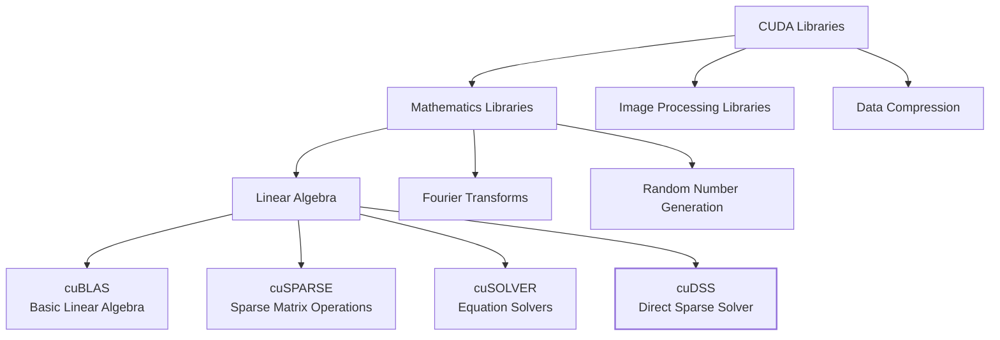
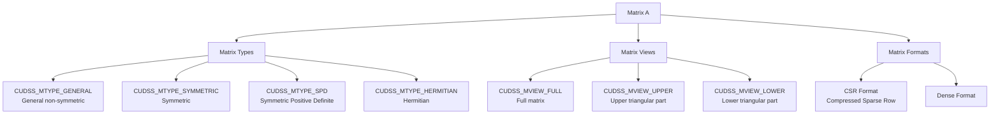
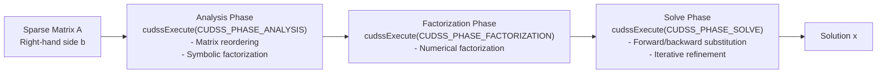
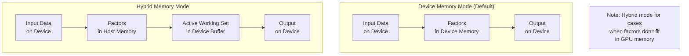
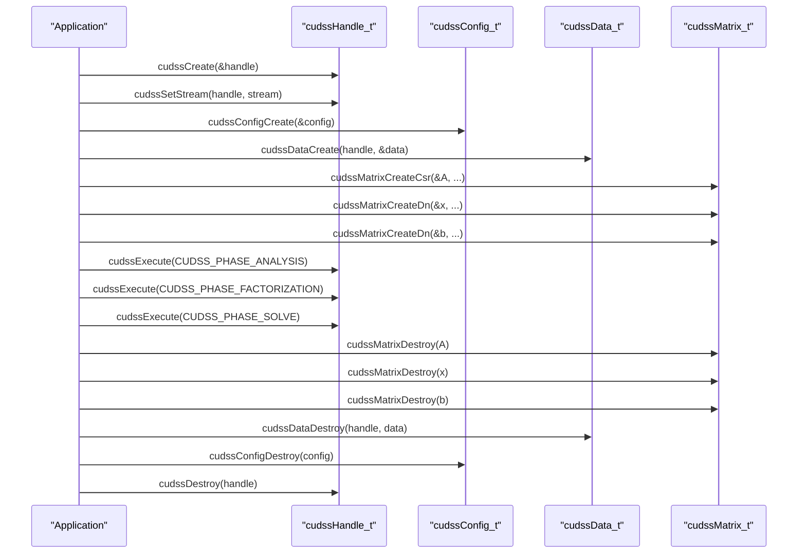
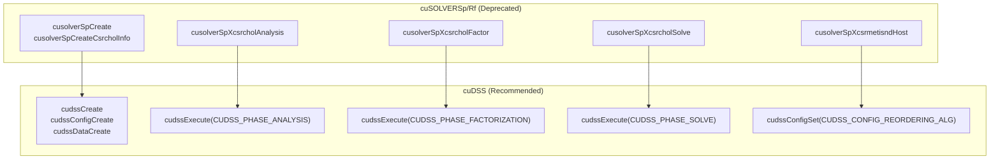

<!-- source: DeepWiki mcp.deepwiki.com · repo NVIDIA/CUDALibrarySamples · page 2.4 cuDSS - Direct Sparse Solver · fetched 2026-10-26 -->

# cuDSS - Direct Sparse Solver

<details>
<summary>Relevant source files</summary>

The following files were used as context for generating this wiki page:

- [README.md](README.md)
- [cuDSS/README.md](cuDSS/README.md)
- [cuDSS/get_set/CMakeLists.txt](cuDSS/get_set/CMakeLists.txt)
- [cuDSS/get_set/get_set.cpp](cuDSS/get_set/get_set.cpp)
- [cuDSS/memory_handler/CMakeLists.txt](cuDSS/memory_handler/CMakeLists.txt)
- [cuDSS/memory_handler/memory_handler.cpp](cuDSS/memory_handler/memory_handler.cpp)
- [cuDSS/simple/CMakeLists.txt](cuDSS/simple/CMakeLists.txt)
- [cuDSS/simple/simple.cpp](cuDSS/simple/simple.cpp)
- [cuDSS/simple_batch/CMakeLists.txt](cuDSS/simple_batch/CMakeLists.txt)
- [cuDSS/simple_batch/simple_batch.cpp](cuDSS/simple_batch/simple_batch.cpp)
- [cuDSS/simple_complex/CMakeLists.txt](cuDSS/simple_complex/CMakeLists.txt)
- [cuDSS/simple_complex/simple_complex.cpp](cuDSS/simple_complex/simple_complex.cpp)
- [cuDSS/simple_hybrid_memory_mode/CMakeLists.txt](cuDSS/simple_hybrid_memory_mode/CMakeLists.txt)
- [cuDSS/simple_hybrid_memory_mode/simple_hybrid_memory_mode.cpp](cuDSS/simple_hybrid_memory_mode/simple_hybrid_memory_mode.cpp)
- [cuDSS/simple_mgmn_mode/CMakeLists.txt](cuDSS/simple_mgmn_mode/CMakeLists.txt)
- [cuSOLVERSp2cuDSS/CMakeLists.txt](cuSOLVERSp2cuDSS/CMakeLists.txt)
- [cuSOLVERSp2cuDSS/README.md](cuSOLVERSp2cuDSS/README.md)
- [cuSOLVERSp2cuDSS/cuSolverRf2cuDSS.hpp](cuSOLVERSp2cuDSS/cuSolverRf2cuDSS.hpp)
- [cuSOLVERSp2cuDSS/cuSolverRf2cuDSS_double.cpp](cuSOLVERSp2cuDSS/cuSolverRf2cuDSS_double.cpp)
- [cuSOLVERSp2cuDSS/cuSolverSp2cuDSS.hpp](cuSOLVERSp2cuDSS/cuSolverSp2cuDSS.hpp)
- [cuSOLVERSp2cuDSS/cuSolverSp2cuDSS_dcomplex.cpp](cuSOLVERSp2cuDSS/cuSolverSp2cuDSS_dcomplex.cpp)
- [cuSOLVERSp2cuDSS/cuSolverSp2cuDSS_double.cpp](cuSOLVERSp2cuDSS/cuSolverSp2cuDSS_double.cpp)
- [cuSOLVERSp2cuDSS/cuSolverSp2cuDSS_float.cpp](cuSOLVERSp2cuDSS/cuSolverSp2cuDSS_float.cpp)
- [cuSOLVERSp2cuDSS/cuSolverSp2cuDSS_scomplex.cpp](cuSOLVERSp2cuDSS/cuSolverSp2cuDSS_scomplex.cpp)
- [cuSOLVERSp2cuDSS/test_complex.mtx](cuSOLVERSp2cuDSS/test_complex.mtx)
- [cuSOLVERSp2cuDSS/test_real.mtx](cuSOLVERSp2cuDSS/test_real.mtx)

</details>


cuDSS (CUDA Direct Sparse Solver) is a GPU-accelerated library for solving sparse linear systems of equations in the form Ax = b. It provides direct methods for efficiently solving sparse linear systems on NVIDIA GPUs, serving as the recommended replacement for the deprecated cuSOLVERSp and cuSOLVERRf libraries.

For information about transitioning from cuSOLVERSp or cuSOLVERRf, see [Migrating from cuSOLVERSp to cuDSS](#2.8).

## Position in CUDA Library Ecosystem

cuDSS is part of NVIDIA's linear algebra libraries within the CUDA ecosystem, specifically focused on direct solvers for sparse linear systems.

### Library Position in CUDA Ecosystem



Sources: [README.md:1-51](), [cuDSS/README.md:1-9]()

## Key Features

- Support for real and complex data types in various precisions
- Solvers for symmetric positive definite, symmetric indefinite, and general sparse matrices
- Hybrid memory mode for large problems where factors don't fit in GPU memory
- Multi-GPU and multi-node execution for distributed solving
- Batch processing capability for multiple systems
- Custom memory management through device memory handlers
- Comprehensive configuration options and information retrieval

Sources: [cuDSS/README.md:12-53](), [cuDSS/simple/simple.cpp:57-65]()

## Core Concepts

### Matrix Representations

cuDSS works with the following matrix formats:

- **Sparse Matrices**: CSR (Compressed Sparse Row) format for coefficient matrices
- **Dense Matrices**: Column-major format for right-hand sides and solutions

### Matrix Types and Views



Sources: [cuDSS/simple/simple.cpp:223-230](), [cuDSS/simple_complex/simple_complex.cpp:238-245]()

### Solver Workflow

cuDSS operates in three distinct phases:



This three-phase separation allows for optimization when solving multiple systems with the same sparsity pattern but different numerical values.

Sources: [cuDSS/simple/simple.cpp:232-242](), [cuDSS/get_set/get_set.cpp:256-289, 357-364]()

### Memory Modes

cuDSS supports different memory management approaches:



Sources: [cuDSS/simple_hybrid_memory_mode/simple_hybrid_memory_mode.cpp:59-72, 242-247](), [cuDSS/get_set/get_set.cpp:283-285]()

## Basic Usage

The typical workflow for using cuDSS involves creating handles and objects, solving the system, and cleanup:



### Basic Code Structure

Here's the typical sequence of operations:

1. Initialize the library
   ```c
   cudssHandle_t handle;
   cudssCreate(&handle);
   cudssSetStream(handle, stream);  // Optional
   ```

2. Create configuration and data objects
   ```c
   cudssConfig_t config;
   cudssData_t data;
   cudssConfigCreate(&config);
   cudssDataCreate(handle, &data);
   ```

3. Create matrix objects
   ```c
   cudssMatrix_t A, x, b;
   cudssMatrixCreateCsr(&A, rows, cols, nnz, offsets, NULL, columns, values, 
                       CUDA_R_32I, CUDA_R_64F, mtype, mview, base);
   cudssMatrixCreateDn(&x, rows, nrhs, ldx, x_values, CUDA_R_64F, CUDSS_LAYOUT_COL_MAJOR);
   cudssMatrixCreateDn(&b, cols, nrhs, ldb, b_values, CUDA_R_64F, CUDSS_LAYOUT_COL_MAJOR);
   ```

4. Execute solver phases
   ```c
   cudssExecute(handle, CUDSS_PHASE_ANALYSIS, config, data, A, x, b);
   cudssExecute(handle, CUDSS_PHASE_FACTORIZATION, config, data, A, x, b);
   cudssExecute(handle, CUDSS_PHASE_SOLVE, config, data, A, x, b);
   ```

5. Clean up resources
   ```c
   cudssMatrixDestroy(A);
   cudssMatrixDestroy(x);
   cudssMatrixDestroy(b);
   cudssDataDestroy(handle, data);
   cudssConfigDestroy(config);
   cudssDestroy(handle);
   ```

Sources: [cuDSS/simple/simple.cpp:198-250]()

## Advanced Features

### Configuration Options

cuDSS provides various configuration options through `cudssConfigSet`:

- Reordering algorithms
  ```c
  cudssAlgType_t reorder_alg = CUDSS_ALG_DEFAULT;
  cudssConfigSet(config, CUDSS_CONFIG_REORDERING_ALG, &reorder_alg, sizeof(cudssAlgType_t));
  ```

- Iterative refinement settings
  ```c
  int iter_ref_nsteps = 2;
  cudssConfigSet(config, CUDSS_CONFIG_IR_N_STEPS, &iter_ref_nsteps, sizeof(int));
  ```

- Memory mode selection
  ```c
  cudssMemoryMode_t memory_mode = CUDSS_MEMMODE_HYBRID;
  cudssConfigSet(config, CUDSS_CONFIG_MEMORY_MODE, &memory_mode, sizeof(cudssMemoryMode_t));
  ```

Sources: [cuDSS/get_set/get_set.cpp:233-235, 357-360](), [cuDSS/simple_hybrid_memory_mode/simple_hybrid_memory_mode.cpp:242-247]()

### Custom Memory Management

cuDSS allows for user-defined memory handling:

```c
// Define a memory handler
cudssDeviceMemHandler_t handler;
handler.ctx = context_ptr;
handler.device_alloc = custom_alloc_function;
handler.device_free = custom_free_function;

// Set the handler
cudssSetDeviceMemHandler(handle, &handler);
```

This feature is useful for integrating with application-specific memory pools or tracking memory usage.

Sources: [cuDSS/memory_handler/memory_handler.cpp:107-172, 254-258]()

### Batch Processing

For solving multiple sparse linear systems simultaneously:

```c
// Create batch matrices
cudssMatrixCreateBatchCsr(&A, batchCount, rows_array, cols_array, nnz_array, 
                         offsets_array, NULL, columns_array, values_array,
                         CUDA_R_32I, CUDA_R_64F, mtype, mview, base);
cudssMatrixCreateBatchDn(&x, batchCount, rows_array, nrhs_array, ldx_array,
                         x_values_array, CUDA_R_32I, CUDA_R_64F, CUDSS_LAYOUT_COL_MAJOR);
cudssMatrixCreateBatchDn(&b, batchCount, cols_array, nrhs_array, ldb_array,
                         b_values_array, CUDA_R_32I, CUDA_R_64F, CUDSS_LAYOUT_COL_MAJOR);

// Execute as usual - operates on all systems in the batch
cudssExecute(handle, CUDSS_PHASE_ANALYSIS, config, data, A, x, b);
cudssExecute(handle, CUDSS_PHASE_FACTORIZATION, config, data, A, x, b);
cudssExecute(handle, CUDSS_PHASE_SOLVE, config, data, A, x, b);
```

Sources: [cuDSS/simple_batch/simple_batch.cpp:297-323]()

### Retrieving Solver Information

cuDSS provides extensive information about the solve process:

```c
// Get permutation arrays
int row_perm[n];
cudssDataGet(handle, data, CUDSS_DATA_PERM_REORDER_ROW, &row_perm, sizeof(row_perm), &sizeWritten);

// Get factorization statistics
int npivots;
cudssDataGet(handle, data, CUDSS_DATA_NPIVOTS, &npivots, sizeof(npivots), &sizeWritten);

// Get matrix inertia (for indefinite matrices)
int inertia[2];
cudssDataGet(handle, data, CUDSS_DATA_INERTIA, &inertia, sizeof(inertia), &sizeWritten);

// Get diagonal elements
double diag[n];
cudssDataGet(handle, data, CUDSS_DATA_DIAG, diag_d, n*sizeof(double), &sizeWritten);

// Get memory usage estimates
int64_t memory_estimates[16];
cudssDataGet(handle, data, CUDSS_DATA_MEMORY_ESTIMATES, &memory_estimates, 
             sizeof(memory_estimates), &sizeWritten);
```

Sources: [cuDSS/get_set/get_set.cpp:260-327, 350-355]()

## Multi-GPU and Multi-Node Execution

cuDSS supports distributed solving across multiple GPUs and compute nodes:

```c
// Set communication backend
cudssConfigSet(config, CUDSS_CONFIG_COMM_BACKEND_PATH, backend_path, strlen(backend_path) + 1);

// Set device ID for multi-GPU operations
cudssConfigSet(config, CUDSS_CONFIG_COMM_DEVICE_ID, &device_id, sizeof(device_id));
```

Both OpenMPI and NCCL communication backends are supported for multi-GPU/multi-node operation.

Sources: [cuDSS/simple_mgmn_mode/CMakeLists.txt:64-69, 128-134]()

## Migration from cuSOLVERSp/Rf

cuDSS is the recommended replacement for the deprecated cuSOLVERSp and cuSOLVERRf libraries. Here's a mapping between the APIs:



The key differences in the cuDSS API:

1. Explicit matrix objects using `cudssMatrixCreateCsr` and `cudssMatrixCreateDn`
2. Three-phase execution model via `cudssExecute`
3. Configuration options handled through `cudssConfigSet`
4. Matrix reordering integrated into the analysis phase
5. Refactorization support via `CUDSS_PHASE_REFACTORIZATION`

Sources: [cuSOLVERSp2cuDSS/README.md:19-61](), [cuSOLVERSp2cuDSS/cuSolverSp2cuDSS.hpp:299-304, 313-334](), [cuSOLVERSp2cuDSS/cuSolverRf2cuDSS.hpp:291-308]()

## Summary

cuDSS provides a comprehensive solution for directly solving sparse linear systems on NVIDIA GPUs. It offers performance, flexibility, and scalability for systems ranging from small matrices to large-scale multi-GPU workloads. The library's three-phase execution model and extensive configuration options allow for optimization in various application scenarios.

Whether you need to solve symmetric positive definite systems, general sparse systems, or batches of multiple systems, cuDSS provides the tools and performance to tackle challenging sparse linear algebra problems efficiently.

Sources: [cuDSS/README.md:1-53](), [cuDSS/simple/simple.cpp:57-65]()

---

