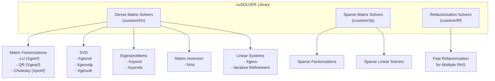
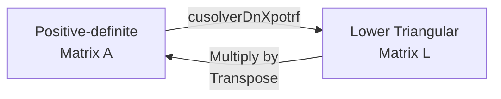
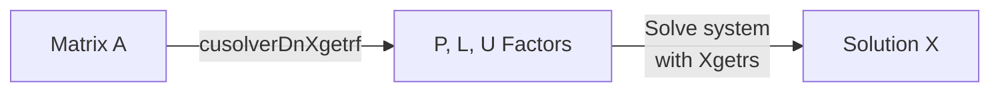
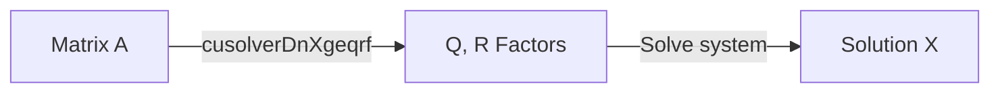
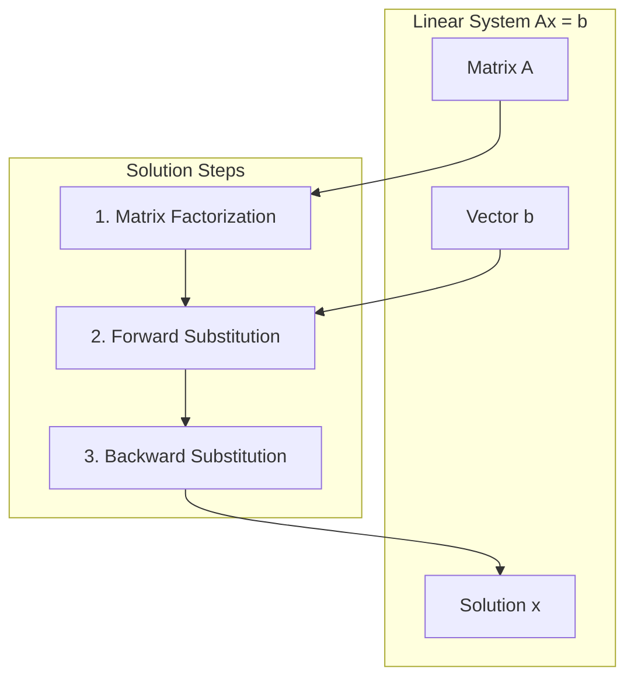
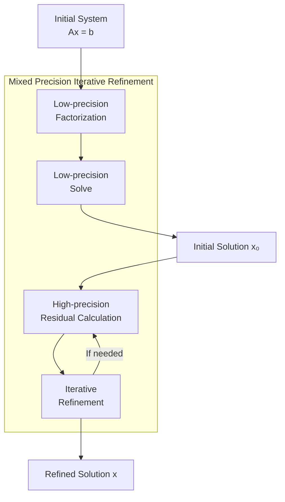
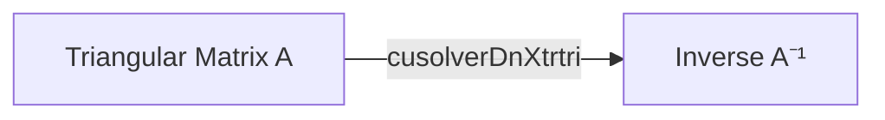
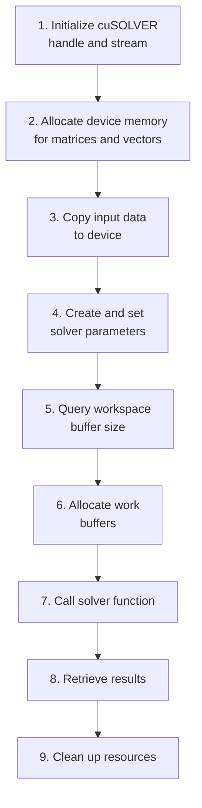
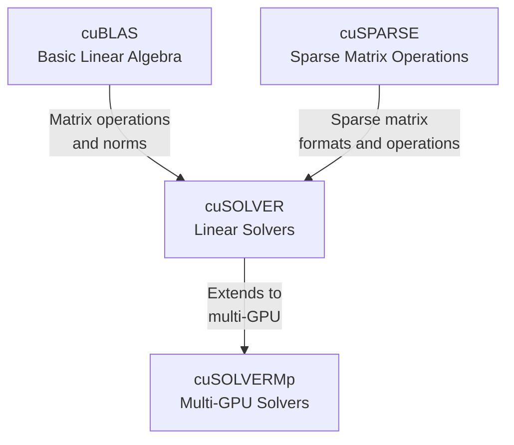

<!-- source: DeepWiki mcp.deepwiki.com · repo NVIDIA/CUDALibrarySamples · page 2.5 cuSOLVER - Linear Solvers · fetched 2026-10-26 -->

# cuSOLVER - Linear Solvers

<details>
<summary>Relevant source files</summary>

The following files were used as context for generating this wiki page:

- [cuBLAS/utils/cublas_utils.h](cuBLAS/utils/cublas_utils.h)
- [cuSOLVER/Xgeqrf/cusolver_Xgeqrf_example.cu](cuSOLVER/Xgeqrf/cusolver_Xgeqrf_example.cu)
- [cuSOLVER/Xgesvd/cusolver_Xgesvd_example.cu](cuSOLVER/Xgesvd/cusolver_Xgesvd_example.cu)
- [cuSOLVER/Xgesvdp/cusolver_Xgesvdp_example.cu](cuSOLVER/Xgesvdp/cusolver_Xgesvdp_example.cu)
- [cuSOLVER/Xgesvdr/cusolver_Xgesvdr_example.cu](cuSOLVER/Xgesvdr/cusolver_Xgesvdr_example.cu)
- [cuSOLVER/Xgetrf/cusolver_Xgetrf_example.cu](cuSOLVER/Xgetrf/cusolver_Xgetrf_example.cu)
- [cuSOLVER/Xpotrf/cusolver_Xpotrf_example.cu](cuSOLVER/Xpotrf/cusolver_Xpotrf_example.cu)
- [cuSOLVER/Xsyevd/cusolver_Xsyevd_example.cu](cuSOLVER/Xsyevd/cusolver_Xsyevd_example.cu)
- [cuSOLVER/Xsyevdx/cusolver_Xsyevdx_example.cu](cuSOLVER/Xsyevdx/cusolver_Xsyevdx_example.cu)
- [cuSOLVER/Xtrtri/.gitignore](cuSOLVER/Xtrtri/.gitignore)
- [cuSOLVER/Xtrtri/CMakeLists.txt](cuSOLVER/Xtrtri/CMakeLists.txt)
- [cuSOLVER/Xtrtri/README.md](cuSOLVER/Xtrtri/README.md)
- [cuSOLVER/Xtrtri/cusolver_Xtrtri_example.cu](cuSOLVER/Xtrtri/cusolver_Xtrtri_example.cu)
- [cuSOLVER/gesv/.gitignore](cuSOLVER/gesv/.gitignore)
- [cuSOLVER/gesv/CMakeLists.txt](cuSOLVER/gesv/CMakeLists.txt)
- [cuSOLVER/gesv/README.md](cuSOLVER/gesv/README.md)
- [cuSOLVER/gesv/cusolver_irs_expert_cuda-10.2.cu](cuSOLVER/gesv/cusolver_irs_expert_cuda-10.2.cu)
- [cuSOLVER/gesv/cusolver_irs_expert_cuda-11.cu](cuSOLVER/gesv/cusolver_irs_expert_cuda-11.cu)
- [cuSOLVER/gesv/cusolver_irs_lapack.cu](cuSOLVER/gesv/cusolver_irs_lapack.cu)
- [cuSOLVER/utils/cusolver_utils.h](cuSOLVER/utils/cusolver_utils.h)

</details>


## Overview

This document provides detailed information about the cuSOLVER library, focusing on its linear solver capabilities. cuSOLVER is NVIDIA's GPU-accelerated library for dense and sparse direct solvers, designed for solving linear systems, eigenvalue problems, singular value decompositions, and matrix factorizations. For information about distributed linear solvers across multiple GPUs, see [cuSOLVERMp - Distributed Linear Solvers](#2.6).

## Library Architecture

cuSOLVER is structured into different modules that handle specific types of linear algebra operations. The library provides an extensive set of LAPACK-like functions optimized for GPU execution.



Sources: [cuSOLVER/Xpotrf/cusolver_Xpotrf_example.cu:1-192](), [cuSOLVER/Xgetrf/cusolver_Xgetrf_example.cu:1-242](), [cuSOLVER/Xgeqrf/cusolver_Xgeqrf_example.cu:1-178](), [cuSOLVER/Xgesvd/cusolver_Xgesvd_example.cu:1-274](), [cuSOLVER/Xtrtri/cusolver_Xtrtri_example.cu:1-220](), [cuSOLVER/Xsyevd/cusolver_Xsyevd_example.cu:1-181]()

## Supported Data Types

cuSOLVER supports various data types for different precision requirements:

| Data Type | CUDA Data Type | Description |
|-----------|---------------|-------------|
| float | CUDA_R_32F | Single precision real |
| double | CUDA_R_64F | Double precision real |
| cuFloatComplex | CUDA_C_32F | Single precision complex |
| cuDoubleComplex | CUDA_C_64F | Double precision complex |

Additional data types may be supported for specific functions, including half precision (CUDA_R_16F).

Sources: [cuSOLVER/utils/cusolver_utils.h:91-177]()

## Key Factorization Methods

The foundation of linear solvers in cuSOLVER consists of several matrix factorization techniques:

### Cholesky Factorization (Xpotrf)

Decomposes a Hermitian, positive-definite matrix A into the product A = L·L* where L is a lower triangular matrix and L* is its conjugate transpose.



Example usage:
```
// Create solver handle
cusolverDnHandle_t handle;
cusolverDnCreate(&handle);

// Set up parameters
cusolverDnParams_t params;
cusolverDnCreateParams(&params);

// Query work buffer size
cusolverDnXpotrf_bufferSize(handle, params, uplo, n, dataType, d_A, lda, computeType, 
                           &workspaceInBytesOnDevice, &workspaceInBytesOnHost);

// Perform Cholesky factorization
cusolverDnXpotrf(handle, params, uplo, n, dataType, d_A, lda, computeType, 
                d_work, workspaceInBytesOnDevice, h_work, workspaceInBytesOnHost, d_info);

// Solve linear system using factorization
cusolverDnXpotrs(handle, params, uplo, n, nrhs, dataType, d_A, lda, 
                dataType, d_B, ldb, d_info);
```

Sources: [cuSOLVER/Xpotrf/cusolver_Xpotrf_example.cu:106-176]()

### LU Factorization (Xgetrf)

Decomposes a general matrix A into the product A = P·L·U where L is a lower triangular matrix, U is an upper triangular matrix, and P is a permutation matrix.



Example usage:
```
// LU factorization
cusolverDnXgetrf(handle, params, m, n, dataType, d_A, lda, d_Ipiv, 
                computeType, d_work, workspaceInBytesOnDevice, 
                h_work, workspaceInBytesOnHost, d_info);

// Solve linear system using factorization
cusolverDnXgetrs(handle, params, trans, n, nrhs, dataType, d_A, lda, 
                d_Ipiv, dataType, d_B, ldb, d_info);
```

Sources: [cuSOLVER/Xgetrf/cusolver_Xgetrf_example.cu:149-215]()

### QR Factorization (Xgeqrf)

Decomposes a matrix A into the product A = Q·R where Q is an orthogonal matrix and R is an upper triangular matrix.



Example usage:
```
// QR factorization
cusolverDnXgeqrf(handle, params, m, n, dataType, d_A, lda, dataType, 
                d_tau, computeType, d_work, workspaceInBytesOnDevice, 
                h_work, workspaceInBytesOnHost, d_info);
```

Sources: [cuSOLVER/Xgeqrf/cusolver_Xgeqrf_example.cu:117-137]()

## Linear System Solvers

cuSOLVER provides several methods for solving linear systems of the form Ax = b.

### Direct Solvers

Direct solvers are based on matrix factorizations and provide the exact solution (within numerical precision) in a fixed number of steps.



#### Gesv Solver

The Gesv family of functions provides a complete linear solver that performs factorization and solve in one call.

Two API styles are available:
1. **LAPACK-style API**: Similar to LAPACK's gesv function
2. **Expert API**: More configurable with additional parameters

Example of Expert API:
```
// Set solver parameters
cusolverDnIRSParamsCreate(&params);
cusolverDnIRSParamsSetSolverPrecisions(params, CUSOLVER_R_64F, CUSOLVER_R_16F);
cusolverDnIRSParamsSetRefinementSolver(params, CUSOLVER_IRS_REFINE_GMRES);

// Query workspace size
cusolverDnIRSXgesv_bufferSize(handle, params, n, nrhs, &workspaceSize);

// Solve linear system
cusolverDnIRSXgesv(handle, params, info, n, nrhs, dA, lda, dB, ldb, 
                  dX, ldx, dwork, workspaceSize, &iter, dinfo);
```

Sources: [cuSOLVER/gesv/cusolver_irs_expert_cuda-11.cu:97-153](), [cuSOLVER/gesv/cusolver_irs_lapack.cu:131-136]()

### Iterative Refinement and Mixed Precision

One of cuSOLVER's advanced features is the ability to use mixed precision computation with iterative refinement, which can significantly accelerate calculations while maintaining high precision in the final result.



Supported refinement methods:
- CUSOLVER_IRS_REFINE_NONE: No refinement
- CUSOLVER_IRS_REFINE_CLASSICAL: Classical iterative refinement
- CUSOLVER_IRS_REFINE_GMRES: Generalized Minimal Residual method
- CUSOLVER_IRS_REFINE_CLASSICAL_GMRES: Classical followed by GMRES
- CUSOLVER_IRS_REFINE_GMRES_GMRES: Two-stage GMRES

Sources: [cuSOLVER/gesv/cusolver_irs_expert_cuda-11.cu:97-104](), [cuSOLVER/utils/cusolver_utils.h:292-309]()

## Matrix Decompositions

### Singular Value Decomposition (SVD)

SVD decomposes a matrix A into the product A = U·Σ·V*, where U and V are orthogonal matrices and Σ is a diagonal matrix containing the singular values.

cuSOLVER offers several SVD implementations:
- **Xgesvd**: Standard SVD implementation
- **Xgesvdp**: SVD with more accurate singular vectors
- **Xgesvdr**: Randomized SVD for faster approximate decomposition

Example:
```
// Set job parameters for U and V matrices
signed char jobu = 'A';  // All columns of U
signed char jobvt = 'A'; // All rows of VT

// Query workspace size
cusolverDnXgesvd_bufferSize(handle, params, jobu, jobvt, m, n, dataType,
                           d_A, lda, dataType, d_S, dataType, d_U, ldu,
                           dataType, d_VT, ldvt, dataType,
                           &workspaceInBytesOnDevice, &workspaceInBytesOnHost);

// Compute SVD
cusolverDnXgesvd(handle, params, jobu, jobvt, m, n, dataType,
                d_A, lda, dataType, d_S, dataType, d_U, ldu,
                dataType, d_VT, ldvt, dataType, d_work,
                workspaceInBytesOnDevice, h_work, workspaceInBytesOnHost, d_info);
```

Sources: [cuSOLVER/Xgesvd/cusolver_Xgesvd_example.cu:130-185](), [cuSOLVER/Xgesvdp/cusolver_Xgesvdp_example.cu:134-165](), [cuSOLVER/Xgesvdr/cusolver_Xgesvdr_example.cu:135-155]()

### Eigenvalue Decomposition

Computes eigenvalues and optionally eigenvectors of symmetric/Hermitian matrices.

Two main implementations:
- **Xsyevd**: Standard eigenvalue decomposition
- **Xsyevdx**: Selective eigenvalue decomposition (computes a subset of eigenvalues)

Example:
```
// Set job parameters
cusolverEigMode_t jobz = CUSOLVER_EIG_MODE_VECTOR; // Compute eigenvectors
cublasFillMode_t uplo = CUBLAS_FILL_MODE_LOWER;    // Lower triangular storage

// Query workspace size
cusolverDnXsyevd_bufferSize(handle, params, jobz, uplo, n, dataType,
                           d_A, lda, dataType, d_W, computeType,
                           &workspaceInBytesOnDevice, &workspaceInBytesOnHost);

// Compute eigenvalues and eigenvectors
cusolverDnXsyevd(handle, params, jobz, uplo, n, dataType,
                d_A, lda, dataType, d_W, computeType,
                d_work, workspaceInBytesOnDevice, h_work, workspaceInBytesOnHost, d_info);
```

Sources: [cuSOLVER/Xsyevd/cusolver_Xsyevd_example.cu:114-132](), [cuSOLVER/Xsyevdx/cusolver_Xsyevdx_example.cu:117-135]()

## Matrix Inversion

For specific matrix types, cuSOLVER provides direct inversion functions:

### Triangular Matrix Inversion (Xtrtri)

Computes the inverse of an upper or lower triangular matrix.



Example:
```
// Query workspace size
cusolverDnXtrtri_bufferSize(handle, uplo, diag, n, dataType,
                           d_A, lda, &workspaceInBytesOnDevice, &workspaceInBytesOnHost);

// Compute inverse of triangular matrix
cusolverDnXtrtri(handle, uplo, diag, n, dataType, d_A, lda,
                d_work, workspaceInBytesOnDevice, h_work, workspaceInBytesOnHost, d_info);
```

Sources: [cuSOLVER/Xtrtri/cusolver_Xtrtri_example.cu:69-87]()

## Common Usage Pattern

Most cuSOLVER functions follow a similar pattern:



Generic code template:
```
// 1. Initialize
cusolverDnHandle_t handle;
cusolverDnCreate(&handle);
cudaStream_t stream;
cudaStreamCreate(&stream);
cusolverDnSetStream(handle, stream);

// 2-3. Allocate and copy data
// (device allocation and data copying code)

// 4. Create parameters
cusolverDnParams_t params;
cusolverDnCreateParams(&params);

// 5. Query buffer size
cusolverDnX[operation]_bufferSize(..., &workspaceInBytesOnDevice, &workspaceInBytesOnHost);

// 6. Allocate work buffers
cudaMalloc(&d_work, workspaceInBytesOnDevice);
if (workspaceInBytesOnHost > 0) {
    h_work = malloc(workspaceInBytesOnHost);
}

// 7. Call solver
cusolverDnX[operation](..., d_work, workspaceInBytesOnDevice, h_work, workspaceInBytesOnHost, d_info);

// 8. Retrieve results
// (copy results from device to host)

// 9. Clean up
cusolverDnDestroyParams(params);
cusolverDnDestroy(handle);
cudaStreamDestroy(stream);
// (free allocated memory)
```

Sources: [cuSOLVER/Xgesvd/cusolver_Xgesvd_example.cu:106-196](), [cuSOLVER/Xpotrf/cusolver_Xpotrf_example.cu:106-176](), [cuSOLVER/Xgetrf/cusolver_Xgetrf_example.cu:121-219]()

## Error Handling

cuSOLVER functions return status codes that should be checked for errors. The library provides macros for simplifying error checking:

```
// Check cuSOLVER API calls
CUSOLVER_CHECK(cusolverDnXpotrf(...));

// Check CUDA runtime API calls
CUDA_CHECK(cudaMalloc(...));
```

Additionally, many functions set an `info` output parameter which provides more details about the operation outcome:
- `info = 0`: Successful execution
- `info < 0`: Invalid input at the -info parameter position
- `info > 0`: Numerical issue (e.g., matrix not positive definite in Cholesky)

Sources: [cuSOLVER/utils/cusolver_utils.h:44-82]()

## Performance Considerations

1. **Stream Management**: Associate the cuSOLVER handle with a CUDA stream for potential overlap with other operations
2. **Memory Layout**: Use leading dimensions aligned to device memory boundaries for better performance
3. **Mixed Precision**: Consider using mixed precision (factorize in lower precision, refine in higher precision) for performance gains
4. **In-place Operations**: Many cuSOLVER functions support in-place operations to save memory

Sources: [cuSOLVER/gesv/cusolver_irs_expert_cuda-11.cu:89-95](), [cuBLAS/utils/cublas_utils.h:64-67]()

## Relationship with Other CUDA Libraries

cuSOLVER functions often interact with other CUDA libraries:



Sources: [cuSOLVER/Xgesvd/cusolver_Xgesvd_example.cu:107-112](), [cuSOLVER/Xtrtri/cusolver_Xtrtri_example.cu:113-114]()

## Example Applications

- Solving systems of linear equations in physics simulations
- Computing least-squares solutions in data fitting problems
- Principal Component Analysis (PCA) via SVD
- Eigenvalue problems in structural analysis and quantum mechanics
- Cholesky decomposition for Monte Carlo simulations and Kalman filters

---

