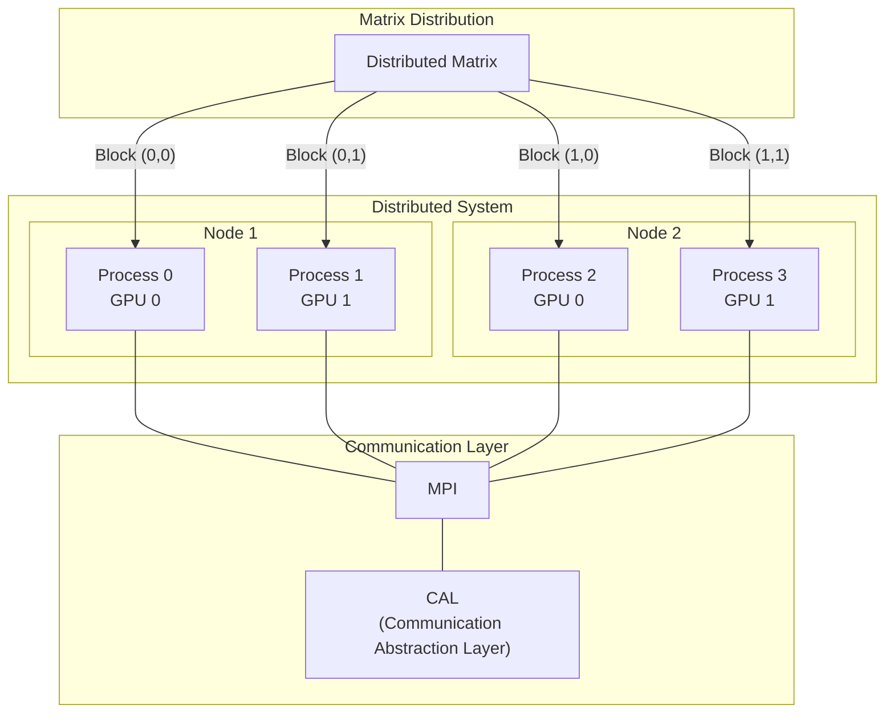
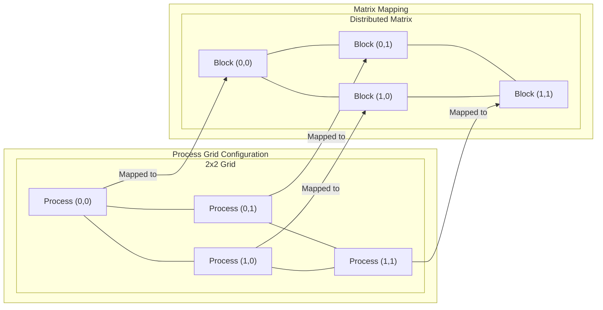
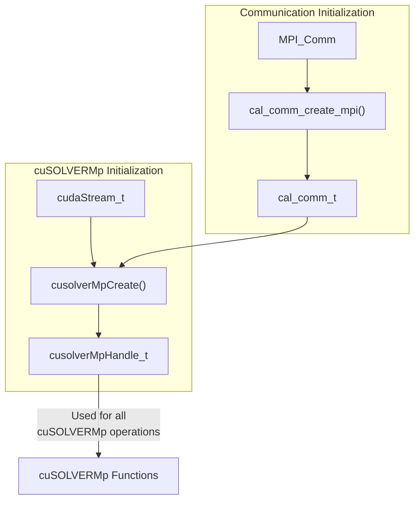
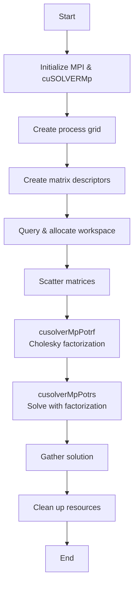
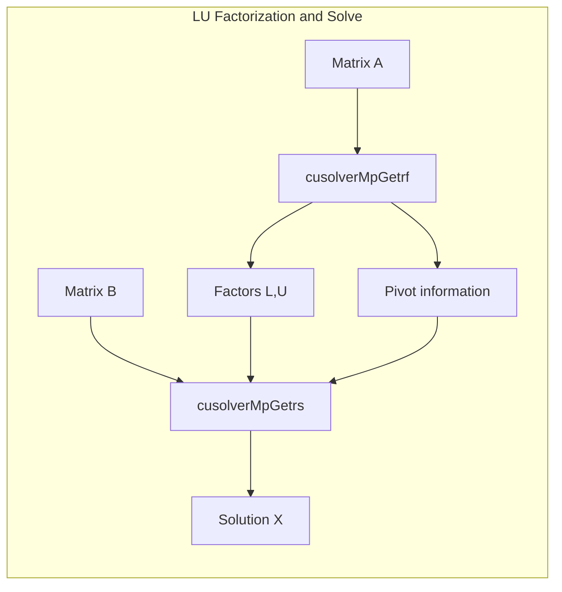
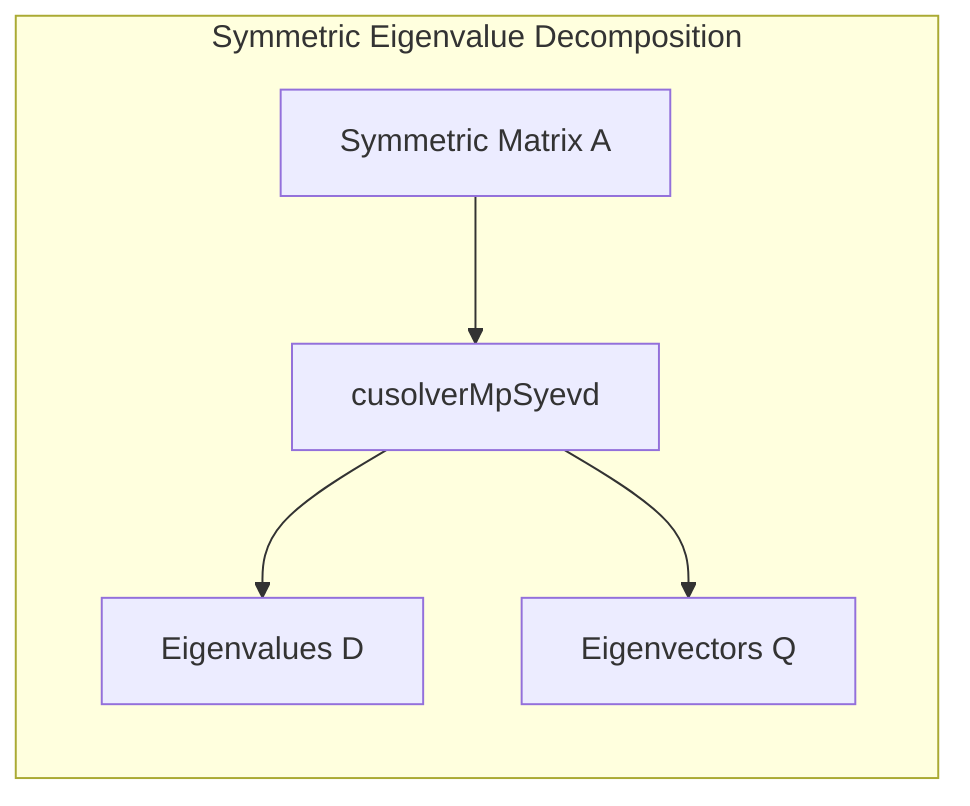
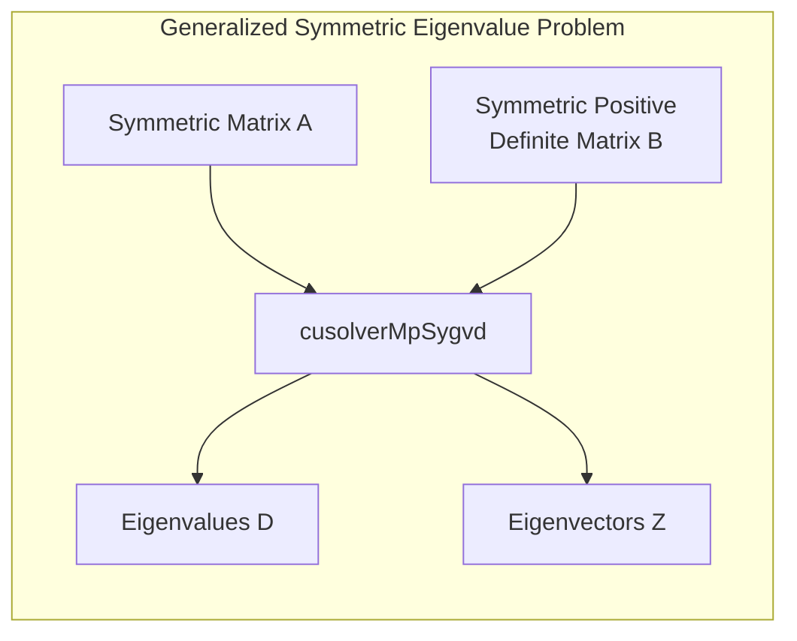
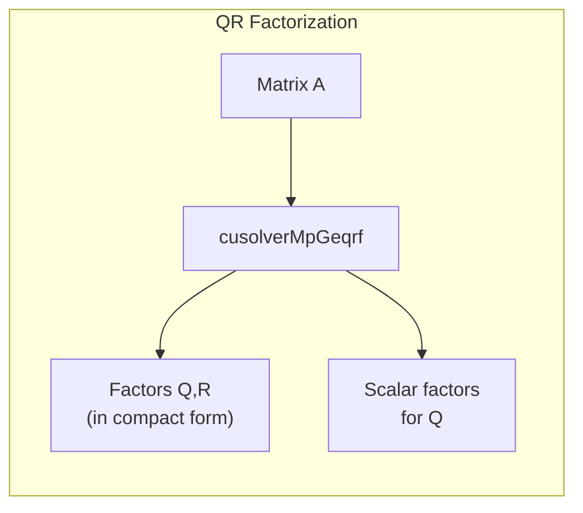
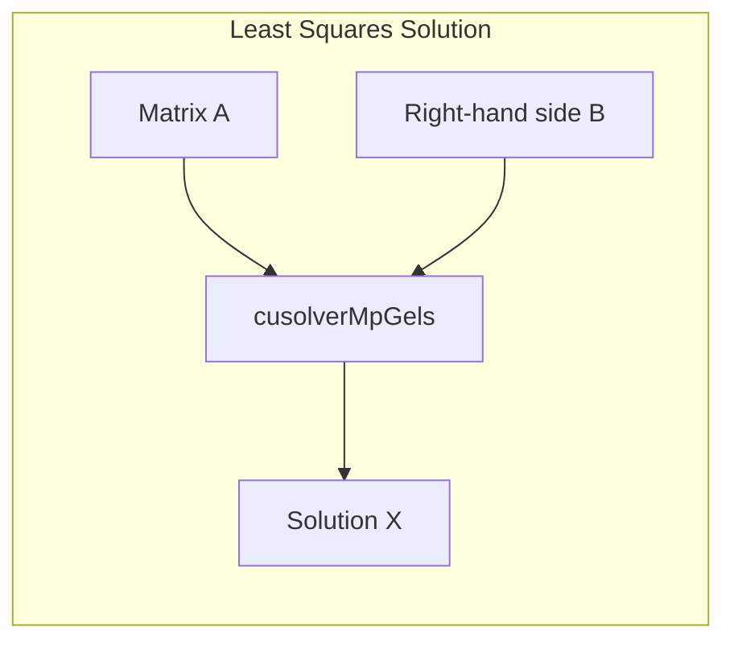
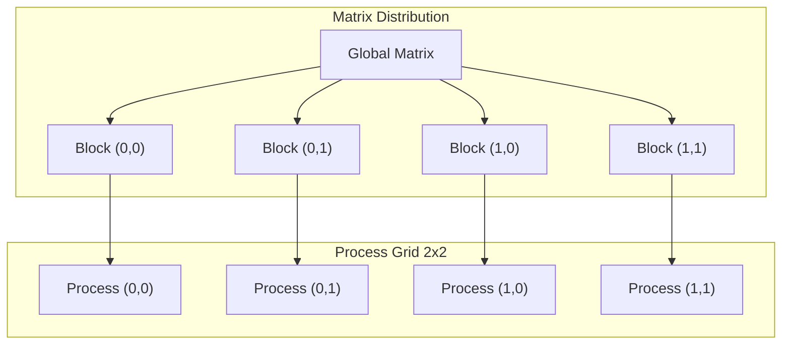

<!-- source: DeepWiki mcp.deepwiki.com · repo NVIDIA/CUDALibrarySamples · page 2.6 cuSOLVERMp - Distributed Linear Solvers · fetched 2026-10-26 -->

# cuSOLVERMp - Distributed Linear Solvers

<details>
<summary>Relevant source files</summary>

The following files were used as context for generating this wiki page:

- [cuSOLVERMp/.gitignore](cuSOLVERMp/.gitignore)
- [cuSOLVERMp/CMakeLists.txt](cuSOLVERMp/CMakeLists.txt)
- [cuSOLVERMp/Makefile](cuSOLVERMp/Makefile)
- [cuSOLVERMp/README.md](cuSOLVERMp/README.md)
- [cuSOLVERMp/helpers.h](cuSOLVERMp/helpers.h)
- [cuSOLVERMp/mp_gels.c](cuSOLVERMp/mp_gels.c)
- [cuSOLVERMp/mp_geqrf.c](cuSOLVERMp/mp_geqrf.c)
- [cuSOLVERMp/mp_getrf_getrs.c](cuSOLVERMp/mp_getrf_getrs.c)
- [cuSOLVERMp/mp_potrf_potrs.c](cuSOLVERMp/mp_potrf_potrs.c)
- [cuSOLVERMp/mp_syevd.c](cuSOLVERMp/mp_syevd.c)
- [cuSOLVERMp/mp_sygvd.c](cuSOLVERMp/mp_sygvd.c)

</details>


## Introduction

cuSOLVERMp is NVIDIA's distributed linear solver library that enables large-scale linear algebra operations across multiple GPUs and multiple nodes. It extends the functionality of the standard cuSOLVER library to distributed memory systems, providing high-performance implementations of key linear algebra operations such as matrix factorizations, solving linear systems, and eigenvalue problems.

This document describes the cuSOLVERMp library, its architecture, supported operations, and usage patterns. For information about single-GPU linear solvers, see [cuSOLVER - Linear Solvers](#2.5).

Sources: [cuSOLVERMp/README.md:1-56]()

## Architecture Overview

cuSOLVERMp employs a distributed computation model where matrices are partitioned and distributed across a grid of processes, with each process typically controlling one GPU. The library utilizes MPI for inter-node communication and provides abstractions for managing distributed matrices and computations.

### Distributed Computing Model



The library requires initialization of the MPI environment and uses a grid-based approach for distributing matrices. Each process is assigned specific blocks of the matrices based on the process grid configuration.

Sources: [cuSOLVERMp/mp_potrf_potrs.c:127-154](), [cuSOLVERMp/mp_potrf_potrs.c:345-353]()

## Core Components

### Process Grid

cuSOLVERMp organizes processes into a 2D grid. This grid determines how matrix blocks are distributed across processes. The grid creation is a fundamental step before any computation:



The grid is created using `cusolverMpCreateDeviceGrid` function, which takes the process grid dimensions and mapping type as parameters.

Sources: [cuSOLVERMp/mp_potrf_potrs.c:347-353](), [cuSOLVERMp/mp_syevd.c:315-321]()

### Matrix Descriptors

Matrix descriptors in cuSOLVERMp describe the properties of distributed matrices, including global dimensions, block sizes, and distribution parameters. They are created using the `cusolverMpCreateMatrixDesc` function.

Key parameters for matrix descriptors include:

| Parameter | Description |
|-----------|-------------|
| grid | The process grid |
| dataType | Data type (e.g., CUDA_R_64F for double precision) |
| m | Global number of rows |
| n | Global number of columns |
| mb | Row block size |
| nb | Column block size |
| rsrc | Row process coordinate of the first block |
| csrc | Column process coordinate of the first block |
| lld | Leading dimension of local storage |

Sources: [cuSOLVERMp/mp_potrf_potrs.c:356-363](), [cuSOLVERMp/mp_syevd.c:326-331]()

### Communication Abstraction Layer (CAL)

cuSOLVERMp uses a Communication Abstraction Layer (CAL) to handle inter-process communication. CAL can be initialized directly from MPI using `cal_comm_create_mpi` or with custom communication callbacks.



Sources: [cuSOLVERMp/mp_potrf_potrs.c:190-227](), [cuSOLVERMp/helpers.h:310-349]()

## Supported Operations

cuSOLVERMp provides distributed implementations of key linear algebra operations. Each operation follows a similar pattern of:
1. Initializing communication and the cuSOLVERMp handle
2. Creating process grids and matrix descriptors
3. Allocating device and host workspaces
4. Distributing input matrices
5. Performing the computation
6. Gathering results back to the master process

### Cholesky Factorization and Solve (POTRF/POTRS)

Performs Cholesky factorization (A = L·L^T) and solves systems of linear equations (A·X = B) using the factorization.



This is demonstrated in [mp_potrf_potrs.c](), which performs a Cholesky factorization of a symmetric positive-definite matrix and then solves a system using that factorization.

Sources: [cuSOLVERMp/mp_potrf_potrs.c:474-542]()

### LU Factorization and Solve (GETRF/GETRS)

Performs LU factorization with partial pivoting (P·A = L·U) and solves systems of linear equations (A·X = B) using the factorization.

The API is similar to POTRF/POTRS but includes partial pivoting information:



Sources: [cuSOLVERMp/mp_getrf_getrs.c:523-592]()

### Symmetric Eigenvalue Decomposition (SYEVD)

Computes all eigenvalues and, optionally, eigenvectors of a symmetric matrix.



Sources: [cuSOLVERMp/mp_syevd.c:414-448]()

### Generalized Symmetric Eigenvalue Problem (SYGVD)

Solves the generalized symmetric eigenvalue problem A·x = λ·B·x, where A and B are symmetric and B is positive definite.



Sources: [cuSOLVERMp/mp_sygvd.c:506-544]()

### QR Factorization (GEQRF)

Computes a QR factorization of a general matrix (A = Q·R).



Sources: [cuSOLVERMp/mp_geqrf.c:374-392]()

### Least Squares Solution (GELS)

Solves overdetermined or underdetermined linear systems using QR or LQ factorization.



Sources: [cuSOLVERMp/mp_gels.c:483-517]()

## Usage Pattern

The general usage pattern for cuSOLVERMp follows these steps:

1. **Initialize MPI and CUDA Environment**
   ```c
   MPI_Init(NULL, NULL);
   cudaSetDevice(localRank);
   ```

2. **Create CAL Communicator**
   ```c
   cal_comm_create_mpi(MPI_COMM_WORLD, rank, commSize, localRank, &cal_comm);
   ```

3. **Initialize cuSOLVERMp Handle**
   ```c
   cudaStreamCreate(&localStream);
   cusolverMpCreate(&cusolverMpHandle, localRank, localStream);
   ```

4. **Create Process Grid**
   ```c
   cusolverMpCreateDeviceGrid(cusolverMpHandle, &grid, cal_comm, 
                             numRowDevices, numColDevices, 
                             CUSOLVERMP_GRID_MAPPING_COL_MAJOR);
   ```

5. **Create Matrix Descriptors**
   ```c
   cusolverMpCreateMatrixDesc(&descA, grid, dataType, m, n, mb, nb, rsrc, csrc, lld);
   ```

6. **Allocate Device Memory and Query Workspace Size**
   ```c
   cudaMalloc((void**)&d_A, localSize * sizeof(double));
   cusolverMpOperation_bufferSize(..., &workspaceInBytesOnDevice, &workspaceInBytesOnHost);
   ```

7. **Allocate Workspace**
   ```c
   cudaMalloc((void**)&d_work, workspaceInBytesOnDevice);
   h_work = malloc(workspaceInBytesOnHost);
   ```

8. **Distribute Input Data**
   ```c
   cusolverMpMatrixScatterH2D(..., d_A, ..., descA, rootRank, h_A, lda);
   ```

9. **Perform Computation**
   ```c
   cusolverMpOperation(..., d_work, workspaceInBytesOnDevice, h_work, workspaceInBytesOnHost, d_info);
   ```

10. **Gather Results**
    ```c
    cusolverMpMatrixGatherD2H(..., d_result, ..., descResult, rootRank, h_result, ld);
    ```

11. **Clean Up Resources**
    ```c
    cusolverMpDestroyMatrixDesc(descA);
    cusolverMpDestroyGrid(grid);
    cusolverMpDestroy(cusolverMpHandle);
    cal_comm_destroy(cal_comm);
    MPI_Finalize();
    ```

Sources: [cuSOLVERMp/mp_potrf_potrs.c:127-743](), [cuSOLVERMp/mp_syevd.c:109-591]()

## Matrix Distribution and Block Sizes

Matrix distribution in cuSOLVERMp is controlled by block sizes and process grid configuration. Matrices are distributed in a block-cyclic fashion.

### Block Sizes and Process Grid Impact



The size of each local block is determined by the `mb` and `nb` parameters, which specify the row and column block sizes respectively. The function `cusolverMpNUMROC` calculates how many rows or columns a process will store locally.

Example from the code:
```c
const int64_t LLDA = cusolverMpNUMROC(lda, MA, rank % numRowDevices, RSRCA, numRowDevices);
const int64_t localColsA = cusolverMpNUMROC(colsA, NA, rank / numRowDevices, CSRCA, numColDevices);
```

Sources: [cuSOLVERMp/mp_potrf_potrs.c:330-334](), [cuSOLVERMp/mp_syevd.c:294-298]()

## Error Handling

cuSOLVERMp operations return error information through an integer pointer (`d_info`). The calling application should check this value after each operation to ensure successful completion.

```c
cudaMemcpyAsync(&h_info, d_info, sizeof(int), cudaMemcpyDeviceToHost, localStream);
cudaStreamSynchronize(localStream);
assert(h_info == 0); // Check for successful completion
```

Sources: [cuSOLVERMp/mp_potrf_potrs.c:495-503](), [cuSOLVERMp/mp_syevd.c:440-448]()

## Prerequisites and Building

cuSOLVERMp requires:
- CUDA Toolkit
- MPI implementation (HPC-X recommended)
- NCCL
- GDRCOPY

The samples can be built with the provided Makefile:

```bash
make
```

And executed with MPI:

```bash
mpirun -n <num_processes> ./mp_potrf_potrs
```

Where `<num_processes>` should match the total number of processes in the grid (numRowDevices × numColDevices).

Sources: [cuSOLVERMp/README.md:57-83](), [cuSOLVERMp/Makefile:50-95]()

## Performance Considerations

When working with cuSOLVERMp, consider the following for optimal performance:

1. **Block Sizes**: Choose appropriate block sizes (`mb` and `nb`) based on the matrix properties and hardware. Too small blocks may lead to communication overhead, while too large blocks might reduce parallelism.

2. **Process Grid Configuration**: The ratio of row processes to column processes can impact performance. For square matrices, a square process grid often works well, but for non-square matrices, different configurations may be more efficient.

3. **Memory Management**: Properly manage device and host memory to minimize transfers and maximize computational efficiency.

4. **Communication Layer**: Ensure the MPI environment is properly configured for the hardware architecture to minimize communication overhead.

5. **Matrix Distribution**: Consider using appropriate offsets and process grid mapping to balance the computation across processes.

Sources: [cuSOLVERMp/mp_potrf_potrs.c:130-147](), [cuSOLVERMp/README.md:25-33]()

---

