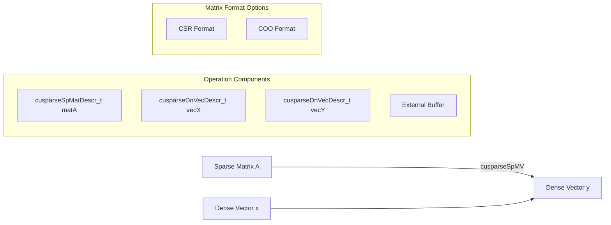
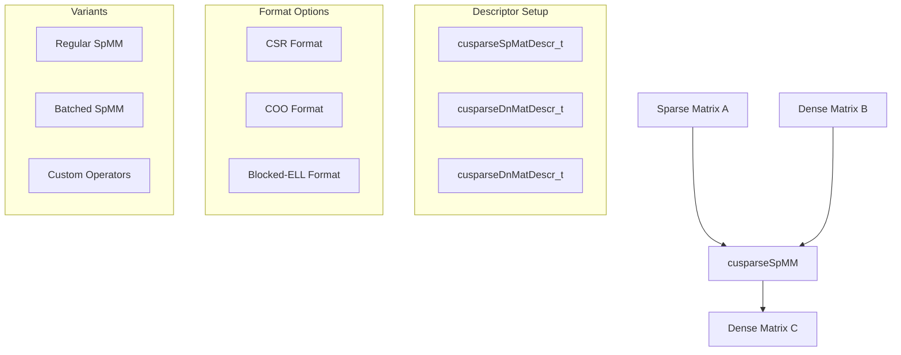
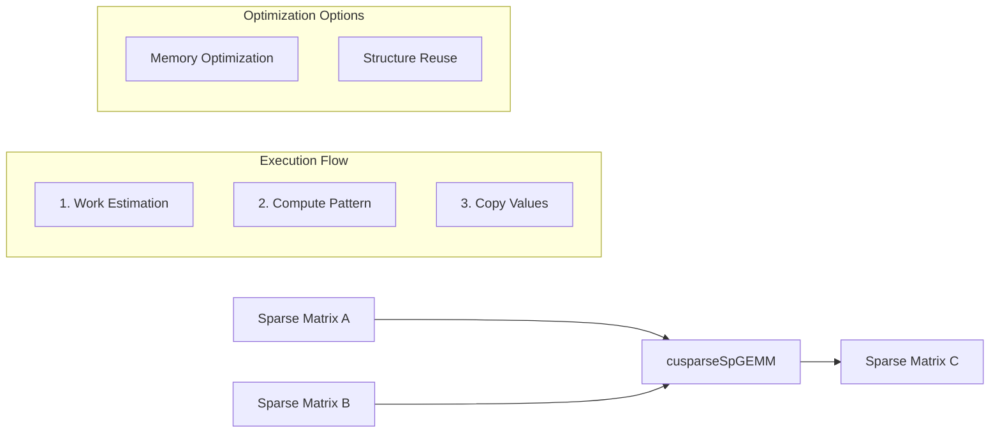
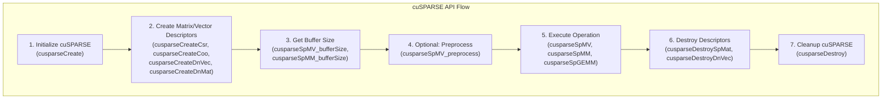

<!-- source: DeepWiki mcp.deepwiki.com · repo NVIDIA/CUDALibrarySamples · page 2.7 cuSPARSE - Sparse Matrix Operations · fetched 2026-10-26 -->

# cuSPARSE - Sparse Matrix Operations

<details>
<summary>Relevant source files</summary>

The following files were used as context for generating this wiki page:

- [cuSPARSE/README.md](cuSPARSE/README.md)
- [cuSPARSE/coosort/CMakeLists.txt](cuSPARSE/coosort/CMakeLists.txt)
- [cuSPARSE/coosort/Makefile](cuSPARSE/coosort/Makefile)
- [cuSPARSE/coosort/README.md](cuSPARSE/coosort/README.md)
- [cuSPARSE/gpsvInterleavedBatch/CMakeLists.txt](cuSPARSE/gpsvInterleavedBatch/CMakeLists.txt)
- [cuSPARSE/gpsvInterleavedBatch/Makefile](cuSPARSE/gpsvInterleavedBatch/Makefile)
- [cuSPARSE/gpsvInterleavedBatch/README.md](cuSPARSE/gpsvInterleavedBatch/README.md)
- [cuSPARSE/spgemm/spgemm_example.c](cuSPARSE/spgemm/spgemm_example.c)
- [cuSPARSE/spmm_coo/spmm_coo_example.c](cuSPARSE/spmm_coo/spmm_coo_example.c)
- [cuSPARSE/spmm_csr/spmm_csr_example.c](cuSPARSE/spmm_csr/spmm_csr_example.c)
- [cuSPARSE/spmv_coo/spmv_coo_example.c](cuSPARSE/spmv_coo/spmv_coo_example.c)
- [cuSPARSE/spmv_csr/spmv_csr_example.c](cuSPARSE/spmv_csr/spmv_csr_example.c)

</details>


## Purpose and Scope

The cuSPARSE library provides GPU-accelerated sparse matrix functionality for efficiently working with sparse data on NVIDIA GPUs. This document covers the core sparse matrix operations available in cuSPARSE, including sparse matrix formats, vector and matrix operations, and optimization techniques. For structured sparsity operations, see [cuSPARSELt - Structured Sparse Matrix Operations](#2.3) instead. For sparse direct solvers, refer to [cuDSS - Direct Sparse Solver](#2.4).

Sources: [cuSPARSE/README.md:1-5]()

## Overview of cuSPARSE

cuSPARSE offers a comprehensive set of functions for sparse matrix computations, enabling efficient processing of large, sparse datasets where most elements are zero. The library provides both basic functions (like sparse vector and matrix operations) and more complex algorithms (like sparse matrix multiplication and sparse triangular solvers).

### Key Features

- Support for multiple sparse matrix formats (CSR, COO, Blocked-ELL)
- Optimized sparse linear algebra operations
- Seamless integration with other CUDA libraries
- Support for different data types (single/double precision, complex)
- Generic APIs for modern, intuitive programming
- Legacy APIs for backward compatibility

### Matrix Formats

cuSPARSE supports several sparse matrix formats for different use cases:

**Sparse Matrix Storage Formats**

| Format | Full Name | Description | Best Use Case |
|--------|-----------|-------------|---------------|
| CSR | Compressed Sparse Row | Stores row pointers, column indices, and values | General purpose, efficient row access |
| COO | Coordinate | Stores row indices, column indices, and values | Incremental matrix construction |
| Blocked-ELL | Blocked Ellpack | Block-based variant of Ellpack format | Matrices with regular non-zero patterns |

Sources: [cuSPARSE/README.md:19-141]()

## Sparse Matrix Operations Diagram

```mermaid
graph TB
    subgraph "cuSPARSE Operations"
        VV["Vector-Vector Operations"]
        MV["Matrix-Vector Operations"]
        MM["Matrix-Matrix Operations"]
        Conv["Format Conversions"]
        Opt["Optimizations"]
        Iter["Iterative Methods"]
    end

    VV --> |"cusparseAxpby"| VV1["Sparse-Dense Vector Sum"]
    VV --> |"cusparseSpVV"| VV2["Sparse-Dense Dot Product"]
    VV --> |"cusparseGather/Scatter"| VV3["Element Collection"]

    MV --> |"cusparseSpMV"| MV1["Sparse Matrix-Vector Multiply"]
    MV --> |"cusparseSpSV"| MV2["Sparse Triangular Solve"]

    MM --> |"cusparseSpMM"| MM1["Sparse-Dense Matrix Multiply"]
    MM --> |"cusparseSpGEMM"| MM2["Sparse-Sparse Matrix Multiply"]
    MM --> |"cusparseSpSM"| MM3["Sparse Triangular Multiple RHS"]
    MM --> |"SDDMM"| MM4["Sampled Dense-Dense Matrix Multiply"]

    Conv --> |"cusparseSparseToDense"| C1["Sparse to Dense Conversion"]
    Conv --> |"cusparseDenseToSparse"| C2["Dense to Sparse Conversion"]

    Opt --> |"CUDA Graph Capture"| O1["Performance Optimization"]
    Opt --> |"Memory Compression"| O2["Memory Usage Optimization"]

    Iter --> |"Preconditioned CG"| I1["Conjugate Gradient Method"]
    Iter --> |"Preconditioned BiCGStab"| I2["Biconjugate Gradient Stabilized"]
```



Sources: [cuSPARSE/README.md:11-17](), [cuSPARSE/README.md:21-156]()

## Vector-Vector Operations

These operations involve at least one sparse vector and provide basic building blocks for more complex algorithms.

| Operation | Function | Description |
|-----------|----------|-------------|
| Sparse Vector + Dense Vector | `cusparseAxpby` | Scales and adds sparse and dense vectors |
| Gather | `cusparseGather` | Collects elements from dense vector into sparse vector |
| Rotation | `cusparseRot` | Applies Givens rotation to sparse-dense vector pair |
| Scatter | `cusparseScatter` | Distributes elements from sparse vector to dense vector |
| Dot Product | `cusparseSpVV` | Computes dot product of sparse and dense vectors |

Sources: [cuSPARSE/README.md:21-41]()

## Matrix-Vector Operations

These operations perform computations between sparse matrices and dense vectors, forming core components of many iterative solvers.

### Sparse Matrix-Vector Multiplication (SpMV)

The SpMV operation `y = α·op(A)·x + β·y` multiplies a sparse matrix A by a dense vector x and adds the result to a scaled dense vector y.



Example usage of SpMV with CSR format:

1. Create matrix/vector descriptors
2. Allocate buffer space
3. Execute the SpMV operation
4. Clean up resources

Sources: [cuSPARSE/spmv_csr/spmv_csr_example.c:73-174](), [cuSPARSE/spmv_coo/spmv_coo_example.c:74-166]()

### Sparse Triangular Solve (SpSV)

The SpSV operation solves a sparse triangular system with a single right-hand side, useful in preconditioning and direct solvers.

Sources: [cuSPARSE/README.md:53-59]()

## Matrix-Matrix Operations

These operations involve at least one sparse matrix and form the computational core of many scientific and machine learning applications.

### Sparse-Dense Matrix Multiplication (SpMM)

The SpMM operation `C = α·op(A)·op(B) + β·C` multiplies a sparse matrix A by a dense matrix B and adds the result to a scaled dense matrix C.



Sources: [cuSPARSE/README.md:63-90](), [cuSPARSE/spmm_csr/spmm_csr_example.c:74-196](), [cuSPARSE/spmm_coo/spmm_coo_example.c:74-186]()

### Sparse-Sparse Matrix Multiplication (SpGEMM)

The SpGEMM operation `C = α·op(A)·op(B) + β·C` multiplies two sparse matrices A and B to produce another sparse matrix C.



SpGEMM is executed in three phases:
1. Work estimation: Determine buffer size requirements
2. Computation: Calculate the non-zero pattern of the result
3. Copy: Populate the result values

Sources: [cuSPARSE/README.md:94-104](), [cuSPARSE/spgemm/spgemm_example.c:74-266]()

### Other Matrix-Matrix Operations

- **SDDMM (Sampled Dense-Dense Matrix Multiplication)**: Performs the operation D = A ∘ (B×C) where ∘ is element-wise multiplication, and A is sparse
- **SpSM**: Solves a sparse triangular system with multiple right-hand sides

Sources: [cuSPARSE/README.md:83-112]()

## Format Conversion

cuSPARSE provides functions to convert between sparse and dense formats, essential for interoperability with other libraries and algorithms.

| Conversion | Function | Description |
|------------|----------|-------------|
| Sparse to Dense | `cusparseSparseToDense` | Converts a sparse matrix to dense format |
| Dense to Sparse | `cusparseDenseToSparse` | Converts a dense matrix to sparse format |

Sources: [cuSPARSE/README.md:114-127]()

## Legacy APIs

cuSPARSE maintains several legacy APIs for backward compatibility:

| API | Function | Description |
|-----|----------|-------------|
| COO Sorting | `cusparseXcoosortByRow` | Sorts a COO matrix by row indices |
| Interleaved Batch | `cusparseSgpsvInterleavedBatch` | Solves penta-diagonal systems in interleaved format |

Sources: [cuSPARSE/README.md:128-137](), [cuSPARSE/coosort/README.md:1-7](), [cuSPARSE/gpsvInterleavedBatch/README.md:1-6]()

## Optimizations and Advanced Features

### Performance Optimizations

- **CUDA Graph Capture**: Captures sequences of cuSPARSE operations for repeated execution
- **Hardware Memory Compression**: Leverages Ampere architecture's hardware compression features
- **Preprocessing**: Some operations (like SpMV) support a preprocessing step to optimize repeated execution with the same matrix

### Sparse Iterative Methods

cuSPARSE integrates with cuBLAS to implement iterative solvers for sparse linear systems:

- **Preconditioned Conjugate Gradient (CG)**: For symmetric positive definite systems
- **Preconditioned Biconjugate Gradient Stabilized (BiCGStab)**: For general non-singular systems

Sources: [cuSPARSE/README.md:138-156]()

## cuSPARSE API Flow



Sources: [cuSPARSE/spmv_csr/spmv_csr_example.c:89-149](), [cuSPARSE/spmm_csr/spmm_csr_example.c:100-169](), [cuSPARSE/spgemm/spgemm_example.c:105-219]()

## Common Error Handling Pattern

Most cuSPARSE samples use the following pattern for error handling:

```
CHECK_CUSPARSE(cusparseFunction(...))

// Where CHECK_CUSPARSE is defined as:
#define CHECK_CUSPARSE(func)                                                   \
{                                                                              \
    cusparseStatus_t status = (func);                                          \
    if (status != CUSPARSE_STATUS_SUCCESS) {                                   \
        printf("CUSPARSE API failed at line %d with error: %s (%d)\n",         \
               __LINE__, cusparseGetErrorString(status), status);              \
        return EXIT_FAILURE;                                                   \
    }                                                                          \
}
```

Sources: [cuSPARSE/spmv_csr/spmv_csr_example.c:54-72](), [cuSPARSE/spgemm/spgemm_example.c:54-72]()

## Summary

cuSPARSE provides efficient GPU-accelerated sparse matrix operations for a wide range of applications in scientific computing, machine learning, and data analytics. By leveraging different sparse matrix formats and optimized operations, developers can significantly accelerate applications that work with large, sparse datasets. The library offers both modern generic APIs and legacy functions, supporting a smooth transition path for existing code.

---

