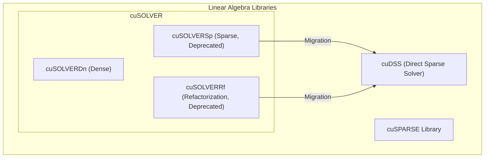
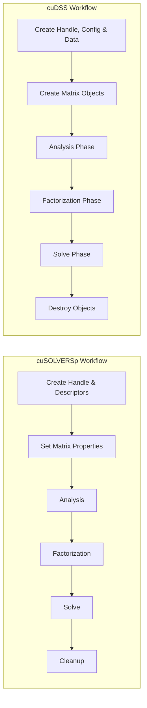
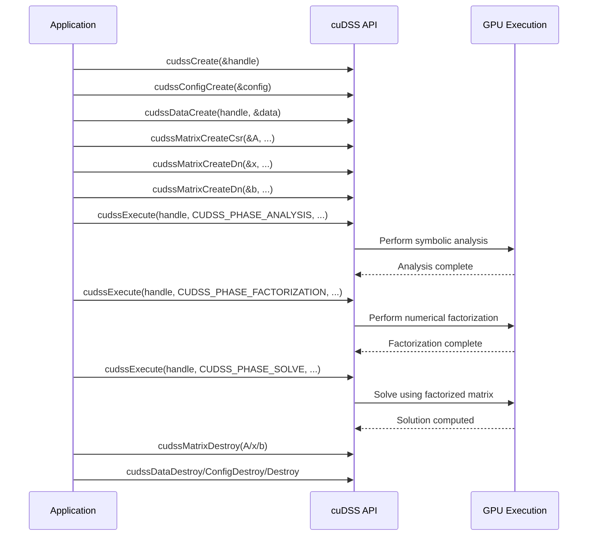
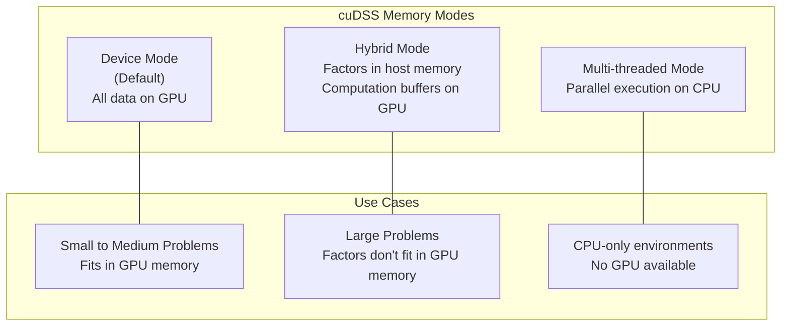

<!-- source: DeepWiki mcp.deepwiki.com · repo NVIDIA/CUDALibrarySamples · page 2.8 Migrating from cuSOLVERSp to cuDSS · fetched 2026-10-26 -->

# Migrating from cuSOLVERSp to cuDSS

<details>
<summary>Relevant source files</summary>

The following files were used as context for generating this wiki page:

- [README.md](README.md)
- [cuDSS/README.md](cuDSS/README.md)
- [cuDSS/get_set/CMakeLists.txt](cuDSS/get_set/CMakeLists.txt)
- [cuDSS/get_set/get_set.cpp](cuDSS/get_set/get_set.cpp)
- [cuDSS/memory_handler/CMakeLists.txt](cuDSS/memory_handler/CMakeLists.txt)
- [cuDSS/memory_handler/memory_handler.cpp](cuDSS/memory_handler/memory_handler.cpp)
- [cuDSS/simple/CMakeLists.txt](cuDSS/simple/CMakeLists.txt)
- [cuDSS/simple/simple.cpp](cuDSS/simple/simple.cpp)
- [cuDSS/simple_batch/CMakeLists.txt](cuDSS/simple_batch/CMakeLists.txt)
- [cuDSS/simple_batch/simple_batch.cpp](cuDSS/simple_batch/simple_batch.cpp)
- [cuDSS/simple_complex/CMakeLists.txt](cuDSS/simple_complex/CMakeLists.txt)
- [cuDSS/simple_complex/simple_complex.cpp](cuDSS/simple_complex/simple_complex.cpp)
- [cuDSS/simple_hybrid_memory_mode/CMakeLists.txt](cuDSS/simple_hybrid_memory_mode/CMakeLists.txt)
- [cuDSS/simple_hybrid_memory_mode/simple_hybrid_memory_mode.cpp](cuDSS/simple_hybrid_memory_mode/simple_hybrid_memory_mode.cpp)
- [cuDSS/simple_mgmn_mode/CMakeLists.txt](cuDSS/simple_mgmn_mode/CMakeLists.txt)
- [cuSOLVERSp2cuDSS/CMakeLists.txt](cuSOLVERSp2cuDSS/CMakeLists.txt)
- [cuSOLVERSp2cuDSS/README.md](cuSOLVERSp2cuDSS/README.md)
- [cuSOLVERSp2cuDSS/cuSolverRf2cuDSS.hpp](cuSOLVERSp2cuDSS/cuSolverRf2cuDSS.hpp)
- [cuSOLVERSp2cuDSS/cuSolverRf2cuDSS_double.cpp](cuSOLVERSp2cuDSS/cuSolverRf2cuDSS_double.cpp)
- [cuSOLVERSp2cuDSS/cuSolverSp2cuDSS.hpp](cuSOLVERSp2cuDSS/cuSolverSp2cuDSS.hpp)
- [cuSOLVERSp2cuDSS/cuSolverSp2cuDSS_dcomplex.cpp](cuSOLVERSp2cuDSS/cuSolverSp2cuDSS_dcomplex.cpp)
- [cuSOLVERSp2cuDSS/cuSolverSp2cuDSS_double.cpp](cuSOLVERSp2cuDSS/cuSolverSp2cuDSS_double.cpp)
- [cuSOLVERSp2cuDSS/cuSolverSp2cuDSS_float.cpp](cuSOLVERSp2cuDSS/cuSolverSp2cuDSS_float.cpp)
- [cuSOLVERSp2cuDSS/cuSolverSp2cuDSS_scomplex.cpp](cuSOLVERSp2cuDSS/cuSolverSp2cuDSS_scomplex.cpp)
- [cuSOLVERSp2cuDSS/test_complex.mtx](cuSOLVERSp2cuDSS/test_complex.mtx)
- [cuSOLVERSp2cuDSS/test_real.mtx](cuSOLVERSp2cuDSS/test_real.mtx)

</details>


This guide provides a comprehensive overview of how to migrate your code from the deprecated cuSOLVERSp/Rf to the newer cuDSS (CUDA Direct Sparse Solver) library. cuSOLVERSp and cuSOLVERRf are deprecated and scheduled for removal in a future major CUDA release, with cuDSS being the recommended replacement for sparse direct solvers.

## Overview of cuDSS

cuDSS (CUDA Direct Sparse Solver) is NVIDIA's GPU-accelerated library for solving sparse linear systems. It provides high-performance solvers for a wide range of sparse matrix problems, with enhanced capabilities compared to the legacy cuSOLVERSp/Rf APIs.



Sources: [cuSOLVERSp2cuDSS/README.md:1-18](), [README.md:25-49]()

## Why Migrate to cuDSS?

- **Performance**: cuDSS offers better performance for sparse direct solvers
- **Ongoing support**: As cuSOLVERSp/Rf are deprecated, cuDSS will receive continued updates
- **Improved API design**: cuDSS has a more consistent, object-oriented API
- **Additional features**: cuDSS includes memory modes, batch operations, and other features not available in cuSOLVERSp/Rf

## Key API Differences

cuDSS employs a significantly different API design compared to cuSOLVERSp/Rf. The main differences include:

1. **Object-based approach**: cuDSS uses distinct objects for matrices, configuration, and solver data
2. **Phase-based execution**: Analysis, factorization, and solve phases are explicitly separated
3. **Matrix creation**: Explicit matrix objects replace the descriptor-based approach
4. **Memory management**: cuDSS offers multiple memory modes including a hybrid CPU/GPU mode



Sources: [cuDSS/simple/simple.cpp:199-250](), [cuDSS/get_set/get_set.cpp:218-243](), [cuSOLVERSp2cuDSS/README.md:25-61]()

## API Mapping

The following table maps the deprecated cuSOLVERSp/Rf functions to their cuDSS counterparts:

| Workflow | cuSOLVERSp/Rf (deprecated) | cuDSS (new) |
|----------|----------------------------|-------------|
| Initialize | `cusolverSpCreate`<br>`cusolverSpCreateCsr{chol,lu}Info[Host]`<br>`cusparseCreateMatDescr`<br>`cusolverRfCreate` | `cudssCreate`<br>`cudssConfigCreate`<br>`cudssDataCreate` |
| Input matrix handling | `cusparseSetMatType`<br>`cusparseSetMatIndexBase` | `cudssMatrixCreateCsr`<br>`cudssMatrixCreateDn`<br>`cudssMatrixDestroy` |
| Reorder & Analyze | `cusolverSpXcsrmetisndHost`<br>`cusolverSpXcsr{chol,lu}Analysis[Host]` | `cudssConfigSet(config, CUDSS_REORDERING_ALG, ...)`<br>`cudssExecute(cudss, CUDSS_PHASE_ANALYSIS, ...)` |
| Factorize | `cusolverSpXcsr{chol,lu}BufferInfo[Host]`<br>`cusolverSpXcsr{chol,lu}Factor[Host]` | `cudssExecute(cudss, CUDSS_PHASE_FACTORIZATION, ...)` |
| Solve | `cusolverSpXcsr{chol,lu}Solve[Host]` | `cudssExecute(cudss, CUDSS_PHASE_SOLVE, ...)` |
| Refactorize & Solve | Various cusolverRf functions | `cudssMatrixSetValues`<br>`cudssExecute(cudss, CUDSS_PHASE_REFACTORIZATION, ...)`<br>`cudssExecute(cudss, CUDSS_PHASE_SOLVE, ...)` |
| Finalize | `cusolverRfDestroy`<br>`cusparseDestroyMatDescr`<br>`cusolverSpDestroyCsr{chol,lu}Info[Host]`<br>`cusolverSpDestroy` | `cudssDataDestroy`<br>`cudssConfigDestroy`<br>`cudssDestroy` |

Sources: [cuSOLVERSp2cuDSS/README.md:25-61]()

## Migration Steps


### 1. Replace Library Initialization

**cuSOLVERSp:**
```
cusolverSpHandle_t cusolversp;
cusparseMatDescr_t descriptor;
csrcholInfo_t chol_info;

cusolverSpCreate(&cusolversp);
cusolverSpCreateCsrcholInfo(&chol_info);
cusparseCreateMatDescr(&descriptor);
```

**cuDSS:**
```
cudssHandle_t cudss;
cudssConfig_t config;
cudssData_t data;

cudssCreate(&cudss);
cudssConfigCreate(&config);
cudssDataCreate(cudss, &data);
```

Sources: [cuSOLVERSp2cuDSS/cuSolverSp2cuDSS.hpp:123-136](), [cuSOLVERSp2cuDSS/cuSolverSp2cuDSS.hpp:140-152]()

### 2. Create Matrix Objects

In cuSOLVERSp, matrix descriptors are used to define matrix properties. In cuDSS, explicit matrix objects are created:

**cuSOLVERSp:**
```
cusparseSetMatType(descriptor, CUSPARSE_MATRIX_TYPE_GENERAL);
cusparseSetMatIndexBase(descriptor, CUSPARSE_INDEX_BASE_ZERO);
```

**cuDSS:**
```
cudssMatrix_t A, x, b;
cudssMatrixCreateCsr(&A, nrows, ncols, nnz, csr_offsets_d, NULL,
                     csr_columns_d, csr_values_d, CUDA_R_32I, CUDA_R_64F, 
                     CUDSS_MTYPE_SPD, CUDSS_MVIEW_UPPER, CUDSS_BASE_ZERO);
cudssMatrixCreateDn(&x, nrows, nrhs, ldx, x_values_d, CUDA_R_64F, CUDSS_LAYOUT_COL_MAJOR);
cudssMatrixCreateDn(&b, ncols, nrhs, ldb, b_values_d, CUDA_R_64F, CUDSS_LAYOUT_COL_MAJOR);
```

Sources: [cuDSS/simple/simple.cpp:213-230](), [cuSOLVERSp2cuDSS/cuSolverSp2cuDSS.hpp:158-160](), [cuSOLVERSp2cuDSS/cuSolverSp2cuDSS.hpp:292-306]()

### 3. Update Analysis Phase

**cuSOLVERSp:**
```
// Reordering
cusolverSpXcsrmetisndHost(cusolversp, m, nnz, descriptor, h_ap.data(), h_aj.data(), NULL, h_perm.data());

// Analysis
cusolverSpXcsrcholAnalysis(cusolversp, m, nnz, descriptor, d_ap, d_aj, chol_info);
```

**cuDSS:**
```
// cuDSS performs reordering as part of the analysis phase
cudssExecute(cudss, CUDSS_PHASE_ANALYSIS, config, data, A, x, b);
```

Sources: [cuSOLVERSp2cuDSS/cuSolverSp2cuDSS.hpp:210-214](), [cuSOLVERSp2cuDSS/cuSolverSp2cuDSS.hpp:371-376](), [cuSOLVERSp2cuDSS/cuSolverSp2cuDSS.hpp:314]()

### 4. Update Factorization Phase

**cuSOLVERSp:**
```
// Get buffer size
size_t workspace_bytes;
cusolverSpXcsrcholBufferInfo(cusolversp, m, nnz, descriptor, d_ax, d_ap, d_aj, chol_info, &workspace_bytes);

// Allocate workspace
void *d_workspace;
cudaMalloc(&d_workspace, workspace_bytes);

// Factorize
cusolverSpXcsrcholFactor(cusolversp, m, nnz, descriptor, d_ax, d_ap, d_aj, chol_info, d_workspace);
```

**cuDSS:**
```
// cuDSS manages workspace internally
cudssExecute(cudss, CUDSS_PHASE_FACTORIZATION, config, data, A, x, b);
```

Sources: [cuSOLVERSp2cuDSS/cuSolverSp2cuDSS.hpp:382-395](), [cuSOLVERSp2cuDSS/cuSolverSp2cuDSS.hpp:321]()

### 5. Update Solver Phase

**cuSOLVERSp:**
```
cusolverSpXcsrcholSolve(cusolversp, m, nnz, descriptor, d_ax, d_ap, d_aj, d_b, d_x, chol_info, d_workspace);
```

**cuDSS:**
```
cudssExecute(cudss, CUDSS_PHASE_SOLVE, config, data, A, x, b);
```

Sources: [cuSOLVERSp2cuDSS/cuSolverSp2cuDSS.hpp:410](), [cuSOLVERSp2cuDSS/cuSolverSp2cuDSS.hpp:334]()

### 6. Update Cleanup

**cuSOLVERSp:**
```
cusparseDestroyMatDescr(descriptor);
cusolverSpDestroyCsrcholInfo(chol_info);
cusolverSpDestroy(cusolversp);
```

**cuDSS:**
```
cudssMatrixDestroy(A);
cudssMatrixDestroy(b);
cudssMatrixDestroy(x);
cudssDataDestroy(cudss, data);
cudssConfigDestroy(config);
cudssDestroy(cudss);
```

Sources: [cuSOLVERSp2cuDSS/cuSolverSp2cuDSS.hpp:133-137](), [cuSOLVERSp2cuDSS/cuSolverSp2cuDSS.hpp:337-344]()

## Migration Example for Real-valued Systems

The following diagram illustrates the basic workflow migration from cuSOLVERSp to cuDSS for real-valued sparse linear systems:



Sources: [cuDSS/simple/simple.cpp:199-250]()

## Migration Example for Complex-valued Systems

For complex-valued systems, the migration follows a similar pattern, but with appropriate data types:

**cuSOLVERSp:**
```
// Using cuComplex or cuDoubleComplex types
cusolverSpCcsrcholSolve(...) or cusolverSpZcsrcholSolve(...)
```

**cuDSS:**
```
// Matrix creation with complex data type
cudssMatrixCreateCsr(&A, nrows, ncols, nnz, csr_offsets_d, NULL,
                     csr_columns_d, csr_values_d, CUDA_R_32I, CUDA_C_32F, 
                     mtype, mview, base);
```

Sources: [cuDSS/simple_complex/simple_complex.cpp:232-245]()

## Advanced Features in cuDSS

### Hybrid Memory Mode

cuDSS supports a hybrid memory mode for cases when factorized matrices are too large to fit in GPU memory:

```
// Enable hybrid memory mode
cudssMemoryMode_t mode = CUDSS_MEMMODE_HYBRID;
cudssConfigSet(config, CUDSS_CONFIG_MEMORY_MODE, &mode, sizeof(mode));
```



Sources: [cuDSS/simple_hybrid_memory_mode/simple_hybrid_memory_mode.cpp:61-72](), [cuDSS/README.md:21-24]()

### Getting Additional Information

cuDSS provides APIs to retrieve additional information about the solving process:

```
size_t sizeWritten;
int info;
cudssDataGet(handle, data, CUDSS_DATA_INFO, &info, sizeof(info), &sizeWritten);

int64_t lu_nnz;
cudssDataGet(handle, data, CUDSS_DATA_LU_NNZ, &lu_nnz, sizeof(int64_t), NULL);
```

Sources: [cuDSS/get_set/get_set.cpp:296-326]()

### Custom Memory Management

cuDSS allows using custom memory allocators:

```
cudssDeviceMemHandler_t handler;
handler.ctx = reinterpret_cast<void*>(&pool);
handler.device_alloc = custom_alloc_function;
handler.device_free = custom_free_function;
cudssSetDeviceMemHandler(handle, &handler);
```

Sources: [cuDSS/memory_handler/memory_handler.cpp:166-171](), [cuDSS/memory_handler/memory_handler.cpp:257-258]()

### Batch Operations

cuDSS supports solving multiple systems in batches:

```
cudssMatrixCreateBatchCsr(&A, batchCount, nrows, ncols, nnz, batch_csr_offsets_d, 
                         NULL, batch_csr_columns_d, batch_csr_values_d,
                         CUDA_R_32I, CUDA_R_64F, mtype, mview, base);
```

Sources: [cuDSS/simple_batch/simple_batch.cpp:297-311]()

## Integration with Existing Code

When integrating cuDSS into existing code that uses cuSOLVERSp, follow these steps:

1. Replace the library initialization calls
2. Create explicit matrix objects instead of using descriptors
3. Convert the analysis, factorization, and solve phases to use cuDSS APIs
4. Update cleanup code to destroy all objects

The examples in the `cuSOLVERSp2cuDSS` directory show detailed implementation for both real and complex systems.

Sources: [cuSOLVERSp2cuDSS/README.md:19-24](), [cuSOLVERSp2cuDSS/README.md:64-97]()

## Conclusion

Migrating from cuSOLVERSp to cuDSS offers performance benefits and future-proofs your code. The migration process involves changes to several parts of your solver workflow, but the structure is straightforward and follows a more object-oriented approach. The cuDSS API provides clear separation of concerns and offers additional features like hybrid memory management and batch operations.

For additional information, refer to:
- [cuDSS Documentation](https://docs.nvidia.com/cuda/cudss/index.html)
- The cuDSS examples in the CUDA Library Samples repository

Sources: [cuSOLVERSp2cuDSS/README.md:14-17]()

---

