<!-- source: DeepWiki mcp.deepwiki.com · repo NVIDIA/CUDALibrarySamples · page 3 Signal Processing Libraries · fetched 2026-10-26 -->

# Signal Processing Libraries

Relevant source files

The following files were used as context for generating this wiki page:

- [README.md](README.md)
- [cuFFTMp/samples/c2c_no_descriptors_cufftMpMakePlan/README.md](cuFFTMp/samples/c2c_no_descriptors_cufftMpMakePlan/README.md)
- [cuFFTMp/samples/c2c_no_descriptors_cufftMpMakePlan/cufftmp_c2c_no_descriptors_cufftMpMakePlan.cu](cuFFTMp/samples/c2c_no_descriptors_cufftMpMakePlan/cufftmp_c2c_no_descriptors_cufftMpMakePlan.cu)
- [cuFFTMp/samples/r2c_c2r_pencils_cufftMpMakePlan/README.md](cuFFTMp/samples/r2c_c2r_pencils_cufftMpMakePlan/README.md)
- [cuFFTMp/samples/r2c_c2r_pencils_cufftMpMakePlan/cufftmp_r2c_c2r_pencils_cufftMpMakePlan.cu](cuFFTMp/samples/r2c_c2r_pencils_cufftMpMakePlan/cufftmp_r2c_c2r_pencils_cufftMpMakePlan.cu)
- [cuFFTMp/samples/reshape/cufftmp_reshape.cu](cuFFTMp/samples/reshape/cufftmp_reshape.cu)
- [cuSOLVERSp2cuDSS/CMakeLists.txt](cuSOLVERSp2cuDSS/CMakeLists.txt)
- [cuSOLVERSp2cuDSS/README.md](cuSOLVERSp2cuDSS/README.md)
- [cuSOLVERSp2cuDSS/cuSolverRf2cuDSS.hpp](cuSOLVERSp2cuDSS/cuSolverRf2cuDSS.hpp)
- [cuSOLVERSp2cuDSS/cuSolverRf2cuDSS_double.cpp](cuSOLVERSp2cuDSS/cuSolverRf2cuDSS_double.cpp)
- [cuSOLVERSp2cuDSS/cuSolverSp2cuDSS.hpp](cuSOLVERSp2cuDSS/cuSolverSp2cuDSS.hpp)
- [cuSOLVERSp2cuDSS/cuSolverSp2cuDSS_dcomplex.cpp](cuSOLVERSp2cuDSS/cuSolverSp2cuDSS_dcomplex.cpp)
- [cuSOLVERSp2cuDSS/cuSolverSp2cuDSS_double.cpp](cuSOLVERSp2cuDSS/cuSolverSp2cuDSS_double.cpp)
- [cuSOLVERSp2cuDSS/cuSolverSp2cuDSS_float.cpp](cuSOLVERSp2cuDSS/cuSolverSp2cuDSS_float.cpp)
- [cuSOLVERSp2cuDSS/cuSolverSp2cuDSS_scomplex.cpp](cuSOLVERSp2cuDSS/cuSolverSp2cuDSS_scomplex.cpp)
- [cuSOLVERSp2cuDSS/test_complex.mtx](cuSOLVERSp2cuDSS/test_complex.mtx)
- [cuSOLVERSp2cuDSS/test_real.mtx](cuSOLVERSp2cuDSS/test_real.mtx)

## Purpose and Scope

This document provides a technical overview of the signal processing libraries available in the NVIDIA CUDA Library Samples repository. It focuses primarily on cuFFTMp, NVIDIA's multi-process/multi-GPU Fast Fourier Transform library. This page covers the architecture, data distribution patterns, and usage examples of these libraries. For information about linear algebra libraries, see [Linear Algebra Libraries](#2).

Sources: [README.md:1-52]()

## Overview of Signal Processing Libraries

NVIDIA provides GPU-accelerated signal processing libraries as part of their CUDA ecosystem. These libraries enable efficient computation of signal processing operations across multiple GPUs and nodes.

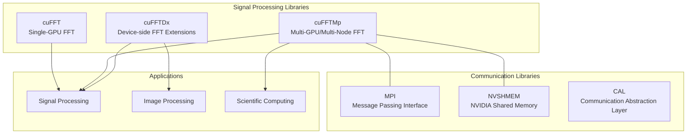

Sources: [README.md:9-14](), [README.md:32-34]()

## cuFFTMp Library

cuFFTMp is NVIDIA's distributed FFT library designed for multi-GPU and multi-node deployments. It extends the functionality of cuFFT to operate across multiple GPUs, enabling processing of larger datasets and providing better performance scaling.

### Key Features

- Multi-GPU and multi-node FFT operations
- Support for various data distribution patterns
- Integration with MPI and NVSHMEM for inter-GPU/node communication
- Data redistribution capabilities
- Support for complex-to-complex (C2C), real-to-complex (R2C), and complex-to-real (C2R) transforms

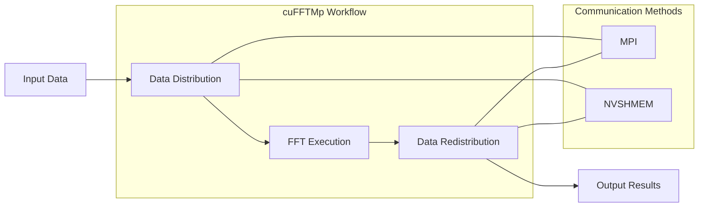

Sources: [README.md:32-34](), [cuFFTMp/samples/c2c_no_descriptors_cufftMpMakePlan/cufftmp_c2c_no_descriptors_cufftMpMakePlan.cu:13-43]()

## Data Distribution Patterns

cuFFTMp supports several data distribution patterns, allowing users to choose the most appropriate pattern for their specific workload.

### Built-in Distribution Patterns

- **X-Slabs (CUFFT_XT_FORMAT_INPLACE)**: Data distributed along the X dimension
- **Y-Slabs (CUFFT_XT_FORMAT_INPLACE_SHUFFLED)**: Data distributed along the Y dimension
- **Custom distributions**: User-defined distribution patterns

The following diagram illustrates the data distribution for a 3D FFT:

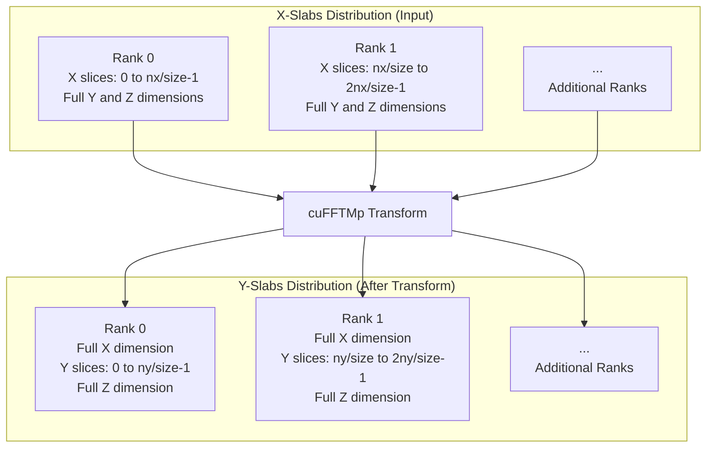

Sources: [cuFFTMp/samples/c2c_no_descriptors_cufftMpMakePlan/cufftmp_c2c_no_descriptors_cufftMpMakePlan.cu:21-42]()

### Pencil Distribution

For certain applications, a "pencil" distribution is more efficient, where each rank owns a subset of two dimensions:

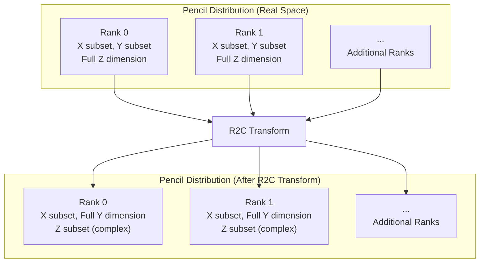

Sources: [cuFFTMp/samples/r2c_c2r_pencils_cufftMpMakePlan/cufftmp_r2c_c2r_pencils_cufftMpMakePlan.cu:133-145]()

## API Overview

cuFFTMp provides several APIs for creating and executing FFT plans on distributed data.

### Key Functions

| Function | Description |
|----------|-------------|
| `cufftMpCreate` | Creates a cuFFTMp plan |
| `cufftMpMakePlan3d` | Creates a 3D plan with built-in data distributions |
| `cufftMpMakePlanDecomposition` | Creates a plan with custom data decomposition |
| `cufftMpExecDescriptor` | Executes a plan using descriptors |
| `cufftMpExecReshapeAsync` | Executes a data redistribution |
| `cufftMpDestroy` | Destroys a cuFFTMp plan |
| `cufftXtMalloc` | Allocates distributed memory |
| `cufftXtFree` | Frees distributed memory |

Sources: [cuFFTMp/samples/c2c_no_descriptors_cufftMpMakePlan/cufftmp_c2c_no_descriptors_cufftMpMakePlan.cu:57-64](), [cuFFTMp/samples/r2c_c2r_pencils_cufftMpMakePlan/cufftmp_r2c_c2r_pencils_cufftMpMakePlan.cu:47-50]()

## Execution Workflow

A typical workflow for executing transforms with cuFFTMp involves the following steps:

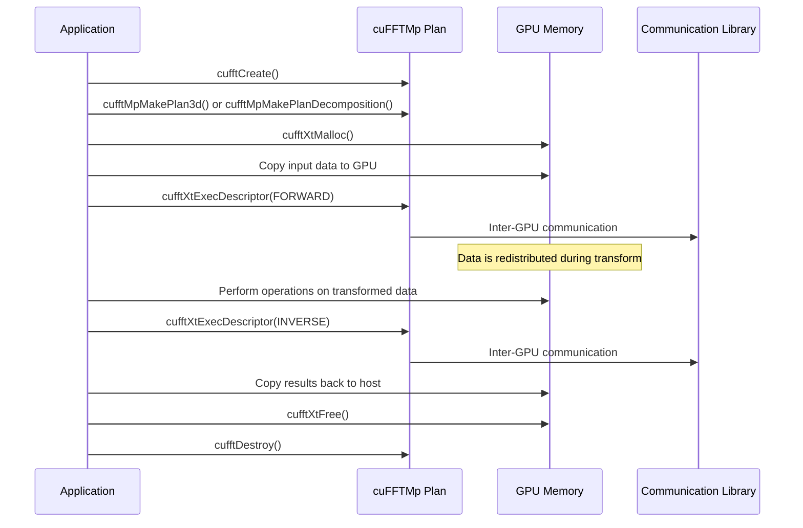

Sources: [cuFFTMp/samples/c2c_no_descriptors_cufftMpMakePlan/cufftmp_c2c_no_descriptors_cufftMpMakePlan.cu:45-91](), [cuFFTMp/samples/r2c_c2r_pencils_cufftMpMakePlan/cufftmp_r2c_c2r_pencils_cufftMpMakePlan.cu:26-82]()

## Data Reshaping

cuFFTMp provides functionality to redistribute data between different decompositions using the `cufftMpCreateReshape` and `cufftMpExecReshapeAsync` functions.

### Data Reshaping Example

The following describes a data reshaping operation where a 2D matrix is redistributed across ranks:

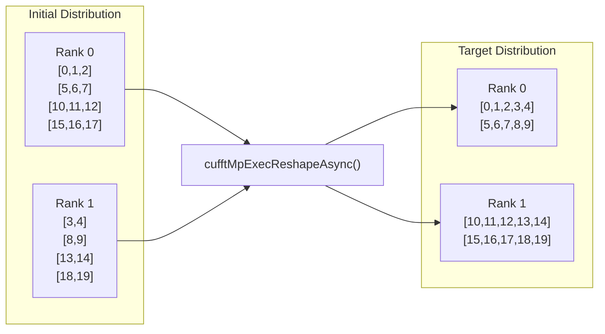

Sources: [cuFFTMp/samples/reshape/cufftmp_reshape.cu:30-53]()

### Box-Based Data Description

cuFFTMp uses "boxes" to describe data distributions, where each box specifies:
- Lower bounds of the data region
- Upper bounds of the data region
- Strides for memory layout

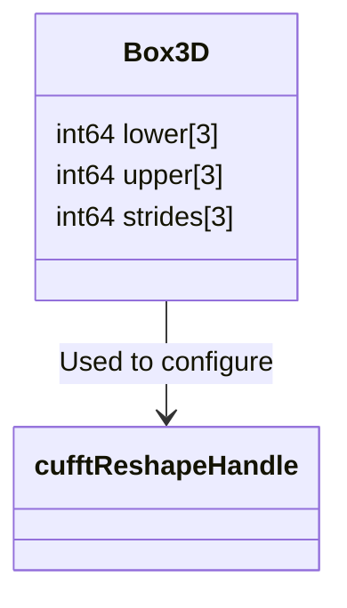

Sources: [cuFFTMp/samples/reshape/cufftmp_reshape.cu:63-68](), [cuFFTMp/samples/r2c_c2r_pencils_cufftMpMakePlan/cufftmp_r2c_c2r_pencils_cufftMpMakePlan.cu:113-121]()

## Sample Usage

Below is a high-level overview of using cuFFTMp for a C2C (complex-to-complex) transform:

1. Initialize MPI and NVSHMEM for inter-GPU communication
2. Create a cuFFT plan 
3. Configure the plan for distributed execution
4. Allocate distributed memory
5. Execute the forward transform
6. Process the transformed data
7. Execute the inverse transform
8. Retrieve the results

Sources: [cuFFTMp/samples/c2c_no_descriptors_cufftMpMakePlan/cufftmp_c2c_no_descriptors_cufftMpMakePlan.cu:93-142]()

### Example: R2C-C2R with Pencil Distribution

This example demonstrates the implementation of a real-to-complex followed by complex-to-real transform using a pencil distribution pattern:

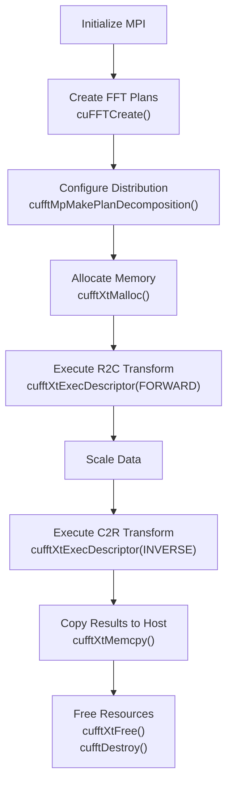

Sources: [cuFFTMp/samples/r2c_c2r_pencils_cufftMpMakePlan/cufftmp_r2c_c2r_pencils_cufftMpMakePlan.cu:26-82]()

## Integration with Communication Libraries

cuFFTMp integrates with MPI and NVSHMEM for inter-GPU and inter-node communication.

### MPI Integration

MPI is used for communication between processes, which can be running on different nodes:

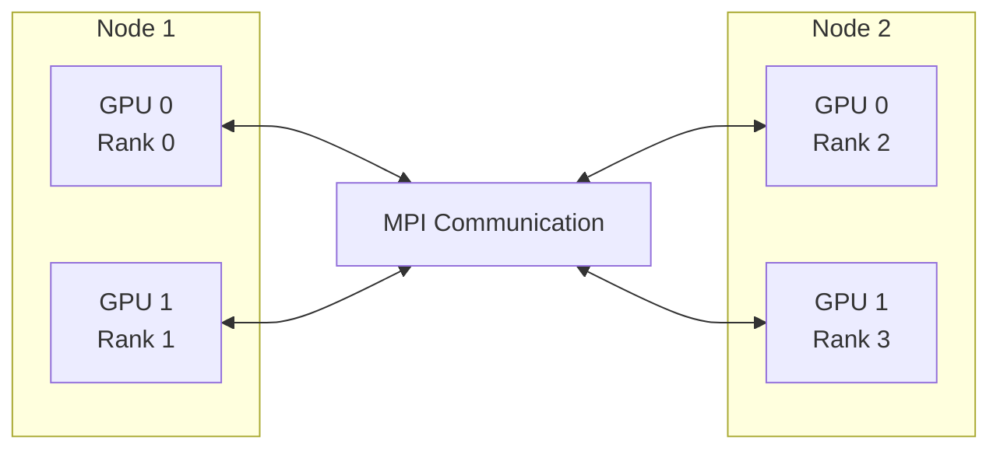

Sources: [cuFFTMp/samples/c2c_no_descriptors_cufftMpMakePlan/cufftmp_c2c_no_descriptors_cufftMpMakePlan.cu:95-108]()

### NVSHMEM Integration

NVSHMEM provides efficient GPU-to-GPU communication within and across nodes:

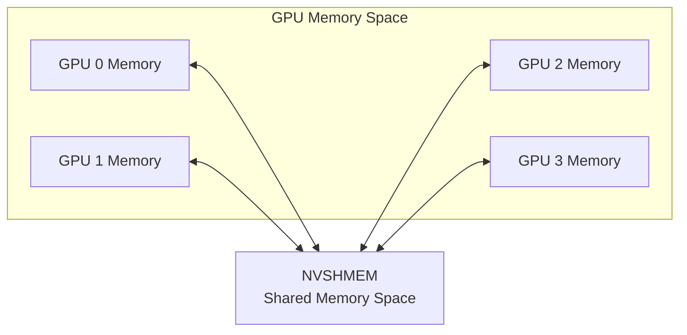

Sources: [cuFFTMp/samples/reshape/cufftmp_reshape.cu:110-111](), [cuFFTMp/samples/reshape/cufftmp_reshape.cu:122-122]()

## Data Synchronization Considerations

When using cuFFTMp with NVSHMEM, proper synchronization is required to avoid race conditions:

1. Before executing a distributed operation, ensure all buffers are ready on all GPUs
2. Use `nvshmemx_sync_all_on_stream()` to synchronize all processing elements
3. After execution, ensure all operations are complete before accessing memory

This is especially important for operations like `cufftMpExecReshapeAsync` which access memory on remote GPUs.

Sources: [cuFFTMp/samples/reshape/cufftmp_reshape.cu:117-122]()

## Relation to Other NVIDIA Libraries

cuFFTMp is part of NVIDIA's suite of GPU-accelerated libraries:

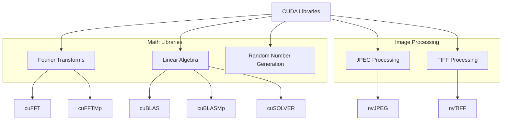

Sources: [README.md:3-15]()

## Performance Considerations

For optimal performance with cuFFTMp:

1. Choose data distributions that minimize communication
2. For best performance with pencil distributions, ensure local dimensions differ between input and output to reduce communication phases
3. Use NVSHMEM for communication when GPUs are within the same node
4. Properly synchronize operations to avoid race conditions

Sources: [cuFFTMp/samples/r2c_c2r_pencils_cufftMpMakePlan/cufftmp_r2c_c2r_pencils_cufftMpMakePlan.cu:142-145]()

## Conclusion

cuFFTMp provides a powerful and flexible framework for distributed FFT operations across multiple GPUs and nodes. Its integration with MPI and NVSHMEM enables efficient communication, while support for various data distribution patterns allows optimization for different workloads. For more information about other NVIDIA libraries, refer to their respective documentation pages.

Sources: [README.md:53-60]()

---

