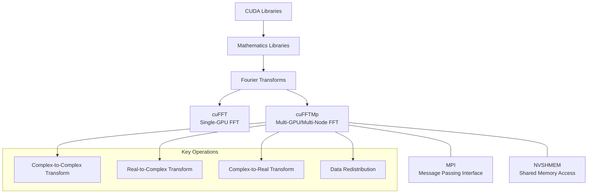
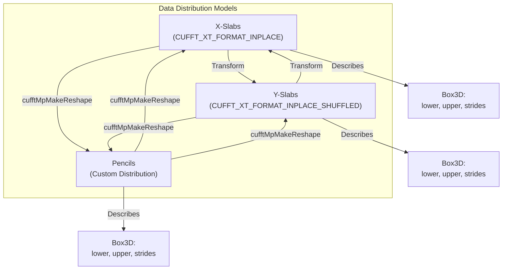
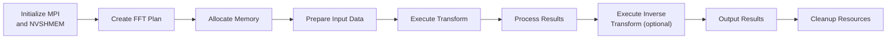

<!-- source: DeepWiki mcp.deepwiki.com · repo NVIDIA/CUDALibrarySamples · page 3.1 cuFFTMp - Distributed FFT Operations · fetched 2026-10-26 -->

# cuFFTMp - Distributed FFT Operations

<details>
<summary>Relevant source files</summary>

The following files were used as context for generating this wiki page:

- [cuFFTMp/samples/c2c_no_descriptors_cufftMpMakePlan/README.md](cuFFTMp/samples/c2c_no_descriptors_cufftMpMakePlan/README.md)
- [cuFFTMp/samples/c2c_no_descriptors_cufftMpMakePlan/cufftmp_c2c_no_descriptors_cufftMpMakePlan.cu](cuFFTMp/samples/c2c_no_descriptors_cufftMpMakePlan/cufftmp_c2c_no_descriptors_cufftMpMakePlan.cu)
- [cuFFTMp/samples/r2c_c2r_pencils_cufftMpMakePlan/README.md](cuFFTMp/samples/r2c_c2r_pencils_cufftMpMakePlan/README.md)
- [cuFFTMp/samples/r2c_c2r_pencils_cufftMpMakePlan/cufftmp_r2c_c2r_pencils_cufftMpMakePlan.cu](cuFFTMp/samples/r2c_c2r_pencils_cufftMpMakePlan/cufftmp_r2c_c2r_pencils_cufftMpMakePlan.cu)
- [cuFFTMp/samples/reshape/cufftmp_reshape.cu](cuFFTMp/samples/reshape/cufftmp_reshape.cu)

</details>


## Introduction

cuFFTMp is NVIDIA's distributed Fast Fourier Transform library designed for multi-GPU and multi-node environments. It extends the standard cuFFT library to enable FFT operations across multiple GPUs and compute nodes, making it suitable for large-scale scientific and engineering applications that require processing data sizes exceeding single-GPU memory capacity.

This document provides technical details on using cuFFTMp for distributed FFT operations. For information about single-GPU FFT operations, see the cuFFT documentation.

Sources: [cuFFTMp/samples/c2c_no_descriptors_cufftMpMakePlan/cufftmp_c2c_no_descriptors_cufftMpMakePlan.cu:17-43]()

## Architecture Overview

cuFFTMp distributes FFT computations across multiple GPUs using MPI for communication coordination and NVSHMEM for efficient GPU memory access. The library manages data distribution, inter-GPU communication, and computation scheduling to provide a unified API for distributed FFT operations.

### cuFFTMp in the CUDA Libraries Ecosystem



Sources: [cuFFTMp/samples/c2c_no_descriptors_cufftMpMakePlan/cufftmp_c2c_no_descriptors_cufftMpMakePlan.cu:17-43]()

## Data Distribution Models

cuFFTMp supports several data distribution formats to optimize performance for different transform types and problem sizes.

### Built-in Distribution Formats

1. **X-Slabs (CUFFT_XT_FORMAT_INPLACE)**:
   - Data distributed along the X dimension
   - Each rank owns approximately (X/ngpus) * Y * Z elements
   - First (X % ngpus) ranks have one more plane than others

2. **Y-Slabs (CUFFT_XT_FORMAT_INPLACE_SHUFFLED)**:
   - Data distributed along the Y dimension
   - Each rank owns approximately X * (Y/ngpus) * Z elements
   - First (Y % ngpus) ranks have one more plane than others

### Custom Data Distributions (Pencils)

cuFFTMp also supports defining custom data distributions using the concept of "pencils" where data can be distributed along multiple dimensions.



Sources: 
- [cuFFTMp/samples/c2c_no_descriptors_cufftMpMakePlan/cufftmp_c2c_no_descriptors_cufftMpMakePlan.cu:44-50]()
- [cuFFTMp/samples/r2c_c2r_pencils_cufftMpMakePlan/cufftmp_r2c_c2r_pencils_cufftMpMakePlan.cu:132-150]()

## Core APIs

cuFFTMp provides several key APIs for creating, executing, and managing distributed FFT operations.

### Plan Creation

1. **Standard Plan Creation**:
   ```c
   cufftResult cufftMpMakePlan3d(
       cufftHandle plan, 
       int nx, int ny, int nz, 
       cufftType type, 
       void* comm, 
       cufftCommType commType, 
       size_t* workSize
   );
   ```

2. **Custom Decomposition Plan Creation**:
   ```c
   cufftResult cufftMpMakePlanDecomposition(
       cufftHandle plan, 
       int dim, int n[], 
       int64_t inembed_low[], int64_t inembed_high[], int64_t istride[],
       int64_t onembed_low[], int64_t onembed_high[], int64_t ostride[], 
       cufftType type, 
       void* comm, 
       cufftCommType commType, 
       size_t* workSize
   );
   ```

### Data Reshaping

cuFFTMp provides APIs for redistributing data between different distribution formats:

```c
cufftResult cufftMpCreateReshape(cufftReshapeHandle* handle);

cufftResult cufftMpMakeReshape(
    cufftReshapeHandle handle, 
    size_t elementSize, int dim,
    int64_t inembed_low[], int64_t inembed_high[], int64_t istride[],
    int64_t onembed_low[], int64_t onembed_high[], int64_t ostride[],
    void* comm, 
    cufftCommType commType
);

cufftResult cufftMpExecReshapeAsync(
    cufftReshapeHandle handle, 
    void* dst, void* src, void* scratch, 
    cudaStream_t stream
);
```

Sources:
- [cuFFTMp/samples/c2c_no_descriptors_cufftMpMakePlan/cufftmp_c2c_no_descriptors_cufftMpMakePlan.cu:64]()
- [cuFFTMp/samples/r2c_c2r_pencils_cufftMpMakePlan/cufftmp_r2c_c2r_pencils_cufftMpMakePlan.cu:48-49]()
- [cuFFTMp/samples/reshape/cufftmp_reshape.cu:85-96]()

## Usage Patterns

### Transform Workflow

The typical workflow for using cuFFTMp consists of:



Sources:
- [cuFFTMp/samples/c2c_no_descriptors_cufftMpMakePlan/cufftmp_c2c_no_descriptors_cufftMpMakePlan.cu:93-142]()
- [cuFFTMp/samples/r2c_c2r_pencils_cufftMpMakePlan/cufftmp_r2c_c2r_pencils_cufftMpMakePlan.cu:26-82]()

### Data Distribution Examples

#### X-Slabs to Y-Slabs (C2C Transform)

For C2C transforms with the built-in distribution:

1. **Initialize** MPI and NVSHMEM
2. **Create plan** with `cufftMpMakePlan3d`
3. **Set subformat** with `cufftXtSetSubformatDefault`
4. **Allocate memory** and copy data to GPU
5. **Execute forward transform** with `cufftExecC2C`
6. **Process data** (now in Y-Slabs distribution)
7. **Execute inverse transform**
8. **Copy back** to host and verify results

Sources: [cuFFTMp/samples/c2c_no_descriptors_cufftMpMakePlan/cufftmp_c2c_no_descriptors_cufftMpMakePlan.cu:45-91]()

#### Custom Pencil Distribution (R2C/C2R Transforms)

For R2C and C2R transforms with custom pencil distributions:

1. **Initialize** MPI
2. **Define custom distribution** using Box3D structures
3. **Create plans** with `cufftMpMakePlanDecomposition`
4. **Allocate memory** with `cufftXtMalloc`
5. **Execute R2C transform** with `cufftXtExecDescriptor`
6. **Process data**
7. **Execute C2R transform** with `cufftXtExecDescriptor`
8. **Copy back** to host and verify results

Sources: [cuFFTMp/samples/r2c_c2r_pencils_cufftMpMakePlan/cufftmp_r2c_c2r_pencils_cufftMpMakePlan.cu:26-82]()

### Data Reshape Operations

For redistributing data between different distribution formats:

1. **Initialize** MPI and NVSHMEM
2. **Define source and target distributions** using Box3D structures
3. **Create reshape handle** with `cufftMpCreateReshape`
4. **Configure reshape operation** with `cufftMpMakeReshape`
5. **Allocate symmetric memory** with `nvshmem_malloc`
6. **Synchronize all GPUs** with `nvshmemx_sync_all_on_stream`
7. **Execute reshape** with `cufftMpExecReshapeAsync`
8. **Copy back** to host and verify results

Sources: [cuFFTMp/samples/reshape/cufftmp_reshape.cu:85-126]()

## Box3D Data Structure

The Box3D structure is fundamental to describing data distributions in cuFFTMp. It defines a region of a multi-dimensional array using:

- `lower`: Lower corner coordinates (inclusive)
- `upper`: Upper corner coordinates (exclusive)
- `strides`: Distance between consecutive elements in each dimension

```c
typedef struct {
    int64_t lower[3];   // Lower bound coordinates (inclusive)
    int64_t upper[3];   // Upper bound coordinates (exclusive)
    int64_t strides[3]; // Stride for each dimension
} Box3D;
```

This structure is used in both custom decomposition plans and reshape operations to precisely specify how data is distributed across ranks.

Sources:
- [cuFFTMp/samples/reshape/cufftmp_reshape.cu:63-74]()
- [cuFFTMp/samples/r2c_c2r_pencils_cufftMpMakePlan/cufftmp_r2c_c2r_pencils_cufftMpMakePlan.cu:113-121]()

## Performance Considerations

When using cuFFTMp, consider the following performance factors:

1. **Data Distribution Choice**:
   - Choose distributions that minimize communication
   - For best performance with pencil distributions, ensure local dimensions in input and output are different to enable only two communication phases

2. **Memory Allocation**:
   - Use symmetric memory allocation with NVSHMEM for reshape operations
   - Ensure sufficient memory is allocated on all GPUs

3. **Synchronization**:
   - Use `nvshmemx_sync_all_on_stream` before operations that access remote GPU memory
   - Properly synchronize streams before accessing results

4. **Process-to-GPU Mapping**:
   - Map MPI ranks to GPUs appropriately to maximize locality and reduce communication overhead

Sources:
- [cuFFTMp/samples/reshape/cufftmp_reshape.cu:102-122]()
- [cuFFTMp/samples/r2c_c2r_pencils_cufftMpMakePlan/cufftmp_r2c_c2r_pencils_cufftMpMakePlan.cu:140-145]()

## Example Scenarios

### Multi-GPU FFT with Default Distribution

This example shows a Complex-to-Complex transform using the default distribution across multiple GPUs:

1. Initialize MPI and set up the environment
2. Create a plan with `cufftMpMakePlan3d`
3. Specify the subformat with `cufftXtSetSubformatDefault`
4. Execute forward transform, process data, then execute inverse transform
5. Verify results

Sources: [cuFFTMp/samples/c2c_no_descriptors_cufftMpMakePlan/cufftmp_c2c_no_descriptors_cufftMpMakePlan.cu:93-142]()

### Custom Data Distribution Example

For applications needing precise control over data distribution:

1. Define custom distributions using Box3D structures
2. Create plans using `cufftMpMakePlanDecomposition`
3. Execute transforms with custom distributions
4. Process data in the desired distribution format

Sources: [cuFFTMp/samples/r2c_c2r_pencils_cufftMpMakePlan/cufftmp_r2c_c2r_pencils_cufftMpMakePlan.cu:84-177]()

### Data Redistribution

To redistribute data across GPUs:

1. Define source and target distributions
2. Create and configure a reshape operation
3. Allocate symmetric memory
4. Execute the reshape operation

Sources: [cuFFTMp/samples/reshape/cufftmp_reshape.cu:11-166]()

## Summary

cuFFTMp provides a powerful framework for distributed FFT operations across multiple GPUs and nodes. By supporting various data distribution models and providing flexible APIs for custom distributions, it enables efficient processing of large-scale FFT workloads. The library handles complex communication patterns and data movement, allowing developers to focus on their application logic rather than distributed computing details.

---

