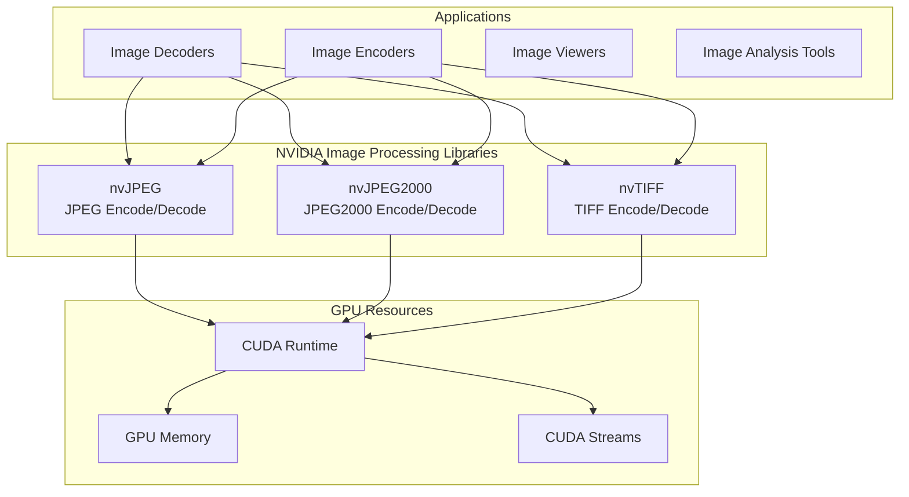
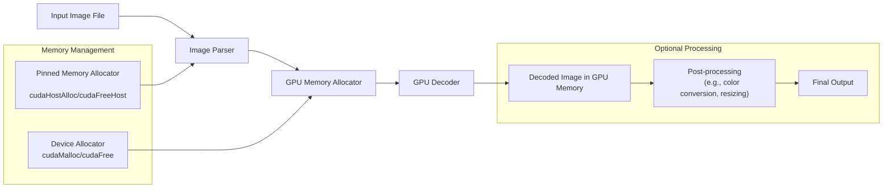
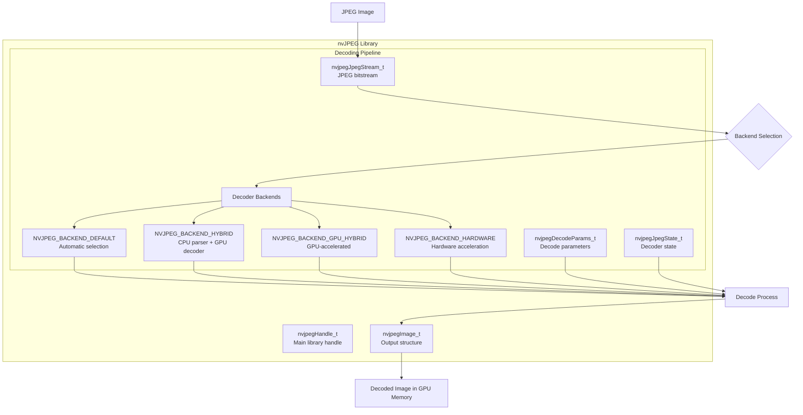
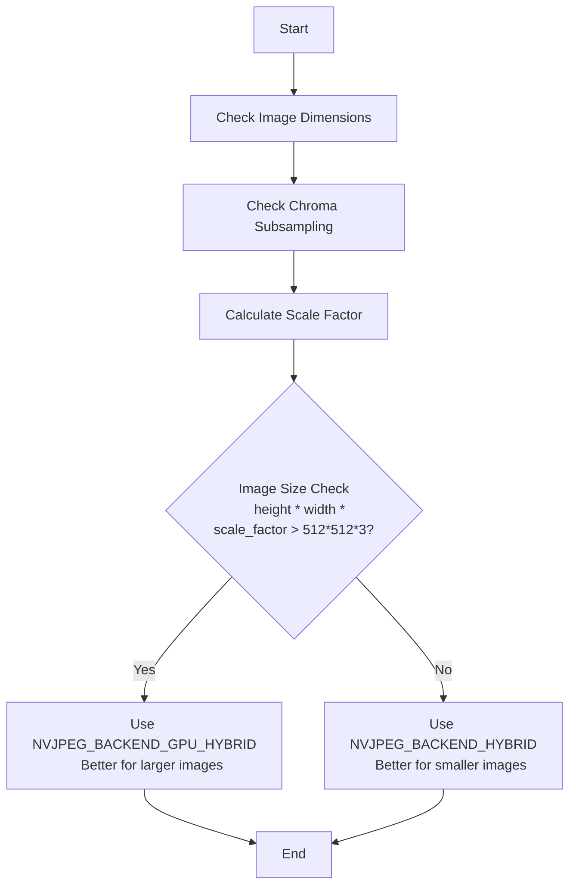
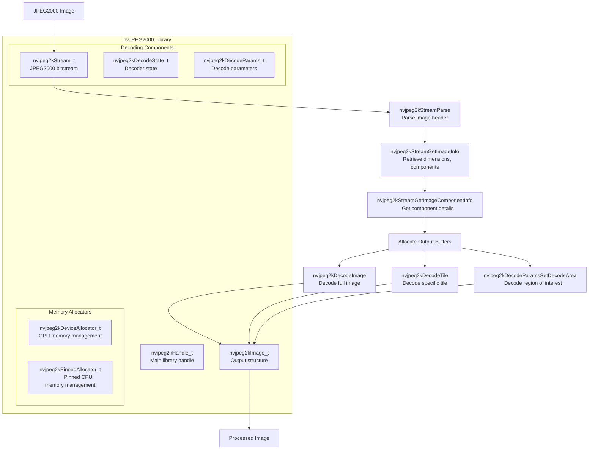
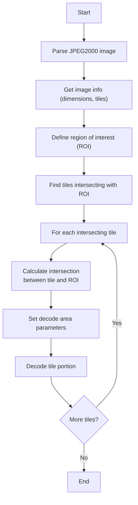
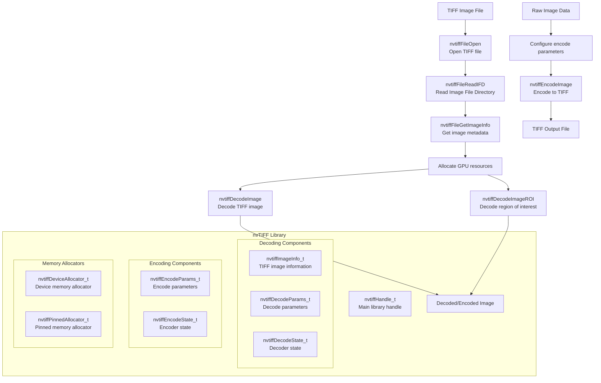
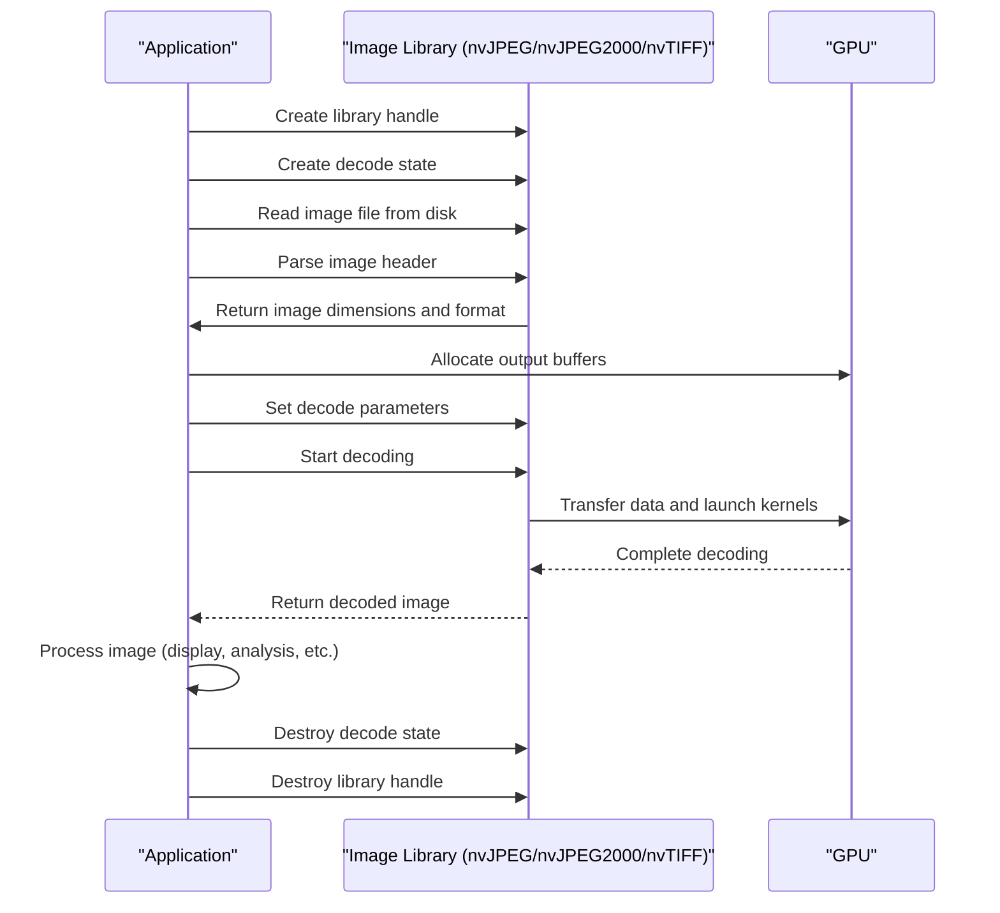
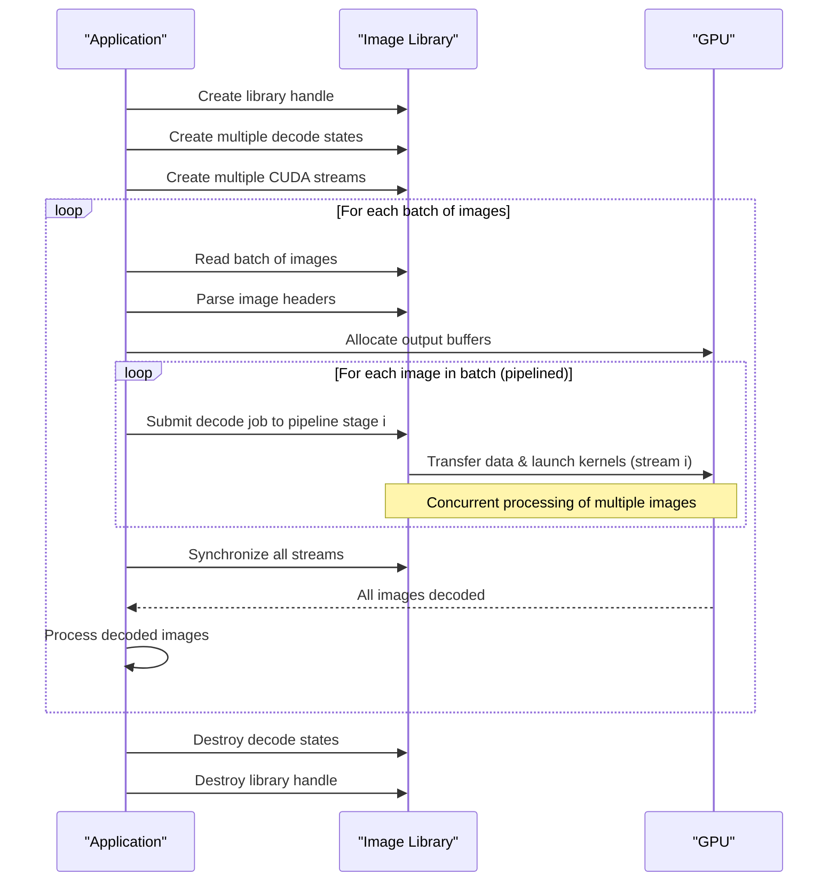

<!-- source: DeepWiki mcp.deepwiki.com · repo NVIDIA/CUDALibrarySamples · page 4 Image Processing Libraries · fetched 2026-10-26 -->

# Image Processing Libraries

Relevant source files

The following files were used as context for generating this wiki page:

- [README.md](README.md)
- [cuSOLVERSp2cuDSS/CMakeLists.txt](cuSOLVERSp2cuDSS/CMakeLists.txt)
- [cuSOLVERSp2cuDSS/README.md](cuSOLVERSp2cuDSS/README.md)
- [cuSOLVERSp2cuDSS/cuSolverRf2cuDSS.hpp](cuSOLVERSp2cuDSS/cuSolverRf2cuDSS.hpp)
- [cuSOLVERSp2cuDSS/cuSolverRf2cuDSS_double.cpp](cuSOLVERSp2cuDSS/cuSolverRf2cuDSS_double.cpp)
- [cuSOLVERSp2cuDSS/cuSolverSp2cuDSS.hpp](cuSOLVERSp2cuDSS/cuSolverSp2cuDSS.hpp)
- [cuSOLVERSp2cuDSS/cuSolverSp2cuDSS_dcomplex.cpp](cuSOLVERSp2cuDSS/cuSolverSp2cuDSS_dcomplex.cpp)
- [cuSOLVERSp2cuDSS/cuSolverSp2cuDSS_double.cpp](cuSOLVERSp2cuDSS/cuSolverSp2cuDSS_double.cpp)
- [cuSOLVERSp2cuDSS/cuSolverSp2cuDSS_float.cpp](cuSOLVERSp2cuDSS/cuSolverSp2cuDSS_float.cpp)
- [cuSOLVERSp2cuDSS/cuSolverSp2cuDSS_scomplex.cpp](cuSOLVERSp2cuDSS/cuSolverSp2cuDSS_scomplex.cpp)
- [cuSOLVERSp2cuDSS/test_complex.mtx](cuSOLVERSp2cuDSS/test_complex.mtx)
- [cuSOLVERSp2cuDSS/test_real.mtx](cuSOLVERSp2cuDSS/test_real.mtx)
- [nvJPEG/README.md](nvJPEG/README.md)
- [nvJPEG/nvJPEG-Decoder-Backend-ROI/README.md](nvJPEG/nvJPEG-Decoder-Backend-ROI/README.md)
- [nvJPEG/nvJPEG-Decoder-Backend-ROI/img9_roi.png](nvJPEG/nvJPEG-Decoder-Backend-ROI/img9_roi.png)
- [nvJPEG/nvJPEG-Decoder-Backend-ROI/nvJPEGROIDecode.cpp](nvJPEG/nvJPEG-Decoder-Backend-ROI/nvJPEGROIDecode.cpp)
- [nvJPEG/nvJPEG-Decoder-Backend-ROI/nvJPEGROIDecode.h](nvJPEG/nvJPEG-Decoder-Backend-ROI/nvJPEGROIDecode.h)
- [nvJPEG/nvJPEG-Decoder-MultipleInstances/CMakeLists.txt](nvJPEG/nvJPEG-Decoder-MultipleInstances/CMakeLists.txt)
- [nvJPEG/nvJPEG-Decoder-MultipleInstances/README.md](nvJPEG/nvJPEG-Decoder-MultipleInstances/README.md)
- [nvJPEG/nvJPEG-Decoder-MultipleInstances/nvJPEGDecMultipleInstances.cpp](nvJPEG/nvJPEG-Decoder-MultipleInstances/nvJPEGDecMultipleInstances.cpp)
- [nvJPEG/nvJPEG-Decoder-MultipleInstances/nvJPEGDecMultipleInstances.h](nvJPEG/nvJPEG-Decoder-MultipleInstances/nvJPEGDecMultipleInstances.h)
- [nvJPEG/nvJPEG-Decoder-MultipleInstances/threadpool.h](nvJPEG/nvJPEG-Decoder-MultipleInstances/threadpool.h)
- [nvJPEG/nvJPEG-Decoder/README.md](nvJPEG/nvJPEG-Decoder/README.md)
- [nvJPEG/nvJPEG-Decoder/nvjpegDecoder.cpp](nvJPEG/nvJPEG-Decoder/nvjpegDecoder.cpp)
- [nvJPEG/nvJPEG-Decoder/nvjpegDecoder.h](nvJPEG/nvJPEG-Decoder/nvjpegDecoder.h)
- [nvJPEG2000/nvJPEG2000-Decoder-Pipelined/CMakeLists.txt](nvJPEG2000/nvJPEG2000-Decoder-Pipelined/CMakeLists.txt)
- [nvJPEG2000/nvJPEG2000-Decoder-Pipelined/README.md](nvJPEG2000/nvJPEG2000-Decoder-Pipelined/README.md)
- [nvJPEG2000/nvJPEG2000-Decoder-Pipelined/nvjpeg2k_dec_pipelined.cpp](nvJPEG2000/nvJPEG2000-Decoder-Pipelined/nvjpeg2k_dec_pipelined.cpp)
- [nvJPEG2000/nvJPEG2000-Decoder-Pipelined/nvjpeg2k_dec_pipelined.h](nvJPEG2000/nvJPEG2000-Decoder-Pipelined/nvjpeg2k_dec_pipelined.h)
- [nvJPEG2000/nvJPEG2000-Decoder-Tile-Partial/CMakeLists.txt](nvJPEG2000/nvJPEG2000-Decoder-Tile-Partial/CMakeLists.txt)
- [nvJPEG2000/nvJPEG2000-Decoder-Tile-Partial/README.md](nvJPEG2000/nvJPEG2000-Decoder-Tile-Partial/README.md)
- [nvJPEG2000/nvJPEG2000-Decoder-Tile-Partial/nvj2k_DecodeTilePartial.cpp](nvJPEG2000/nvJPEG2000-Decoder-Tile-Partial/nvj2k_DecodeTilePartial.cpp)
- [nvJPEG2000/nvJPEG2000-Decoder-Tile-Partial/nvj2k_DecodeTilePartial.h](nvJPEG2000/nvJPEG2000-Decoder-Tile-Partial/nvj2k_DecodeTilePartial.h)
- [nvJPEG2000/nvJPEG2000-Decoder/CMakeLists.txt](nvJPEG2000/nvJPEG2000-Decoder/CMakeLists.txt)
- [nvJPEG2000/nvJPEG2000-Decoder/README.md](nvJPEG2000/nvJPEG2000-Decoder/README.md)
- [nvJPEG2000/nvJPEG2000-Decoder/nvjpeg2000DecodeSample.cpp](nvJPEG2000/nvJPEG2000-Decoder/nvjpeg2000DecodeSample.cpp)
- [nvJPEG2000/nvJPEG2000-Decoder/nvjpeg2000DecodeSample.h](nvJPEG2000/nvJPEG2000-Decoder/nvjpeg2000DecodeSample.h)
- [nvTIFF/README.md](nvTIFF/README.md)
- [nvTIFF/nvTIFF-Decode-Encode/README.md](nvTIFF/nvTIFF-Decode-Encode/README.md)
- [nvTIFF/nvTIFF-Decode-Image-ROI/CMakeLists.txt](nvTIFF/nvTIFF-Decode-Image-ROI/CMakeLists.txt)
- [nvTIFF/nvTIFF-Decode-Image-ROI/README.md](nvTIFF/nvTIFF-Decode-Image-ROI/README.md)
- [nvTIFF/nvTIFF-Decode-Image-ROI/nvtiff_decode_image_roi.cpp](nvTIFF/nvTIFF-Decode-Image-ROI/nvtiff_decode_image_roi.cpp)

This document provides an overview of GPU-accelerated image processing libraries available in the NVIDIA CUDA Library Samples repository. These libraries enable high-performance encoding and decoding of various image formats leveraging NVIDIA GPUs. This page covers nvJPEG, nvJPEG2000, and nvTIFF libraries, their core capabilities, architectures, and includes practical usage examples.

## Overview

NVIDIA's image processing libraries provide GPU-accelerated implementations for various image encoding and decoding operations. These libraries significantly outperform CPU-based alternatives and are designed for both batch processing and real-time applications.

### Supported Libraries

| Library | Purpose | Key Features | GPU Architecture |
|---------|---------|--------------|------------------|
| nvJPEG | JPEG encoding/decoding | Multiple backends, ROI support, batch processing | SM 3.5+ |
| nvJPEG2000 | JPEG2000 encoding/decoding | Tile-based decoding, partial image decoding | SM 6.0+ |
| nvTIFF | TIFF encoding/decoding | GeoTIFF support, ROI decoding, LZW compression | SM 6.0+ |

Sources: [README.md:4-14](), [nvJPEG/README.md:1-36](), [nvTIFF/README.md:1-33]()

## Architecture Overview

The following diagram illustrates the high-level architecture of the image processing libraries and their relationships:

Sources: [README.md:3-15]()

## Common Processing Pipeline

All three libraries follow a similar data processing flow, with variations in specific implementation details:

Sources: [nvJPEG/nvJPEG-Decoder/nvjpegDecoder.cpp:33-126](), [nvJPEG2000/nvJPEG2000-Decoder/nvjpeg2000DecodeSample.cpp:31-137](), [nvTIFF/nvTIFF-Decode-Encode/README.md:1-20]()

## nvJPEG Library

The nvJPEG library provides GPU-accelerated encoding and decoding of JPEG images, supporting various color formats and optimizations for different image sizes.

### Architecture and Components

Sources: [nvJPEG/nvJPEG-Decoder/nvjpegDecoder.cpp:33-126](), [nvJPEG/nvJPEG-Decoder-Backend-ROI/nvJPEGROIDecode.cpp:33-137](), [nvJPEG/nvJPEG-Decoder-MultipleInstances/nvJPEGDecMultipleInstances.cpp:33-71]()

### Key Features

1. **Multiple Decoding Backends**:
   - `NVJPEG_BACKEND_DEFAULT`: Automatically selects the optimal backend
   - `NVJPEG_BACKEND_HYBRID`: Uses CPU for parsing and GPU for decoding (better for small images)
   - `NVJPEG_BACKEND_GPU_HYBRID`: Maximizes GPU usage (better for large images)
   - `NVJPEG_BACKEND_HARDWARE`: Hardware-accelerated decoding on supported GPUs

2. **Region of Interest (ROI) Decoding**:
   - Allows decoding specific regions of an image
   - Useful for viewing or processing parts of large images
   - Reduces memory usage and computation time

3. **Multiple Output Formats**:
   - RGB, BGR (channel-separated)
   - RGBI, BGRI (interleaved)
   - YUV, Y (grayscale)
   - Unchanged (original format)

4. **Advanced Processing Options**:
   - Batch processing for multiple images
   - Pipelined decoding for overlapping I/O and computation
   - Multiple instance support for parallel processing

Sources: [nvJPEG/nvJPEG-Decoder-Backend-ROI/README.md:1-99](), [nvJPEG/nvJPEG-Decoder/nvjpegDecoder.h:1-100]()

### Backend Selection Strategy

The nvJPEG library can automatically select the optimal backend based on image characteristics:

Sources: [nvJPEG/nvJPEG-Decoder-Backend-ROI/nvJPEGROIDecode.cpp:70-106](), [nvJPEG/nvJPEG-Decoder-MultipleInstances/nvJPEGDecMultipleInstances.cpp:33-69]()

### Usage Example

Here's a typical flow for using the nvJPEG decoder:

1. Create nvJPEG handle
2. Set up decoder state and parameters
3. Parse JPEG bitstream
4. Allocate memory for output
5. Decode image
6. Process the decoded image
7. Clean up resources

For specific implementations, see the sample code in:
- [nvJPEG/nvJPEG-Decoder/nvjpegDecoder.cpp:164-217]()
- [nvJPEG/nvJPEG-Decoder-Backend-ROI/nvJPEGROIDecode.cpp:161-294]()

## nvJPEG2000 Library

The nvJPEG2000 library provides GPU-accelerated encoding and decoding for JPEG2000 images. It supports various features specific to the JPEG2000 format, including tile-based processing and progressive decoding.

### Architecture and Components

Sources: [nvJPEG2000/nvJPEG2000-Decoder/nvjpeg2000DecodeSample.cpp:31-280](), [nvJPEG2000/nvJPEG2000-Decoder-Pipelined/nvjpeg2k_dec_pipelined.cpp:31-233](), [nvJPEG2000/nvJPEG2000-Decoder-Tile-Partial/nvj2k_DecodeTilePartial.cpp:30-234]()

### Key Features

1. **Tile-Based Decoding**:
   - JPEG2000 images are organized in tiles
   - Each tile can be decoded independently
   - Enables parallel processing and memory efficiency

2. **Region of Interest (ROI) Decoding**:
   - Decode only specific areas of the image
   - Supports crossing tile boundaries
   - Efficient for large images when only portions are needed

3. **Pipelined Decoding**:
   - Overlapping I/O and computation
   - Multiple decode states for concurrent processing
   - Increases throughput for batch processing

4. **Format Support**:
   - Various bit depths (8-bit, 16-bit)
   - Signed and unsigned data
   - RGB output conversion for images with chroma subsampling

Sources: [nvJPEG2000/nvJPEG2000-Decoder/nvjpeg2000DecodeSample.h:76-527](), [nvJPEG2000/nvJPEG2000-Decoder-Tile-Partial/README.md:1-66]()

### Partial Decoding with Tiles

The following diagram illustrates how nvJPEG2000 handles partial decoding across tile boundaries:

Sources: [nvJPEG2000/nvJPEG2000-Decoder-Tile-Partial/nvj2k_DecodeTilePartial.cpp:236-258](), [nvJPEG2000/nvJPEG2000-Decoder-Tile-Partial/nvj2k_DecodeTilePartial.cpp:296-341]()

## nvTIFF Library

The nvTIFF library provides GPU-accelerated encoding and decoding for TIFF images, with support for various TIFF features including GeoTIFF metadata.

### Architecture and Components

Sources: [nvTIFF/nvTIFF-Decode-Encode/README.md:1-158](), [nvTIFF/nvTIFF-Decode-Image-ROI/nvtiff_decode_image_roi.cpp:1-20]()

### Key Features

1. **Image Format Support**:
   - Grayscale (PhotometricInterp=1) and RGB (PhotometricInterp=2)
   - LZW compression and uncompressed images
   - "Chunky" format for RGB images (RGB..., PlanarConfiguration=1)
   - Strip-based organization (not tile-based)
   
2. **Bit Depth Support**:
   - 8-bit for LZW compressed images
   - 8, 16, or 32 bits for uncompressed images
   
3. **Region of Interest (ROI) Decoding**:
   - Decode specific portions of an image
   - Reduces memory usage and computation time
   
4. **GeoTIFF Support**:
   - Read and process geographic metadata
   - Preserve coordinate system information
   
5. **Memory Management Options**:
   - Pinned or pageable memory for input data
   - Optional data copying to device memory

Sources: [nvTIFF/nvTIFF-Decode-Encode/README.md:11-140](), [nvTIFF/README.md:1-33]()

## Performance Considerations

When working with these image processing libraries, consider the following performance optimization strategies:

1. **Backend Selection for nvJPEG**:
   - For small images (<512x512), use `NVJPEG_BACKEND_HYBRID`
   - For large images (>512x512), use `NVJPEG_BACKEND_GPU_HYBRID`
   - Use hardware-accelerated backend (`NVJPEG_BACKEND_HARDWARE`) if available

2. **Batch Processing**:
   - Process multiple images in batches for better throughput
   - Adjust batch size based on available GPU memory

3. **Pipelined Processing**:
   - Use pipelined decoding to overlap I/O and computation
   - Creates multiple decode states and streams

4. **Memory Management**:
   - Use pinned memory for host-device transfers
   - Pre-allocate and reuse buffers when processing multiple images

5. **Tile/ROI-Based Processing**:
   - For large images, decode only necessary regions
   - Use tile-based processing in nvJPEG2000 for parallel decoding

Sources: [nvJPEG/nvJPEG-Decoder-Backend-ROI/nvJPEGROIDecode.cpp:89-106](), [nvJPEG2000/nvJPEG2000-Decoder-Pipelined/nvjpeg2k_dec_pipelined.cpp:225-311]()

## Common Usage Patterns

### Single Image Decoding

Sources: [nvJPEG/nvJPEG-Decoder/nvjpegDecoder.cpp:164-226](), [nvJPEG2000/nvJPEG2000-Decoder/nvjpeg2000DecodeSample.cpp:172-280]()

### Batch Processing with Pipelining

Sources: [nvJPEG2000/nvJPEG2000-Decoder-Pipelined/nvjpeg2k_dec_pipelined.cpp:225-311](), [nvJPEG/nvJPEG-Decoder-MultipleInstances/nvJPEGDecMultipleInstances.cpp:72-170]()

## Conclusion

NVIDIA's image processing libraries provide powerful GPU-accelerated solutions for common image encoding and decoding tasks. By leveraging these libraries, applications can achieve significant performance improvements over CPU-based implementations. Each library is designed for specific image formats and offers unique features tailored to those formats.

For more specific implementation details, refer to the sample code in the CUDA Library Samples repository, which demonstrates various use cases and optimization strategies for each library.

Sources: [README.md:3-21](), [nvJPEG/README.md:1-43](), [nvJPEG2000/nvJPEG2000-Decoder/README.md:1-32](), [nvTIFF/README.md:1-33]()

---

