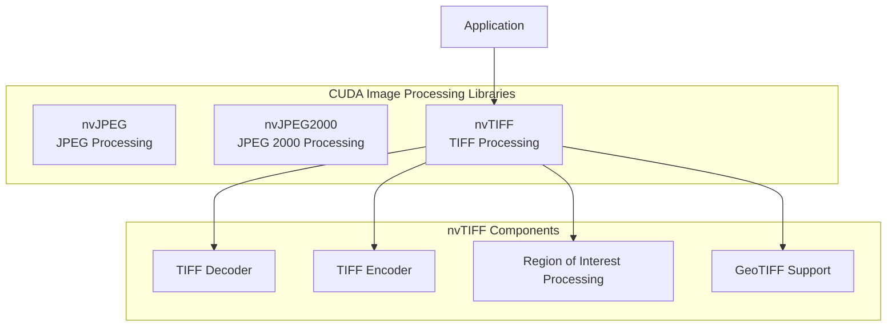
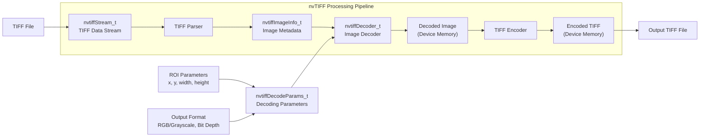
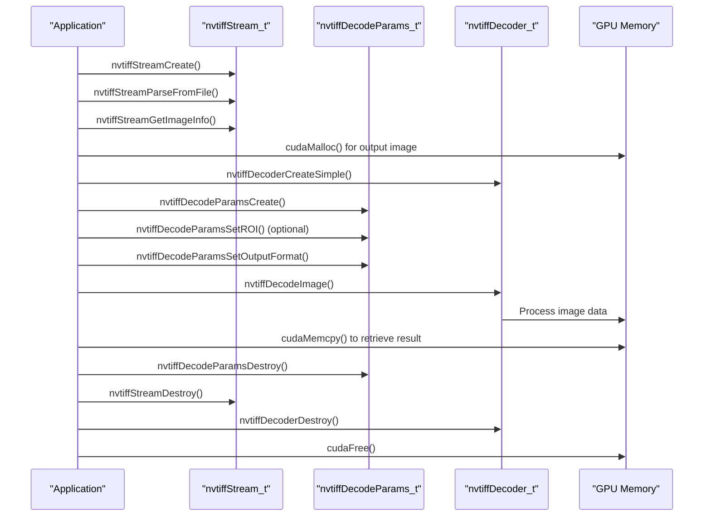

<!-- source: DeepWiki mcp.deepwiki.com · repo NVIDIA/CUDALibrarySamples · page 4.1 nvTIFF - TIFF Image Processing · fetched 2026-10-26 -->

# nvTIFF - TIFF Image Processing

<details>
<summary>Relevant source files</summary>

The following files were used as context for generating this wiki page:

- [nvTIFF/README.md](nvTIFF/README.md)
- [nvTIFF/nvTIFF-Decode-Encode/README.md](nvTIFF/nvTIFF-Decode-Encode/README.md)
- [nvTIFF/nvTIFF-Decode-Image-ROI/CMakeLists.txt](nvTIFF/nvTIFF-Decode-Image-ROI/CMakeLists.txt)
- [nvTIFF/nvTIFF-Decode-Image-ROI/README.md](nvTIFF/nvTIFF-Decode-Image-ROI/README.md)
- [nvTIFF/nvTIFF-Decode-Image-ROI/nvtiff_decode_image_roi.cpp](nvTIFF/nvTIFF-Decode-Image-ROI/nvtiff_decode_image_roi.cpp)

</details>


## Purpose and Scope

nvTIFF is a GPU-accelerated library for processing TIFF (Tagged Image File Format) images. It provides high-performance decoding and encoding capabilities for TIFF files by leveraging NVIDIA GPUs. This document covers the core functionality, API components, and usage patterns of the nvTIFF library. For information about other image processing libraries, see [nvJPEG](#4.3) or [nvJPEG2000](#4.2).

Sources: [nvTIFF/README.md:1-41]()

## System Overview

nvTIFF is part of NVIDIA's CUDA Library ecosystem, specifically within the Image Processing Libraries category. It provides GPU-accelerated functionality for handling TIFF images, enabling faster processing compared to CPU-based solutions.



Sources: [nvTIFF/README.md:3-9](), [nvTIFF/nvTIFF-Decode-Encode/README.md:3-9]()

## Key Features

nvTIFF provides several capabilities for TIFF image processing:

1. **TIFF Image Decoding**: Full and partial (ROI-based) image decoding
2. **TIFF Image Encoding**: Converting raw image data to TIFF format with LZW compression
3. **GeoTIFF Support**: Processing of TIFF files with geographic metadata
4. **ROI-based Processing**: Ability to decode only specific regions of an image
5. **Multi-image Support**: Processing TIFF files containing multiple images

Sources: [nvTIFF/README.md:11-19](), [nvTIFF/nvTIFF-Decode-Image-ROI/README.md:5-9]()

## System Architecture

The nvTIFF library follows a stream-based architecture where TIFF data is processed through a sequence of operations.



Sources: [nvTIFF/nvTIFF-Decode-Image-ROI/nvtiff_decode_image_roi.cpp:228-265]()

## API Components

The nvTIFF API consists of several key components:

| Component | Purpose | Primary Functions |
|-----------|---------|-------------------|
| Stream API | TIFF file parsing and metadata extraction | `nvtiffStreamCreate`, `nvtiffStreamParseFromFile`, `nvtiffStreamGetImageInfo` |
| Decoder API | Image decoding with various parameters | `nvtiffDecoderCreateSimple`, `nvtiffDecodeImage` |
| Parameter API | Control of decoding behavior | `nvtiffDecodeParamsCreate`, `nvtiffDecodeParamsSetROI`, `nvtiffDecodeParamsSetOutputFormat` |
| Info API | Access to image metadata | `nvtiffImageInfo_t` structure |
| Encoder API | Image encoding with compression | Various encoding functions |

Sources: [nvTIFF/nvTIFF-Decode-Image-ROI/nvtiff_decode_image_roi.cpp:228-265]()

## Decoding Process

The typical workflow for decoding a TIFF image with nvTIFF includes the following steps:



Sources: [nvTIFF/nvTIFF-Decode-Image-ROI/nvtiff_decode_image_roi.cpp:222-281]()

## ROI-based Decoding

One of the key features of nvTIFF is the ability to decode only a specific region of interest (ROI) within an image. This is particularly useful for working with large TIFF images when only a portion is needed.

```mermaid
graph TD
    subgraph "ROI Decoding Process"
        Input["Input TIFF Image"] --> Parse["Parse TIFF Structure"]
        Parse --> GetInfo["Get Image Information"]
        GetInfo --> SetROI["Set ROI Parameters\nx, y, width, height"]
        SetROI --> DecodeROI["Decode Only ROI Region"]
        DecodeROI --> Output["Output Decoded Region"]
    end
    
    subgraph "API Flow"
        CreateStream["nvtiffStreamCreate()"] --> ParseFile["nvtiffStreamParseFromFile()"]
        ParseFile --> GetImageInfo["nvtiffStreamGetImageInfo()"]
        GetImageInfo --> CreateDecoder["nvtiffDecoderCreateSimple()"]
        CreateDecoder --> CreateParams["nvtiffDecodeParamsCreate()"]
        CreateParams --> SetROIParams["nvtiffDecodeParamsSetROI()"]
        SetROIParams --> DecodeImage["nvtiffDecodeImage()"]
    end
```



Sources: [nvTIFF/nvTIFF-Decode-Image-ROI/nvtiff_decode_image_roi.cpp:120-141](), [nvTIFF/nvTIFF-Decode-Image-ROI/nvtiff_decode_image_roi.cpp:249-256]()

## Supported Image Features

nvTIFF supports TIFF files with the following specifications:

| Feature | Supported Options |
|---------|-------------------|
| Color Space | Grayscale (PhotometricInterp=1) or RGB (=2) |
| Compression | LZW (Compression=5) or uncompressed |
| Pixel Format | "Chunky" format (RGB..., PlanarConfiguration=1) for RGB images |
| Organization | Strips (not Tiles) |
| Pixel Components | At most 4 components for RGB images |
| Bit Depth | 8 bits for LZW compressed images, 8/16/32 bits for uncompressed images |
| Special Types | GeoTIFF (TIFF with geographic metadata) |

Sources: [nvTIFF/nvTIFF-Decode-Encode/README.md:76-88]()

## Usage Examples

nvTIFF includes several examples demonstrating its capabilities:

### Basic Decoding and Encoding

This example demonstrates how to decode a TIFF file and optionally re-encode it:

```
nvTiff_example [options] -f <TIFF_FILE>
```

With options to control GPU device selection, verbosity, image range, memory type, and encoding options.

Sources: [nvTIFF/nvTIFF-Decode-Encode/README.md:54-142]()

### ROI-based Decoding

This example shows how to decode only a specific region of a TIFF image:

```
nvtiff_decode_image_roi -f <TIFF_FILE> [-image_id image_id] [-o output_dir] [-roi offset_x,offset_y,roi_width,roi_height]
```

Sources: [nvTIFF/nvTIFF-Decode-Image-ROI/README.md:55-66](), [nvTIFF/nvTIFF-Decode-Image-ROI/nvtiff_decode_image_roi.cpp:283-325]()

## System Requirements

nvTIFF has the following system requirements:

| Component | Requirement |
|-----------|-------------|
| GPU | SM 6.0+ (NVIDIA GPUs supporting CUDA) |
| Operating Systems | Linux, Windows |
| CPU Architecture | x86_64, arm64-sbsa, aarch64-jetson |
| Dependencies | CUDA toolkit, nvComp (for Deflate decompression) |

Sources: [nvTIFF/README.md:20-39](), [nvTIFF/nvTIFF-Decode-Image-ROI/README.md:30-35]()

## Building Applications with nvTIFF

To build applications using nvTIFF:

1. Install the CUDA toolkit
2. Download and install the nvTIFF library
3. If needed, install nvComp for Deflate decompression support
4. Use CMake to configure your project, specifying the nvTIFF path

Basic CMake configuration example:

```
mkdir build
cd build
export CUDACXX=nvcc
cmake .. -DNVTIFF_PATH=<nvTIFF Library location>
make
```

Sources: [nvTIFF/nvTIFF-Decode-Image-ROI/README.md:37-50](), [nvTIFF/nvTIFF-Decode-Image-ROI/CMakeLists.txt:11-56]()

## Performance Considerations

nvTIFF leverages GPU acceleration to provide significant performance improvements over CPU-based TIFF processing, particularly for:

1. Large TIFF files
2. Batch processing of multiple TIFF images
3. ROI-based processing that can avoid loading entire images
4. LZW compression/decompression

For optimal performance:
- Use CUDA streams to overlap computation and data transfer
- Properly manage GPU memory to minimize allocations
- Consider using pinned memory for better host-device transfer speeds

Sources: [nvTIFF/nvTIFF-Decode-Encode/README.md:103-115](), [nvTIFF/nvTIFF-Decode-Image-ROI/nvtiff_decode_image_roi.cpp:264-268]()

---

