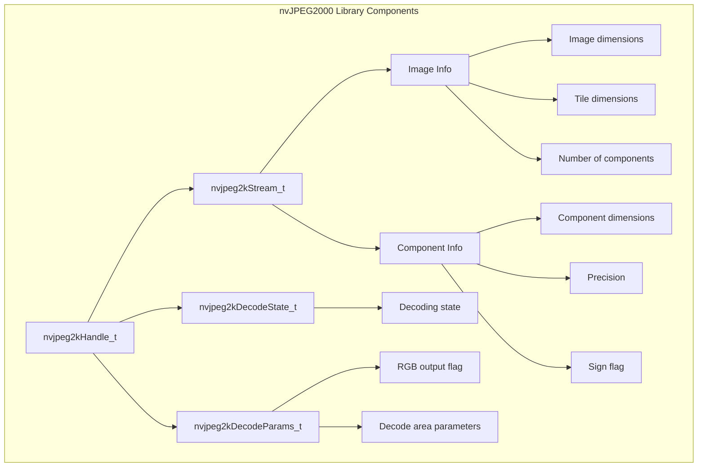
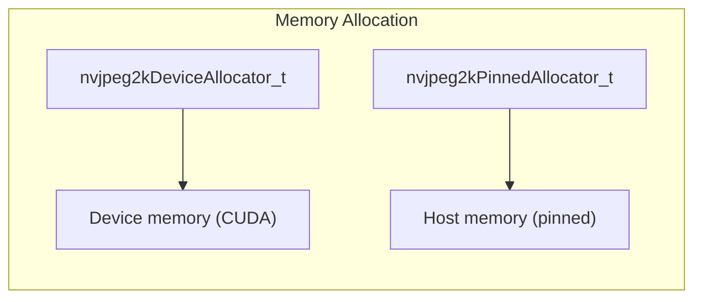
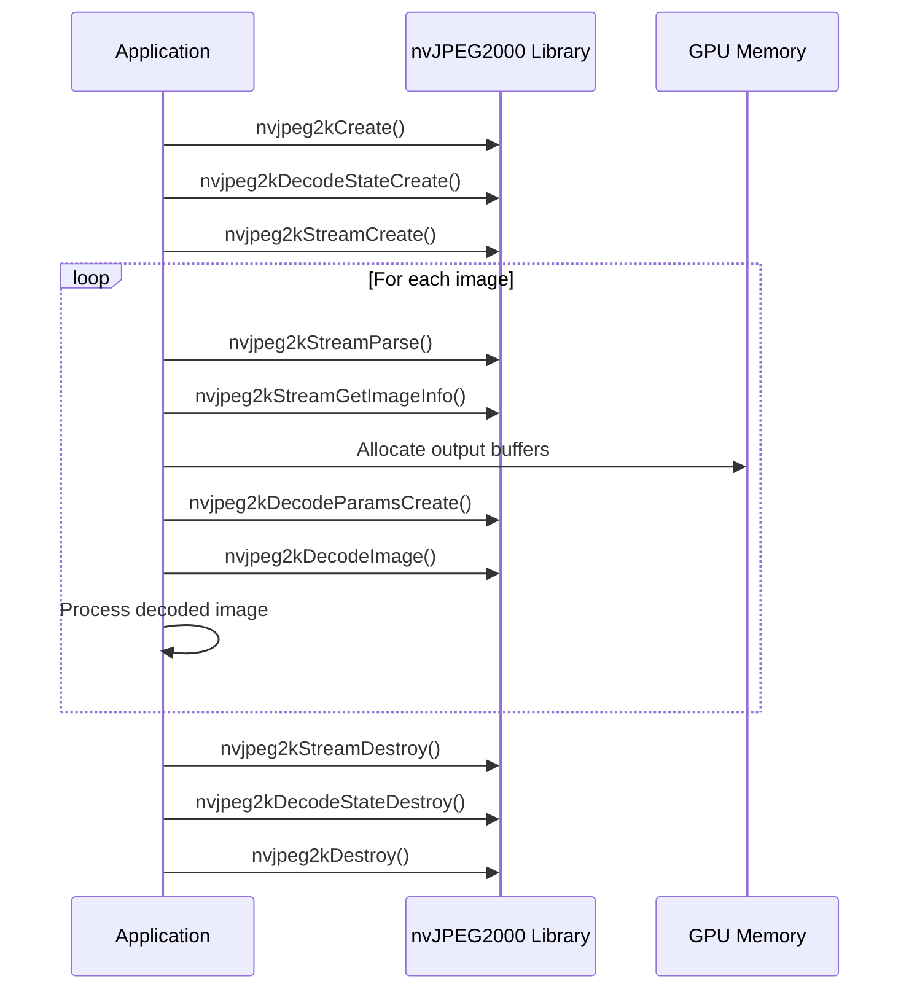
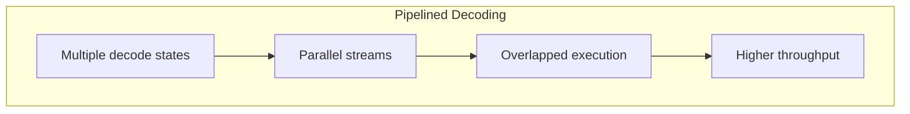
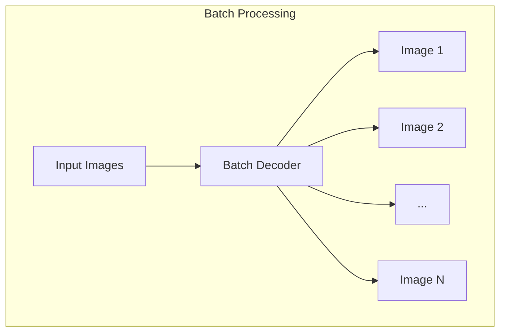
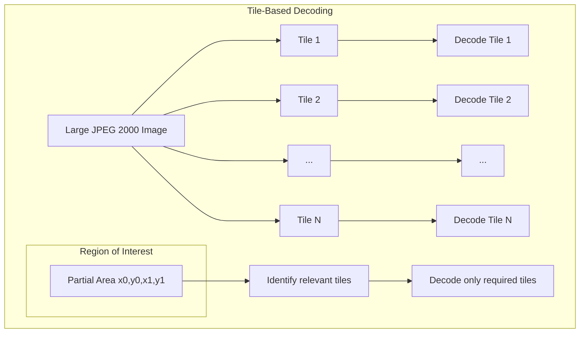
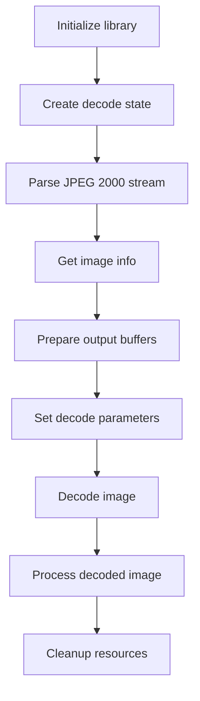

<!-- source: DeepWiki mcp.deepwiki.com · repo NVIDIA/CUDALibrarySamples · page 4.2 nvJPEG2000 - JPEG 2000 Processing · fetched 2026-10-26 -->

# nvJPEG2000 - JPEG 2000 Processing

<details>
<summary>Relevant source files</summary>

The following files were used as context for generating this wiki page:

- [nvJPEG2000/nvJPEG2000-Decoder-Pipelined/CMakeLists.txt](nvJPEG2000/nvJPEG2000-Decoder-Pipelined/CMakeLists.txt)
- [nvJPEG2000/nvJPEG2000-Decoder-Pipelined/README.md](nvJPEG2000/nvJPEG2000-Decoder-Pipelined/README.md)
- [nvJPEG2000/nvJPEG2000-Decoder-Pipelined/nvjpeg2k_dec_pipelined.cpp](nvJPEG2000/nvJPEG2000-Decoder-Pipelined/nvjpeg2k_dec_pipelined.cpp)
- [nvJPEG2000/nvJPEG2000-Decoder-Pipelined/nvjpeg2k_dec_pipelined.h](nvJPEG2000/nvJPEG2000-Decoder-Pipelined/nvjpeg2k_dec_pipelined.h)
- [nvJPEG2000/nvJPEG2000-Decoder-Tile-Partial/CMakeLists.txt](nvJPEG2000/nvJPEG2000-Decoder-Tile-Partial/CMakeLists.txt)
- [nvJPEG2000/nvJPEG2000-Decoder-Tile-Partial/README.md](nvJPEG2000/nvJPEG2000-Decoder-Tile-Partial/README.md)
- [nvJPEG2000/nvJPEG2000-Decoder-Tile-Partial/nvj2k_DecodeTilePartial.cpp](nvJPEG2000/nvJPEG2000-Decoder-Tile-Partial/nvj2k_DecodeTilePartial.cpp)
- [nvJPEG2000/nvJPEG2000-Decoder-Tile-Partial/nvj2k_DecodeTilePartial.h](nvJPEG2000/nvJPEG2000-Decoder-Tile-Partial/nvj2k_DecodeTilePartial.h)
- [nvJPEG2000/nvJPEG2000-Decoder/CMakeLists.txt](nvJPEG2000/nvJPEG2000-Decoder/CMakeLists.txt)
- [nvJPEG2000/nvJPEG2000-Decoder/README.md](nvJPEG2000/nvJPEG2000-Decoder/README.md)
- [nvJPEG2000/nvJPEG2000-Decoder/nvjpeg2000DecodeSample.cpp](nvJPEG2000/nvJPEG2000-Decoder/nvjpeg2000DecodeSample.cpp)
- [nvJPEG2000/nvJPEG2000-Decoder/nvjpeg2000DecodeSample.h](nvJPEG2000/nvJPEG2000-Decoder/nvjpeg2000DecodeSample.h)

</details>


## Introduction

nvJPEG2000 is NVIDIA's GPU-accelerated library for high-performance JPEG 2000 image processing. It provides capabilities for decoding JPEG 2000 images with various optimizations, including batch processing, pipelined decoding, and support for partial region decoding. This document covers the core capabilities, API components, and usage patterns of the nvJPEG2000 library.

For information about standard JPEG processing, see [nvJPEG - JPEG Processing](#4.3).

Sources: [nvJPEG2000/nvJPEG2000-Decoder/README.md:1-26]()

## JPEG 2000 Format Overview

JPEG 2000 is an advanced image compression standard that offers superior quality and flexibility compared to the original JPEG format. Key features include:

- Wavelet-based compression
- Progressive decoding
- Region of interest coding
- Lossless and lossy compression
- Support for high bit-depth (up to 16-bit precision)
- Multi-component images
- Tiled image organization

The tiled organization of JPEG 2000 images enables efficient processing of large images by dividing them into rectangular regions that can be independently decoded, making it well-suited for GPU acceleration.

## Library Architecture



Sources: [nvJPEG2000/nvJPEG2000-Decoder/nvjpeg2000DecodeSample.cpp:139-204](), [nvJPEG2000/nvJPEG2000-Decoder-Pipelined/nvjpeg2k_dec_pipelined.cpp:139-204]()

## Core API Components

### Key Data Structures

The nvJPEG2000 library uses several main structures for image processing:

| Structure | Description |
|-----------|-------------|
| `nvjpeg2kHandle_t` | Main library handle |
| `nvjpeg2kDecodeState_t` | State object for decoding operations |
| `nvjpeg2kStream_t` | Represents a parsed JPEG 2000 stream |
| `nvjpeg2kImage_t` | Output structure for decoded images |
| `nvjpeg2kDecodeParams_t` | Parameters controlling the decoding process |
| `nvjpeg2kImageInfo_t` | Image dimensions, components, and tile information |
| `nvjpeg2kImageComponentInfo_t` | Component-specific information (precision, sign) |

Sources: [nvJPEG2000/nvJPEG2000-Decoder/nvjpeg2000DecodeSample.h:54-54](), [nvJPEG2000/nvJPEG2000-Decoder/nvjpeg2000DecodeSample.cpp:139-204]()

### Memory Management

nvJPEG2000 provides interfaces for custom memory allocation:



Example of custom memory allocators:

```
nvjpeg2kDeviceAllocator_t dev_allocator = {&dev_malloc, &dev_free};
nvjpeg2kPinnedAllocator_t pinned_allocator = {&host_malloc, &host_free};
```

Sources: [nvJPEG2000/nvJPEG2000-Decoder/nvjpeg2000DecodeSample.h:76-84](), [nvJPEG2000/nvJPEG2000-Decoder/nvjpeg2000DecodeSample.cpp:431-467]()

## Decoding Workflows

nvJPEG2000 supports several decoding workflows optimized for different use cases:

### Basic Decoding

The standard decoding workflow processes a single image at a time:



Sources: [nvJPEG2000/nvJPEG2000-Decoder/nvjpeg2000DecodeSample.cpp:172-280]()

### Pipelined Decoding

For high-throughput applications, nvJPEG2000 offers pipelined decoding to overlap CPU and GPU operations:



The pipelined approach creates multiple decode states and uses CUDA streams to maximize GPU utilization:

```
#define PIPELINE_STAGES 10

nvjpeg2kDecodeState_t nvjpeg2k_decode_states[PIPELINE_STAGES];
cudaStream_t stream[PIPELINE_STAGES];

// Create multiple decode states
for(int p = 0; p < PIPELINE_STAGES; p++) {
    nvjpeg2kDecodeStateCreate(nvjpeg2k_handle, &nvjpeg2k_decode_states[p]);
    cudaStreamCreateWithFlags(&stream[p], cudaStreamNonBlocking);
}
```

Sources: [nvJPEG2000/nvJPEG2000-Decoder-Pipelined/nvjpeg2k_dec_pipelined.cpp:225-310](), [nvJPEG2000/nvJPEG2000-Decoder-Pipelined/nvjpeg2k_dec_pipelined.h:78-78]()

### Batch Processing

The library allows processing multiple images in a batch for increased efficiency:



Sources: [nvJPEG2000/nvJPEG2000-Decoder/nvjpeg2000DecodeSample.cpp:282-325]()

### Tile-Based and Partial Decoding

For large JPEG 2000 images, the library provides tile-based decoding and partial region (area of interest) decoding:



Tile-based decoding allows processing individual tiles separately:

```c++
nvjpeg2kDecodeTile(handle, decode_state, stream, 
                   decode_params, tile_id, 0,
                   &output_image, cuda_stream);
```

Partial decoding enables extracting only a specified region of interest:

```c++
nvjpeg2kDecodeParamsSetDecodeArea(decode_params, 
                                 win_x0, win_x1,
                                 win_y0, win_y1);
```

Sources: [nvJPEG2000/nvJPEG2000-Decoder-Tile-Partial/nvj2k_DecodeTilePartial.cpp:227-264](), [nvJPEG2000/nvJPEG2000-Decoder-Tile-Partial/nvj2k_DecodeTilePartial.cpp:329-330]()

## Image Format Support

### Pixel Types and Bit Depths

nvJPEG2000 supports various pixel types and bit depths:

| Pixel Type | Description |
|------------|-------------|
| `NVJPEG2K_UINT8` | 8-bit unsigned integer |
| `NVJPEG2K_UINT16` | 16-bit unsigned integer |
| `NVJPEG2K_INT16` | 16-bit signed integer |

The library can handle JPEG 2000 images with precision up to 16 bits, and automatically selects the appropriate output type based on the image's bit depth.

Sources: [nvJPEG2000/nvJPEG2000-Decoder/nvjpeg2000DecodeSample.cpp:172-204]()

### Color Space Handling

The library supports conversion to RGB output for images with subsampled components (420/422 formats):

```c++
// Enable RGB output
nvjpeg2kDecodeParamsSetRGBOutput(decode_params, 1);
```

Sources: [nvJPEG2000/nvJPEG2000-Decoder/nvjpeg2000DecodeSample.cpp:186-187]()

## Typical Usage Example

The following shows a typical flow for using nvJPEG2000:



### Key Function Sequences

1. **Initialization**:
   ```c++
   nvjpeg2kDeviceAllocator_t dev_allocator = {&dev_malloc, &dev_free};
   nvjpeg2kPinnedAllocator_t pinned_allocator = {&host_malloc, &host_free};
   nvjpeg2kCreate(NVJPEG2K_BACKEND_DEFAULT, &dev_allocator, &pinned_allocator, &handle);
   nvjpeg2kDecodeStateCreate(handle, &decode_state);
   nvjpeg2kStreamCreate(&stream);
   ```

2. **Parsing and Information Retrieval**:
   ```c++
   nvjpeg2kStreamParse(handle, image_data, image_length, 0, 0, stream);
   nvjpeg2kStreamGetImageInfo(stream, &image_info);
   nvjpeg2kStreamGetImageComponentInfo(stream, &component_info, component_index);
   ```

3. **Decoding**:
   ```c++
   nvjpeg2kDecodeParamsCreate(&decode_params);
   nvjpeg2kDecodeParamsSetRGBOutput(decode_params, 1);
   nvjpeg2kDecodeImage(handle, decode_state, stream, decode_params, &output_image, cuda_stream);
   ```

4. **Cleanup**:
   ```c++
   nvjpeg2kStreamDestroy(stream);
   nvjpeg2kDecodeStateDestroy(decode_state);
   nvjpeg2kDestroy(handle);
   ```

Sources: [nvJPEG2000/nvJPEG2000-Decoder/nvjpeg2000DecodeSample.cpp:431-478](), [nvJPEG2000/nvJPEG2000-Decoder-Pipelined/nvjpeg2k_dec_pipelined.cpp:465-526]()

## Performance Optimization Techniques

The nvJPEG2000 library provides several techniques to optimize decoding performance:

### Pipelined Execution

Using multiple decode states with non-blocking CUDA streams allows overlapping CPU and GPU operations for improved throughput:

```c++
// Create multiple decode states and streams
for(int p = 0; p < PIPELINE_STAGES; p++) {
    nvjpeg2kDecodeStateCreate(handle, &decode_states[p]);
    cudaStreamCreateWithFlags(&streams[p], cudaStreamNonBlocking);
}

// Use different states/streams in a round-robin fashion
int buffer_index = 0;
for(int batch_id = 0; batch_id < batch_size; batch_id++) {
    // Use decode_states[buffer_index] and streams[buffer_index]
    buffer_index = (buffer_index + 1) % PIPELINE_STAGES;
}
```

Sources: [nvJPEG2000/nvJPEG2000-Decoder-Pipelined/nvjpeg2k_dec_pipelined.cpp:256-273]()

### Batch Processing

Processing multiple images in batches reduces API overhead and improves GPU utilization:

```c++
// Prepare batch processing
std::vector<nvjpeg2kStream_t> jpeg2k_streams(batch_size);
for(auto& stream : jpeg2k_streams) {
    nvjpeg2kStreamCreate(&stream);
}
```

Sources: [nvJPEG2000/nvJPEG2000-Decoder-Pipelined/nvjpeg2k_dec_pipelined.cpp:477-482]()

### Partial Decoding

For applications that only need to work with a portion of a large image, partial decoding can significantly improve performance:

```c++
// Set decode area for partial decoding
nvjpeg2kDecodeParamsSetDecodeArea(decode_params, 
                                 win_x0, win_x1, 
                                 win_y0, win_y1);
```

Sources: [nvJPEG2000/nvJPEG2000-Decoder-Tile-Partial/nvj2k_DecodeTilePartial.cpp:329-330]()

## Sample Applications

The nvJPEG2000 library includes several sample applications that demonstrate different usage patterns:

1. **Basic Decoder** - Simple decoding of JPEG 2000 images
   - Path: `nvJPEG2000/nvJPEG2000-Decoder/`

2. **Pipelined Decoder** - Enhanced throughput with pipelined execution
   - Path: `nvJPEG2000/nvJPEG2000-Decoder-Pipelined/`

3. **Tile-Based and Partial Decoding** - Region of interest decoding for large images
   - Path: `nvJPEG2000/nvJPEG2000-Decoder-Tile-Partial/`

### Command-Line Options

All sample applications support similar command-line options:

| Option | Description |
|--------|-------------|
| `-i <path>` | Input directory or image file |
| `-b <n>` | Batch size for decoding |
| `-t <n>` | Total number of images to process |
| `-w <n>` | Number of warmup iterations |
| `-o <path>` | Output directory for decoded images |
| `-v` | Enable verbose output |
| `-rgb_output` | Enable RGB output for subsampled images |
| `-da x0,y0,x1,y1` | Specify decode area for partial decoding |

Example usage:

```
./nvjpeg2000_decode_sample -i input_dir -b 16 -t 1000 -o output_dir
./nvjpeg2k_dec_pipelined -i input_dir -b 32 -t 1000
./nvj2k_decode_tile_partial -i input_dir -da 100,100,500,500 -o output_dir
```

Sources: [nvJPEG2000/nvJPEG2000-Decoder/README.md:53-63](), [nvJPEG2000/nvJPEG2000-Decoder-Pipelined/README.md:53-63](), [nvJPEG2000/nvJPEG2000-Decoder-Tile-Partial/README.md:53-64]()

## Building Applications with nvJPEG2000

The nvJPEG2000 library is typically installed as part of the NVIDIA SDK or can be downloaded separately. To build applications using nvJPEG2000:

```cmake
# CMakeLists.txt example
cmake_minimum_required(VERSION 3.17 FATAL_ERROR)
project(my_app LANGUAGES CXX CUDA)

find_package(CUDAToolkit REQUIRED)

find_library(NVJPEG2K_LIB
    NAMES nvjpeg2k
    PATHS ${NVJPEG2K_PATH}/lib64/${CUDAToolkit_VERSION_MAJOR}
          ${NVJPEG2K_PATH}/lib/${CUDAToolkit_VERSION_MAJOR})

include_directories(
    ${NVJPEG2K_PATH}/include
    SYSTEM ${CMAKE_CUDA_TOOLKIT_INCLUDE_DIRECTORIES}
)

add_executable(my_app my_app.cpp)
target_link_libraries(my_app PUBLIC ${NVJPEG2K_LIB} CUDA::cudart)
```

Sources: [nvJPEG2000/nvJPEG2000-Decoder/CMakeLists.txt:11-54](), [nvJPEG2000/nvJPEG2000-Decoder-Pipelined/CMakeLists.txt:11-54](), [nvJPEG2000/nvJPEG2000-Decoder-Tile-Partial/CMakeLists.txt:11-54]()

## Conclusion

nvJPEG2000 is a high-performance library for JPEG 2000 image processing on NVIDIA GPUs. It provides capabilities for basic decoding, pipelined execution for high throughput, and specialized features like tile-based and partial decoding for large images. The library supports various pixel formats and bit depths, making it suitable for a wide range of applications in medical imaging, satellite imagery, digital cinema, and other domains where JPEG 2000 is commonly used.

---

