<!-- source: DeepWiki mcp.deepwiki.com · repo NVIDIA/CUDALibrarySamples · page 4.3 nvJPEG - JPEG Processing · fetched 2026-10-26 -->

# nvJPEG - JPEG Processing

<details>
<summary>Relevant source files</summary>

The following files were used as context for generating this wiki page:

- [nvJPEG/README.md](nvJPEG/README.md)
- [nvJPEG/nvJPEG-Decoder-Backend-ROI/README.md](nvJPEG/nvJPEG-Decoder-Backend-ROI/README.md)
- [nvJPEG/nvJPEG-Decoder-Backend-ROI/img9_roi.png](nvJPEG/nvJPEG-Decoder-Backend-ROI/img9_roi.png)
- [nvJPEG/nvJPEG-Decoder-Backend-ROI/nvJPEGROIDecode.cpp](nvJPEG/nvJPEG-Decoder-Backend-ROI/nvJPEGROIDecode.cpp)
- [nvJPEG/nvJPEG-Decoder-Backend-ROI/nvJPEGROIDecode.h](nvJPEG/nvJPEG-Decoder-Backend-ROI/nvJPEGROIDecode.h)
- [nvJPEG/nvJPEG-Decoder-MultipleInstances/CMakeLists.txt](nvJPEG/nvJPEG-Decoder-MultipleInstances/CMakeLists.txt)
- [nvJPEG/nvJPEG-Decoder-MultipleInstances/README.md](nvJPEG/nvJPEG-Decoder-MultipleInstances/README.md)
- [nvJPEG/nvJPEG-Decoder-MultipleInstances/nvJPEGDecMultipleInstances.cpp](nvJPEG/nvJPEG-Decoder-MultipleInstances/nvJPEGDecMultipleInstances.cpp)
- [nvJPEG/nvJPEG-Decoder-MultipleInstances/nvJPEGDecMultipleInstances.h](nvJPEG/nvJPEG-Decoder-MultipleInstances/nvJPEGDecMultipleInstances.h)
- [nvJPEG/nvJPEG-Decoder-MultipleInstances/threadpool.h](nvJPEG/nvJPEG-Decoder-MultipleInstances/threadpool.h)
- [nvJPEG/nvJPEG-Decoder/README.md](nvJPEG/nvJPEG-Decoder/README.md)
- [nvJPEG/nvJPEG-Decoder/nvjpegDecoder.cpp](nvJPEG/nvJPEG-Decoder/nvjpegDecoder.cpp)
- [nvJPEG/nvJPEG-Decoder/nvjpegDecoder.h](nvJPEG/nvJPEG-Decoder/nvjpegDecoder.h)

</details>


## Purpose and Scope

This document provides technical documentation for the nvJPEG library, focusing on GPU-accelerated JPEG image decoding capabilities. The nvJPEG library enables high-performance JPEG processing using NVIDIA GPUs, with features including multiple decoder backends, region of interest (ROI) processing, multi-instance decoding, and support for various output formats.

For information about related image formats like JPEG 2000, see [nvJPEG2000 - JPEG 2000 Processing](#4.2), and for TIFF processing, see [nvTIFF - TIFF Image Processing](#4.1).

## Library Overview

nvJPEG is a CUDA-accelerated library designed for fast JPEG image decoding. It provides different backend implementations optimized for various image sizes and processing requirements. The library can be integrated into data processing pipelines to accelerate image loading and preprocessing for deep learning, computer vision, and other applications.

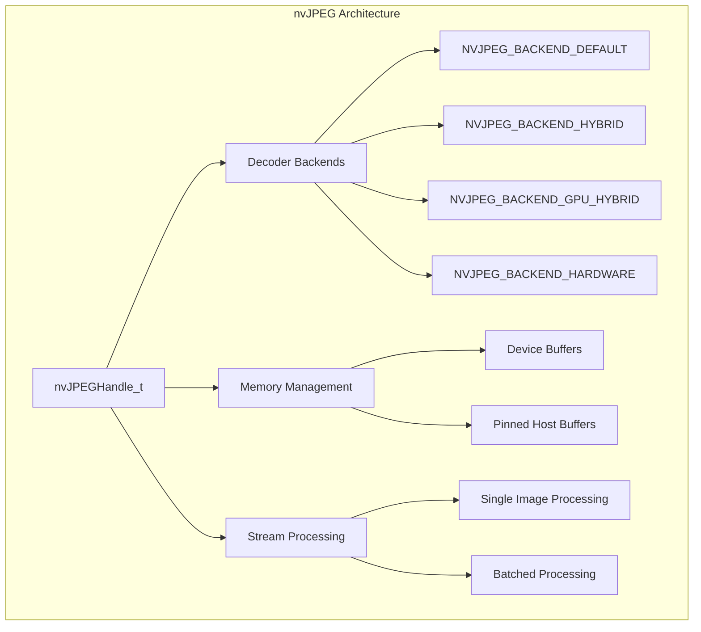

Sources: [nvJPEG/nvJPEG-Decoder/nvjpegDecoder.cpp:331-339](), [nvJPEG/nvJPEG-Decoder-Backend-ROI/nvJPEGROIDecode.cpp:126-127](), [nvJPEG/nvJPEG-Decoder-MultipleInstances/nvJPEGDecMultipleInstances.cpp:93-96]()

## Key Features

### Multiple Decoder Backends

nvJPEG provides different backend implementations optimized for various use cases:

1. **NVJPEG_BACKEND_DEFAULT**: The standard decoder backend
2. **NVJPEG_BACKEND_HYBRID**: CPU-GPU hybrid decoder, more efficient for smaller images
3. **NVJPEG_BACKEND_GPU_HYBRID**: GPU-focused hybrid decoder, better for larger images 
4. **NVJPEG_BACKEND_HARDWARE**: Hardware-accelerated decoder (supported on NVIDIA A100)

The library can automatically select the appropriate backend based on image characteristics or explicitly specified by the application.

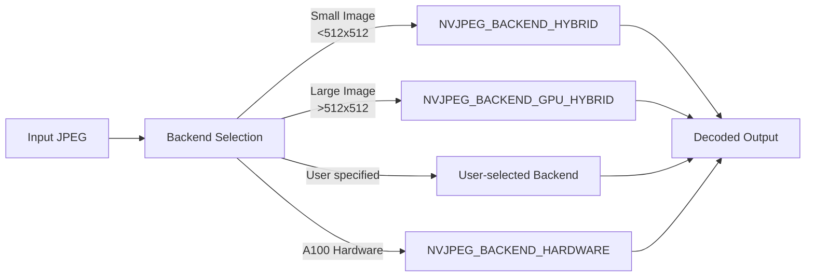

Sources: [nvJPEG/nvJPEG-Decoder-Backend-ROI/nvJPEGROIDecode.cpp:89-105](), [nvJPEG/nvJPEG-Decoder-MultipleInstances/nvJPEGDecMultipleInstances.cpp:52-69](), [nvJPEG/nvJPEG-Decoder/nvjpegDecoder.cpp:331-341]()

### Supported Output Formats

nvJPEG supports various output pixel formats:

| Format | Description |
|--------|-------------|
| `NVJPEG_OUTPUT_RGB` | Non-interleaved RGB |
| `NVJPEG_OUTPUT_BGR` | Non-interleaved BGR | 
| `NVJPEG_OUTPUT_RGBI` | Interleaved RGB |
| `NVJPEG_OUTPUT_BGRI` | Interleaved BGR |
| `NVJPEG_OUTPUT_YUV` | YUV format |
| `NVJPEG_OUTPUT_Y` | Y (grayscale) only |
| `NVJPEG_OUTPUT_UNCHANGED` | Original format |

Sources: [nvJPEG/nvJPEG-Decoder/nvjpegDecoder.cpp:292-308](), [nvJPEG/nvJPEG-Decoder-Backend-ROI/nvJPEGROIDecode.cpp:484-500](), [nvJPEG/nvJPEG-Decoder-MultipleInstances/nvJPEGDecMultipleInstances.cpp:341-357]()

### Region of Interest (ROI) Processing

nvJPEG supports decoding only a specific region of an image, which can save processing time and memory when only a portion of an image is needed.

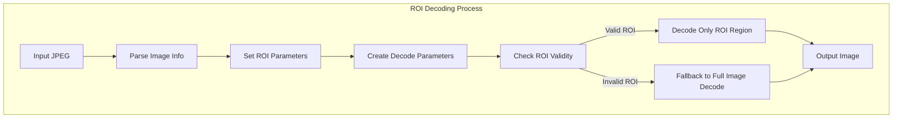

Sources: [nvJPEG/nvJPEG-Decoder-Backend-ROI/nvJPEGROIDecode.cpp:108-137](), [nvJPEG/nvJPEG-Decoder-Backend-ROI/nvJPEGROIDecode.cpp:189-248](), [nvJPEG/nvJPEG-Decoder-Backend-ROI/README.md:89-99]()

### Multi-Instance and Multi-Threaded Decoding

nvJPEG supports decoding multiple images in parallel using thread pools and multiple decoder instances for improved throughput.

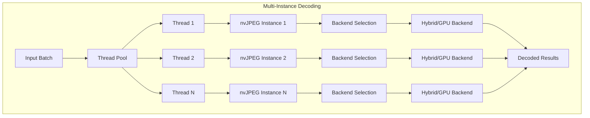

Sources: [nvJPEG/nvJPEG-Decoder-MultipleInstances/nvJPEGDecMultipleInstances.cpp:72-161](), [nvJPEG/nvJPEG-Decoder-Backend-ROI/nvJPEGROIDecode.cpp:161-286]()

## Decoding Pipeline

The nvJPEG library implements a multi-stage decoding pipeline that can be divided into host-side parsing and device-side decoding:

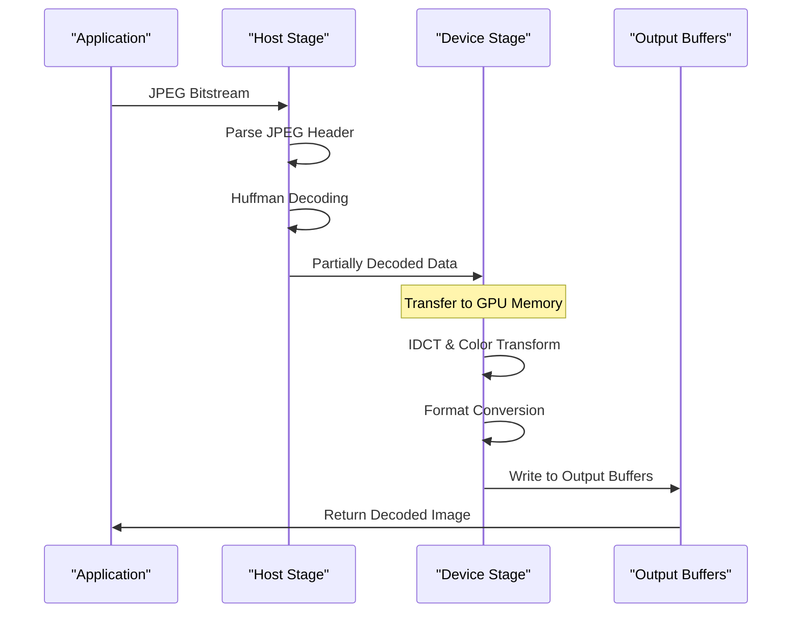

Sources: [nvJPEG/nvJPEG-Decoder/nvjpegDecoder.cpp:94-118](), [nvJPEG/nvJPEG-Decoder-Backend-ROI/nvJPEGROIDecode.cpp:193-215](), [nvJPEG/nvJPEG-Decoder-MultipleInstances/nvJPEGDecMultipleInstances.cpp:93-110]()

## Library Initialization and Cleanup

### Initialization Process

The nvJPEG library requires initialization of various handles and resources before decoding:

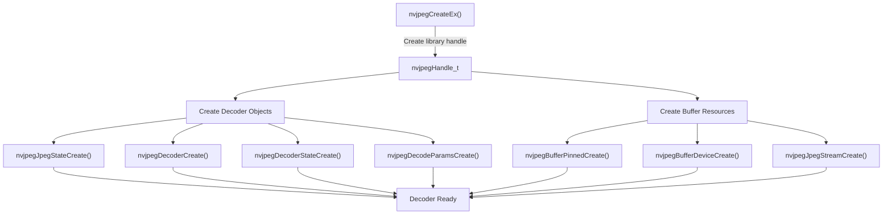

Sources: [nvJPEG/nvJPEG-Decoder/nvjpegDecoder.cpp:331-339](), [nvJPEG/nvJPEG-Decoder/nvjpegDecoder.cpp:245-257](), [nvJPEG/nvJPEG-Decoder-Backend-ROI/nvJPEGROIDecode.cpp:533-538]()

### Resource Cleanup

Proper cleanup of nvJPEG resources is required to avoid memory leaks:

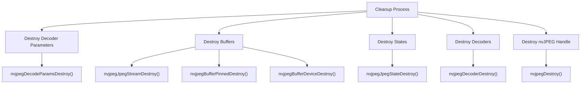

Sources: [nvJPEG/nvJPEG-Decoder/nvjpegDecoder.cpp:379-383](), [nvJPEG/nvJPEG-Decoder-Backend-ROI/nvJPEGROIDecode.cpp:569-573](), [nvJPEG/nvJPEG-Decoder-MultipleInstances/nvJPEGDecMultipleInstances.cpp:417-420]()

## Key Function Flows

### Single Image Decoding Flow

The typical flow for decoding a single JPEG image:

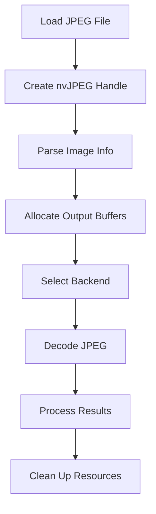

Sources: [nvJPEG/nvJPEG-Decoder/nvjpegDecoder.cpp:82-126](), [nvJPEG/nvJPEG-Decoder/nvjpegDecoder.cpp:164-178]()

### Batched Image Decoding Flow

For decoding multiple images in a batch:

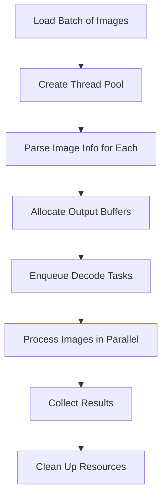

Sources: [nvJPEG/nvJPEG-Decoder-MultipleInstances/nvJPEGDecMultipleInstances.cpp:220-269](), [nvJPEG/nvJPEG-Decoder-Backend-ROI/nvJPEGROIDecode.cpp:333-394]()

## Implementation Details

### Backend Selection Logic

The library includes an automatic backend selection mechanism based on image characteristics:

```
// Code to determine whether to use GPU or CPU backend
bool pick_gpu_backend(nvjpegJpegStream_t&  jpeg_stream)
{
  unsigned int frame_width, frame_height;
  nvjpegChromaSubsampling_t chroma_subsampling;
      
  // Get image dimensions and chroma format
  nvjpegJpegStreamGetFrameDimensions(jpeg_stream, &frame_width, &frame_height);
  nvjpegJpegStreamGetChromaSubsampling(jpeg_stream, &chroma_subsampling);
  
  auto scale_factor = get_scale_factor(chroma_subsampling);

  bool use_gpu_backend = false;
  // Use NVJPEG_BACKEND_GPU_HYBRID when dimensions are greater than 512x512
  if(frame_height * frame_width * scale_factor > 512 * 512 * 3)
  {
    use_gpu_backend = true;
  }
  return use_gpu_backend;
}
```

Sources: [nvJPEG/nvJPEG-Decoder-Backend-ROI/nvJPEGROIDecode.cpp:89-106](), [nvJPEG/nvJPEG-Decoder-MultipleInstances/nvJPEGDecMultipleInstances.cpp:52-69]()

### Memory Management

nvJPEG requires careful management of both host and device memory:

1. **Host Memory**: Pinned memory buffers for efficient host-to-device transfers
2. **Device Memory**: GPU memory buffers for image processing
3. **Output Buffers**: Where decoded image data is stored

The library provides custom allocator support to integrate with application memory management.

Sources: [nvJPEG/nvJPEG-Decoder/nvjpegDecoder.cpp:71-77](), [nvJPEG/nvJPEG-Decoder-Backend-ROI/nvJPEGROIDecode.cpp:71-77](), [nvJPEG/nvJPEG-Decoder-MultipleInstances/nvJPEGDecMultipleInstances.cpp:71-77]()

### Thread Pool Implementation

For multi-threaded decoding, nvJPEG uses a thread pool implementation:

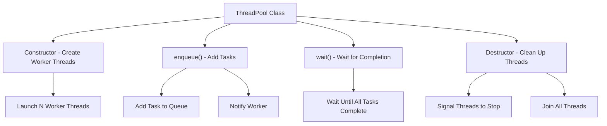

Sources: [nvJPEG/nvJPEG-Decoder-MultipleInstances/threadpool.h:13-98]()

## Performance Considerations

### Backend Selection for Different Image Sizes

Performance varies significantly based on the backend used and image characteristics:

- **NVJPEG_BACKEND_HYBRID**: Better for small images (<512×512 pixels)
- **NVJPEG_BACKEND_GPU_HYBRID**: Better for large images (>512×512 pixels)
- **NVJPEG_BACKEND_HARDWARE**: Best performance on A100 GPUs

Sources: [nvJPEG/nvJPEG-Decoder-Backend-ROI/nvJPEGROIDecode.cpp:89-106](), [nvJPEG/nvJPEG-Decoder-MultipleInstances/nvJPEGDecMultipleInstances.cpp:52-69](), [nvJPEG/nvJPEG-Decoder/nvjpegDecoder.cpp:331-341]()

### Scaling with Multiple Threads

When processing multiple images, using multiple threads with the thread pool implementation can significantly improve throughput:

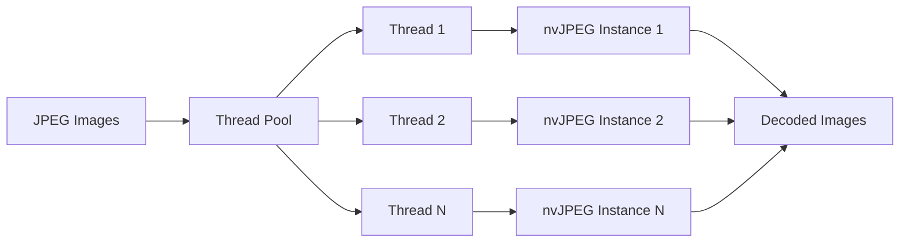

Sources: [nvJPEG/nvJPEG-Decoder-MultipleInstances/nvJPEGDecMultipleInstances.cpp:121-155](), [nvJPEG/nvJPEG-Decoder-Backend-ROI/nvJPEGROIDecode.cpp:226-277]()

## Command-Line Options

The nvJPEG sample applications support various command-line options:

| Option | Description |
|--------|-------------|
| `-i images_dir` | Path to images directory |
| `-roi x,y,width,height` | Specify region of interest parameters |
| `-backend n` | Backend selection (0=default, 1=hybrid, 2=gpu) |
| `-b batch_size` | Number of images to process in one batch |
| `-t total_images` | Total number of images to process |
| `-w warmup_iterations` | Number of warmup iterations before timing |
| `-o output_dir` | Directory to write decoded images |
| `-fmt format` | Output format (rgb, rgbi, bgr, bgri, yuv, y, unchanged) |
| `-j threads` | Number of decoding threads |

Sources: [nvJPEG/nvJPEG-Decoder-Backend-ROI/nvJPEGROIDecode.cpp:402-432](), [nvJPEG/nvJPEG-Decoder-MultipleInstances/nvJPEGDecMultipleInstances.cpp:277-302](), [nvJPEG/nvJPEG-Decoder/nvjpegDecoder.cpp:233-258]()

## Conclusion

nvJPEG provides a high-performance, GPU-accelerated solution for JPEG image decoding. With support for multiple backends, region of interest processing, and multi-threaded operation, it offers flexibility and performance for a wide range of applications, from image processing to AI data pipelines.

---

