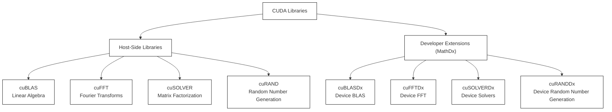
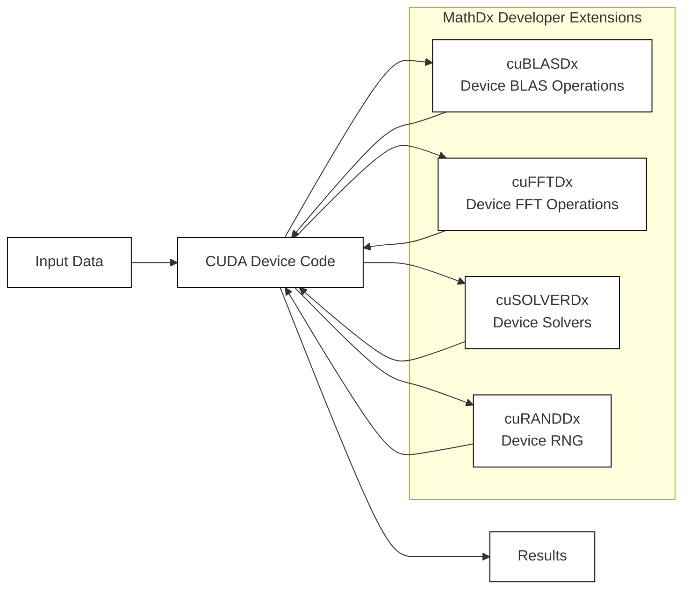
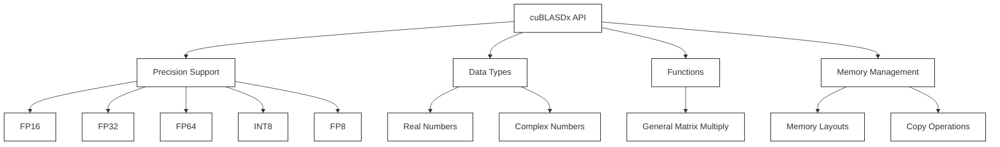
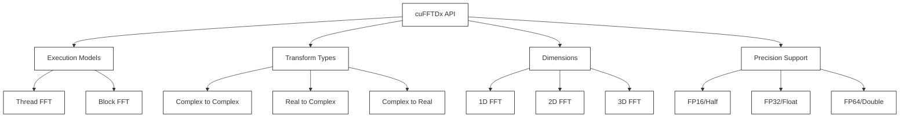
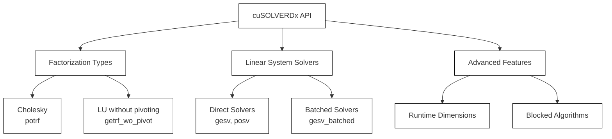
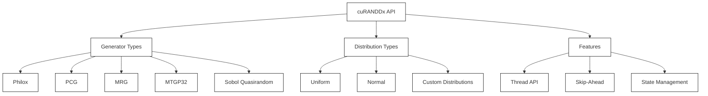
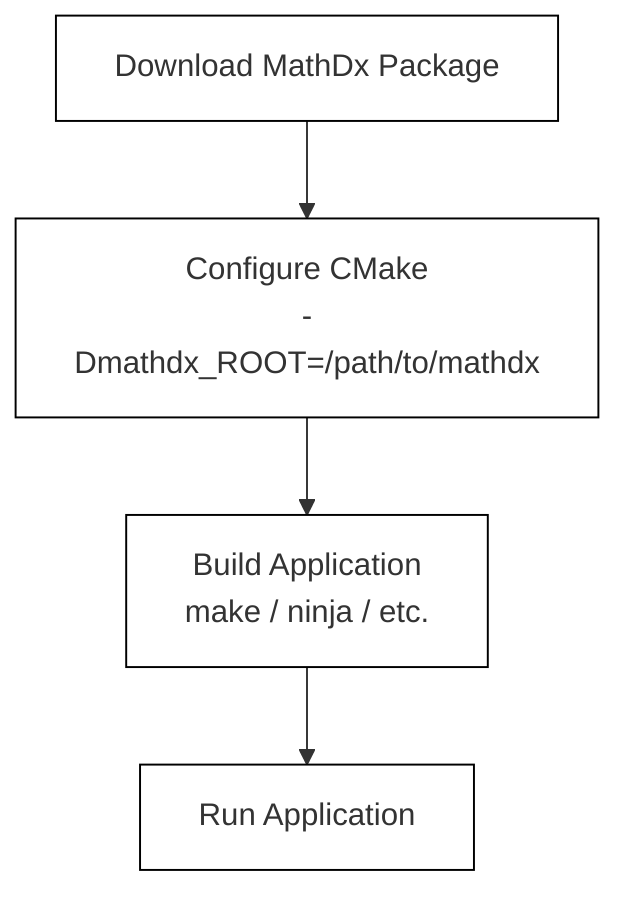

<!-- source: DeepWiki mcp.deepwiki.com · repo NVIDIA/CUDALibrarySamples · page 5 Developer Extensions · fetched 2026-10-26 -->

# Developer Extensions

Relevant source files

The following files were used as context for generating this wiki page:

- [MathDx/README.md](MathDx/README.md)
- [MathDx/cuBLASDx/CMakeLists.txt](MathDx/cuBLASDx/CMakeLists.txt)
- [MathDx/cuBLASDx/README.md](MathDx/cuBLASDx/README.md)
- [MathDx/cuBLASDx/block_io.hpp](MathDx/cuBLASDx/block_io.hpp)
- [MathDx/cuBLASDx/common.hpp](MathDx/cuBLASDx/common.hpp)
- [MathDx/cuBLASDx/common_nvrtc.hpp](MathDx/cuBLASDx/common_nvrtc.hpp)
- [MathDx/cuBLASDx/gemm_fft_performance.cu](MathDx/cuBLASDx/gemm_fft_performance.cu)
- [MathDx/cuFFTDx/CMakeLists.txt](MathDx/cuFFTDx/CMakeLists.txt)
- [MathDx/cuFFTDx/Makefile](MathDx/cuFFTDx/Makefile)
- [MathDx/cuFFTDx/README.md](MathDx/cuFFTDx/README.md)
- [MathDx/cuRANDDx/CMakeLists.txt](MathDx/cuRANDDx/CMakeLists.txt)
- [MathDx/cuSolverDx/README.md](MathDx/cuSolverDx/README.md)
- [README.md](README.md)
- [cuSOLVERSp2cuDSS/CMakeLists.txt](cuSOLVERSp2cuDSS/CMakeLists.txt)
- [cuSOLVERSp2cuDSS/README.md](cuSOLVERSp2cuDSS/README.md)
- [cuSOLVERSp2cuDSS/cuSolverRf2cuDSS.hpp](cuSOLVERSp2cuDSS/cuSolverRf2cuDSS.hpp)
- [cuSOLVERSp2cuDSS/cuSolverRf2cuDSS_double.cpp](cuSOLVERSp2cuDSS/cuSolverRf2cuDSS_double.cpp)
- [cuSOLVERSp2cuDSS/cuSolverSp2cuDSS.hpp](cuSOLVERSp2cuDSS/cuSolverSp2cuDSS.hpp)
- [cuSOLVERSp2cuDSS/cuSolverSp2cuDSS_dcomplex.cpp](cuSOLVERSp2cuDSS/cuSolverSp2cuDSS_dcomplex.cpp)
- [cuSOLVERSp2cuDSS/cuSolverSp2cuDSS_double.cpp](cuSOLVERSp2cuDSS/cuSolverSp2cuDSS_double.cpp)
- [cuSOLVERSp2cuDSS/cuSolverSp2cuDSS_float.cpp](cuSOLVERSp2cuDSS/cuSolverSp2cuDSS_float.cpp)
- [cuSOLVERSp2cuDSS/cuSolverSp2cuDSS_scomplex.cpp](cuSOLVERSp2cuDSS/cuSolverSp2cuDSS_scomplex.cpp)
- [cuSOLVERSp2cuDSS/test_complex.mtx](cuSOLVERSp2cuDSS/test_complex.mtx)
- [cuSOLVERSp2cuDSS/test_real.mtx](cuSOLVERSp2cuDSS/test_real.mtx)

Developer Extensions provide low-level, device-side interfaces to CUDA's mathematical libraries, enabling developers to perform operations directly within CUDA kernels. These extensions offer greater flexibility and optimization potential compared to their host-side counterparts, allowing for specialized computation patterns, kernel fusion, and fine-grained performance tuning.

## Overview of MathDx

MathDx is a package of Developer Extensions libraries that provide device-side implementations of common mathematical operations. Unlike traditional CUDA libraries that operate from the host, MathDx libraries enable direct invocation within device code, facilitating specialized computation patterns and kernel fusion.

Sources: [MathDx/README.md:1-9](), [README.md:30-35]()

MathDx libraries offer several key advantages:

1. **Kernel fusion** - Combine multiple operations into a single kernel, reducing memory traffic
2. **Fine-grained control** - Apply custom transformations between computation steps
3. **Specialized patterns** - Implement specialized computation patterns not available in host APIs
4. **Performance optimization** - Tune implementations for specific GPU architectures

Sources: [MathDx/README.md:1-9]()

## cuBLASDx - BLAS Extensions

cuBLASDx provides device-side implementations of Basic Linear Algebra Subprograms (BLAS) operations, with particular focus on General Matrix Multiply (GEMM) operations. It allows for direct execution of BLAS operations within CUDA kernels.

### Key Features

- Matrix multiplication operations (GEMM) directly within device code
- Support for multiple precisions (FP16, FP32, FP64, INT8, FP8)
- Complex number support
- Integration with NVIDIA Tensor Cores for accelerated performance
- Customizable memory layouts and access patterns
- Support for runtime compilation with NVRTC

Sources: [MathDx/cuBLASDx/README.md:32-62]()

### Example Use Cases

The cuBLASDx library enables several advanced use cases:

1. **Fused operations**: Perform multiple GEMM operations in a single kernel for improved performance
2. **Custom transformations**: Apply custom transformations to matrices between computation steps
3. **Mixed precision**: Utilize different precision levels for computation and storage
4. **Integration with other device libraries**: Combine with cuFFTDx for fused linear algebra and FFT operations

Table of cuBLASDx Example Categories:

| Category | Examples | Description |
|----------|----------|-------------|
| Introduction | introduction_example | API overview and basic concepts |
| Simple GEMM | simple_gemm_fp32, simple_gemm_cfp16, simple_gemm_fp8 | Basic matrix multiplication with different data types |
| Advanced | fused_gemm, gemm_fft, batched_gemm_fp64 | Multiple operations in a single kernel |
| Deep Learning | scaled_dot_prod_attn, scaled_dot_prod_attn_batched | Attention mechanism implementations |
| Performance | single_gemm_performance, fused_gemm_performance | Benchmarking and performance analysis |

Sources: [MathDx/cuBLASDx/README.md:32-62](), [MathDx/cuBLASDx/CMakeLists.txt:297-342]()

## cuFFTDx - FFT Extensions

cuFFTDx provides device-side Fast Fourier Transform (FFT) operations that can be executed directly within CUDA kernels. This enables developers to perform FFTs as part of larger computation pipelines without additional memory transfers.

### Key Features

- Thread and block-level FFT execution
- Complex-to-complex, real-to-complex, and complex-to-real transforms
- Support for multiple precisions (FP16, FP32, FP64)
- Customizable memory layouts and access patterns
- Integration with NVRTC for runtime compilation
- Support for 1D, 2D, and 3D transforms

Sources: [MathDx/cuFFTDx/README.md:39-194]()

### Example Use Cases

cuFFTDx enables several advanced FFT-related use cases:

1. **Convolution operations**: Implement FFT-based convolutions with pre/post-processing in a single kernel
2. **Signal processing pipelines**: Create fused signal processing pipelines with multiple FFT operations
3. **Mixed precision computing**: Use different precision for storage and computation
4. **Integration with other libraries**: Combine with cuBLASDx for complex computational workflows

Table of cuFFTDx Example Categories:

| Category | Examples | Description |
|----------|----------|-------------|
| Introduction | introduction_example | API overview and basic concepts |
| Simple FFT | simple_fft_thread, simple_fft_block | Basic thread and block FFT operations |
| Convolution | convolution, convolution_padded | FFT-based convolution implementations |
| 2D/3D FFT | fft_2d, fft_3d | Multi-dimensional FFT examples |
| Mixed Precision | mixed_precision_fft_1d, mixed_precision_fft_2d | Different precision for storage and computation |

Sources: [MathDx/cuFFTDx/README.md:39-194](), [MathDx/cuFFTDx/CMakeLists.txt:120-346]()

## cuSOLVERDx - Solver Extensions

cuSOLVERDx provides device-side linear system solvers and matrix factorization operations. This enables direct computation of matrix factorizations and solving linear systems within CUDA kernels.

### Key Features

- Cholesky factorization directly within device code
- LU factorization without pivoting
- Batched linear system solving
- Support for runtime leading dimensions
- NVRTC integration for runtime compilation

Sources: [MathDx/cuSolverDx/README.md:35-43]()

### Example Use Cases

cuSOLVERDx enables several advanced solver-related use cases:

1. **In-kernel matrix factorization**: Perform Cholesky or LU factorization as part of a larger computation
2. **Batched linear system solving**: Solve multiple small linear systems efficiently
3. **Large matrix handling**: Process matrices too large to fit in shared memory using blocked algorithms

Table of cuSOLVERDx Example Categories:

| Category | Examples | Description |
|----------|----------|-------------|
| Introduction | posv_batched | API overview and basic concepts |
| Cholesky | simple_potrf, potrf_runtime_ld | Cholesky factorization examples |
| LU | getrf_wo_pivot, gesv_batched_wo_pivot | LU factorization and linear system solving |
| Advanced | blocked_potrf | Algorithms for large matrices |

Sources: [MathDx/cuSolverDx/README.md:100-110]()

## cuRANDDx - Random Generator Extensions

cuRANDDx provides device-side random number generation capabilities that can be executed directly within CUDA kernels. This enables generating random numbers as part of larger computation pipelines without additional memory transfers.

### Key Features

- Thread-level random number generation
- Multiple generator algorithms (Philox, PCG, MRG, MTGP32, Sobol)
- Support for different distributions
- Seed management and sequence control
- NVRTC integration for runtime compilation

Sources: [MathDx/README.md:112-126](), [MathDx/cuRANDDx/CMakeLists.txt:235-246]()

### Example Use Cases

cuRANDDx enables several advanced random number generation use cases:

1. **In-kernel randomization**: Generate random numbers directly within computation kernels
2. **Multiple distribution handling**: Work with different probability distributions in the same kernel
3. **Quasirandom sequence generation**: Use Sobol sequences for quasi-Monte Carlo methods
4. **Reproducible random streams**: Create reproducible random sequences with controlled seeds

Table of cuRANDDx Example Categories:

| Category | Examples | Description |
|----------|----------|-------------|
| Introduction | philox_thread_api | API overview with Philox generator |
| Generator Types | simple_pcg_thread_api | PCG generator example |
| Advanced Usage | mrg_two_distributions_thread_api | Multiple distributions example |
| Quasirandom | sobol_thread_api | Sobol quasirandom generator |
| State Management | xorwow_init_and_generate_thread_api | Separate initialization example |

Sources: [MathDx/README.md:119-126](), [MathDx/cuRANDDx/CMakeLists.txt:241-246]()

## Integration and Fusion Examples

One of the most powerful aspects of Developer Extensions is the ability to fuse operations from different domains into a single kernel, reducing memory transfers and improving performance.

### cuBLASDx + cuFFTDx Fusion

A prime example of kernel fusion is combining matrix operations with FFT operations in a single kernel, as demonstrated in the gemm_fft examples:

Sources: [MathDx/cuBLASDx/gemm_fft_performance.cu:244-251]()

The fusion workflow typically involves:

1. Loading input data into shared memory
2. Performing the first operation (e.g., GEMM using cuBLASDx)
3. Synchronizing threads to ensure completion
4. Performing the second operation (e.g., FFT using cuFFTDx)
5. Storing results back to global memory

This pattern eliminates the need for intermediate storage in global memory, significantly reducing memory bandwidth requirements and improving performance.

## Transitioning from Host to Device Extensions

When migrating from host-side CUDA libraries to Developer Extensions, several changes in approach are necessary:

### Architectural Differences

| Aspect | Host-side Libraries | Developer Extensions |
|--------|---------------------|---------------------|
| Execution Context | Host code calls library functions | Device code calls inline functions |
| Memory Management | Library manages device memory | Developer manages device memory |
| API Style | Function-based API | Template expression-based API |
| Customization | Configuration through function parameters | Configuration through template parameters |
| Synchronization | Implicit synchronization | Explicit synchronization required |

### Migration Example: cuSOLVERSp to cuDSS

For users transitioning from deprecated libraries like cuSOLVERSp/Rf to newer alternatives like cuDSS, transition examples are provided:

```mermaid
flowchart TD
    subgraph "cuSOLVERSp/Rf Workflow"
        CS1["1. Initialize\ncusolverSpCreate\ncusolverSpCreateCsr{chol,lu}Info"]
        CS2["2. Configure Matrix\ncusparseSetMatType\ncusparseSetMatIndexBase"]
        CS3["3. Analyze\ncusolverSpXcsr{chol,lu}Analysis"]
        CS4["4. Factorize\ncusolverSpXcsr{chol,lu}Factor"]
        CS5["5. Solve\ncusolverSpXcsr{chol,lu}Solve"]
        CS6["6. Cleanup\ncusolverSpDestroy"]
        
        CS1 --> CS2 --> CS3 --> CS4 --> CS5 --> CS6
    end
    
    subgraph "cuDSS Workflow"
        CD1["1. Initialize\ncudssCreate\ncudssConfigCreate\ncudssDataCreate"]
        CD2["2. Configure Matrix\ncudssMatrixCreateCsr\ncudssMatrixCreateDn"]
        CD3["3. Analyze\ncudssExecute(CUDSS_PHASE_ANALYSIS)"]
        CD4["4. Factorize\ncudssExecute(CUDSS_PHASE_FACTORIZATION)"]
        CD5["5. Solve\ncudssExecute(CUDSS_PHASE_SOLVE)"]
        CD6["6. Cleanup\ncudssMatrixDestroy\ncudssDataDestroy"]
        
        CD1 --> CD2 --> CD3 --> CD4 --> CD5 --> CD6
    end
    
    classDef default fill:#fff,stroke:#000,stroke-width:1px;
```

Sources: [cuSOLVERSp2cuDSS/README.md:25-61](), [cuSOLVERSp2cuDSS/cuSolverSp2cuDSS.hpp:118-345]()

## Performance Considerations

Developer Extensions offer performance advantages in specific scenarios:

1. **Memory-bound applications**: Reduce memory transfers through kernel fusion
2. **Custom computation patterns**: Implement specialized algorithms not available in host APIs
3. **Fine-grained control**: Apply custom transformations between computation steps

However, they also require more developer effort and expertise compared to host-side libraries. For standard computational patterns with large matrices, host-side libraries may provide better performance through highly optimized implementations.

## Build and Deployment

Each MathDx component can be obtained from the NVIDIA Developer website:

- [cuBLASDx download page](https://developer.nvidia.com/cublasdx-downloads)
- [cuFFTDx download page](https://developer.nvidia.com/cufftdx-downloads)
- [cuSOLVERDx download page](https://developer.nvidia.com/cusolverdx-downloads)
- [cuRANDDx download page](https://developer.nvidia.com/curanddx-downloads)

The examples provided in the CUDA Library Samples repository demonstrate how to integrate these libraries into your projects using CMake:

Sources: [MathDx/cuFFTDx/README.md:14-33](), [MathDx/cuBLASDx/README.md:12-31](), [MathDx/cuSolverDx/README.md:11-29]()

## Platform Support and Requirements

Developer Extensions require:
- CUDA Toolkit 11.0 or newer
- NVIDIA GPU with Volta (SM70) architecture or newer
- C++17 compatible compiler

Specific extensions may have additional requirements, detailed in their respective documentation.

Sources: [MathDx/cuFFTDx/README.md:14-21](), [MathDx/cuBLASDx/README.md:12-19](), [MathDx/cuSolverDx/README.md:11-16]()

---

