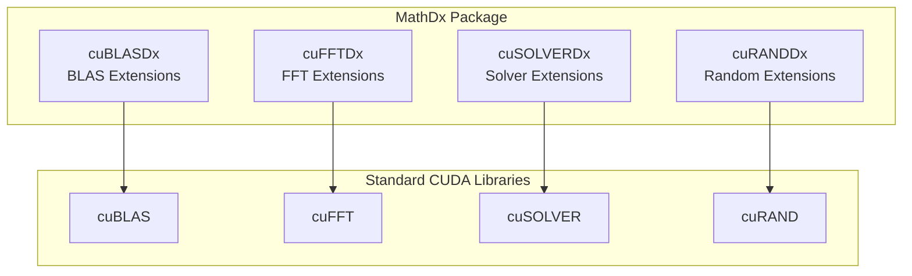
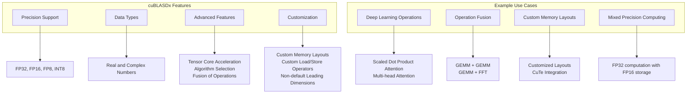
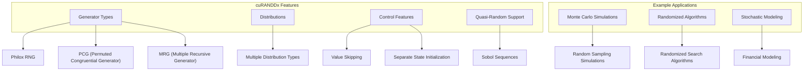
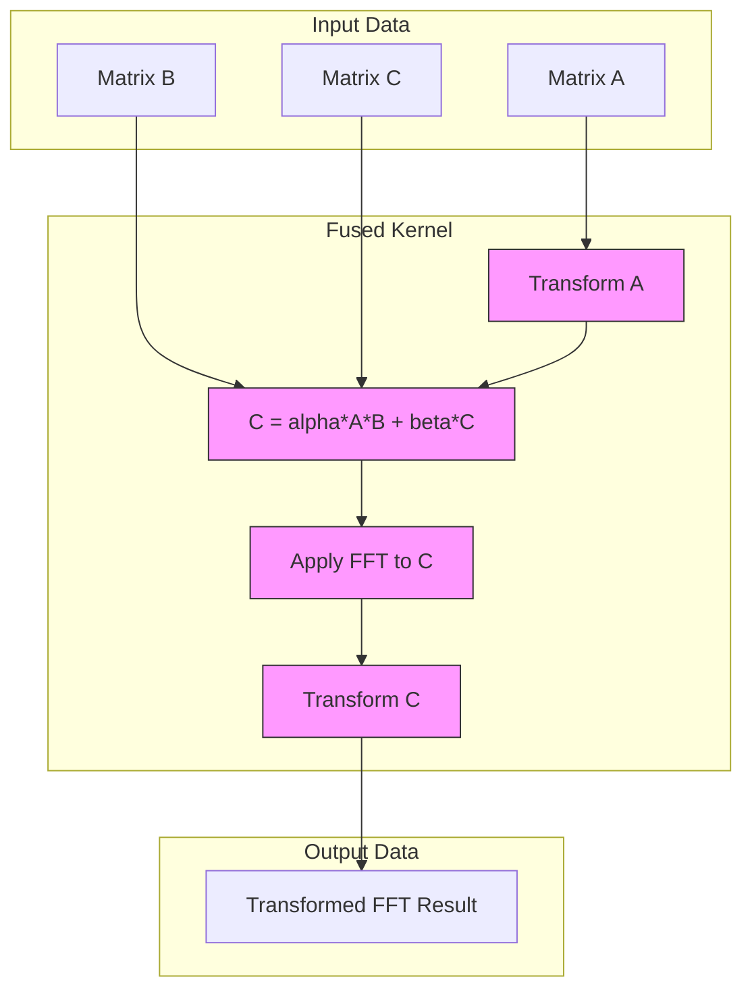

<!-- source: DeepWiki mcp.deepwiki.com · repo NVIDIA/CUDALibrarySamples · page 5.1 MathDx - Mathematical Extensions · fetched 2026-10-26 -->

# MathDx - Mathematical Extensions

<details>
<summary>Relevant source files</summary>

The following files were used as context for generating this wiki page:

- [MathDx/README.md](MathDx/README.md)
- [MathDx/cuBLASDx/CMakeLists.txt](MathDx/cuBLASDx/CMakeLists.txt)
- [MathDx/cuBLASDx/README.md](MathDx/cuBLASDx/README.md)
- [MathDx/cuBLASDx/block_io.hpp](MathDx/cuBLASDx/block_io.hpp)
- [MathDx/cuBLASDx/common.hpp](MathDx/cuBLASDx/common.hpp)
- [MathDx/cuBLASDx/common_nvrtc.hpp](MathDx/cuBLASDx/common_nvrtc.hpp)
- [MathDx/cuBLASDx/gemm_fft_performance.cu](MathDx/cuBLASDx/gemm_fft_performance.cu)
- [MathDx/cuFFTDx/CMakeLists.txt](MathDx/cuFFTDx/CMakeLists.txt)
- [MathDx/cuFFTDx/Makefile](MathDx/cuFFTDx/Makefile)
- [MathDx/cuFFTDx/README.md](MathDx/cuFFTDx/README.md)
- [MathDx/cuRANDDx/CMakeLists.txt](MathDx/cuRANDDx/CMakeLists.txt)
- [MathDx/cuSolverDx/README.md](MathDx/cuSolverDx/README.md)

</details>


## Purpose and Scope

MathDx is a collection of developer extension libraries that provide low-level, fine-grained access to CUDA mathematical operations. These extensions enable developers to have greater control over mathematical computations, optimize performance, and create custom GPU-accelerated algorithms. Unlike the standard CUDA libraries, MathDx components offer template-based, header-only APIs that allow for compile-time optimizations and seamless integration with other CUDA components.

This document covers the MathDx package, its components, key features, and use cases. For information about specific CUDA libraries like cuBLASLt or cuFFTMp, see their respective pages in [Linear Algebra Libraries](#2) and [Signal Processing Libraries](#3).

Sources: [MathDx/README.md:1-4]()

## MathDx Components Overview

MathDx consists of four primary components, each extending a corresponding standard CUDA library:



Sources: [MathDx/README.md:3-14]()

## Getting Started

All MathDx components share similar requirements and build processes:

### Requirements
- NVIDIA GPU of Volta (SM70) or newer architecture
- CUDA Toolkit
- Linux system with installed NVIDIA drivers
- CMake 3.18 or newer (for building examples)

### Building Examples
To build examples for any MathDx component, use the following process:

```bash
mkdir build && cd build
cmake -DCUDA_ARCHITECTURES=70-real -Dmathdx_ROOT=/path/to/mathdx ..
make
ctest  # Run the examples
```

Sources: [MathDx/cuFFTDx/README.md:14-21](), [MathDx/cuBLASDx/README.md:13-18]()

## cuBLASDx - BLAS Extensions

cuBLASDx extends the standard cuBLAS library by providing template-based, customizable matrix operations with a focus on General Matrix Multiply (GEMM) operations. It enables developers to fine-tune performance by controlling memory access patterns, precision, and operation fusion.

### Key Features and Use Cases



Sources: [MathDx/README.md:5-37](), [MathDx/cuBLASDx/README.md:37-62]()

### Example Categories

cuBLASDx includes examples in several categories:

1. **Introduction Examples**: API introduction
2. **Simple GEMM Examples**:
   - Basic operations with various precision types (FP32, INT8, FP16, FP8)
   - Custom layouts and leading dimensions
   - Mixed precision operations
   - Complex number support
3. **NVRTC Examples**: Runtime compilation of GEMM kernels
4. **Performance Examples**: Benchmarking for single and fused operations
5. **Advanced Examples**:
   - Operation fusion (multiple GEMMs, GEMM+FFT)
   - Deep learning applications (attention mechanisms)
   - Batched operations and custom block dimensions

Sources: [MathDx/cuBLASDx/README.md:37-62]()

## cuFFTDx - FFT Extensions

cuFFTDx extends cuFFT to provide granular control over FFT operations, enabling thread-level and block-level transforms with customizable execution parameters.

### Key Features and Use Cases



```mermaid
graph TD
    subgraph "cuFFTDx Features"
        EM["Execution Models"]
        TT["Transform Types"]
        D["Dimensionality"]
        P["Precision"]
    end
    
    subgraph "Example Applications"
        Conv["Convolution Operations"]
        MP["Mixed Precision"]
        SP["Signal Processing"]
        IP["Image Processing"]
    end
    
    EM --> ThreadFFT["Thread FFT\n(each thread performs an FFT)"]
    EM --> BlockFFT["Block FFT\n(threads cooperate on FFT)"]
    
    TT --> C2C["Complex-to-Complex (C2C)"]
    TT --> R2C["Real-to-Complex (R2C)"]
    TT --> C2R["Complex-to-Real (C2R)"]
    
    D --> D1["1D FFT"]
    D --> D2["2D FFT"]
    D --> D3["3D FFT"]
    
    P --> P_FP32["FP32"]
    P --> P_FP16["FP16/Half Precision"]
    
    Conv --> Conv1D["1D Convolution"]
    Conv --> Conv2D["2D Convolution"]
    Conv --> Conv3D["3D Convolution with padding"]
    
    MP --> MP_Examples["Storage/Compute Precision Separation"]
    SP --> SP_Examples["Fourier Analysis"]
    IP --> IP_Examples["Image Filtering"]
```

Sources: [MathDx/README.md:39-91](), [MathDx/cuFFTDx/README.md:39-193]()

### Example Categories

cuFFTDx includes examples in several categories:

1. **Introduction Examples**: API introduction
2. **Simple FFT Examples**:
   - Thread and block-level FFTs
   - Different precision types (FP32, FP16)
   - Various transform types (C2C, R2C, C2R)
3. **Performance Examples**: Benchmarking for different FFT configurations
4. **NVRTC Examples**: Runtime compilation of FFT kernels
5. **Multi-dimensional FFT Examples**: 2D and 3D FFTs
6. **Application Examples**:
   - FFT-based convolutions in 1D, 2D, and 3D
   - Mixed precision operations

Sources: [MathDx/cuFFTDx/README.md:51-194]()

## cuSOLVERDx - Solver Extensions

cuSOLVERDx extends cuSOLVER by providing low-level access to linear system solvers and matrix factorization routines, enabling fine-grained control over solver execution.

### Key Features and Use Cases



```mermaid
graph TD
    subgraph "cuSOLVERDx Features"
        F["Factorization Methods"]
        S["Solver Types"]
        B["Batched Operations"]
        C["Custom Features"]
    end
    
    subgraph "Example Applications"
        LSS["Linear System Solving"]
        MF["Matrix Factorization"]
        BA["Blocked Algorithms"]
        Rt["Runtime Parameters"]
    end
    
    F --> Cholesky["Cholesky (POTRF)"]
    F --> LU["LU without pivoting (GETRF)"]
    
    S --> POSV["Positive Definite Solvers (POSV)"]
    S --> GESV["General Linear System Solvers (GESV)"]
    
    B --> BatchedPOSV["Batched POSV"]
    B --> BatchedGESV["Batched GESV without pivoting"]
    
    C --> RuntimeLD["Runtime Leading Dimensions"]
    C --> BlockedAlgo["Blocked Algorithms for Large Matrices"]
    
    LSS --> MultiRHS["Multiple Right-Hand Sides"]
    MF --> FactExamples["Cholesky and LU Examples"]
    BA --> LargeMatrix["Matrices too large for shared memory"]
    Rt --> RuntimeExamples["Dynamic parameter adjustment"]
```

Sources: [MathDx/README.md:94-110](), [MathDx/cuSolverDx/README.md:35-43]()

### Example Categories

cuSOLVERDx includes examples in several categories:

1. **Introduction Examples**: API introduction
2. **Cholesky Examples**:
   - Basic Cholesky factorization
   - Runtime leading dimensions
3. **LU Examples**:
   - LU factorization without pivoting
   - Batched linear systems
4. **NVRTC Examples**: Runtime compilation with nvJitLink
5. **Advanced Examples**:
   - Blocked algorithms for large matrices

Sources: [MathDx/cuSolverDx/README.md:35-43]()

## cuRANDDx - Random Number Generation Extensions

cuRANDDx extends cuRAND by providing more control over random number generation, supporting various generators and distributions with customizable execution.

### Key Features and Use Cases



Sources: [MathDx/README.md:112-126]()

### Example Categories

cuRANDDx includes examples in several categories:

1. **Introduction Examples**: API introduction with Philox RNG
2. **Generator Examples**:
   - PCG generator for 32-bit random values
3. **Control Examples**:
   - Separate initialization kernels
   - Skipping values in sequences
4. **Quasi-random Examples**:
   - Sobol generator usage
5. **NVRTC Examples**: Runtime compilation

Sources: [MathDx/README.md:119-126]()

## Integration and Fusion Capabilities

One of MathDx's key strengths is the ability to fuse multiple operations into a single kernel, reducing memory traffic and improving performance. This is exemplified by the GEMM+FFT fusion examples.

### GEMM+FFT Fusion Example

The following diagram illustrates the data flow in a fused GEMM+FFT operation, as demonstrated in the `gemm_fft_performance.cu` example:



Sources: [MathDx/cuBLASDx/gemm_fft_performance.cu:244-255]()

This fusion approach provides several benefits:
1. Reduced memory traffic between GPU and memory
2. Better utilization of shared memory
3. Improved overall performance compared to separate kernel execution

The `gemm_fft_performance.cu` example also includes benchmarking to compare the performance of the fused operation against separate cuBLAS and cuFFT calls.

Sources: [MathDx/cuBLASDx/gemm_fft_performance.cu:34-114](), [MathDx/cuBLASDx/gemm_fft_performance.cu:123-218]()

## Template-Based API Structure

MathDx libraries utilize a template-based API approach, allowing compile-time configuration and optimization. This code structure enables the compiler to generate highly optimized code for specific use cases.

### cuBLASDx API Pattern

```cpp
// Example GEMM configuration
using GEMM = decltype(
    cublasdx::Size<M, N, K>() +               // Matrix dimensions
    cublasdx::Precision<float>() +            // Data precision
    cublasdx::Type<cublasdx::type::complex>() + // Data type
    cublasdx::Function<cublasdx::function::MM>() + // BLAS function
    cublasdx::TransposeMode<...>() +          // Transpose options
    cublasdx::Block() +                       // Block-level execution
    cublasdx::SM<Arch>()                      // Target architecture
);
```

### cuFFTDx API Pattern

```cpp
// Example FFT configuration
using FFT = decltype(
    cufftdx::Size<FFT_SIZE>() +               // FFT size
    cufftdx::Type<cufftdx::fft_type::c2c>() + // Transform type
    cufftdx::Direction<cufftdx::fft_direction::forward>() + // Direction
    cufftdx::Precision<float>() +             // Data precision
    cufftdx::ElementsPerThread<EPT>() +       // Elements per thread
    cufftdx::FFTsPerBlock<1>() +              // FFTs per block
    cufftdx::SM<Arch>()                       // Target architecture
);
```

This template-based approach allows for:
1. Compile-time optimization
2. Type safety
3. Clear expression of computational intent
4. Hardware-specific tuning

Sources: [MathDx/cuBLASDx/gemm_fft_performance.cu:277-286](), [MathDx/cuBLASDx/gemm_fft_performance.cu:273-276]()

## Documentation and Resources

Each MathDx component has dedicated documentation and example resources:

| Component | Documentation | Download Page |
|-----------|---------------|--------------|
| cuBLASDx | [cuBLASDx API documentation](https://docs.nvidia.com/cuda/cublasdx/index.html) | [cuBLASDx download page](https://developer.nvidia.com/cublasdx-downloads) |
| cuFFTDx | [cuFFTDx API documentation](https://docs.nvidia.com/cuda/cufftdx/index.html) | [cuFFTDx download page](https://developer.nvidia.com/cufftdx-downloads) |
| cuSOLVERDx | [cuSOLVERDx API documentation](https://docs.nvidia.com/cuda/cusolverdx/index.html) | [cuSOLVERDx download page](https://developer.nvidia.com/cusolverdx-downloads) |
| cuRANDDx | [cuRANDDx API documentation](https://docs.nvidia.com/cuda/curanddx/index.html) | [cuRANDDx download page](https://developer.nvidia.com/curanddx-downloads) |

The MathDx package itself is available at: [MathDx package](https://developer.nvidia.com/mathdx)

Sources: [MathDx/README.md:5-14](), [MathDx/cuFFTDx/README.md:11-12](), [MathDx/cuBLASDx/README.md:9-10](), [MathDx/cuSolverDx/README.md:9]()

## Summary

MathDx provides developer-focused extensions to standard CUDA libraries, enabling fine-grained control, operation fusion, and performance optimization through its template-based API. The four components (cuBLASDx, cuFFTDx, cuSOLVERDx, cuRANDDx) offer specialized capabilities for matrix operations, Fourier transforms, linear solvers, and random number generation respectively.

By using MathDx, developers can create highly optimized GPU kernels tailored to specific computational needs, with the ability to fuse operations and customize execution parameters at compile time.

---

