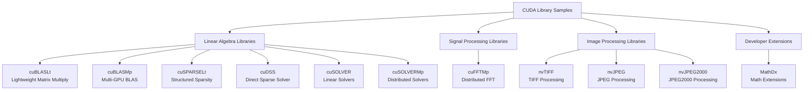
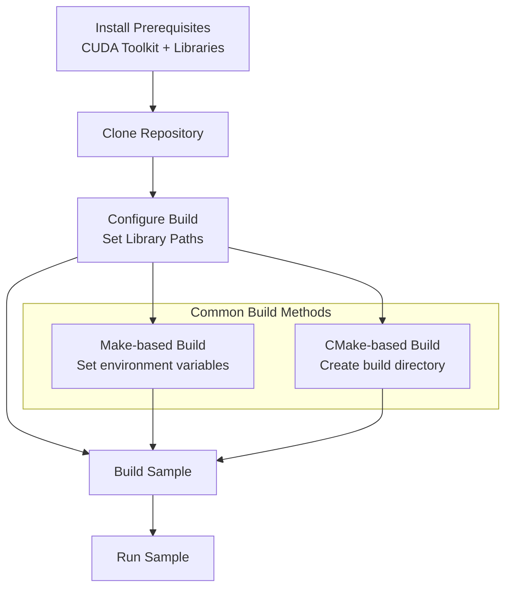
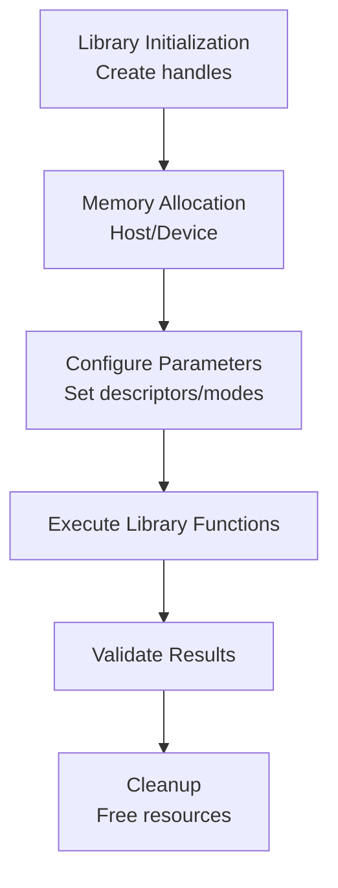
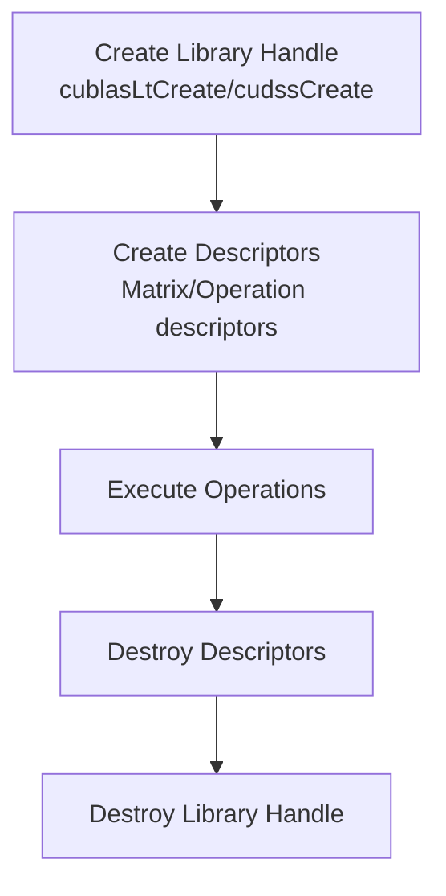
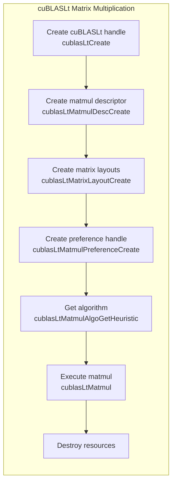
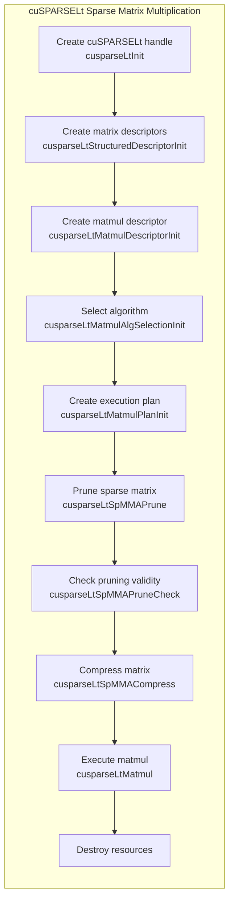

<!-- source: DeepWiki mcp.deepwiki.com · repo NVIDIA/CUDALibrarySamples · page 6 Getting Started · fetched 2026-10-26 -->

# Getting Started

<details>
<summary>Relevant source files</summary>

The following files were used as context for generating this wiki page:

- [README.md](README.md)
- [cuBLASLt/Common/helpers.h](cuBLASLt/Common/helpers.h)
- [cuBLASLt/LtFp8Matmul/main.cpp](cuBLASLt/LtFp8Matmul/main.cpp)
- [cuBLASLt/LtFp8Matmul/sample_cublasLt_LtFp8Matmul.cu](cuBLASLt/LtFp8Matmul/sample_cublasLt_LtFp8Matmul.cu)
- [cuBLASLt/LtFp8Matmul/sample_cublasLt_LtFp8Matmul.h](cuBLASLt/LtFp8Matmul/sample_cublasLt_LtFp8Matmul.h)
- [cuBLASLt/LtMxfp8Matmul/main.cpp](cuBLASLt/LtMxfp8Matmul/main.cpp)
- [cuBLASLt/LtMxfp8Matmul/sample_cublasLt_LtMxfp8Matmul.cu](cuBLASLt/LtMxfp8Matmul/sample_cublasLt_LtMxfp8Matmul.cu)
- [cuBLASLt/LtMxfp8Matmul/sample_cublasLt_LtMxfp8Matmul.h](cuBLASLt/LtMxfp8Matmul/sample_cublasLt_LtMxfp8Matmul.h)
- [cuBLASLt/LtNvfp4Matmul/main.cpp](cuBLASLt/LtNvfp4Matmul/main.cpp)
- [cuBLASLt/LtNvfp4Matmul/sample_cublasLt_LtNvfp4Matmul.cu](cuBLASLt/LtNvfp4Matmul/sample_cublasLt_LtNvfp4Matmul.cu)
- [cuBLASLt/LtNvfp4Matmul/sample_cublasLt_LtNvfp4Matmul.h](cuBLASLt/LtNvfp4Matmul/sample_cublasLt_LtNvfp4Matmul.h)
- [cuSOLVERSp2cuDSS/CMakeLists.txt](cuSOLVERSp2cuDSS/CMakeLists.txt)
- [cuSOLVERSp2cuDSS/README.md](cuSOLVERSp2cuDSS/README.md)
- [cuSOLVERSp2cuDSS/cuSolverRf2cuDSS.hpp](cuSOLVERSp2cuDSS/cuSolverRf2cuDSS.hpp)
- [cuSOLVERSp2cuDSS/cuSolverRf2cuDSS_double.cpp](cuSOLVERSp2cuDSS/cuSolverRf2cuDSS_double.cpp)
- [cuSOLVERSp2cuDSS/cuSolverSp2cuDSS.hpp](cuSOLVERSp2cuDSS/cuSolverSp2cuDSS.hpp)
- [cuSOLVERSp2cuDSS/cuSolverSp2cuDSS_dcomplex.cpp](cuSOLVERSp2cuDSS/cuSolverSp2cuDSS_dcomplex.cpp)
- [cuSOLVERSp2cuDSS/cuSolverSp2cuDSS_double.cpp](cuSOLVERSp2cuDSS/cuSolverSp2cuDSS_double.cpp)
- [cuSOLVERSp2cuDSS/cuSolverSp2cuDSS_float.cpp](cuSOLVERSp2cuDSS/cuSolverSp2cuDSS_float.cpp)
- [cuSOLVERSp2cuDSS/cuSolverSp2cuDSS_scomplex.cpp](cuSOLVERSp2cuDSS/cuSolverSp2cuDSS_scomplex.cpp)
- [cuSOLVERSp2cuDSS/test_complex.mtx](cuSOLVERSp2cuDSS/test_complex.mtx)
- [cuSOLVERSp2cuDSS/test_real.mtx](cuSOLVERSp2cuDSS/test_real.mtx)
- [cuSPARSELt/matmul/CMakeLists.txt](cuSPARSELt/matmul/CMakeLists.txt)
- [cuSPARSELt/matmul/Makefile](cuSPARSELt/matmul/Makefile)
- [cuSPARSELt/matmul/README.md](cuSPARSELt/matmul/README.md)
- [cuSPARSELt/matmul/matmul_example.cpp](cuSPARSELt/matmul/matmul_example.cpp)
- [cuSPARSELt/matmul_advanced/CMakeLists.txt](cuSPARSELt/matmul_advanced/CMakeLists.txt)
- [cuSPARSELt/matmul_advanced/Makefile](cuSPARSELt/matmul_advanced/Makefile)
- [cuSPARSELt/matmul_advanced/README.md](cuSPARSELt/matmul_advanced/README.md)
- [cuSPARSELt/matmul_advanced/matmul_advanced_example.cpp](cuSPARSELt/matmul_advanced/matmul_advanced_example.cpp)

</details>


This page provides a comprehensive guide to help you get started with the NVIDIA CUDA Library Samples repository. This repository contains working examples demonstrating how to use NVIDIA's GPU-accelerated libraries for applications ranging from linear algebra to image processing, sparse matrix operations, and more.

## Purpose and Scope

The CUDA Library Samples repository serves as a practical reference for developers looking to leverage NVIDIA's optimized libraries in their applications. These samples demonstrate:

- How to initialize and use various CUDA libraries
- Common usage patterns and best practices
- Integration of multiple libraries in real-world scenarios
- Performance optimization techniques

For information about specific libraries and their advanced features, please refer to their dedicated wiki pages in the [Linear Algebra Libraries](#2) or [Image Processing Libraries](#4) sections.

## Repository Structure



Sources: [README.md:1-61]()

## System Requirements

### Hardware Requirements

To run the CUDA Library Samples, you'll need:

- An NVIDIA GPU with appropriate compute capability for the library you're using
- Sufficient GPU memory for your workloads

Most libraries require specific GPU architectures. For example, cuSPARSELt requires:

```
SM 8.0, SM 8.6, SM 8.7, SM 8.9, SM 9.0, SM 10.0, SM 12.0
```

Sources: [cuSPARSELt/matmul/README.md:33-35](), [cuSPARSELt/matmul_advanced/README.md:35-36](), [cuSPARSELt/matmul_example.cpp:113-123]()

### Software Requirements

Before using the samples, ensure you have installed:

1. **CUDA Toolkit**: Most samples require CUDA 12.0 or higher
2. **Library-specific components**: Some libraries require additional packages
3. **C++ Compiler**: Compatible with C++14 standard
4. **Build tools**: CMake 3.18+ or Make

Sources: [cuSPARSELt/matmul/README.md:42-44](), [cuSPARSELt/matmul_advanced/README.md:43-45](), [cuSPARSELt/matmul/CMakeLists.txt:11-28]()

## Building the Samples

The repository supports multiple build methods, with most samples providing both CMake and Make build files.

### Build Process Overview



Sources: [cuSPARSELt/matmul/Makefile:11-42](), [cuSPARSELt/matmul/CMakeLists.txt:11-62](), [cuSOLVERSp2cuDSS/CMakeLists.txt:49-114]()

### Using Make

For Make-based builds, you typically need to specify the paths to the CUDA Toolkit and library-specific installations:

```bash
# Example for building a cuSPARSELt sample
make CUSPARSELT_PATH=/path/to/cusparselt CUDA_TOOLKIT_PATH=/path/to/cuda
```

Sources: [cuSPARSELt/matmul/Makefile:11-42](), [cuSPARSELt/matmul_advanced/Makefile:11-46]()

### Using CMake

For CMake-based builds:

```bash
mkdir build
cd build
cmake -DCUSPARSELT_PATH=/path/to/cusparselt -DCMAKE_CUDA_COMPILER=/path/to/nvcc ..
make
```

Sources: [cuSPARSELt/matmul/README.md:25-31](), [cuSPARSELt/matmul_advanced/README.md:25-31](), [cuSOLVERSp2cuDSS/README.md:80-87]()

## Common Code Structure

Most samples follow a similar structure, which includes:



Sources: [cuSPARSELt/matmul_example.cpp:108-367](), [cuBLASLt/LtFp8Matmul/sample_cublasLt_LtFp8Matmul.cu:40-129]()

## Error Handling

CUDA Library Samples use a consistent error handling approach with macros that check return status. Common patterns include:

```cpp
// For CUDA runtime API calls
CHECK_CUDA(cudaFunction(...))

// For library-specific API calls
CHECK_CUSPARSE(cusparseFunction(...))
CHECK_CUBLAS(cublasFunction(...))
```

This pattern is demonstrated in files such as [cuSPARSELt/matmul_example.cpp:84-102]() and [cuBLASLt/Common/helpers.h:73-85]().

## Library Initialization and Resource Management

Most CUDA libraries follow a similar pattern for initialization and cleanup:



Sources: [cuBLASLt/LtFp8Matmul/sample_cublasLt_LtFp8Matmul.cu:60-128](), [cuSPARSELt/matmul_example.cpp:193-296](), [cuSOLVERSp2cuDSS/cuSolverSp2cuDSS.hpp:122-158]()

## Sample Library-Specific Workflows

### Matrix Multiplication with cuBLASLt



Sources: [cuBLASLt/LtFp8Matmul/sample_cublasLt_LtFp8Matmul.cu:60-128](), [cuBLASLt/LtNvfp4Matmul/sample_cublasLt_LtNvfp4Matmul.cu:66-139]()

### Sparse Matrix Operations with cuSPARSELt



Sources: [cuSPARSELt/matmul_example.cpp:193-296](), [cuSPARSELt/matmul_advanced/matmul_advanced_example.cpp:241-410]()

## Key Concepts

### Device Memory Management

Working with CUDA libraries requires understanding device memory management:

1. **Allocation**: Use `cudaMalloc` to allocate device memory
2. **Host to Device Transfer**: Use `cudaMemcpy` with `cudaMemcpyHostToDevice`
3. **Device to Host Transfer**: Use `cudaMemcpy` with `cudaMemcpyDeviceToHost`
4. **Synchronization**: Use `cudaStreamSynchronize` before accessing results
5. **Deallocation**: Use `cudaFree` to release device memory

Sources: [cuSPARSELt/matmul_example.cpp:179-189](), [cuBLASLt/Common/helpers.h:135-147](), [cuSOLVERSp2cuDSS/cuSolverSp2cuDSS.hpp:264-287]()

### Data Types and Precision

CUDA libraries support various data types with different precision levels:

| Data Type | Description | Header | Common Usage |
|-----------|-------------|--------|--------------|
| `float` / `double` | Standard floating-point | Standard C++ | General computations |
| `__half` | 16-bit floating-point | `<cuda_fp16.h>` | Matrix multiply, AI |
| `__nv_bfloat16` | Brain floating-point | `<cuda_bf16.h>` | Deep learning |
| `__nv_fp8_e4m3` | 8-bit floating-point | `<cuda_fp8.h>` | Low-precision compute |
| `__nv_fp4_e2m1` | 4-bit floating-point | `<cuda_fp4.h>` | Ultra-low precision |

Sources: [cuBLASLt/Common/helpers.h:29-39](), [cuSPARSELt/matmul_example.cpp:16-41](), [cuBLASLt/LtNvfp4Matmul/sample_cublasLt_LtNvfp4Matmul.h:29-30]()

## Running Examples

After building, you can run the examples directly. Many samples include validation code that compares library results with CPU-computed reference results.

For example, to run a cuSPARSELt example:

```bash
./matmul_example
```

Sources: [cuSPARSELt/matmul/Makefile:33-37](), [cuSPARSELt/matmul_advanced/Makefile:36-40]()

## Troubleshooting

Common issues when running the samples include:

1. **Unsupported GPU architecture**: Ensure your GPU meets the compute capability requirements
2. **Missing libraries**: Check that all required libraries are installed and in the search path
3. **Build configuration errors**: Verify paths to CUDA Toolkit and libraries are correct
4. **Runtime errors**: Check error messages for insight into specific API failures

Sources: [cuSPARSELt/matmul_example.cpp:113-125](), [cuBLASLt/Common/helpers.h:73-85]()

## Next Steps

After getting familiar with the basic examples, you can:

1. Explore specific libraries in depth via their dedicated wiki pages
2. Modify examples to fit your application needs
3. Learn about [Performance Optimization](#7) techniques
4. Understand the advanced features of libraries like cuBLASLt's algorithm selection

Sources: [README.md:15-50]()

---

