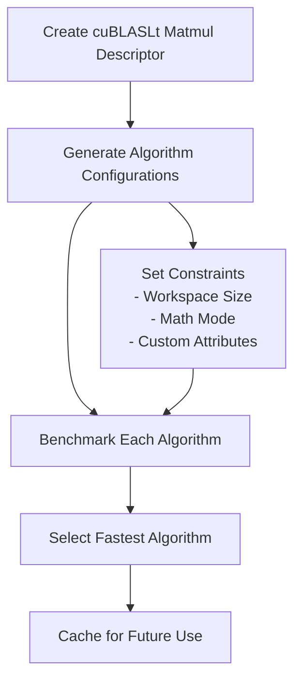
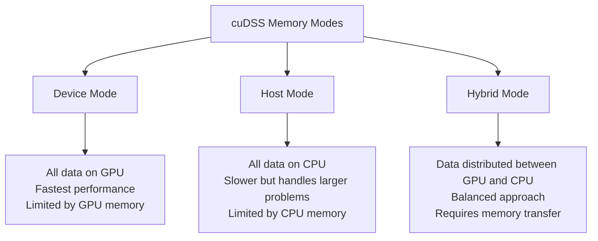
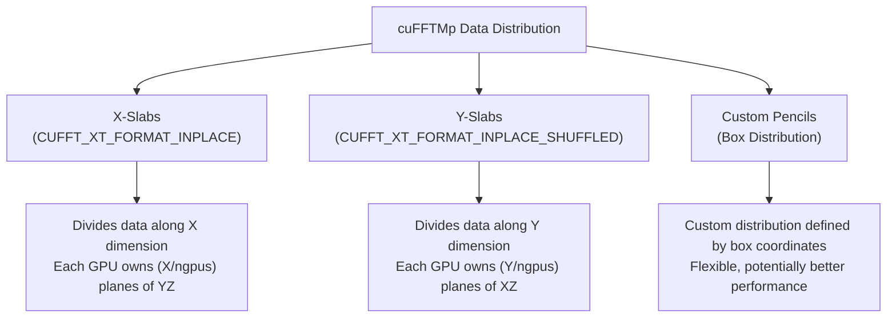
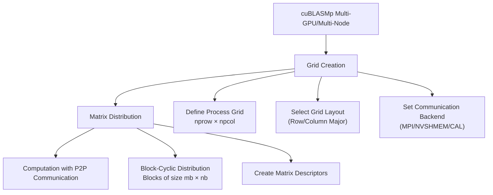
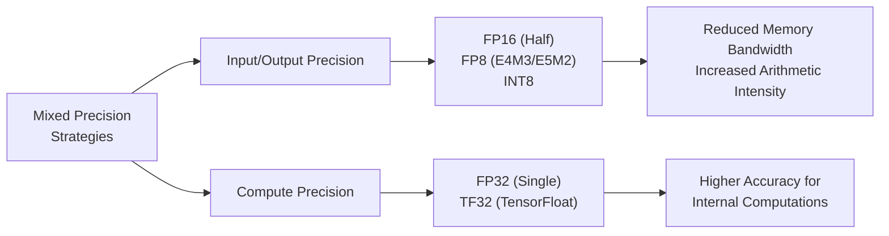

<!-- source: DeepWiki mcp.deepwiki.com · repo NVIDIA/CUDALibrarySamples · page 7 Performance Optimization · fetched 2026-10-26 -->

# Performance Optimization

<details>
<summary>Relevant source files</summary>

The following files were used as context for generating this wiki page:

- [cuBLASLt/Common/LtMatmulCustomFind.h](cuBLASLt/Common/LtMatmulCustomFind.h)
- [cuBLASLt/Common/helpers.cpp](cuBLASLt/Common/helpers.cpp)
- [cuBLASLt/LtSgemmCustomFind/CMakeLists.txt](cuBLASLt/LtSgemmCustomFind/CMakeLists.txt)
- [cuBLASLt/LtSgemmCustomFind/main.cpp](cuBLASLt/LtSgemmCustomFind/main.cpp)
- [cuBLASMp/CMakeLists.txt](cuBLASMp/CMakeLists.txt)
- [cuBLASMp/README.md](cuBLASMp/README.md)
- [cuBLASMp/helpers.h](cuBLASMp/helpers.h)
- [cuBLASMp/matrix_generator.hxx](cuBLASMp/matrix_generator.hxx)
- [cuBLASMp/pgeadd.cu](cuBLASMp/pgeadd.cu)
- [cuBLASMp/pgemm.cu](cuBLASMp/pgemm.cu)
- [cuBLASMp/pmatmul.cu](cuBLASMp/pmatmul.cu)
- [cuBLASMp/pmatmul_ar.cu](cuBLASMp/pmatmul_ar.cu)
- [cuBLASMp/psyrk.cu](cuBLASMp/psyrk.cu)
- [cuBLASMp/ptradd.cu](cuBLASMp/ptradd.cu)
- [cuBLASMp/ptrsm.cu](cuBLASMp/ptrsm.cu)
- [cuDSS/README.md](cuDSS/README.md)
- [cuDSS/get_set/CMakeLists.txt](cuDSS/get_set/CMakeLists.txt)
- [cuDSS/get_set/get_set.cpp](cuDSS/get_set/get_set.cpp)
- [cuDSS/memory_handler/CMakeLists.txt](cuDSS/memory_handler/CMakeLists.txt)
- [cuDSS/memory_handler/memory_handler.cpp](cuDSS/memory_handler/memory_handler.cpp)
- [cuDSS/simple/CMakeLists.txt](cuDSS/simple/CMakeLists.txt)
- [cuDSS/simple/simple.cpp](cuDSS/simple/simple.cpp)
- [cuDSS/simple_batch/CMakeLists.txt](cuDSS/simple_batch/CMakeLists.txt)
- [cuDSS/simple_batch/simple_batch.cpp](cuDSS/simple_batch/simple_batch.cpp)
- [cuDSS/simple_complex/CMakeLists.txt](cuDSS/simple_complex/CMakeLists.txt)
- [cuDSS/simple_complex/simple_complex.cpp](cuDSS/simple_complex/simple_complex.cpp)
- [cuDSS/simple_hybrid_memory_mode/CMakeLists.txt](cuDSS/simple_hybrid_memory_mode/CMakeLists.txt)
- [cuDSS/simple_hybrid_memory_mode/simple_hybrid_memory_mode.cpp](cuDSS/simple_hybrid_memory_mode/simple_hybrid_memory_mode.cpp)
- [cuDSS/simple_mgmn_mode/CMakeLists.txt](cuDSS/simple_mgmn_mode/CMakeLists.txt)
- [cuFFTMp/samples/c2c_no_descriptors_cufftMpMakePlan/README.md](cuFFTMp/samples/c2c_no_descriptors_cufftMpMakePlan/README.md)
- [cuFFTMp/samples/c2c_no_descriptors_cufftMpMakePlan/cufftmp_c2c_no_descriptors_cufftMpMakePlan.cu](cuFFTMp/samples/c2c_no_descriptors_cufftMpMakePlan/cufftmp_c2c_no_descriptors_cufftMpMakePlan.cu)
- [cuFFTMp/samples/r2c_c2r_pencils_cufftMpMakePlan/README.md](cuFFTMp/samples/r2c_c2r_pencils_cufftMpMakePlan/README.md)
- [cuFFTMp/samples/r2c_c2r_pencils_cufftMpMakePlan/cufftmp_r2c_c2r_pencils_cufftMpMakePlan.cu](cuFFTMp/samples/r2c_c2r_pencils_cufftMpMakePlan/cufftmp_r2c_c2r_pencils_cufftMpMakePlan.cu)
- [cuFFTMp/samples/reshape/cufftmp_reshape.cu](cuFFTMp/samples/reshape/cufftmp_reshape.cu)

</details>


This page provides a comprehensive guide to performance optimization techniques for NVIDIA CUDA libraries. It covers strategies for algorithm selection, memory management, and multi-GPU/multi-node scaling across the cuBLASLt, cuBLASMp, cuFFTMp, and cuDSS libraries. For library-specific optimization details, see the respective library pages.

## Algorithm Selection and Tuning

Selecting the optimal algorithm for your workload is crucial for performance. NVIDIA CUDA libraries offer mechanisms to identify the fastest algorithm for specific problem sizes and hardware.

### cuBLASLt Algorithm Selection

cuBLASLt provides a custom algorithm finding mechanism that allows you to benchmark multiple algorithm configurations for matrix multiplication and select the optimal one.



The key steps in the algorithm selection process are:

1. **Generate algorithm list**: Create a set of potential algorithms to evaluate
2. **Set constraints**: Limit by workspace size, math mode, and other attributes
3. **Benchmark algorithms**: Measure performance for your specific problem
4. **Select fastest**: Choose the algorithm with the best performance
5. **Cache results**: Save the selection for future use with similar problems

Implementation example:

```c++
// Workspace used for finding the best algorithm
void* workspace = nullptr;
size_t workspaceSize = 32 * 1024 * 1024;  // 32 MiB
cudaMalloc(&workspace, workspaceSize);

// Algorithm selection (simplified)
const int algoCount = 10;  // Number of algorithms to try
customMatmulPerf_t perfResults[algoCount];
  
LtMatmulSearch(ltHandle, 
              CUBLAS_OP_N, CUBLAS_OP_N,
              &alpha, A, m, B, k, &beta,
              C, m, D, m,
              workspace, workspaceSize,
              algoCount, perfResults);

// Use the best algorithm
cublasLtMatmul(ltHandle, matmulDesc,
              &alpha, A, Adesc, B, Bdesc,
              &beta, C, Cdesc, D, Ddesc,
              &perfResults[0].algo,
              workspace, workspaceSize, stream);
```

Sources: [cuBLASLt/LtSgemmCustomFind/main.cpp:37-64](). [cuBLASLt/Common/LtMatmulCustomFind.h:40-49](), [cuBLASLt/Common/LtMatmulCustomFind.h:248-322]()

### cuDSS Reordering Algorithm Selection

cuDSS provides several reordering algorithms for sparse matrices that can significantly impact solver performance:

| Algorithm | Description | Best For |
|-----------|-------------|----------|
| `CUDSS_ALG_DEFAULT` | Default algorithm selected based on matrix properties | General use |
| `CUDSS_ALG_1` | Symmetric approximate minimum degree | Symmetric matrices |
| `CUDSS_ALG_2` | Nested dissection | Large, structured matrices |

The choice of reordering algorithm affects fill-in during factorization, which directly impacts both memory consumption and computation time.

```c++
// Configure reordering algorithm
cudssAlgType_t reorder_alg = CUDSS_ALG_DEFAULT;  // or CUDSS_ALG_1, CUDSS_ALG_2
CUDSS_CALL_AND_CHECK(cudssConfigSet(solverConfig, CUDSS_CONFIG_REORDERING_ALG,
                     &reorder_alg, sizeof(cudssAlgType_t)), status, "cudssSolverSet");
```

Sources: [cuDSS/get_set/get_set.cpp:232-235]()

## Memory Management Strategies

Effective memory management is critical for performance optimization. Each library offers different memory modes and configuration options to optimize memory usage.

### cuDSS Memory Modes

cuDSS supports three memory modes that allow you to balance GPU memory usage with performance:



The memory mode selection depends on:
- Problem size
- Available GPU memory
- Performance requirements

For example, hybrid memory mode allows solving larger problems that don't fit entirely in GPU memory while still leveraging GPU acceleration:

```c++
// Set hybrid memory mode
cudssHybridMode_t hybridMode = CUDSS_HYBRID_ON;
CUDSS_CALL_AND_CHECK(cudssConfigSet(solverConfig, CUDSS_CONFIG_HYBRID_MODE,
                     &hybridMode, sizeof(hybridMode)), status, "cudssConfigSet for hybrid mode");
```

Sources: [cuDSS/simple_hybrid_memory_mode/simple_hybrid_memory_mode.cpp](), [cuDSS/get_set/get_set.cpp:275-285]()

### Memory Handlers in cuDSS

cuDSS allows using custom memory handlers for device memory allocation, enabling integration with existing memory pools or custom allocators:

```c++
// Create custom memory handlers
cudssDeviceMemHandler_t memHandler;
memHandler.alloc = example_device_alloc;
memHandler.dealloc = example_device_dealloc;
memHandler.ctx = &memPool;  // Custom memory pool context

// Set the memory handler
CUDSS_CALL_AND_CHECK(cudssSetDeviceMemHandler(handle, &memHandler), 
                    status, "cudssSetDeviceMemHandler");
```

Custom memory handlers can improve performance by reducing allocation overhead and memory fragmentation.

Sources: [cuDSS/memory_handler/memory_handler.cpp:126-141](), [cuDSS/memory_handler/memory_handler.cpp:322-326]()

### Data Layout in cuFFTMp

cuFFTMp performance is highly dependent on data distribution across GPUs. Several distribution strategies are available:

1. **X-Slabs**: Data divided along X dimension (CUFFT_XT_FORMAT_INPLACE)
2. **Y-Slabs**: Data divided along Y dimension (CUFFT_XT_FORMAT_INPLACE_SHUFFLED)
3. **Pencils**: Custom distributions using box coordinates



For best performance, selecting the right data layout is crucial:

```c++
// For built-in distributions (X-Slabs, Y-Slabs)
CUFFT_CHECK(cufftXtSetSubformatDefault(plan, CUFFT_XT_FORMAT_INPLACE, 
                                      CUFFT_XT_FORMAT_INPLACE_SHUFFLED));

// For custom distributions (Pencils)
Box3D boxes_real[NUM_GPUS];
Box3D boxes_complex[NUM_GPUS];
// Define custom distribution using boxes...
CUFFT_CHECK(cufftMpMakePlanDecomposition(plan, 3, n, 
                                         box_real.lower, box_real.upper, box_real.strides,
                                         box_complex.lower, box_complex.upper, box_complex.strides,
                                         CUFFT_R2C, &comm, CUFFT_COMM_MPI, &workspace));
```

Sources: [cuFFTMp/samples/c2c_no_descriptors_cufftMpMakePlan/cufftmp_c2c_no_descriptors_cufftMpMakePlan.cu:43-44](), [cuFFTMp/samples/r2c_c2r_pencils_cufftMpMakePlan/cufftmp_r2c_c2r_pencils_cufftMpMakePlan.cu:47-49]()

## Multi-GPU and Distributed Computing

Scaling computations across multiple GPUs and nodes can significantly improve performance for large-scale problems.

### cuBLASMp Matrix Distribution and Communication

cuBLASMp distributes matrices across multiple GPUs using a 2D grid of processes. The communication architecture supports different backends:



Key performance factors include:

1. **Process grid configuration**: Balance between rows and columns
2. **Block sizes**: Impact locality and communication patterns
3. **Communication backend**: MPI, NVSHMEM, or CAL (Communication Abstraction Layer)

Example of grid creation and matrix distribution:

```c++
// Create process grid
CUBLASMP_CHECK(cublasMpGridCreate(
    nprow,                                                      // Number of process rows
    npcol,                                                      // Number of process columns
    opts.grid_layout == 'c' ? CUBLASMP_GRID_LAYOUT_COL_MAJOR : // Grid layout
                             CUBLASMP_GRID_LAYOUT_ROW_MAJOR,
    cal_comm,                                                   // Communication backend
    &grid));

// Create matrix descriptors with block-cyclic distribution
CUBLASMP_CHECK(
    cublasMpMatrixDescriptorCreate(global_m_a, global_n_a,      // Global matrix dimensions
                                  mbA, nbA,                     // Block sizes
                                  0, 0, llda,                   // Leading dimension
                                  CUDA_R_64F,                   // Data type
                                  grid, &descA));               // Process grid
```

For matrix multiplication with P2P communication:

```c++
// Set algorithm type for P2P communication
const cublasMpMatmulAlgoType_t algoType = CUBLASMP_MATMUL_ALGO_TYPE_SPLIT_P2P;
CUBLASMP_CHECK(cublasMpMatmulDescriptorAttributeSet(
    matmulDesc, CUBLASMP_MATMUL_DESCRIPTOR_ATTRIBUTE_ALGO_TYPE, 
    &algoType, sizeof(algoType)));
```

Sources: [cuBLASMp/pgemm.cu:183-196](), [cuBLASMp/pmatmul.cu:179-188](), [cuBLASMp/pmatmul.cu:334-342]()

### Communication Synchronization

Proper synchronization is essential for distributed operations. Different libraries use different synchronization mechanisms:

```c++
// cuBLASMp: CAL barrier and stream synchronization
CAL_CHECK(cal_stream_sync(cal_comm, stream));
CAL_CHECK(cal_comm_barrier(cal_comm, stream));

// cuFFTMp: NVSHMEM synchronization
nvshmemx_sync_all_on_stream(stream);
```

Minimizing synchronization points while ensuring correctness is critical for performance.

Sources: [cuBLASMp/pgemm.cu:226-228](), [cuFFTMp/samples/reshape/cufftmp_reshape.cu:121-122]()

## Low-Level Optimization Techniques

Several low-level techniques can further improve performance when using CUDA libraries.

### Mixed Precision Computation

Using lower precision types can significantly accelerate computation while maintaining acceptable accuracy:



cuBLASMp and cuBLASLt examples:

```c++
// cuBLASMp with mixed precision
using input_t = __half;         // Input in FP16
using output_t = __half;        // Output in FP16
using compute_t = float;        // Internal computation in FP32
const cudaDataType_t cuda_input_type = CUDA_R_16F;
const cudaDataType_t cuda_output_type = CUDA_R_16F;
const cublasComputeType_t cublas_compute_type = CUBLAS_COMPUTE_32F;
```

Sources: [cuBLASMp/pmatmul.cu:52-57](), [cuBLASMp/pgemm.cu:50-55]()

### Stream Management

Proper stream management enables concurrent execution of operations:

```c++
// Create a stream
cudaStream_t stream = nullptr;
CUDA_CHECK(cudaStreamCreate(&stream));

// Set stream for the library handle
CUBLASMP_CHECK(cublasMpCreate(&handle, stream));
// or
CUDSS_CALL_AND_CHECK(cudssSetStream(handle, stream), status, "cudssSetStream");
```

Sources: [cuBLASMp/pgemm.cu:127-132](), [cuDSS/simple/simple.cpp:194-204]()

### Workspace Size Optimization

Most CUDA libraries allow configuring workspace size to balance memory usage and performance:

```c++
// Query required workspace size
size_t workspaceInBytesOnDevice = 0;
size_t workspaceInBytesOnHost = 0;
CUBLASMP_CHECK(cublasMpGemm_bufferSize(
    handle, CUBLAS_OP_N, CUBLAS_OP_N, m, n, k,
    &alpha, d_A, ia, ja, descA, d_B, ib, jb, descB,
    &beta, d_C, ic, jc, descC, cublas_compute_type,
    &workspaceInBytesOnDevice, &workspaceInBytesOnHost));

// Allocate workspace
CUDA_CHECK(cudaMallocAsync(&d_work, workspaceInBytesOnDevice, stream));
std::vector<int8_t> h_work(workspaceInBytesOnHost);
```

Larger workspaces generally provide better performance but at the cost of increased memory usage.

Sources: [cuBLASMp/pgemm.cu:198-223](), [cuDSS/get_set/get_set.cpp:275-285]()

## Performance Measurement and Tuning

Measuring performance is crucial for optimization. The examples include performance measurement techniques:

```c++
// Timing with MPI_Wtime()
const double begin = MPI_Wtime();
// Execute operation...
const double end = MPI_Wtime();

// Calculate and report performance
printf("Duration: %lf GFlops: %lf\n", end - begin, 
       (2 * m * n * k * 1e-9) / (end - begin));
```

Sources: [cuBLASMp/pgemm.cu:230-266](), [cuBLASMp/pmatmul.cu:225-263]()

## Summary of Key Optimization Strategies

| Library | Key Optimization Techniques |
|---------|---------------------------|
| cuBLASLt | Algorithm selection with `LtMatmulSearch`, Tensor Core utilization, Mixed precision computation |
| cuBLASMp | Process grid configuration, Block-cyclic distribution, P2P communication optimization |
| cuFFTMp | Data distribution (X-slabs, Y-slabs, Pencils), Communication pattern optimization |
| cuDSS | Memory mode selection, Reordering algorithm selection, Custom memory handlers |

Applying these optimization techniques can significantly improve the performance of your CUDA library applications, especially for large-scale problems requiring multiple GPUs or nodes.