# Page: CUDA Library Samples Overview

# CUDA Library Samples Overview

<details>
<summary>Relevant source files</summary>

The following files were used as context for generating this wiki page:

- [README.md](README.md)
- [cuSOLVERSp2cuDSS/CMakeLists.txt](cuSOLVERSp2cuDSS/CMakeLists.txt)
- [cuSOLVERSp2cuDSS/README.md](cuSOLVERSp2cuDSS/README.md)
- [cuSOLVERSp2cuDSS/cuSolverRf2cuDSS.hpp](cuSOLVERSp2cuDSS/cuSolverRf2cuDSS.hpp)
- [cuSOLVERSp2cuDSS/cuSolverRf2cuDSS_double.cpp](cuSOLVERSp2cuDSS/cuSolverRf2cuDSS_double.cpp)
- [cuSOLVERSp2cuDSS/cuSolverSp2cuDSS.hpp](cuSOLVERSp2cuDSS/cuSolverSp2cuDSS.hpp)
- [cuSOLVERSp2cuDSS/cuSolverSp2cuDSS_dcomplex.cpp](cuSOLVERSp2cuDSS/cuSolverSp2cuDSS_dcomplex.cpp)
- [cuSOLVERSp2cuDSS/cuSolverSp2cuDSS_double.cpp](cuSOLVERSp2cuDSS/cuSolverSp2cuDSS_double.cpp)
- [cuSOLVERSp2cuDSS/cuSolverSp2cuDSS_float.cpp](cuSOLVERSp2cuDSS/cuSolverSp2cuDSS_float.cpp)
- [cuSOLVERSp2cuDSS/cuSolverSp2cuDSS_scomplex.cpp](cuSOLVERSp2cuDSS/cuSolverSp2cuDSS_scomplex.cpp)
- [cuSOLVERSp2cuDSS/test_complex.mtx](cuSOLVERSp2cuDSS/test_complex.mtx)
- [cuSOLVERSp2cuDSS/test_real.mtx](cuSOLVERSp2cuDSS/test_real.mtx)

</details>


The CUDA Library Samples repository provides comprehensive examples demonstrating NVIDIA's GPU-accelerated libraries for high-performance computing. This collection covers a wide range of computational domains including linear algebra, signal processing, image processing, and data compression. These samples serve as practical reference implementations for developers looking to leverage GPU acceleration in their applications.

## Purpose and Scope

This repository contains working code examples for each CUDA library, demonstrating typical use cases and best practices. These samples are designed to:

1. Demonstrate the proper usage of CUDA library APIs
2. Showcase performance optimization techniques
3. Provide functional examples that can be adapted for real-world applications
4. Illustrate transitions between different libraries and their versions

For specific information about individual libraries, please refer to their dedicated pages in this wiki (e.g., [Linear Algebra Libraries](#2) for cuBLAS, cuBLASLt, cuSOLVER, etc.).

Sources: [README.md:1-21]()

## Library Categories

The repository organizes libraries into functional categories reflecting their primary computational domains:

```mermaid
graph TD
    cuda["CUDA Library Samples"]
    cuda --> math["Mathematics Libraries"]
    cuda --> image["Image Processing Libraries"]
    cuda --> data["Data Compression"]
    
    math --> la["Linear Algebra"]
    math --> fft["Fourier Transforms"]
    math --> rand["Random Number Generation"]
    math --> dx["Developer Extensions (MathDx)"]
    
    la --> cublas["cuBLAS - Basic Linear Algebra"]
    la --> cublaslt["cuBLASLt - Lightweight Matrix Multiply"]
    la --> cublasmp["cuBLASMp - Multi-GPU BLAS"]
    la --> cusolver["cuSOLVER - Equation Solvers"]
    la --> cusolvermp["cuSOLVERMp - Multi-GPU Solvers"]
    la --> cusparse["cuSPARSE - Sparse Matrix Operations"]
    la --> cusparselt["cuSPARSELt - Structured Sparse Operations"]
    la --> cudss["cuDSS - Direct Sparse Solver"]
    la --> cutensor["cuTENSOR - Tensor Linear Algebra"]
    la --> cutensormg["cuTENSORMg - Multi-GPU Tensor Operations"]
    
    fft --> cufft["cuFFT - Fast Fourier Transform"]
    fft --> cufftmp["cuFFTMp - Multi-GPU FFT"]
    
    rand --> curand["cuRAND - Random Number Generation"]
    
    image --> nvjpeg["nvJPEG - JPEG Processing"]
    image --> nvjpeg2000["nvJPEG2000 - JPEG 2000 Processing"]
    image --> nvtiff["nvTIFF - TIFF Processing"]
    image --> npp["NPP - Image/Video Processing"]
    image --> nppplus["NPP+ - C++ Extensions for NPP"]
    
    data --> nvcomp["nvCOMP - Data Compression"]
    
    dx --> cublasdx["cuBLASDx - Device-side BLAS Extensions"]
    dx --> cufftdx["cuFFTDx - Device-side FFT Extensions"]
    dx --> cusolverdx["cuSOLVERDx - Device-side Solver Extensions"]
    dx --> curanddx["cuRANDDx - Device-side Random Number Extensions"]
    
    crypto[Cryptography] --- cuda
    crypto --> cupqc["cuPQC - Post-Quantum Cryptography"]
```

Sources: [README.md:24-49]()

## Key Components and Functionality

The repository includes examples for several major library groups:

### 1. Linear Algebra Libraries

These libraries form the core of GPU-accelerated mathematical computations:

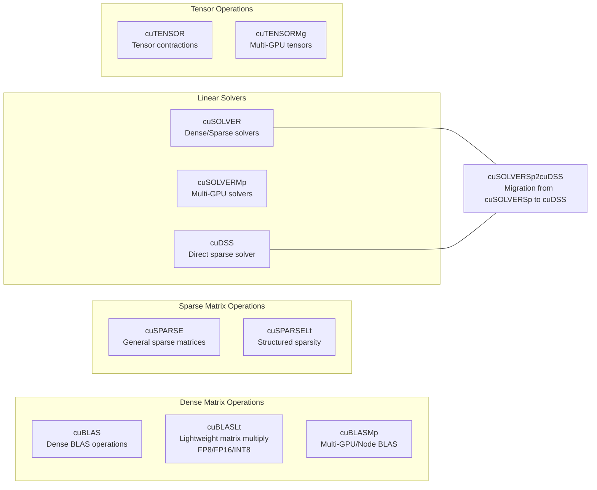

The linear algebra libraries cover dense operations (cuBLAS family), sparse operations (cuSPARSE family), and linear solvers (cuSOLVER family and cuDSS). The repository contains specific samples for transitioning between deprecated APIs like cuSOLVERSp and newer ones like cuDSS.

Sources: [README.md:27-32](), [README.md:36-42](), [cuSOLVERSp2cuDSS/README.md:1-17]()

### 2. Signal Processing Libraries

For frequency domain operations:

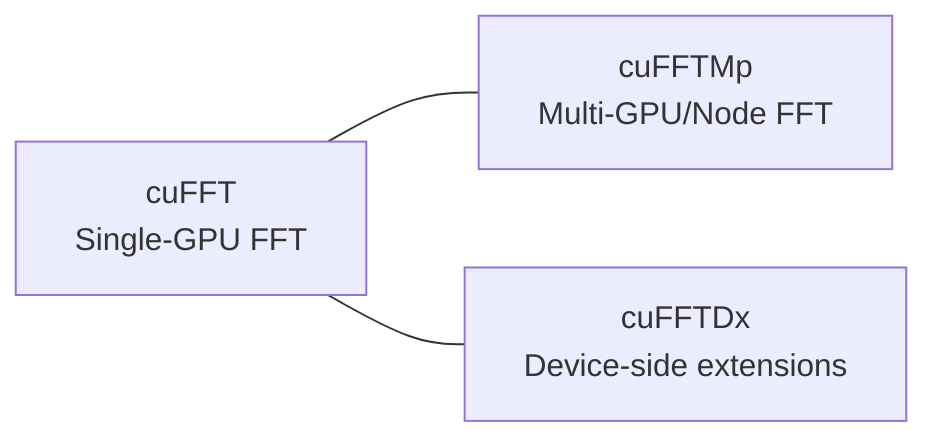

Sources: [README.md:33-34]()

### 3. Image Processing Libraries

For various image format handling and processing:

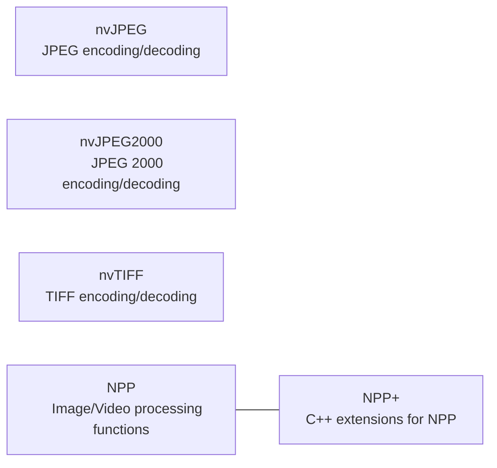

Sources: [README.md:44-48]()

### 4. Developer Extensions (MathDx)

Low-level, device-side implementations of core mathematical operations:

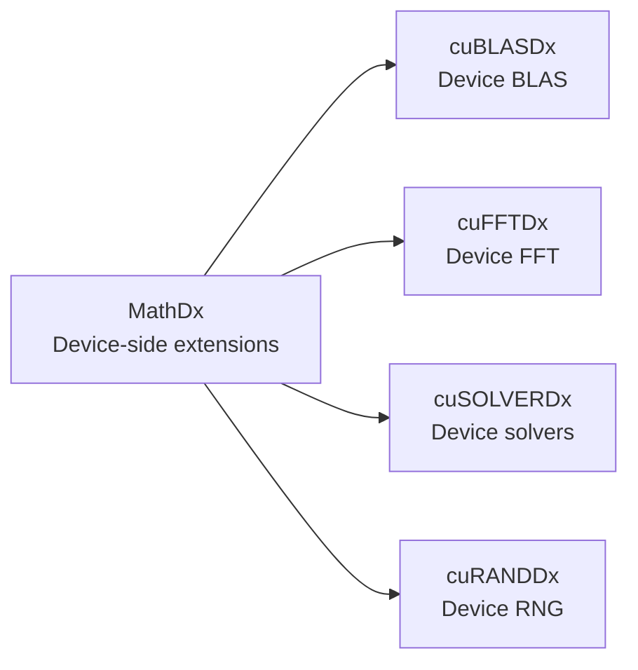

Sources: [README.md:30](), [README.md:34]()

## Multi-GPU and Multi-Node Support

Several libraries provide multi-GPU and multi-node implementations for scaling beyond a single GPU:

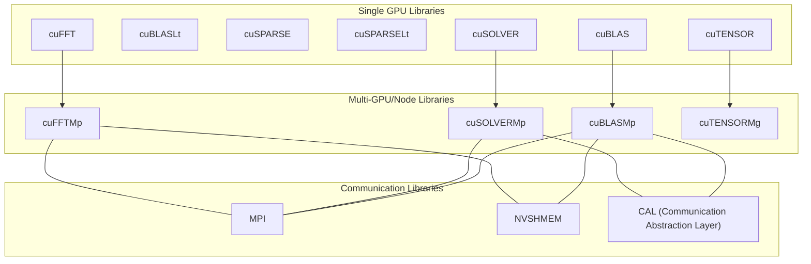

The Multi-GPU libraries (with "Mp" suffix) enable scaling computations across multiple GPUs and nodes, using various communication libraries like MPI, NVSHMEM, and CAL.

Sources: [README.md:28-29](), [README.md:33](), [README.md:38](), [README.md:43]()

## Precision and Type Support

CUDA libraries support various numerical precisions to balance performance and accuracy requirements:

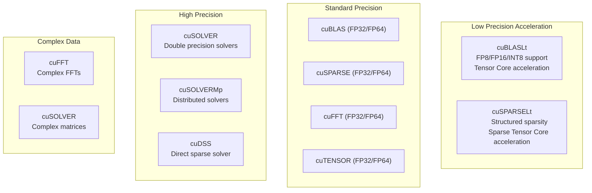

Libraries like cuBLASLt provide special support for low-precision operations that leverage Tensor Cores for significant performance gains.

Sources: [README.md:28]()

## Repository Structure and Organization

Each CUDA library has its own dedicated directory containing sample applications:

| Directory | Description |
|-----------|-------------|
| `cuBLAS/` | Basic Linear Algebra Subprograms examples |
| `cuBLASLt/` | Lightweight matrix multiplication examples |
| `cuBLASMp/` | Multi-process BLAS examples |
| `cuDSS/` | Direct sparse solver examples |
| `cuFFT/` | Fast Fourier Transform examples |
| `cuFFTMp/` | Multi-process FFT examples |
| `cuPQC/` | Post-Quantum Cryptography examples |
| `cuRAND/` | Random number generation examples |
| `cuSOLVER/` | Dense and sparse solver examples |
| `cuSOLVERMp/` | Multi-process solver examples |
| `cuSOLVERSp2cuDSS/` | Migration from cuSOLVERSp to cuDSS |
| `cuSPARSE/` | Sparse matrix operations examples |
| `cuSPARSELt/` | Structured sparse matrix operations |
| `cuTENSOR/` | Tensor linear algebra examples |
| `cuTENSORMg/` | Multi-GPU tensor operations |
| `MathDx/` | Device-side extensions (cuBLASDx, cuFFTDx, etc.) |
| `NPP/` | Image and video processing examples |
| `NPP+/` | C++ extensions for NPP |
| `nvJPEG/` | JPEG encode/decode examples |
| `nvJPEG2000/` | JPEG2000 encode/decode examples |
| `nvTIFF/` | TIFF encode/decode examples |
| `nvCOMP/` | Data compression examples |

Sources: [README.md:27-49]()

## Example: Migration Between Libraries

The repository includes specific examples for transitioning between APIs. For instance, the `cuSOLVERSp2cuDSS` directory contains samples demonstrating how to migrate code from the deprecated cuSOLVERSp/Rf APIs to the newer cuDSS library:

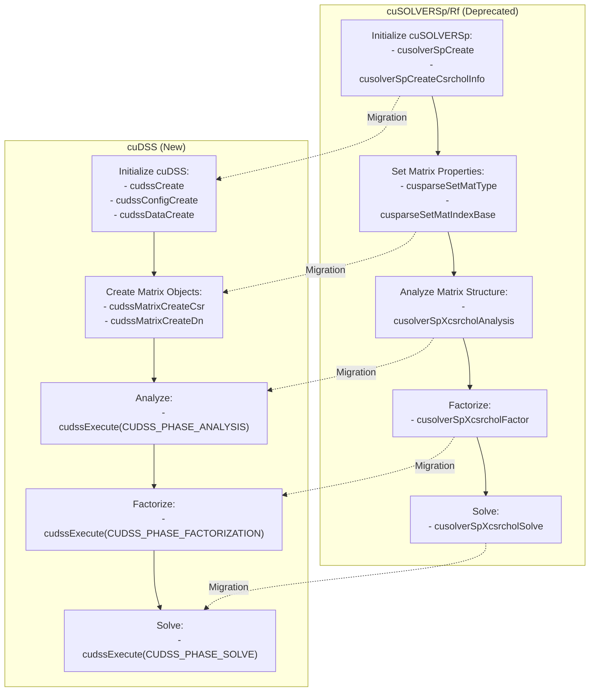

The example includes code for both the old (cuSOLVERSp/Rf) and new (cuDSS) APIs, with detailed comments explaining the transition process.

Sources: [cuSOLVERSp2cuDSS/README.md:1-162](), [cuSOLVERSp2cuDSS/cuSolverSp2cuDSS.hpp:291-344](), [cuSOLVERSp2cuDSS/cuSolverRf2cuDSS.hpp:290-338]()

## Performance Considerations

Different libraries are optimized for specific use cases:

1. **Tensor Core Acceleration**: Libraries like cuBLASLt and cuSPARSELt are optimized for Tensor Core operations on supported hardware
2. **Multi-GPU Scaling**: Libraries with "Mp" suffix provide scaling across multiple GPUs and nodes
3. **Low Precision Optimization**: Support for FP8/FP16/INT8 operations for improved performance
4. **Structured Sparsity**: Specialized libraries for efficient sparse matrix operations

For specific performance optimization guidance, see the [Performance Optimization](#7) page.

Sources: [README.md:27-29]()

## Getting Started

To use these samples:

1. Clone the repository from [GitHub](https://github.com/NVIDIA/CUDALibrarySamples)
2. Explore the directory for the specific CUDA library you're interested in
3. Follow the READMEs within each directory for build and execution instructions

Most examples use CMake as their build system. For a more detailed guide, see the [Getting Started](#6) page.

Sources: [README.md:53-59]()

## Additional Resources

For more detailed information about the CUDA libraries:

- [CUDA Toolkit Documentation](https://docs.nvidia.com/cuda/)
- [NVIDIA Developer Zone](https://developer.nvidia.com/)
- [GPU Accelerated Libraries](https://developer.nvidia.com/gpu-accelerated-libraries)
- [CUDA Samples Repository](https://github.com/NVIDIA/cuda-samples)

Sources: [README.md:53-59]()

---

# Page: Linear Algebra Libraries

# Linear Algebra Libraries

<details>
<summary>Relevant source files</summary>

The following files were used as context for generating this wiki page:

- [README.md](README.md)
- [cuBLASLt/Common/helpers.h](cuBLASLt/Common/helpers.h)
- [cuBLASLt/LtFp8Matmul/main.cpp](cuBLASLt/LtFp8Matmul/main.cpp)
- [cuBLASLt/LtFp8Matmul/sample_cublasLt_LtFp8Matmul.cu](cuBLASLt/LtFp8Matmul/sample_cublasLt_LtFp8Matmul.cu)
- [cuBLASLt/LtFp8Matmul/sample_cublasLt_LtFp8Matmul.h](cuBLASLt/LtFp8Matmul/sample_cublasLt_LtFp8Matmul.h)
- [cuBLASLt/LtMxfp8Matmul/main.cpp](cuBLASLt/LtMxfp8Matmul/main.cpp)
- [cuBLASLt/LtMxfp8Matmul/sample_cublasLt_LtMxfp8Matmul.cu](cuBLASLt/LtMxfp8Matmul/sample_cublasLt_LtMxfp8Matmul.cu)
- [cuBLASLt/LtMxfp8Matmul/sample_cublasLt_LtMxfp8Matmul.h](cuBLASLt/LtMxfp8Matmul/sample_cublasLt_LtMxfp8Matmul.h)
- [cuBLASLt/LtNvfp4Matmul/main.cpp](cuBLASLt/LtNvfp4Matmul/main.cpp)
- [cuBLASLt/LtNvfp4Matmul/sample_cublasLt_LtNvfp4Matmul.cu](cuBLASLt/LtNvfp4Matmul/sample_cublasLt_LtNvfp4Matmul.cu)
- [cuBLASLt/LtNvfp4Matmul/sample_cublasLt_LtNvfp4Matmul.h](cuBLASLt/LtNvfp4Matmul/sample_cublasLt_LtNvfp4Matmul.h)
- [cuBLASMp/CMakeLists.txt](cuBLASMp/CMakeLists.txt)
- [cuBLASMp/README.md](cuBLASMp/README.md)
- [cuBLASMp/helpers.h](cuBLASMp/helpers.h)
- [cuBLASMp/matrix_generator.hxx](cuBLASMp/matrix_generator.hxx)
- [cuBLASMp/pgeadd.cu](cuBLASMp/pgeadd.cu)
- [cuBLASMp/pgemm.cu](cuBLASMp/pgemm.cu)
- [cuBLASMp/pmatmul.cu](cuBLASMp/pmatmul.cu)
- [cuBLASMp/pmatmul_ar.cu](cuBLASMp/pmatmul_ar.cu)
- [cuBLASMp/psyrk.cu](cuBLASMp/psyrk.cu)
- [cuBLASMp/ptradd.cu](cuBLASMp/ptradd.cu)
- [cuBLASMp/ptrsm.cu](cuBLASMp/ptrsm.cu)
- [cuDSS/README.md](cuDSS/README.md)
- [cuDSS/get_set/CMakeLists.txt](cuDSS/get_set/CMakeLists.txt)
- [cuDSS/get_set/get_set.cpp](cuDSS/get_set/get_set.cpp)
- [cuDSS/memory_handler/CMakeLists.txt](cuDSS/memory_handler/CMakeLists.txt)
- [cuDSS/memory_handler/memory_handler.cpp](cuDSS/memory_handler/memory_handler.cpp)
- [cuDSS/simple/CMakeLists.txt](cuDSS/simple/CMakeLists.txt)
- [cuDSS/simple/simple.cpp](cuDSS/simple/simple.cpp)
- [cuDSS/simple_batch/CMakeLists.txt](cuDSS/simple_batch/CMakeLists.txt)
- [cuDSS/simple_batch/simple_batch.cpp](cuDSS/simple_batch/simple_batch.cpp)
- [cuDSS/simple_complex/CMakeLists.txt](cuDSS/simple_complex/CMakeLists.txt)
- [cuDSS/simple_complex/simple_complex.cpp](cuDSS/simple_complex/simple_complex.cpp)
- [cuDSS/simple_hybrid_memory_mode/CMakeLists.txt](cuDSS/simple_hybrid_memory_mode/CMakeLists.txt)
- [cuDSS/simple_hybrid_memory_mode/simple_hybrid_memory_mode.cpp](cuDSS/simple_hybrid_memory_mode/simple_hybrid_memory_mode.cpp)
- [cuDSS/simple_mgmn_mode/CMakeLists.txt](cuDSS/simple_mgmn_mode/CMakeLists.txt)
- [cuSOLVERSp2cuDSS/CMakeLists.txt](cuSOLVERSp2cuDSS/CMakeLists.txt)
- [cuSOLVERSp2cuDSS/README.md](cuSOLVERSp2cuDSS/README.md)
- [cuSOLVERSp2cuDSS/cuSolverRf2cuDSS.hpp](cuSOLVERSp2cuDSS/cuSolverRf2cuDSS.hpp)
- [cuSOLVERSp2cuDSS/cuSolverRf2cuDSS_double.cpp](cuSOLVERSp2cuDSS/cuSolverRf2cuDSS_double.cpp)
- [cuSOLVERSp2cuDSS/cuSolverSp2cuDSS.hpp](cuSOLVERSp2cuDSS/cuSolverSp2cuDSS.hpp)
- [cuSOLVERSp2cuDSS/cuSolverSp2cuDSS_dcomplex.cpp](cuSOLVERSp2cuDSS/cuSolverSp2cuDSS_dcomplex.cpp)
- [cuSOLVERSp2cuDSS/cuSolverSp2cuDSS_double.cpp](cuSOLVERSp2cuDSS/cuSolverSp2cuDSS_double.cpp)
- [cuSOLVERSp2cuDSS/cuSolverSp2cuDSS_float.cpp](cuSOLVERSp2cuDSS/cuSolverSp2cuDSS_float.cpp)
- [cuSOLVERSp2cuDSS/cuSolverSp2cuDSS_scomplex.cpp](cuSOLVERSp2cuDSS/cuSolverSp2cuDSS_scomplex.cpp)
- [cuSOLVERSp2cuDSS/test_complex.mtx](cuSOLVERSp2cuDSS/test_complex.mtx)
- [cuSOLVERSp2cuDSS/test_real.mtx](cuSOLVERSp2cuDSS/test_real.mtx)
- [cuSPARSELt/matmul/CMakeLists.txt](cuSPARSELt/matmul/CMakeLists.txt)
- [cuSPARSELt/matmul/Makefile](cuSPARSELt/matmul/Makefile)
- [cuSPARSELt/matmul/README.md](cuSPARSELt/matmul/README.md)
- [cuSPARSELt/matmul/matmul_example.cpp](cuSPARSELt/matmul/matmul_example.cpp)
- [cuSPARSELt/matmul_advanced/CMakeLists.txt](cuSPARSELt/matmul_advanced/CMakeLists.txt)
- [cuSPARSELt/matmul_advanced/Makefile](cuSPARSELt/matmul_advanced/Makefile)
- [cuSPARSELt/matmul_advanced/README.md](cuSPARSELt/matmul_advanced/README.md)
- [cuSPARSELt/matmul_advanced/matmul_advanced_example.cpp](cuSPARSELt/matmul_advanced/matmul_advanced_example.cpp)

</details>


This page provides an overview of the CUDA linear algebra libraries available in the NVIDIA CUDA Library Samples repository. These libraries deliver high-performance GPU-accelerated implementations of key linear algebra operations that form the backbone of many scientific computing, machine learning, and data science applications.

For information about signal processing libraries, see page [Signal Processing Libraries](#3).

## Library Hierarchy and Relationships

The CUDA linear algebra libraries are organized into several families based on their specialization and purpose.

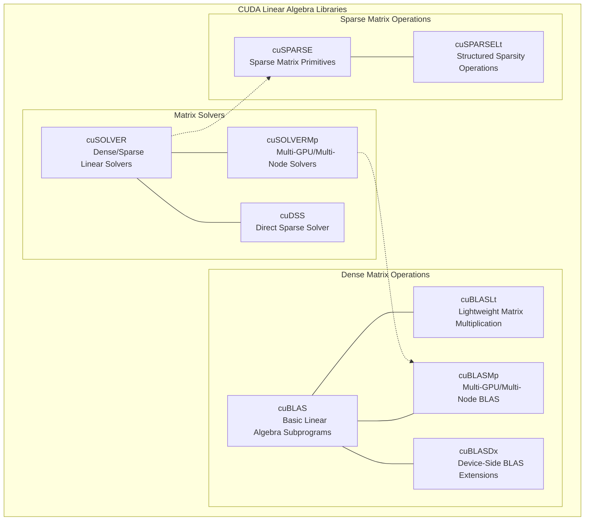

Sources: [README.md:26-43]()

## Library Feature Comparison

The following table summarizes the key characteristics of the CUDA linear algebra libraries:

| Library | Matrix Type | Precision Support | Multi-GPU | Key Features |
|---------|-------------|-------------------|-----------|--------------|
| cuBLAS | Dense | FP16/FP32/FP64/Complex | No | Standard BLAS operations |
| cuBLASLt | Dense | FP4/FP8/FP16/FP32/BF16/INT8 | No | Tensor Core acceleration, low precision |
| cuBLASMp | Dense | FP16/FP32/FP64 | Yes | Distributed matrix operations |
| cuSOLVER | Dense/Sparse | FP32/FP64/Complex | No | Matrix factorizations, eigensolvers |
| cuSOLVERMp | Dense | FP32/FP64/Complex | Yes | Distributed solvers |
| cuSPARSE | Sparse | FP32/FP64/Complex | No | General sparse matrix operations |
| cuSPARSELt | Structured Sparse | FP16/FP8/INT8/BF16 | No | 50% structured sparsity, Tensor Cores |
| cuDSS | Sparse | FP32/FP64/Complex | Yes* | Direct sparse solver, hybrid memory mode |

*cuDSS supports multi-GPU through its MGMN (Multi-GPU Multi-Node) mode

Sources: [README.md:26-43](), [cuSPARSELt/matmul/README.md:5-16](), [cuSPARSELt/matmul_advanced/README.md:5-17](), [cuDSS/README.md:25-30]()

## Data Flow and Precision Paths

The following diagram illustrates the typical data flow patterns and precision paths when using these libraries:

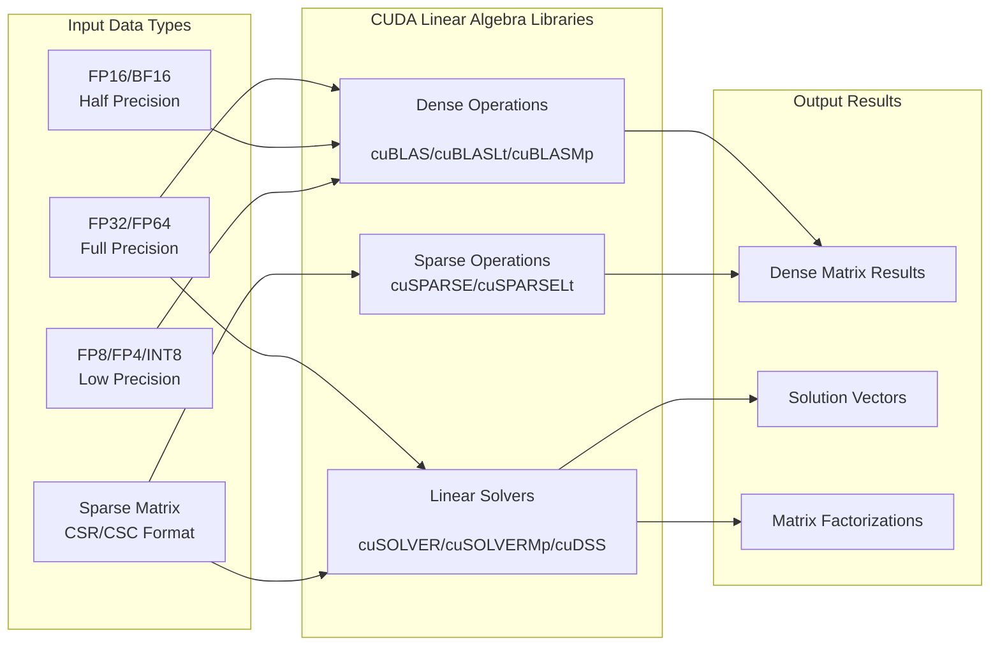

Sources: [cuBLASLt/Common/helpers.h:31-72](), [cuSPARSELt/matmul/matmul_example.cpp:25-41](), [cuSPARSELt/matmul_advanced/matmul_advanced_example.cpp:30-42]()

## Dense Linear Algebra Libraries

### cuBLAS
The basic linear algebra subprograms (BLAS) library for dense matrices. It provides standard BLAS operations such as vector-vector (Level 1), matrix-vector (Level 2), and matrix-matrix (Level 3) operations.

### cuBLASLt
A lightweight matrix multiplication-focused API that enables tensor core operations and supports advanced features such as:

- Low precision matrix multiplication (FP16, FP8, FP4, INT8)
- Block scaling for mixed precision operations
- Tensor Core acceleration
- Algorithm selection for performance optimization

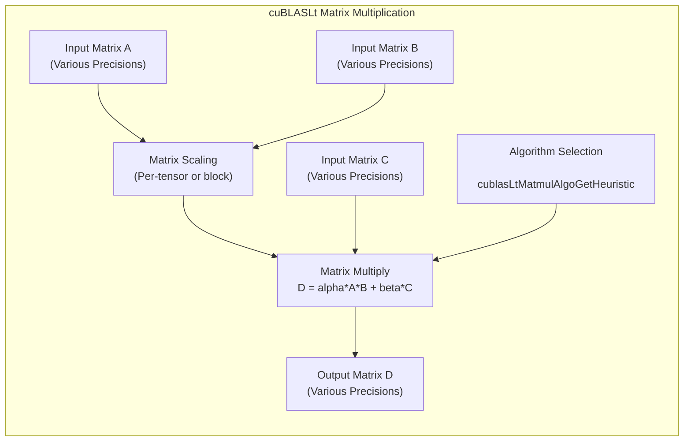

Sample code: The `LtFp8Matmul` function showcases FP8 matrix multiplication with tensor cores:
[cuBLASLt/LtFp8Matmul/sample_cublasLt_LtFp8Matmul.cu:40-141]()

Similarly, there's support for even lower precision with FP4:
[cuBLASLt/LtNvfp4Matmul/sample_cublasLt_LtNvfp4Matmul.cu:40-140]()

Sources: [cuBLASLt/LtFp8Matmul/sample_cublasLt_LtFp8Matmul.h:32-57](), [cuBLASLt/LtNvfp4Matmul/sample_cublasLt_LtNvfp4Matmul.h:34-65](), [cuBLASLt/Common/helpers.h:109-247]()

### cuBLASMp
Multi-GPU and multi-node implementation of BLAS operations, enabling distributed matrix computations across multiple GPUs and multiple compute nodes. Key features include:

- Distributed matrix operations (GEMM, TRSM, SYRK, GEADD, etc.)
- Support for MPI, NVSHMEM, and CAL (Communication Abstraction Layer)
- Process grid configuration for optimized data distribution
- Support for different communication backends

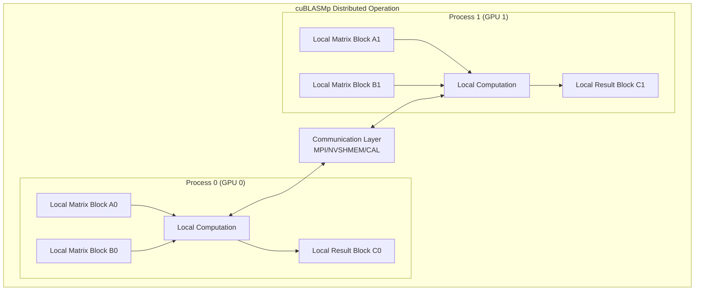

Sample operations offered by cuBLASMp include:
- Matrix multiplication: `cublasMpGemm`, `cublasMpMatmul`
- Triangular solve: `cublasMpTrsm`
- Symmetric rank-k update: `cublasMpSyrk`
- Matrix addition: `cublasMpGeadd`, `cublasMpTradd`

Sources: [cuBLASMp/README.md:8-21](), [cuBLASMp/CMakeLists.txt:62-68](), [cuBLASMp/pgemm.cu:197-257](), [cuBLASMp/pmatmul.cu:227-269](), [cuBLASMp/ptrsm.cu:202-223]()

## Sparse Linear Algebra Libraries

### cuSPARSE
General sparse matrix operations library supporting various sparse matrix formats (CSR, CSC, COO, etc.) and operations.

### cuSPARSELt
A lightweight library for structured sparse matrix operations that leverage Tensor Cores. Key features include:

- Support for 50% structured sparsity
- Sparse-dense matrix multiplication
- Tensor Core acceleration for sparse operations
- FP16, FP8, INT8, BF16 precision support
- Prune, compress and compute workflow

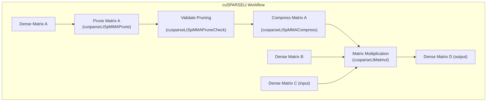

Advanced features include:
- Batched computation
- Split-K algorithm for parallel computation
- ReLU activation function
- Bias addition

Sources: [cuSPARSELt/matmul/matmul_example.cpp:237-289](), [cuSPARSELt/matmul_advanced/matmul_advanced_example.cpp:307-318](), [cuSPARSELt/matmul/README.md:5-16](), [cuSPARSELt/matmul_advanced/README.md:5-17]()

### cuSOLVER and cuSOLVERMp
cuSOLVER provides dense and sparse linear solvers, matrix factorizations, and eigensolvers. cuSOLVERMp extends these capabilities to multi-GPU environments.

### cuDSS (Direct Sparse Solver)
A modern GPU-accelerated direct sparse solver designed to replace cuSOLVERSp/Rf. Key features include:

- Efficient sparse linear system solving
- Support for symmetric, unsymmetric, and complex matrices
- Hybrid host/device memory mode for large problems
- Multi-GPU multi-node (MGMN) mode
- Memory-optimized operations

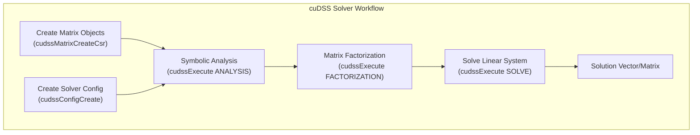

Sample usage pattern:
1. Create matrix objects using `cudssMatrixCreateCsr` or other appropriate creation functions
2. Set up solver configuration with `cudssConfigCreate`
3. Perform symbolic analysis phase with `cudssExecute(CUDSS_PHASE_ANALYSIS)`
4. Perform numerical factorization with `cudssExecute(CUDSS_PHASE_FACTORIZATION)`
5. Solve the system with `cudssExecute(CUDSS_PHASE_SOLVE)`

Sources: [cuDSS/simple/simple.cpp:103-268](), [cuDSS/get_set/get_set.cpp:218-242](), [cuDSS/README.md:13-52]()

## When to Use Which Library

| If you need to... | Consider using... |
|-------------------|-------------------|
| Perform standard dense matrix operations | cuBLAS |
| Accelerate matrix multiplication with low precision | cuBLASLt |
| Scale operations across multiple GPUs | cuBLASMp or cuSOLVERMp |
| Work with general sparse matrices | cuSPARSE |
| Leverage structured sparsity (e.g., in neural networks) | cuSPARSELt |
| Solve dense linear systems or find eigenvalues | cuSOLVER |
| Solve large sparse linear systems efficiently | cuDSS |

## Common API Patterns

Despite the diversity of libraries, there are common API patterns across the CUDA linear algebra ecosystem:

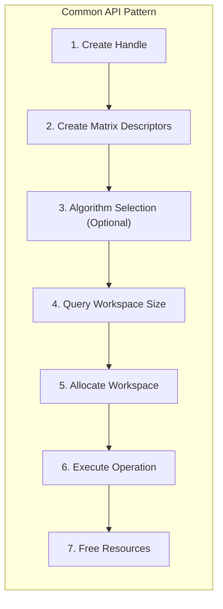

This pattern is evident in libraries like cuBLASLt:
1. Create handle: `cublasLtCreate(&handle)`
2. Create matrix descriptors: `cublasLtMatrixLayoutCreate()`
3. Select algorithm: `cublasLtMatmulAlgoGetHeuristic()`
4. Query workspace size (often implicit in algorithm selection)
5. Allocate workspace if needed
6. Execute operation: `cublasLtMatmul()`
7. Free resources: `cublasLtDestroy()`, `cublasLtMatrixLayoutDestroy()`

And similar patterns appear in cuDSS:
1. Create handle: `cudssCreate(&handle)`
2. Create matrix objects: `cudssMatrixCreateCsr()`
3. Set algorithm options: `cudssConfigSet()`
4. Implicit buffer sizing
5. Execute operations: `cudssExecute()`
6. Free resources: `cudssDestroy()`, `cudssMatrixDestroy()`

Sources: [cuBLASLt/LtFp8Matmul/sample_cublasLt_LtFp8Matmul.cu:61-141](), [cuSPARSELt/matmul/matmul_example.cpp:193-296](), [cuDSS/simple/simple.cpp:199-250]()

## Low Precision Operations

A key feature across several libraries is support for low precision operations, enabling significant performance improvements through Tensor Core acceleration:

| Precision | Data Type | Libraries | Notes |
|-----------|-----------|-----------|-------|
| FP64 | Double | cuBLAS, cuSOLVER, cuDSS | Full precision, highest accuracy |
| FP32 | Float | All | Standard precision |
| FP16 | Half | cuBLAS, cuBLASLt, cuSPARSELt | Tensor Core acceleration |
| BF16 | BFloat16 | cuBLASLt, cuSPARSELt | Extended dynamic range |
| FP8 | __nv_fp8_e4m3 | cuBLASLt, cuSPARSELt | Very low precision |
| FP4 | __nv_fp4_e2m1 | cuBLASLt | Extremely low precision |
| INT8 | int8_t | cuBLASLt, cuSPARSELt | Quantized integer operations |

For mixed precision operations, scaling factors are often used to maintain numerical stability, as seen in the cuBLASLt API:

```
LtFp8Matmul(cublasLtHandle_t ltHandle,
           int m, int n, int k,
           const float *alpha,           /* host pointer */
           const float *a_scale,         /* device pointer */
           const __nv_fp8_e4m3 *A,
           int lda,
           const float *b_scale,         /* device pointer */
           const __nv_fp8_e4m3 *B,
           int ldb,
           const float *beta,
           const float *c_scale,         /* device pointer */
           __nv_bfloat16 *C,
           int ldc,
           const float *d_scale,         /* device pointer */
           __nv_fp8_e4m3 *D,
           int ldd,
           float *amax_d,                /* device pointer */
           void *workspace,
           size_t workspaceSize)
```

Sources: [cuBLASLt/Common/helpers.h:31-72](), [cuBLASLt/LtFp8Matmul/sample_cublasLt_LtFp8Matmul.h:32-57](), [cuBLASLt/LtNvfp4Matmul/sample_cublasLt_LtNvfp4Matmul.h:34-65](), [cuSPARSELt/matmul/matmul_example.cpp:30-41]()

## Distributed Computing Support

Libraries like cuBLASMp and cuSOLVERMp enable distributed operations using different communication backends:

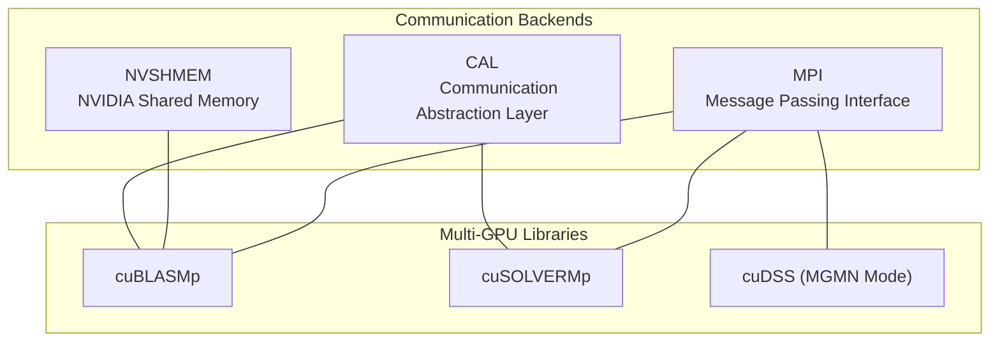

Key distributed computing concepts:
- Process grid: 2D arrangement of processes for matrix distribution
- Data distribution: Block-cyclic distribution of matrices
- Communication: Collective operations for data exchange

Sources: [cuBLASMp/CMakeLists.txt:62-68](), [cuBLASMp/README.md:49-83](), [cuBLASMp/pgemm.cu:183-197](), [cuDSS/README.md:25-30]()

---

# Page: cuBLASLt - Lightweight Matrix Multiplication

# cuBLASLt - Lightweight Matrix Multiplication

<details>
<summary>Relevant source files</summary>

The following files were used as context for generating this wiki page:

- [cuBLASLt/Common/helpers.h](cuBLASLt/Common/helpers.h)
- [cuBLASLt/LtFp8Matmul/main.cpp](cuBLASLt/LtFp8Matmul/main.cpp)
- [cuBLASLt/LtFp8Matmul/sample_cublasLt_LtFp8Matmul.cu](cuBLASLt/LtFp8Matmul/sample_cublasLt_LtFp8Matmul.cu)
- [cuBLASLt/LtFp8Matmul/sample_cublasLt_LtFp8Matmul.h](cuBLASLt/LtFp8Matmul/sample_cublasLt_LtFp8Matmul.h)
- [cuBLASLt/LtMxfp8Matmul/main.cpp](cuBLASLt/LtMxfp8Matmul/main.cpp)
- [cuBLASLt/LtMxfp8Matmul/sample_cublasLt_LtMxfp8Matmul.cu](cuBLASLt/LtMxfp8Matmul/sample_cublasLt_LtMxfp8Matmul.cu)
- [cuBLASLt/LtMxfp8Matmul/sample_cublasLt_LtMxfp8Matmul.h](cuBLASLt/LtMxfp8Matmul/sample_cublasLt_LtMxfp8Matmul.h)
- [cuBLASLt/LtNvfp4Matmul/main.cpp](cuBLASLt/LtNvfp4Matmul/main.cpp)
- [cuBLASLt/LtNvfp4Matmul/sample_cublasLt_LtNvfp4Matmul.cu](cuBLASLt/LtNvfp4Matmul/sample_cublasLt_LtNvfp4Matmul.cu)
- [cuBLASLt/LtNvfp4Matmul/sample_cublasLt_LtNvfp4Matmul.h](cuBLASLt/LtNvfp4Matmul/sample_cublasLt_LtNvfp4Matmul.h)

</details>


## Purpose and Scope

This document provides a technical overview of cuBLASLt, a specialized CUDA library that offers lightweight, high-performance matrix multiplication operations. cuBLASLt is particularly focused on low-precision compute formats (FP16, FP8, FP4, INT8) with Tensor Core acceleration to deliver maximum performance for matrix multiplication workloads.

For general linear algebra operations beyond matrix multiplication, see [Linear Algebra Libraries](#2). For distributed multi-GPU BLAS operations, see [cuBLASMp - Distributed BLAS Operations](#2.2).

## Architecture Overview

cuBLASLt is designed specifically for matrix multiplication operations with a focus on performance and support for various precision formats. It provides a more streamlined API compared to the full cuBLAS library while maintaining performance optimization capabilities.

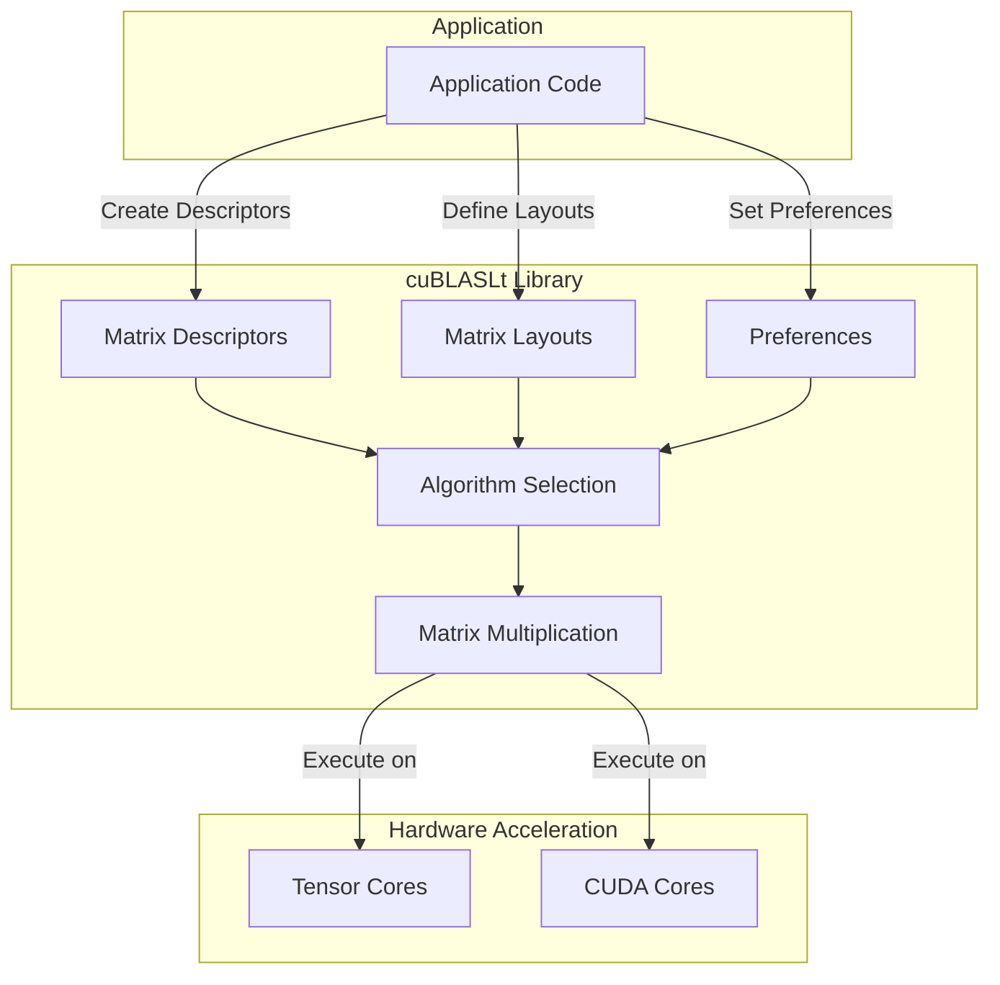

Sources: [cuBLASLt/LtFp8Matmul/sample_cublasLt_LtFp8Matmul.cu:65-96](), [cuBLASLt/LtNvfp4Matmul/sample_cublasLt_LtNvfp4Matmul.cu:66-96]()

## Key Components and Workflow

The cuBLASLt API revolves around several key objects that must be created and configured before performing matrix multiplication:

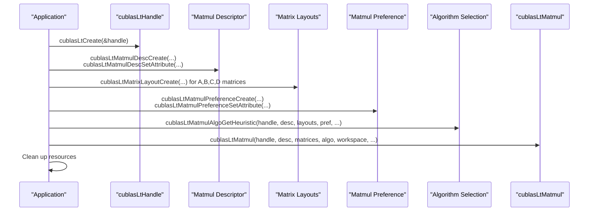

Sources: [cuBLASLt/LtFp8Matmul/sample_cublasLt_LtFp8Matmul.cu:61-129](), [cuBLASLt/LtNvfp4Matmul/sample_cublasLt_LtNvfp4Matmul.cu:65-140]()

## Supported Data Types

cuBLASLt supports various precision formats, with special emphasis on low-precision formats that can leverage Tensor Cores for acceleration:

| Data Type | Description | Supported in |
|-----------|-------------|--------------|
| __nv_fp8_e4m3 | 8-bit floating point (4-bit exponent, 3-bit mantissa) | LtFp8Matmul, LtMxfp8Matmul |
| __nv_fp4_e2m1 | 4-bit floating point (2-bit exponent, 1-bit mantissa) | LtNvfp4Matmul |
| __nv_bfloat16 | Brain floating point (16-bit) | All examples as output type |
| __half | 16-bit floating point | Supporting examples |
| float | 32-bit floating point | Used for scaling and computation |

Sources: [cuBLASLt/LtFp8Matmul/sample_cublasLt_LtFp8Matmul.h:35-58](), [cuBLASLt/LtNvfp4Matmul/sample_cublasLt_LtNvfp4Matmul.h:34-65](), [cuBLASLt/Common/helpers.h:36-39]()

## Matrix Representation and Layouts

cuBLASLt represents matrices through the `cublasLtMatrixLayout_t` object, which defines the dimensions, data type, and memory layout of the matrix:

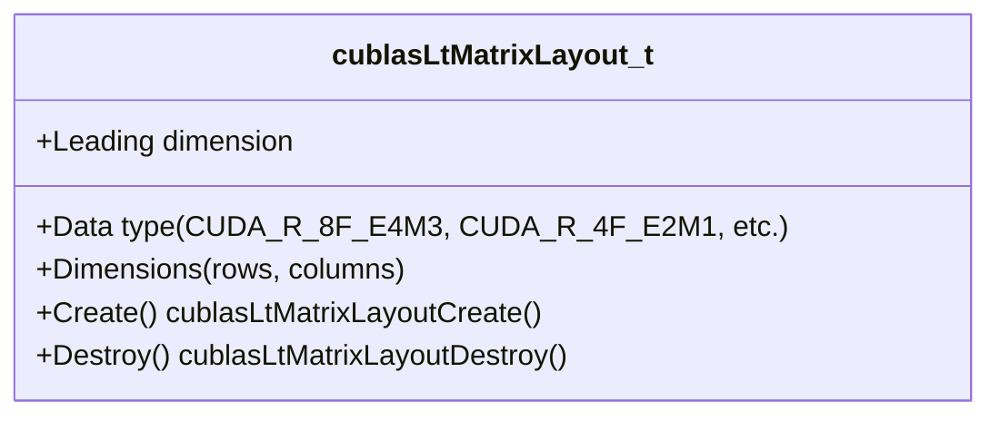

Sources: [cuBLASLt/LtFp8Matmul/sample_cublasLt_LtFp8Matmul.cu:86-89](), [cuBLASLt/LtNvfp4Matmul/sample_cublasLt_LtNvfp4Matmul.cu:97-100]()

## Matrix Operation Configuration

A key component of cuBLASLt is the matrix multiplication descriptor, which defines the operation parameters:

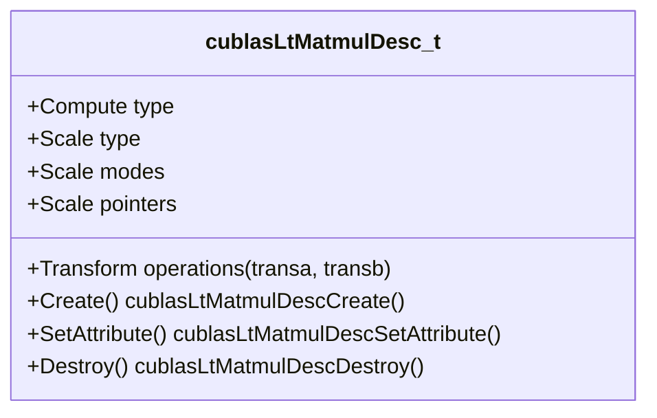

Sources: [cuBLASLt/LtFp8Matmul/sample_cublasLt_LtFp8Matmul.cu:71-82](), [cuBLASLt/LtNvfp4Matmul/sample_cublasLt_LtNvfp4Matmul.cu:76-93]()

## Special Features

### Scaling Modes

cuBLASLt supports various scaling modes for efficient low-precision operations:

| Scaling Mode | Description |
|--------------|-------------|
| CUBLASLT_MATMUL_MATRIX_SCALE_SCALAR_32F | Single scalar value for the entire matrix |
| CUBLASLT_MATMUL_MATRIX_SCALE_VEC32_UE8M0 | Vector scaling with 32-element blocks, using FP8 E8M0 format |
| CUBLASLT_MATMUL_MATRIX_SCALE_VEC16_UE4M3 | Vector scaling with 16-element blocks, using FP8 E4M3 format |

Sources: [cuBLASLt/Common/helpers.h:88-107](), [cuBLASLt/LtMxfp8Matmul/sample_cublasLt_LtMxfp8Matmul.cu:82-84]()

### Algorithm Selection

cuBLASLt provides algorithm selection capabilities through the `cublasLtMatmulPreference_t` and `cublasLtMatmulAlgoGetHeuristic` functions:

```mermaid
flowchart TD
    subgraph "Algorithm Selection Process"
        prefer["Create Preference<br>cublasLtMatmulPreferenceCreate()"]
        config["Configure Preference<br>set workspace size, etc."]
        heuristic["Get Algorithm<br>cublasLtMatmulAlgoGetHeuristic()"]
        execute["Execute<br>cublasLtMatmul()"]
    end
    
    prefer --> config
    config --> heuristic
    heuristic --> execute
```

Sources: [cuBLASLt/LtFp8Matmul/sample_cublasLt_LtFp8Matmul.cu:94-103](), [cuBLASLt/LtNvfp4Matmul/sample_cublasLt_LtNvfp4Matmul.cu:102-114]()

## Example Usage Patterns

cuBLASLt samples demonstrate different matrix multiplication operations based on data types and scaling methods:

### FP8 Matrix Multiplication

This example shows how to perform matrix multiplication using the FP8 data type with tensor scaling:

```mermaid
flowchart LR
    A["FP8 Input A"] --> scale1["A Scale<br>(float)"]
    B["FP8 Input B"] --> scale2["B Scale<br>(float)"]
    
    scale1 --> matmul["cuBLASLt<br>Matrix Multiply"]
    scale2 --> matmul
    
    C["BF16 Input C"] --> scale3["C Scale<br>(float)"]
    scale3 --> matmul
    
    matmul --> scale4["D Scale<br>(float)"]
    scale4 --> D["FP8 Output D"]
    
    matmul --> amax["amax_d<br>Maximum absolute value"]
```

Sources: [cuBLASLt/LtFp8Matmul/sample_cublasLt_LtFp8Matmul.h:35-58](), [cuBLASLt/LtFp8Matmul/sample_cublasLt_LtFp8Matmul.cu:40-59]()

### MXFP8 Matrix Multiplication (Mixed Precision FP8)

This example demonstrates matrix multiplication with block scaling using E8M0 format for scaling factors:

```mermaid
flowchart LR
    A["FP8 Input A"] --> scale1["A Scale<br>(FP8 E8M0)"]
    B["FP8 Input B"] --> scale2["B Scale<br>(FP8 E8M0)"]
    
    scale1 --> matmul["cuBLASLt<br>Matrix Multiply<br>with Block Scaling"]
    scale2 --> matmul
    
    C["BF16 Input C"] --> scale3["C Scale<br>(FP8 E8M0)"]
    scale3 --> matmul
    
    matmul --> D["FP8 Output D"]
    matmul --> outscale["Output Scale<br>(FP8 E8M0)"]
```

Sources: [cuBLASLt/LtMxfp8Matmul/sample_cublasLt_LtMxfp8Matmul.h:35-61](), [cuBLASLt/LtMxfp8Matmul/sample_cublasLt_LtMxfp8Matmul.cu:40-63]()

### NVFP4 Matrix Multiplication

This example shows matrix multiplication with the 4-bit FP4 data type:

```mermaid
flowchart LR
    A["FP4 Input A"] --> scale1["A Scale<br>(FP8 E4M3)"]
    B["FP4 Input B"] --> scale2["B Scale<br>(FP8 E4M3)"]
    
    scale1 --> matmul["cuBLASLt<br>Matrix Multiply<br>with Block Scaling"]
    scale2 --> matmul
    
    C["BF16 Input C"] --> scale3["C Scale<br>(FP8 E4M3)"]
    scale3 --> matmul
    
    matmul --> D["FP4 Output D"]
    matmul --> outscale["D Output Scale<br>(FP8 E4M3)"]
```

Sources: [cuBLASLt/LtNvfp4Matmul/sample_cublasLt_LtNvfp4Matmul.h:34-65](), [cuBLASLt/LtNvfp4Matmul/sample_cublasLt_LtNvfp4Matmul.cu:40-65]()

## Test Bench Helper

The samples include a `TestBench` template class that simplifies setting up and running cuBLASLt operations:

```mermaid
classDiagram
    class TestBench {
        -cublasLtHandle_t ltHandle
        -Device and host data pointers
        -Matrix dimensions
        -Scaling factors
        -Workspace
        +fillData() Initialize data
        +fillScales() Initialize scales
        +copyDataToDevice() Transfer to GPU
        +copyDataFromDevice() Transfer from GPU
        +run() Execute a function
    }
```

Sources: [cuBLASLt/Common/helpers.h:109-247]()

## Performance Considerations

1. **Workspace**: cuBLASLt can use a workspace buffer to enable more efficient algorithms, like split-K. The size of this workspace affects which algorithms are available.

2. **Algorithm Selection**: The `cublasLtMatmulAlgoGetHeuristic` function allows cuBLASLt to choose the most efficient algorithm based on matrix dimensions and hardware capabilities.

3. **Scaling Factors**: Proper use of scaling factors is crucial for maintaining numerical precision when using low-precision data types.

4. **Block Scaling**: For very low precision formats like FP4 and some FP8 operations, block scaling is essential for preserving a useful dynamic range.

Sources: [cuBLASLt/LtFp8Matmul/sample_cublasLt_LtFp8Matmul.cu:94-103](), [cuBLASLt/Common/helpers.h:88-107]()

## Best Practices

1. Always check the return status of cuBLASLt functions to ensure operations completed successfully.

2. Provide adequate workspace memory to enable the most efficient algorithms.

3. Properly align matrix data for best performance, ideally using `cudaMalloc` for matrix storage.

4. Clean up resources by destroying descriptors, layouts, and preferences once they are no longer needed.

5. For low precision types, carefully manage scaling factors to maintain numerical accuracy.

Sources: [cuBLASLt/LtFp8Matmul/sample_cublasLt_LtFp8Matmul.cu:123-128](), [cuBLASLt/LtNvfp4Matmul/sample_cublasLt_LtNvfp4Matmul.cu:134-139]()

## Related Pages

- [Low Precision Matrix Multiplication with cuBLASLt](#2.1.1)
- [Algorithm Selection with cuBLASLt](#2.1.2)
- [cuBLASMp - Distributed BLAS Operations](#2.2)

---

# Page: Low Precision Matrix Multiplication with cuBLASLt

# Low Precision Matrix Multiplication with cuBLASLt

<details>
<summary>Relevant source files</summary>

The following files were used as context for generating this wiki page:

- [cuBLASLt/Common/helpers.h](cuBLASLt/Common/helpers.h)
- [cuBLASLt/LtFp8Matmul/main.cpp](cuBLASLt/LtFp8Matmul/main.cpp)
- [cuBLASLt/LtFp8Matmul/sample_cublasLt_LtFp8Matmul.cu](cuBLASLt/LtFp8Matmul/sample_cublasLt_LtFp8Matmul.cu)
- [cuBLASLt/LtFp8Matmul/sample_cublasLt_LtFp8Matmul.h](cuBLASLt/LtFp8Matmul/sample_cublasLt_LtFp8Matmul.h)
- [cuBLASLt/LtMxfp8Matmul/main.cpp](cuBLASLt/LtMxfp8Matmul/main.cpp)
- [cuBLASLt/LtMxfp8Matmul/sample_cublasLt_LtMxfp8Matmul.cu](cuBLASLt/LtMxfp8Matmul/sample_cublasLt_LtMxfp8Matmul.cu)
- [cuBLASLt/LtMxfp8Matmul/sample_cublasLt_LtMxfp8Matmul.h](cuBLASLt/LtMxfp8Matmul/sample_cublasLt_LtMxfp8Matmul.h)
- [cuBLASLt/LtNvfp4Matmul/main.cpp](cuBLASLt/LtNvfp4Matmul/main.cpp)
- [cuBLASLt/LtNvfp4Matmul/sample_cublasLt_LtNvfp4Matmul.cu](cuBLASLt/LtNvfp4Matmul/sample_cublasLt_LtNvfp4Matmul.cu)
- [cuBLASLt/LtNvfp4Matmul/sample_cublasLt_LtNvfp4Matmul.h](cuBLASLt/LtNvfp4Matmul/sample_cublasLt_LtNvfp4Matmul.h)

</details>


## Purpose and Scope

This document explains how to perform matrix multiplication using low precision data types with cuBLASLt, focusing on FP8 (8-bit floating point), MXFP8 (matrix-extended 8-bit floating point), and FP4 (4-bit floating point) formats. These operations leverage Tensor Cores to achieve high performance while reducing memory footprint and bandwidth requirements. For algorithm selection features in cuBLASLt, see [Algorithm Selection with cuBLASLt](#2.1.2).

## Introduction to Low Precision Operations

Low precision matrix multiplication is crucial for deep learning and high-performance computing applications where performance and memory efficiency are priorities. cuBLASLt provides optimized implementations that leverage NVIDIA's Tensor Cores to accelerate these operations. Supported low precision formats include:

- FP8 (8-bit floating point, E4M3 format)  
- MXFP8 (8-bit matrix-extended floating point, E8M0 for scales)
- FP4 (4-bit floating point, E2M1 format)
- INT8 (8-bit integer)

The diagram below illustrates the precision formats supported by cuBLASLt:

```mermaid
graph LR
    subgraph "cuBLASLt Low Precision Formats"
        FP8["FP8 (E4M3)\n8-bit floating point"]
        FP4["FP4 (E2M1)\n4-bit floating point"]
        INT8["INT8\n8-bit integer"]
        MXFP8["MXFP8\nBlock-scaling enabled FP8"]
    end
    
    FP8 --- TENSOR["Tensor Cores"]
    FP4 --- TENSOR
    INT8 --- TENSOR
    MXFP8 --- TENSOR
    
    TENSOR --> PERF["High Performance\nMatrix Multiplication"]
```

Sources: [cuBLASLt/LtFp8Matmul/sample_cublasLt_LtFp8Matmul.cu:85-89](), [cuBLASLt/LtNvfp4Matmul/sample_cublasLt_LtNvfp4Matmul.cu:96-100]()

## Scaling in Low Precision Operations

Low precision formats require scaling to maintain numerical accuracy. cuBLASLt supports several scaling modes:

```mermaid
flowchart TD
    subgraph "Matrix Multiplication with Scaling"
        A["Input Matrix A\n(Low Precision)"] --> SCALE_A["Apply A_scale"]
        B["Input Matrix B\n(Low Precision)"] --> SCALE_B["Apply B_scale"]
        SCALE_A --> MM["Matrix Multiply Operation\nC = α×(A×B)+β×C"]
        SCALE_B --> MM
        C["Input Matrix C\n(Higher Precision)"] --> SCALE_C["Apply C_scale"]
        SCALE_C --> MM
        MM --> SCALE_D["Apply D_scale"]
        SCALE_D --> D["Output Matrix D\n(Low Precision)"]
    end
```

Sources: [cuBLASLt/LtFp8Matmul/sample_cublasLt_LtFp8Matmul.cu:77-82](), [cuBLASLt/LtMxfp8Matmul/sample_cublasLt_LtMxfp8Matmul.cu:86-89](), [cuBLASLt/LtNvfp4Matmul/sample_cublasLt_LtNvfp4Matmul.cu:90-93]()

### Scaling Modes

cuBLASLt supports different scaling modes for each matrix:

| Scaling Mode | Description | Typical Use Case |
|--------------|-------------|------------------|
| `CUBLASLT_MATMUL_MATRIX_SCALE_SCALAR_32F` | Single scalar scaling factor | Simple scaling |
| `CUBLASLT_MATMUL_MATRIX_SCALE_VEC32_UE8M0` | Vector of E8M0 values, 32 elements per block | MXFP8 block scaling |
| `CUBLASLT_MATMUL_MATRIX_SCALE_VEC16_UE4M3` | Vector of E4M3 values, 16 elements per block | NVFP4 block scaling |

Sources: [cuBLASLt/Common/helpers.h:88-107](), [cuBLASLt/LtMxfp8Matmul/sample_cublasLt_LtMxfp8Matmul.cu:81-84](), [cuBLASLt/LtNvfp4Matmul/sample_cublasLt_LtNvfp4Matmul.cu:83-87]()

## API Overview and Data Flow

The following diagram illustrates the key components and data flow when using cuBLASLt for low precision matrix multiplication:

```mermaid
graph TD
    subgraph "cuBLASLt Low Precision Matrix Multiplication"
        INIT["Initialize cuBLASLt\ncublasLtCreate()"]
        DESC["Create Operation Descriptor\ncublasLtMatmulDescCreate()"]
        LAYOUT["Create Matrix Layouts\ncublasLtMatrixLayoutCreate()"]
        SCALE["Set Scaling Factors\ncublasLtMatmulDescSetAttribute()"]
        PREF["Create Preference\ncublasLtMatmulPreferenceCreate()"]
        ALGO["Get Algorithm\ncublasLtMatmulAlgoGetHeuristic()"]
        MATMUL["Perform Matrix Multiplication\ncublasLtMatmul()"]
        CLEANUP["Cleanup Resources"]
        
        INIT --> DESC
        DESC --> SCALE
        DESC --> LAYOUT
        SCALE --> PREF
        LAYOUT --> PREF
        PREF --> ALGO
        ALGO --> MATMUL
        MATMUL --> CLEANUP
    end
```

Sources: [cuBLASLt/LtFp8Matmul/sample_cublasLt_LtFp8Matmul.cu:66-129](), [cuBLASLt/LtMxfp8Matmul/sample_cublasLt_LtMxfp8Matmul.cu:64-136](), [cuBLASLt/LtNvfp4Matmul/sample_cublasLt_LtNvfp4Matmul.cu:66-140]()

## Low Precision Data Types

cuBLASLt supports various low precision data types. The table below summarizes the key characteristics:

| Data Type | Description | Bits | Exponent Bits | Mantissa Bits | CUDA Type |
|-----------|-------------|------|---------------|---------------|-----------|
| FP8 (E4M3) | 8-bit floating point | 8 | 4 | 3 | `__nv_fp8_e4m3` |
| MXFP8 (E8M0) | 8-bit scaling factor | 8 | 8 | 0 | `__nv_fp8_e8m0` |
| FP4 (E2M1) | 4-bit floating point | 4 | 2 | 1 | `__nv_fp4_e2m1` |
| BF16 | Brain floating point | 16 | 8 | 7 | `__nv_bfloat16` |

Sources: [cuBLASLt/Common/helpers.h:29-39](), [cuBLASLt/Common/helpers.h:57-61]()

## Implementing Low Precision Matrix Multiplication

### Common Pattern

All low precision matrix multiplication implementations follow this general pattern:

1. Create a matrix multiplication descriptor
2. Configure scaling modes and pointers
3. Create matrix layouts
4. Set up algorithm preference
5. Find a suitable algorithm
6. Perform the matrix multiplication
7. Clean up resources

Sources: [cuBLASLt/LtFp8Matmul/sample_cublasLt_LtFp8Matmul.cu:40-129](), [cuBLASLt/LtMxfp8Matmul/sample_cublasLt_LtMxfp8Matmul.cu:40-136](), [cuBLASLt/LtNvfp4Matmul/sample_cublasLt_LtNvfp4Matmul.cu:40-140]()

### FP8 Matrix Multiplication

The `LtFp8Matmul` function demonstrates matrix multiplication using FP8 (E4M3) data type:

```mermaid
classDiagram
    class LtFp8Matmul {
        +cublasLtHandle_t ltHandle
        +matrices(m, n, k)
        +alpha, beta
        +a_scale, b_scale
        +c_scale, d_scale
        +A[FP8], B[FP8]
        +C[BF16], D[FP8]
        +amax_d
        +workspace
    }
    
    LtFp8Matmul --> cublasLtMatmulDesc_t
    LtFp8Matmul --> cublasLtMatrixLayout_t
    LtFp8Matmul --> cublasLtMatmulPreference_t
    LtFp8Matmul --> cublasLtMatmulHeuristicResult_t
```

Main characteristics:
- Uses FP8 (E4M3) for input matrices A and B
- Supports different precision for output (BF16 for C, FP8 for D)
- Provides per-tensor scaling factors
- Tracks maximum absolute values through `amax_d` for dynamic scaling

Sources: [cuBLASLt/LtFp8Matmul/sample_cublasLt_LtFp8Matmul.h:38-58](), [cuBLASLt/LtFp8Matmul/sample_cublasLt_LtFp8Matmul.cu:40-129]()

### MXFP8 Matrix Multiplication

The `LtMxfp8Matmul` function implements matrix multiplication with MXFP8 block scaling:

```mermaid
classDiagram
    class LtMxfp8Matmul {
        +cublasLtHandle_t ltHandle
        +matrices(m, n, k)
        +alpha, beta
        +a_scale[E8M0], b_scale[E8M0]
        +c_scale[E8M0]
        +A[FP8], B[FP8]
        +C[BF16], D[FP8]
        +d_out_scale[E8M0]
        +workspace
        +ScaleModes
    }
    
    LtMxfp8Matmul --> cublasLtMatmulDesc_t
    LtMxfp8Matmul --> cublasLtMatrixLayout_t
    LtMxfp8Matmul --> cublasLtMatmulPreference_t
    LtMxfp8Matmul --> cublasLtMatmulHeuristicResult_t
```

Main characteristics:
- Uses FP8 (E4M3) for input and output matrices
- Employs E8M0 format for scaling factors
- Supports block-wise scaling modes
- Configurable scaling modes for each matrix

Sources: [cuBLASLt/LtMxfp8Matmul/sample_cublasLt_LtMxfp8Matmul.h:38-61](), [cuBLASLt/LtMxfp8Matmul/sample_cublasLt_LtMxfp8Matmul.cu:40-136]()

### FP4 Matrix Multiplication

The `LtNvfp4Matmul` function demonstrates the lowest precision matrix multiplication with FP4 (E2M1):

```mermaid
classDiagram
    class LtNvfp4Matmul {
        +cublasLtHandle_t ltHandle
        +matrices(m, n, k)
        +alpha, beta
        +a_scale[E4M3], b_scale[E4M3]
        +c_scale[E4M3], d_scale[float]
        +A[FP4], B[FP4]
        +C[BF16], D[FP4]
        +d_out_scale[E4M3]
        +workspace
        +ScaleModes
    }
    
    LtNvfp4Matmul --> cublasLtMatmulDesc_t
    LtNvfp4Matmul --> cublasLtMatrixLayout_t
    LtNvfp4Matmul --> cublasLtMatmulPreference_t
    LtNvfp4Matmul --> cublasLtMatmulHeuristicResult_t
```

Main characteristics:
- Uses ultra-low 4-bit precision (E2M1) for input and output matrices
- Utilizes E4M3 format for scaling factors
- Requires special handling due to 4-bit packing (2 values per byte)
- Supports various block scaling modes

Sources: [cuBLASLt/LtNvfp4Matmul/sample_cublasLt_LtNvfp4Matmul.h:34-65](), [cuBLASLt/LtNvfp4Matmul/sample_cublasLt_LtNvfp4Matmul.cu:40-140]()

## Key Implementation Details

### Data Storage and Packing

For 4-bit precision (FP4), values are packed two per byte. The `StorageType` template handles this packing:

```mermaid
graph LR
    subgraph "FP4 Data Packing"
        FP4_1["FP4 Value 1"] --> PACKED["__nv_fp4x2_e2m1\n(Packed Storage)"]
        FP4_2["FP4 Value 2"] --> PACKED
        PACKED --> BYTE["Single Byte\n(8 bits)"]
    end
```

Sources: [cuBLASLt/Common/helpers.h:53-61](), [cuBLASLt/Common/helpers.h:63-71]()

### Matrix Layout and Dimensions

The process of creating matrix layouts involves specifying:
- Data type (e.g., CUDA_R_8F_E4M3, CUDA_R_4F_E2M1)
- Dimensions (rows, columns)
- Leading dimension
- Transform operations (transpose)

Sources: [cuBLASLt/LtFp8Matmul/sample_cublasLt_LtFp8Matmul.cu:86-89](), [cuBLASLt/LtNvfp4Matmul/sample_cublasLt_LtNvfp4Matmul.cu:97-100]()

### Block Scaling

Block scaling is crucial for maintaining precision in low-precision formats. The `getScaleTensorSize` function calculates the required size for scale tensors:

```mermaid
graph TD
    subgraph "Block Scaling Process"
        INP["Input Matrix\n(Low Precision)"] --> BLOCKS["Divide Into Blocks"]
        BLOCKS --> CALC["Calculate Scale\nPer Block"]
        CALC --> APPLY["Apply Scale\nDuring Computation"]
        APPLY --> RES["Result with\nImproved Accuracy"]
    end
```

Sources: [cuBLASLt/Common/helpers.h:88-107](), [cuBLASLt/LtMxfp8Matmul/sample_cublasLt_LtMxfp8Matmul.cu:81-84]()

## Usage Examples

### Basic FP8 Matrix Multiplication

The following example demonstrates how to use FP8 matrix multiplication:

```mermaid
sequenceDiagram
    participant App as Application
    participant TB as TestBench
    participant FP8MM as LtFp8Matmul
    participant cuBLASLt as cuBLASLt API
    
    App->>TB: Create TestBench<FP8>
    TB->>TB: Initialize matrices
    App->>TB: Call run()
    TB->>TB: Copy data to device
    TB->>FP8MM: Execute LtFp8Matmul
    FP8MM->>cuBLASLt: Setup descriptors
    FP8MM->>cuBLASLt: Set scaling factors
    FP8MM->>cuBLASLt: Create matrix layouts
    FP8MM->>cuBLASLt: Get algorithm
    FP8MM->>cuBLASLt: Perform matrix multiply
    FP8MM->>cuBLASLt: Cleanup resources
    TB->>TB: Copy results from device
    TB->>App: Return results
```

Sources: [cuBLASLt/LtFp8Matmul/main.cpp:38-67]()

### MXFP8 with Block Scaling

Example of using MXFP8 with block scaling:

```mermaid
sequenceDiagram
    participant App as Application
    participant TB as TestBench
    participant MXFP8MM as LtMxfp8Matmul
    participant cuBLASLt as cuBLASLt API
    
    App->>TB: Create TestBench with<br/>block scaling modes
    App->>TB: Call run()
    TB->>MXFP8MM: Execute LtMxfp8Matmul
    MXFP8MM->>cuBLASLt: Set scale modes
    MXFP8MM->>cuBLASLt: Setup with E8M0 scales
    MXFP8MM->>cuBLASLt: Perform matrix multiply
    TB->>App: Return results
```

Sources: [cuBLASLt/LtMxfp8Matmul/main.cpp:38-71]()

### Ultra-Low Precision FP4

Example of using FP4 matrix multiplication:

```mermaid
sequenceDiagram
    participant App as Application
    participant TB as TestBench
    participant FP4MM as LtNvfp4Matmul
    participant cuBLASLt as cuBLASLt API
    
    App->>TB: Create TestBench<FP4>
    App->>TB: Call run()
    TB->>FP4MM: Execute LtNvfp4Matmul
    FP4MM->>cuBLASLt: Setup with E2M1 type
    FP4MM->>cuBLASLt: Set VEC16_UE4M3 scale mode
    FP4MM->>cuBLASLt: Perform matrix multiply
    TB->>App: Return results
```

Sources: [cuBLASLt/LtNvfp4Matmul/main.cpp:38-73]()

## Performance Considerations

When using low precision matrix multiplication with cuBLASLt, consider the following:

1. **Workspace Size**: Larger workspace allows for more algorithm options, especially split-K algorithms
2. **Data Alignment**: Ensure matrices are properly aligned for optimal performance
3. **Scale Selection**: Appropriate scaling factors are crucial for numerical stability
4. **Algorithm Selection**: Use algorithm heuristics to find the best implementation
5. **Hardware Requirements**: Different precision formats require specific GPU architectures

For detailed performance optimization techniques, see [Performance Optimization](#7).

Sources: [cuBLASLt/LtFp8Matmul/sample_cublasLt_LtFp8Matmul.cu:91-96](), [cuBLASLt/LtMxfp8Matmul/sample_cublasLt_LtMxfp8Matmul.cu:97-102](), [cuBLASLt/LtNvfp4Matmul/sample_cublasLt_LtNvfp4Matmul.cu:101-106]()

## Common Pitfalls and Troubleshooting

- **Algorithm Not Found**: If `returnedResults == 0`, the requested operation may not be supported on the current hardware
- **Scaling Factors**: Improper scaling can lead to underflow/overflow or precision loss
- **Memory Allocation**: Ensure sufficient workspace is allocated for complex algorithms
- **Resource Cleanup**: Always properly destroy descriptors to prevent resource leaks
- **Hardware Compatibility**: Check that your GPU supports the desired precision format

Sources: [cuBLASLt/LtFp8Matmul/sample_cublasLt_LtFp8Matmul.cu:101-103](), [cuBLASLt/LtNvfp4Matmul/sample_cublasLt_LtNvfp4Matmul.cu:112-114]()

---

# Page: Algorithm Selection with cuBLASLt

# Algorithm Selection with cuBLASLt

<details>
<summary>Relevant source files</summary>

The following files were used as context for generating this wiki page:

- [cuBLASLt/Common/LtMatmulCustomFind.h](cuBLASLt/Common/LtMatmulCustomFind.h)
- [cuBLASLt/Common/helpers.cpp](cuBLASLt/Common/helpers.cpp)
- [cuBLASLt/LtSgemmCustomFind/CMakeLists.txt](cuBLASLt/LtSgemmCustomFind/CMakeLists.txt)
- [cuBLASLt/LtSgemmCustomFind/main.cpp](cuBLASLt/LtSgemmCustomFind/main.cpp)

</details>


## Purpose and Scope

This document explains how to use cuBLASLt's custom algorithm finding functionality to optimize matrix multiplication performance. cuBLASLt is a lightweight matrix multiplication library that provides a custom API for general matrix-matrix multiplication (GEMM) operations with a focus on performance tuning capabilities. This page specifically covers the algorithm selection process, which is essential for achieving optimal performance in matrix multiplication operations on NVIDIA GPUs.

For information about low precision matrix multiplication with cuBLASLt, see [Low Precision Matrix Multiplication with cuBLASLt](#2.1.1).

## Introduction to Algorithm Selection in cuBLASLt

cuBLASLt provides a mechanism to select the most optimal algorithm for a specific matrix multiplication task based on matrix dimensions, data types, and available hardware. While cuBLASLt has a built-in heuristic algorithm selection, the custom algorithm finding functionality allows for more fine-grained control and potentially better performance for specific workloads.

```mermaid
flowchart TD
    A["Matrix Multiplication Task"] --> B["Algorithm Selection"]
    B --> C["Automatic Selection\n(Built-in Heuristics)"]
    B --> D["Custom Algorithm Finding\n(Manual Exploration)"]
    D --> E["Test Multiple Algorithm Configurations"]
    E --> F["Measure Performance"]
    F --> G["Select Best Algorithm"]
    G --> H["Execute Matrix Multiplication\nwith Optimal Configuration"]
```

Sources: [cuBLASLt/Common/LtMatmulCustomFind.h:29-362]()

## Algorithm Configuration Parameters

cuBLASLt algorithms can be configured with various parameters that affect performance. The key configuration parameters include:

### Tile Size

The tile size defines how the matrices are partitioned for processing. Different tile sizes work better for different matrix dimensions.

```mermaid
flowchart LR
    tileConfig["cuBLASLt Tile Configuration"] --> smallTiles["Small Tiles\n(e.g., 8x8, 16x16)"]
    tileConfig --> mediumTiles["Medium Tiles\n(e.g., 32x32, 64x64)"] 
    tileConfig --> largeTiles["Large Tiles\n(e.g., 128x128, 256x256)"]
    
    smallTiles --> smallerMatrices["Better for smaller matrices"]
    mediumTiles --> balancedPerformance["Balanced performance"]
    largeTiles --> largerMatrices["Better for larger matrices"]
```

Sources: [cuBLASLt/Common/helpers.cpp:4-640](), [cuBLASLt/Common/LtMatmulCustomFind.h:235-264]()

### Split-K Mechanism

Split-K is a technique where the K dimension of the matrices is split into smaller parts to enable more parallelism during matrix multiplication.

```mermaid
flowchart TD
    splitK["Split-K Configuration"] --> noSplitK["No Split-K\n(Default)"]
    splitK --> withSplitK["With Split-K\n(Values: 2, 3, 4, 5, 6, 8, 12, 16, 32)"]
    
    withSplitK --> reductionScheme["Reduction Scheme Selection"]
    reductionScheme --> rs1["CUBLASLT_REDUCTION_SCHEME_NONE"]
    reductionScheme --> rs2["Other Reduction Schemes\n(Based on Hardware Support)"]
```

Sources: [cuBLASLt/Common/LtMatmulCustomFind.h:190-190](), [cuBLASLt/Common/LtMatmulCustomFind.h:276-314]()

### Other Configuration Parameters

Additional parameters that can be adjusted include:

| Parameter | Description |
|-----------|-------------|
| CTA Swizzling | Controls how Cooperative Thread Arrays are arranged, affecting memory access patterns |
| Custom Option | Implementation-specific options |
| Stages | Number of pipeline stages for matrix multiplication |
| Cluster Shape | For devices that support it, controls thread cluster configuration |

Sources: [cuBLASLt/Common/LtMatmulCustomFind.h:254-260](), [cuBLASLt/Common/LtMatmulCustomFind.h:265-272]()

## The Custom Algorithm Finding Process

The custom algorithm finding process in cuBLASLt involves systematically testing various algorithm configurations and measuring their performance to identify the optimal configuration for a specific matrix multiplication task.

```mermaid
sequenceDiagram
    participant App as "Application"
    participant Finder as "LtMatmulCustomFind"
    participant Runner as "customMatmulRun"
    participant cuBLASLt as "cuBLASLt Library"
    
    App->>Finder: Call with matrix parameters
    Note over Finder: Create descriptors for operation and matrices
    
    Finder->>cuBLASLt: Get available algorithm IDs
    cuBLASLt-->>Finder: Return algorithm IDs
    
    loop For each algorithm ID
        Finder->>cuBLASLt: Get algorithm capabilities
        cuBLASLt-->>Finder: Return capabilities (tiles, splitK, etc.)
        
        loop For all parameter combinations
            Finder->>Finder: Configure algorithm with parameters
            Finder->>Runner: Test algorithm configuration
            Runner->>cuBLASLt: Execute test run with configuration
            cuBLASLt-->>Runner: Return execution status and timing
            Runner-->>Finder: Return performance results
            Finder->>Finder: Store if successful
        end
    end
    
    Finder->>Finder: Sort results by execution time
    Finder->>App: Display performance results
```

Sources: [cuBLASLt/Common/LtMatmulCustomFind.h:159-362](), [cuBLASLt/Common/LtMatmulCustomFind.h:80-157]()

## Key Components for Algorithm Selection

### The customMatmulPerf_t Structure

This structure stores information about different algorithm trials, including:

```cpp
struct customMatmulPerf_t {
    cublasLtMatmulAlgo_t algo;    // Algorithm configuration
    cublasStatus_t status;        // Success or failure status
    float time;                   // Execution time
    size_t workspaceSize;         // Required workspace memory
    cublasMath_t mathMode;        // Math mode used
    cublasLtReductionScheme_t reductionScheme;  // Reduction scheme
    int customOption;             // Custom options
    float wavesCount;             // Hardware utilization metric
};
```

Sources: [cuBLASLt/Common/LtMatmulCustomFind.h:40-49]()

### The LtMatmulCustomFind Function

This is the main function that implements the algorithm finding functionality. It:
1. Creates operation and matrix descriptors
2. Retrieves available algorithm IDs
3. Tests various algorithm configurations
4. Sorts and returns performance results

Sources: [cuBLASLt/Common/LtMatmulCustomFind.h:159-362]()

### The customMatmulRun Function

This function tests a specific algorithm configuration by:
1. Checking if the algorithm is valid for the operation
2. Running the matrix multiplication multiple times
3. Measuring execution time
4. Returning performance results

Sources: [cuBLASLt/Common/LtMatmulCustomFind.h:80-157]()

## Using the Algorithm Finding Functionality

### Basic Usage Example

The following example demonstrates how to use the custom algorithm finding functionality:

```mermaid
flowchart LR
    init["Initialize Test Parameters\nTestBench<float>"] --> run["Run Matrix Multiplication\nLtMatmulCustomFind"]
    run --> result["Get Best Algorithm\nPrints sorted results"]
```

Sources: [cuBLASLt/LtSgemmCustomFind/main.cpp:37-64]()

### Step-by-Step Process

1. **Initialize Test Parameters**: Set up the matrix dimensions, alpha/beta values, and workspace size.
2. **Call LtMatmulCustomFind**: Pass the necessary parameters to test different algorithm configurations.
3. **Review Performance Results**: The function sorts and displays performance details for each configuration.
4. **Select the Best Algorithm**: The best-performing (fastest) valid algorithm will be listed first.

Sources: [cuBLASLt/LtSgemmCustomFind/main.cpp:37-64](), [cuBLASLt/Common/LtMatmulCustomFind.h:347-352]()

## Advanced Usage and Considerations

### Performance Analysis

Algorithm configurations are compared based on execution time. The `time_compare` function sorts configurations from fastest to slowest, considering only successful executions:

```cpp
inline bool time_compare(const customMatmulPerf_t &perf_a, const customMatmulPerf_t &perf_b) {
    return ((perf_a.status == CUBLAS_STATUS_SUCCESS) && (perf_a.time < perf_b.time));
}
```

Sources: [cuBLASLt/Common/LtMatmulCustomFind.h:77-79]()

### Workspace Requirements

Different algorithm configurations may require different amounts of workspace memory. The custom algorithm finder checks if the available workspace is sufficient for each configuration:

```mermaid
flowchart TD
    algoCheck["Check Algorithm Validity\ncublasLtMatmulAlgoCheck"] --> workspaceCheck{"Is workspace\nsufficient?"}
    workspaceCheck -->|Yes| runAlgo["Run Algorithm Test"]
    workspaceCheck -->|No| skipAlgo["Skip Algorithm\n(CUBLAS_STATUS_NOT_SUPPORTED)"]
```

Sources: [cuBLASLt/Common/LtMatmulCustomFind.h:105-153]()

### Algorithm Information Retrieval

The system retrieves detailed information about each algorithm configuration for reporting and analysis, including:
- Algorithm ID
- Tile size
- Split-K configuration
- Reduction scheme
- Swizzling pattern
- Custom options
- Pipeline stages

Sources: [cuBLASLt/Common/LtMatmulCustomFind.h:52-75]()

## Best Practices

1. **Set an Adequate Workspace Size**: Larger workspace sizes allow testing more algorithm configurations.
2. **Test with Representative Data**: Use matrix dimensions similar to your actual workload.
3. **Consider Reusing the Best Algorithm**: For repetitive operations with the same dimensions, save and reuse the best algorithm.
4. **Balance Testing Time and Performance**: Comprehensive testing takes time but can yield better performance.
5. **Conduct Multiple Runs**: The functionality runs each algorithm multiple times to ensure accurate timing.

Sources: [cuBLASLt/LtSgemmCustomFind/main.cpp:37-64](), [cuBLASLt/Common/LtMatmulCustomFind.h:195-195]()

## Summary

cuBLASLt's algorithm selection functionality provides a powerful mechanism to optimize matrix multiplication performance by systematically testing and comparing different algorithm configurations. By understanding and properly using this functionality, developers can achieve significant performance improvements for specific matrix multiplication workloads.

---

# Page: cuBLASMp - Distributed BLAS Operations

# cuBLASMp - Distributed BLAS Operations

<details>
<summary>Relevant source files</summary>

The following files were used as context for generating this wiki page:

- [cuBLASMp/CMakeLists.txt](cuBLASMp/CMakeLists.txt)
- [cuBLASMp/README.md](cuBLASMp/README.md)
- [cuBLASMp/helpers.h](cuBLASMp/helpers.h)
- [cuBLASMp/matrix_generator.hxx](cuBLASMp/matrix_generator.hxx)
- [cuBLASMp/pgeadd.cu](cuBLASMp/pgeadd.cu)
- [cuBLASMp/pgemm.cu](cuBLASMp/pgemm.cu)
- [cuBLASMp/pmatmul.cu](cuBLASMp/pmatmul.cu)
- [cuBLASMp/pmatmul_ar.cu](cuBLASMp/pmatmul_ar.cu)
- [cuBLASMp/psyrk.cu](cuBLASMp/psyrk.cu)
- [cuBLASMp/ptradd.cu](cuBLASMp/ptradd.cu)
- [cuBLASMp/ptrsm.cu](cuBLASMp/ptrsm.cu)

</details>


## Purpose and Scope

This document provides a detailed overview of cuBLASMp, NVIDIA's distributed implementation of Basic Linear Algebra Subprograms (BLAS) operations. cuBLASMp enables highly efficient execution of BLAS operations across multiple GPUs and multiple nodes, making it suitable for large-scale high-performance computing applications. This library is part of NVIDIA's suite of GPU-accelerated linear algebra libraries and specifically targets distributed computing environments.

For information about single-GPU matrix multiplication, see [cuBLASLt - Lightweight Matrix Multiplication](#2.1). For distributed linear solvers, see [cuSOLVERMp - Distributed Linear Solvers](#2.6).

## Overview

cuBLASMp provides distributed versions of common BLAS operations optimized for NVIDIA GPUs. It integrates with MPI for inter-node communication and supports NVSHMEM for efficient GPU-to-GPU communication. The library also uses the Communication Abstraction Layer (CAL) to provide a unified communication interface.

```mermaid
flowchart TD
    A["Application"] --> B["cuBLASMp API"]
    B --> C["Distributed Matrix Operations"]
    C --> D["Communication Layer"]
    D --> E["MPI"]
    D --> F["NVSHMEM"]
    D --> G["CAL"]
    C --> H["Local Matrix Operations"]
    H --> I["GPU Execution"]
    
    classDef plain fill:#fff,stroke:#333,stroke-width:1px;
    class A,B,C,D,E,F,G,H,I plain;
```

Sources: [cuBLASMp/pgemm.cu:4-45](), [cuBLASMp/pmatmul.cu:29-46](), [cuBLASMp/README.md:48-63]()

## Key Components

### Process Grid

cuBLASMp organizes processes in a 2D grid, similar to ScaLAPACK and other distributed BLAS implementations. The grid can be organized in row-major or column-major order.

```mermaid
flowchart TD
    subgraph "Process Grid (p=3, q=2)"
        P00["Process (0,0)"] --- P01["Process (0,1)"]
        P10["Process (1,0)"] --- P11["Process (1,1)"]
        P20["Process (2,0)"] --- P21["Process (2,1)"]
        
        P00 --- P10 --- P20
        P01 --- P11 --- P21
    end
    
    subgraph "Distributed Matrix"
        M["Matrix blocks distributed\nacross processes"]
    end
    
    M --> P00
    M --> P01
    M --> P10
    M --> P11
    M --> P20
    M --> P21
    
    classDef plain fill:#fff,stroke:#333,stroke-width:1px;
    class P00,P01,P10,P11,P20,P21,M plain;
```

Sources: [cuBLASMp/pgemm.cu:106-107](), [cuBLASMp/helpers.h:91-114]()

### Matrix Distribution

Matrices are distributed in blocks across the process grid. Each process owns a subset of the matrix blocks based on its position in the grid.

```mermaid
graph TB
    subgraph "Global Matrix"
        GM["Global Matrix"]
    end
    
    subgraph "Process Grid"
        P00["Process (0,0)"]
        P01["Process (0,1)"]
        P10["Process (1,0)"]
        P11["Process (1,1)"]
    end
    
    subgraph "Local Matrix Blocks"
        LM00["Local Block (0,0)"]
        LM01["Local Block (0,1)"]
        LM10["Local Block (1,0)"]
        LM11["Local Block (1,1)"]
    end
    
    GM --> LM00
    GM --> LM01
    GM --> LM10
    GM --> LM11
    
    LM00 --> P00
    LM01 --> P01
    LM10 --> P10
    LM11 --> P11
    
    classDef plain fill:#fff,stroke:#333,stroke-width:1px;
    class GM,P00,P01,P10,P11,LM00,LM01,LM10,LM11 plain;
```

Sources: [cuBLASMp/matrix_generator.hxx:36-91](), [cuBLASMp/pgemm.cu:152-175]()

## Core Concepts

### Descriptors

cuBLASMp uses several descriptor types to manage distributed operations:

#### cublasMpHandle_t

The main handle for cuBLASMp operations, initialized with a CUDA stream.

#### cublasMpGrid_t

Represents the process grid configuration for distributed operations.

#### cublasMpMatrixDescriptor_t

Describes a distributed matrix, including its global dimensions, block sizes, and distribution across the process grid.

#### cublasMpMatmulDescriptor_t

Used for the advanced matrix multiplication interface, allowing control over algorithm selection and communication patterns.

```mermaid
classDiagram
    class cublasMpHandle_t {
        CUDA stream
        Initialize with cublasMpCreate()
        Destroy with cublasMpDestroy()
    }
    
    class cublasMpGrid_t {
        Process rows (p)
        Process columns (q)
        Grid layout
        Communication library
        Create with cublasMpGridCreate()
        Destroy with cublasMpGridDestroy()
    }
    
    class cublasMpMatrixDescriptor_t {
        Global dimensions
        Block sizes (mb, nb)
        Leading dimension
        Data type
        Grid configuration
        Create with cublasMpMatrixDescriptorCreate()
        Destroy with cublasMpMatrixDescriptorDestroy()
    }
    
    class cublasMpMatmulDescriptor_t {
        Compute type
        Algorithm type
        Matrix operation modes
        Epilogue operation
        Create with cublasMpMatmulDescriptorCreate()
        Destroy with cublasMpMatmulDescriptorDestroy()
    }
    
    cublasMpHandle_t --> cublasMpGrid_t: uses
    cublasMpMatrixDescriptor_t --> cublasMpGrid_t: references
    cublasMpMatmulDescriptor_t --> cublasMpHandle_t: used with
```

Sources: [cuBLASMp/pgemm.cu:131-138](), [cuBLASMp/pmatmul.cu:89-97](), [cuBLASMp/pmatmul.cu:180-188]()

## Supported Operations

cuBLASMp supports the following distributed BLAS operations:

| Function | Description | File Example |
|----------|-------------|--------------|
| `cublasMpGemm` | General matrix-matrix multiplication | pgemm.cu |
| `cublasMpMatmul` | Advanced matrix multiplication with different algorithms | pmatmul.cu, pmatmul_ar.cu |
| `cublasMpTrsm` | Triangular solve with multiple right-hand sides | ptrsm.cu |
| `cublasMpSyrk` | Symmetric rank-k update | psyrk.cu |
| `cublasMpGeadd` | General matrix addition | pgeadd.cu |
| `cublasMpTradd` | Triangular matrix addition | ptradd.cu |

Sources: [cuBLASMp/CMakeLists.txt:62-68](), [cuBLASMp/README.md:9-21]()

### Distributed GEMM

The distributed general matrix multiplication (GEMM) operation computes:

```
C = alpha * op(A) * op(B) + beta * C
```

where op(X) can be X or X^T (transpose), and alpha and beta are scalars.

```mermaid
graph TD
    subgraph "Input Matrices"
        A["Matrix A\nDistributed across process grid"]
        B["Matrix B\nDistributed across process grid"]
        C["Matrix C\nDistributed across process grid"]
    end
    
    subgraph "cublasMpGemm"
        op["Distributed GEMM Operation"]
    end
    
    subgraph "Result"
        R["Updated Matrix C\nC = alpha*op(A)*op(B) + beta*C"]
    end
    
    A --> op
    B --> op
    C --> op
    op --> R
    
    classDef plain fill:#fff,stroke:#333,stroke-width:1px;
    class A,B,C,op,R plain;
```

Sources: [cuBLASMp/pgemm.cu:232-257]()

### Advanced Matrix Multiplication with cublasMpMatmul

The `cublasMpMatmul` function provides more control over the matrix multiplication algorithm and communication patterns. It supports different algorithm types:

- `CUBLASMP_MATMUL_ALGO_TYPE_SPLIT_P2P`: Uses point-to-point communication between processes
- `CUBLASMP_MATMUL_ALGO_TYPE_SPLIT_MULTICAST`: Uses multicast operations for communication

```mermaid
graph TD
    subgraph "Algorithm Types"
        A["CUBLASMP_MATMUL_ALGO_TYPE_SPLIT_P2P"]
        B["CUBLASMP_MATMUL_ALGO_TYPE_SPLIT_MULTICAST"]
    end
    
    subgraph "Matrix Operations"
        C["Allgather + Matmul"]
        D["Matmul + Reduce-Scatter"]
        E["Matmul + Allreduce"]
    end
    
    A --> C
    A --> D
    B --> E
    
    classDef plain fill:#fff,stroke:#333,stroke-width:1px;
    class A,B,C,D,E plain;
```

Sources: [cuBLASMp/pmatmul.cu:180](), [cuBLASMp/pmatmul.cu:334](), [cuBLASMp/pmatmul_ar.cu:145-146]()

### Communication Patterns

cuBLASMp uses different communication patterns depending on the operation and algorithm selected:

```mermaid
sequenceDiagram
    participant P1 as "Process 1"
    participant P2 as "Process 2"
    participant P3 as "Process 3"
    
    Note over P1,P3: Allgather + Matmul Pattern
    P1->>P2: Send local A blocks
    P1->>P3: Send local A blocks
    P2->>P1: Send local A blocks
    P2->>P3: Send local A blocks
    P3->>P1: Send local A blocks
    P3->>P2: Send local A blocks
    Note over P1,P3: Local matrix multiplication
    
    Note over P1,P3: Matmul + Reduce-Scatter Pattern
    Note over P1,P3: Local matrix multiplication
    P1->>P2: Send partial results
    P1->>P3: Send partial results
    P2->>P1: Send partial results
    P2->>P3: Send partial results
    P3->>P1: Send partial results
    P3->>P2: Send partial results
    
    Note over P1,P3: Matmul + Allreduce Pattern
    Note over P1,P3: Local matrix multiplication
    P1->>P2: Allreduce partial results
    P1->>P3: Allreduce partial results
    P2->>P1: Allreduce partial results
    P2->>P3: Allreduce partial results
    P3->>P1: Allreduce partial results
    P3->>P2: Allreduce partial results
```

Sources: [cuBLASMp/pmatmul.cu:117-275](), [cuBLASMp/pmatmul_ar.cu:116-235]()

## Usage Guide

### Initialization and Setup

To use cuBLASMp, you need to:

1. Initialize MPI
2. Create a CAL communication context
3. Initialize a cuBLASMp handle
4. Create a process grid
5. Create matrix descriptors

```mermaid
graph TD
    A["Initialize MPI\nMPI_Init()"] --> B["Set CUDA device\ncudaSetDevice()"]
    B --> C["Create CAL communication context\ncal_comm_create()"]
    C --> D["Create CUDA stream\ncudaStreamCreate()"]
    D --> E["Create cuBLASMp handle\ncublasMpCreate()"]
    E --> F["Create process grid\ncublasMpGridCreate()"]
    F --> G["Create matrix descriptors\ncublasMpMatrixDescriptorCreate()"]
    
    classDef plain fill:#fff,stroke:#333,stroke-width:1px;
    class A,B,C,D,E,F,G plain;
```

Sources: [cuBLASMp/pgemm.cu:81-196](), [cuBLASMp/pmatmul.cu:61-178]()

### Typical Workflow

The typical workflow for a cuBLASMp operation involves:

1. Set up the input and output matrices
2. Create descriptors for the matrices
3. Allocate workspace memory
4. Call the operation function
5. Clean up resources

```mermaid
graph TD
    A["Allocate device memory for matrices"] --> B["Create matrix descriptors"]
    B --> C["Calculate required workspace\ne.g., cublasMpGemm_bufferSize()"]
    C --> D["Allocate workspace memory"]
    D --> E["Execute operation\ne.g., cublasMpGemm()"]
    E --> F["Clean up resources"]
    
    classDef plain fill:#fff,stroke:#333,stroke-width:1px;
    class A,B,C,D,E,F plain;
```

Sources: [cuBLASMp/pgemm.cu:176-288](), [cuBLASMp/ptrsm.cu:154-255]()

### Example: Matrix Multiplication (GEMM)

The steps for performing a distributed matrix multiplication:

1. Initialize MPI and set up the environment
2. Allocate and initialize matrices on each process
3. Create matrix descriptors
4. Determine workspace requirements
5. Allocate workspace memory
6. Execute the GEMM operation
7. Clean up resources

Key functions involved:
- `cublasMpCreate`: Create a cuBLASMp handle
- `cublasMpGridCreate`: Create a process grid
- `cublasMpMatrixDescriptorCreate`: Create matrix descriptors
- `cublasMpGemm_bufferSize`: Determine workspace requirements
- `cublasMpGemm`: Execute the GEMM operation
- `cublasMpMatrixDescriptorDestroy`: Destroy matrix descriptors
- `cublasMpGridDestroy`: Destroy the process grid
- `cublasMpDestroy`: Destroy the cuBLASMp handle

Sources: [cuBLASMp/pgemm.cu:48-298]()

### Advanced Matrix Multiplication

For more control over the matrix multiplication algorithm and communication patterns, use the `cublasMpMatmul` function:

```mermaid
graph TD
    A["Create matmul descriptor\ncublasMpMatmulDescriptorCreate()"] --> 
    B["Set attributes\ncublasMpMatmulDescriptorAttributeSet()"]
    B --> C["Calculate workspace\ncublasMpMatmul_bufferSize()"]
    C --> D["Execute operation\ncublasMpMatmul()"]
    D --> E["Destroy descriptor\ncublasMpMatmulDescriptorDestroy()"]
    
    classDef plain fill:#fff,stroke:#333,stroke-width:1px;
    class A,B,C,D,E plain;
```

Sources: [cuBLASMp/pmatmul.cu:182-267](), [cuBLASMp/pmatmul_ar.cu:148-222]()

## Supported Data Types and Compute Types

cuBLASMp supports various data types for input and output matrices, as well as different compute types for the internal calculations:

| Input/Output Data Type | CUDA Data Type | Description |
|------------------------|---------------|-------------|
| `__half` | `CUDA_R_16F` | 16-bit floating-point (FP16) |
| `float` | `CUDA_R_32F` | 32-bit floating-point (FP32) |
| `double` | `CUDA_R_64F` | 64-bit floating-point (FP64) |

| Compute Type | cuBLAS Compute Type | Description |
|--------------|---------------------|-------------|
| `float` | `CUBLAS_COMPUTE_32F` | 32-bit floating-point computation |
| `double` | `CUBLAS_COMPUTE_64F` | 64-bit floating-point computation |

Sources: [cuBLASMp/pgemm.cu:50-55](), [cuBLASMp/pmatmul.cu:52-57](), [cuBLASMp/ptrsm.cu:189]()

## Performance Considerations

### Block Sizes

The block size parameters (mb, nb) affect both performance and communication overhead. Optimal block sizes depend on the matrix dimensions, the number of processes, and the hardware configuration.

### Process Grid Configuration

The process grid configuration (p, q) can significantly impact performance. For matrices with m ≈ n, a square process grid (p ≈ q) is often optimal. For rectangular matrices, the process grid should generally reflect the matrix aspect ratio.

### Algorithm Selection

Different algorithms have different communication patterns and performance characteristics:
- `SPLIT_P2P`: Generally better for smaller clusters or when processes have good point-to-point connectivity
- `SPLIT_MULTICAST`: Can be more efficient for larger clusters with efficient collective operations

### Communication Libraries

cuBLASMp can use different communication libraries:
- MPI: Widely available but may have higher overhead
- NVSHMEM: Can provide lower latency for GPU-to-GPU communication
- CAL: Provides a unified interface to different communication backends

Sources: [cuBLASMp/pmatmul.cu:180](), [cuBLASMp/pmatmul.cu:334](), [cuBLASMp/pmatmul_ar.cu:145-146](), [cuBLASMp/README.md:50]()

## Prerequisites and Dependencies

To use cuBLASMp, you need:

1. CUDA Toolkit
2. MPI implementation (e.g., HPC-X)
3. NVSHMEM
4. CAL (Communication Abstraction Layer)
5. GDRCOPY
6. C++11 compatible compiler

Sources: [cuBLASMp/README.md:48-63](), [cuBLASMp/CMakeLists.txt:11-20]()

## Sample Applications

The CUDA Library Samples repository includes several examples demonstrating the use of cuBLASMp:

| Sample | Description |
|--------|-------------|
| `pmatmul.cu` | Basic distributed matrix multiplication with different communication patterns |
| `pmatmul_ar.cu` | Matrix multiplication with allreduce |
| `pgemm.cu` | Standard distributed GEMM operation |
| `ptrsm.cu` | Triangular solve with multiple right-hand sides |
| `psyrk.cu` | Symmetric rank-k update |
| `pgeadd.cu` | General matrix addition |
| `ptradd.cu` | Triangular matrix addition |

Sources: [cuBLASMp/README.md:9-21](), [cuBLASMp/CMakeLists.txt:62-68]()

## Relation to Other NVIDIA Libraries

cuBLASMp is part of NVIDIA's suite of GPU-accelerated linear algebra libraries:

```mermaid
graph TD
    CUDA["CUDA Libraries"] --> Math["Mathematics Libraries"]
    Math --> LinearAlgebra["Linear Algebra"]
    
    LinearAlgebra --> cuBLAS["cuBLAS\nSingle-GPU BLAS"]
    LinearAlgebra --> cuBLASLt["cuBLASLt\nLightweight Matrix Multiply"]
    LinearAlgebra --> cuBLASMp["cuBLASMp\nDistributed BLAS"]
    LinearAlgebra --> cuSOLVER["cuSOLVER\nSingle-GPU Solvers"]
    LinearAlgebra --> cuSOLVERMp["cuSOLVERMp\nDistributed Solvers"]
    
    cuBLASMp -.-> cuBLAS
    cuSOLVERMp -.-> cuBLASMp
    
    classDef current fill:#fff,stroke:#333,stroke-width:2px;
    classDef plain fill:#fff,stroke:#333,stroke-width:1px;
    class cuBLASMp current;
    class CUDA,Math,LinearAlgebra,cuBLAS,cuBLASLt,cuSOLVER,cuSOLVERMp plain;
```

Sources: [cuBLASMp/README.md:42-44]()

---

# Page: cuSPARSELt - Structured Sparse Matrix Operations

# cuSPARSELt - Structured Sparse Matrix Operations

<details>
<summary>Relevant source files</summary>

The following files were used as context for generating this wiki page:

- [cuSPARSELt/README.md](cuSPARSELt/README.md)
- [cuSPARSELt/matmul/CMakeLists.txt](cuSPARSELt/matmul/CMakeLists.txt)
- [cuSPARSELt/matmul/Makefile](cuSPARSELt/matmul/Makefile)
- [cuSPARSELt/matmul/README.md](cuSPARSELt/matmul/README.md)
- [cuSPARSELt/matmul/matmul_example.cpp](cuSPARSELt/matmul/matmul_example.cpp)
- [cuSPARSELt/matmul_advanced/CMakeLists.txt](cuSPARSELt/matmul_advanced/CMakeLists.txt)
- [cuSPARSELt/matmul_advanced/Makefile](cuSPARSELt/matmul_advanced/Makefile)
- [cuSPARSELt/matmul_advanced/README.md](cuSPARSELt/matmul_advanced/README.md)
- [cuSPARSELt/matmul_advanced/matmul_advanced_example.cpp](cuSPARSELt/matmul_advanced/matmul_advanced_example.cpp)

</details>


## Purpose and Scope

This document provides a detailed overview of cuSPARSELt, a CUDA library specifically designed for accelerating structured sparse matrix operations using NVIDIA Tensor Cores. cuSPARSELt focuses on optimizing performance for sparse matrices with structured sparsity patterns, enabling significant computation savings while maintaining high throughput. 

For general sparse matrix operations with arbitrary sparsity patterns, see [cuSPARSE - Sparse Matrix Operations](#2.7).

Sources: [cuSPARSELt/README.md]()

## Structured Sparsity Overview

Structured sparsity provides a middle ground between dense matrix operations and completely unstructured sparse matrices. In cuSPARSELt, matrices follow specific sparsity patterns (typically 50% structured sparsity) that can be efficiently processed by Sparse Tensor Cores on NVIDIA GPUs.

```mermaid
flowchart LR
    subgraph "Matrix Representations"
        Dense["Dense Matrix\n100% non-zeros"]
        StructuredSparse["Structured Sparse Matrix\n50% non-zeros in specific pattern"]
        UnstructuredSparse["Unstructured Sparse Matrix\nArbitrary sparsity pattern"]
    end
    
    Dense -- "Pruning" --> StructuredSparse
    StructuredSparse -- "Compression" --> StructuredSparse
    
    subgraph "GPU Hardware"
        TensorCores["Tensor Cores"]
        SparseTensorCores["Sparse Tensor Cores"]
    end
    
    Dense -.-> TensorCores
    StructuredSparse -.-> SparseTensorCores
    UnstructuredSparse -.-> |"Not optimal"| SparseTensorCores
```

### Key Benefits

- **Computational Efficiency**: Reduces computation by up to 2x by skipping operations on zero elements
- **Memory Bandwidth Savings**: Structured compression format reduces memory requirements
- **Tensor Core Acceleration**: Leverages specialized Sparse Tensor Core hardware
- **Minimal Accuracy Impact**: Structured pruning preserves model accuracy in AI applications

Sources: [cuSPARSELt/matmul/README.md](), [cuSPARSELt/matmul_advanced/README.md]()

## Hardware Support

cuSPARSELt is supported on NVIDIA GPUs with the following compute capabilities:

| Compute Capability | GPU Architecture Examples |
|-------------------|---------------------------|
| SM 8.0 | NVIDIA A100 |
| SM 8.6 | NVIDIA RTX 3090, A2 |
| SM 8.7 | NVIDIA A30, A10 |
| SM 8.9 | NVIDIA RTX 4090, L4 |
| SM 9.0 | NVIDIA H100 |
| SM 10.0 | NVIDIA GB200, B100 |
| SM 12.0 | NVIDIA Blackwell generation |

The library will verify hardware compatibility at runtime and return an appropriate error code if the device is not supported.

Sources: [cuSPARSELt/matmul/matmul_example.cpp:108-124](), [cuSPARSELt/matmul_advanced/matmul_advanced_example.cpp:140-157]()

## Basic Workflow

The typical workflow for using cuSPARSELt involves the following steps:

```mermaid
flowchart TD
    Init["Initialize library\n(cusparseLtInit)"] --> Descriptors["Create matrix descriptors\n(cusparseLtStructuredDescriptorInit\ncusparseLtDenseDescriptorInit)"]
    Descriptors --> MatmulDesc["Create matmul descriptor\n(cusparseLtMatmulDescriptorInit)"]
    MatmulDesc --> AlgSelection["Algorithm selection\n(cusparseLtMatmulAlgSelectionInit)"]
    AlgSelection --> PlanInit["Initialize matmul plan\n(cusparseLtMatmulPlanInit)"]
    PlanInit --> Prune["Prune sparse matrix\n(cusparseLtSpMMAPrune)"]
    Prune --> CheckPrune["Verify pruning\n(cusparseLtSpMMAPruneCheck)"]
    CheckPrune --> Compress["Compress sparse matrix\n(cusparseLtSpMMACompress)"]
    Compress --> Search["Optional: Search best algorithm\n(cusparseLtMatmulSearch)"]
    Search --> MatMul["Perform matrix multiplication\n(cusparseLtMatmul)"]
    MatMul --> Cleanup["Destroy resources\n(cusparseLtMatDescriptorDestroy\ncusparseLtMatmulPlanDestroy\ncusparseLtDestroy)"]
```

Sources: [cuSPARSELt/matmul/matmul_example.cpp:199-296](), [cuSPARSELt/matmul_advanced/matmul_advanced_example.cpp:241-410]()

## Data Types and Precision

cuSPARSELt supports multiple data types for input matrices and computation:

| Matrix Data Types | Compute Types | Description |
|-------------------|---------------|-------------|
| `CUDA_R_16F` (FP16) | `CUSPARSE_COMPUTE_32F` | Half precision matrices, float computation |
| `CUDA_R_8I` (INT8) | `CUSPARSE_COMPUTE_32I` | 8-bit integer matrices, int32 computation |
| `CUDA_R_8F_E4M3` (FP8) | `CUSPARSE_COMPUTE_32F` | 8-bit float matrices (e4m3), float computation |
| `CUDA_R_16BF` (BF16) | `CUSPARSE_COMPUTE_32F` | BFloat16 matrices, float computation |

The code examples demonstrate the use of template helpers to map C++ types to CUDA data types:

```mermaid
classDiagram
    class "cuda_type<T>" {
        +cudaDataType value
    }
    class "cusparse_compute_type<T>" {
        +cusparseComputeType value
    }
    
    "cuda_type<T>" <|-- "cuda_type<__half>"
    "cuda_type<T>" <|-- "cuda_type<__nv_bfloat16>"
    "cuda_type<T>" <|-- "cuda_type<__nv_fp8_e4m3>"
    "cuda_type<T>" <|-- "cuda_type<int8_t>"
    "cuda_type<T>" <|-- "cuda_type<int>"
    
    "cusparse_compute_type<T>" <|-- "cusparse_compute_type<float>"
    "cusparse_compute_type<T>" <|-- "cusparse_compute_type<int>"
```

Sources: [cuSPARSELt/matmul/matmul_example.cpp:43-82](), [cuSPARSELt/matmul_advanced/matmul_advanced_example.cpp:48-92]()

## Key Components

### Matrix Descriptors

Three types of matrix descriptors are used:

1. **Structured Sparse Matrix (A)**: Created with `cusparseLtStructuredDescriptorInit`
2. **Dense Input Matrix (B)**: Created with `cusparseLtDenseDescriptorInit`
3. **Dense Output Matrix (C/D)**: Created with `cusparseLtDenseDescriptorInit`

These descriptors store information about matrix dimensions, layout, and data types.

```mermaid
graph LR
    subgraph "Matrix Operations D = α·A·B + β·C"
        A["Matrix A\n(Structured Sparse)"]
        B["Matrix B\n(Dense)"]
        C["Matrix C\n(Dense Input)"]
        D["Matrix D\n(Dense Output)"]
        
        A --> MM((MatMul))
        B --> MM
        MM --> Add
        C --> Add
        Add --> D
    end
    
    subgraph "Matrix Descriptors"
        matA["cusparseLtMatDescriptor_t matA\n(CUSPARSELT_SPARSITY_50_PERCENT)"]
        matB["cusparseLtMatDescriptor_t matB"]
        matC["cusparseLtMatDescriptor_t matC"]
    end
    
    A -.-> matA
    B -.-> matB
    C -.-> matC
    D -.-> matC
```

Sources: [cuSPARSELt/matmul/matmul_example.cpp:203-216](), [cuSPARSELt/matmul_advanced/matmul_advanced_example.cpp:249-261]()

### Pruning and Compression

Structured sparsity requires two key operations:

1. **Pruning**: Removes values according to structured sparsity patterns (typically 50% of values)
2. **Compression**: Compacts the pruned matrix to reduce memory footprint

The pruning operation is performed with `cusparseLtSpMMAPrune`, followed by a validation check with `cusparseLtSpMMAPruneCheck`. After successful pruning, the matrix is compressed with `cusparseLtSpMMACompress`.

Sources: [cuSPARSELt/matmul/matmul_example.cpp:238-263](), [cuSPARSELt/matmul_advanced/matmul_advanced_example.cpp:362-388]()

## Advanced Features

### Matrix Layouts and Operations

cuSPARSELt supports both row-major and column-major matrix layouts, as well as transpose operations:

| Layout Option | Description |
|---------------|-------------|
| `CUSPARSE_ORDER_ROW` | Row-major layout |
| `CUSPARSE_ORDER_COL` | Column-major layout |
| `CUSPARSE_OPERATION_NON_TRANSPOSE` | Use matrix as-is |
| `CUSPARSE_OPERATION_TRANSPOSE` | Use transposed matrix |

Sources: [cuSPARSELt/matmul/matmul_example.cpp:132-134](), [cuSPARSELt/matmul_advanced/matmul_advanced_example.cpp:167-169]()

### Batched Operations

cuSPARSELt supports batched matrix multiplication, allowing multiple matrix multiplications to be performed in a single operation. This is particularly useful for deep learning workloads.

```mermaid
graph TD
    subgraph "Batched MatMul Configuration"
        SetNumBatches["Set batch count\n(CUSPARSELT_MAT_NUM_BATCHES)"]
        SetBatchStride["Set batch stride\n(CUSPARSELT_MAT_BATCH_STRIDE)"]
    end
    
    subgraph "Memory Layout"
        BatchA["A₁\nA₂\n...\nAₙ"]
        BatchB["B₁\nB₂\n...\nBₙ"]
        BatchC["C₁\nC₂\n...\nCₙ"]
        BatchD["D₁\nD₂\n...\nDₙ"]
    end
    
    SetNumBatches --> BatchA
    SetNumBatches --> BatchB
    SetNumBatches --> BatchC
    SetBatchStride --> BatchA
    SetBatchStride --> BatchB
    SetBatchStride --> BatchC
```

The batch attributes are set using `cusparseLtMatDescSetAttribute` with:
- `CUSPARSELT_MAT_NUM_BATCHES`: Number of matrices in the batch
- `CUSPARSELT_MAT_BATCH_STRIDE`: Stride between consecutive matrices (can be zero for broadcasting)

Sources: [cuSPARSELt/matmul_advanced/matmul_advanced_example.cpp:263-288]()

### Activation Functions

cuSPARSELt supports fusion of activation functions with matrix multiplication. The ReLU activation function can be enabled and configured as shown below:

```mermaid
flowchart LR
    MatMul["Matrix Multiplication\nD = α·A·B + β·C + bias"] --> Activation["Activation Function\n(e.g., ReLU)"] --> Result["Final Output"]
    
    subgraph "ReLU Configuration"
        Enable["Enable ReLU\n(CUSPARSELT_MATMUL_ACTIVATION_RELU)"]
        UpperBound["Set upper bound\n(CUSPARSELT_MATMUL_ACTIVATION_RELU_UPPERBOUND)"]
        Threshold["Set threshold\n(CUSPARSELT_MATMUL_ACTIVATION_RELU_THRESHOLD)"]
    end
    
    Enable --> Activation
    UpperBound --> Activation
    Threshold --> Activation
```

Sources: [cuSPARSELt/matmul_advanced/matmul_advanced_example.cpp:303-318]()

### Bias Addition

cuSPARSELt supports adding a bias vector to the matrix multiplication results. This is particularly useful for neural network operations.

The bias pointer is set using `cusparseLtMatmulDescSetAttribute` with `CUSPARSELT_MATMUL_BIAS_POINTER`.

Sources: [cuSPARSELt/matmul_advanced/matmul_advanced_example.cpp:321-330]()

### Split-K Algorithm

cuSPARSELt supports the Split-K algorithm for matrix multiplication, which divides the K dimension across multiple threads or thread blocks to improve parallelism.

```mermaid
flowchart TD
    subgraph "Split-K Configuration"
        GetSplitK["Get Split-K value\n(CUSPARSELT_MATMUL_SPLIT_K)"]
        GetSplitKMode["Get Split-K mode\n(CUSPARSELT_MATMUL_SPLIT_K_MODE)"]
        GetSplitKBuffers["Get Split-K buffers\n(CUSPARSELT_MATMUL_SPLIT_K_BUFFERS)"]
    end
    
    subgraph "Split-K Modes"
        OneKernel["CUSPARSELT_SPLIT_K_MODE_ONE_KERNEL"]
        TwoKernels["CUSPARSELT_SPLIT_K_MODE_TWO_KERNELS"]
    end
    
    GetSplitKMode --> OneKernel
    GetSplitKMode --> TwoKernels
```

Sources: [cuSPARSELt/matmul_advanced/matmul_advanced_example.cpp:340-359]()

### Algorithm Selection

cuSPARSELt provides an algorithm search functionality to find the optimal kernel for a given matrix multiplication:

```mermaid
flowchart LR
    AlgDefault["Default Algorithm"] --> Search["Algorithm Search\n(cusparseLtMatmulSearch)"] --> OptimalAlg["Optimal Algorithm"]
    
    subgraph "Search Configuration"
        Matrices["Input/Output Matrices"]
        Scalars["α and β values"]
        Workspace["Workspace memory"]
    end
    
    Matrices --> Search
    Scalars --> Search
    Workspace --> Search
```

Sources: [cuSPARSELt/matmul/matmul_example.cpp:270-277]()

## Complete Example Workflow

The full workflow for structured sparse matrix multiplication with cuSPARSELt is illustrated below:

```mermaid
sequenceDiagram
    participant App as Application
    participant cuSPARSELt as cuSPARSELt Library
    participant GPU as GPU Memory
    
    App->>cuSPARSELt: cusparseLtInit(&handle)
    App->>GPU: Allocate matrices (dA, dB, dC)
    App->>GPU: Transfer data (Host to Device)
    
    App->>cuSPARSELt: Create matrix descriptors
    App->>cuSPARSELt: cusparseLtMatmulDescriptorInit
    App->>cuSPARSELt: cusparseLtMatmulAlgSelectionInit
    App->>cuSPARSELt: cusparseLtMatmulPlanInit
    
    App->>cuSPARSELt: cusparseLtSpMMAPrune (dA, dA)
    App->>cuSPARSELt: cusparseLtSpMMAPruneCheck (dA, d_valid)
    App->>GPU: Check is_valid flag
    
    App->>cuSPARSELt: cusparseLtSpMMACompressedSize
    App->>GPU: Allocate compressed matrix memory
    App->>cuSPARSELt: cusparseLtSpMMACompress (dA, dA_compressed)
    
    App->>cuSPARSELt: cusparseLtMatmulGetWorkspace
    App->>GPU: Allocate workspace memory
    
    opt Algorithm Search
        App->>cuSPARSELt: cusparseLtMatmulSearch
    end
    
    App->>cuSPARSELt: cusparseLtMatmul (dA_compressed, dB, dC, dD)
    App->>GPU: Transfer results (Device to Host)
    
    App->>cuSPARSELt: Cleanup resources
    App->>GPU: Free device memory
```

Sources: [cuSPARSELt/matmul/matmul_example.cpp:108-364](), [cuSPARSELt/matmul_advanced/matmul_advanced_example.cpp:140-487]()

## Error Handling

cuSPARSELt functions return `cusparseStatus_t` values that should be checked for errors. The examples use a `CHECK_CUSPARSE` macro to simplify error handling:

```cpp
#define CHECK_CUSPARSE(func)                                                   \
{                                                                              \
    cusparseStatus_t status = (func);                                          \
    if (status != CUSPARSE_STATUS_SUCCESS) {                                   \
        printf("CUSPARSE API failed at line %d with error: %s (%d)\n",         \
               __LINE__, cusparseGetErrorString(status), status);              \
        return EXIT_FAILURE;                                                   \
    }                                                                          \
}
```

Sources: [cuSPARSELt/matmul/matmul_example.cpp:94-102](), [cuSPARSELt/matmul_advanced/matmul_advanced_example.cpp:104-112]()

## Conclusion

cuSPARSELt provides specialized functionality for structured sparse matrix operations, offering significant performance benefits for applications that can leverage 50% structured sparsity. The library integrates with NVIDIA's Sparse Tensor Cores to accelerate computation while reducing memory requirements.

For more advanced usage including batched operations, activation functions, and bias addition, see [Advanced Features in cuSPARSELt](#2.3.2).

For basic sparse matrix multiplication examples, see [Sparse Matrix Multiplication with cuSPARSELt](#2.3.1).

Sources: [cuSPARSELt/README.md](), [cuSPARSELt/matmul/README.md](), [cuSPARSELt/matmul_advanced/README.md]()

---

# Page: Sparse Matrix Multiplication with cuSPARSELt

# Sparse Matrix Multiplication with cuSPARSELt

<details>
<summary>Relevant source files</summary>

The following files were used as context for generating this wiki page:

- [cuSPARSELt/matmul/CMakeLists.txt](cuSPARSELt/matmul/CMakeLists.txt)
- [cuSPARSELt/matmul/Makefile](cuSPARSELt/matmul/Makefile)
- [cuSPARSELt/matmul/README.md](cuSPARSELt/matmul/README.md)
- [cuSPARSELt/matmul/matmul_example.cpp](cuSPARSELt/matmul/matmul_example.cpp)
- [cuSPARSELt/matmul_advanced/CMakeLists.txt](cuSPARSELt/matmul_advanced/CMakeLists.txt)
- [cuSPARSELt/matmul_advanced/Makefile](cuSPARSELt/matmul_advanced/Makefile)
- [cuSPARSELt/matmul_advanced/README.md](cuSPARSELt/matmul_advanced/README.md)
- [cuSPARSELt/matmul_advanced/matmul_advanced_example.cpp](cuSPARSELt/matmul_advanced/matmul_advanced_example.cpp)

</details>


## Purpose and Scope

This document covers the implementation and usage of sparse matrix multiplication operations using NVIDIA's cuSPARSELt library. cuSPARSELt is specialized for structured sparse matrix operations that can exploit NVIDIA Sparse Tensor Cores for significant performance acceleration. This page focuses on the core workflow for performing sparse matrix multiplication, including matrix initialization, pruning, compression, and execution, as well as advanced features like batched operations and activation functions. For information on additional advanced features like split-K algorithms and custom pruning, see [Advanced Features in cuSPARSELt](#2.3.2).

## Overview

cuSPARSELt accelerates sparse matrix multiplication by leveraging structured sparsity patterns and specialized hardware acceleration. Unlike traditional sparse formats that can handle arbitrary sparsity patterns, cuSPARSELt focuses on structured sparsity (typically 50% sparsity) to take advantage of Sparse Tensor Core acceleration on NVIDIA GPUs.

```mermaid
graph TB
    subgraph "cuSPARSELt Operations"
        A["Matrix A\n(Structured Sparse)"] --> |"Prune"| A1["Pruned Matrix A"]
        A1 --> |"Compress"| A2["Compressed Matrix A"]
        
        B["Matrix B\n(Dense)"] --> M
        A2 --> M["cusparseLtMatmul"]
        C["Matrix C\n(Dense)"] --> M
        
        M --> |"alpha*A*B + beta*C"| D["Result Matrix D"]
        
        Opt["Optional Features"] -.-> M
    end
    
    subgraph "Optional Features"
        direction LR
        Batch["Batched Operations"]
        Act["Activation Functions"]
        Bias["Bias Addition"]
        SplitK["Split-K Algorithm"]
    end
```

Sources: [cuSPARSELt/matmul/README.md:1-16](), [cuSPARSELt/matmul_advanced/README.md:1-17]()

## Hardware Requirements

cuSPARSELt requires specific NVIDIA GPU architectures with Sparse Tensor Core support:

| Compute Capability | GPU Architecture |
|-------------------|------------------|
| 8.0               | NVIDIA A100      |
| 8.6               | NVIDIA RTX 30 Series |
| 8.7               | NVIDIA L40, L4   |
| 8.9               | NVIDIA RTX 40 Series, L40S |
| 9.0               | NVIDIA H100      |
| 10.0              | NVIDIA GB200     |
| 12.0              | NVIDIA Blackwell |

The cuSPARSELt example code performs a compatibility check to ensure the GPU supports the required features:

```mermaid
graph TB
    Start["Start Application"] --> Check["Check GPU Compute Capability"]
    Check --> |"Compatible\n(8.0, 8.6, 8.7, 8.9, 9.0, 10.0, 12.0)"| Continue["Continue Execution"]
    Check --> |"Incompatible"| Exit["Exit with\nUNSUPPORTED status"]
```

Sources: [cuSPARSELt/matmul/matmul_example.cpp:109-125](), [cuSPARSELt/matmul_advanced/matmul_advanced_example.cpp:141-157](), [cuSPARSELt/matmul/README.md:34-38]()

## Data Types and Computation

cuSPARSELt supports multiple data types for input matrices and computation:

| Input Matrix Types | Computation Types | Output Matrix Types |
|--------------------|-------------------|---------------------|
| FP16 (`__half`)    | FP32 (`float`)    | FP16 (`__half`)     |
| FP8 (`__nv_fp8_e4m3`) | FP32 (`float`) | FP16 (`__half`)     |
| INT8 (`int8_t`)    | INT32 (`int`)     | INT8, FP16, or INT32 |

The library provides templated helper structures for mapping C++ types to CUDA data types:

```mermaid
classDiagram
    class "cuda_type" {
        +value: cudaDataType
    }
    
    class "cuda_type~__half~" {
        +value = CUDA_R_16F
    }
    
    class "cuda_type~__nv_fp8_e4m3~" {
        +value = CUDA_R_8F_E4M3
    }
    
    class "cuda_type~int8_t~" {
        +value = CUDA_R_8I
    }
    
    class "cusparse_compute_type" {
        +value: cusparseComputeType
    }
    
    class "cusparse_compute_type~float~" {
        +value = CUSPARSE_COMPUTE_32F
    }
    
    class "cusparse_compute_type~int~" {
        +value = CUSPARSE_COMPUTE_32I
    }
    
    "cuda_type" <|-- "cuda_type~__half~"
    "cuda_type" <|-- "cuda_type~__nv_fp8_e4m3~"
    "cuda_type" <|-- "cuda_type~int8_t~"
    
    "cusparse_compute_type" <|-- "cusparse_compute_type~float~"
    "cusparse_compute_type" <|-- "cusparse_compute_type~int~"
```

Sources: [cuSPARSELt/matmul/matmul_example.cpp:18-82](), [cuSPARSELt/matmul_advanced/matmul_advanced_example.cpp:17-92]()

## Basic Workflow

The basic workflow for performing sparse matrix multiplication with cuSPARSELt involves several key steps:

```mermaid
flowchart TD
    subgraph "Initialization"
        Init["Initialize cuSPARSELt handle\ncusparseLtInit()"]
        MatDesc["Initialize matrix descriptors\ncusparseLtStructuredDescriptorInit()\ncusparseLtDenseDescriptorInit()"]
        MatMulDesc["Initialize matmul descriptor\ncusparseLtMatmulDescriptorInit()"]
        AlgSel["Initialize algorithm selection\ncusparseLtMatmulAlgSelectionInit()"]
        Plan["Initialize matmul plan\ncusparseLtMatmulPlanInit()"]
    end
    
    subgraph "Matrix Processing"
        Prune["Prune sparse matrix\ncusparseLtSpMMAPrune()"]
        Check["Check pruning validity\ncusparseLtSpMMAPruneCheck()"]
        CompSize["Get compressed size\ncusparseLtSpMMACompressedSize()"]
        Compress["Compress sparse matrix\ncusparseLtSpMMACompress()"]
        WS["Get workspace size\ncusparseLtMatmulGetWorkspace()"]
    end
    
    subgraph "Execution"
        Search["Optional: Search for best algorithm\ncusparseLtMatmulSearch()"]
        Multiply["Perform matrix multiplication\ncusparseLtMatmul()"]
    end
    
    subgraph "Cleanup"
        Destroy["Destroy resources\ncusparseLtMatDescriptorDestroy()\ncusparseLtMatmulPlanDestroy()\ncusparseLtDestroy()"]
    end
    
    Init --> MatDesc --> MatMulDesc --> AlgSel --> Plan
    Plan --> Prune --> Check
    Check --> |"Valid"| CompSize --> Compress --> WS
    WS --> Search --> Multiply
    Check --> |"Invalid"| Error["Error: Invalid pruning"]
    Multiply --> Destroy
```

Sources: [cuSPARSELt/matmul/matmul_example.cpp:193-296]()

### 1. Initialization

The first step is to initialize the cuSPARSELt handle and create descriptors for the matrices and the matrix multiplication operation:

```
cusparseLtHandle_t             handle;
cusparseLtMatDescriptor_t      matA, matB, matC;
cusparseLtMatmulDescriptor_t   matmul;
cusparseLtMatmulAlgSelection_t alg_sel;
cusparseLtMatmulPlan_t         plan;
```

Initialize the handle:
```
CHECK_CUSPARSE( cusparseLtInit(&handle) )
```

Create matrix descriptors, specifying that matrix A will have structured sparsity:
```
CHECK_CUSPARSE( cusparseLtStructuredDescriptorInit(
                                        &handle, &matA, num_A_rows,
                                        num_A_cols, lda, alignment,
                                        type_AB, order,
                                        CUSPARSELT_SPARSITY_50_PERCENT) )

CHECK_CUSPARSE( cusparseLtDenseDescriptorInit(
                                        &handle, &matB, num_B_rows,
                                        num_B_cols, ldb, alignment,
                                        type_AB, order) )
```

Sources: [cuSPARSELt/matmul/matmul_example.cpp:193-216]()

### 2. Matrix Multiplication Setup

Set up the matrix multiplication operation:

```
CHECK_CUSPARSE( cusparseLtMatmulDescriptorInit(
                                        &handle, &matmul, opA, opB,
                                        &matA, &matB, &matC, &matC,
                                        compute_type) )

CHECK_CUSPARSE( cusparseLtMatmulAlgSelectionInit(
                                        &handle, &alg_sel, &matmul,
                                        CUSPARSELT_MATMUL_ALG_DEFAULT) )

CHECK_CUSPARSE( cusparseLtMatmulPlanInit(&handle, &plan, &matmul, &alg_sel))
```

Sources: [cuSPARSELt/matmul/matmul_example.cpp:219-228]()

### 3. Pruning and Compression

Prune the sparse matrix to enforce the structured sparsity pattern:

```
CHECK_CUSPARSE( cusparseLtSpMMAPrune(&handle, &matmul, dA, dA,
                                     CUSPARSELT_PRUNE_SPMMA_TILE, stream) )
CHECK_CUSPARSE( cusparseLtSpMMAPruneCheck(&handle, &matmul, dA,
                                          d_valid, stream) )
```

Then compress the pruned matrix for optimized computation:

```
CHECK_CUSPARSE( cusparseLtSpMMACompressedSize(&handle, &plan,
                                              &compressed_size,
                                              &compressed_buffer_size) )
CHECK_CUSPARSE( cusparseLtSpMMACompress(&handle, &plan, dA, dA_compressed,
                                        dA_compressedBuffer, stream) )
```

Sources: [cuSPARSELt/matmul/matmul_example.cpp:237-264]()

### 4. Execution

Finally, perform the matrix multiplication:

```
CHECK_CUSPARSE( cusparseLtMatmul(&handle, &plan, &alpha, dA_compressed, dB,
                                 &beta, dC, dD, d_workspace, streams,
                                 num_streams) )
```

Sources: [cuSPARSELt/matmul/matmul_example.cpp:286-289]()

## Advanced Features

cuSPARSELt provides several advanced features for optimizing performance and extending functionality.

### Batched Operations

Batched operations allow processing multiple matrix multiplications in a single call:

```mermaid
graph TD
    A1["Matrix A (Batch 1)"] --> |"Prune &\nCompress"| A1C["Compressed A (Batch 1)"]
    AN["Matrix A (Batch N)"] --> |"Prune &\nCompress"| ANC["Compressed A (Batch N)"]
    
    A1C --> MatMul["cusparseLtMatmul"]
    ANC --> MatMul
    
    B1["Matrix B (Batch 1)"] --> MatMul
    BN["Matrix B (Batch N)"] --> MatMul
    
    C1["Matrix C (Batch 1)"] --> MatMul
    CN["Matrix C (Batch N)"] --> MatMul
    
    MatMul --> D1["Result D (Batch 1)"]
    MatMul --> DN["Result D (Batch N)"]
```

To use batched operations:

1. Set the number of batches for each matrix:
```
CHECK_CUSPARSE( cusparseLtMatDescSetAttribute(&handle, &matA,
                                            CUSPARSELT_MAT_NUM_BATCHES,
                                            &num_batches, sizeof(num_batches)) )
```

2. Set the stride between consecutive batches:
```
CHECK_CUSPARSE( cusparseLtMatDescSetAttribute(&handle, &matA,
                                            CUSPARSELT_MAT_BATCH_STRIDE,
                                            &batch_strideA,
                                            sizeof(batch_strideA)) )
```

Sources: [cuSPARSELt/matmul_advanced/matmul_advanced_example.cpp:264-288]()

### Activation Functions (ReLU)

cuSPARSELt supports applying activation functions like ReLU during matrix multiplication:

```
// Enable ReLU activation function
int   true_value       = 1;
float relu_upper_bound = 15.0f;
float relu_threshold   = 1.0f;
CHECK_CUSPARSE( cusparseLtMatmulDescSetAttribute(&handle, &matmul,
                                        CUSPARSELT_MATMUL_ACTIVATION_RELU,
                                        &true_value, sizeof(true_value)) )
CHECK_CUSPARSE( cusparseLtMatmulDescSetAttribute(
                            &handle, &matmul,
                            CUSPARSELT_MATMUL_ACTIVATION_RELU_UPPERBOUND,
                            &(relu_upper_bound),
                            sizeof(relu_upper_bound)) )
CHECK_CUSPARSE( cusparseLtMatmulDescSetAttribute(
                            &handle, &matmul,
                            CUSPARSELT_MATMUL_ACTIVATION_RELU_THRESHOLD,
                            &(relu_threshold), sizeof(relu_threshold)) )
```

Sources: [cuSPARSELt/matmul_advanced/matmul_advanced_example.cpp:303-318]()

### Bias Addition

cuSPARSELt can add a bias vector during matrix multiplication:

```
// Set bias pointer
void* dBias;
auto  hBias = new Bias_t[m];
for (int i = 0; i < m; i++)
    hBias[i] = static_cast<Bias_t>(1.0f);
CHECK_CUDA( cudaMalloc((void**) &dBias, m * sizeof(Bias_t)) )
CHECK_CUDA( cudaMemcpy(dBias, hBias, m * sizeof(Bias_t),
                       cudaMemcpyHostToDevice) )
CHECK_CUSPARSE( cusparseLtMatmulDescSetAttribute(&handle, &matmul,
                                            CUSPARSELT_MATMUL_BIAS_POINTER,
                                            &dBias, sizeof(dBias)) )
```

Sources: [cuSPARSELt/matmul_advanced/matmul_advanced_example.cpp:320-330]()

### Algorithm Search

cuSPARSELt can automatically search for the best algorithm for a specific matrix multiplication:

```
if (matmul_search) {
    CHECK_CUSPARSE( cusparseLtMatmulSearch(&handle, &plan, &alpha,
                                           dA_compressed, dB, &beta,
                                           dC, dD, nullptr,
                                           streams, num_streams) )
    // dC accumulates so reset dC for correctness check
    CHECK_CUDA( cudaMemcpy(dC, hC, C_size, cudaMemcpyHostToDevice) )
}
```

Sources: [cuSPARSELt/matmul/matmul_example.cpp:270-277]()

## Complete Matrix Multiplication Example

This diagram illustrates the complete workflow for sparse matrix multiplication using cuSPARSELt with advanced features:

```mermaid
graph TD
    Init["Initialize cuSPARSELt handle"] --> MatDesc["Create matrix descriptors\n(A with structured sparsity)"]
    MatDesc --> AdvCfg["Configure advanced features\n- Batching\n- Activation functions\n- Bias addition"]
    AdvCfg --> MatMulDesc["Initialize matmul descriptor"]
    MatMulDesc --> Plan["Create execution plan"]
    Plan --> Prune["Prune matrix A\n(enforce sparsity pattern)"]
    Prune --> Check["Check pruning validity"]
    Check --> |"Valid"| Compress["Compress matrix A"]
    Check --> |"Invalid"| Error["Error: Invalid pruning"]
    Compress --> WS["Allocate workspace"]
    WS --> Search["Optional: Search for optimal algorithm"]
    Search --> Exec["Execute matrix multiplication\nD = alpha*A*B + beta*C\n(with optional ReLU and bias)"]
    Exec --> Cleanup["Release resources"]
```

Sources: [cuSPARSELt/matmul/matmul_example.cpp:108-367](), [cuSPARSELt/matmul_advanced/matmul_advanced_example.cpp:140-488]()

## Code Example Walkthrough

Let's walk through a minimal example of using cuSPARSELt for sparse matrix multiplication, based on the sample code:

1. **Define data types and matrix dimensions**:
   ```cpp
   using AB_t = __half;   // Input matrices data type
   using C_t = __half;    // Output matrix data type
   using COMPUTE_t = float; // Computation type
   
   int m = 32; // Rows of A and C
   int n = 16; // Columns of B and C
   int k = 32; // Columns of A, rows of B
   ```

2. **Initialize cuSPARSELt and create matrix descriptors**:
   ```cpp
   cusparseLtHandle_t handle;
   cusparseLtInit(&handle);
   
   cusparseLtMatDescriptor_t matA, matB, matC;
   
   // Initialize matrix A with structured sparsity
   cusparseLtStructuredDescriptorInit(
       &handle, &matA, m, k, lda, alignment,
       CUDA_R_16F, CUSPARSE_ORDER_ROW,
       CUSPARSELT_SPARSITY_50_PERCENT);
   
   // Initialize dense matrices B and C
   cusparseLtDenseDescriptorInit(
       &handle, &matB, k, n, ldb, alignment,
       CUDA_R_16F, CUSPARSE_ORDER_ROW);
   
   cusparseLtDenseDescriptorInit(
       &handle, &matC, m, n, ldc, alignment,
       CUDA_R_16F, CUSPARSE_ORDER_ROW);
   ```

3. **Set up matrix multiplication operation**:
   ```cpp
   cusparseLtMatmulDescriptor_t matmul;
   cusparseLtMatmulDescriptorInit(
       &handle, &matmul, CUSPARSE_OPERATION_NON_TRANSPOSE,
       CUSPARSE_OPERATION_TRANSPOSE, &matA, &matB, &matC, &matC,
       CUSPARSE_COMPUTE_32F);
   
   cusparseLtMatmulAlgSelection_t alg_sel;
   cusparseLtMatmulAlgSelectionInit(
       &handle, &alg_sel, &matmul, CUSPARSELT_MATMUL_ALG_DEFAULT);
   
   cusparseLtMatmulPlan_t plan;
   cusparseLtMatmulPlanInit(&handle, &plan, &matmul, &alg_sel);
   ```

4. **Prune and compress the sparse matrix**:
   ```cpp
   // Prune the A matrix
   cusparseLtSpMMAPrune(&handle, &matmul, dA, dA,
                        CUSPARSELT_PRUNE_SPMMA_TILE, stream);
   
   // Verify pruning validity
   cusparseLtSpMMAPruneCheck(&handle, &matmul, dA, d_valid, stream);
   
   // Compress the pruned matrix
   size_t compressed_size, compressed_buffer_size;
   cusparseLtSpMMACompressedSize(&handle, &plan,
                                &compressed_size,
                                &compressed_buffer_size);
   
   // Allocate memory for compressed matrix
   cudaMalloc(&dA_compressed, compressed_size);
   cudaMalloc(&dA_compressedBuffer, compressed_buffer_size);
   
   // Compress matrix A
   cusparseLtSpMMACompress(&handle, &plan, dA, dA_compressed,
                          dA_compressedBuffer, stream);
   ```

5. **Execute the matrix multiplication**:
   ```cpp
   // Allocate workspace
   size_t workspace_size;
   cusparseLtMatmulGetWorkspace(&handle, &plan, &workspace_size);
   cudaMalloc(&d_workspace, workspace_size);
   
   // Perform multiplication: D = alpha*A*B + beta*C
   float alpha = 1.0f;
   float beta = 1.0f;
   cusparseLtMatmul(&handle, &plan, &alpha, dA_compressed, dB,
                   &beta, dC, dD, d_workspace, streams, num_streams);
   ```

6. **Clean up resources**:
   ```cpp
   cusparseLtMatDescriptorDestroy(&matA);
   cusparseLtMatDescriptorDestroy(&matB);
   cusparseLtMatDescriptorDestroy(&matC);
   cusparseLtMatmulPlanDestroy(&plan);
   cusparseLtDestroy(&handle);
   ```

Sources: [cuSPARSELt/matmul/matmul_example.cpp:126-367]()

## Summary

cuSPARSELt provides a specialized library for accelerating sparse matrix multiplication operations by leveraging structured sparsity patterns and NVIDIA's Sparse Tensor Cores. Key benefits include:

1. Performance acceleration for matrices with structured 50% sparsity
2. Support for multiple data types including FP16, FP8, and INT8
3. Advanced features like batched operations, activation functions, and bias addition
4. Automatic algorithm selection for optimal performance

When implementing sparse matrix multiplication with cuSPARSELt, follow the workflow of initialization, pruning, compression, and execution to achieve optimal performance.

Sources: [cuSPARSELt/matmul/README.md:1-44](), [cuSPARSELt/matmul_advanced/README.md:1-45]()

---

# Page: Advanced Features in cuSPARSELt

# Advanced Features in cuSPARSELt

<details>
<summary>Relevant source files</summary>

The following files were used as context for generating this wiki page:

- [cuSPARSELt/README.md](cuSPARSELt/README.md)
- [cuSPARSELt/matmul/CMakeLists.txt](cuSPARSELt/matmul/CMakeLists.txt)
- [cuSPARSELt/matmul/Makefile](cuSPARSELt/matmul/Makefile)
- [cuSPARSELt/matmul/README.md](cuSPARSELt/matmul/README.md)
- [cuSPARSELt/matmul/matmul_example.cpp](cuSPARSELt/matmul/matmul_example.cpp)
- [cuSPARSELt/matmul_advanced/CMakeLists.txt](cuSPARSELt/matmul_advanced/CMakeLists.txt)
- [cuSPARSELt/matmul_advanced/Makefile](cuSPARSELt/matmul_advanced/Makefile)
- [cuSPARSELt/matmul_advanced/README.md](cuSPARSELt/matmul_advanced/README.md)
- [cuSPARSELt/matmul_advanced/matmul_advanced_example.cpp](cuSPARSELt/matmul_advanced/matmul_advanced_example.cpp)

</details>


## Purpose and Scope

This document covers the advanced features available in the cuSPARSELt library beyond basic structured sparse matrix multiplication. While [Sparse Matrix Multiplication with cuSPARSELt](#2.3.1) introduces the fundamental concepts, this page focuses on techniques that enhance performance and functionality, including batched operations, activation functions, bias addition, and the Split-K algorithm.

## Overview

cuSPARSELt extends basic sparse matrix multiplication with features that are particularly valuable for deep learning and other compute-intensive applications where these operations are commonly performed within a single kernel for maximum efficiency.

The advanced features enable operations of the form:

```
C[i] = activation(alpha * A[i] * B[i] + beta * C[i] + bias)
```

Where:
- `A[i]` is a batched structured sparse matrix
- `B[i]` and `C[i]` are batched dense matrices
- `activation` is an optional activation function (e.g., ReLU)
- `bias` is an optional vector that gets added to each row of the result

## Batched Matrix Multiplication

Batched matrix multiplication allows processing multiple independent matrix multiplications in a single API call, which improves throughput and reduces API overhead.

### Configuring Batched Operations

To configure batched operations in cuSPARSELt:

1. Set the number of batches for each matrix descriptor:

```cpp
CHECK_CUSPARSE(cusparseLtMatDescSetAttribute(&handle, &matA,
                                        CUSPARSELT_MAT_NUM_BATCHES,
                                        &num_batches, sizeof(num_batches)))
```

2. Set the batch stride (the distance in memory between consecutive matrices):

```cpp
CHECK_CUSPARSE(cusparseLtMatDescSetAttribute(&handle, &matA,
                                        CUSPARSELT_MAT_BATCH_STRIDE,
                                        &batch_strideA,
                                        sizeof(batch_strideA)))
```

Note that if `batch_strideA` is set to 0, matrix A will be broadcast (reused) for all batch operations.

Sources: [cuSPARSELt/matmul_advanced/matmul_advanced_example.cpp:263-288]()

### Memory Layout for Batched Operations

The example below shows how batched matrix data is laid out in memory:

```mermaid
graph TD
    subgraph "Memory Layout"
        A1["Matrix A[0]"] --- A2["Matrix A[1]"] --- A3["..."] --- An["Matrix A[n-1]"]
        B1["Matrix B[0]"] --- B2["Matrix B[1]"] --- B3["..."] --- Bn["Matrix B[n-1]"]
        C1["Matrix C[0]"] --- C2["Matrix C[1]"] --- C3["..."] --- Cn["Matrix C[n-1]"]
    end
    
    A1 <-- "batch_strideA" --> A2
    B1 <-- "batch_strideB" --> B2
    C1 <-- "batch_strideC" --> C2
```

Sources: [cuSPARSELt/matmul_advanced/matmul_advanced_example.cpp:164-167](), [cuSPARSELt/matmul_advanced/matmul_advanced_example.cpp:274-288]()

## Activation Functions

cuSPARSELt supports applying activation functions directly after the matrix multiplication, which eliminates the need for separate kernel launches.

### ReLU Activation

The primary activation function supported is ReLU (Rectified Linear Unit), which can be configured with parameters for upper bound and threshold:

```cpp
// Enable ReLU activation function
int   true_value       = 1;
float relu_upper_bound = 15.0f;
float relu_threshold   = 1.0f;

CHECK_CUSPARSE(cusparseLtMatmulDescSetAttribute(&handle, &matmul,
                                    CUSPARSELT_MATMUL_ACTIVATION_RELU,
                                    &true_value, sizeof(true_value)));

CHECK_CUSPARSE(cusparseLtMatmulDescSetAttribute(
                            &handle, &matmul,
                            CUSPARSELT_MATMUL_ACTIVATION_RELU_UPPERBOUND,
                            &(relu_upper_bound),
                            sizeof(relu_upper_bound)));

CHECK_CUSPARSE(cusparseLtMatmulDescSetAttribute(
                            &handle, &matmul,
                            CUSPARSELT_MATMUL_ACTIVATION_RELU_THRESHOLD,
                            &(relu_threshold), sizeof(relu_threshold)));
```

This implements the ReLU function defined as:

```
ReLU(x) = 0                   if x ≤ threshold
ReLU(x) = min(x, upper_bound) if x > threshold
```

Sources: [cuSPARSELt/matmul_advanced/matmul_advanced_example.cpp:303-318](), [cuSPARSELt/matmul_advanced/matmul_advanced_example.cpp:420-424]()

## Bias Addition

For many operations like neural network layers, adding a bias vector is required. cuSPARSELt allows performing this operation within the same kernel that computes the matrix multiplication.

### Configuring Bias Addition

To add bias to the matrix multiplication:

1. Allocate and initialize the bias vector (one value per row of the output matrix):

```cpp
void* dBias;
auto  hBias = new Bias_t[m];
for (int i = 0; i < m; i++)
    hBias[i] = static_cast<Bias_t>(1.0f);
```

2. Set the bias pointer in the matmul descriptor:

```cpp
CHECK_CUSPARSE(cusparseLtMatmulDescSetAttribute(&handle, &matmul,
                                        CUSPARSELT_MATMUL_BIAS_POINTER,
                                        &dBias, sizeof(dBias)));
```

The bias is added to each row of the result matrix before the activation function is applied.

Sources: [cuSPARSELt/matmul_advanced/matmul_advanced_example.cpp:320-330](), [cuSPARSELt/matmul_advanced/matmul_advanced_example.cpp:443]()

## Split-K Algorithm

The Split-K algorithm is a technique that divides the K dimension of matrix multiplication across multiple parallel operations, which can improve performance for certain matrix shapes and sparsity patterns.

### Querying Split-K Information

After initializing the algorithm selection, you can query the Split-K parameters:

```cpp
int splitK, splitKBuffers;
cusparseLtSplitKMode_t splitKMode;

CHECK_CUSPARSE(cusparseLtMatmulAlgGetAttribute(&handle, &alg_sel,
                                   CUSPARSELT_MATMUL_SPLIT_K,
                                   &splitK, sizeof(splitK)));

CHECK_CUSPARSE(cusparseLtMatmulAlgGetAttribute(&handle, &alg_sel,
                                   CUSPARSELT_MATMUL_SPLIT_K_MODE,
                                   &splitKMode, sizeof(splitKMode)));

CHECK_CUSPARSE(cusparseLtMatmulAlgGetAttribute(&handle, &alg_sel,
                                   CUSPARSELT_MATMUL_SPLIT_K_BUFFERS,
                                   &splitKBuffers, sizeof(splitKBuffers)));
```

There are two Split-K modes:
- `CUSPARSELT_SPLIT_K_MODE_ONE_KERNEL`: Performs all computation in a single kernel call
- `CUSPARSELT_SPLIT_K_MODE_TWO_KERNELS`: Uses two kernels, one for the split computation and one for reduction

Sources: [cuSPARSELt/matmul_advanced/matmul_advanced_example.cpp:340-359]()

```mermaid
graph TD
    subgraph "Split-K Algorithm"
        MM["Matrix Multiplication"] --> |"Split K dimension"| SP["Split Computations"]
        SP --> |"SPLIT_K_MODE_ONE_KERNEL"| ONE["Single Kernel Computation + Reduction"]
        SP --> |"SPLIT_K_MODE_TWO_KERNELS"| TWO1["First Kernel: Computation"]
        TWO1 --> TWO2["Second Kernel: Reduction"]
    end
```

Sources: [cuSPARSELt/matmul_advanced/matmul_advanced_example.cpp:340-359]()

## Data Type Support

cuSPARSELt supports multiple data types for input and output matrices, allowing you to optimize for speed or precision according to your application needs.

### Supported Data Types

| Data Type | Description | Tensor Core Support |
|-----------|-------------|---------------------|
| FP16 (`__half`) | 16-bit floating-point | Yes |
| INT8 (`int8_t`) | 8-bit integer | Yes |
| FP8 (`__nv_fp8_e4m3`) | 8-bit floating-point (4 bits exponent, 3 bits mantissa) | Yes (on supported hardware) |

The data type selection affects the matrix types, compute type, and bias type:

```cpp
#if AB_TYPE == FP8
using AB_t         = __nv_fp8_e4m3;
using C_t          = __half;
using COMPUTE_t    = float;
using Bias_t       = C_t;
#elif AB_TYPE == FP16
using AB_t         = __half;
using C_t          = __half;
using COMPUTE_t    = float;
using Bias_t       = C_t;
#elif AB_TYPE == INT8
using AB_t         = int8_t;
using C_t          = int8_t; // can also be __half, __nv_bfloat16, int
using COMPUTE_t    = int;
using Bias_t       = float; 
#endif
```

Sources: [cuSPARSELt/matmul_advanced/matmul_advanced_example.cpp:19-46]()

## Complete Advanced Workflow

The following diagram shows the complete workflow when using advanced features in cuSPARSELt:

```mermaid
graph TD
    INIT["Initialize matrices and allocate memory"] --> DESC["Set up cuSPARSELt descriptors"]
    DESC --> BATCH["Configure batch parameters"]
    BATCH --> ADVF["Set up advanced features"]
    ADVF --> ALG["Initialize algorithm selection and plan"]
    ALG --> PRUNE["Prune sparse matrix"]
    PRUNE --> CHECK["Check pruning validity"]
    CHECK --> COMP["Compress sparse matrix"]
    COMP --> EXEC["Execute matrix multiplication"]
    EXEC --> CLEAN["Clean up resources"]
    
    subgraph "Advanced Features Configuration"
        ACT["Set ReLU activation"]
        BIAS["Configure bias pointer"]
        SPLITK["Query Split-K parameters"]
    end
    
    ADVF --> ACT
    ADVF --> BIAS
    ALG --> SPLITK
```

Sources: [cuSPARSELt/matmul_advanced/matmul_advanced_example.cpp:140-487]()

## Advanced vs. Basic Usage Comparison

The following table compares basic and advanced usage of cuSPARSELt:

| Feature | Basic Usage | Advanced Usage |
|---------|------------|----------------|
| Operation | `D = alpha * A * B + beta * C` | `D[i] = ReLU(alpha * A[i] * B[i] + beta * C[i] + bias)` |
| Batching | No | Yes, multiple matrices processed in one call |
| Activation | No | Yes, ReLU with configurable parameters |
| Bias | No | Yes, vector added to each row |
| Split-K | Not explicitly configured | Configurable and queryable |
| Data Types | Basic support | Extended support including FP8 |

Sources: [cuSPARSELt/matmul/matmul_example.cpp:107-367](), [cuSPARSELt/matmul_advanced/matmul_advanced_example.cpp:140-487](), [cuSPARSELt/matmul_advanced/README.md:1-46]()

## Hardware and Software Requirements

cuSPARSELt's advanced features require:

- CUDA 12.8 toolkit or above
- cusparseLt 0.7.0 or above
- GPU with compute capability 8.0, 8.6, 8.7, 8.9, 9.0, 10.0, or 12.0

The advanced features rely on Sparse Tensor Cores, which are only available on supported NVIDIA GPUs.

Sources: [cuSPARSELt/matmul_advanced/README.md:33-44]()

---

# Page: cuDSS - Direct Sparse Solver

# cuDSS - Direct Sparse Solver

<details>
<summary>Relevant source files</summary>

The following files were used as context for generating this wiki page:

- [README.md](README.md)
- [cuDSS/README.md](cuDSS/README.md)
- [cuDSS/get_set/CMakeLists.txt](cuDSS/get_set/CMakeLists.txt)
- [cuDSS/get_set/get_set.cpp](cuDSS/get_set/get_set.cpp)
- [cuDSS/memory_handler/CMakeLists.txt](cuDSS/memory_handler/CMakeLists.txt)
- [cuDSS/memory_handler/memory_handler.cpp](cuDSS/memory_handler/memory_handler.cpp)
- [cuDSS/simple/CMakeLists.txt](cuDSS/simple/CMakeLists.txt)
- [cuDSS/simple/simple.cpp](cuDSS/simple/simple.cpp)
- [cuDSS/simple_batch/CMakeLists.txt](cuDSS/simple_batch/CMakeLists.txt)
- [cuDSS/simple_batch/simple_batch.cpp](cuDSS/simple_batch/simple_batch.cpp)
- [cuDSS/simple_complex/CMakeLists.txt](cuDSS/simple_complex/CMakeLists.txt)
- [cuDSS/simple_complex/simple_complex.cpp](cuDSS/simple_complex/simple_complex.cpp)
- [cuDSS/simple_hybrid_memory_mode/CMakeLists.txt](cuDSS/simple_hybrid_memory_mode/CMakeLists.txt)
- [cuDSS/simple_hybrid_memory_mode/simple_hybrid_memory_mode.cpp](cuDSS/simple_hybrid_memory_mode/simple_hybrid_memory_mode.cpp)
- [cuDSS/simple_mgmn_mode/CMakeLists.txt](cuDSS/simple_mgmn_mode/CMakeLists.txt)
- [cuSOLVERSp2cuDSS/CMakeLists.txt](cuSOLVERSp2cuDSS/CMakeLists.txt)
- [cuSOLVERSp2cuDSS/README.md](cuSOLVERSp2cuDSS/README.md)
- [cuSOLVERSp2cuDSS/cuSolverRf2cuDSS.hpp](cuSOLVERSp2cuDSS/cuSolverRf2cuDSS.hpp)
- [cuSOLVERSp2cuDSS/cuSolverRf2cuDSS_double.cpp](cuSOLVERSp2cuDSS/cuSolverRf2cuDSS_double.cpp)
- [cuSOLVERSp2cuDSS/cuSolverSp2cuDSS.hpp](cuSOLVERSp2cuDSS/cuSolverSp2cuDSS.hpp)
- [cuSOLVERSp2cuDSS/cuSolverSp2cuDSS_dcomplex.cpp](cuSOLVERSp2cuDSS/cuSolverSp2cuDSS_dcomplex.cpp)
- [cuSOLVERSp2cuDSS/cuSolverSp2cuDSS_double.cpp](cuSOLVERSp2cuDSS/cuSolverSp2cuDSS_double.cpp)
- [cuSOLVERSp2cuDSS/cuSolverSp2cuDSS_float.cpp](cuSOLVERSp2cuDSS/cuSolverSp2cuDSS_float.cpp)
- [cuSOLVERSp2cuDSS/cuSolverSp2cuDSS_scomplex.cpp](cuSOLVERSp2cuDSS/cuSolverSp2cuDSS_scomplex.cpp)
- [cuSOLVERSp2cuDSS/test_complex.mtx](cuSOLVERSp2cuDSS/test_complex.mtx)
- [cuSOLVERSp2cuDSS/test_real.mtx](cuSOLVERSp2cuDSS/test_real.mtx)

</details>


cuDSS (CUDA Direct Sparse Solver) is a GPU-accelerated library for solving sparse linear systems of equations in the form Ax = b. It provides direct methods for efficiently solving sparse linear systems on NVIDIA GPUs, serving as the recommended replacement for the deprecated cuSOLVERSp and cuSOLVERRf libraries.

For information about transitioning from cuSOLVERSp or cuSOLVERRf, see [Migrating from cuSOLVERSp to cuDSS](#2.8).

## Position in CUDA Library Ecosystem

cuDSS is part of NVIDIA's linear algebra libraries within the CUDA ecosystem, specifically focused on direct solvers for sparse linear systems.

### Library Position in CUDA Ecosystem

```mermaid
graph TD
    CUDA["CUDA Libraries"] --> Math["Mathematics Libraries"]
    CUDA --> Image["Image Processing Libraries"]
    CUDA --> Data["Data Compression"]
    
    Math --> LinearAlgebra["Linear Algebra"]
    Math --> FFT["Fourier Transforms"]
    Math --> Random["Random Number Generation"]
    
    LinearAlgebra --> cuBLAS["cuBLAS\nBasic Linear Algebra"]
    LinearAlgebra --> cuSPARSE["cuSPARSE\nSparse Matrix Operations"]
    LinearAlgebra --> cuSOLVER["cuSOLVER\nEquation Solvers"]
    LinearAlgebra --> cuDSS["cuDSS\nDirect Sparse Solver"]
    
    classDef current stroke-width:2px;
    class cuDSS current;
```

Sources: [README.md:1-51](), [cuDSS/README.md:1-9]()

## Key Features

- Support for real and complex data types in various precisions
- Solvers for symmetric positive definite, symmetric indefinite, and general sparse matrices
- Hybrid memory mode for large problems where factors don't fit in GPU memory
- Multi-GPU and multi-node execution for distributed solving
- Batch processing capability for multiple systems
- Custom memory management through device memory handlers
- Comprehensive configuration options and information retrieval

Sources: [cuDSS/README.md:12-53](), [cuDSS/simple/simple.cpp:57-65]()

## Core Concepts

### Matrix Representations

cuDSS works with the following matrix formats:

- **Sparse Matrices**: CSR (Compressed Sparse Row) format for coefficient matrices
- **Dense Matrices**: Column-major format for right-hand sides and solutions

### Matrix Types and Views

```mermaid
graph TD
    Matrix["Matrix A"] --> Types["Matrix Types"]
    Matrix --> Views["Matrix Views"]
    Matrix --> Formats["Matrix Formats"]
    
    Types --> General["CUDSS_MTYPE_GENERAL\nGeneral non-symmetric"]
    Types --> Symmetric["CUDSS_MTYPE_SYMMETRIC\nSymmetric"]
    Types --> SPD["CUDSS_MTYPE_SPD\nSymmetric Positive Definite"]
    Types --> Hermitian["CUDSS_MTYPE_HERMITIAN\nHermitian"]
    
    Views --> Full["CUDSS_MVIEW_FULL\nFull matrix"]
    Views --> Upper["CUDSS_MVIEW_UPPER\nUpper triangular part"]
    Views --> Lower["CUDSS_MVIEW_LOWER\nLower triangular part"]
    
    Formats --> CSR["CSR Format\nCompressed Sparse Row"]
    Formats --> Dense["Dense Format"]
```

Sources: [cuDSS/simple/simple.cpp:223-230](), [cuDSS/simple_complex/simple_complex.cpp:238-245]()

### Solver Workflow

cuDSS operates in three distinct phases:

```mermaid
graph LR
    Input["Sparse Matrix A\nRight-hand side b"] --> Analysis["Analysis Phase\ncudssExecute(CUDSS_PHASE_ANALYSIS)\n- Matrix reordering\n- Symbolic factorization"]
    Analysis --> Factorization["Factorization Phase\ncudssExecute(CUDSS_PHASE_FACTORIZATION)\n- Numerical factorization"]
    Factorization --> Solve["Solve Phase\ncudssExecute(CUDSS_PHASE_SOLVE)\n- Forward/backward substitution\n- Iterative refinement"]
    Solve --> Output["Solution x"]
```

This three-phase separation allows for optimization when solving multiple systems with the same sparsity pattern but different numerical values.

Sources: [cuDSS/simple/simple.cpp:232-242](), [cuDSS/get_set/get_set.cpp:256-289, 357-364]()

### Memory Modes

cuDSS supports different memory management approaches:

```mermaid
graph TD
    subgraph "Device Memory Mode (Default)"
        DeviceInput["Input Data\non Device"] --> DeviceFactors["Factors\nin Device Memory"]
        DeviceFactors --> DeviceOutput["Output\non Device"]
    end
    
    subgraph "Hybrid Memory Mode"
        HybridInput["Input Data\non Device"] --> HybridFactors["Factors\nin Host Memory"]
        HybridFactors --> DeviceBuffer["Active Working Set\nin Device Buffer"]
        DeviceBuffer --> HybridOutput["Output\non Device"]
    end
    
    Note["Note: Hybrid mode for cases\nwhen factors don't fit\nin GPU memory"]
```

Sources: [cuDSS/simple_hybrid_memory_mode/simple_hybrid_memory_mode.cpp:59-72, 242-247](), [cuDSS/get_set/get_set.cpp:283-285]()

## Basic Usage

The typical workflow for using cuDSS involves creating handles and objects, solving the system, and cleanup:

```mermaid
sequenceDiagram
    participant App as "Application"
    participant Handle as "cudssHandle_t"
    participant Config as "cudssConfig_t"
    participant Data as "cudssData_t"
    participant Matrix as "cudssMatrix_t"
    
    App->>Handle: cudssCreate(&handle)
    App->>Handle: cudssSetStream(handle, stream)
    App->>Config: cudssConfigCreate(&config)
    App->>Data: cudssDataCreate(handle, &data)
    
    App->>Matrix: cudssMatrixCreateCsr(&A, ...)
    App->>Matrix: cudssMatrixCreateDn(&x, ...)
    App->>Matrix: cudssMatrixCreateDn(&b, ...)
    
    App->>Handle: cudssExecute(CUDSS_PHASE_ANALYSIS)
    App->>Handle: cudssExecute(CUDSS_PHASE_FACTORIZATION)
    App->>Handle: cudssExecute(CUDSS_PHASE_SOLVE)
    
    App->>Matrix: cudssMatrixDestroy(A)
    App->>Matrix: cudssMatrixDestroy(x)
    App->>Matrix: cudssMatrixDestroy(b)
    App->>Data: cudssDataDestroy(handle, data)
    App->>Config: cudssConfigDestroy(config)
    App->>Handle: cudssDestroy(handle)
```

### Basic Code Structure

Here's the typical sequence of operations:

1. Initialize the library
   ```c
   cudssHandle_t handle;
   cudssCreate(&handle);
   cudssSetStream(handle, stream);  // Optional
   ```

2. Create configuration and data objects
   ```c
   cudssConfig_t config;
   cudssData_t data;
   cudssConfigCreate(&config);
   cudssDataCreate(handle, &data);
   ```

3. Create matrix objects
   ```c
   cudssMatrix_t A, x, b;
   cudssMatrixCreateCsr(&A, rows, cols, nnz, offsets, NULL, columns, values, 
                       CUDA_R_32I, CUDA_R_64F, mtype, mview, base);
   cudssMatrixCreateDn(&x, rows, nrhs, ldx, x_values, CUDA_R_64F, CUDSS_LAYOUT_COL_MAJOR);
   cudssMatrixCreateDn(&b, cols, nrhs, ldb, b_values, CUDA_R_64F, CUDSS_LAYOUT_COL_MAJOR);
   ```

4. Execute solver phases
   ```c
   cudssExecute(handle, CUDSS_PHASE_ANALYSIS, config, data, A, x, b);
   cudssExecute(handle, CUDSS_PHASE_FACTORIZATION, config, data, A, x, b);
   cudssExecute(handle, CUDSS_PHASE_SOLVE, config, data, A, x, b);
   ```

5. Clean up resources
   ```c
   cudssMatrixDestroy(A);
   cudssMatrixDestroy(x);
   cudssMatrixDestroy(b);
   cudssDataDestroy(handle, data);
   cudssConfigDestroy(config);
   cudssDestroy(handle);
   ```

Sources: [cuDSS/simple/simple.cpp:198-250]()

## Advanced Features

### Configuration Options

cuDSS provides various configuration options through `cudssConfigSet`:

- Reordering algorithms
  ```c
  cudssAlgType_t reorder_alg = CUDSS_ALG_DEFAULT;
  cudssConfigSet(config, CUDSS_CONFIG_REORDERING_ALG, &reorder_alg, sizeof(cudssAlgType_t));
  ```

- Iterative refinement settings
  ```c
  int iter_ref_nsteps = 2;
  cudssConfigSet(config, CUDSS_CONFIG_IR_N_STEPS, &iter_ref_nsteps, sizeof(int));
  ```

- Memory mode selection
  ```c
  cudssMemoryMode_t memory_mode = CUDSS_MEMMODE_HYBRID;
  cudssConfigSet(config, CUDSS_CONFIG_MEMORY_MODE, &memory_mode, sizeof(cudssMemoryMode_t));
  ```

Sources: [cuDSS/get_set/get_set.cpp:233-235, 357-360](), [cuDSS/simple_hybrid_memory_mode/simple_hybrid_memory_mode.cpp:242-247]()

### Custom Memory Management

cuDSS allows for user-defined memory handling:

```c
// Define a memory handler
cudssDeviceMemHandler_t handler;
handler.ctx = context_ptr;
handler.device_alloc = custom_alloc_function;
handler.device_free = custom_free_function;

// Set the handler
cudssSetDeviceMemHandler(handle, &handler);
```

This feature is useful for integrating with application-specific memory pools or tracking memory usage.

Sources: [cuDSS/memory_handler/memory_handler.cpp:107-172, 254-258]()

### Batch Processing

For solving multiple sparse linear systems simultaneously:

```c
// Create batch matrices
cudssMatrixCreateBatchCsr(&A, batchCount, rows_array, cols_array, nnz_array, 
                         offsets_array, NULL, columns_array, values_array,
                         CUDA_R_32I, CUDA_R_64F, mtype, mview, base);
cudssMatrixCreateBatchDn(&x, batchCount, rows_array, nrhs_array, ldx_array,
                         x_values_array, CUDA_R_32I, CUDA_R_64F, CUDSS_LAYOUT_COL_MAJOR);
cudssMatrixCreateBatchDn(&b, batchCount, cols_array, nrhs_array, ldb_array,
                         b_values_array, CUDA_R_32I, CUDA_R_64F, CUDSS_LAYOUT_COL_MAJOR);

// Execute as usual - operates on all systems in the batch
cudssExecute(handle, CUDSS_PHASE_ANALYSIS, config, data, A, x, b);
cudssExecute(handle, CUDSS_PHASE_FACTORIZATION, config, data, A, x, b);
cudssExecute(handle, CUDSS_PHASE_SOLVE, config, data, A, x, b);
```

Sources: [cuDSS/simple_batch/simple_batch.cpp:297-323]()

### Retrieving Solver Information

cuDSS provides extensive information about the solve process:

```c
// Get permutation arrays
int row_perm[n];
cudssDataGet(handle, data, CUDSS_DATA_PERM_REORDER_ROW, &row_perm, sizeof(row_perm), &sizeWritten);

// Get factorization statistics
int npivots;
cudssDataGet(handle, data, CUDSS_DATA_NPIVOTS, &npivots, sizeof(npivots), &sizeWritten);

// Get matrix inertia (for indefinite matrices)
int inertia[2];
cudssDataGet(handle, data, CUDSS_DATA_INERTIA, &inertia, sizeof(inertia), &sizeWritten);

// Get diagonal elements
double diag[n];
cudssDataGet(handle, data, CUDSS_DATA_DIAG, diag_d, n*sizeof(double), &sizeWritten);

// Get memory usage estimates
int64_t memory_estimates[16];
cudssDataGet(handle, data, CUDSS_DATA_MEMORY_ESTIMATES, &memory_estimates, 
             sizeof(memory_estimates), &sizeWritten);
```

Sources: [cuDSS/get_set/get_set.cpp:260-327, 350-355]()

## Multi-GPU and Multi-Node Execution

cuDSS supports distributed solving across multiple GPUs and compute nodes:

```c
// Set communication backend
cudssConfigSet(config, CUDSS_CONFIG_COMM_BACKEND_PATH, backend_path, strlen(backend_path) + 1);

// Set device ID for multi-GPU operations
cudssConfigSet(config, CUDSS_CONFIG_COMM_DEVICE_ID, &device_id, sizeof(device_id));
```

Both OpenMPI and NCCL communication backends are supported for multi-GPU/multi-node operation.

Sources: [cuDSS/simple_mgmn_mode/CMakeLists.txt:64-69, 128-134]()

## Migration from cuSOLVERSp/Rf

cuDSS is the recommended replacement for the deprecated cuSOLVERSp and cuSOLVERRf libraries. Here's a mapping between the APIs:

```mermaid
graph TD
    subgraph "cuSOLVERSp/Rf (Deprecated)"
        InitOld["cusolverSpCreate\ncusolverSpCreateCsrcholInfo"]
        AnalyzeOld["cusolverSpXcsrcholAnalysis"]
        FactorOld["cusolverSpXcsrcholFactor"]
        SolveOld["cusolverSpXcsrcholSolve"]
        ReorderOld["cusolverSpXcsrmetisndHost"]
    end
    
    subgraph "cuDSS (Recommended)"
        InitNew["cudssCreate\ncudssConfigCreate\ncudssDataCreate"]
        AnalyzeNew["cudssExecute(CUDSS_PHASE_ANALYSIS)"]
        FactorNew["cudssExecute(CUDSS_PHASE_FACTORIZATION)"]
        SolveNew["cudssExecute(CUDSS_PHASE_SOLVE)"]
        ReorderNew["cudssConfigSet(CUDSS_CONFIG_REORDERING_ALG)"]
    end
    
    InitOld-->InitNew
    AnalyzeOld-->AnalyzeNew
    FactorOld-->FactorNew
    SolveOld-->SolveNew
    ReorderOld-->ReorderNew
```

The key differences in the cuDSS API:

1. Explicit matrix objects using `cudssMatrixCreateCsr` and `cudssMatrixCreateDn`
2. Three-phase execution model via `cudssExecute`
3. Configuration options handled through `cudssConfigSet`
4. Matrix reordering integrated into the analysis phase
5. Refactorization support via `CUDSS_PHASE_REFACTORIZATION`

Sources: [cuSOLVERSp2cuDSS/README.md:19-61](), [cuSOLVERSp2cuDSS/cuSolverSp2cuDSS.hpp:299-304, 313-334](), [cuSOLVERSp2cuDSS/cuSolverRf2cuDSS.hpp:291-308]()

## Summary

cuDSS provides a comprehensive solution for directly solving sparse linear systems on NVIDIA GPUs. It offers performance, flexibility, and scalability for systems ranging from small matrices to large-scale multi-GPU workloads. The library's three-phase execution model and extensive configuration options allow for optimization in various application scenarios.

Whether you need to solve symmetric positive definite systems, general sparse systems, or batches of multiple systems, cuDSS provides the tools and performance to tackle challenging sparse linear algebra problems efficiently.

Sources: [cuDSS/README.md:1-53](), [cuDSS/simple/simple.cpp:57-65]()

---

# Page: cuSOLVER - Linear Solvers

# cuSOLVER - Linear Solvers

<details>
<summary>Relevant source files</summary>

The following files were used as context for generating this wiki page:

- [cuBLAS/utils/cublas_utils.h](cuBLAS/utils/cublas_utils.h)
- [cuSOLVER/Xgeqrf/cusolver_Xgeqrf_example.cu](cuSOLVER/Xgeqrf/cusolver_Xgeqrf_example.cu)
- [cuSOLVER/Xgesvd/cusolver_Xgesvd_example.cu](cuSOLVER/Xgesvd/cusolver_Xgesvd_example.cu)
- [cuSOLVER/Xgesvdp/cusolver_Xgesvdp_example.cu](cuSOLVER/Xgesvdp/cusolver_Xgesvdp_example.cu)
- [cuSOLVER/Xgesvdr/cusolver_Xgesvdr_example.cu](cuSOLVER/Xgesvdr/cusolver_Xgesvdr_example.cu)
- [cuSOLVER/Xgetrf/cusolver_Xgetrf_example.cu](cuSOLVER/Xgetrf/cusolver_Xgetrf_example.cu)
- [cuSOLVER/Xpotrf/cusolver_Xpotrf_example.cu](cuSOLVER/Xpotrf/cusolver_Xpotrf_example.cu)
- [cuSOLVER/Xsyevd/cusolver_Xsyevd_example.cu](cuSOLVER/Xsyevd/cusolver_Xsyevd_example.cu)
- [cuSOLVER/Xsyevdx/cusolver_Xsyevdx_example.cu](cuSOLVER/Xsyevdx/cusolver_Xsyevdx_example.cu)
- [cuSOLVER/Xtrtri/.gitignore](cuSOLVER/Xtrtri/.gitignore)
- [cuSOLVER/Xtrtri/CMakeLists.txt](cuSOLVER/Xtrtri/CMakeLists.txt)
- [cuSOLVER/Xtrtri/README.md](cuSOLVER/Xtrtri/README.md)
- [cuSOLVER/Xtrtri/cusolver_Xtrtri_example.cu](cuSOLVER/Xtrtri/cusolver_Xtrtri_example.cu)
- [cuSOLVER/gesv/.gitignore](cuSOLVER/gesv/.gitignore)
- [cuSOLVER/gesv/CMakeLists.txt](cuSOLVER/gesv/CMakeLists.txt)
- [cuSOLVER/gesv/README.md](cuSOLVER/gesv/README.md)
- [cuSOLVER/gesv/cusolver_irs_expert_cuda-10.2.cu](cuSOLVER/gesv/cusolver_irs_expert_cuda-10.2.cu)
- [cuSOLVER/gesv/cusolver_irs_expert_cuda-11.cu](cuSOLVER/gesv/cusolver_irs_expert_cuda-11.cu)
- [cuSOLVER/gesv/cusolver_irs_lapack.cu](cuSOLVER/gesv/cusolver_irs_lapack.cu)
- [cuSOLVER/utils/cusolver_utils.h](cuSOLVER/utils/cusolver_utils.h)

</details>


## Overview

This document provides detailed information about the cuSOLVER library, focusing on its linear solver capabilities. cuSOLVER is NVIDIA's GPU-accelerated library for dense and sparse direct solvers, designed for solving linear systems, eigenvalue problems, singular value decompositions, and matrix factorizations. For information about distributed linear solvers across multiple GPUs, see [cuSOLVERMp - Distributed Linear Solvers](#2.6).

## Library Architecture

cuSOLVER is structured into different modules that handle specific types of linear algebra operations. The library provides an extensive set of LAPACK-like functions optimized for GPU execution.

```mermaid
graph TD
    subgraph "cuSOLVER Library"
        Dense["Dense Matrix Solvers\n(cusolverDn)"]
        Sparse["Sparse Matrix Solvers\n(cusolverSp)"]
        Refact["Refactorization Solvers\n(cusolverRf)"]
    end
    
    Dense --> DenseFact["Matrix Factorizations\n- LU (Xgetrf)\n- QR (Xgeqrf)\n- Cholesky (Xpotrf)"]
    Dense --> DenseSVD["SVD\n- Xgesvd\n- Xgesvdp\n- Xgesvdr"]
    Dense --> DenseEigen["Eigenproblems\n- Xsyevd\n- Xsyevdx"]
    Dense --> DenseInv["Matrix Inversion\n- Xtrtri"]
    Dense --> DenseLinSys["Linear Systems\n- Xgesv\n- Iterative Refinement"]
    
    Sparse --> SparseFact["Sparse Factorizations"]
    Sparse --> SparseSolve["Sparse Linear Solvers"]
    
    Refact --> RefactSolve["Fast Refactorization\nfor Multiple RHS"]
```

Sources: [cuSOLVER/Xpotrf/cusolver_Xpotrf_example.cu:1-192](), [cuSOLVER/Xgetrf/cusolver_Xgetrf_example.cu:1-242](), [cuSOLVER/Xgeqrf/cusolver_Xgeqrf_example.cu:1-178](), [cuSOLVER/Xgesvd/cusolver_Xgesvd_example.cu:1-274](), [cuSOLVER/Xtrtri/cusolver_Xtrtri_example.cu:1-220](), [cuSOLVER/Xsyevd/cusolver_Xsyevd_example.cu:1-181]()

## Supported Data Types

cuSOLVER supports various data types for different precision requirements:

| Data Type | CUDA Data Type | Description |
|-----------|---------------|-------------|
| float | CUDA_R_32F | Single precision real |
| double | CUDA_R_64F | Double precision real |
| cuFloatComplex | CUDA_C_32F | Single precision complex |
| cuDoubleComplex | CUDA_C_64F | Double precision complex |

Additional data types may be supported for specific functions, including half precision (CUDA_R_16F).

Sources: [cuSOLVER/utils/cusolver_utils.h:91-177]()

## Key Factorization Methods

The foundation of linear solvers in cuSOLVER consists of several matrix factorization techniques:

### Cholesky Factorization (Xpotrf)

Decomposes a Hermitian, positive-definite matrix A into the product A = L·L* where L is a lower triangular matrix and L* is its conjugate transpose.

```mermaid
graph LR
    A["Positive-definite\nMatrix A"] -- "cusolverDnXpotrf" --> L["Lower Triangular\nMatrix L"]
    L -- "Multiply by\nTranspose" --> A
```

Example usage:
```
// Create solver handle
cusolverDnHandle_t handle;
cusolverDnCreate(&handle);

// Set up parameters
cusolverDnParams_t params;
cusolverDnCreateParams(&params);

// Query work buffer size
cusolverDnXpotrf_bufferSize(handle, params, uplo, n, dataType, d_A, lda, computeType, 
                           &workspaceInBytesOnDevice, &workspaceInBytesOnHost);

// Perform Cholesky factorization
cusolverDnXpotrf(handle, params, uplo, n, dataType, d_A, lda, computeType, 
                d_work, workspaceInBytesOnDevice, h_work, workspaceInBytesOnHost, d_info);

// Solve linear system using factorization
cusolverDnXpotrs(handle, params, uplo, n, nrhs, dataType, d_A, lda, 
                dataType, d_B, ldb, d_info);
```

Sources: [cuSOLVER/Xpotrf/cusolver_Xpotrf_example.cu:106-176]()

### LU Factorization (Xgetrf)

Decomposes a general matrix A into the product A = P·L·U where L is a lower triangular matrix, U is an upper triangular matrix, and P is a permutation matrix.

```mermaid
graph LR
    A["Matrix A"] -- "cusolverDnXgetrf" --> Factors["P, L, U Factors"]
    Factors -- "Solve system\nwith Xgetrs" --> X["Solution X"]
```

Example usage:
```
// LU factorization
cusolverDnXgetrf(handle, params, m, n, dataType, d_A, lda, d_Ipiv, 
                computeType, d_work, workspaceInBytesOnDevice, 
                h_work, workspaceInBytesOnHost, d_info);

// Solve linear system using factorization
cusolverDnXgetrs(handle, params, trans, n, nrhs, dataType, d_A, lda, 
                d_Ipiv, dataType, d_B, ldb, d_info);
```

Sources: [cuSOLVER/Xgetrf/cusolver_Xgetrf_example.cu:149-215]()

### QR Factorization (Xgeqrf)

Decomposes a matrix A into the product A = Q·R where Q is an orthogonal matrix and R is an upper triangular matrix.

```mermaid
graph LR
    A["Matrix A"] -- "cusolverDnXgeqrf" --> Factors["Q, R Factors"]
    Factors -- "Solve system" --> X["Solution X"]
```

Example usage:
```
// QR factorization
cusolverDnXgeqrf(handle, params, m, n, dataType, d_A, lda, dataType, 
                d_tau, computeType, d_work, workspaceInBytesOnDevice, 
                h_work, workspaceInBytesOnHost, d_info);
```

Sources: [cuSOLVER/Xgeqrf/cusolver_Xgeqrf_example.cu:117-137]()

## Linear System Solvers

cuSOLVER provides several methods for solving linear systems of the form Ax = b.

### Direct Solvers

Direct solvers are based on matrix factorizations and provide the exact solution (within numerical precision) in a fixed number of steps.

```mermaid
graph TD
    subgraph "Linear System Ax = b"
        A["Matrix A"]
        b["Vector b"]
        x["Solution x"]
    end
    
    subgraph "Solution Steps"
        Fact["1. Matrix Factorization"]
        FwdSub["2. Forward Substitution"]
        BkSub["3. Backward Substitution"]
    end
    
    A --> Fact
    Fact --> FwdSub
    b --> FwdSub
    FwdSub --> BkSub
    BkSub --> x
```

#### Gesv Solver

The Gesv family of functions provides a complete linear solver that performs factorization and solve in one call.

Two API styles are available:
1. **LAPACK-style API**: Similar to LAPACK's gesv function
2. **Expert API**: More configurable with additional parameters

Example of Expert API:
```
// Set solver parameters
cusolverDnIRSParamsCreate(&params);
cusolverDnIRSParamsSetSolverPrecisions(params, CUSOLVER_R_64F, CUSOLVER_R_16F);
cusolverDnIRSParamsSetRefinementSolver(params, CUSOLVER_IRS_REFINE_GMRES);

// Query workspace size
cusolverDnIRSXgesv_bufferSize(handle, params, n, nrhs, &workspaceSize);

// Solve linear system
cusolverDnIRSXgesv(handle, params, info, n, nrhs, dA, lda, dB, ldb, 
                  dX, ldx, dwork, workspaceSize, &iter, dinfo);
```

Sources: [cuSOLVER/gesv/cusolver_irs_expert_cuda-11.cu:97-153](), [cuSOLVER/gesv/cusolver_irs_lapack.cu:131-136]()

### Iterative Refinement and Mixed Precision

One of cuSOLVER's advanced features is the ability to use mixed precision computation with iterative refinement, which can significantly accelerate calculations while maintaining high precision in the final result.

```mermaid
graph TD
    subgraph "Mixed Precision Iterative Refinement"
        Factor["Low-precision\nFactorization"] 
        Solve["Low-precision\nSolve"]
        Residual["High-precision\nResidual Calculation"]
        Refine["Iterative\nRefinement"]
    end
    
    Initial["Initial System\nAx = b"] --> Factor
    Factor --> Solve
    Solve --> X0["Initial Solution x₀"]
    X0 --> Residual
    Residual --> Refine
    Refine --> X["Refined Solution x"]
    
    Refine -- "If needed" --> Residual
```

Supported refinement methods:
- CUSOLVER_IRS_REFINE_NONE: No refinement
- CUSOLVER_IRS_REFINE_CLASSICAL: Classical iterative refinement
- CUSOLVER_IRS_REFINE_GMRES: Generalized Minimal Residual method
- CUSOLVER_IRS_REFINE_CLASSICAL_GMRES: Classical followed by GMRES
- CUSOLVER_IRS_REFINE_GMRES_GMRES: Two-stage GMRES

Sources: [cuSOLVER/gesv/cusolver_irs_expert_cuda-11.cu:97-104](), [cuSOLVER/utils/cusolver_utils.h:292-309]()

## Matrix Decompositions

### Singular Value Decomposition (SVD)

SVD decomposes a matrix A into the product A = U·Σ·V*, where U and V are orthogonal matrices and Σ is a diagonal matrix containing the singular values.

cuSOLVER offers several SVD implementations:
- **Xgesvd**: Standard SVD implementation
- **Xgesvdp**: SVD with more accurate singular vectors
- **Xgesvdr**: Randomized SVD for faster approximate decomposition

Example:
```
// Set job parameters for U and V matrices
signed char jobu = 'A';  // All columns of U
signed char jobvt = 'A'; // All rows of VT

// Query workspace size
cusolverDnXgesvd_bufferSize(handle, params, jobu, jobvt, m, n, dataType,
                           d_A, lda, dataType, d_S, dataType, d_U, ldu,
                           dataType, d_VT, ldvt, dataType,
                           &workspaceInBytesOnDevice, &workspaceInBytesOnHost);

// Compute SVD
cusolverDnXgesvd(handle, params, jobu, jobvt, m, n, dataType,
                d_A, lda, dataType, d_S, dataType, d_U, ldu,
                dataType, d_VT, ldvt, dataType, d_work,
                workspaceInBytesOnDevice, h_work, workspaceInBytesOnHost, d_info);
```

Sources: [cuSOLVER/Xgesvd/cusolver_Xgesvd_example.cu:130-185](), [cuSOLVER/Xgesvdp/cusolver_Xgesvdp_example.cu:134-165](), [cuSOLVER/Xgesvdr/cusolver_Xgesvdr_example.cu:135-155]()

### Eigenvalue Decomposition

Computes eigenvalues and optionally eigenvectors of symmetric/Hermitian matrices.

Two main implementations:
- **Xsyevd**: Standard eigenvalue decomposition
- **Xsyevdx**: Selective eigenvalue decomposition (computes a subset of eigenvalues)

Example:
```
// Set job parameters
cusolverEigMode_t jobz = CUSOLVER_EIG_MODE_VECTOR; // Compute eigenvectors
cublasFillMode_t uplo = CUBLAS_FILL_MODE_LOWER;    // Lower triangular storage

// Query workspace size
cusolverDnXsyevd_bufferSize(handle, params, jobz, uplo, n, dataType,
                           d_A, lda, dataType, d_W, computeType,
                           &workspaceInBytesOnDevice, &workspaceInBytesOnHost);

// Compute eigenvalues and eigenvectors
cusolverDnXsyevd(handle, params, jobz, uplo, n, dataType,
                d_A, lda, dataType, d_W, computeType,
                d_work, workspaceInBytesOnDevice, h_work, workspaceInBytesOnHost, d_info);
```

Sources: [cuSOLVER/Xsyevd/cusolver_Xsyevd_example.cu:114-132](), [cuSOLVER/Xsyevdx/cusolver_Xsyevdx_example.cu:117-135]()

## Matrix Inversion

For specific matrix types, cuSOLVER provides direct inversion functions:

### Triangular Matrix Inversion (Xtrtri)

Computes the inverse of an upper or lower triangular matrix.

```mermaid
graph LR
    A["Triangular Matrix A"] -- "cusolverDnXtrtri" --> AInv["Inverse A⁻¹"]
```

Example:
```
// Query workspace size
cusolverDnXtrtri_bufferSize(handle, uplo, diag, n, dataType,
                           d_A, lda, &workspaceInBytesOnDevice, &workspaceInBytesOnHost);

// Compute inverse of triangular matrix
cusolverDnXtrtri(handle, uplo, diag, n, dataType, d_A, lda,
                d_work, workspaceInBytesOnDevice, h_work, workspaceInBytesOnHost, d_info);
```

Sources: [cuSOLVER/Xtrtri/cusolver_Xtrtri_example.cu:69-87]()

## Common Usage Pattern

Most cuSOLVER functions follow a similar pattern:

```mermaid
graph TD
    Init["1. Initialize cuSOLVER\nhandle and stream"]
    Alloc["2. Allocate device memory\nfor matrices and vectors"]
    Copy["3. Copy input data\nto device"]
    Params["4. Create and set\nsolver parameters"]
    BufferSize["5. Query workspace\nbuffer size"]
    WorkBuffer["6. Allocate work\nbuffers"]
    Compute["7. Call solver function"]
    Result["8. Retrieve results"]
    Clean["9. Clean up resources"]
    
    Init --> Alloc
    Alloc --> Copy
    Copy --> Params
    Params --> BufferSize
    BufferSize --> WorkBuffer
    WorkBuffer --> Compute
    Compute --> Result
    Result --> Clean
```

Generic code template:
```
// 1. Initialize
cusolverDnHandle_t handle;
cusolverDnCreate(&handle);
cudaStream_t stream;
cudaStreamCreate(&stream);
cusolverDnSetStream(handle, stream);

// 2-3. Allocate and copy data
// (device allocation and data copying code)

// 4. Create parameters
cusolverDnParams_t params;
cusolverDnCreateParams(&params);

// 5. Query buffer size
cusolverDnX[operation]_bufferSize(..., &workspaceInBytesOnDevice, &workspaceInBytesOnHost);

// 6. Allocate work buffers
cudaMalloc(&d_work, workspaceInBytesOnDevice);
if (workspaceInBytesOnHost > 0) {
    h_work = malloc(workspaceInBytesOnHost);
}

// 7. Call solver
cusolverDnX[operation](..., d_work, workspaceInBytesOnDevice, h_work, workspaceInBytesOnHost, d_info);

// 8. Retrieve results
// (copy results from device to host)

// 9. Clean up
cusolverDnDestroyParams(params);
cusolverDnDestroy(handle);
cudaStreamDestroy(stream);
// (free allocated memory)
```

Sources: [cuSOLVER/Xgesvd/cusolver_Xgesvd_example.cu:106-196](), [cuSOLVER/Xpotrf/cusolver_Xpotrf_example.cu:106-176](), [cuSOLVER/Xgetrf/cusolver_Xgetrf_example.cu:121-219]()

## Error Handling

cuSOLVER functions return status codes that should be checked for errors. The library provides macros for simplifying error checking:

```
// Check cuSOLVER API calls
CUSOLVER_CHECK(cusolverDnXpotrf(...));

// Check CUDA runtime API calls
CUDA_CHECK(cudaMalloc(...));
```

Additionally, many functions set an `info` output parameter which provides more details about the operation outcome:
- `info = 0`: Successful execution
- `info < 0`: Invalid input at the -info parameter position
- `info > 0`: Numerical issue (e.g., matrix not positive definite in Cholesky)

Sources: [cuSOLVER/utils/cusolver_utils.h:44-82]()

## Performance Considerations

1. **Stream Management**: Associate the cuSOLVER handle with a CUDA stream for potential overlap with other operations
2. **Memory Layout**: Use leading dimensions aligned to device memory boundaries for better performance
3. **Mixed Precision**: Consider using mixed precision (factorize in lower precision, refine in higher precision) for performance gains
4. **In-place Operations**: Many cuSOLVER functions support in-place operations to save memory

Sources: [cuSOLVER/gesv/cusolver_irs_expert_cuda-11.cu:89-95](), [cuBLAS/utils/cublas_utils.h:64-67]()

## Relationship with Other CUDA Libraries

cuSOLVER functions often interact with other CUDA libraries:

```mermaid
graph TD
    cuSOLVER["cuSOLVER\nLinear Solvers"]
    cuBLAS["cuBLAS\nBasic Linear Algebra"]
    cuSPARSE["cuSPARSE\nSparse Matrix Operations"]
    cuSOLVERMp["cuSOLVERMp\nMulti-GPU Solvers"]
    
    cuBLAS -- "Matrix operations\nand norms" --> cuSOLVER
    cuSPARSE -- "Sparse matrix\nformats and operations" --> cuSOLVER
    cuSOLVER -- "Extends to\nmulti-GPU" --> cuSOLVERMp
```

Sources: [cuSOLVER/Xgesvd/cusolver_Xgesvd_example.cu:107-112](), [cuSOLVER/Xtrtri/cusolver_Xtrtri_example.cu:113-114]()

## Example Applications

- Solving systems of linear equations in physics simulations
- Computing least-squares solutions in data fitting problems
- Principal Component Analysis (PCA) via SVD
- Eigenvalue problems in structural analysis and quantum mechanics
- Cholesky decomposition for Monte Carlo simulations and Kalman filters

---

# Page: cuSOLVERMp - Distributed Linear Solvers

# cuSOLVERMp - Distributed Linear Solvers

<details>
<summary>Relevant source files</summary>

The following files were used as context for generating this wiki page:

- [cuSOLVERMp/.gitignore](cuSOLVERMp/.gitignore)
- [cuSOLVERMp/CMakeLists.txt](cuSOLVERMp/CMakeLists.txt)
- [cuSOLVERMp/Makefile](cuSOLVERMp/Makefile)
- [cuSOLVERMp/README.md](cuSOLVERMp/README.md)
- [cuSOLVERMp/helpers.h](cuSOLVERMp/helpers.h)
- [cuSOLVERMp/mp_gels.c](cuSOLVERMp/mp_gels.c)
- [cuSOLVERMp/mp_geqrf.c](cuSOLVERMp/mp_geqrf.c)
- [cuSOLVERMp/mp_getrf_getrs.c](cuSOLVERMp/mp_getrf_getrs.c)
- [cuSOLVERMp/mp_potrf_potrs.c](cuSOLVERMp/mp_potrf_potrs.c)
- [cuSOLVERMp/mp_syevd.c](cuSOLVERMp/mp_syevd.c)
- [cuSOLVERMp/mp_sygvd.c](cuSOLVERMp/mp_sygvd.c)

</details>


## Introduction

cuSOLVERMp is NVIDIA's distributed linear solver library that enables large-scale linear algebra operations across multiple GPUs and multiple nodes. It extends the functionality of the standard cuSOLVER library to distributed memory systems, providing high-performance implementations of key linear algebra operations such as matrix factorizations, solving linear systems, and eigenvalue problems.

This document describes the cuSOLVERMp library, its architecture, supported operations, and usage patterns. For information about single-GPU linear solvers, see [cuSOLVER - Linear Solvers](#2.5).

Sources: [cuSOLVERMp/README.md:1-56]()

## Architecture Overview

cuSOLVERMp employs a distributed computation model where matrices are partitioned and distributed across a grid of processes, with each process typically controlling one GPU. The library utilizes MPI for inter-node communication and provides abstractions for managing distributed matrices and computations.

### Distributed Computing Model

```mermaid
flowchart TD
    subgraph "Distributed System"
        subgraph "Node 1"
            P0["Process 0\nGPU 0"]
            P1["Process 1\nGPU 1"]
        end
        subgraph "Node 2"
            P2["Process 2\nGPU 0"]
            P3["Process 3\nGPU 1"]
        end
    end
    
    subgraph "Matrix Distribution"
        MAT["Distributed Matrix"]
        MAT -->|"Block (0,0)"| P0
        MAT -->|"Block (0,1)"| P1
        MAT -->|"Block (1,0)"| P2
        MAT -->|"Block (1,1)"| P3
    end
    
    subgraph "Communication Layer"
        MPI["MPI"]
        CAL["CAL\n(Communication Abstraction Layer)"]
        MPI --- CAL
    end
    
    P0 --- MPI
    P1 --- MPI
    P2 --- MPI
    P3 --- MPI
```

The library requires initialization of the MPI environment and uses a grid-based approach for distributing matrices. Each process is assigned specific blocks of the matrices based on the process grid configuration.

Sources: [cuSOLVERMp/mp_potrf_potrs.c:127-154](), [cuSOLVERMp/mp_potrf_potrs.c:345-353]()

## Core Components

### Process Grid

cuSOLVERMp organizes processes into a 2D grid. This grid determines how matrix blocks are distributed across processes. The grid creation is a fundamental step before any computation:

```mermaid
flowchart LR
    subgraph "Process Grid Configuration"
        direction TB
        subgraph "2x2 Grid"
            P00["Process (0,0)"]
            P01["Process (0,1)"]
            P10["Process (1,0)"]
            P11["Process (1,1)"]
            P00 --- P01
            P00 --- P10
            P01 --- P11
            P10 --- P11
        end
    end
    
    subgraph "Matrix Mapping"
        direction TB
        subgraph "Distributed Matrix"
            B00["Block (0,0)"]
            B01["Block (0,1)"]
            B10["Block (1,0)"]
            B11["Block (1,1)"]
            B00 --- B01
            B00 --- B10
            B01 --- B11
            B10 --- B11
        end
    end
    
    P00 -->|"Mapped to"| B00
    P01 -->|"Mapped to"| B01
    P10 -->|"Mapped to"| B10
    P11 -->|"Mapped to"| B11
```

The grid is created using `cusolverMpCreateDeviceGrid` function, which takes the process grid dimensions and mapping type as parameters.

Sources: [cuSOLVERMp/mp_potrf_potrs.c:347-353](), [cuSOLVERMp/mp_syevd.c:315-321]()

### Matrix Descriptors

Matrix descriptors in cuSOLVERMp describe the properties of distributed matrices, including global dimensions, block sizes, and distribution parameters. They are created using the `cusolverMpCreateMatrixDesc` function.

Key parameters for matrix descriptors include:

| Parameter | Description |
|-----------|-------------|
| grid | The process grid |
| dataType | Data type (e.g., CUDA_R_64F for double precision) |
| m | Global number of rows |
| n | Global number of columns |
| mb | Row block size |
| nb | Column block size |
| rsrc | Row process coordinate of the first block |
| csrc | Column process coordinate of the first block |
| lld | Leading dimension of local storage |

Sources: [cuSOLVERMp/mp_potrf_potrs.c:356-363](), [cuSOLVERMp/mp_syevd.c:326-331]()

### Communication Abstraction Layer (CAL)

cuSOLVERMp uses a Communication Abstraction Layer (CAL) to handle inter-process communication. CAL can be initialized directly from MPI using `cal_comm_create_mpi` or with custom communication callbacks.

```mermaid
flowchart TD
    subgraph "Communication Initialization"
        direction TB
        MPI["MPI_Comm"]
        CAL_INIT["cal_comm_create_mpi()"]
        CAL_COMM["cal_comm_t"]
        
        MPI --> CAL_INIT
        CAL_INIT --> CAL_COMM
    end
    
    subgraph "cuSOLVERMp Initialization"
        direction TB
        STREAM["cudaStream_t"]
        MP_CREATE["cusolverMpCreate()"]
        MP_HANDLE["cusolverMpHandle_t"]
        
        STREAM --> MP_CREATE
        CAL_COMM --> MP_CREATE
        MP_CREATE --> MP_HANDLE
    end
    
    MP_HANDLE -->|"Used for all\ncuSOLVERMp operations"| OPS["cuSOLVERMp Functions"]
```

Sources: [cuSOLVERMp/mp_potrf_potrs.c:190-227](), [cuSOLVERMp/helpers.h:310-349]()

## Supported Operations

cuSOLVERMp provides distributed implementations of key linear algebra operations. Each operation follows a similar pattern of:
1. Initializing communication and the cuSOLVERMp handle
2. Creating process grids and matrix descriptors
3. Allocating device and host workspaces
4. Distributing input matrices
5. Performing the computation
6. Gathering results back to the master process

### Cholesky Factorization and Solve (POTRF/POTRS)

Performs Cholesky factorization (A = L·L^T) and solves systems of linear equations (A·X = B) using the factorization.

```mermaid
flowchart TD
    START["Start"]
    INIT["Initialize MPI & cuSOLVERMp"]
    GRID["Create process grid"]
    DESC["Create matrix descriptors"]
    BUFFER["Query & allocate workspace"]
    SCATTER["Scatter matrices"]
    POTRF["cusolverMpPotrf\nCholesky factorization"]
    POTRS["cusolverMpPotrs\nSolve with factorization"]
    GATHER["Gather solution"]
    CLEANUP["Clean up resources"]
    END["End"]
    
    START --> INIT
    INIT --> GRID
    GRID --> DESC
    DESC --> BUFFER
    BUFFER --> SCATTER
    SCATTER --> POTRF
    POTRF --> POTRS
    POTRS --> GATHER
    GATHER --> CLEANUP
    CLEANUP --> END
```

This is demonstrated in [mp_potrf_potrs.c](), which performs a Cholesky factorization of a symmetric positive-definite matrix and then solves a system using that factorization.

Sources: [cuSOLVERMp/mp_potrf_potrs.c:474-542]()

### LU Factorization and Solve (GETRF/GETRS)

Performs LU factorization with partial pivoting (P·A = L·U) and solves systems of linear equations (A·X = B) using the factorization.

The API is similar to POTRF/POTRS but includes partial pivoting information:

```mermaid
flowchart LR
    subgraph "LU Factorization and Solve"
        direction TB
        A["Matrix A"] --> GETRF["cusolverMpGetrf"]
        B["Matrix B"] --> GETRS["cusolverMpGetrs"]
        GETRF --> LU["Factors L,U"]
        GETRF --> IPIV["Pivot information"]
        LU --> GETRS
        IPIV --> GETRS
        GETRS --> X["Solution X"]
    end
```

Sources: [cuSOLVERMp/mp_getrf_getrs.c:523-592]()

### Symmetric Eigenvalue Decomposition (SYEVD)

Computes all eigenvalues and, optionally, eigenvectors of a symmetric matrix.

```mermaid
flowchart LR
    subgraph "Symmetric Eigenvalue Decomposition"
        direction TB
        A["Symmetric Matrix A"] --> SYEVD["cusolverMpSyevd"]
        SYEVD --> D["Eigenvalues D"]
        SYEVD --> Q["Eigenvectors Q"]
    end
```

Sources: [cuSOLVERMp/mp_syevd.c:414-448]()

### Generalized Symmetric Eigenvalue Problem (SYGVD)

Solves the generalized symmetric eigenvalue problem A·x = λ·B·x, where A and B are symmetric and B is positive definite.

```mermaid
flowchart LR
    subgraph "Generalized Symmetric Eigenvalue Problem"
        direction TB
        A["Symmetric Matrix A"] --> SYGVD["cusolverMpSygvd"]
        B["Symmetric Positive\nDefinite Matrix B"] --> SYGVD
        SYGVD --> D["Eigenvalues D"]
        SYGVD --> Z["Eigenvectors Z"]
    end
```

Sources: [cuSOLVERMp/mp_sygvd.c:506-544]()

### QR Factorization (GEQRF)

Computes a QR factorization of a general matrix (A = Q·R).

```mermaid
flowchart LR
    subgraph "QR Factorization"
        direction TB
        A["Matrix A"] --> GEQRF["cusolverMpGeqrf"]
        GEQRF --> QR["Factors Q,R\n(in compact form)"]
        GEQRF --> TAU["Scalar factors\nfor Q"]
    end
```

Sources: [cuSOLVERMp/mp_geqrf.c:374-392]()

### Least Squares Solution (GELS)

Solves overdetermined or underdetermined linear systems using QR or LQ factorization.

```mermaid
flowchart LR
    subgraph "Least Squares Solution"
        direction TB
        A["Matrix A"] --> GELS["cusolverMpGels"]
        B["Right-hand side B"] --> GELS
        GELS --> X["Solution X"]
    end
```

Sources: [cuSOLVERMp/mp_gels.c:483-517]()

## Usage Pattern

The general usage pattern for cuSOLVERMp follows these steps:

1. **Initialize MPI and CUDA Environment**
   ```c
   MPI_Init(NULL, NULL);
   cudaSetDevice(localRank);
   ```

2. **Create CAL Communicator**
   ```c
   cal_comm_create_mpi(MPI_COMM_WORLD, rank, commSize, localRank, &cal_comm);
   ```

3. **Initialize cuSOLVERMp Handle**
   ```c
   cudaStreamCreate(&localStream);
   cusolverMpCreate(&cusolverMpHandle, localRank, localStream);
   ```

4. **Create Process Grid**
   ```c
   cusolverMpCreateDeviceGrid(cusolverMpHandle, &grid, cal_comm, 
                             numRowDevices, numColDevices, 
                             CUSOLVERMP_GRID_MAPPING_COL_MAJOR);
   ```

5. **Create Matrix Descriptors**
   ```c
   cusolverMpCreateMatrixDesc(&descA, grid, dataType, m, n, mb, nb, rsrc, csrc, lld);
   ```

6. **Allocate Device Memory and Query Workspace Size**
   ```c
   cudaMalloc((void**)&d_A, localSize * sizeof(double));
   cusolverMpOperation_bufferSize(..., &workspaceInBytesOnDevice, &workspaceInBytesOnHost);
   ```

7. **Allocate Workspace**
   ```c
   cudaMalloc((void**)&d_work, workspaceInBytesOnDevice);
   h_work = malloc(workspaceInBytesOnHost);
   ```

8. **Distribute Input Data**
   ```c
   cusolverMpMatrixScatterH2D(..., d_A, ..., descA, rootRank, h_A, lda);
   ```

9. **Perform Computation**
   ```c
   cusolverMpOperation(..., d_work, workspaceInBytesOnDevice, h_work, workspaceInBytesOnHost, d_info);
   ```

10. **Gather Results**
    ```c
    cusolverMpMatrixGatherD2H(..., d_result, ..., descResult, rootRank, h_result, ld);
    ```

11. **Clean Up Resources**
    ```c
    cusolverMpDestroyMatrixDesc(descA);
    cusolverMpDestroyGrid(grid);
    cusolverMpDestroy(cusolverMpHandle);
    cal_comm_destroy(cal_comm);
    MPI_Finalize();
    ```

Sources: [cuSOLVERMp/mp_potrf_potrs.c:127-743](), [cuSOLVERMp/mp_syevd.c:109-591]()

## Matrix Distribution and Block Sizes

Matrix distribution in cuSOLVERMp is controlled by block sizes and process grid configuration. Matrices are distributed in a block-cyclic fashion.

### Block Sizes and Process Grid Impact

```mermaid
flowchart TD
    subgraph "Matrix Distribution"
        direction TB
        M["Global Matrix"]
        B00["Block (0,0)"]
        B01["Block (0,1)"]
        B10["Block (1,0)"]
        B11["Block (1,1)"]
        M --> B00
        M --> B01
        M --> B10
        M --> B11
    end
    
    subgraph "Process Grid 2x2"
        direction TB
        P00["Process (0,0)"]
        P01["Process (0,1)"]
        P10["Process (1,0)"]
        P11["Process (1,1)"]
    end
    
    B00 --> P00
    B01 --> P01
    B10 --> P10
    B11 --> P11
```

The size of each local block is determined by the `mb` and `nb` parameters, which specify the row and column block sizes respectively. The function `cusolverMpNUMROC` calculates how many rows or columns a process will store locally.

Example from the code:
```c
const int64_t LLDA = cusolverMpNUMROC(lda, MA, rank % numRowDevices, RSRCA, numRowDevices);
const int64_t localColsA = cusolverMpNUMROC(colsA, NA, rank / numRowDevices, CSRCA, numColDevices);
```

Sources: [cuSOLVERMp/mp_potrf_potrs.c:330-334](), [cuSOLVERMp/mp_syevd.c:294-298]()

## Error Handling

cuSOLVERMp operations return error information through an integer pointer (`d_info`). The calling application should check this value after each operation to ensure successful completion.

```c
cudaMemcpyAsync(&h_info, d_info, sizeof(int), cudaMemcpyDeviceToHost, localStream);
cudaStreamSynchronize(localStream);
assert(h_info == 0); // Check for successful completion
```

Sources: [cuSOLVERMp/mp_potrf_potrs.c:495-503](), [cuSOLVERMp/mp_syevd.c:440-448]()

## Prerequisites and Building

cuSOLVERMp requires:
- CUDA Toolkit
- MPI implementation (HPC-X recommended)
- NCCL
- GDRCOPY

The samples can be built with the provided Makefile:

```bash
make
```

And executed with MPI:

```bash
mpirun -n <num_processes> ./mp_potrf_potrs
```

Where `<num_processes>` should match the total number of processes in the grid (numRowDevices × numColDevices).

Sources: [cuSOLVERMp/README.md:57-83](), [cuSOLVERMp/Makefile:50-95]()

## Performance Considerations

When working with cuSOLVERMp, consider the following for optimal performance:

1. **Block Sizes**: Choose appropriate block sizes (`mb` and `nb`) based on the matrix properties and hardware. Too small blocks may lead to communication overhead, while too large blocks might reduce parallelism.

2. **Process Grid Configuration**: The ratio of row processes to column processes can impact performance. For square matrices, a square process grid often works well, but for non-square matrices, different configurations may be more efficient.

3. **Memory Management**: Properly manage device and host memory to minimize transfers and maximize computational efficiency.

4. **Communication Layer**: Ensure the MPI environment is properly configured for the hardware architecture to minimize communication overhead.

5. **Matrix Distribution**: Consider using appropriate offsets and process grid mapping to balance the computation across processes.

Sources: [cuSOLVERMp/mp_potrf_potrs.c:130-147](), [cuSOLVERMp/README.md:25-33]()

---

# Page: cuSPARSE - Sparse Matrix Operations

# cuSPARSE - Sparse Matrix Operations

<details>
<summary>Relevant source files</summary>

The following files were used as context for generating this wiki page:

- [cuSPARSE/README.md](cuSPARSE/README.md)
- [cuSPARSE/coosort/CMakeLists.txt](cuSPARSE/coosort/CMakeLists.txt)
- [cuSPARSE/coosort/Makefile](cuSPARSE/coosort/Makefile)
- [cuSPARSE/coosort/README.md](cuSPARSE/coosort/README.md)
- [cuSPARSE/gpsvInterleavedBatch/CMakeLists.txt](cuSPARSE/gpsvInterleavedBatch/CMakeLists.txt)
- [cuSPARSE/gpsvInterleavedBatch/Makefile](cuSPARSE/gpsvInterleavedBatch/Makefile)
- [cuSPARSE/gpsvInterleavedBatch/README.md](cuSPARSE/gpsvInterleavedBatch/README.md)
- [cuSPARSE/spgemm/spgemm_example.c](cuSPARSE/spgemm/spgemm_example.c)
- [cuSPARSE/spmm_coo/spmm_coo_example.c](cuSPARSE/spmm_coo/spmm_coo_example.c)
- [cuSPARSE/spmm_csr/spmm_csr_example.c](cuSPARSE/spmm_csr/spmm_csr_example.c)
- [cuSPARSE/spmv_coo/spmv_coo_example.c](cuSPARSE/spmv_coo/spmv_coo_example.c)
- [cuSPARSE/spmv_csr/spmv_csr_example.c](cuSPARSE/spmv_csr/spmv_csr_example.c)

</details>


## Purpose and Scope

The cuSPARSE library provides GPU-accelerated sparse matrix functionality for efficiently working with sparse data on NVIDIA GPUs. This document covers the core sparse matrix operations available in cuSPARSE, including sparse matrix formats, vector and matrix operations, and optimization techniques. For structured sparsity operations, see [cuSPARSELt - Structured Sparse Matrix Operations](#2.3) instead. For sparse direct solvers, refer to [cuDSS - Direct Sparse Solver](#2.4).

Sources: [cuSPARSE/README.md:1-5]()

## Overview of cuSPARSE

cuSPARSE offers a comprehensive set of functions for sparse matrix computations, enabling efficient processing of large, sparse datasets where most elements are zero. The library provides both basic functions (like sparse vector and matrix operations) and more complex algorithms (like sparse matrix multiplication and sparse triangular solvers).

### Key Features

- Support for multiple sparse matrix formats (CSR, COO, Blocked-ELL)
- Optimized sparse linear algebra operations
- Seamless integration with other CUDA libraries
- Support for different data types (single/double precision, complex)
- Generic APIs for modern, intuitive programming
- Legacy APIs for backward compatibility

### Matrix Formats

cuSPARSE supports several sparse matrix formats for different use cases:

**Sparse Matrix Storage Formats**

| Format | Full Name | Description | Best Use Case |
|--------|-----------|-------------|---------------|
| CSR | Compressed Sparse Row | Stores row pointers, column indices, and values | General purpose, efficient row access |
| COO | Coordinate | Stores row indices, column indices, and values | Incremental matrix construction |
| Blocked-ELL | Blocked Ellpack | Block-based variant of Ellpack format | Matrices with regular non-zero patterns |

Sources: [cuSPARSE/README.md:19-141]()

## Sparse Matrix Operations Diagram

```mermaid
graph TB
    subgraph "cuSPARSE Operations"
        VV["Vector-Vector Operations"]
        MV["Matrix-Vector Operations"]
        MM["Matrix-Matrix Operations"]
        Conv["Format Conversions"]
        Opt["Optimizations"]
        Iter["Iterative Methods"]
    end

    VV --> |"cusparseAxpby"| VV1["Sparse-Dense Vector Sum"]
    VV --> |"cusparseSpVV"| VV2["Sparse-Dense Dot Product"]
    VV --> |"cusparseGather/Scatter"| VV3["Element Collection"]

    MV --> |"cusparseSpMV"| MV1["Sparse Matrix-Vector Multiply"]
    MV --> |"cusparseSpSV"| MV2["Sparse Triangular Solve"]

    MM --> |"cusparseSpMM"| MM1["Sparse-Dense Matrix Multiply"]
    MM --> |"cusparseSpGEMM"| MM2["Sparse-Sparse Matrix Multiply"]
    MM --> |"cusparseSpSM"| MM3["Sparse Triangular Multiple RHS"]
    MM --> |"SDDMM"| MM4["Sampled Dense-Dense Matrix Multiply"]

    Conv --> |"cusparseSparseToDense"| C1["Sparse to Dense Conversion"]
    Conv --> |"cusparseDenseToSparse"| C2["Dense to Sparse Conversion"]

    Opt --> |"CUDA Graph Capture"| O1["Performance Optimization"]
    Opt --> |"Memory Compression"| O2["Memory Usage Optimization"]

    Iter --> |"Preconditioned CG"| I1["Conjugate Gradient Method"]
    Iter --> |"Preconditioned BiCGStab"| I2["Biconjugate Gradient Stabilized"]
```

Sources: [cuSPARSE/README.md:11-17](), [cuSPARSE/README.md:21-156]()

## Vector-Vector Operations

These operations involve at least one sparse vector and provide basic building blocks for more complex algorithms.

| Operation | Function | Description |
|-----------|----------|-------------|
| Sparse Vector + Dense Vector | `cusparseAxpby` | Scales and adds sparse and dense vectors |
| Gather | `cusparseGather` | Collects elements from dense vector into sparse vector |
| Rotation | `cusparseRot` | Applies Givens rotation to sparse-dense vector pair |
| Scatter | `cusparseScatter` | Distributes elements from sparse vector to dense vector |
| Dot Product | `cusparseSpVV` | Computes dot product of sparse and dense vectors |

Sources: [cuSPARSE/README.md:21-41]()

## Matrix-Vector Operations

These operations perform computations between sparse matrices and dense vectors, forming core components of many iterative solvers.

### Sparse Matrix-Vector Multiplication (SpMV)

The SpMV operation `y = α·op(A)·x + β·y` multiplies a sparse matrix A by a dense vector x and adds the result to a scaled dense vector y.

```mermaid
graph LR
    A["Sparse Matrix A"] -- "cusparseSpMV" --> y["Dense Vector y"]
    x["Dense Vector x"] --> y
    
    subgraph "Operation Components"
        Desc["cusparseSpMatDescr_t matA"]
        VecX["cusparseDnVecDescr_t vecX"]
        VecY["cusparseDnVecDescr_t vecY"]
        Buff["External Buffer"]
    end

    subgraph "Matrix Format Options"
        CSR["CSR Format"]
        COO["COO Format"]
    end
```

Example usage of SpMV with CSR format:

1. Create matrix/vector descriptors
2. Allocate buffer space
3. Execute the SpMV operation
4. Clean up resources

Sources: [cuSPARSE/spmv_csr/spmv_csr_example.c:73-174](), [cuSPARSE/spmv_coo/spmv_coo_example.c:74-166]()

### Sparse Triangular Solve (SpSV)

The SpSV operation solves a sparse triangular system with a single right-hand side, useful in preconditioning and direct solvers.

Sources: [cuSPARSE/README.md:53-59]()

## Matrix-Matrix Operations

These operations involve at least one sparse matrix and form the computational core of many scientific and machine learning applications.

### Sparse-Dense Matrix Multiplication (SpMM)

The SpMM operation `C = α·op(A)·op(B) + β·C` multiplies a sparse matrix A by a dense matrix B and adds the result to a scaled dense matrix C.

```mermaid
graph TD
    A["Sparse Matrix A"] --> SpMM["cusparseSpMM"]
    B["Dense Matrix B"] --> SpMM
    SpMM --> C["Dense Matrix C"]
    
    subgraph "Descriptor Setup"
        matA["cusparseSpMatDescr_t"]
        matB["cusparseDnMatDescr_t"]
        matC["cusparseDnMatDescr_t"]
    end
    
    subgraph "Format Options"
        CSR["CSR Format"]
        COO["COO Format"]
        BEll["Blocked-ELL Format"]
    end
    
    subgraph "Variants"
        Reg["Regular SpMM"]
        Batch["Batched SpMM"]
        CustomOp["Custom Operators"]
    end
```

Sources: [cuSPARSE/README.md:63-90](), [cuSPARSE/spmm_csr/spmm_csr_example.c:74-196](), [cuSPARSE/spmm_coo/spmm_coo_example.c:74-186]()

### Sparse-Sparse Matrix Multiplication (SpGEMM)

The SpGEMM operation `C = α·op(A)·op(B) + β·C` multiplies two sparse matrices A and B to produce another sparse matrix C.

```mermaid
graph LR
    A["Sparse Matrix A"] --> SpGEMM
    B["Sparse Matrix B"] --> SpGEMM
    SpGEMM["cusparseSpGEMM"] --> C["Sparse Matrix C"]
    
    subgraph "Execution Flow"
        Work["1. Work Estimation"]
        Compute["2. Compute Pattern"]
        Copy["3. Copy Values"]
    end
    
    subgraph "Optimization Options"
        Mem["Memory Optimization"]
        Reuse["Structure Reuse"]
    end
```

SpGEMM is executed in three phases:
1. Work estimation: Determine buffer size requirements
2. Computation: Calculate the non-zero pattern of the result
3. Copy: Populate the result values

Sources: [cuSPARSE/README.md:94-104](), [cuSPARSE/spgemm/spgemm_example.c:74-266]()

### Other Matrix-Matrix Operations

- **SDDMM (Sampled Dense-Dense Matrix Multiplication)**: Performs the operation D = A ∘ (B×C) where ∘ is element-wise multiplication, and A is sparse
- **SpSM**: Solves a sparse triangular system with multiple right-hand sides

Sources: [cuSPARSE/README.md:83-112]()

## Format Conversion

cuSPARSE provides functions to convert between sparse and dense formats, essential for interoperability with other libraries and algorithms.

| Conversion | Function | Description |
|------------|----------|-------------|
| Sparse to Dense | `cusparseSparseToDense` | Converts a sparse matrix to dense format |
| Dense to Sparse | `cusparseDenseToSparse` | Converts a dense matrix to sparse format |

Sources: [cuSPARSE/README.md:114-127]()

## Legacy APIs

cuSPARSE maintains several legacy APIs for backward compatibility:

| API | Function | Description |
|-----|----------|-------------|
| COO Sorting | `cusparseXcoosortByRow` | Sorts a COO matrix by row indices |
| Interleaved Batch | `cusparseSgpsvInterleavedBatch` | Solves penta-diagonal systems in interleaved format |

Sources: [cuSPARSE/README.md:128-137](), [cuSPARSE/coosort/README.md:1-7](), [cuSPARSE/gpsvInterleavedBatch/README.md:1-6]()

## Optimizations and Advanced Features

### Performance Optimizations

- **CUDA Graph Capture**: Captures sequences of cuSPARSE operations for repeated execution
- **Hardware Memory Compression**: Leverages Ampere architecture's hardware compression features
- **Preprocessing**: Some operations (like SpMV) support a preprocessing step to optimize repeated execution with the same matrix

### Sparse Iterative Methods

cuSPARSE integrates with cuBLAS to implement iterative solvers for sparse linear systems:

- **Preconditioned Conjugate Gradient (CG)**: For symmetric positive definite systems
- **Preconditioned Biconjugate Gradient Stabilized (BiCGStab)**: For general non-singular systems

Sources: [cuSPARSE/README.md:138-156]()

## cuSPARSE API Flow

```mermaid
graph TD
    subgraph "cuSPARSE API Flow"
        Init["1. Initialize cuSPARSE\n(cusparseCreate)"]
        Create["2. Create Matrix/Vector Descriptors\n(cusparseCreateCsr, cusparseCreateCoo,\ncusparseCreateDnVec, cusparseCreateDnMat)"]
        Buffer["3. Get Buffer Size\n(cusparseSpMV_bufferSize,\ncusparseSpMM_bufferSize)"]
        Preprocess["4. Optional: Preprocess\n(cusparseSpMV_preprocess)"]
        Execute["5. Execute Operation\n(cusparseSpMV, cusparseSpMM, cusparseSpGEMM)"]
        Destroy["6. Destroy Descriptors\n(cusparseDestroySpMat, cusparseDestroyDnVec)"]
        CleanUp["7. Cleanup cuSPARSE\n(cusparseDestroy)"]
    end
    
    Init --> Create
    Create --> Buffer
    Buffer --> Preprocess
    Preprocess --> Execute
    Execute --> Destroy
    Destroy --> CleanUp
```

Sources: [cuSPARSE/spmv_csr/spmv_csr_example.c:89-149](), [cuSPARSE/spmm_csr/spmm_csr_example.c:100-169](), [cuSPARSE/spgemm/spgemm_example.c:105-219]()

## Common Error Handling Pattern

Most cuSPARSE samples use the following pattern for error handling:

```
CHECK_CUSPARSE(cusparseFunction(...))

// Where CHECK_CUSPARSE is defined as:
#define CHECK_CUSPARSE(func)                                                   \
{                                                                              \
    cusparseStatus_t status = (func);                                          \
    if (status != CUSPARSE_STATUS_SUCCESS) {                                   \
        printf("CUSPARSE API failed at line %d with error: %s (%d)\n",         \
               __LINE__, cusparseGetErrorString(status), status);              \
        return EXIT_FAILURE;                                                   \
    }                                                                          \
}
```

Sources: [cuSPARSE/spmv_csr/spmv_csr_example.c:54-72](), [cuSPARSE/spgemm/spgemm_example.c:54-72]()

## Summary

cuSPARSE provides efficient GPU-accelerated sparse matrix operations for a wide range of applications in scientific computing, machine learning, and data analytics. By leveraging different sparse matrix formats and optimized operations, developers can significantly accelerate applications that work with large, sparse datasets. The library offers both modern generic APIs and legacy functions, supporting a smooth transition path for existing code.

---

# Page: Migrating from cuSOLVERSp to cuDSS

# Migrating from cuSOLVERSp to cuDSS

<details>
<summary>Relevant source files</summary>

The following files were used as context for generating this wiki page:

- [README.md](README.md)
- [cuDSS/README.md](cuDSS/README.md)
- [cuDSS/get_set/CMakeLists.txt](cuDSS/get_set/CMakeLists.txt)
- [cuDSS/get_set/get_set.cpp](cuDSS/get_set/get_set.cpp)
- [cuDSS/memory_handler/CMakeLists.txt](cuDSS/memory_handler/CMakeLists.txt)
- [cuDSS/memory_handler/memory_handler.cpp](cuDSS/memory_handler/memory_handler.cpp)
- [cuDSS/simple/CMakeLists.txt](cuDSS/simple/CMakeLists.txt)
- [cuDSS/simple/simple.cpp](cuDSS/simple/simple.cpp)
- [cuDSS/simple_batch/CMakeLists.txt](cuDSS/simple_batch/CMakeLists.txt)
- [cuDSS/simple_batch/simple_batch.cpp](cuDSS/simple_batch/simple_batch.cpp)
- [cuDSS/simple_complex/CMakeLists.txt](cuDSS/simple_complex/CMakeLists.txt)
- [cuDSS/simple_complex/simple_complex.cpp](cuDSS/simple_complex/simple_complex.cpp)
- [cuDSS/simple_hybrid_memory_mode/CMakeLists.txt](cuDSS/simple_hybrid_memory_mode/CMakeLists.txt)
- [cuDSS/simple_hybrid_memory_mode/simple_hybrid_memory_mode.cpp](cuDSS/simple_hybrid_memory_mode/simple_hybrid_memory_mode.cpp)
- [cuDSS/simple_mgmn_mode/CMakeLists.txt](cuDSS/simple_mgmn_mode/CMakeLists.txt)
- [cuSOLVERSp2cuDSS/CMakeLists.txt](cuSOLVERSp2cuDSS/CMakeLists.txt)
- [cuSOLVERSp2cuDSS/README.md](cuSOLVERSp2cuDSS/README.md)
- [cuSOLVERSp2cuDSS/cuSolverRf2cuDSS.hpp](cuSOLVERSp2cuDSS/cuSolverRf2cuDSS.hpp)
- [cuSOLVERSp2cuDSS/cuSolverRf2cuDSS_double.cpp](cuSOLVERSp2cuDSS/cuSolverRf2cuDSS_double.cpp)
- [cuSOLVERSp2cuDSS/cuSolverSp2cuDSS.hpp](cuSOLVERSp2cuDSS/cuSolverSp2cuDSS.hpp)
- [cuSOLVERSp2cuDSS/cuSolverSp2cuDSS_dcomplex.cpp](cuSOLVERSp2cuDSS/cuSolverSp2cuDSS_dcomplex.cpp)
- [cuSOLVERSp2cuDSS/cuSolverSp2cuDSS_double.cpp](cuSOLVERSp2cuDSS/cuSolverSp2cuDSS_double.cpp)
- [cuSOLVERSp2cuDSS/cuSolverSp2cuDSS_float.cpp](cuSOLVERSp2cuDSS/cuSolverSp2cuDSS_float.cpp)
- [cuSOLVERSp2cuDSS/cuSolverSp2cuDSS_scomplex.cpp](cuSOLVERSp2cuDSS/cuSolverSp2cuDSS_scomplex.cpp)
- [cuSOLVERSp2cuDSS/test_complex.mtx](cuSOLVERSp2cuDSS/test_complex.mtx)
- [cuSOLVERSp2cuDSS/test_real.mtx](cuSOLVERSp2cuDSS/test_real.mtx)

</details>


This guide provides a comprehensive overview of how to migrate your code from the deprecated cuSOLVERSp/Rf to the newer cuDSS (CUDA Direct Sparse Solver) library. cuSOLVERSp and cuSOLVERRf are deprecated and scheduled for removal in a future major CUDA release, with cuDSS being the recommended replacement for sparse direct solvers.

## Overview of cuDSS

cuDSS (CUDA Direct Sparse Solver) is NVIDIA's GPU-accelerated library for solving sparse linear systems. It provides high-performance solvers for a wide range of sparse matrix problems, with enhanced capabilities compared to the legacy cuSOLVERSp/Rf APIs.

```mermaid
graph TB
    subgraph "Linear Algebra Libraries"
        cuSOLVER["cuSOLVER Library"]
        cuDSS["cuDSS (Direct Sparse Solver)"]
        cuSPARSE["cuSPARSE Library"]
    end

    subgraph "cuSOLVER"
        cuSOLVERDn["cuSOLVERDn (Dense)"]
        cuSOLVERSp["cuSOLVERSp (Sparse, Deprecated)"]
        cuSOLVERRf["cuSOLVERRf (Refactorization, Deprecated)"]
    end

    cuSOLVER --- cuSOLVERDn
    cuSOLVER --- cuSOLVERSp
    cuSOLVER --- cuSOLVERRf
    
    cuSOLVERSp --->|"Migration"| cuDSS
    cuSOLVERRf --->|"Migration"| cuDSS
```

Sources: [cuSOLVERSp2cuDSS/README.md:1-18](), [README.md:25-49]()

## Why Migrate to cuDSS?

- **Performance**: cuDSS offers better performance for sparse direct solvers
- **Ongoing support**: As cuSOLVERSp/Rf are deprecated, cuDSS will receive continued updates
- **Improved API design**: cuDSS has a more consistent, object-oriented API
- **Additional features**: cuDSS includes memory modes, batch operations, and other features not available in cuSOLVERSp/Rf

## Key API Differences

cuDSS employs a significantly different API design compared to cuSOLVERSp/Rf. The main differences include:

1. **Object-based approach**: cuDSS uses distinct objects for matrices, configuration, and solver data
2. **Phase-based execution**: Analysis, factorization, and solve phases are explicitly separated
3. **Matrix creation**: Explicit matrix objects replace the descriptor-based approach
4. **Memory management**: cuDSS offers multiple memory modes including a hybrid CPU/GPU mode

```mermaid
flowchart LR
    subgraph "cuSOLVERSp Workflow"
        CS1["Create Handle & Descriptors"] --> CS2["Set Matrix Properties"]
        CS2 --> CS3["Analysis"]
        CS3 --> CS4["Factorization"]
        CS4 --> CS5["Solve"]
        CS5 --> CS6["Cleanup"]
    end

    subgraph "cuDSS Workflow"
        CD1["Create Handle, Config & Data"] --> CD2["Create Matrix Objects"]
        CD2 --> CD3["Analysis Phase"]
        CD3 --> CD4["Factorization Phase"]
        CD4 --> CD5["Solve Phase"]
        CD5 --> CD6["Destroy Objects"]
    end
```

Sources: [cuDSS/simple/simple.cpp:199-250](), [cuDSS/get_set/get_set.cpp:218-243](), [cuSOLVERSp2cuDSS/README.md:25-61]()

## API Mapping

The following table maps the deprecated cuSOLVERSp/Rf functions to their cuDSS counterparts:

| Workflow | cuSOLVERSp/Rf (deprecated) | cuDSS (new) |
|----------|----------------------------|-------------|
| Initialize | `cusolverSpCreate`<br>`cusolverSpCreateCsr{chol,lu}Info[Host]`<br>`cusparseCreateMatDescr`<br>`cusolverRfCreate` | `cudssCreate`<br>`cudssConfigCreate`<br>`cudssDataCreate` |
| Input matrix handling | `cusparseSetMatType`<br>`cusparseSetMatIndexBase` | `cudssMatrixCreateCsr`<br>`cudssMatrixCreateDn`<br>`cudssMatrixDestroy` |
| Reorder & Analyze | `cusolverSpXcsrmetisndHost`<br>`cusolverSpXcsr{chol,lu}Analysis[Host]` | `cudssConfigSet(config, CUDSS_REORDERING_ALG, ...)`<br>`cudssExecute(cudss, CUDSS_PHASE_ANALYSIS, ...)` |
| Factorize | `cusolverSpXcsr{chol,lu}BufferInfo[Host]`<br>`cusolverSpXcsr{chol,lu}Factor[Host]` | `cudssExecute(cudss, CUDSS_PHASE_FACTORIZATION, ...)` |
| Solve | `cusolverSpXcsr{chol,lu}Solve[Host]` | `cudssExecute(cudss, CUDSS_PHASE_SOLVE, ...)` |
| Refactorize & Solve | Various cusolverRf functions | `cudssMatrixSetValues`<br>`cudssExecute(cudss, CUDSS_PHASE_REFACTORIZATION, ...)`<br>`cudssExecute(cudss, CUDSS_PHASE_SOLVE, ...)` |
| Finalize | `cusolverRfDestroy`<br>`cusparseDestroyMatDescr`<br>`cusolverSpDestroyCsr{chol,lu}Info[Host]`<br>`cusolverSpDestroy` | `cudssDataDestroy`<br>`cudssConfigDestroy`<br>`cudssDestroy` |

Sources: [cuSOLVERSp2cuDSS/README.md:25-61]()

## Migration Steps

```mermaid
graph TD
    subgraph "Migration Process"
        A["1. Replace Library Initialization"] --> B["2. Create Matrix Objects"]
        B --> C["3. Update Analysis Phase"]
        C --> D["4. Update Factorization"]
        D --> E["5. Update Solver Phase"]
        E --> F["6. Update Cleanup"]
    end

    classDef step fill:#f9f9f9,stroke:#333,stroke-width:1px;
    class A,B,C,D,E,F step;
```

### 1. Replace Library Initialization

**cuSOLVERSp:**
```
cusolverSpHandle_t cusolversp;
cusparseMatDescr_t descriptor;
csrcholInfo_t chol_info;

cusolverSpCreate(&cusolversp);
cusolverSpCreateCsrcholInfo(&chol_info);
cusparseCreateMatDescr(&descriptor);
```

**cuDSS:**
```
cudssHandle_t cudss;
cudssConfig_t config;
cudssData_t data;

cudssCreate(&cudss);
cudssConfigCreate(&config);
cudssDataCreate(cudss, &data);
```

Sources: [cuSOLVERSp2cuDSS/cuSolverSp2cuDSS.hpp:123-136](), [cuSOLVERSp2cuDSS/cuSolverSp2cuDSS.hpp:140-152]()

### 2. Create Matrix Objects

In cuSOLVERSp, matrix descriptors are used to define matrix properties. In cuDSS, explicit matrix objects are created:

**cuSOLVERSp:**
```
cusparseSetMatType(descriptor, CUSPARSE_MATRIX_TYPE_GENERAL);
cusparseSetMatIndexBase(descriptor, CUSPARSE_INDEX_BASE_ZERO);
```

**cuDSS:**
```
cudssMatrix_t A, x, b;
cudssMatrixCreateCsr(&A, nrows, ncols, nnz, csr_offsets_d, NULL,
                     csr_columns_d, csr_values_d, CUDA_R_32I, CUDA_R_64F, 
                     CUDSS_MTYPE_SPD, CUDSS_MVIEW_UPPER, CUDSS_BASE_ZERO);
cudssMatrixCreateDn(&x, nrows, nrhs, ldx, x_values_d, CUDA_R_64F, CUDSS_LAYOUT_COL_MAJOR);
cudssMatrixCreateDn(&b, ncols, nrhs, ldb, b_values_d, CUDA_R_64F, CUDSS_LAYOUT_COL_MAJOR);
```

Sources: [cuDSS/simple/simple.cpp:213-230](), [cuSOLVERSp2cuDSS/cuSolverSp2cuDSS.hpp:158-160](), [cuSOLVERSp2cuDSS/cuSolverSp2cuDSS.hpp:292-306]()

### 3. Update Analysis Phase

**cuSOLVERSp:**
```
// Reordering
cusolverSpXcsrmetisndHost(cusolversp, m, nnz, descriptor, h_ap.data(), h_aj.data(), NULL, h_perm.data());

// Analysis
cusolverSpXcsrcholAnalysis(cusolversp, m, nnz, descriptor, d_ap, d_aj, chol_info);
```

**cuDSS:**
```
// cuDSS performs reordering as part of the analysis phase
cudssExecute(cudss, CUDSS_PHASE_ANALYSIS, config, data, A, x, b);
```

Sources: [cuSOLVERSp2cuDSS/cuSolverSp2cuDSS.hpp:210-214](), [cuSOLVERSp2cuDSS/cuSolverSp2cuDSS.hpp:371-376](), [cuSOLVERSp2cuDSS/cuSolverSp2cuDSS.hpp:314]()

### 4. Update Factorization Phase

**cuSOLVERSp:**
```
// Get buffer size
size_t workspace_bytes;
cusolverSpXcsrcholBufferInfo(cusolversp, m, nnz, descriptor, d_ax, d_ap, d_aj, chol_info, &workspace_bytes);

// Allocate workspace
void *d_workspace;
cudaMalloc(&d_workspace, workspace_bytes);

// Factorize
cusolverSpXcsrcholFactor(cusolversp, m, nnz, descriptor, d_ax, d_ap, d_aj, chol_info, d_workspace);
```

**cuDSS:**
```
// cuDSS manages workspace internally
cudssExecute(cudss, CUDSS_PHASE_FACTORIZATION, config, data, A, x, b);
```

Sources: [cuSOLVERSp2cuDSS/cuSolverSp2cuDSS.hpp:382-395](), [cuSOLVERSp2cuDSS/cuSolverSp2cuDSS.hpp:321]()

### 5. Update Solver Phase

**cuSOLVERSp:**
```
cusolverSpXcsrcholSolve(cusolversp, m, nnz, descriptor, d_ax, d_ap, d_aj, d_b, d_x, chol_info, d_workspace);
```

**cuDSS:**
```
cudssExecute(cudss, CUDSS_PHASE_SOLVE, config, data, A, x, b);
```

Sources: [cuSOLVERSp2cuDSS/cuSolverSp2cuDSS.hpp:410](), [cuSOLVERSp2cuDSS/cuSolverSp2cuDSS.hpp:334]()

### 6. Update Cleanup

**cuSOLVERSp:**
```
cusparseDestroyMatDescr(descriptor);
cusolverSpDestroyCsrcholInfo(chol_info);
cusolverSpDestroy(cusolversp);
```

**cuDSS:**
```
cudssMatrixDestroy(A);
cudssMatrixDestroy(b);
cudssMatrixDestroy(x);
cudssDataDestroy(cudss, data);
cudssConfigDestroy(config);
cudssDestroy(cudss);
```

Sources: [cuSOLVERSp2cuDSS/cuSolverSp2cuDSS.hpp:133-137](), [cuSOLVERSp2cuDSS/cuSolverSp2cuDSS.hpp:337-344]()

## Migration Example for Real-valued Systems

The following diagram illustrates the basic workflow migration from cuSOLVERSp to cuDSS for real-valued sparse linear systems:

```mermaid
sequenceDiagram
    participant App as Application
    participant cuDSS as cuDSS API
    participant GPU as GPU Execution
    
    App->>cuDSS: cudssCreate(&handle)
    App->>cuDSS: cudssConfigCreate(&config)
    App->>cuDSS: cudssDataCreate(handle, &data)
    App->>cuDSS: cudssMatrixCreateCsr(&A, ...)
    App->>cuDSS: cudssMatrixCreateDn(&x, ...)
    App->>cuDSS: cudssMatrixCreateDn(&b, ...)
    App->>cuDSS: cudssExecute(handle, CUDSS_PHASE_ANALYSIS, ...)
    cuDSS->>GPU: Perform symbolic analysis
    GPU-->>cuDSS: Analysis complete
    App->>cuDSS: cudssExecute(handle, CUDSS_PHASE_FACTORIZATION, ...)
    cuDSS->>GPU: Perform numerical factorization
    GPU-->>cuDSS: Factorization complete
    App->>cuDSS: cudssExecute(handle, CUDSS_PHASE_SOLVE, ...)
    cuDSS->>GPU: Solve using factorized matrix
    GPU-->>cuDSS: Solution computed
    App->>cuDSS: cudssMatrixDestroy(A/x/b)
    App->>cuDSS: cudssDataDestroy/ConfigDestroy/Destroy
```

Sources: [cuDSS/simple/simple.cpp:199-250]()

## Migration Example for Complex-valued Systems

For complex-valued systems, the migration follows a similar pattern, but with appropriate data types:

**cuSOLVERSp:**
```
// Using cuComplex or cuDoubleComplex types
cusolverSpCcsrcholSolve(...) or cusolverSpZcsrcholSolve(...)
```

**cuDSS:**
```
// Matrix creation with complex data type
cudssMatrixCreateCsr(&A, nrows, ncols, nnz, csr_offsets_d, NULL,
                     csr_columns_d, csr_values_d, CUDA_R_32I, CUDA_C_32F, 
                     mtype, mview, base);
```

Sources: [cuDSS/simple_complex/simple_complex.cpp:232-245]()

## Advanced Features in cuDSS

### Hybrid Memory Mode

cuDSS supports a hybrid memory mode for cases when factorized matrices are too large to fit in GPU memory:

```
// Enable hybrid memory mode
cudssMemoryMode_t mode = CUDSS_MEMMODE_HYBRID;
cudssConfigSet(config, CUDSS_CONFIG_MEMORY_MODE, &mode, sizeof(mode));
```

```mermaid
graph TD
    subgraph "cuDSS Memory Modes"
        device["Device Mode<br>(Default)<br>All data on GPU"]
        hybrid["Hybrid Mode<br>Factors in host memory<br>Computation buffers on GPU"]
        mt["Multi-threaded Mode<br>Parallel execution on CPU"]
    end
    
    subgraph "Use Cases"
        small["Small to Medium Problems<br>Fits in GPU memory"]
        large["Large Problems<br>Factors don't fit in GPU memory"]
        cpu["CPU-only environments<br>No GPU available"]
    end
    
    device --- small
    hybrid --- large
    mt --- cpu
```

Sources: [cuDSS/simple_hybrid_memory_mode/simple_hybrid_memory_mode.cpp:61-72](), [cuDSS/README.md:21-24]()

### Getting Additional Information

cuDSS provides APIs to retrieve additional information about the solving process:

```
size_t sizeWritten;
int info;
cudssDataGet(handle, data, CUDSS_DATA_INFO, &info, sizeof(info), &sizeWritten);

int64_t lu_nnz;
cudssDataGet(handle, data, CUDSS_DATA_LU_NNZ, &lu_nnz, sizeof(int64_t), NULL);
```

Sources: [cuDSS/get_set/get_set.cpp:296-326]()

### Custom Memory Management

cuDSS allows using custom memory allocators:

```
cudssDeviceMemHandler_t handler;
handler.ctx = reinterpret_cast<void*>(&pool);
handler.device_alloc = custom_alloc_function;
handler.device_free = custom_free_function;
cudssSetDeviceMemHandler(handle, &handler);
```

Sources: [cuDSS/memory_handler/memory_handler.cpp:166-171](), [cuDSS/memory_handler/memory_handler.cpp:257-258]()

### Batch Operations

cuDSS supports solving multiple systems in batches:

```
cudssMatrixCreateBatchCsr(&A, batchCount, nrows, ncols, nnz, batch_csr_offsets_d, 
                         NULL, batch_csr_columns_d, batch_csr_values_d,
                         CUDA_R_32I, CUDA_R_64F, mtype, mview, base);
```

Sources: [cuDSS/simple_batch/simple_batch.cpp:297-311]()

## Integration with Existing Code

When integrating cuDSS into existing code that uses cuSOLVERSp, follow these steps:

1. Replace the library initialization calls
2. Create explicit matrix objects instead of using descriptors
3. Convert the analysis, factorization, and solve phases to use cuDSS APIs
4. Update cleanup code to destroy all objects

The examples in the `cuSOLVERSp2cuDSS` directory show detailed implementation for both real and complex systems.

Sources: [cuSOLVERSp2cuDSS/README.md:19-24](), [cuSOLVERSp2cuDSS/README.md:64-97]()

## Conclusion

Migrating from cuSOLVERSp to cuDSS offers performance benefits and future-proofs your code. The migration process involves changes to several parts of your solver workflow, but the structure is straightforward and follows a more object-oriented approach. The cuDSS API provides clear separation of concerns and offers additional features like hybrid memory management and batch operations.

For additional information, refer to:
- [cuDSS Documentation](https://docs.nvidia.com/cuda/cudss/index.html)
- The cuDSS examples in the CUDA Library Samples repository

Sources: [cuSOLVERSp2cuDSS/README.md:14-17]()

---

# Page: Signal Processing Libraries

# Signal Processing Libraries

<details>
<summary>Relevant source files</summary>

The following files were used as context for generating this wiki page:

- [README.md](README.md)
- [cuFFTMp/samples/c2c_no_descriptors_cufftMpMakePlan/README.md](cuFFTMp/samples/c2c_no_descriptors_cufftMpMakePlan/README.md)
- [cuFFTMp/samples/c2c_no_descriptors_cufftMpMakePlan/cufftmp_c2c_no_descriptors_cufftMpMakePlan.cu](cuFFTMp/samples/c2c_no_descriptors_cufftMpMakePlan/cufftmp_c2c_no_descriptors_cufftMpMakePlan.cu)
- [cuFFTMp/samples/r2c_c2r_pencils_cufftMpMakePlan/README.md](cuFFTMp/samples/r2c_c2r_pencils_cufftMpMakePlan/README.md)
- [cuFFTMp/samples/r2c_c2r_pencils_cufftMpMakePlan/cufftmp_r2c_c2r_pencils_cufftMpMakePlan.cu](cuFFTMp/samples/r2c_c2r_pencils_cufftMpMakePlan/cufftmp_r2c_c2r_pencils_cufftMpMakePlan.cu)
- [cuFFTMp/samples/reshape/cufftmp_reshape.cu](cuFFTMp/samples/reshape/cufftmp_reshape.cu)
- [cuSOLVERSp2cuDSS/CMakeLists.txt](cuSOLVERSp2cuDSS/CMakeLists.txt)
- [cuSOLVERSp2cuDSS/README.md](cuSOLVERSp2cuDSS/README.md)
- [cuSOLVERSp2cuDSS/cuSolverRf2cuDSS.hpp](cuSOLVERSp2cuDSS/cuSolverRf2cuDSS.hpp)
- [cuSOLVERSp2cuDSS/cuSolverRf2cuDSS_double.cpp](cuSOLVERSp2cuDSS/cuSolverRf2cuDSS_double.cpp)
- [cuSOLVERSp2cuDSS/cuSolverSp2cuDSS.hpp](cuSOLVERSp2cuDSS/cuSolverSp2cuDSS.hpp)
- [cuSOLVERSp2cuDSS/cuSolverSp2cuDSS_dcomplex.cpp](cuSOLVERSp2cuDSS/cuSolverSp2cuDSS_dcomplex.cpp)
- [cuSOLVERSp2cuDSS/cuSolverSp2cuDSS_double.cpp](cuSOLVERSp2cuDSS/cuSolverSp2cuDSS_double.cpp)
- [cuSOLVERSp2cuDSS/cuSolverSp2cuDSS_float.cpp](cuSOLVERSp2cuDSS/cuSolverSp2cuDSS_float.cpp)
- [cuSOLVERSp2cuDSS/cuSolverSp2cuDSS_scomplex.cpp](cuSOLVERSp2cuDSS/cuSolverSp2cuDSS_scomplex.cpp)
- [cuSOLVERSp2cuDSS/test_complex.mtx](cuSOLVERSp2cuDSS/test_complex.mtx)
- [cuSOLVERSp2cuDSS/test_real.mtx](cuSOLVERSp2cuDSS/test_real.mtx)

</details>


## Purpose and Scope

This document provides a technical overview of the signal processing libraries available in the NVIDIA CUDA Library Samples repository. It focuses primarily on cuFFTMp, NVIDIA's multi-process/multi-GPU Fast Fourier Transform library. This page covers the architecture, data distribution patterns, and usage examples of these libraries. For information about linear algebra libraries, see [Linear Algebra Libraries](#2).

Sources: [README.md:1-52]()

## Overview of Signal Processing Libraries

NVIDIA provides GPU-accelerated signal processing libraries as part of their CUDA ecosystem. These libraries enable efficient computation of signal processing operations across multiple GPUs and nodes.

```mermaid
flowchart TB
    subgraph "Signal Processing Libraries"
        cuFFT["cuFFT\nSingle-GPU FFT"]
        cuFFTMp["cuFFTMp\nMulti-GPU/Multi-Node FFT"]
        cuFFTDx["cuFFTDx\nDevice-side FFT Extensions"]
    end

    subgraph "Communication Libraries"
        MPI["MPI\nMessage Passing Interface"]
        NVSHMEM["NVSHMEM\nNVIDIA Shared Memory"]
        CAL["CAL\nCommunication Abstraction Layer"]
    end

    cuFFTMp --- MPI
    cuFFTMp --- NVSHMEM
    
    subgraph "Applications"
        SignalProc["Signal Processing"]
        ImageProc["Image Processing"]
        ScientificComputing["Scientific Computing"]
    end

    cuFFT --> SignalProc
    cuFFTMp --> SignalProc
    cuFFTMp --> ScientificComputing
    cuFFTDx --> SignalProc
    cuFFTDx --> ImageProc
```

Sources: [README.md:9-14](), [README.md:32-34]()

## cuFFTMp Library

cuFFTMp is NVIDIA's distributed FFT library designed for multi-GPU and multi-node deployments. It extends the functionality of cuFFT to operate across multiple GPUs, enabling processing of larger datasets and providing better performance scaling.

### Key Features

- Multi-GPU and multi-node FFT operations
- Support for various data distribution patterns
- Integration with MPI and NVSHMEM for inter-GPU/node communication
- Data redistribution capabilities
- Support for complex-to-complex (C2C), real-to-complex (R2C), and complex-to-real (C2R) transforms

```mermaid
flowchart LR
    Input["Input Data"] --> Distribution["Data Distribution"]
    Distribution --> Execution["FFT Execution"]
    Execution --> Redistribution["Data Redistribution"]
    Redistribution --> Output["Output Results"]
    
    subgraph "cuFFTMp Workflow"
        Distribution
        Execution
        Redistribution
    end
    
    subgraph "Communication Methods"
        MPI["MPI"]
        NVSHMEM["NVSHMEM"]
    end
    
    Distribution --- MPI & NVSHMEM
    Redistribution --- MPI & NVSHMEM
```

Sources: [README.md:32-34](), [cuFFTMp/samples/c2c_no_descriptors_cufftMpMakePlan/cufftmp_c2c_no_descriptors_cufftMpMakePlan.cu:13-43]()

## Data Distribution Patterns

cuFFTMp supports several data distribution patterns, allowing users to choose the most appropriate pattern for their specific workload.

### Built-in Distribution Patterns

- **X-Slabs (CUFFT_XT_FORMAT_INPLACE)**: Data distributed along the X dimension
- **Y-Slabs (CUFFT_XT_FORMAT_INPLACE_SHUFFLED)**: Data distributed along the Y dimension
- **Custom distributions**: User-defined distribution patterns

The following diagram illustrates the data distribution for a 3D FFT:

```mermaid
flowchart TD
    subgraph "X-Slabs Distribution (Input)"
        XSlab1["Rank 0\nX slices: 0 to nx/size-1\nFull Y and Z dimensions"]
        XSlab2["Rank 1\nX slices: nx/size to 2nx/size-1\nFull Y and Z dimensions"]
        XSlab3["...\nAdditional Ranks"]
    end
    
    subgraph "Y-Slabs Distribution (After Transform)"
        YSlab1["Rank 0\nFull X dimension\nY slices: 0 to ny/size-1\nFull Z dimension"]
        YSlab2["Rank 1\nFull X dimension\nY slices: ny/size to 2ny/size-1\nFull Z dimension"]
        YSlab3["...\nAdditional Ranks"]
    end
    
    XSlab1 & XSlab2 & XSlab3 --> Transform["cuFFTMp Transform"]
    Transform --> YSlab1 & YSlab2 & YSlab3
```

Sources: [cuFFTMp/samples/c2c_no_descriptors_cufftMpMakePlan/cufftmp_c2c_no_descriptors_cufftMpMakePlan.cu:21-42]()

### Pencil Distribution

For certain applications, a "pencil" distribution is more efficient, where each rank owns a subset of two dimensions:

```mermaid
flowchart TD
    subgraph "Pencil Distribution (Real Space)"
        Pencil1["Rank 0\nX subset, Y subset\nFull Z dimension"]
        Pencil2["Rank 1\nX subset, Y subset\nFull Z dimension"]
        Pencil3["...\nAdditional Ranks"]
    end
    
    subgraph "Pencil Distribution (After R2C Transform)"
        PencilC1["Rank 0\nX subset, Full Y dimension\nZ subset (complex)"]
        PencilC2["Rank 1\nX subset, Full Y dimension\nZ subset (complex)"]
        PencilC3["...\nAdditional Ranks"]
    end
    
    Pencil1 & Pencil2 & Pencil3 --> R2CTransform["R2C Transform"]
    R2CTransform --> PencilC1 & PencilC2 & PencilC3
```

Sources: [cuFFTMp/samples/r2c_c2r_pencils_cufftMpMakePlan/cufftmp_r2c_c2r_pencils_cufftMpMakePlan.cu:133-145]()

## API Overview

cuFFTMp provides several APIs for creating and executing FFT plans on distributed data.

### Key Functions

| Function | Description |
|----------|-------------|
| `cufftMpCreate` | Creates a cuFFTMp plan |
| `cufftMpMakePlan3d` | Creates a 3D plan with built-in data distributions |
| `cufftMpMakePlanDecomposition` | Creates a plan with custom data decomposition |
| `cufftMpExecDescriptor` | Executes a plan using descriptors |
| `cufftMpExecReshapeAsync` | Executes a data redistribution |
| `cufftMpDestroy` | Destroys a cuFFTMp plan |
| `cufftXtMalloc` | Allocates distributed memory |
| `cufftXtFree` | Frees distributed memory |

Sources: [cuFFTMp/samples/c2c_no_descriptors_cufftMpMakePlan/cufftmp_c2c_no_descriptors_cufftMpMakePlan.cu:57-64](), [cuFFTMp/samples/r2c_c2r_pencils_cufftMpMakePlan/cufftmp_r2c_c2r_pencils_cufftMpMakePlan.cu:47-50]()

## Execution Workflow

A typical workflow for executing transforms with cuFFTMp involves the following steps:

```mermaid
sequenceDiagram
    participant App as Application
    participant Plan as cuFFTMp Plan
    participant Mem as GPU Memory
    participant Comm as Communication Library
    
    App->>Plan: cufftCreate()
    App->>Plan: cufftMpMakePlan3d() or cufftMpMakePlanDecomposition()
    App->>Mem: cufftXtMalloc()
    App->>Mem: Copy input data to GPU
    App->>Plan: cufftXtExecDescriptor(FORWARD)
    Plan->>Comm: Inter-GPU communication
    Note over Mem: Data is redistributed during transform
    App->>Mem: Perform operations on transformed data
    App->>Plan: cufftXtExecDescriptor(INVERSE)
    Plan->>Comm: Inter-GPU communication
    App->>Mem: Copy results back to host
    App->>Mem: cufftXtFree()
    App->>Plan: cufftDestroy()
```

Sources: [cuFFTMp/samples/c2c_no_descriptors_cufftMpMakePlan/cufftmp_c2c_no_descriptors_cufftMpMakePlan.cu:45-91](), [cuFFTMp/samples/r2c_c2r_pencils_cufftMpMakePlan/cufftmp_r2c_c2r_pencils_cufftMpMakePlan.cu:26-82]()

## Data Reshaping

cuFFTMp provides functionality to redistribute data between different decompositions using the `cufftMpCreateReshape` and `cufftMpExecReshapeAsync` functions.

### Data Reshaping Example

The following describes a data reshaping operation where a 2D matrix is redistributed across ranks:

```mermaid
flowchart LR
    subgraph "Initial Distribution"
        ID1["Rank 0\n[0,1,2]\n[5,6,7]\n[10,11,12]\n[15,16,17]"]
        ID2["Rank 1\n[3,4]\n[8,9]\n[13,14]\n[18,19]"]
    end
    
    subgraph "Target Distribution"
        TD1["Rank 0\n[0,1,2,3,4]\n[5,6,7,8,9]"]
        TD2["Rank 1\n[10,11,12,13,14]\n[15,16,17,18,19]"]
    end
    
    ID1 & ID2 --> Reshape["cufftMpExecReshapeAsync()"]
    Reshape --> TD1 & TD2
```

Sources: [cuFFTMp/samples/reshape/cufftmp_reshape.cu:30-53]()

### Box-Based Data Description

cuFFTMp uses "boxes" to describe data distributions, where each box specifies:
- Lower bounds of the data region
- Upper bounds of the data region
- Strides for memory layout

```mermaid
classDiagram
    class Box3D {
        int64 lower[3]
        int64 upper[3]
        int64 strides[3]
    }
    
    class cufftReshapeHandle {
    }
    
    Box3D --> cufftReshapeHandle : Used to configure
```

Sources: [cuFFTMp/samples/reshape/cufftmp_reshape.cu:63-68](), [cuFFTMp/samples/r2c_c2r_pencils_cufftMpMakePlan/cufftmp_r2c_c2r_pencils_cufftMpMakePlan.cu:113-121]()

## Sample Usage

Below is a high-level overview of using cuFFTMp for a C2C (complex-to-complex) transform:

1. Initialize MPI and NVSHMEM for inter-GPU communication
2. Create a cuFFT plan 
3. Configure the plan for distributed execution
4. Allocate distributed memory
5. Execute the forward transform
6. Process the transformed data
7. Execute the inverse transform
8. Retrieve the results

Sources: [cuFFTMp/samples/c2c_no_descriptors_cufftMpMakePlan/cufftmp_c2c_no_descriptors_cufftMpMakePlan.cu:93-142]()

### Example: R2C-C2R with Pencil Distribution

This example demonstrates the implementation of a real-to-complex followed by complex-to-real transform using a pencil distribution pattern:

```mermaid
flowchart TB
    Start["Initialize MPI"] --> SetupA["Create FFT Plans\ncuFFTCreate()"]
    SetupA --> SetupB["Configure Distribution\ncufftMpMakePlanDecomposition()"]
    SetupB --> Memory["Allocate Memory\ncufftXtMalloc()"]
    Memory --> Forward["Execute R2C Transform\ncufftXtExecDescriptor(FORWARD)"]
    Forward --> Scale["Scale Data"]
    Scale --> Backward["Execute C2R Transform\ncufftXtExecDescriptor(INVERSE)"]
    Backward --> Result["Copy Results to Host\ncufftXtMemcpy()"]
    Result --> Cleanup["Free Resources\ncufftXtFree()\ncufftDestroy()"]
```

Sources: [cuFFTMp/samples/r2c_c2r_pencils_cufftMpMakePlan/cufftmp_r2c_c2r_pencils_cufftMpMakePlan.cu:26-82]()

## Integration with Communication Libraries

cuFFTMp integrates with MPI and NVSHMEM for inter-GPU and inter-node communication.

### MPI Integration

MPI is used for communication between processes, which can be running on different nodes:

```mermaid
flowchart LR
    subgraph "Node 1"
        GPU1["GPU 0\nRank 0"]
        GPU2["GPU 1\nRank 1"]
    end
    
    subgraph "Node 2"
        GPU3["GPU 0\nRank 2"]
        GPU4["GPU 1\nRank 3"]
    end
    
    GPU1 <--> MPI["MPI Communication"] <--> GPU3
    GPU2 <--> MPI <--> GPU4
```

Sources: [cuFFTMp/samples/c2c_no_descriptors_cufftMpMakePlan/cufftmp_c2c_no_descriptors_cufftMpMakePlan.cu:95-108]()

### NVSHMEM Integration

NVSHMEM provides efficient GPU-to-GPU communication within and across nodes:

```mermaid
flowchart LR
    subgraph "GPU Memory Space"
        GPU1Mem["GPU 0 Memory"]
        GPU2Mem["GPU 1 Memory"]
        GPU3Mem["GPU 2 Memory"]
        GPU4Mem["GPU 3 Memory"]
    end
    
    GPU1Mem <--> NVSHMEM["NVSHMEM\nShared Memory Space"] <--> GPU3Mem
    GPU2Mem <--> NVSHMEM <--> GPU4Mem
```

Sources: [cuFFTMp/samples/reshape/cufftmp_reshape.cu:110-111](), [cuFFTMp/samples/reshape/cufftmp_reshape.cu:122-122]()

## Data Synchronization Considerations

When using cuFFTMp with NVSHMEM, proper synchronization is required to avoid race conditions:

1. Before executing a distributed operation, ensure all buffers are ready on all GPUs
2. Use `nvshmemx_sync_all_on_stream()` to synchronize all processing elements
3. After execution, ensure all operations are complete before accessing memory

This is especially important for operations like `cufftMpExecReshapeAsync` which access memory on remote GPUs.

Sources: [cuFFTMp/samples/reshape/cufftmp_reshape.cu:117-122]()

## Relation to Other NVIDIA Libraries

cuFFTMp is part of NVIDIA's suite of GPU-accelerated libraries:

```mermaid
flowchart TD
    CUDA["CUDA Libraries"]
    
    subgraph "Math Libraries"
        LA["Linear Algebra"]
        FT["Fourier Transforms"]
        RNG["Random Number Generation"]
    end
    
    subgraph "Image Processing"
        JPG["JPEG Processing"]
        TIFF["TIFF Processing"]
    end
    
    CUDA --> FT & LA & RNG & JPG & TIFF
    
    FT --> cuFFT["cuFFT"]
    FT --> cuFFTMp["cuFFTMp"]
    
    LA --> cuBLAS["cuBLAS"]
    LA --> cuBLASMp["cuBLASMp"]
    LA --> cuSOLVER["cuSOLVER"]
    
    JPG --> nvJPEG["nvJPEG"]
    TIFF --> nvTIFF["nvTIFF"]
```

Sources: [README.md:3-15]()

## Performance Considerations

For optimal performance with cuFFTMp:

1. Choose data distributions that minimize communication
2. For best performance with pencil distributions, ensure local dimensions differ between input and output to reduce communication phases
3. Use NVSHMEM for communication when GPUs are within the same node
4. Properly synchronize operations to avoid race conditions

Sources: [cuFFTMp/samples/r2c_c2r_pencils_cufftMpMakePlan/cufftmp_r2c_c2r_pencils_cufftMpMakePlan.cu:142-145]()

## Conclusion

cuFFTMp provides a powerful and flexible framework for distributed FFT operations across multiple GPUs and nodes. Its integration with MPI and NVSHMEM enables efficient communication, while support for various data distribution patterns allows optimization for different workloads. For more information about other NVIDIA libraries, refer to their respective documentation pages.

Sources: [README.md:53-60]()

---

# Page: cuFFTMp - Distributed FFT Operations

# cuFFTMp - Distributed FFT Operations

<details>
<summary>Relevant source files</summary>

The following files were used as context for generating this wiki page:

- [cuFFTMp/samples/c2c_no_descriptors_cufftMpMakePlan/README.md](cuFFTMp/samples/c2c_no_descriptors_cufftMpMakePlan/README.md)
- [cuFFTMp/samples/c2c_no_descriptors_cufftMpMakePlan/cufftmp_c2c_no_descriptors_cufftMpMakePlan.cu](cuFFTMp/samples/c2c_no_descriptors_cufftMpMakePlan/cufftmp_c2c_no_descriptors_cufftMpMakePlan.cu)
- [cuFFTMp/samples/r2c_c2r_pencils_cufftMpMakePlan/README.md](cuFFTMp/samples/r2c_c2r_pencils_cufftMpMakePlan/README.md)
- [cuFFTMp/samples/r2c_c2r_pencils_cufftMpMakePlan/cufftmp_r2c_c2r_pencils_cufftMpMakePlan.cu](cuFFTMp/samples/r2c_c2r_pencils_cufftMpMakePlan/cufftmp_r2c_c2r_pencils_cufftMpMakePlan.cu)
- [cuFFTMp/samples/reshape/cufftmp_reshape.cu](cuFFTMp/samples/reshape/cufftmp_reshape.cu)

</details>


## Introduction

cuFFTMp is NVIDIA's distributed Fast Fourier Transform library designed for multi-GPU and multi-node environments. It extends the standard cuFFT library to enable FFT operations across multiple GPUs and compute nodes, making it suitable for large-scale scientific and engineering applications that require processing data sizes exceeding single-GPU memory capacity.

This document provides technical details on using cuFFTMp for distributed FFT operations. For information about single-GPU FFT operations, see the cuFFT documentation.

Sources: [cuFFTMp/samples/c2c_no_descriptors_cufftMpMakePlan/cufftmp_c2c_no_descriptors_cufftMpMakePlan.cu:17-43]()

## Architecture Overview

cuFFTMp distributes FFT computations across multiple GPUs using MPI for communication coordination and NVSHMEM for efficient GPU memory access. The library manages data distribution, inter-GPU communication, and computation scheduling to provide a unified API for distributed FFT operations.

### cuFFTMp in the CUDA Libraries Ecosystem

```mermaid
graph TD
    CUDA["CUDA Libraries"] --> Math["Mathematics Libraries"]
    Math --> FFT["Fourier Transforms"]
    FFT --> cuFFT["cuFFT\nSingle-GPU FFT"]
    FFT --> cuFFTMp["cuFFTMp\nMulti-GPU/Multi-Node FFT"]
    
    cuFFTMp --- MPI["MPI\nMessage Passing Interface"]
    cuFFTMp --- NVSHMEM["NVSHMEM\nShared Memory Access"]
    
    subgraph "Key Operations"
        C2C["Complex-to-Complex Transform"]
        R2C["Real-to-Complex Transform"]
        C2R["Complex-to-Real Transform"]
        Reshape["Data Redistribution"]
    end
    
    cuFFTMp --> C2C
    cuFFTMp --> R2C
    cuFFTMp --> C2R
    cuFFTMp --> Reshape
```

Sources: [cuFFTMp/samples/c2c_no_descriptors_cufftMpMakePlan/cufftmp_c2c_no_descriptors_cufftMpMakePlan.cu:17-43]()

## Data Distribution Models

cuFFTMp supports several data distribution formats to optimize performance for different transform types and problem sizes.

### Built-in Distribution Formats

1. **X-Slabs (CUFFT_XT_FORMAT_INPLACE)**:
   - Data distributed along the X dimension
   - Each rank owns approximately (X/ngpus) * Y * Z elements
   - First (X % ngpus) ranks have one more plane than others

2. **Y-Slabs (CUFFT_XT_FORMAT_INPLACE_SHUFFLED)**:
   - Data distributed along the Y dimension
   - Each rank owns approximately X * (Y/ngpus) * Z elements
   - First (Y % ngpus) ranks have one more plane than others

### Custom Data Distributions (Pencils)

cuFFTMp also supports defining custom data distributions using the concept of "pencils" where data can be distributed along multiple dimensions.

```mermaid
graph TD
    subgraph "Data Distribution Models"
        XSlabs["X-Slabs\n(CUFFT_XT_FORMAT_INPLACE)"]
        YSlabs["Y-Slabs\n(CUFFT_XT_FORMAT_INPLACE_SHUFFLED)"]
        Pencils["Pencils\n(Custom Distribution)"]
    end
    
    XSlabs -->|"Transform"| YSlabs
    YSlabs -->|"Transform"| XSlabs
    
    XSlabs -->|"cufftMpMakeReshape"| Pencils
    YSlabs -->|"cufftMpMakeReshape"| Pencils
    Pencils -->|"cufftMpMakeReshape"| XSlabs
    Pencils -->|"cufftMpMakeReshape"| YSlabs
    
    XSlabs -->|"Describes"| Box1["Box3D:\nlower, upper, strides"]
    YSlabs -->|"Describes"| Box2["Box3D:\nlower, upper, strides"]
    Pencils -->|"Describes"| Box3["Box3D:\nlower, upper, strides"]
```

Sources: 
- [cuFFTMp/samples/c2c_no_descriptors_cufftMpMakePlan/cufftmp_c2c_no_descriptors_cufftMpMakePlan.cu:44-50]()
- [cuFFTMp/samples/r2c_c2r_pencils_cufftMpMakePlan/cufftmp_r2c_c2r_pencils_cufftMpMakePlan.cu:132-150]()

## Core APIs

cuFFTMp provides several key APIs for creating, executing, and managing distributed FFT operations.

### Plan Creation

1. **Standard Plan Creation**:
   ```c
   cufftResult cufftMpMakePlan3d(
       cufftHandle plan, 
       int nx, int ny, int nz, 
       cufftType type, 
       void* comm, 
       cufftCommType commType, 
       size_t* workSize
   );
   ```

2. **Custom Decomposition Plan Creation**:
   ```c
   cufftResult cufftMpMakePlanDecomposition(
       cufftHandle plan, 
       int dim, int n[], 
       int64_t inembed_low[], int64_t inembed_high[], int64_t istride[],
       int64_t onembed_low[], int64_t onembed_high[], int64_t ostride[], 
       cufftType type, 
       void* comm, 
       cufftCommType commType, 
       size_t* workSize
   );
   ```

### Data Reshaping

cuFFTMp provides APIs for redistributing data between different distribution formats:

```c
cufftResult cufftMpCreateReshape(cufftReshapeHandle* handle);

cufftResult cufftMpMakeReshape(
    cufftReshapeHandle handle, 
    size_t elementSize, int dim,
    int64_t inembed_low[], int64_t inembed_high[], int64_t istride[],
    int64_t onembed_low[], int64_t onembed_high[], int64_t ostride[],
    void* comm, 
    cufftCommType commType
);

cufftResult cufftMpExecReshapeAsync(
    cufftReshapeHandle handle, 
    void* dst, void* src, void* scratch, 
    cudaStream_t stream
);
```

Sources:
- [cuFFTMp/samples/c2c_no_descriptors_cufftMpMakePlan/cufftmp_c2c_no_descriptors_cufftMpMakePlan.cu:64]()
- [cuFFTMp/samples/r2c_c2r_pencils_cufftMpMakePlan/cufftmp_r2c_c2r_pencils_cufftMpMakePlan.cu:48-49]()
- [cuFFTMp/samples/reshape/cufftmp_reshape.cu:85-96]()

## Usage Patterns

### Transform Workflow

The typical workflow for using cuFFTMp consists of:

```mermaid
flowchart LR
    Init["Initialize MPI\nand NVSHMEM"] --> Plan["Create FFT Plan"]
    Plan --> AllocMem["Allocate Memory"]
    AllocMem --> InputData["Prepare Input Data"]
    InputData --> ExecFFT["Execute Transform"]
    ExecFFT --> Process["Process Results"]
    Process --> InvFFT["Execute Inverse\nTransform (optional)"]
    InvFFT --> Output["Output Results"]
    Output --> Cleanup["Cleanup Resources"]
```

Sources:
- [cuFFTMp/samples/c2c_no_descriptors_cufftMpMakePlan/cufftmp_c2c_no_descriptors_cufftMpMakePlan.cu:93-142]()
- [cuFFTMp/samples/r2c_c2r_pencils_cufftMpMakePlan/cufftmp_r2c_c2r_pencils_cufftMpMakePlan.cu:26-82]()

### Data Distribution Examples

#### X-Slabs to Y-Slabs (C2C Transform)

For C2C transforms with the built-in distribution:

1. **Initialize** MPI and NVSHMEM
2. **Create plan** with `cufftMpMakePlan3d`
3. **Set subformat** with `cufftXtSetSubformatDefault`
4. **Allocate memory** and copy data to GPU
5. **Execute forward transform** with `cufftExecC2C`
6. **Process data** (now in Y-Slabs distribution)
7. **Execute inverse transform**
8. **Copy back** to host and verify results

Sources: [cuFFTMp/samples/c2c_no_descriptors_cufftMpMakePlan/cufftmp_c2c_no_descriptors_cufftMpMakePlan.cu:45-91]()

#### Custom Pencil Distribution (R2C/C2R Transforms)

For R2C and C2R transforms with custom pencil distributions:

1. **Initialize** MPI
2. **Define custom distribution** using Box3D structures
3. **Create plans** with `cufftMpMakePlanDecomposition`
4. **Allocate memory** with `cufftXtMalloc`
5. **Execute R2C transform** with `cufftXtExecDescriptor`
6. **Process data**
7. **Execute C2R transform** with `cufftXtExecDescriptor`
8. **Copy back** to host and verify results

Sources: [cuFFTMp/samples/r2c_c2r_pencils_cufftMpMakePlan/cufftmp_r2c_c2r_pencils_cufftMpMakePlan.cu:26-82]()

### Data Reshape Operations

For redistributing data between different distribution formats:

1. **Initialize** MPI and NVSHMEM
2. **Define source and target distributions** using Box3D structures
3. **Create reshape handle** with `cufftMpCreateReshape`
4. **Configure reshape operation** with `cufftMpMakeReshape`
5. **Allocate symmetric memory** with `nvshmem_malloc`
6. **Synchronize all GPUs** with `nvshmemx_sync_all_on_stream`
7. **Execute reshape** with `cufftMpExecReshapeAsync`
8. **Copy back** to host and verify results

Sources: [cuFFTMp/samples/reshape/cufftmp_reshape.cu:85-126]()

## Box3D Data Structure

The Box3D structure is fundamental to describing data distributions in cuFFTMp. It defines a region of a multi-dimensional array using:

- `lower`: Lower corner coordinates (inclusive)
- `upper`: Upper corner coordinates (exclusive)
- `strides`: Distance between consecutive elements in each dimension

```c
typedef struct {
    int64_t lower[3];   // Lower bound coordinates (inclusive)
    int64_t upper[3];   // Upper bound coordinates (exclusive)
    int64_t strides[3]; // Stride for each dimension
} Box3D;
```

This structure is used in both custom decomposition plans and reshape operations to precisely specify how data is distributed across ranks.

Sources:
- [cuFFTMp/samples/reshape/cufftmp_reshape.cu:63-74]()
- [cuFFTMp/samples/r2c_c2r_pencils_cufftMpMakePlan/cufftmp_r2c_c2r_pencils_cufftMpMakePlan.cu:113-121]()

## Performance Considerations

When using cuFFTMp, consider the following performance factors:

1. **Data Distribution Choice**:
   - Choose distributions that minimize communication
   - For best performance with pencil distributions, ensure local dimensions in input and output are different to enable only two communication phases

2. **Memory Allocation**:
   - Use symmetric memory allocation with NVSHMEM for reshape operations
   - Ensure sufficient memory is allocated on all GPUs

3. **Synchronization**:
   - Use `nvshmemx_sync_all_on_stream` before operations that access remote GPU memory
   - Properly synchronize streams before accessing results

4. **Process-to-GPU Mapping**:
   - Map MPI ranks to GPUs appropriately to maximize locality and reduce communication overhead

Sources:
- [cuFFTMp/samples/reshape/cufftmp_reshape.cu:102-122]()
- [cuFFTMp/samples/r2c_c2r_pencils_cufftMpMakePlan/cufftmp_r2c_c2r_pencils_cufftMpMakePlan.cu:140-145]()

## Example Scenarios

### Multi-GPU FFT with Default Distribution

This example shows a Complex-to-Complex transform using the default distribution across multiple GPUs:

1. Initialize MPI and set up the environment
2. Create a plan with `cufftMpMakePlan3d`
3. Specify the subformat with `cufftXtSetSubformatDefault`
4. Execute forward transform, process data, then execute inverse transform
5. Verify results

Sources: [cuFFTMp/samples/c2c_no_descriptors_cufftMpMakePlan/cufftmp_c2c_no_descriptors_cufftMpMakePlan.cu:93-142]()

### Custom Data Distribution Example

For applications needing precise control over data distribution:

1. Define custom distributions using Box3D structures
2. Create plans using `cufftMpMakePlanDecomposition`
3. Execute transforms with custom distributions
4. Process data in the desired distribution format

Sources: [cuFFTMp/samples/r2c_c2r_pencils_cufftMpMakePlan/cufftmp_r2c_c2r_pencils_cufftMpMakePlan.cu:84-177]()

### Data Redistribution

To redistribute data across GPUs:

1. Define source and target distributions
2. Create and configure a reshape operation
3. Allocate symmetric memory
4. Execute the reshape operation

Sources: [cuFFTMp/samples/reshape/cufftmp_reshape.cu:11-166]()

## Summary

cuFFTMp provides a powerful framework for distributed FFT operations across multiple GPUs and nodes. By supporting various data distribution models and providing flexible APIs for custom distributions, it enables efficient processing of large-scale FFT workloads. The library handles complex communication patterns and data movement, allowing developers to focus on their application logic rather than distributed computing details.

---

# Page: Image Processing Libraries

# Image Processing Libraries

<details>
<summary>Relevant source files</summary>

The following files were used as context for generating this wiki page:

- [README.md](README.md)
- [cuSOLVERSp2cuDSS/CMakeLists.txt](cuSOLVERSp2cuDSS/CMakeLists.txt)
- [cuSOLVERSp2cuDSS/README.md](cuSOLVERSp2cuDSS/README.md)
- [cuSOLVERSp2cuDSS/cuSolverRf2cuDSS.hpp](cuSOLVERSp2cuDSS/cuSolverRf2cuDSS.hpp)
- [cuSOLVERSp2cuDSS/cuSolverRf2cuDSS_double.cpp](cuSOLVERSp2cuDSS/cuSolverRf2cuDSS_double.cpp)
- [cuSOLVERSp2cuDSS/cuSolverSp2cuDSS.hpp](cuSOLVERSp2cuDSS/cuSolverSp2cuDSS.hpp)
- [cuSOLVERSp2cuDSS/cuSolverSp2cuDSS_dcomplex.cpp](cuSOLVERSp2cuDSS/cuSolverSp2cuDSS_dcomplex.cpp)
- [cuSOLVERSp2cuDSS/cuSolverSp2cuDSS_double.cpp](cuSOLVERSp2cuDSS/cuSolverSp2cuDSS_double.cpp)
- [cuSOLVERSp2cuDSS/cuSolverSp2cuDSS_float.cpp](cuSOLVERSp2cuDSS/cuSolverSp2cuDSS_float.cpp)
- [cuSOLVERSp2cuDSS/cuSolverSp2cuDSS_scomplex.cpp](cuSOLVERSp2cuDSS/cuSolverSp2cuDSS_scomplex.cpp)
- [cuSOLVERSp2cuDSS/test_complex.mtx](cuSOLVERSp2cuDSS/test_complex.mtx)
- [cuSOLVERSp2cuDSS/test_real.mtx](cuSOLVERSp2cuDSS/test_real.mtx)
- [nvJPEG/README.md](nvJPEG/README.md)
- [nvJPEG/nvJPEG-Decoder-Backend-ROI/README.md](nvJPEG/nvJPEG-Decoder-Backend-ROI/README.md)
- [nvJPEG/nvJPEG-Decoder-Backend-ROI/img9_roi.png](nvJPEG/nvJPEG-Decoder-Backend-ROI/img9_roi.png)
- [nvJPEG/nvJPEG-Decoder-Backend-ROI/nvJPEGROIDecode.cpp](nvJPEG/nvJPEG-Decoder-Backend-ROI/nvJPEGROIDecode.cpp)
- [nvJPEG/nvJPEG-Decoder-Backend-ROI/nvJPEGROIDecode.h](nvJPEG/nvJPEG-Decoder-Backend-ROI/nvJPEGROIDecode.h)
- [nvJPEG/nvJPEG-Decoder-MultipleInstances/CMakeLists.txt](nvJPEG/nvJPEG-Decoder-MultipleInstances/CMakeLists.txt)
- [nvJPEG/nvJPEG-Decoder-MultipleInstances/README.md](nvJPEG/nvJPEG-Decoder-MultipleInstances/README.md)
- [nvJPEG/nvJPEG-Decoder-MultipleInstances/nvJPEGDecMultipleInstances.cpp](nvJPEG/nvJPEG-Decoder-MultipleInstances/nvJPEGDecMultipleInstances.cpp)
- [nvJPEG/nvJPEG-Decoder-MultipleInstances/nvJPEGDecMultipleInstances.h](nvJPEG/nvJPEG-Decoder-MultipleInstances/nvJPEGDecMultipleInstances.h)
- [nvJPEG/nvJPEG-Decoder-MultipleInstances/threadpool.h](nvJPEG/nvJPEG-Decoder-MultipleInstances/threadpool.h)
- [nvJPEG/nvJPEG-Decoder/README.md](nvJPEG/nvJPEG-Decoder/README.md)
- [nvJPEG/nvJPEG-Decoder/nvjpegDecoder.cpp](nvJPEG/nvJPEG-Decoder/nvjpegDecoder.cpp)
- [nvJPEG/nvJPEG-Decoder/nvjpegDecoder.h](nvJPEG/nvJPEG-Decoder/nvjpegDecoder.h)
- [nvJPEG2000/nvJPEG2000-Decoder-Pipelined/CMakeLists.txt](nvJPEG2000/nvJPEG2000-Decoder-Pipelined/CMakeLists.txt)
- [nvJPEG2000/nvJPEG2000-Decoder-Pipelined/README.md](nvJPEG2000/nvJPEG2000-Decoder-Pipelined/README.md)
- [nvJPEG2000/nvJPEG2000-Decoder-Pipelined/nvjpeg2k_dec_pipelined.cpp](nvJPEG2000/nvJPEG2000-Decoder-Pipelined/nvjpeg2k_dec_pipelined.cpp)
- [nvJPEG2000/nvJPEG2000-Decoder-Pipelined/nvjpeg2k_dec_pipelined.h](nvJPEG2000/nvJPEG2000-Decoder-Pipelined/nvjpeg2k_dec_pipelined.h)
- [nvJPEG2000/nvJPEG2000-Decoder-Tile-Partial/CMakeLists.txt](nvJPEG2000/nvJPEG2000-Decoder-Tile-Partial/CMakeLists.txt)
- [nvJPEG2000/nvJPEG2000-Decoder-Tile-Partial/README.md](nvJPEG2000/nvJPEG2000-Decoder-Tile-Partial/README.md)
- [nvJPEG2000/nvJPEG2000-Decoder-Tile-Partial/nvj2k_DecodeTilePartial.cpp](nvJPEG2000/nvJPEG2000-Decoder-Tile-Partial/nvj2k_DecodeTilePartial.cpp)
- [nvJPEG2000/nvJPEG2000-Decoder-Tile-Partial/nvj2k_DecodeTilePartial.h](nvJPEG2000/nvJPEG2000-Decoder-Tile-Partial/nvj2k_DecodeTilePartial.h)
- [nvJPEG2000/nvJPEG2000-Decoder/CMakeLists.txt](nvJPEG2000/nvJPEG2000-Decoder/CMakeLists.txt)
- [nvJPEG2000/nvJPEG2000-Decoder/README.md](nvJPEG2000/nvJPEG2000-Decoder/README.md)
- [nvJPEG2000/nvJPEG2000-Decoder/nvjpeg2000DecodeSample.cpp](nvJPEG2000/nvJPEG2000-Decoder/nvjpeg2000DecodeSample.cpp)
- [nvJPEG2000/nvJPEG2000-Decoder/nvjpeg2000DecodeSample.h](nvJPEG2000/nvJPEG2000-Decoder/nvjpeg2000DecodeSample.h)
- [nvTIFF/README.md](nvTIFF/README.md)
- [nvTIFF/nvTIFF-Decode-Encode/README.md](nvTIFF/nvTIFF-Decode-Encode/README.md)
- [nvTIFF/nvTIFF-Decode-Image-ROI/CMakeLists.txt](nvTIFF/nvTIFF-Decode-Image-ROI/CMakeLists.txt)
- [nvTIFF/nvTIFF-Decode-Image-ROI/README.md](nvTIFF/nvTIFF-Decode-Image-ROI/README.md)
- [nvTIFF/nvTIFF-Decode-Image-ROI/nvtiff_decode_image_roi.cpp](nvTIFF/nvTIFF-Decode-Image-ROI/nvtiff_decode_image_roi.cpp)

</details>


This document provides an overview of GPU-accelerated image processing libraries available in the NVIDIA CUDA Library Samples repository. These libraries enable high-performance encoding and decoding of various image formats leveraging NVIDIA GPUs. This page covers nvJPEG, nvJPEG2000, and nvTIFF libraries, their core capabilities, architectures, and includes practical usage examples.

## Overview

NVIDIA's image processing libraries provide GPU-accelerated implementations for various image encoding and decoding operations. These libraries significantly outperform CPU-based alternatives and are designed for both batch processing and real-time applications.

### Supported Libraries

| Library | Purpose | Key Features | GPU Architecture |
|---------|---------|--------------|------------------|
| nvJPEG | JPEG encoding/decoding | Multiple backends, ROI support, batch processing | SM 3.5+ |
| nvJPEG2000 | JPEG2000 encoding/decoding | Tile-based decoding, partial image decoding | SM 6.0+ |
| nvTIFF | TIFF encoding/decoding | GeoTIFF support, ROI decoding, LZW compression | SM 6.0+ |

Sources: [README.md:4-14](), [nvJPEG/README.md:1-36](), [nvTIFF/README.md:1-33]()

## Architecture Overview

The following diagram illustrates the high-level architecture of the image processing libraries and their relationships:

```mermaid
graph TD
    subgraph "NVIDIA Image Processing Libraries"
        nvJPEG["nvJPEG
        JPEG Encode/Decode"]
        nvJPEG2000["nvJPEG2000
        JPEG2000 Encode/Decode"]
        nvTIFF["nvTIFF
        TIFF Encode/Decode"]
    end

    subgraph "Applications"
        ImageDecoders["Image Decoders"]
        ImageEncoders["Image Encoders"]
        Viewers["Image Viewers"]
        Analysis["Image Analysis Tools"]
    end

    subgraph "GPU Resources"
        CUDARuntime["CUDA Runtime"]
        CUDAMemory["GPU Memory"]
        CUDAStreams["CUDA Streams"]
    end

    ImageDecoders --> nvJPEG
    ImageDecoders --> nvJPEG2000
    ImageDecoders --> nvTIFF
    
    ImageEncoders --> nvJPEG
    ImageEncoders --> nvJPEG2000
    ImageEncoders --> nvTIFF

    nvJPEG --> CUDARuntime
    nvJPEG2000 --> CUDARuntime
    nvTIFF --> CUDARuntime

    CUDARuntime --> CUDAMemory
    CUDARuntime --> CUDAStreams
```

Sources: [README.md:3-15]()

## Common Processing Pipeline

All three libraries follow a similar data processing flow, with variations in specific implementation details:

```mermaid
flowchart LR
    Input["Input Image File"] --> Parser["Image Parser"]
    Parser --> Allocator["GPU Memory Allocator"]
    Allocator --> Decoder["GPU Decoder"]
    Decoder --> Output["Decoded Image in GPU Memory"]
    
    subgraph "Optional Processing"
        Output --> PostProcess["Post-processing
        (e.g., color conversion, resizing)"]
        PostProcess --> FinalOutput["Final Output"]
    end
    
    subgraph "Memory Management"
        DevAllocator["Device Allocator
        cudaMalloc/cudaFree"]
        PinnedAllocator["Pinned Memory Allocator
        cudaHostAlloc/cudaFreeHost"]
    end
    
    DevAllocator --> Allocator
    PinnedAllocator --> Parser
```

Sources: [nvJPEG/nvJPEG-Decoder/nvjpegDecoder.cpp:33-126](), [nvJPEG2000/nvJPEG2000-Decoder/nvjpeg2000DecodeSample.cpp:31-137](), [nvTIFF/nvTIFF-Decode-Encode/README.md:1-20]()

## nvJPEG Library

The nvJPEG library provides GPU-accelerated encoding and decoding of JPEG images, supporting various color formats and optimizations for different image sizes.

### Architecture and Components

```mermaid
graph TD
    subgraph "nvJPEG Library"
        NVJPEGHandle["nvjpegHandle_t
        Main library handle"]
        
        subgraph "Decoding Pipeline"
            JpegStream["nvjpegJpegStream_t
            JPEG bitstream"]
            JpegState["nvjpegJpegState_t
            Decoder state"]
            DecodeParams["nvjpegDecodeParams_t
            Decode parameters"]
            
            Backends["Decoder Backends"]
            DefaultBackend["NVJPEG_BACKEND_DEFAULT
            Automatic selection"]
            HybridBackend["NVJPEG_BACKEND_HYBRID
            CPU parser + GPU decoder"]
            GPUBackend["NVJPEG_BACKEND_GPU_HYBRID
            GPU-accelerated"]
            HWBackend["NVJPEG_BACKEND_HARDWARE
            Hardware acceleration"]
        end
        
        DecodeOutput["nvjpegImage_t
        Output structure"]
    end
    
    InputImage["JPEG Image"] --> JpegStream
    JpegStream --> BackendSelection{"Backend Selection"}
    BackendSelection --> Backends
    
    Backends --> DefaultBackend
    Backends --> HybridBackend
    Backends --> GPUBackend
    Backends --> HWBackend
    
    DefaultBackend --> DecodeProcess["Decode Process"]
    HybridBackend --> DecodeProcess
    GPUBackend --> DecodeProcess
    HWBackend --> DecodeProcess
    
    DecodeParams --> DecodeProcess
    JpegState --> DecodeProcess
    
    DecodeProcess --> DecodeOutput
    DecodeOutput --> DecodedImage["Decoded Image in GPU Memory"]
```

Sources: [nvJPEG/nvJPEG-Decoder/nvjpegDecoder.cpp:33-126](), [nvJPEG/nvJPEG-Decoder-Backend-ROI/nvJPEGROIDecode.cpp:33-137](), [nvJPEG/nvJPEG-Decoder-MultipleInstances/nvJPEGDecMultipleInstances.cpp:33-71]()

### Key Features

1. **Multiple Decoding Backends**:
   - `NVJPEG_BACKEND_DEFAULT`: Automatically selects the optimal backend
   - `NVJPEG_BACKEND_HYBRID`: Uses CPU for parsing and GPU for decoding (better for small images)
   - `NVJPEG_BACKEND_GPU_HYBRID`: Maximizes GPU usage (better for large images)
   - `NVJPEG_BACKEND_HARDWARE`: Hardware-accelerated decoding on supported GPUs

2. **Region of Interest (ROI) Decoding**:
   - Allows decoding specific regions of an image
   - Useful for viewing or processing parts of large images
   - Reduces memory usage and computation time

3. **Multiple Output Formats**:
   - RGB, BGR (channel-separated)
   - RGBI, BGRI (interleaved)
   - YUV, Y (grayscale)
   - Unchanged (original format)

4. **Advanced Processing Options**:
   - Batch processing for multiple images
   - Pipelined decoding for overlapping I/O and computation
   - Multiple instance support for parallel processing

Sources: [nvJPEG/nvJPEG-Decoder-Backend-ROI/README.md:1-99](), [nvJPEG/nvJPEG-Decoder/nvjpegDecoder.h:1-100]()

### Backend Selection Strategy

The nvJPEG library can automatically select the optimal backend based on image characteristics:

```mermaid
flowchart TD
    Start["Start"] --> CheckDims["Check Image Dimensions"]
    CheckDims --> CheckSubsampling["Check Chroma Subsampling"]
    CheckSubsampling --> CalculateScale["Calculate Scale Factor"]
    
    CalculateScale --> SizeCheck{"Image Size Check
    height * width * scale_factor > 512*512*3?"}
    
    SizeCheck -->|"Yes"| UseGPU["Use NVJPEG_BACKEND_GPU_HYBRID
    Better for larger images"]
    SizeCheck -->|"No"| UseHybrid["Use NVJPEG_BACKEND_HYBRID
    Better for smaller images"]
    
    UseGPU --> End["End"]
    UseHybrid --> End
```

Sources: [nvJPEG/nvJPEG-Decoder-Backend-ROI/nvJPEGROIDecode.cpp:70-106](), [nvJPEG/nvJPEG-Decoder-MultipleInstances/nvJPEGDecMultipleInstances.cpp:33-69]()

### Usage Example

Here's a typical flow for using the nvJPEG decoder:

1. Create nvJPEG handle
2. Set up decoder state and parameters
3. Parse JPEG bitstream
4. Allocate memory for output
5. Decode image
6. Process the decoded image
7. Clean up resources

For specific implementations, see the sample code in:
- [nvJPEG/nvJPEG-Decoder/nvjpegDecoder.cpp:164-217]()
- [nvJPEG/nvJPEG-Decoder-Backend-ROI/nvJPEGROIDecode.cpp:161-294]()

## nvJPEG2000 Library

The nvJPEG2000 library provides GPU-accelerated encoding and decoding for JPEG2000 images. It supports various features specific to the JPEG2000 format, including tile-based processing and progressive decoding.

### Architecture and Components

```mermaid
graph TD
    subgraph "nvJPEG2000 Library"
        NVJPEG2KHandle["nvjpeg2kHandle_t
        Main library handle"]
        
        subgraph "Decoding Components"
            JPEG2KStream["nvjpeg2kStream_t
            JPEG2000 bitstream"]
            DecodeState["nvjpeg2kDecodeState_t
            Decoder state"]
            DecodeParams["nvjpeg2kDecodeParams_t
            Decode parameters"]
        end
        
        subgraph "Memory Allocators"
            DeviceAllocator["nvjpeg2kDeviceAllocator_t
            GPU memory management"]
            PinnedAllocator["nvjpeg2kPinnedAllocator_t
            Pinned CPU memory management"]
        end
        
        ImageOutput["nvjpeg2kImage_t
        Output structure"]
    end
    
    InputImage["JPEG2000 Image"] --> JPEG2KStream
    JPEG2KStream --> StreamParse["nvjpeg2kStreamParse
    Parse image header"]
    
    StreamParse --> GetImageInfo["nvjpeg2kStreamGetImageInfo
    Retrieve dimensions, components"]
    GetImageInfo --> GetComponentInfo["nvjpeg2kStreamGetImageComponentInfo
    Get component details"]
    
    GetComponentInfo --> AllocateOutput["Allocate Output Buffers"]
    
    AllocateOutput --> DecodeImage["nvjpeg2kDecodeImage
    Decode full image"]
    
    AllocateOutput --> DecodeTile["nvjpeg2kDecodeTile
    Decode specific tile"]
    
    AllocateOutput --> DecodeROI["nvjpeg2kDecodeParamsSetDecodeArea
    Decode region of interest"]
    
    DecodeImage --> ImageOutput
    DecodeTile --> ImageOutput
    DecodeROI --> ImageOutput
    
    ImageOutput --> ProcessedImage["Processed Image"]
```

Sources: [nvJPEG2000/nvJPEG2000-Decoder/nvjpeg2000DecodeSample.cpp:31-280](), [nvJPEG2000/nvJPEG2000-Decoder-Pipelined/nvjpeg2k_dec_pipelined.cpp:31-233](), [nvJPEG2000/nvJPEG2000-Decoder-Tile-Partial/nvj2k_DecodeTilePartial.cpp:30-234]()

### Key Features

1. **Tile-Based Decoding**:
   - JPEG2000 images are organized in tiles
   - Each tile can be decoded independently
   - Enables parallel processing and memory efficiency

2. **Region of Interest (ROI) Decoding**:
   - Decode only specific areas of the image
   - Supports crossing tile boundaries
   - Efficient for large images when only portions are needed

3. **Pipelined Decoding**:
   - Overlapping I/O and computation
   - Multiple decode states for concurrent processing
   - Increases throughput for batch processing

4. **Format Support**:
   - Various bit depths (8-bit, 16-bit)
   - Signed and unsigned data
   - RGB output conversion for images with chroma subsampling

Sources: [nvJPEG2000/nvJPEG2000-Decoder/nvjpeg2000DecodeSample.h:76-527](), [nvJPEG2000/nvJPEG2000-Decoder-Tile-Partial/README.md:1-66]()

### Partial Decoding with Tiles

The following diagram illustrates how nvJPEG2000 handles partial decoding across tile boundaries:

```mermaid
flowchart TD
    Start["Start"] --> ParseImage["Parse JPEG2000 image"]
    ParseImage --> GetInfo["Get image info (dimensions, tiles)"]
    GetInfo --> DefineROI["Define region of interest (ROI)"]
    
    DefineROI --> FindTiles["Find tiles intersecting with ROI"]
    
    FindTiles --> ProcessLoop["For each intersecting tile"]
    
    ProcessLoop --> CalculateIntersection["Calculate intersection
    between tile and ROI"]
    
    CalculateIntersection --> SetDecodeArea["Set decode area parameters"]
    
    SetDecodeArea --> DecodeTile["Decode tile portion"]
    
    DecodeTile --> NextTile{"More tiles?"}
    
    NextTile -->|"Yes"| ProcessLoop
    NextTile -->|"No"| End["End"]
```

Sources: [nvJPEG2000/nvJPEG2000-Decoder-Tile-Partial/nvj2k_DecodeTilePartial.cpp:236-258](), [nvJPEG2000/nvJPEG2000-Decoder-Tile-Partial/nvj2k_DecodeTilePartial.cpp:296-341]()

## nvTIFF Library

The nvTIFF library provides GPU-accelerated encoding and decoding for TIFF images, with support for various TIFF features including GeoTIFF metadata.

### Architecture and Components

```mermaid
graph TD
    subgraph "nvTIFF Library"
        NVTIFFHandle["nvtiffHandle_t
        Main library handle"]
        
        subgraph "Decoding Components"
            NVTIFFInfo["nvtiffImageInfo_t
            TIFF image information"]
            DecodeParams["nvtiffDecodeParams_t
            Decode parameters"]
            DecodeState["nvtiffDecodeState_t
            Decoder state"]
        end
        
        subgraph "Encoding Components"
            EncodeParams["nvtiffEncodeParams_t
            Encode parameters"]
            EncodeState["nvtiffEncodeState_t
            Encoder state"]
        end
        
        subgraph "Memory Allocators"
            DevAllocator["nvtiffDeviceAllocator_t
            Device memory allocator"]
            PinnedAllocator["nvtiffPinnedAllocator_t
            Pinned memory allocator"]
        end
        
        ImageOutput["Decoded/Encoded Image"]
    end
    
    InputTIFF["TIFF Image File"] --> OpenFile["nvtiffFileOpen
    Open TIFF file"]
    
    OpenFile --> ReadIFD["nvtiffFileReadIFD
    Read Image File Directory"]
    
    ReadIFD --> GetInfo["nvtiffFileGetImageInfo
    Get image metadata"]
    
    GetInfo --> AllocResources["Allocate GPU resources"]
    
    AllocResources --> DecodeImage["nvtiffDecodeImage
    Decode TIFF image"]
    
    AllocResources --> DecodeROI["nvtiffDecodeImageROI
    Decode region of interest"]
    
    DecodeImage --> ImageOutput
    DecodeROI --> ImageOutput
    
    RawImage["Raw Image Data"] --> ConfigEncode["Configure encode parameters"]
    ConfigEncode --> EncodeImage["nvtiffEncodeImage
    Encode to TIFF"]
    EncodeImage --> OutputTIFF["TIFF Output File"]
```

Sources: [nvTIFF/nvTIFF-Decode-Encode/README.md:1-158](), [nvTIFF/nvTIFF-Decode-Image-ROI/nvtiff_decode_image_roi.cpp:1-20]()

### Key Features

1. **Image Format Support**:
   - Grayscale (PhotometricInterp=1) and RGB (PhotometricInterp=2)
   - LZW compression and uncompressed images
   - "Chunky" format for RGB images (RGB..., PlanarConfiguration=1)
   - Strip-based organization (not tile-based)
   
2. **Bit Depth Support**:
   - 8-bit for LZW compressed images
   - 8, 16, or 32 bits for uncompressed images
   
3. **Region of Interest (ROI) Decoding**:
   - Decode specific portions of an image
   - Reduces memory usage and computation time
   
4. **GeoTIFF Support**:
   - Read and process geographic metadata
   - Preserve coordinate system information
   
5. **Memory Management Options**:
   - Pinned or pageable memory for input data
   - Optional data copying to device memory

Sources: [nvTIFF/nvTIFF-Decode-Encode/README.md:11-140](), [nvTIFF/README.md:1-33]()

## Performance Considerations

When working with these image processing libraries, consider the following performance optimization strategies:

1. **Backend Selection for nvJPEG**:
   - For small images (<512x512), use `NVJPEG_BACKEND_HYBRID`
   - For large images (>512x512), use `NVJPEG_BACKEND_GPU_HYBRID`
   - Use hardware-accelerated backend (`NVJPEG_BACKEND_HARDWARE`) if available

2. **Batch Processing**:
   - Process multiple images in batches for better throughput
   - Adjust batch size based on available GPU memory

3. **Pipelined Processing**:
   - Use pipelined decoding to overlap I/O and computation
   - Creates multiple decode states and streams

4. **Memory Management**:
   - Use pinned memory for host-device transfers
   - Pre-allocate and reuse buffers when processing multiple images

5. **Tile/ROI-Based Processing**:
   - For large images, decode only necessary regions
   - Use tile-based processing in nvJPEG2000 for parallel decoding

Sources: [nvJPEG/nvJPEG-Decoder-Backend-ROI/nvJPEGROIDecode.cpp:89-106](), [nvJPEG2000/nvJPEG2000-Decoder-Pipelined/nvjpeg2k_dec_pipelined.cpp:225-311]()

## Common Usage Patterns

### Single Image Decoding

```mermaid
sequenceDiagram
    participant App as "Application"
    participant Lib as "Image Library (nvJPEG/nvJPEG2000/nvTIFF)"
    participant GPU as "GPU"
    
    App->>Lib: Create library handle
    App->>Lib: Create decode state
    App->>Lib: Read image file from disk
    App->>Lib: Parse image header
    Lib->>App: Return image dimensions and format
    App->>GPU: Allocate output buffers
    App->>Lib: Set decode parameters
    App->>Lib: Start decoding
    Lib->>GPU: Transfer data and launch kernels
    GPU-->>Lib: Complete decoding
    Lib-->>App: Return decoded image
    App->>App: Process image (display, analysis, etc.)
    App->>Lib: Destroy decode state
    App->>Lib: Destroy library handle
```

Sources: [nvJPEG/nvJPEG-Decoder/nvjpegDecoder.cpp:164-226](), [nvJPEG2000/nvJPEG2000-Decoder/nvjpeg2000DecodeSample.cpp:172-280]()

### Batch Processing with Pipelining

```mermaid
sequenceDiagram
    participant App as "Application"
    participant Lib as "Image Library"
    participant GPU as "GPU"
    
    App->>Lib: Create library handle
    App->>Lib: Create multiple decode states
    App->>Lib: Create multiple CUDA streams
    
    loop For each batch of images
        App->>Lib: Read batch of images
        App->>Lib: Parse image headers
        App->>GPU: Allocate output buffers
        
        loop For each image in batch (pipelined)
            App->>Lib: Submit decode job to pipeline stage i
            Lib->>GPU: Transfer data & launch kernels (stream i)
            Note over Lib,GPU: Concurrent processing of multiple images
        end
        
        App->>Lib: Synchronize all streams
        GPU-->>App: All images decoded
        App->>App: Process decoded images
    end
    
    App->>Lib: Destroy decode states
    App->>Lib: Destroy library handle
```

Sources: [nvJPEG2000/nvJPEG2000-Decoder-Pipelined/nvjpeg2k_dec_pipelined.cpp:225-311](), [nvJPEG/nvJPEG-Decoder-MultipleInstances/nvJPEGDecMultipleInstances.cpp:72-170]()

## Conclusion

NVIDIA's image processing libraries provide powerful GPU-accelerated solutions for common image encoding and decoding tasks. By leveraging these libraries, applications can achieve significant performance improvements over CPU-based implementations. Each library is designed for specific image formats and offers unique features tailored to those formats.

For more specific implementation details, refer to the sample code in the CUDA Library Samples repository, which demonstrates various use cases and optimization strategies for each library.

Sources: [README.md:3-21](), [nvJPEG/README.md:1-43](), [nvJPEG2000/nvJPEG2000-Decoder/README.md:1-32](), [nvTIFF/README.md:1-33]()

---

# Page: nvTIFF - TIFF Image Processing

# nvTIFF - TIFF Image Processing

<details>
<summary>Relevant source files</summary>

The following files were used as context for generating this wiki page:

- [nvTIFF/README.md](nvTIFF/README.md)
- [nvTIFF/nvTIFF-Decode-Encode/README.md](nvTIFF/nvTIFF-Decode-Encode/README.md)
- [nvTIFF/nvTIFF-Decode-Image-ROI/CMakeLists.txt](nvTIFF/nvTIFF-Decode-Image-ROI/CMakeLists.txt)
- [nvTIFF/nvTIFF-Decode-Image-ROI/README.md](nvTIFF/nvTIFF-Decode-Image-ROI/README.md)
- [nvTIFF/nvTIFF-Decode-Image-ROI/nvtiff_decode_image_roi.cpp](nvTIFF/nvTIFF-Decode-Image-ROI/nvtiff_decode_image_roi.cpp)

</details>


## Purpose and Scope

nvTIFF is a GPU-accelerated library for processing TIFF (Tagged Image File Format) images. It provides high-performance decoding and encoding capabilities for TIFF files by leveraging NVIDIA GPUs. This document covers the core functionality, API components, and usage patterns of the nvTIFF library. For information about other image processing libraries, see [nvJPEG](#4.3) or [nvJPEG2000](#4.2).

Sources: [nvTIFF/README.md:1-41]()

## System Overview

nvTIFF is part of NVIDIA's CUDA Library ecosystem, specifically within the Image Processing Libraries category. It provides GPU-accelerated functionality for handling TIFF images, enabling faster processing compared to CPU-based solutions.

```mermaid
graph TD
    subgraph "CUDA Image Processing Libraries"
        nvJPEG["nvJPEG\nJPEG Processing"]
        nvJPEG2000["nvJPEG2000\nJPEG 2000 Processing"]
        nvTIFF["nvTIFF\nTIFF Processing"]
    end
    
    subgraph "nvTIFF Components"
        Decoder["TIFF Decoder"]
        Encoder["TIFF Encoder"]
        ROI["Region of Interest Processing"]
        GeoTIFF["GeoTIFF Support"]
    end
    
    nvTIFF --> Decoder
    nvTIFF --> Encoder
    nvTIFF --> ROI
    nvTIFF --> GeoTIFF
    
    User["Application"] --> nvTIFF
```

Sources: [nvTIFF/README.md:3-9](), [nvTIFF/nvTIFF-Decode-Encode/README.md:3-9]()

## Key Features

nvTIFF provides several capabilities for TIFF image processing:

1. **TIFF Image Decoding**: Full and partial (ROI-based) image decoding
2. **TIFF Image Encoding**: Converting raw image data to TIFF format with LZW compression
3. **GeoTIFF Support**: Processing of TIFF files with geographic metadata
4. **ROI-based Processing**: Ability to decode only specific regions of an image
5. **Multi-image Support**: Processing TIFF files containing multiple images

Sources: [nvTIFF/README.md:11-19](), [nvTIFF/nvTIFF-Decode-Image-ROI/README.md:5-9]()

## System Architecture

The nvTIFF library follows a stream-based architecture where TIFF data is processed through a sequence of operations.

```mermaid
graph LR
    subgraph "nvTIFF Processing Pipeline"
        Stream["nvtiffStream_t\nTIFF Data Stream"] --> Parser["TIFF Parser"]
        Parser --> ImageInfo["nvtiffImageInfo_t\nImage Metadata"]
        ImageInfo --> Decoder["nvtiffDecoder_t\nImage Decoder"]
        Decoder --> DecodedImage["Decoded Image\n(Device Memory)"]
        DecodedImage --> Encoder["TIFF Encoder"]
        Encoder --> EncodedTIFF["Encoded TIFF\n(Device Memory)"]
    end
    
    TIFF["TIFF File"] --> Stream
    EncodedTIFF --> OutputTIFF["Output TIFF File"]
    
    DecodeParams["nvtiffDecodeParams_t\nDecoding Parameters"] --> Decoder
    ROIParams["ROI Parameters\nx, y, width, height"] --> DecodeParams
    OutputFormat["Output Format\nRGB/Grayscale, Bit Depth"] --> DecodeParams
```

Sources: [nvTIFF/nvTIFF-Decode-Image-ROI/nvtiff_decode_image_roi.cpp:228-265]()

## API Components

The nvTIFF API consists of several key components:

| Component | Purpose | Primary Functions |
|-----------|---------|-------------------|
| Stream API | TIFF file parsing and metadata extraction | `nvtiffStreamCreate`, `nvtiffStreamParseFromFile`, `nvtiffStreamGetImageInfo` |
| Decoder API | Image decoding with various parameters | `nvtiffDecoderCreateSimple`, `nvtiffDecodeImage` |
| Parameter API | Control of decoding behavior | `nvtiffDecodeParamsCreate`, `nvtiffDecodeParamsSetROI`, `nvtiffDecodeParamsSetOutputFormat` |
| Info API | Access to image metadata | `nvtiffImageInfo_t` structure |
| Encoder API | Image encoding with compression | Various encoding functions |

Sources: [nvTIFF/nvTIFF-Decode-Image-ROI/nvtiff_decode_image_roi.cpp:228-265]()

## Decoding Process

The typical workflow for decoding a TIFF image with nvTIFF includes the following steps:

```mermaid
sequenceDiagram
    participant App as "Application"
    participant Stream as "nvtiffStream_t"
    participant Params as "nvtiffDecodeParams_t"
    participant Decoder as "nvtiffDecoder_t"
    participant GPU as "GPU Memory"
    
    App->>Stream: nvtiffStreamCreate()
    App->>Stream: nvtiffStreamParseFromFile()
    App->>Stream: nvtiffStreamGetImageInfo()
    
    App->>GPU: cudaMalloc() for output image
    
    App->>Decoder: nvtiffDecoderCreateSimple()
    App->>Params: nvtiffDecodeParamsCreate()
    App->>Params: nvtiffDecodeParamsSetROI() (optional)
    App->>Params: nvtiffDecodeParamsSetOutputFormat()
    
    App->>Decoder: nvtiffDecodeImage()
    Decoder->>GPU: Process image data
    
    App->>GPU: cudaMemcpy() to retrieve result
    
    App->>Params: nvtiffDecodeParamsDestroy()
    App->>Stream: nvtiffStreamDestroy()
    App->>Decoder: nvtiffDecoderDestroy()
    App->>GPU: cudaFree()
```

Sources: [nvTIFF/nvTIFF-Decode-Image-ROI/nvtiff_decode_image_roi.cpp:222-281]()

## ROI-based Decoding

One of the key features of nvTIFF is the ability to decode only a specific region of interest (ROI) within an image. This is particularly useful for working with large TIFF images when only a portion is needed.

```mermaid
graph TD
    subgraph "ROI Decoding Process"
        Input["Input TIFF Image"] --> Parse["Parse TIFF Structure"]
        Parse --> GetInfo["Get Image Information"]
        GetInfo --> SetROI["Set ROI Parameters\nx, y, width, height"]
        SetROI --> DecodeROI["Decode Only ROI Region"]
        DecodeROI --> Output["Output Decoded Region"]
    end
    
    subgraph "API Flow"
        CreateStream["nvtiffStreamCreate()"] --> ParseFile["nvtiffStreamParseFromFile()"]
        ParseFile --> GetImageInfo["nvtiffStreamGetImageInfo()"]
        GetImageInfo --> CreateDecoder["nvtiffDecoderCreateSimple()"]
        CreateDecoder --> CreateParams["nvtiffDecodeParamsCreate()"]
        CreateParams --> SetROIParams["nvtiffDecodeParamsSetROI()"]
        SetROIParams --> DecodeImage["nvtiffDecodeImage()"]
    end
```

Sources: [nvTIFF/nvTIFF-Decode-Image-ROI/nvtiff_decode_image_roi.cpp:120-141](), [nvTIFF/nvTIFF-Decode-Image-ROI/nvtiff_decode_image_roi.cpp:249-256]()

## Supported Image Features

nvTIFF supports TIFF files with the following specifications:

| Feature | Supported Options |
|---------|-------------------|
| Color Space | Grayscale (PhotometricInterp=1) or RGB (=2) |
| Compression | LZW (Compression=5) or uncompressed |
| Pixel Format | "Chunky" format (RGB..., PlanarConfiguration=1) for RGB images |
| Organization | Strips (not Tiles) |
| Pixel Components | At most 4 components for RGB images |
| Bit Depth | 8 bits for LZW compressed images, 8/16/32 bits for uncompressed images |
| Special Types | GeoTIFF (TIFF with geographic metadata) |

Sources: [nvTIFF/nvTIFF-Decode-Encode/README.md:76-88]()

## Usage Examples

nvTIFF includes several examples demonstrating its capabilities:

### Basic Decoding and Encoding

This example demonstrates how to decode a TIFF file and optionally re-encode it:

```
nvTiff_example [options] -f <TIFF_FILE>
```

With options to control GPU device selection, verbosity, image range, memory type, and encoding options.

Sources: [nvTIFF/nvTIFF-Decode-Encode/README.md:54-142]()

### ROI-based Decoding

This example shows how to decode only a specific region of a TIFF image:

```
nvtiff_decode_image_roi -f <TIFF_FILE> [-image_id image_id] [-o output_dir] [-roi offset_x,offset_y,roi_width,roi_height]
```

Sources: [nvTIFF/nvTIFF-Decode-Image-ROI/README.md:55-66](), [nvTIFF/nvTIFF-Decode-Image-ROI/nvtiff_decode_image_roi.cpp:283-325]()

## System Requirements

nvTIFF has the following system requirements:

| Component | Requirement |
|-----------|-------------|
| GPU | SM 6.0+ (NVIDIA GPUs supporting CUDA) |
| Operating Systems | Linux, Windows |
| CPU Architecture | x86_64, arm64-sbsa, aarch64-jetson |
| Dependencies | CUDA toolkit, nvComp (for Deflate decompression) |

Sources: [nvTIFF/README.md:20-39](), [nvTIFF/nvTIFF-Decode-Image-ROI/README.md:30-35]()

## Building Applications with nvTIFF

To build applications using nvTIFF:

1. Install the CUDA toolkit
2. Download and install the nvTIFF library
3. If needed, install nvComp for Deflate decompression support
4. Use CMake to configure your project, specifying the nvTIFF path

Basic CMake configuration example:

```
mkdir build
cd build
export CUDACXX=nvcc
cmake .. -DNVTIFF_PATH=<nvTIFF Library location>
make
```

Sources: [nvTIFF/nvTIFF-Decode-Image-ROI/README.md:37-50](), [nvTIFF/nvTIFF-Decode-Image-ROI/CMakeLists.txt:11-56]()

## Performance Considerations

nvTIFF leverages GPU acceleration to provide significant performance improvements over CPU-based TIFF processing, particularly for:

1. Large TIFF files
2. Batch processing of multiple TIFF images
3. ROI-based processing that can avoid loading entire images
4. LZW compression/decompression

For optimal performance:
- Use CUDA streams to overlap computation and data transfer
- Properly manage GPU memory to minimize allocations
- Consider using pinned memory for better host-device transfer speeds

Sources: [nvTIFF/nvTIFF-Decode-Encode/README.md:103-115](), [nvTIFF/nvTIFF-Decode-Image-ROI/nvtiff_decode_image_roi.cpp:264-268]()

---

# Page: nvJPEG2000 - JPEG 2000 Processing

# nvJPEG2000 - JPEG 2000 Processing

<details>
<summary>Relevant source files</summary>

The following files were used as context for generating this wiki page:

- [nvJPEG2000/nvJPEG2000-Decoder-Pipelined/CMakeLists.txt](nvJPEG2000/nvJPEG2000-Decoder-Pipelined/CMakeLists.txt)
- [nvJPEG2000/nvJPEG2000-Decoder-Pipelined/README.md](nvJPEG2000/nvJPEG2000-Decoder-Pipelined/README.md)
- [nvJPEG2000/nvJPEG2000-Decoder-Pipelined/nvjpeg2k_dec_pipelined.cpp](nvJPEG2000/nvJPEG2000-Decoder-Pipelined/nvjpeg2k_dec_pipelined.cpp)
- [nvJPEG2000/nvJPEG2000-Decoder-Pipelined/nvjpeg2k_dec_pipelined.h](nvJPEG2000/nvJPEG2000-Decoder-Pipelined/nvjpeg2k_dec_pipelined.h)
- [nvJPEG2000/nvJPEG2000-Decoder-Tile-Partial/CMakeLists.txt](nvJPEG2000/nvJPEG2000-Decoder-Tile-Partial/CMakeLists.txt)
- [nvJPEG2000/nvJPEG2000-Decoder-Tile-Partial/README.md](nvJPEG2000/nvJPEG2000-Decoder-Tile-Partial/README.md)
- [nvJPEG2000/nvJPEG2000-Decoder-Tile-Partial/nvj2k_DecodeTilePartial.cpp](nvJPEG2000/nvJPEG2000-Decoder-Tile-Partial/nvj2k_DecodeTilePartial.cpp)
- [nvJPEG2000/nvJPEG2000-Decoder-Tile-Partial/nvj2k_DecodeTilePartial.h](nvJPEG2000/nvJPEG2000-Decoder-Tile-Partial/nvj2k_DecodeTilePartial.h)
- [nvJPEG2000/nvJPEG2000-Decoder/CMakeLists.txt](nvJPEG2000/nvJPEG2000-Decoder/CMakeLists.txt)
- [nvJPEG2000/nvJPEG2000-Decoder/README.md](nvJPEG2000/nvJPEG2000-Decoder/README.md)
- [nvJPEG2000/nvJPEG2000-Decoder/nvjpeg2000DecodeSample.cpp](nvJPEG2000/nvJPEG2000-Decoder/nvjpeg2000DecodeSample.cpp)
- [nvJPEG2000/nvJPEG2000-Decoder/nvjpeg2000DecodeSample.h](nvJPEG2000/nvJPEG2000-Decoder/nvjpeg2000DecodeSample.h)

</details>


## Introduction

nvJPEG2000 is NVIDIA's GPU-accelerated library for high-performance JPEG 2000 image processing. It provides capabilities for decoding JPEG 2000 images with various optimizations, including batch processing, pipelined decoding, and support for partial region decoding. This document covers the core capabilities, API components, and usage patterns of the nvJPEG2000 library.

For information about standard JPEG processing, see [nvJPEG - JPEG Processing](#4.3).

Sources: [nvJPEG2000/nvJPEG2000-Decoder/README.md:1-26]()

## JPEG 2000 Format Overview

JPEG 2000 is an advanced image compression standard that offers superior quality and flexibility compared to the original JPEG format. Key features include:

- Wavelet-based compression
- Progressive decoding
- Region of interest coding
- Lossless and lossy compression
- Support for high bit-depth (up to 16-bit precision)
- Multi-component images
- Tiled image organization

The tiled organization of JPEG 2000 images enables efficient processing of large images by dividing them into rectangular regions that can be independently decoded, making it well-suited for GPU acceleration.

## Library Architecture

```mermaid
graph TD
    subgraph "nvJPEG2000 Library Components"
        A["nvjpeg2kHandle_t"] --> B["nvjpeg2kStream_t"]
        A --> C["nvjpeg2kDecodeState_t"]
        A --> D["nvjpeg2kDecodeParams_t"]
        
        B --> E["Image Info"]
        B --> F["Component Info"]
        
        E --> G["Image dimensions"]
        E --> H["Tile dimensions"]
        E --> I["Number of components"]
        
        F --> J["Component dimensions"]
        F --> K["Precision"]
        F --> L["Sign flag"]
        
        C --> M["Decoding state"]
        D --> N["RGB output flag"]
        D --> O["Decode area parameters"]
    end
```

Sources: [nvJPEG2000/nvJPEG2000-Decoder/nvjpeg2000DecodeSample.cpp:139-204](), [nvJPEG2000/nvJPEG2000-Decoder-Pipelined/nvjpeg2k_dec_pipelined.cpp:139-204]()

## Core API Components

### Key Data Structures

The nvJPEG2000 library uses several main structures for image processing:

| Structure | Description |
|-----------|-------------|
| `nvjpeg2kHandle_t` | Main library handle |
| `nvjpeg2kDecodeState_t` | State object for decoding operations |
| `nvjpeg2kStream_t` | Represents a parsed JPEG 2000 stream |
| `nvjpeg2kImage_t` | Output structure for decoded images |
| `nvjpeg2kDecodeParams_t` | Parameters controlling the decoding process |
| `nvjpeg2kImageInfo_t` | Image dimensions, components, and tile information |
| `nvjpeg2kImageComponentInfo_t` | Component-specific information (precision, sign) |

Sources: [nvJPEG2000/nvJPEG2000-Decoder/nvjpeg2000DecodeSample.h:54-54](), [nvJPEG2000/nvJPEG2000-Decoder/nvjpeg2000DecodeSample.cpp:139-204]()

### Memory Management

nvJPEG2000 provides interfaces for custom memory allocation:

```mermaid
graph LR
    subgraph "Memory Allocation"
        A["nvjpeg2kDeviceAllocator_t"] --> B["Device memory (CUDA)"]
        C["nvjpeg2kPinnedAllocator_t"] --> D["Host memory (pinned)"]
    end
```

Example of custom memory allocators:

```
nvjpeg2kDeviceAllocator_t dev_allocator = {&dev_malloc, &dev_free};
nvjpeg2kPinnedAllocator_t pinned_allocator = {&host_malloc, &host_free};
```

Sources: [nvJPEG2000/nvJPEG2000-Decoder/nvjpeg2000DecodeSample.h:76-84](), [nvJPEG2000/nvJPEG2000-Decoder/nvjpeg2000DecodeSample.cpp:431-467]()

## Decoding Workflows

nvJPEG2000 supports several decoding workflows optimized for different use cases:

### Basic Decoding

The standard decoding workflow processes a single image at a time:

```mermaid
sequenceDiagram
    participant App as Application
    participant Lib as nvJPEG2000 Library
    participant GPU as GPU Memory

    App->>Lib: nvjpeg2kCreate()
    App->>Lib: nvjpeg2kDecodeStateCreate()
    App->>Lib: nvjpeg2kStreamCreate()
    
    loop For each image
        App->>Lib: nvjpeg2kStreamParse()
        App->>Lib: nvjpeg2kStreamGetImageInfo()
        App->>GPU: Allocate output buffers
        App->>Lib: nvjpeg2kDecodeParamsCreate()
        App->>Lib: nvjpeg2kDecodeImage()
        App->>App: Process decoded image
    end
    
    App->>Lib: nvjpeg2kStreamDestroy()
    App->>Lib: nvjpeg2kDecodeStateDestroy()
    App->>Lib: nvjpeg2kDestroy()
```

Sources: [nvJPEG2000/nvJPEG2000-Decoder/nvjpeg2000DecodeSample.cpp:172-280]()

### Pipelined Decoding

For high-throughput applications, nvJPEG2000 offers pipelined decoding to overlap CPU and GPU operations:

```mermaid
graph TD
    subgraph "Pipelined Decoding"
        A["Multiple decode states"] --> B["Parallel streams"]
        B --> C["Overlapped execution"]
        C --> D["Higher throughput"]
    end
```

The pipelined approach creates multiple decode states and uses CUDA streams to maximize GPU utilization:

```
#define PIPELINE_STAGES 10

nvjpeg2kDecodeState_t nvjpeg2k_decode_states[PIPELINE_STAGES];
cudaStream_t stream[PIPELINE_STAGES];

// Create multiple decode states
for(int p = 0; p < PIPELINE_STAGES; p++) {
    nvjpeg2kDecodeStateCreate(nvjpeg2k_handle, &nvjpeg2k_decode_states[p]);
    cudaStreamCreateWithFlags(&stream[p], cudaStreamNonBlocking);
}
```

Sources: [nvJPEG2000/nvJPEG2000-Decoder-Pipelined/nvjpeg2k_dec_pipelined.cpp:225-310](), [nvJPEG2000/nvJPEG2000-Decoder-Pipelined/nvjpeg2k_dec_pipelined.h:78-78]()

### Batch Processing

The library allows processing multiple images in a batch for increased efficiency:

```mermaid
graph TD
    subgraph "Batch Processing"
        A["Input Images"] --> B["Batch Decoder"]
        B --> C1["Image 1"]
        B --> C2["Image 2"]
        B --> C3["..."]
        B --> C4["Image N"]
    end
```

Sources: [nvJPEG2000/nvJPEG2000-Decoder/nvjpeg2000DecodeSample.cpp:282-325]()

### Tile-Based and Partial Decoding

For large JPEG 2000 images, the library provides tile-based decoding and partial region (area of interest) decoding:

```mermaid
graph TD
    subgraph "Tile-Based Decoding"
        A["Large JPEG 2000 Image"] --> B["Tile 1"]
        A --> C["Tile 2"]
        A --> D["..."]
        A --> E["Tile N"]
        
        B --> F["Decode Tile 1"]
        C --> G["Decode Tile 2"]
        D --> H["..."]
        E --> I["Decode Tile N"]
        
        subgraph "Region of Interest"
            J["Partial Area x0,y0,x1,y1"]
        end
        
        J --> K["Identify relevant tiles"]
        K --> L["Decode only required tiles"]
    end
```

Tile-based decoding allows processing individual tiles separately:

```c++
nvjpeg2kDecodeTile(handle, decode_state, stream, 
                   decode_params, tile_id, 0,
                   &output_image, cuda_stream);
```

Partial decoding enables extracting only a specified region of interest:

```c++
nvjpeg2kDecodeParamsSetDecodeArea(decode_params, 
                                 win_x0, win_x1,
                                 win_y0, win_y1);
```

Sources: [nvJPEG2000/nvJPEG2000-Decoder-Tile-Partial/nvj2k_DecodeTilePartial.cpp:227-264](), [nvJPEG2000/nvJPEG2000-Decoder-Tile-Partial/nvj2k_DecodeTilePartial.cpp:329-330]()

## Image Format Support

### Pixel Types and Bit Depths

nvJPEG2000 supports various pixel types and bit depths:

| Pixel Type | Description |
|------------|-------------|
| `NVJPEG2K_UINT8` | 8-bit unsigned integer |
| `NVJPEG2K_UINT16` | 16-bit unsigned integer |
| `NVJPEG2K_INT16` | 16-bit signed integer |

The library can handle JPEG 2000 images with precision up to 16 bits, and automatically selects the appropriate output type based on the image's bit depth.

Sources: [nvJPEG2000/nvJPEG2000-Decoder/nvjpeg2000DecodeSample.cpp:172-204]()

### Color Space Handling

The library supports conversion to RGB output for images with subsampled components (420/422 formats):

```c++
// Enable RGB output
nvjpeg2kDecodeParamsSetRGBOutput(decode_params, 1);
```

Sources: [nvJPEG2000/nvJPEG2000-Decoder/nvjpeg2000DecodeSample.cpp:186-187]()

## Typical Usage Example

The following shows a typical flow for using nvJPEG2000:

```mermaid
flowchart TD
    A["Initialize library"] --> B["Create decode state"]
    B --> C["Parse JPEG 2000 stream"]
    C --> D["Get image info"]
    D --> E["Prepare output buffers"]
    E --> F["Set decode parameters"]
    F --> G["Decode image"]
    G --> H["Process decoded image"]
    H --> I["Cleanup resources"]
```

### Key Function Sequences

1. **Initialization**:
   ```c++
   nvjpeg2kDeviceAllocator_t dev_allocator = {&dev_malloc, &dev_free};
   nvjpeg2kPinnedAllocator_t pinned_allocator = {&host_malloc, &host_free};
   nvjpeg2kCreate(NVJPEG2K_BACKEND_DEFAULT, &dev_allocator, &pinned_allocator, &handle);
   nvjpeg2kDecodeStateCreate(handle, &decode_state);
   nvjpeg2kStreamCreate(&stream);
   ```

2. **Parsing and Information Retrieval**:
   ```c++
   nvjpeg2kStreamParse(handle, image_data, image_length, 0, 0, stream);
   nvjpeg2kStreamGetImageInfo(stream, &image_info);
   nvjpeg2kStreamGetImageComponentInfo(stream, &component_info, component_index);
   ```

3. **Decoding**:
   ```c++
   nvjpeg2kDecodeParamsCreate(&decode_params);
   nvjpeg2kDecodeParamsSetRGBOutput(decode_params, 1);
   nvjpeg2kDecodeImage(handle, decode_state, stream, decode_params, &output_image, cuda_stream);
   ```

4. **Cleanup**:
   ```c++
   nvjpeg2kStreamDestroy(stream);
   nvjpeg2kDecodeStateDestroy(decode_state);
   nvjpeg2kDestroy(handle);
   ```

Sources: [nvJPEG2000/nvJPEG2000-Decoder/nvjpeg2000DecodeSample.cpp:431-478](), [nvJPEG2000/nvJPEG2000-Decoder-Pipelined/nvjpeg2k_dec_pipelined.cpp:465-526]()

## Performance Optimization Techniques

The nvJPEG2000 library provides several techniques to optimize decoding performance:

### Pipelined Execution

Using multiple decode states with non-blocking CUDA streams allows overlapping CPU and GPU operations for improved throughput:

```c++
// Create multiple decode states and streams
for(int p = 0; p < PIPELINE_STAGES; p++) {
    nvjpeg2kDecodeStateCreate(handle, &decode_states[p]);
    cudaStreamCreateWithFlags(&streams[p], cudaStreamNonBlocking);
}

// Use different states/streams in a round-robin fashion
int buffer_index = 0;
for(int batch_id = 0; batch_id < batch_size; batch_id++) {
    // Use decode_states[buffer_index] and streams[buffer_index]
    buffer_index = (buffer_index + 1) % PIPELINE_STAGES;
}
```

Sources: [nvJPEG2000/nvJPEG2000-Decoder-Pipelined/nvjpeg2k_dec_pipelined.cpp:256-273]()

### Batch Processing

Processing multiple images in batches reduces API overhead and improves GPU utilization:

```c++
// Prepare batch processing
std::vector<nvjpeg2kStream_t> jpeg2k_streams(batch_size);
for(auto& stream : jpeg2k_streams) {
    nvjpeg2kStreamCreate(&stream);
}
```

Sources: [nvJPEG2000/nvJPEG2000-Decoder-Pipelined/nvjpeg2k_dec_pipelined.cpp:477-482]()

### Partial Decoding

For applications that only need to work with a portion of a large image, partial decoding can significantly improve performance:

```c++
// Set decode area for partial decoding
nvjpeg2kDecodeParamsSetDecodeArea(decode_params, 
                                 win_x0, win_x1, 
                                 win_y0, win_y1);
```

Sources: [nvJPEG2000/nvJPEG2000-Decoder-Tile-Partial/nvj2k_DecodeTilePartial.cpp:329-330]()

## Sample Applications

The nvJPEG2000 library includes several sample applications that demonstrate different usage patterns:

1. **Basic Decoder** - Simple decoding of JPEG 2000 images
   - Path: `nvJPEG2000/nvJPEG2000-Decoder/`

2. **Pipelined Decoder** - Enhanced throughput with pipelined execution
   - Path: `nvJPEG2000/nvJPEG2000-Decoder-Pipelined/`

3. **Tile-Based and Partial Decoding** - Region of interest decoding for large images
   - Path: `nvJPEG2000/nvJPEG2000-Decoder-Tile-Partial/`

### Command-Line Options

All sample applications support similar command-line options:

| Option | Description |
|--------|-------------|
| `-i <path>` | Input directory or image file |
| `-b <n>` | Batch size for decoding |
| `-t <n>` | Total number of images to process |
| `-w <n>` | Number of warmup iterations |
| `-o <path>` | Output directory for decoded images |
| `-v` | Enable verbose output |
| `-rgb_output` | Enable RGB output for subsampled images |
| `-da x0,y0,x1,y1` | Specify decode area for partial decoding |

Example usage:

```
./nvjpeg2000_decode_sample -i input_dir -b 16 -t 1000 -o output_dir
./nvjpeg2k_dec_pipelined -i input_dir -b 32 -t 1000
./nvj2k_decode_tile_partial -i input_dir -da 100,100,500,500 -o output_dir
```

Sources: [nvJPEG2000/nvJPEG2000-Decoder/README.md:53-63](), [nvJPEG2000/nvJPEG2000-Decoder-Pipelined/README.md:53-63](), [nvJPEG2000/nvJPEG2000-Decoder-Tile-Partial/README.md:53-64]()

## Building Applications with nvJPEG2000

The nvJPEG2000 library is typically installed as part of the NVIDIA SDK or can be downloaded separately. To build applications using nvJPEG2000:

```cmake
# CMakeLists.txt example
cmake_minimum_required(VERSION 3.17 FATAL_ERROR)
project(my_app LANGUAGES CXX CUDA)

find_package(CUDAToolkit REQUIRED)

find_library(NVJPEG2K_LIB
    NAMES nvjpeg2k
    PATHS ${NVJPEG2K_PATH}/lib64/${CUDAToolkit_VERSION_MAJOR}
          ${NVJPEG2K_PATH}/lib/${CUDAToolkit_VERSION_MAJOR})

include_directories(
    ${NVJPEG2K_PATH}/include
    SYSTEM ${CMAKE_CUDA_TOOLKIT_INCLUDE_DIRECTORIES}
)

add_executable(my_app my_app.cpp)
target_link_libraries(my_app PUBLIC ${NVJPEG2K_LIB} CUDA::cudart)
```

Sources: [nvJPEG2000/nvJPEG2000-Decoder/CMakeLists.txt:11-54](), [nvJPEG2000/nvJPEG2000-Decoder-Pipelined/CMakeLists.txt:11-54](), [nvJPEG2000/nvJPEG2000-Decoder-Tile-Partial/CMakeLists.txt:11-54]()

## Conclusion

nvJPEG2000 is a high-performance library for JPEG 2000 image processing on NVIDIA GPUs. It provides capabilities for basic decoding, pipelined execution for high throughput, and specialized features like tile-based and partial decoding for large images. The library supports various pixel formats and bit depths, making it suitable for a wide range of applications in medical imaging, satellite imagery, digital cinema, and other domains where JPEG 2000 is commonly used.

---

# Page: nvJPEG - JPEG Processing

# nvJPEG - JPEG Processing

<details>
<summary>Relevant source files</summary>

The following files were used as context for generating this wiki page:

- [nvJPEG/README.md](nvJPEG/README.md)
- [nvJPEG/nvJPEG-Decoder-Backend-ROI/README.md](nvJPEG/nvJPEG-Decoder-Backend-ROI/README.md)
- [nvJPEG/nvJPEG-Decoder-Backend-ROI/img9_roi.png](nvJPEG/nvJPEG-Decoder-Backend-ROI/img9_roi.png)
- [nvJPEG/nvJPEG-Decoder-Backend-ROI/nvJPEGROIDecode.cpp](nvJPEG/nvJPEG-Decoder-Backend-ROI/nvJPEGROIDecode.cpp)
- [nvJPEG/nvJPEG-Decoder-Backend-ROI/nvJPEGROIDecode.h](nvJPEG/nvJPEG-Decoder-Backend-ROI/nvJPEGROIDecode.h)
- [nvJPEG/nvJPEG-Decoder-MultipleInstances/CMakeLists.txt](nvJPEG/nvJPEG-Decoder-MultipleInstances/CMakeLists.txt)
- [nvJPEG/nvJPEG-Decoder-MultipleInstances/README.md](nvJPEG/nvJPEG-Decoder-MultipleInstances/README.md)
- [nvJPEG/nvJPEG-Decoder-MultipleInstances/nvJPEGDecMultipleInstances.cpp](nvJPEG/nvJPEG-Decoder-MultipleInstances/nvJPEGDecMultipleInstances.cpp)
- [nvJPEG/nvJPEG-Decoder-MultipleInstances/nvJPEGDecMultipleInstances.h](nvJPEG/nvJPEG-Decoder-MultipleInstances/nvJPEGDecMultipleInstances.h)
- [nvJPEG/nvJPEG-Decoder-MultipleInstances/threadpool.h](nvJPEG/nvJPEG-Decoder-MultipleInstances/threadpool.h)
- [nvJPEG/nvJPEG-Decoder/README.md](nvJPEG/nvJPEG-Decoder/README.md)
- [nvJPEG/nvJPEG-Decoder/nvjpegDecoder.cpp](nvJPEG/nvJPEG-Decoder/nvjpegDecoder.cpp)
- [nvJPEG/nvJPEG-Decoder/nvjpegDecoder.h](nvJPEG/nvJPEG-Decoder/nvjpegDecoder.h)

</details>


## Purpose and Scope

This document provides technical documentation for the nvJPEG library, focusing on GPU-accelerated JPEG image decoding capabilities. The nvJPEG library enables high-performance JPEG processing using NVIDIA GPUs, with features including multiple decoder backends, region of interest (ROI) processing, multi-instance decoding, and support for various output formats.

For information about related image formats like JPEG 2000, see [nvJPEG2000 - JPEG 2000 Processing](#4.2), and for TIFF processing, see [nvTIFF - TIFF Image Processing](#4.1).

## Library Overview

nvJPEG is a CUDA-accelerated library designed for fast JPEG image decoding. It provides different backend implementations optimized for various image sizes and processing requirements. The library can be integrated into data processing pipelines to accelerate image loading and preprocessing for deep learning, computer vision, and other applications.

```mermaid
graph TD
    subgraph "nvJPEG Architecture"
        A["nvJPEGHandle_t"] --> B["Decoder Backends"]
        A --> C["Memory Management"]
        A --> D["Stream Processing"]
        
        B --> B1["NVJPEG_BACKEND_DEFAULT"]
        B --> B2["NVJPEG_BACKEND_HYBRID"]
        B --> B3["NVJPEG_BACKEND_GPU_HYBRID"]
        B --> B4["NVJPEG_BACKEND_HARDWARE"]
        
        C --> C1["Device Buffers"]
        C --> C2["Pinned Host Buffers"]
        
        D --> D1["Single Image Processing"]
        D --> D2["Batched Processing"]
    end
```

Sources: [nvJPEG/nvJPEG-Decoder/nvjpegDecoder.cpp:331-339](), [nvJPEG/nvJPEG-Decoder-Backend-ROI/nvJPEGROIDecode.cpp:126-127](), [nvJPEG/nvJPEG-Decoder-MultipleInstances/nvJPEGDecMultipleInstances.cpp:93-96]()

## Key Features

### Multiple Decoder Backends

nvJPEG provides different backend implementations optimized for various use cases:

1. **NVJPEG_BACKEND_DEFAULT**: The standard decoder backend
2. **NVJPEG_BACKEND_HYBRID**: CPU-GPU hybrid decoder, more efficient for smaller images
3. **NVJPEG_BACKEND_GPU_HYBRID**: GPU-focused hybrid decoder, better for larger images 
4. **NVJPEG_BACKEND_HARDWARE**: Hardware-accelerated decoder (supported on NVIDIA A100)

The library can automatically select the appropriate backend based on image characteristics or explicitly specified by the application.

```mermaid
flowchart LR
    A["Input JPEG"] --> B["Backend Selection"]
    B -->|"Small Image\n<512x512"| C["NVJPEG_BACKEND_HYBRID"]
    B -->|"Large Image\n>512x512"| D["NVJPEG_BACKEND_GPU_HYBRID"]
    B -->|"User specified"| E["User-selected Backend"]
    B -->|"A100 Hardware"| F["NVJPEG_BACKEND_HARDWARE"]
    
    C --> G["Decoded Output"]
    D --> G
    E --> G
    F --> G
```

Sources: [nvJPEG/nvJPEG-Decoder-Backend-ROI/nvJPEGROIDecode.cpp:89-105](), [nvJPEG/nvJPEG-Decoder-MultipleInstances/nvJPEGDecMultipleInstances.cpp:52-69](), [nvJPEG/nvJPEG-Decoder/nvjpegDecoder.cpp:331-341]()

### Supported Output Formats

nvJPEG supports various output pixel formats:

| Format | Description |
|--------|-------------|
| `NVJPEG_OUTPUT_RGB` | Non-interleaved RGB |
| `NVJPEG_OUTPUT_BGR` | Non-interleaved BGR | 
| `NVJPEG_OUTPUT_RGBI` | Interleaved RGB |
| `NVJPEG_OUTPUT_BGRI` | Interleaved BGR |
| `NVJPEG_OUTPUT_YUV` | YUV format |
| `NVJPEG_OUTPUT_Y` | Y (grayscale) only |
| `NVJPEG_OUTPUT_UNCHANGED` | Original format |

Sources: [nvJPEG/nvJPEG-Decoder/nvjpegDecoder.cpp:292-308](), [nvJPEG/nvJPEG-Decoder-Backend-ROI/nvJPEGROIDecode.cpp:484-500](), [nvJPEG/nvJPEG-Decoder-MultipleInstances/nvJPEGDecMultipleInstances.cpp:341-357]()

### Region of Interest (ROI) Processing

nvJPEG supports decoding only a specific region of an image, which can save processing time and memory when only a portion of an image is needed.

```mermaid
graph TD
    subgraph "ROI Decoding Process"
        A["Input JPEG"] --> B["Parse Image Info"]
        B --> C["Set ROI Parameters"]
        C --> D["Create Decode Parameters"]
        D --> E["Check ROI Validity"]
        E -->|"Valid ROI"| F["Decode Only ROI Region"]
        E -->|"Invalid ROI"| G["Fallback to Full Image Decode"]
        F --> H["Output Image"]
        G --> H
    end
```

Sources: [nvJPEG/nvJPEG-Decoder-Backend-ROI/nvJPEGROIDecode.cpp:108-137](), [nvJPEG/nvJPEG-Decoder-Backend-ROI/nvJPEGROIDecode.cpp:189-248](), [nvJPEG/nvJPEG-Decoder-Backend-ROI/README.md:89-99]()

### Multi-Instance and Multi-Threaded Decoding

nvJPEG supports decoding multiple images in parallel using thread pools and multiple decoder instances for improved throughput.

```mermaid
graph TD
    subgraph "Multi-Instance Decoding"
        A["Input Batch"] --> B["Thread Pool"]
        
        B --> C1["Thread 1"]
        B --> C2["Thread 2"]
        B --> C3["Thread N"]
        
        C1 --> D1["nvJPEG Instance 1"]
        C2 --> D2["nvJPEG Instance 2"]
        C3 --> D3["nvJPEG Instance N"]
        
        D1 --> E1["Backend Selection"]
        D2 --> E2["Backend Selection"]
        D3 --> E3["Backend Selection"]
        
        E1 --> F1["Hybrid/GPU Backend"]
        E2 --> F2["Hybrid/GPU Backend"]
        E3 --> F3["Hybrid/GPU Backend"]
        
        F1 --> G["Decoded Results"]
        F2 --> G
        F3 --> G
    end
```

Sources: [nvJPEG/nvJPEG-Decoder-MultipleInstances/nvJPEGDecMultipleInstances.cpp:72-161](), [nvJPEG/nvJPEG-Decoder-Backend-ROI/nvJPEGROIDecode.cpp:161-286]()

## Decoding Pipeline

The nvJPEG library implements a multi-stage decoding pipeline that can be divided into host-side parsing and device-side decoding:

```mermaid
sequenceDiagram
    participant App as "Application"
    participant Host as "Host Stage"
    participant Device as "Device Stage"
    participant Output as "Output Buffers"
    
    App->>Host: JPEG Bitstream
    Host->>Host: Parse JPEG Header
    Host->>Host: Huffman Decoding
    Host->>Device: Partially Decoded Data
    Note over Device: Transfer to GPU Memory
    Device->>Device: IDCT & Color Transform
    Device->>Device: Format Conversion
    Device->>Output: Write to Output Buffers
    Output->>App: Return Decoded Image
```

Sources: [nvJPEG/nvJPEG-Decoder/nvjpegDecoder.cpp:94-118](), [nvJPEG/nvJPEG-Decoder-Backend-ROI/nvJPEGROIDecode.cpp:193-215](), [nvJPEG/nvJPEG-Decoder-MultipleInstances/nvJPEGDecMultipleInstances.cpp:93-110]()

## Library Initialization and Cleanup

### Initialization Process

The nvJPEG library requires initialization of various handles and resources before decoding:

```mermaid
graph TD
    A["nvjpegCreateEx()"] -->|"Create library handle"| B["nvjpegHandle_t"]
    B --> C["Create Decoder Objects"]
    B --> D["Create Buffer Resources"]
    
    C --> C1["nvjpegJpegStateCreate()"]
    C --> C2["nvjpegDecoderCreate()"]
    C --> C3["nvjpegDecoderStateCreate()"]
    C --> C4["nvjpegDecodeParamsCreate()"]
    
    D --> D1["nvjpegBufferPinnedCreate()"]
    D --> D2["nvjpegBufferDeviceCreate()"]
    D --> D3["nvjpegJpegStreamCreate()"]
    
    C1 --> E["Decoder Ready"]
    C2 --> E
    C3 --> E
    C4 --> E
    D1 --> E
    D2 --> E
    D3 --> E
```

Sources: [nvJPEG/nvJPEG-Decoder/nvjpegDecoder.cpp:331-339](), [nvJPEG/nvJPEG-Decoder/nvjpegDecoder.cpp:245-257](), [nvJPEG/nvJPEG-Decoder-Backend-ROI/nvJPEGROIDecode.cpp:533-538]()

### Resource Cleanup

Proper cleanup of nvJPEG resources is required to avoid memory leaks:

```mermaid
graph TD
    A["Cleanup Process"] --> B["Destroy Decoder Parameters"]
    A --> C["Destroy Buffers"]
    A --> D["Destroy States"]
    A --> E["Destroy Decoders"]
    A --> F["Destroy nvJPEG Handle"]
    
    B --> B1["nvjpegDecodeParamsDestroy()"]
    
    C --> C1["nvjpegJpegStreamDestroy()"]
    C --> C2["nvjpegBufferPinnedDestroy()"]
    C --> C3["nvjpegBufferDeviceDestroy()"]
    
    D --> D1["nvjpegJpegStateDestroy()"]
    
    E --> E1["nvjpegDecoderDestroy()"]
    
    F --> F1["nvjpegDestroy()"]
```

Sources: [nvJPEG/nvJPEG-Decoder/nvjpegDecoder.cpp:379-383](), [nvJPEG/nvJPEG-Decoder-Backend-ROI/nvJPEGROIDecode.cpp:569-573](), [nvJPEG/nvJPEG-Decoder-MultipleInstances/nvJPEGDecMultipleInstances.cpp:417-420]()

## Key Function Flows

### Single Image Decoding Flow

The typical flow for decoding a single JPEG image:

```mermaid
graph TD
    A["Load JPEG File"] --> B["Create nvJPEG Handle"]
    B --> C["Parse Image Info"]
    C --> D["Allocate Output Buffers"]
    D --> E["Select Backend"]
    E --> F["Decode JPEG"]
    F --> G["Process Results"]
    G --> H["Clean Up Resources"]
```

Sources: [nvJPEG/nvJPEG-Decoder/nvjpegDecoder.cpp:82-126](), [nvJPEG/nvJPEG-Decoder/nvjpegDecoder.cpp:164-178]()

### Batched Image Decoding Flow

For decoding multiple images in a batch:

```mermaid
graph TD
    A["Load Batch of Images"] --> B["Create Thread Pool"]
    B --> C["Parse Image Info for Each"]
    C --> D["Allocate Output Buffers"]
    D --> E["Enqueue Decode Tasks"]
    E --> F["Process Images in Parallel"]
    F --> G["Collect Results"]
    G --> H["Clean Up Resources"]
```

Sources: [nvJPEG/nvJPEG-Decoder-MultipleInstances/nvJPEGDecMultipleInstances.cpp:220-269](), [nvJPEG/nvJPEG-Decoder-Backend-ROI/nvJPEGROIDecode.cpp:333-394]()

## Implementation Details

### Backend Selection Logic

The library includes an automatic backend selection mechanism based on image characteristics:

```
// Code to determine whether to use GPU or CPU backend
bool pick_gpu_backend(nvjpegJpegStream_t&  jpeg_stream)
{
  unsigned int frame_width, frame_height;
  nvjpegChromaSubsampling_t chroma_subsampling;
      
  // Get image dimensions and chroma format
  nvjpegJpegStreamGetFrameDimensions(jpeg_stream, &frame_width, &frame_height);
  nvjpegJpegStreamGetChromaSubsampling(jpeg_stream, &chroma_subsampling);
  
  auto scale_factor = get_scale_factor(chroma_subsampling);

  bool use_gpu_backend = false;
  // Use NVJPEG_BACKEND_GPU_HYBRID when dimensions are greater than 512x512
  if(frame_height * frame_width * scale_factor > 512 * 512 * 3)
  {
    use_gpu_backend = true;
  }
  return use_gpu_backend;
}
```

Sources: [nvJPEG/nvJPEG-Decoder-Backend-ROI/nvJPEGROIDecode.cpp:89-106](), [nvJPEG/nvJPEG-Decoder-MultipleInstances/nvJPEGDecMultipleInstances.cpp:52-69]()

### Memory Management

nvJPEG requires careful management of both host and device memory:

1. **Host Memory**: Pinned memory buffers for efficient host-to-device transfers
2. **Device Memory**: GPU memory buffers for image processing
3. **Output Buffers**: Where decoded image data is stored

The library provides custom allocator support to integrate with application memory management.

Sources: [nvJPEG/nvJPEG-Decoder/nvjpegDecoder.cpp:71-77](), [nvJPEG/nvJPEG-Decoder-Backend-ROI/nvJPEGROIDecode.cpp:71-77](), [nvJPEG/nvJPEG-Decoder-MultipleInstances/nvJPEGDecMultipleInstances.cpp:71-77]()

### Thread Pool Implementation

For multi-threaded decoding, nvJPEG uses a thread pool implementation:

```mermaid
graph TD
    A["ThreadPool Class"] --> B["Constructor - Create Worker Threads"]
    A --> C["enqueue() - Add Tasks"]
    A --> D["wait() - Wait for Completion"]
    A --> E["Destructor - Clean Up Threads"]
    
    B --> B1["Launch N Worker Threads"]
    
    C --> C1["Add Task to Queue"]
    C --> C2["Notify Worker"]
    
    D --> D1["Wait Until All Tasks Complete"]
    
    E --> E1["Signal Threads to Stop"]
    E --> E2["Join All Threads"]
```

Sources: [nvJPEG/nvJPEG-Decoder-MultipleInstances/threadpool.h:13-98]()

## Performance Considerations

### Backend Selection for Different Image Sizes

Performance varies significantly based on the backend used and image characteristics:

- **NVJPEG_BACKEND_HYBRID**: Better for small images (<512×512 pixels)
- **NVJPEG_BACKEND_GPU_HYBRID**: Better for large images (>512×512 pixels)
- **NVJPEG_BACKEND_HARDWARE**: Best performance on A100 GPUs

Sources: [nvJPEG/nvJPEG-Decoder-Backend-ROI/nvJPEGROIDecode.cpp:89-106](), [nvJPEG/nvJPEG-Decoder-MultipleInstances/nvJPEGDecMultipleInstances.cpp:52-69](), [nvJPEG/nvJPEG-Decoder/nvjpegDecoder.cpp:331-341]()

### Scaling with Multiple Threads

When processing multiple images, using multiple threads with the thread pool implementation can significantly improve throughput:

```mermaid
graph LR
    A["JPEG Images"] --> B["Thread Pool"]
    
    B --> C1["Thread 1"]
    B --> C2["Thread 2"]
    B --> C3["Thread N"]
    
    C1 --> D1["nvJPEG Instance 1"]
    C2 --> D2["nvJPEG Instance 2"]
    C3 --> D3["nvJPEG Instance N"]
    
    D1 --> E["Decoded Images"]
    D2 --> E
    D3 --> E
```

Sources: [nvJPEG/nvJPEG-Decoder-MultipleInstances/nvJPEGDecMultipleInstances.cpp:121-155](), [nvJPEG/nvJPEG-Decoder-Backend-ROI/nvJPEGROIDecode.cpp:226-277]()

## Command-Line Options

The nvJPEG sample applications support various command-line options:

| Option | Description |
|--------|-------------|
| `-i images_dir` | Path to images directory |
| `-roi x,y,width,height` | Specify region of interest parameters |
| `-backend n` | Backend selection (0=default, 1=hybrid, 2=gpu) |
| `-b batch_size` | Number of images to process in one batch |
| `-t total_images` | Total number of images to process |
| `-w warmup_iterations` | Number of warmup iterations before timing |
| `-o output_dir` | Directory to write decoded images |
| `-fmt format` | Output format (rgb, rgbi, bgr, bgri, yuv, y, unchanged) |
| `-j threads` | Number of decoding threads |

Sources: [nvJPEG/nvJPEG-Decoder-Backend-ROI/nvJPEGROIDecode.cpp:402-432](), [nvJPEG/nvJPEG-Decoder-MultipleInstances/nvJPEGDecMultipleInstances.cpp:277-302](), [nvJPEG/nvJPEG-Decoder/nvjpegDecoder.cpp:233-258]()

## Conclusion

nvJPEG provides a high-performance, GPU-accelerated solution for JPEG image decoding. With support for multiple backends, region of interest processing, and multi-threaded operation, it offers flexibility and performance for a wide range of applications, from image processing to AI data pipelines.

---

# Page: Developer Extensions

# Developer Extensions

<details>
<summary>Relevant source files</summary>

The following files were used as context for generating this wiki page:

- [MathDx/README.md](MathDx/README.md)
- [MathDx/cuBLASDx/CMakeLists.txt](MathDx/cuBLASDx/CMakeLists.txt)
- [MathDx/cuBLASDx/README.md](MathDx/cuBLASDx/README.md)
- [MathDx/cuBLASDx/block_io.hpp](MathDx/cuBLASDx/block_io.hpp)
- [MathDx/cuBLASDx/common.hpp](MathDx/cuBLASDx/common.hpp)
- [MathDx/cuBLASDx/common_nvrtc.hpp](MathDx/cuBLASDx/common_nvrtc.hpp)
- [MathDx/cuBLASDx/gemm_fft_performance.cu](MathDx/cuBLASDx/gemm_fft_performance.cu)
- [MathDx/cuFFTDx/CMakeLists.txt](MathDx/cuFFTDx/CMakeLists.txt)
- [MathDx/cuFFTDx/Makefile](MathDx/cuFFTDx/Makefile)
- [MathDx/cuFFTDx/README.md](MathDx/cuFFTDx/README.md)
- [MathDx/cuRANDDx/CMakeLists.txt](MathDx/cuRANDDx/CMakeLists.txt)
- [MathDx/cuSolverDx/README.md](MathDx/cuSolverDx/README.md)
- [README.md](README.md)
- [cuSOLVERSp2cuDSS/CMakeLists.txt](cuSOLVERSp2cuDSS/CMakeLists.txt)
- [cuSOLVERSp2cuDSS/README.md](cuSOLVERSp2cuDSS/README.md)
- [cuSOLVERSp2cuDSS/cuSolverRf2cuDSS.hpp](cuSOLVERSp2cuDSS/cuSolverRf2cuDSS.hpp)
- [cuSOLVERSp2cuDSS/cuSolverRf2cuDSS_double.cpp](cuSOLVERSp2cuDSS/cuSolverRf2cuDSS_double.cpp)
- [cuSOLVERSp2cuDSS/cuSolverSp2cuDSS.hpp](cuSOLVERSp2cuDSS/cuSolverSp2cuDSS.hpp)
- [cuSOLVERSp2cuDSS/cuSolverSp2cuDSS_dcomplex.cpp](cuSOLVERSp2cuDSS/cuSolverSp2cuDSS_dcomplex.cpp)
- [cuSOLVERSp2cuDSS/cuSolverSp2cuDSS_double.cpp](cuSOLVERSp2cuDSS/cuSolverSp2cuDSS_double.cpp)
- [cuSOLVERSp2cuDSS/cuSolverSp2cuDSS_float.cpp](cuSOLVERSp2cuDSS/cuSolverSp2cuDSS_float.cpp)
- [cuSOLVERSp2cuDSS/cuSolverSp2cuDSS_scomplex.cpp](cuSOLVERSp2cuDSS/cuSolverSp2cuDSS_scomplex.cpp)
- [cuSOLVERSp2cuDSS/test_complex.mtx](cuSOLVERSp2cuDSS/test_complex.mtx)
- [cuSOLVERSp2cuDSS/test_real.mtx](cuSOLVERSp2cuDSS/test_real.mtx)

</details>


Developer Extensions provide low-level, device-side interfaces to CUDA's mathematical libraries, enabling developers to perform operations directly within CUDA kernels. These extensions offer greater flexibility and optimization potential compared to their host-side counterparts, allowing for specialized computation patterns, kernel fusion, and fine-grained performance tuning.

## Overview of MathDx

MathDx is a package of Developer Extensions libraries that provide device-side implementations of common mathematical operations. Unlike traditional CUDA libraries that operate from the host, MathDx libraries enable direct invocation within device code, facilitating specialized computation patterns and kernel fusion.

```mermaid
graph TD
    CUDA["CUDA Libraries"] --> Host["Host-Side Libraries"]
    CUDA --> DevExt["Developer Extensions (MathDx)"]
    
    Host --> cuBLAS["cuBLAS\nLinear Algebra"]
    Host --> cuFFT["cuFFT\nFourier Transforms"]
    Host --> cuSOLVER["cuSOLVER\nMatrix Factorization"]
    Host --> cuRAND["cuRAND\nRandom Number Generation"]
    
    DevExt --> cuBLASDx["cuBLASDx\nDevice BLAS"]
    DevExt --> cuFFTDx["cuFFTDx\nDevice FFT"]
    DevExt --> cuSOLVERDx["cuSOLVERDx\nDevice Solvers"]
    DevExt --> cuRANDDx["cuRANDDx\nDevice Random Number Generation"]
    
    classDef default fill:#fff,stroke:#000,stroke-width:1px;
```

Sources: [MathDx/README.md:1-9](), [README.md:30-35]()

MathDx libraries offer several key advantages:

1. **Kernel fusion** - Combine multiple operations into a single kernel, reducing memory traffic
2. **Fine-grained control** - Apply custom transformations between computation steps
3. **Specialized patterns** - Implement specialized computation patterns not available in host APIs
4. **Performance optimization** - Tune implementations for specific GPU architectures

```mermaid
graph LR
    Input["Input Data"] --> DeviceCode["CUDA Device Code"]
    DeviceCode --> Output["Results"]
    
    subgraph "MathDx Developer Extensions"
        cuBLASDx["cuBLASDx\nDevice BLAS Operations"]
        cuFFTDx["cuFFTDx\nDevice FFT Operations"]
        cuSOLVERDx["cuSOLVERDx\nDevice Solvers"]
        cuRANDDx["cuRANDDx\nDevice RNG"]
    end
    
    DeviceCode --> cuBLASDx
    DeviceCode --> cuFFTDx
    DeviceCode --> cuSOLVERDx
    DeviceCode --> cuRANDDx
    
    cuBLASDx --> DeviceCode
    cuFFTDx --> DeviceCode
    cuSOLVERDx --> DeviceCode
    cuRANDDx --> DeviceCode
    
    classDef default fill:#fff,stroke:#000,stroke-width:1px;
```

Sources: [MathDx/README.md:1-9]()

## cuBLASDx - BLAS Extensions

cuBLASDx provides device-side implementations of Basic Linear Algebra Subprograms (BLAS) operations, with particular focus on General Matrix Multiply (GEMM) operations. It allows for direct execution of BLAS operations within CUDA kernels.

### Key Features

- Matrix multiplication operations (GEMM) directly within device code
- Support for multiple precisions (FP16, FP32, FP64, INT8, FP8)
- Complex number support
- Integration with NVIDIA Tensor Cores for accelerated performance
- Customizable memory layouts and access patterns
- Support for runtime compilation with NVRTC

```mermaid
graph TD
    cuBLASDx["cuBLASDx API"]
    
    cuBLASDx --> Precision["Precision Support"]
    cuBLASDx --> DataTypes["Data Types"]
    cuBLASDx --> Functions["Functions"]
    cuBLASDx --> Memory["Memory Management"]
    
    Precision --> FP16["FP16"]
    Precision --> FP32["FP32"]
    Precision --> FP64["FP64"]
    Precision --> INT8["INT8"]
    Precision --> FP8["FP8"]
    
    DataTypes --> Real["Real Numbers"]
    DataTypes --> Complex["Complex Numbers"]
    
    Functions --> GEMM["General Matrix Multiply"]
    
    Memory --> Layouts["Memory Layouts"]
    Memory --> Copy["Copy Operations"]
    
    classDef default fill:#fff,stroke:#000,stroke-width:1px;
```

Sources: [MathDx/cuBLASDx/README.md:32-62]()

### Example Use Cases

The cuBLASDx library enables several advanced use cases:

1. **Fused operations**: Perform multiple GEMM operations in a single kernel for improved performance
2. **Custom transformations**: Apply custom transformations to matrices between computation steps
3. **Mixed precision**: Utilize different precision levels for computation and storage
4. **Integration with other device libraries**: Combine with cuFFTDx for fused linear algebra and FFT operations

Table of cuBLASDx Example Categories:

| Category | Examples | Description |
|----------|----------|-------------|
| Introduction | introduction_example | API overview and basic concepts |
| Simple GEMM | simple_gemm_fp32, simple_gemm_cfp16, simple_gemm_fp8 | Basic matrix multiplication with different data types |
| Advanced | fused_gemm, gemm_fft, batched_gemm_fp64 | Multiple operations in a single kernel |
| Deep Learning | scaled_dot_prod_attn, scaled_dot_prod_attn_batched | Attention mechanism implementations |
| Performance | single_gemm_performance, fused_gemm_performance | Benchmarking and performance analysis |

Sources: [MathDx/cuBLASDx/README.md:32-62](), [MathDx/cuBLASDx/CMakeLists.txt:297-342]()

## cuFFTDx - FFT Extensions

cuFFTDx provides device-side Fast Fourier Transform (FFT) operations that can be executed directly within CUDA kernels. This enables developers to perform FFTs as part of larger computation pipelines without additional memory transfers.

### Key Features

- Thread and block-level FFT execution
- Complex-to-complex, real-to-complex, and complex-to-real transforms
- Support for multiple precisions (FP16, FP32, FP64)
- Customizable memory layouts and access patterns
- Integration with NVRTC for runtime compilation
- Support for 1D, 2D, and 3D transforms

```mermaid
graph TD
    cuFFTDx["cuFFTDx API"]
    
    cuFFTDx --> ExecutionModel["Execution Models"]
    cuFFTDx --> TransformTypes["Transform Types"]
    cuFFTDx --> Dimensions["Dimensions"]
    cuFFTDx --> Precision["Precision Support"]
    
    ExecutionModel --> Thread["Thread FFT"]
    ExecutionModel --> Block["Block FFT"]
    
    TransformTypes --> C2C["Complex to Complex"]
    TransformTypes --> R2C["Real to Complex"]
    TransformTypes --> C2R["Complex to Real"]
    
    Dimensions --> Dim1D["1D FFT"]
    Dimensions --> Dim2D["2D FFT"]
    Dimensions --> Dim3D["3D FFT"]
    
    Precision --> Half["FP16/Half"]
    Precision --> Single["FP32/Float"]
    Precision --> Double["FP64/Double"]
    
    classDef default fill:#fff,stroke:#000,stroke-width:1px;
```

Sources: [MathDx/cuFFTDx/README.md:39-194]()

### Example Use Cases

cuFFTDx enables several advanced FFT-related use cases:

1. **Convolution operations**: Implement FFT-based convolutions with pre/post-processing in a single kernel
2. **Signal processing pipelines**: Create fused signal processing pipelines with multiple FFT operations
3. **Mixed precision computing**: Use different precision for storage and computation
4. **Integration with other libraries**: Combine with cuBLASDx for complex computational workflows

Table of cuFFTDx Example Categories:

| Category | Examples | Description |
|----------|----------|-------------|
| Introduction | introduction_example | API overview and basic concepts |
| Simple FFT | simple_fft_thread, simple_fft_block | Basic thread and block FFT operations |
| Convolution | convolution, convolution_padded | FFT-based convolution implementations |
| 2D/3D FFT | fft_2d, fft_3d | Multi-dimensional FFT examples |
| Mixed Precision | mixed_precision_fft_1d, mixed_precision_fft_2d | Different precision for storage and computation |

Sources: [MathDx/cuFFTDx/README.md:39-194](), [MathDx/cuFFTDx/CMakeLists.txt:120-346]()

## cuSOLVERDx - Solver Extensions

cuSOLVERDx provides device-side linear system solvers and matrix factorization operations. This enables direct computation of matrix factorizations and solving linear systems within CUDA kernels.

### Key Features

- Cholesky factorization directly within device code
- LU factorization without pivoting
- Batched linear system solving
- Support for runtime leading dimensions
- NVRTC integration for runtime compilation

```mermaid
graph TD
    cuSOLVERDx["cuSOLVERDx API"]
    
    cuSOLVERDx --> Factorizations["Factorization Types"]
    cuSOLVERDx --> LinearSystems["Linear System Solvers"]
    cuSOLVERDx --> Features["Advanced Features"]
    
    Factorizations --> Cholesky["Cholesky\npotrf"]
    Factorizations --> LU["LU without pivoting\ngetrf_wo_pivot"]
    
    LinearSystems --> DirectSolvers["Direct Solvers\ngesv, posv"]
    LinearSystems --> BatchedSolvers["Batched Solvers\ngesv_batched"]
    
    Features --> RuntimeDimensions["Runtime Dimensions"]
    Features --> BlockedAlgorithms["Blocked Algorithms"]
    
    classDef default fill:#fff,stroke:#000,stroke-width:1px;
```

Sources: [MathDx/cuSolverDx/README.md:35-43]()

### Example Use Cases

cuSOLVERDx enables several advanced solver-related use cases:

1. **In-kernel matrix factorization**: Perform Cholesky or LU factorization as part of a larger computation
2. **Batched linear system solving**: Solve multiple small linear systems efficiently
3. **Large matrix handling**: Process matrices too large to fit in shared memory using blocked algorithms

Table of cuSOLVERDx Example Categories:

| Category | Examples | Description |
|----------|----------|-------------|
| Introduction | posv_batched | API overview and basic concepts |
| Cholesky | simple_potrf, potrf_runtime_ld | Cholesky factorization examples |
| LU | getrf_wo_pivot, gesv_batched_wo_pivot | LU factorization and linear system solving |
| Advanced | blocked_potrf | Algorithms for large matrices |

Sources: [MathDx/cuSolverDx/README.md:100-110]()

## cuRANDDx - Random Generator Extensions

cuRANDDx provides device-side random number generation capabilities that can be executed directly within CUDA kernels. This enables generating random numbers as part of larger computation pipelines without additional memory transfers.

### Key Features

- Thread-level random number generation
- Multiple generator algorithms (Philox, PCG, MRG, MTGP32, Sobol)
- Support for different distributions
- Seed management and sequence control
- NVRTC integration for runtime compilation

```mermaid
graph TD
    cuRANDDx["cuRANDDx API"]
    
    cuRANDDx --> Generators["Generator Types"]
    cuRANDDx --> Distributions["Distribution Types"]
    cuRANDDx --> Features["Features"]
    
    Generators --> Philox["Philox"]
    Generators --> PCG["PCG"]
    Generators --> MRG["MRG"]
    Generators --> MTGP32["MTGP32"]
    Generators --> Sobol["Sobol Quasirandom"]
    
    Distributions --> Uniform["Uniform"]
    Distributions --> Normal["Normal"]
    Distributions --> Custom["Custom Distributions"]
    
    Features --> ThreadAPI["Thread API"]
    Features --> SkipAhead["Skip-Ahead"]
    Features --> StateManagement["State Management"]
    
    classDef default fill:#fff,stroke:#000,stroke-width:1px;
```

Sources: [MathDx/README.md:112-126](), [MathDx/cuRANDDx/CMakeLists.txt:235-246]()

### Example Use Cases

cuRANDDx enables several advanced random number generation use cases:

1. **In-kernel randomization**: Generate random numbers directly within computation kernels
2. **Multiple distribution handling**: Work with different probability distributions in the same kernel
3. **Quasirandom sequence generation**: Use Sobol sequences for quasi-Monte Carlo methods
4. **Reproducible random streams**: Create reproducible random sequences with controlled seeds

Table of cuRANDDx Example Categories:

| Category | Examples | Description |
|----------|----------|-------------|
| Introduction | philox_thread_api | API overview with Philox generator |
| Generator Types | simple_pcg_thread_api | PCG generator example |
| Advanced Usage | mrg_two_distributions_thread_api | Multiple distributions example |
| Quasirandom | sobol_thread_api | Sobol quasirandom generator |
| State Management | xorwow_init_and_generate_thread_api | Separate initialization example |

Sources: [MathDx/README.md:119-126](), [MathDx/cuRANDDx/CMakeLists.txt:241-246]()

## Integration and Fusion Examples

One of the most powerful aspects of Developer Extensions is the ability to fuse operations from different domains into a single kernel, reducing memory transfers and improving performance.

### cuBLASDx + cuFFTDx Fusion

A prime example of kernel fusion is combining matrix operations with FFT operations in a single kernel, as demonstrated in the gemm_fft examples:

```mermaid
flowchart LR
    Input["Input Matrices"] --> GEMM["cuBLASDx GEMM\nC = alpha*A*B + beta*C"]
    GEMM --> FFT["cuFFTDx FFT\nFrequency Domain Transform"]
    FFT --> Transform["Custom Transform\nFrequency Domain Processing"]
    Transform --> Output["Output Results"]
    
    classDef default fill:#fff,stroke:#000,stroke-width:1px;
```

Sources: [MathDx/cuBLASDx/gemm_fft_performance.cu:244-251]()

The fusion workflow typically involves:

1. Loading input data into shared memory
2. Performing the first operation (e.g., GEMM using cuBLASDx)
3. Synchronizing threads to ensure completion
4. Performing the second operation (e.g., FFT using cuFFTDx)
5. Storing results back to global memory

This pattern eliminates the need for intermediate storage in global memory, significantly reducing memory bandwidth requirements and improving performance.

## Transitioning from Host to Device Extensions

When migrating from host-side CUDA libraries to Developer Extensions, several changes in approach are necessary:

### Architectural Differences

| Aspect | Host-side Libraries | Developer Extensions |
|--------|---------------------|---------------------|
| Execution Context | Host code calls library functions | Device code calls inline functions |
| Memory Management | Library manages device memory | Developer manages device memory |
| API Style | Function-based API | Template expression-based API |
| Customization | Configuration through function parameters | Configuration through template parameters |
| Synchronization | Implicit synchronization | Explicit synchronization required |

### Migration Example: cuSOLVERSp to cuDSS

For users transitioning from deprecated libraries like cuSOLVERSp/Rf to newer alternatives like cuDSS, transition examples are provided:

```mermaid
flowchart TD
    subgraph "cuSOLVERSp/Rf Workflow"
        CS1["1. Initialize\ncusolverSpCreate\ncusolverSpCreateCsr{chol,lu}Info"]
        CS2["2. Configure Matrix\ncusparseSetMatType\ncusparseSetMatIndexBase"]
        CS3["3. Analyze\ncusolverSpXcsr{chol,lu}Analysis"]
        CS4["4. Factorize\ncusolverSpXcsr{chol,lu}Factor"]
        CS5["5. Solve\ncusolverSpXcsr{chol,lu}Solve"]
        CS6["6. Cleanup\ncusolverSpDestroy"]
        
        CS1 --> CS2 --> CS3 --> CS4 --> CS5 --> CS6
    end
    
    subgraph "cuDSS Workflow"
        CD1["1. Initialize\ncudssCreate\ncudssConfigCreate\ncudssDataCreate"]
        CD2["2. Configure Matrix\ncudssMatrixCreateCsr\ncudssMatrixCreateDn"]
        CD3["3. Analyze\ncudssExecute(CUDSS_PHASE_ANALYSIS)"]
        CD4["4. Factorize\ncudssExecute(CUDSS_PHASE_FACTORIZATION)"]
        CD5["5. Solve\ncudssExecute(CUDSS_PHASE_SOLVE)"]
        CD6["6. Cleanup\ncudssMatrixDestroy\ncudssDataDestroy"]
        
        CD1 --> CD2 --> CD3 --> CD4 --> CD5 --> CD6
    end
    
    classDef default fill:#fff,stroke:#000,stroke-width:1px;
```

Sources: [cuSOLVERSp2cuDSS/README.md:25-61](), [cuSOLVERSp2cuDSS/cuSolverSp2cuDSS.hpp:118-345]()

## Performance Considerations

Developer Extensions offer performance advantages in specific scenarios:

1. **Memory-bound applications**: Reduce memory transfers through kernel fusion
2. **Custom computation patterns**: Implement specialized algorithms not available in host APIs
3. **Fine-grained control**: Apply custom transformations between computation steps

However, they also require more developer effort and expertise compared to host-side libraries. For standard computational patterns with large matrices, host-side libraries may provide better performance through highly optimized implementations.

## Build and Deployment

Each MathDx component can be obtained from the NVIDIA Developer website:

- [cuBLASDx download page](https://developer.nvidia.com/cublasdx-downloads)
- [cuFFTDx download page](https://developer.nvidia.com/cufftdx-downloads)
- [cuSOLVERDx download page](https://developer.nvidia.com/cusolverdx-downloads)
- [cuRANDDx download page](https://developer.nvidia.com/curanddx-downloads)

The examples provided in the CUDA Library Samples repository demonstrate how to integrate these libraries into your projects using CMake:

```mermaid
flowchart TD
    Download["Download MathDx Package"] --> CMake["Configure CMake\n-Dmathdx_ROOT=/path/to/mathdx"]
    CMake --> Build["Build Application\nmake / ninja / etc."]
    Build --> Run["Run Application"]
    
    classDef default fill:#fff,stroke:#000,stroke-width:1px;
```

Sources: [MathDx/cuFFTDx/README.md:14-33](), [MathDx/cuBLASDx/README.md:12-31](), [MathDx/cuSolverDx/README.md:11-29]()

## Platform Support and Requirements

Developer Extensions require:
- CUDA Toolkit 11.0 or newer
- NVIDIA GPU with Volta (SM70) architecture or newer
- C++17 compatible compiler

Specific extensions may have additional requirements, detailed in their respective documentation.

Sources: [MathDx/cuFFTDx/README.md:14-21](), [MathDx/cuBLASDx/README.md:12-19](), [MathDx/cuSolverDx/README.md:11-16]()

---

# Page: MathDx - Mathematical Extensions

# MathDx - Mathematical Extensions

<details>
<summary>Relevant source files</summary>

The following files were used as context for generating this wiki page:

- [MathDx/README.md](MathDx/README.md)
- [MathDx/cuBLASDx/CMakeLists.txt](MathDx/cuBLASDx/CMakeLists.txt)
- [MathDx/cuBLASDx/README.md](MathDx/cuBLASDx/README.md)
- [MathDx/cuBLASDx/block_io.hpp](MathDx/cuBLASDx/block_io.hpp)
- [MathDx/cuBLASDx/common.hpp](MathDx/cuBLASDx/common.hpp)
- [MathDx/cuBLASDx/common_nvrtc.hpp](MathDx/cuBLASDx/common_nvrtc.hpp)
- [MathDx/cuBLASDx/gemm_fft_performance.cu](MathDx/cuBLASDx/gemm_fft_performance.cu)
- [MathDx/cuFFTDx/CMakeLists.txt](MathDx/cuFFTDx/CMakeLists.txt)
- [MathDx/cuFFTDx/Makefile](MathDx/cuFFTDx/Makefile)
- [MathDx/cuFFTDx/README.md](MathDx/cuFFTDx/README.md)
- [MathDx/cuRANDDx/CMakeLists.txt](MathDx/cuRANDDx/CMakeLists.txt)
- [MathDx/cuSolverDx/README.md](MathDx/cuSolverDx/README.md)

</details>


## Purpose and Scope

MathDx is a collection of developer extension libraries that provide low-level, fine-grained access to CUDA mathematical operations. These extensions enable developers to have greater control over mathematical computations, optimize performance, and create custom GPU-accelerated algorithms. Unlike the standard CUDA libraries, MathDx components offer template-based, header-only APIs that allow for compile-time optimizations and seamless integration with other CUDA components.

This document covers the MathDx package, its components, key features, and use cases. For information about specific CUDA libraries like cuBLASLt or cuFFTMp, see their respective pages in [Linear Algebra Libraries](#2) and [Signal Processing Libraries](#3).

Sources: [MathDx/README.md:1-4]()

## MathDx Components Overview

MathDx consists of four primary components, each extending a corresponding standard CUDA library:

```mermaid
graph TD
    subgraph "MathDx Package"
        cuBLASDx["cuBLASDx\nBLAS Extensions"]
        cuFFTDx["cuFFTDx\nFFT Extensions"]
        cuSOLVERDx["cuSOLVERDx\nSolver Extensions"]
        cuRANDDx["cuRANDDx\nRandom Extensions"]
    end
    
    subgraph "Standard CUDA Libraries"
        cuBLAS["cuBLAS"]
        cuFFT["cuFFT"]
        cuSOLVER["cuSOLVER"]
        cuRAND["cuRAND"]
    end
    
    cuBLASDx --> cuBLAS
    cuFFTDx --> cuFFT
    cuSOLVERDx --> cuSOLVER
    cuRANDDx --> cuRAND
```

Sources: [MathDx/README.md:3-14]()

## Getting Started

All MathDx components share similar requirements and build processes:

### Requirements
- NVIDIA GPU of Volta (SM70) or newer architecture
- CUDA Toolkit
- Linux system with installed NVIDIA drivers
- CMake 3.18 or newer (for building examples)

### Building Examples
To build examples for any MathDx component, use the following process:

```bash
mkdir build && cd build
cmake -DCUDA_ARCHITECTURES=70-real -Dmathdx_ROOT=/path/to/mathdx ..
make
ctest  # Run the examples
```

Sources: [MathDx/cuFFTDx/README.md:14-21](), [MathDx/cuBLASDx/README.md:13-18]()

## cuBLASDx - BLAS Extensions

cuBLASDx extends the standard cuBLAS library by providing template-based, customizable matrix operations with a focus on General Matrix Multiply (GEMM) operations. It enables developers to fine-tune performance by controlling memory access patterns, precision, and operation fusion.

### Key Features and Use Cases

```mermaid
graph TD
    subgraph "cuBLASDx Features"
        P["Precision Support"]
        D["Data Types"]
        F["Advanced Features"]
        C["Customization"]
    end
    
    subgraph "Example Use Cases"
        DL["Deep Learning Operations"]
        Fusion["Operation Fusion"]
        Custom["Custom Memory Layouts"]
        Mixed["Mixed Precision Computing"]
    end
    
    P --> P_types["FP32, FP16, FP8, INT8"]
    D --> D_types["Real and Complex Numbers"]
    F --> F_features["Tensor Core Acceleration\nAlgorithm Selection\nFusion of Operations"]
    C --> C_options["Custom Memory Layouts\nCustom Load/Store Operators\nNon-default Leading Dimensions"]
    
    DL --> Attention["Scaled Dot Product Attention\nMulti-head Attention"]
    Fusion --> FusionTypes["GEMM + GEMM\nGEMM + FFT"]
    Custom --> CustomExamples["Customized Layouts\nCuTe Integration"]
    Mixed --> MixedTypes["FP32 computation with FP16 storage"]
```

Sources: [MathDx/README.md:5-37](), [MathDx/cuBLASDx/README.md:37-62]()

### Example Categories

cuBLASDx includes examples in several categories:

1. **Introduction Examples**: API introduction
2. **Simple GEMM Examples**:
   - Basic operations with various precision types (FP32, INT8, FP16, FP8)
   - Custom layouts and leading dimensions
   - Mixed precision operations
   - Complex number support
3. **NVRTC Examples**: Runtime compilation of GEMM kernels
4. **Performance Examples**: Benchmarking for single and fused operations
5. **Advanced Examples**:
   - Operation fusion (multiple GEMMs, GEMM+FFT)
   - Deep learning applications (attention mechanisms)
   - Batched operations and custom block dimensions

Sources: [MathDx/cuBLASDx/README.md:37-62]()

## cuFFTDx - FFT Extensions

cuFFTDx extends cuFFT to provide granular control over FFT operations, enabling thread-level and block-level transforms with customizable execution parameters.

### Key Features and Use Cases

```mermaid
graph TD
    subgraph "cuFFTDx Features"
        EM["Execution Models"]
        TT["Transform Types"]
        D["Dimensionality"]
        P["Precision"]
    end
    
    subgraph "Example Applications"
        Conv["Convolution Operations"]
        MP["Mixed Precision"]
        SP["Signal Processing"]
        IP["Image Processing"]
    end
    
    EM --> ThreadFFT["Thread FFT\n(each thread performs an FFT)"]
    EM --> BlockFFT["Block FFT\n(threads cooperate on FFT)"]
    
    TT --> C2C["Complex-to-Complex (C2C)"]
    TT --> R2C["Real-to-Complex (R2C)"]
    TT --> C2R["Complex-to-Real (C2R)"]
    
    D --> D1["1D FFT"]
    D --> D2["2D FFT"]
    D --> D3["3D FFT"]
    
    P --> P_FP32["FP32"]
    P --> P_FP16["FP16/Half Precision"]
    
    Conv --> Conv1D["1D Convolution"]
    Conv --> Conv2D["2D Convolution"]
    Conv --> Conv3D["3D Convolution with padding"]
    
    MP --> MP_Examples["Storage/Compute Precision Separation"]
    SP --> SP_Examples["Fourier Analysis"]
    IP --> IP_Examples["Image Filtering"]
```

Sources: [MathDx/README.md:39-91](), [MathDx/cuFFTDx/README.md:39-193]()

### Example Categories

cuFFTDx includes examples in several categories:

1. **Introduction Examples**: API introduction
2. **Simple FFT Examples**:
   - Thread and block-level FFTs
   - Different precision types (FP32, FP16)
   - Various transform types (C2C, R2C, C2R)
3. **Performance Examples**: Benchmarking for different FFT configurations
4. **NVRTC Examples**: Runtime compilation of FFT kernels
5. **Multi-dimensional FFT Examples**: 2D and 3D FFTs
6. **Application Examples**:
   - FFT-based convolutions in 1D, 2D, and 3D
   - Mixed precision operations

Sources: [MathDx/cuFFTDx/README.md:51-194]()

## cuSOLVERDx - Solver Extensions

cuSOLVERDx extends cuSOLVER by providing low-level access to linear system solvers and matrix factorization routines, enabling fine-grained control over solver execution.

### Key Features and Use Cases

```mermaid
graph TD
    subgraph "cuSOLVERDx Features"
        F["Factorization Methods"]
        S["Solver Types"]
        B["Batched Operations"]
        C["Custom Features"]
    end
    
    subgraph "Example Applications"
        LSS["Linear System Solving"]
        MF["Matrix Factorization"]
        BA["Blocked Algorithms"]
        Rt["Runtime Parameters"]
    end
    
    F --> Cholesky["Cholesky (POTRF)"]
    F --> LU["LU without pivoting (GETRF)"]
    
    S --> POSV["Positive Definite Solvers (POSV)"]
    S --> GESV["General Linear System Solvers (GESV)"]
    
    B --> BatchedPOSV["Batched POSV"]
    B --> BatchedGESV["Batched GESV without pivoting"]
    
    C --> RuntimeLD["Runtime Leading Dimensions"]
    C --> BlockedAlgo["Blocked Algorithms for Large Matrices"]
    
    LSS --> MultiRHS["Multiple Right-Hand Sides"]
    MF --> FactExamples["Cholesky and LU Examples"]
    BA --> LargeMatrix["Matrices too large for shared memory"]
    Rt --> RuntimeExamples["Dynamic parameter adjustment"]
```

Sources: [MathDx/README.md:94-110](), [MathDx/cuSolverDx/README.md:35-43]()

### Example Categories

cuSOLVERDx includes examples in several categories:

1. **Introduction Examples**: API introduction
2. **Cholesky Examples**:
   - Basic Cholesky factorization
   - Runtime leading dimensions
3. **LU Examples**:
   - LU factorization without pivoting
   - Batched linear systems
4. **NVRTC Examples**: Runtime compilation with nvJitLink
5. **Advanced Examples**:
   - Blocked algorithms for large matrices

Sources: [MathDx/cuSolverDx/README.md:35-43]()

## cuRANDDx - Random Number Generation Extensions

cuRANDDx extends cuRAND by providing more control over random number generation, supporting various generators and distributions with customizable execution.

### Key Features and Use Cases

```mermaid
graph TD
    subgraph "cuRANDDx Features"
        G["Generator Types"]
        D["Distributions"]
        C["Control Features"]
        Q["Quasi-Random Support"]
    end
    
    subgraph "Example Applications"
        MC["Monte Carlo Simulations"]
        RA["Randomized Algorithms"]
        SM["Stochastic Modeling"]
    end
    
    G --> Philox["Philox RNG"]
    G --> PCG["PCG (Permuted Congruential Generator)"]
    G --> MRG["MRG (Multiple Recursive Generator)"]
    
    D --> Dist["Multiple Distribution Types"]
    
    C --> Skip["Value Skipping"]
    C --> SepInit["Separate State Initialization"]
    
    Q --> Sobol["Sobol Sequences"]
    
    MC --> MCExamples["Random Sampling Simulations"]
    RA --> RAExamples["Randomized Search Algorithms"]
    SM --> SMExamples["Financial Modeling"]
```

Sources: [MathDx/README.md:112-126]()

### Example Categories

cuRANDDx includes examples in several categories:

1. **Introduction Examples**: API introduction with Philox RNG
2. **Generator Examples**:
   - PCG generator for 32-bit random values
3. **Control Examples**:
   - Separate initialization kernels
   - Skipping values in sequences
4. **Quasi-random Examples**:
   - Sobol generator usage
5. **NVRTC Examples**: Runtime compilation

Sources: [MathDx/README.md:119-126]()

## Integration and Fusion Capabilities

One of MathDx's key strengths is the ability to fuse multiple operations into a single kernel, reducing memory traffic and improving performance. This is exemplified by the GEMM+FFT fusion examples.

### GEMM+FFT Fusion Example

The following diagram illustrates the data flow in a fused GEMM+FFT operation, as demonstrated in the `gemm_fft_performance.cu` example:

```mermaid
flowchart TD
    subgraph "Input Data"
        A["Matrix A"]
        B["Matrix B"]
        C["Matrix C"]
    end
    
    subgraph "Fused Kernel"
        direction LR
        Transform_A["Transform A"]
        GEMM["C = alpha*A*B + beta*C"]
        FFT["Apply FFT to C"]
        Transform_C["Transform C"]
    end
    
    subgraph "Output Data"
        Output["Transformed FFT Result"]
    end
    
    A --> Transform_A
    B --> GEMM
    C --> GEMM
    
    Transform_A --> GEMM
    GEMM --> FFT
    FFT --> Transform_C
    Transform_C --> Output
    
    classDef operation fill:#f9f,stroke:#333,stroke-width:1px;
    class Transform_A,GEMM,FFT,Transform_C operation;
```

Sources: [MathDx/cuBLASDx/gemm_fft_performance.cu:244-255]()

This fusion approach provides several benefits:
1. Reduced memory traffic between GPU and memory
2. Better utilization of shared memory
3. Improved overall performance compared to separate kernel execution

The `gemm_fft_performance.cu` example also includes benchmarking to compare the performance of the fused operation against separate cuBLAS and cuFFT calls.

Sources: [MathDx/cuBLASDx/gemm_fft_performance.cu:34-114](), [MathDx/cuBLASDx/gemm_fft_performance.cu:123-218]()

## Template-Based API Structure

MathDx libraries utilize a template-based API approach, allowing compile-time configuration and optimization. This code structure enables the compiler to generate highly optimized code for specific use cases.

### cuBLASDx API Pattern

```cpp
// Example GEMM configuration
using GEMM = decltype(
    cublasdx::Size<M, N, K>() +               // Matrix dimensions
    cublasdx::Precision<float>() +            // Data precision
    cublasdx::Type<cublasdx::type::complex>() + // Data type
    cublasdx::Function<cublasdx::function::MM>() + // BLAS function
    cublasdx::TransposeMode<...>() +          // Transpose options
    cublasdx::Block() +                       // Block-level execution
    cublasdx::SM<Arch>()                      // Target architecture
);
```

### cuFFTDx API Pattern

```cpp
// Example FFT configuration
using FFT = decltype(
    cufftdx::Size<FFT_SIZE>() +               // FFT size
    cufftdx::Type<cufftdx::fft_type::c2c>() + // Transform type
    cufftdx::Direction<cufftdx::fft_direction::forward>() + // Direction
    cufftdx::Precision<float>() +             // Data precision
    cufftdx::ElementsPerThread<EPT>() +       // Elements per thread
    cufftdx::FFTsPerBlock<1>() +              // FFTs per block
    cufftdx::SM<Arch>()                       // Target architecture
);
```

This template-based approach allows for:
1. Compile-time optimization
2. Type safety
3. Clear expression of computational intent
4. Hardware-specific tuning

Sources: [MathDx/cuBLASDx/gemm_fft_performance.cu:277-286](), [MathDx/cuBLASDx/gemm_fft_performance.cu:273-276]()

## Documentation and Resources

Each MathDx component has dedicated documentation and example resources:

| Component | Documentation | Download Page |
|-----------|---------------|--------------|
| cuBLASDx | [cuBLASDx API documentation](https://docs.nvidia.com/cuda/cublasdx/index.html) | [cuBLASDx download page](https://developer.nvidia.com/cublasdx-downloads) |
| cuFFTDx | [cuFFTDx API documentation](https://docs.nvidia.com/cuda/cufftdx/index.html) | [cuFFTDx download page](https://developer.nvidia.com/cufftdx-downloads) |
| cuSOLVERDx | [cuSOLVERDx API documentation](https://docs.nvidia.com/cuda/cusolverdx/index.html) | [cuSOLVERDx download page](https://developer.nvidia.com/cusolverdx-downloads) |
| cuRANDDx | [cuRANDDx API documentation](https://docs.nvidia.com/cuda/curanddx/index.html) | [cuRANDDx download page](https://developer.nvidia.com/curanddx-downloads) |

The MathDx package itself is available at: [MathDx package](https://developer.nvidia.com/mathdx)

Sources: [MathDx/README.md:5-14](), [MathDx/cuFFTDx/README.md:11-12](), [MathDx/cuBLASDx/README.md:9-10](), [MathDx/cuSolverDx/README.md:9]()

## Summary

MathDx provides developer-focused extensions to standard CUDA libraries, enabling fine-grained control, operation fusion, and performance optimization through its template-based API. The four components (cuBLASDx, cuFFTDx, cuSOLVERDx, cuRANDDx) offer specialized capabilities for matrix operations, Fourier transforms, linear solvers, and random number generation respectively.

By using MathDx, developers can create highly optimized GPU kernels tailored to specific computational needs, with the ability to fuse operations and customize execution parameters at compile time.

---

# Page: Getting Started

# Getting Started

<details>
<summary>Relevant source files</summary>

The following files were used as context for generating this wiki page:

- [README.md](README.md)
- [cuBLASLt/Common/helpers.h](cuBLASLt/Common/helpers.h)
- [cuBLASLt/LtFp8Matmul/main.cpp](cuBLASLt/LtFp8Matmul/main.cpp)
- [cuBLASLt/LtFp8Matmul/sample_cublasLt_LtFp8Matmul.cu](cuBLASLt/LtFp8Matmul/sample_cublasLt_LtFp8Matmul.cu)
- [cuBLASLt/LtFp8Matmul/sample_cublasLt_LtFp8Matmul.h](cuBLASLt/LtFp8Matmul/sample_cublasLt_LtFp8Matmul.h)
- [cuBLASLt/LtMxfp8Matmul/main.cpp](cuBLASLt/LtMxfp8Matmul/main.cpp)
- [cuBLASLt/LtMxfp8Matmul/sample_cublasLt_LtMxfp8Matmul.cu](cuBLASLt/LtMxfp8Matmul/sample_cublasLt_LtMxfp8Matmul.cu)
- [cuBLASLt/LtMxfp8Matmul/sample_cublasLt_LtMxfp8Matmul.h](cuBLASLt/LtMxfp8Matmul/sample_cublasLt_LtMxfp8Matmul.h)
- [cuBLASLt/LtNvfp4Matmul/main.cpp](cuBLASLt/LtNvfp4Matmul/main.cpp)
- [cuBLASLt/LtNvfp4Matmul/sample_cublasLt_LtNvfp4Matmul.cu](cuBLASLt/LtNvfp4Matmul/sample_cublasLt_LtNvfp4Matmul.cu)
- [cuBLASLt/LtNvfp4Matmul/sample_cublasLt_LtNvfp4Matmul.h](cuBLASLt/LtNvfp4Matmul/sample_cublasLt_LtNvfp4Matmul.h)
- [cuSOLVERSp2cuDSS/CMakeLists.txt](cuSOLVERSp2cuDSS/CMakeLists.txt)
- [cuSOLVERSp2cuDSS/README.md](cuSOLVERSp2cuDSS/README.md)
- [cuSOLVERSp2cuDSS/cuSolverRf2cuDSS.hpp](cuSOLVERSp2cuDSS/cuSolverRf2cuDSS.hpp)
- [cuSOLVERSp2cuDSS/cuSolverRf2cuDSS_double.cpp](cuSOLVERSp2cuDSS/cuSolverRf2cuDSS_double.cpp)
- [cuSOLVERSp2cuDSS/cuSolverSp2cuDSS.hpp](cuSOLVERSp2cuDSS/cuSolverSp2cuDSS.hpp)
- [cuSOLVERSp2cuDSS/cuSolverSp2cuDSS_dcomplex.cpp](cuSOLVERSp2cuDSS/cuSolverSp2cuDSS_dcomplex.cpp)
- [cuSOLVERSp2cuDSS/cuSolverSp2cuDSS_double.cpp](cuSOLVERSp2cuDSS/cuSolverSp2cuDSS_double.cpp)
- [cuSOLVERSp2cuDSS/cuSolverSp2cuDSS_float.cpp](cuSOLVERSp2cuDSS/cuSolverSp2cuDSS_float.cpp)
- [cuSOLVERSp2cuDSS/cuSolverSp2cuDSS_scomplex.cpp](cuSOLVERSp2cuDSS/cuSolverSp2cuDSS_scomplex.cpp)
- [cuSOLVERSp2cuDSS/test_complex.mtx](cuSOLVERSp2cuDSS/test_complex.mtx)
- [cuSOLVERSp2cuDSS/test_real.mtx](cuSOLVERSp2cuDSS/test_real.mtx)
- [cuSPARSELt/matmul/CMakeLists.txt](cuSPARSELt/matmul/CMakeLists.txt)
- [cuSPARSELt/matmul/Makefile](cuSPARSELt/matmul/Makefile)
- [cuSPARSELt/matmul/README.md](cuSPARSELt/matmul/README.md)
- [cuSPARSELt/matmul/matmul_example.cpp](cuSPARSELt/matmul/matmul_example.cpp)
- [cuSPARSELt/matmul_advanced/CMakeLists.txt](cuSPARSELt/matmul_advanced/CMakeLists.txt)
- [cuSPARSELt/matmul_advanced/Makefile](cuSPARSELt/matmul_advanced/Makefile)
- [cuSPARSELt/matmul_advanced/README.md](cuSPARSELt/matmul_advanced/README.md)
- [cuSPARSELt/matmul_advanced/matmul_advanced_example.cpp](cuSPARSELt/matmul_advanced/matmul_advanced_example.cpp)

</details>


This page provides a comprehensive guide to help you get started with the NVIDIA CUDA Library Samples repository. This repository contains working examples demonstrating how to use NVIDIA's GPU-accelerated libraries for applications ranging from linear algebra to image processing, sparse matrix operations, and more.

## Purpose and Scope

The CUDA Library Samples repository serves as a practical reference for developers looking to leverage NVIDIA's optimized libraries in their applications. These samples demonstrate:

- How to initialize and use various CUDA libraries
- Common usage patterns and best practices
- Integration of multiple libraries in real-world scenarios
- Performance optimization techniques

For information about specific libraries and their advanced features, please refer to their dedicated wiki pages in the [Linear Algebra Libraries](#2) or [Image Processing Libraries](#4) sections.

## Repository Structure

```mermaid
flowchart TD
    CUDALibSamples["CUDA Library Samples"]
    
    CUDALibSamples --> LinearAlgebra["Linear Algebra Libraries"]
    CUDALibSamples --> SignalProcessing["Signal Processing Libraries"]
    CUDALibSamples --> ImageProcessing["Image Processing Libraries"]
    CUDALibSamples --> DevExtensions["Developer Extensions"]
    
    LinearAlgebra --> cuBLASLt["cuBLASLt\nLightweight Matrix Multiply"]
    LinearAlgebra --> cuBLASMp["cuBLASMp\nMulti-GPU BLAS"]
    LinearAlgebra --> cuSPARSELt["cuSPARSELt\nStructured Sparsity"]
    LinearAlgebra --> cuDSS["cuDSS\nDirect Sparse Solver"]
    LinearAlgebra --> cuSOLVER["cuSOLVER\nLinear Solvers"]
    LinearAlgebra --> cuSOLVERMp["cuSOLVERMp\nDistributed Solvers"]
    
    SignalProcessing --> cuFFTMp["cuFFTMp\nDistributed FFT"]
    
    ImageProcessing --> nvTIFF["nvTIFF\nTIFF Processing"]
    ImageProcessing --> nvJPEG["nvJPEG\nJPEG Processing"]
    ImageProcessing --> nvJPEG2000["nvJPEG2000\nJPEG2000 Processing"]
    
    DevExtensions --> MathDx["MathDx\nMath Extensions"]
```

Sources: [README.md:1-61]()

## System Requirements

### Hardware Requirements

To run the CUDA Library Samples, you'll need:

- An NVIDIA GPU with appropriate compute capability for the library you're using
- Sufficient GPU memory for your workloads

Most libraries require specific GPU architectures. For example, cuSPARSELt requires:

```
SM 8.0, SM 8.6, SM 8.7, SM 8.9, SM 9.0, SM 10.0, SM 12.0
```

Sources: [cuSPARSELt/matmul/README.md:33-35](), [cuSPARSELt/matmul_advanced/README.md:35-36](), [cuSPARSELt/matmul_example.cpp:113-123]()

### Software Requirements

Before using the samples, ensure you have installed:

1. **CUDA Toolkit**: Most samples require CUDA 12.0 or higher
2. **Library-specific components**: Some libraries require additional packages
3. **C++ Compiler**: Compatible with C++14 standard
4. **Build tools**: CMake 3.18+ or Make

Sources: [cuSPARSELt/matmul/README.md:42-44](), [cuSPARSELt/matmul_advanced/README.md:43-45](), [cuSPARSELt/matmul/CMakeLists.txt:11-28]()

## Building the Samples

The repository supports multiple build methods, with most samples providing both CMake and Make build files.

### Build Process Overview

```mermaid
graph TD
    install["Install Prerequisites\nCUDA Toolkit + Libraries"]
    clone["Clone Repository"]
    config["Configure Build\nSet Library Paths"]
    build["Build Sample"]
    run["Run Sample"]
    
    install --> clone
    clone --> config
    config --> build
    build --> run
    
    subgraph "Common Build Methods"
        make["Make-based Build\nSet environment variables"]
        cmake["CMake-based Build\nCreate build directory"]
    end
    
    config --> make
    config --> cmake
    make --> build
    cmake --> build
```

Sources: [cuSPARSELt/matmul/Makefile:11-42](), [cuSPARSELt/matmul/CMakeLists.txt:11-62](), [cuSOLVERSp2cuDSS/CMakeLists.txt:49-114]()

### Using Make

For Make-based builds, you typically need to specify the paths to the CUDA Toolkit and library-specific installations:

```bash
# Example for building a cuSPARSELt sample
make CUSPARSELT_PATH=/path/to/cusparselt CUDA_TOOLKIT_PATH=/path/to/cuda
```

Sources: [cuSPARSELt/matmul/Makefile:11-42](), [cuSPARSELt/matmul_advanced/Makefile:11-46]()

### Using CMake

For CMake-based builds:

```bash
mkdir build
cd build
cmake -DCUSPARSELT_PATH=/path/to/cusparselt -DCMAKE_CUDA_COMPILER=/path/to/nvcc ..
make
```

Sources: [cuSPARSELt/matmul/README.md:25-31](), [cuSPARSELt/matmul_advanced/README.md:25-31](), [cuSOLVERSp2cuDSS/README.md:80-87]()

## Common Code Structure

Most samples follow a similar structure, which includes:

```mermaid
flowchart TD
    init["Library Initialization\nCreate handles"]
    allocate["Memory Allocation\nHost/Device"]
    configure["Configure Parameters\nSet descriptors/modes"]
    execute["Execute Library Functions"]
    validate["Validate Results"]
    cleanup["Cleanup\nFree resources"]
    
    init --> allocate
    allocate --> configure
    configure --> execute
    execute --> validate
    validate --> cleanup
```

Sources: [cuSPARSELt/matmul_example.cpp:108-367](), [cuBLASLt/LtFp8Matmul/sample_cublasLt_LtFp8Matmul.cu:40-129]()

## Error Handling

CUDA Library Samples use a consistent error handling approach with macros that check return status. Common patterns include:

```cpp
// For CUDA runtime API calls
CHECK_CUDA(cudaFunction(...))

// For library-specific API calls
CHECK_CUSPARSE(cusparseFunction(...))
CHECK_CUBLAS(cublasFunction(...))
```

This pattern is demonstrated in files such as [cuSPARSELt/matmul_example.cpp:84-102]() and [cuBLASLt/Common/helpers.h:73-85]().

## Library Initialization and Resource Management

Most CUDA libraries follow a similar pattern for initialization and cleanup:

```mermaid
flowchart TD
    createHandle["Create Library Handle\ncublasLtCreate/cudssCreate"]
    createDesc["Create Descriptors\nMatrix/Operation descriptors"]
    execOps["Execute Operations"]
    destroyDesc["Destroy Descriptors"]
    destroyHandle["Destroy Library Handle"]
    
    createHandle --> createDesc
    createDesc --> execOps
    execOps --> destroyDesc
    destroyDesc --> destroyHandle
```

Sources: [cuBLASLt/LtFp8Matmul/sample_cublasLt_LtFp8Matmul.cu:60-128](), [cuSPARSELt/matmul_example.cpp:193-296](), [cuSOLVERSp2cuDSS/cuSolverSp2cuDSS.hpp:122-158]()

## Sample Library-Specific Workflows

### Matrix Multiplication with cuBLASLt

```mermaid
flowchart LR
    subgraph "cuBLASLt Matrix Multiplication"
        direction TB
        createHandle["Create cuBLASLt handle\ncublasLtCreate"]
        createMatmulDesc["Create matmul descriptor\ncublasLtMatmulDescCreate"]
        createMatrixLayout["Create matrix layouts\ncublasLtMatrixLayoutCreate"]
        createPreference["Create preference handle\ncublasLtMatmulPreferenceCreate"]
        getAlgorithm["Get algorithm\ncublasLtMatmulAlgoGetHeuristic"]
        executeMatmul["Execute matmul\ncublasLtMatmul"]
        cleanup["Destroy resources"]
        
        createHandle --> createMatmulDesc
        createMatmulDesc --> createMatrixLayout
        createMatrixLayout --> createPreference
        createPreference --> getAlgorithm
        getAlgorithm --> executeMatmul
        executeMatmul --> cleanup
    end
```

Sources: [cuBLASLt/LtFp8Matmul/sample_cublasLt_LtFp8Matmul.cu:60-128](), [cuBLASLt/LtNvfp4Matmul/sample_cublasLt_LtNvfp4Matmul.cu:66-139]()

### Sparse Matrix Operations with cuSPARSELt

```mermaid
flowchart LR
    subgraph "cuSPARSELt Sparse Matrix Multiplication"
        direction TB
        createHandle["Create cuSPARSELt handle\ncusparseLtInit"]
        createDesc["Create matrix descriptors\ncusparseLtStructuredDescriptorInit"]
        createMatmul["Create matmul descriptor\ncusparseLtMatmulDescriptorInit"]
        selectAlgorithm["Select algorithm\ncusparseLtMatmulAlgSelectionInit"]
        createPlan["Create execution plan\ncusparseLtMatmulPlanInit"]
        pruneMatrix["Prune sparse matrix\ncusparseLtSpMMAPrune"]
        checkPruning["Check pruning validity\ncusparseLtSpMMAPruneCheck"]
        compressMatrix["Compress matrix\ncusparseLtSpMMACompress"]
        executeMatmul["Execute matmul\ncusparseLtMatmul"]
        cleanup["Destroy resources"]
        
        createHandle --> createDesc
        createDesc --> createMatmul
        createMatmul --> selectAlgorithm
        selectAlgorithm --> createPlan
        createPlan --> pruneMatrix
        pruneMatrix --> checkPruning
        checkPruning --> compressMatrix
        compressMatrix --> executeMatmul
        executeMatmul --> cleanup
    end
```

Sources: [cuSPARSELt/matmul_example.cpp:193-296](), [cuSPARSELt/matmul_advanced/matmul_advanced_example.cpp:241-410]()

## Key Concepts

### Device Memory Management

Working with CUDA libraries requires understanding device memory management:

1. **Allocation**: Use `cudaMalloc` to allocate device memory
2. **Host to Device Transfer**: Use `cudaMemcpy` with `cudaMemcpyHostToDevice`
3. **Device to Host Transfer**: Use `cudaMemcpy` with `cudaMemcpyDeviceToHost`
4. **Synchronization**: Use `cudaStreamSynchronize` before accessing results
5. **Deallocation**: Use `cudaFree` to release device memory

Sources: [cuSPARSELt/matmul_example.cpp:179-189](), [cuBLASLt/Common/helpers.h:135-147](), [cuSOLVERSp2cuDSS/cuSolverSp2cuDSS.hpp:264-287]()

### Data Types and Precision

CUDA libraries support various data types with different precision levels:

| Data Type | Description | Header | Common Usage |
|-----------|-------------|--------|--------------|
| `float` / `double` | Standard floating-point | Standard C++ | General computations |
| `__half` | 16-bit floating-point | `<cuda_fp16.h>` | Matrix multiply, AI |
| `__nv_bfloat16` | Brain floating-point | `<cuda_bf16.h>` | Deep learning |
| `__nv_fp8_e4m3` | 8-bit floating-point | `<cuda_fp8.h>` | Low-precision compute |
| `__nv_fp4_e2m1` | 4-bit floating-point | `<cuda_fp4.h>` | Ultra-low precision |

Sources: [cuBLASLt/Common/helpers.h:29-39](), [cuSPARSELt/matmul_example.cpp:16-41](), [cuBLASLt/LtNvfp4Matmul/sample_cublasLt_LtNvfp4Matmul.h:29-30]()

## Running Examples

After building, you can run the examples directly. Many samples include validation code that compares library results with CPU-computed reference results.

For example, to run a cuSPARSELt example:

```bash
./matmul_example
```

Sources: [cuSPARSELt/matmul/Makefile:33-37](), [cuSPARSELt/matmul_advanced/Makefile:36-40]()

## Troubleshooting

Common issues when running the samples include:

1. **Unsupported GPU architecture**: Ensure your GPU meets the compute capability requirements
2. **Missing libraries**: Check that all required libraries are installed and in the search path
3. **Build configuration errors**: Verify paths to CUDA Toolkit and libraries are correct
4. **Runtime errors**: Check error messages for insight into specific API failures

Sources: [cuSPARSELt/matmul_example.cpp:113-125](), [cuBLASLt/Common/helpers.h:73-85]()

## Next Steps

After getting familiar with the basic examples, you can:

1. Explore specific libraries in depth via their dedicated wiki pages
2. Modify examples to fit your application needs
3. Learn about [Performance Optimization](#7) techniques
4. Understand the advanced features of libraries like cuBLASLt's algorithm selection

Sources: [README.md:15-50]()

---

# Page: Performance Optimization

# Performance Optimization

<details>
<summary>Relevant source files</summary>

The following files were used as context for generating this wiki page:

- [cuBLASLt/Common/LtMatmulCustomFind.h](cuBLASLt/Common/LtMatmulCustomFind.h)
- [cuBLASLt/Common/helpers.cpp](cuBLASLt/Common/helpers.cpp)
- [cuBLASLt/LtSgemmCustomFind/CMakeLists.txt](cuBLASLt/LtSgemmCustomFind/CMakeLists.txt)
- [cuBLASLt/LtSgemmCustomFind/main.cpp](cuBLASLt/LtSgemmCustomFind/main.cpp)
- [cuBLASMp/CMakeLists.txt](cuBLASMp/CMakeLists.txt)
- [cuBLASMp/README.md](cuBLASMp/README.md)
- [cuBLASMp/helpers.h](cuBLASMp/helpers.h)
- [cuBLASMp/matrix_generator.hxx](cuBLASMp/matrix_generator.hxx)
- [cuBLASMp/pgeadd.cu](cuBLASMp/pgeadd.cu)
- [cuBLASMp/pgemm.cu](cuBLASMp/pgemm.cu)
- [cuBLASMp/pmatmul.cu](cuBLASMp/pmatmul.cu)
- [cuBLASMp/pmatmul_ar.cu](cuBLASMp/pmatmul_ar.cu)
- [cuBLASMp/psyrk.cu](cuBLASMp/psyrk.cu)
- [cuBLASMp/ptradd.cu](cuBLASMp/ptradd.cu)
- [cuBLASMp/ptrsm.cu](cuBLASMp/ptrsm.cu)
- [cuDSS/README.md](cuDSS/README.md)
- [cuDSS/get_set/CMakeLists.txt](cuDSS/get_set/CMakeLists.txt)
- [cuDSS/get_set/get_set.cpp](cuDSS/get_set/get_set.cpp)
- [cuDSS/memory_handler/CMakeLists.txt](cuDSS/memory_handler/CMakeLists.txt)
- [cuDSS/memory_handler/memory_handler.cpp](cuDSS/memory_handler/memory_handler.cpp)
- [cuDSS/simple/CMakeLists.txt](cuDSS/simple/CMakeLists.txt)
- [cuDSS/simple/simple.cpp](cuDSS/simple/simple.cpp)
- [cuDSS/simple_batch/CMakeLists.txt](cuDSS/simple_batch/CMakeLists.txt)
- [cuDSS/simple_batch/simple_batch.cpp](cuDSS/simple_batch/simple_batch.cpp)
- [cuDSS/simple_complex/CMakeLists.txt](cuDSS/simple_complex/CMakeLists.txt)
- [cuDSS/simple_complex/simple_complex.cpp](cuDSS/simple_complex/simple_complex.cpp)
- [cuDSS/simple_hybrid_memory_mode/CMakeLists.txt](cuDSS/simple_hybrid_memory_mode/CMakeLists.txt)
- [cuDSS/simple_hybrid_memory_mode/simple_hybrid_memory_mode.cpp](cuDSS/simple_hybrid_memory_mode/simple_hybrid_memory_mode.cpp)
- [cuDSS/simple_mgmn_mode/CMakeLists.txt](cuDSS/simple_mgmn_mode/CMakeLists.txt)
- [cuFFTMp/samples/c2c_no_descriptors_cufftMpMakePlan/README.md](cuFFTMp/samples/c2c_no_descriptors_cufftMpMakePlan/README.md)
- [cuFFTMp/samples/c2c_no_descriptors_cufftMpMakePlan/cufftmp_c2c_no_descriptors_cufftMpMakePlan.cu](cuFFTMp/samples/c2c_no_descriptors_cufftMpMakePlan/cufftmp_c2c_no_descriptors_cufftMpMakePlan.cu)
- [cuFFTMp/samples/r2c_c2r_pencils_cufftMpMakePlan/README.md](cuFFTMp/samples/r2c_c2r_pencils_cufftMpMakePlan/README.md)
- [cuFFTMp/samples/r2c_c2r_pencils_cufftMpMakePlan/cufftmp_r2c_c2r_pencils_cufftMpMakePlan.cu](cuFFTMp/samples/r2c_c2r_pencils_cufftMpMakePlan/cufftmp_r2c_c2r_pencils_cufftMpMakePlan.cu)
- [cuFFTMp/samples/reshape/cufftmp_reshape.cu](cuFFTMp/samples/reshape/cufftmp_reshape.cu)

</details>


This page provides a comprehensive guide to performance optimization techniques for NVIDIA CUDA libraries. It covers strategies for algorithm selection, memory management, and multi-GPU/multi-node scaling across the cuBLASLt, cuBLASMp, cuFFTMp, and cuDSS libraries. For library-specific optimization details, see the respective library pages.

## Algorithm Selection and Tuning

Selecting the optimal algorithm for your workload is crucial for performance. NVIDIA CUDA libraries offer mechanisms to identify the fastest algorithm for specific problem sizes and hardware.

### cuBLASLt Algorithm Selection

cuBLASLt provides a custom algorithm finding mechanism that allows you to benchmark multiple algorithm configurations for matrix multiplication and select the optimal one.

```mermaid
flowchart TD
    A["Create cuBLASLt Matmul Descriptor"] --> B["Generate Algorithm Configurations"]
    B --> C["Benchmark Each Algorithm"]
    C --> D["Select Fastest Algorithm"]
    D --> E["Cache for Future Use"]
    
    B --> F["Set Constraints\n- Workspace Size\n- Math Mode\n- Custom Attributes"]
    F --> C
```

The key steps in the algorithm selection process are:

1. **Generate algorithm list**: Create a set of potential algorithms to evaluate
2. **Set constraints**: Limit by workspace size, math mode, and other attributes
3. **Benchmark algorithms**: Measure performance for your specific problem
4. **Select fastest**: Choose the algorithm with the best performance
5. **Cache results**: Save the selection for future use with similar problems

Implementation example:

```c++
// Workspace used for finding the best algorithm
void* workspace = nullptr;
size_t workspaceSize = 32 * 1024 * 1024;  // 32 MiB
cudaMalloc(&workspace, workspaceSize);

// Algorithm selection (simplified)
const int algoCount = 10;  // Number of algorithms to try
customMatmulPerf_t perfResults[algoCount];
  
LtMatmulSearch(ltHandle, 
              CUBLAS_OP_N, CUBLAS_OP_N,
              &alpha, A, m, B, k, &beta,
              C, m, D, m,
              workspace, workspaceSize,
              algoCount, perfResults);

// Use the best algorithm
cublasLtMatmul(ltHandle, matmulDesc,
              &alpha, A, Adesc, B, Bdesc,
              &beta, C, Cdesc, D, Ddesc,
              &perfResults[0].algo,
              workspace, workspaceSize, stream);
```

Sources: [cuBLASLt/LtSgemmCustomFind/main.cpp:37-64](). [cuBLASLt/Common/LtMatmulCustomFind.h:40-49](), [cuBLASLt/Common/LtMatmulCustomFind.h:248-322]()

### cuDSS Reordering Algorithm Selection

cuDSS provides several reordering algorithms for sparse matrices that can significantly impact solver performance:

| Algorithm | Description | Best For |
|-----------|-------------|----------|
| `CUDSS_ALG_DEFAULT` | Default algorithm selected based on matrix properties | General use |
| `CUDSS_ALG_1` | Symmetric approximate minimum degree | Symmetric matrices |
| `CUDSS_ALG_2` | Nested dissection | Large, structured matrices |

The choice of reordering algorithm affects fill-in during factorization, which directly impacts both memory consumption and computation time.

```c++
// Configure reordering algorithm
cudssAlgType_t reorder_alg = CUDSS_ALG_DEFAULT;  // or CUDSS_ALG_1, CUDSS_ALG_2
CUDSS_CALL_AND_CHECK(cudssConfigSet(solverConfig, CUDSS_CONFIG_REORDERING_ALG,
                     &reorder_alg, sizeof(cudssAlgType_t)), status, "cudssSolverSet");
```

Sources: [cuDSS/get_set/get_set.cpp:232-235]()

## Memory Management Strategies

Effective memory management is critical for performance optimization. Each library offers different memory modes and configuration options to optimize memory usage.

### cuDSS Memory Modes

cuDSS supports three memory modes that allow you to balance GPU memory usage with performance:

```mermaid
flowchart TD
    A["cuDSS Memory Modes"] --> B["Device Mode"]
    A --> C["Host Mode"]
    A --> D["Hybrid Mode"]
    
    B --> B1["All data on GPU\nFastest performance\nLimited by GPU memory"]
    C --> C1["All data on CPU\nSlower but handles larger problems\nLimited by CPU memory"]
    D --> D1["Data distributed between GPU and CPU\nBalanced approach\nRequires memory transfer"]
```

The memory mode selection depends on:
- Problem size
- Available GPU memory
- Performance requirements

For example, hybrid memory mode allows solving larger problems that don't fit entirely in GPU memory while still leveraging GPU acceleration:

```c++
// Set hybrid memory mode
cudssHybridMode_t hybridMode = CUDSS_HYBRID_ON;
CUDSS_CALL_AND_CHECK(cudssConfigSet(solverConfig, CUDSS_CONFIG_HYBRID_MODE,
                     &hybridMode, sizeof(hybridMode)), status, "cudssConfigSet for hybrid mode");
```

Sources: [cuDSS/simple_hybrid_memory_mode/simple_hybrid_memory_mode.cpp](), [cuDSS/get_set/get_set.cpp:275-285]()

### Memory Handlers in cuDSS

cuDSS allows using custom memory handlers for device memory allocation, enabling integration with existing memory pools or custom allocators:

```c++
// Create custom memory handlers
cudssDeviceMemHandler_t memHandler;
memHandler.alloc = example_device_alloc;
memHandler.dealloc = example_device_dealloc;
memHandler.ctx = &memPool;  // Custom memory pool context

// Set the memory handler
CUDSS_CALL_AND_CHECK(cudssSetDeviceMemHandler(handle, &memHandler), 
                    status, "cudssSetDeviceMemHandler");
```

Custom memory handlers can improve performance by reducing allocation overhead and memory fragmentation.

Sources: [cuDSS/memory_handler/memory_handler.cpp:126-141](), [cuDSS/memory_handler/memory_handler.cpp:322-326]()

### Data Layout in cuFFTMp

cuFFTMp performance is highly dependent on data distribution across GPUs. Several distribution strategies are available:

1. **X-Slabs**: Data divided along X dimension (CUFFT_XT_FORMAT_INPLACE)
2. **Y-Slabs**: Data divided along Y dimension (CUFFT_XT_FORMAT_INPLACE_SHUFFLED)
3. **Pencils**: Custom distributions using box coordinates

```mermaid
flowchart TD
    A["cuFFTMp Data Distribution"] --> B["X-Slabs\n(CUFFT_XT_FORMAT_INPLACE)"]
    A --> C["Y-Slabs\n(CUFFT_XT_FORMAT_INPLACE_SHUFFLED)"]
    A --> D["Custom Pencils\n(Box Distribution)"]
    
    B --> B1["Divides data along X dimension\nEach GPU owns (X/ngpus) planes of YZ"]
    C --> C1["Divides data along Y dimension\nEach GPU owns (Y/ngpus) planes of XZ"]
    D --> D1["Custom distribution defined by box coordinates\nFlexible, potentially better performance"]
```

For best performance, selecting the right data layout is crucial:

```c++
// For built-in distributions (X-Slabs, Y-Slabs)
CUFFT_CHECK(cufftXtSetSubformatDefault(plan, CUFFT_XT_FORMAT_INPLACE, 
                                      CUFFT_XT_FORMAT_INPLACE_SHUFFLED));

// For custom distributions (Pencils)
Box3D boxes_real[NUM_GPUS];
Box3D boxes_complex[NUM_GPUS];
// Define custom distribution using boxes...
CUFFT_CHECK(cufftMpMakePlanDecomposition(plan, 3, n, 
                                         box_real.lower, box_real.upper, box_real.strides,
                                         box_complex.lower, box_complex.upper, box_complex.strides,
                                         CUFFT_R2C, &comm, CUFFT_COMM_MPI, &workspace));
```

Sources: [cuFFTMp/samples/c2c_no_descriptors_cufftMpMakePlan/cufftmp_c2c_no_descriptors_cufftMpMakePlan.cu:43-44](), [cuFFTMp/samples/r2c_c2r_pencils_cufftMpMakePlan/cufftmp_r2c_c2r_pencils_cufftMpMakePlan.cu:47-49]()

## Multi-GPU and Distributed Computing

Scaling computations across multiple GPUs and nodes can significantly improve performance for large-scale problems.

### cuBLASMp Matrix Distribution and Communication

cuBLASMp distributes matrices across multiple GPUs using a 2D grid of processes. The communication architecture supports different backends:

```mermaid
flowchart TD
    A["cuBLASMp Multi-GPU/Multi-Node"] --> B["Grid Creation"]
    B --> C["Matrix Distribution"]
    C --> D["Computation with P2P Communication"]
    
    B --> B1["Define Process Grid\nnprow × npcol"]
    B --> B2["Select Grid Layout\n(Row/Column Major)"]
    B --> B3["Set Communication Backend\n(MPI/NVSHMEM/CAL)"]
    
    C --> C1["Block-Cyclic Distribution\nBlocks of size mb × nb"]
    C --> C2["Create Matrix Descriptors"]
```

Key performance factors include:

1. **Process grid configuration**: Balance between rows and columns
2. **Block sizes**: Impact locality and communication patterns
3. **Communication backend**: MPI, NVSHMEM, or CAL (Communication Abstraction Layer)

Example of grid creation and matrix distribution:

```c++
// Create process grid
CUBLASMP_CHECK(cublasMpGridCreate(
    nprow,                                                      // Number of process rows
    npcol,                                                      // Number of process columns
    opts.grid_layout == 'c' ? CUBLASMP_GRID_LAYOUT_COL_MAJOR : // Grid layout
                             CUBLASMP_GRID_LAYOUT_ROW_MAJOR,
    cal_comm,                                                   // Communication backend
    &grid));

// Create matrix descriptors with block-cyclic distribution
CUBLASMP_CHECK(
    cublasMpMatrixDescriptorCreate(global_m_a, global_n_a,      // Global matrix dimensions
                                  mbA, nbA,                     // Block sizes
                                  0, 0, llda,                   // Leading dimension
                                  CUDA_R_64F,                   // Data type
                                  grid, &descA));               // Process grid
```

For matrix multiplication with P2P communication:

```c++
// Set algorithm type for P2P communication
const cublasMpMatmulAlgoType_t algoType = CUBLASMP_MATMUL_ALGO_TYPE_SPLIT_P2P;
CUBLASMP_CHECK(cublasMpMatmulDescriptorAttributeSet(
    matmulDesc, CUBLASMP_MATMUL_DESCRIPTOR_ATTRIBUTE_ALGO_TYPE, 
    &algoType, sizeof(algoType)));
```

Sources: [cuBLASMp/pgemm.cu:183-196](), [cuBLASMp/pmatmul.cu:179-188](), [cuBLASMp/pmatmul.cu:334-342]()

### Communication Synchronization

Proper synchronization is essential for distributed operations. Different libraries use different synchronization mechanisms:

```c++
// cuBLASMp: CAL barrier and stream synchronization
CAL_CHECK(cal_stream_sync(cal_comm, stream));
CAL_CHECK(cal_comm_barrier(cal_comm, stream));

// cuFFTMp: NVSHMEM synchronization
nvshmemx_sync_all_on_stream(stream);
```

Minimizing synchronization points while ensuring correctness is critical for performance.

Sources: [cuBLASMp/pgemm.cu:226-228](), [cuFFTMp/samples/reshape/cufftmp_reshape.cu:121-122]()

## Low-Level Optimization Techniques

Several low-level techniques can further improve performance when using CUDA libraries.

### Mixed Precision Computation

Using lower precision types can significantly accelerate computation while maintaining acceptable accuracy:

```mermaid
flowchart LR
    A["Mixed Precision\nStrategies"] --> B["Input/Output Precision"]
    A --> C["Compute Precision"]
    
    B --> B1["FP16 (Half)\nFP8 (E4M3/E5M2)\nINT8"]
    C --> C1["FP32 (Single)\nTF32 (TensorFloat)"]
    
    B1 --> D["Reduced Memory Bandwidth\nIncreased Arithmetic Intensity"]
    C1 --> E["Higher Accuracy for\nInternal Computations"]
```

cuBLASMp and cuBLASLt examples:

```c++
// cuBLASMp with mixed precision
using input_t = __half;         // Input in FP16
using output_t = __half;        // Output in FP16
using compute_t = float;        // Internal computation in FP32
const cudaDataType_t cuda_input_type = CUDA_R_16F;
const cudaDataType_t cuda_output_type = CUDA_R_16F;
const cublasComputeType_t cublas_compute_type = CUBLAS_COMPUTE_32F;
```

Sources: [cuBLASMp/pmatmul.cu:52-57](), [cuBLASMp/pgemm.cu:50-55]()

### Stream Management

Proper stream management enables concurrent execution of operations:

```c++
// Create a stream
cudaStream_t stream = nullptr;
CUDA_CHECK(cudaStreamCreate(&stream));

// Set stream for the library handle
CUBLASMP_CHECK(cublasMpCreate(&handle, stream));
// or
CUDSS_CALL_AND_CHECK(cudssSetStream(handle, stream), status, "cudssSetStream");
```

Sources: [cuBLASMp/pgemm.cu:127-132](), [cuDSS/simple/simple.cpp:194-204]()

### Workspace Size Optimization

Most CUDA libraries allow configuring workspace size to balance memory usage and performance:

```c++
// Query required workspace size
size_t workspaceInBytesOnDevice = 0;
size_t workspaceInBytesOnHost = 0;
CUBLASMP_CHECK(cublasMpGemm_bufferSize(
    handle, CUBLAS_OP_N, CUBLAS_OP_N, m, n, k,
    &alpha, d_A, ia, ja, descA, d_B, ib, jb, descB,
    &beta, d_C, ic, jc, descC, cublas_compute_type,
    &workspaceInBytesOnDevice, &workspaceInBytesOnHost));

// Allocate workspace
CUDA_CHECK(cudaMallocAsync(&d_work, workspaceInBytesOnDevice, stream));
std::vector<int8_t> h_work(workspaceInBytesOnHost);
```

Larger workspaces generally provide better performance but at the cost of increased memory usage.

Sources: [cuBLASMp/pgemm.cu:198-223](), [cuDSS/get_set/get_set.cpp:275-285]()

## Performance Measurement and Tuning

Measuring performance is crucial for optimization. The examples include performance measurement techniques:

```c++
// Timing with MPI_Wtime()
const double begin = MPI_Wtime();
// Execute operation...
const double end = MPI_Wtime();

// Calculate and report performance
printf("Duration: %lf GFlops: %lf\n", end - begin, 
       (2 * m * n * k * 1e-9) / (end - begin));
```

Sources: [cuBLASMp/pgemm.cu:230-266](), [cuBLASMp/pmatmul.cu:225-263]()

## Summary of Key Optimization Strategies

| Library | Key Optimization Techniques |
|---------|---------------------------|
| cuBLASLt | Algorithm selection with `LtMatmulSearch`, Tensor Core utilization, Mixed precision computation |
| cuBLASMp | Process grid configuration, Block-cyclic distribution, P2P communication optimization |
| cuFFTMp | Data distribution (X-slabs, Y-slabs, Pencils), Communication pattern optimization |
| cuDSS | Memory mode selection, Reordering algorithm selection, Custom memory handlers |

Applying these optimization techniques can significantly improve the performance of your CUDA library applications, especially for large-scale problems requiring multiple GPUs or nodes.