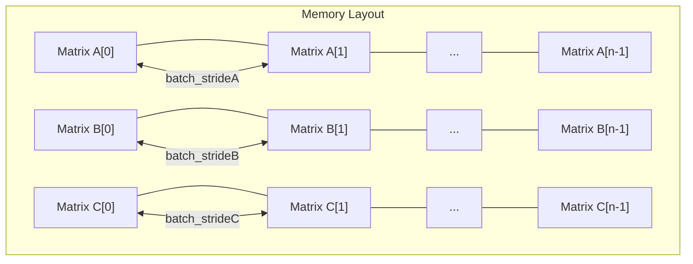
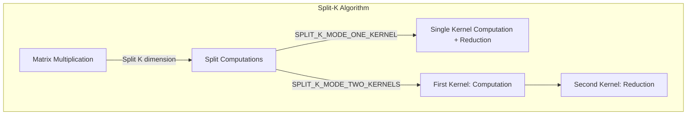
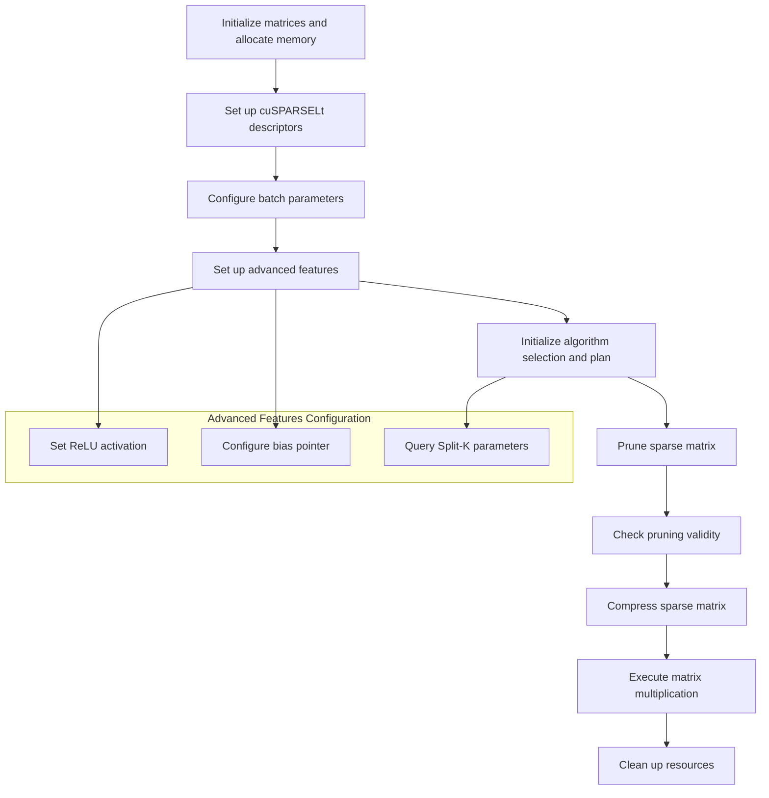

<!-- source: DeepWiki mcp.deepwiki.com · repo NVIDIA/CUDALibrarySamples · extra page Advanced Features in cuSPARSELt · fetched 2026-10-26 -->

# Advanced Features in cuSPARSELt

<details>
<summary>Relevant source files</summary>

The following files were used as context for generating this wiki page:

- [cuSPARSELt/README.md](cuSPARSELt/README.md)
- [cuSPARSELt/matmul/CMakeLists.txt](cuSPARSELt/matmul/CMakeLists.txt)
- [cuSPARSELt/matmul/Makefile](cuSPARSELt/matmul/Makefile)
- [cuSPARSELt/matmul/README.md](cuSPARSELt/matmul/README.md)
- [cuSPARSELt/matmul/matmul_example.cpp](cuSPARSELt/matmul/matmul_example.cpp)
- [cuSPARSELt/matmul_advanced/CMakeLists.txt](cuSPARSELt/matmul_advanced/CMakeLists.txt)
- [cuSPARSELt/matmul_advanced/Makefile](cuSPARSELt/matmul_advanced/Makefile)
- [cuSPARSELt/matmul_advanced/README.md](cuSPARSELt/matmul_advanced/README.md)
- [cuSPARSELt/matmul_advanced/matmul_advanced_example.cpp](cuSPARSELt/matmul_advanced/matmul_advanced_example.cpp)

</details>


## Purpose and Scope

This document covers the advanced features available in the cuSPARSELt library beyond basic structured sparse matrix multiplication. While [Sparse Matrix Multiplication with cuSPARSELt](#2.3.1) introduces the fundamental concepts, this page focuses on techniques that enhance performance and functionality, including batched operations, activation functions, bias addition, and the Split-K algorithm.

## Overview

cuSPARSELt extends basic sparse matrix multiplication with features that are particularly valuable for deep learning and other compute-intensive applications where these operations are commonly performed within a single kernel for maximum efficiency.

The advanced features enable operations of the form:

```
C[i] = activation(alpha * A[i] * B[i] + beta * C[i] + bias)
```

Where:
- `A[i]` is a batched structured sparse matrix
- `B[i]` and `C[i]` are batched dense matrices
- `activation` is an optional activation function (e.g., ReLU)
- `bias` is an optional vector that gets added to each row of the result

## Batched Matrix Multiplication

Batched matrix multiplication allows processing multiple independent matrix multiplications in a single API call, which improves throughput and reduces API overhead.

### Configuring Batched Operations

To configure batched operations in cuSPARSELt:

1. Set the number of batches for each matrix descriptor:

```cpp
CHECK_CUSPARSE(cusparseLtMatDescSetAttribute(&handle, &matA,
                                        CUSPARSELT_MAT_NUM_BATCHES,
                                        &num_batches, sizeof(num_batches)))
```

2. Set the batch stride (the distance in memory between consecutive matrices):

```cpp
CHECK_CUSPARSE(cusparseLtMatDescSetAttribute(&handle, &matA,
                                        CUSPARSELT_MAT_BATCH_STRIDE,
                                        &batch_strideA,
                                        sizeof(batch_strideA)))
```

Note that if `batch_strideA` is set to 0, matrix A will be broadcast (reused) for all batch operations.

Sources: [cuSPARSELt/matmul_advanced/matmul_advanced_example.cpp:263-288]()

### Memory Layout for Batched Operations

The example below shows how batched matrix data is laid out in memory:



Sources: [cuSPARSELt/matmul_advanced/matmul_advanced_example.cpp:164-167](), [cuSPARSELt/matmul_advanced/matmul_advanced_example.cpp:274-288]()

## Activation Functions

cuSPARSELt supports applying activation functions directly after the matrix multiplication, which eliminates the need for separate kernel launches.

### ReLU Activation

The primary activation function supported is ReLU (Rectified Linear Unit), which can be configured with parameters for upper bound and threshold:

```cpp
// Enable ReLU activation function
int   true_value       = 1;
float relu_upper_bound = 15.0f;
float relu_threshold   = 1.0f;

CHECK_CUSPARSE(cusparseLtMatmulDescSetAttribute(&handle, &matmul,
                                    CUSPARSELT_MATMUL_ACTIVATION_RELU,
                                    &true_value, sizeof(true_value)));

CHECK_CUSPARSE(cusparseLtMatmulDescSetAttribute(
                            &handle, &matmul,
                            CUSPARSELT_MATMUL_ACTIVATION_RELU_UPPERBOUND,
                            &(relu_upper_bound),
                            sizeof(relu_upper_bound)));

CHECK_CUSPARSE(cusparseLtMatmulDescSetAttribute(
                            &handle, &matmul,
                            CUSPARSELT_MATMUL_ACTIVATION_RELU_THRESHOLD,
                            &(relu_threshold), sizeof(relu_threshold)));
```

This implements the ReLU function defined as:

```
ReLU(x) = 0                   if x ≤ threshold
ReLU(x) = min(x, upper_bound) if x > threshold
```

Sources: [cuSPARSELt/matmul_advanced/matmul_advanced_example.cpp:303-318](), [cuSPARSELt/matmul_advanced/matmul_advanced_example.cpp:420-424]()

## Bias Addition

For many operations like neural network layers, adding a bias vector is required. cuSPARSELt allows performing this operation within the same kernel that computes the matrix multiplication.

### Configuring Bias Addition

To add bias to the matrix multiplication:

1. Allocate and initialize the bias vector (one value per row of the output matrix):

```cpp
void* dBias;
auto  hBias = new Bias_t[m];
for (int i = 0; i < m; i++)
    hBias[i] = static_cast<Bias_t>(1.0f);
```

2. Set the bias pointer in the matmul descriptor:

```cpp
CHECK_CUSPARSE(cusparseLtMatmulDescSetAttribute(&handle, &matmul,
                                        CUSPARSELT_MATMUL_BIAS_POINTER,
                                        &dBias, sizeof(dBias)));
```

The bias is added to each row of the result matrix before the activation function is applied.

Sources: [cuSPARSELt/matmul_advanced/matmul_advanced_example.cpp:320-330](), [cuSPARSELt/matmul_advanced/matmul_advanced_example.cpp:443]()

## Split-K Algorithm

The Split-K algorithm is a technique that divides the K dimension of matrix multiplication across multiple parallel operations, which can improve performance for certain matrix shapes and sparsity patterns.

### Querying Split-K Information

After initializing the algorithm selection, you can query the Split-K parameters:

```cpp
int splitK, splitKBuffers;
cusparseLtSplitKMode_t splitKMode;

CHECK_CUSPARSE(cusparseLtMatmulAlgGetAttribute(&handle, &alg_sel,
                                   CUSPARSELT_MATMUL_SPLIT_K,
                                   &splitK, sizeof(splitK)));

CHECK_CUSPARSE(cusparseLtMatmulAlgGetAttribute(&handle, &alg_sel,
                                   CUSPARSELT_MATMUL_SPLIT_K_MODE,
                                   &splitKMode, sizeof(splitKMode)));

CHECK_CUSPARSE(cusparseLtMatmulAlgGetAttribute(&handle, &alg_sel,
                                   CUSPARSELT_MATMUL_SPLIT_K_BUFFERS,
                                   &splitKBuffers, sizeof(splitKBuffers)));
```

There are two Split-K modes:
- `CUSPARSELT_SPLIT_K_MODE_ONE_KERNEL`: Performs all computation in a single kernel call
- `CUSPARSELT_SPLIT_K_MODE_TWO_KERNELS`: Uses two kernels, one for the split computation and one for reduction

Sources: [cuSPARSELt/matmul_advanced/matmul_advanced_example.cpp:340-359]()



Sources: [cuSPARSELt/matmul_advanced/matmul_advanced_example.cpp:340-359]()

## Data Type Support

cuSPARSELt supports multiple data types for input and output matrices, allowing you to optimize for speed or precision according to your application needs.

### Supported Data Types

| Data Type | Description | Tensor Core Support |
|-----------|-------------|---------------------|
| FP16 (`__half`) | 16-bit floating-point | Yes |
| INT8 (`int8_t`) | 8-bit integer | Yes |
| FP8 (`__nv_fp8_e4m3`) | 8-bit floating-point (4 bits exponent, 3 bits mantissa) | Yes (on supported hardware) |

The data type selection affects the matrix types, compute type, and bias type:

```cpp
#if AB_TYPE == FP8
using AB_t         = __nv_fp8_e4m3;
using C_t          = __half;
using COMPUTE_t    = float;
using Bias_t       = C_t;
#elif AB_TYPE == FP16
using AB_t         = __half;
using C_t          = __half;
using COMPUTE_t    = float;
using Bias_t       = C_t;
#elif AB_TYPE == INT8
using AB_t         = int8_t;
using C_t          = int8_t; // can also be __half, __nv_bfloat16, int
using COMPUTE_t    = int;
using Bias_t       = float; 
#endif
```

Sources: [cuSPARSELt/matmul_advanced/matmul_advanced_example.cpp:19-46]()

## Complete Advanced Workflow

The following diagram shows the complete workflow when using advanced features in cuSPARSELt:



Sources: [cuSPARSELt/matmul_advanced/matmul_advanced_example.cpp:140-487]()

## Advanced vs. Basic Usage Comparison

The following table compares basic and advanced usage of cuSPARSELt:

| Feature | Basic Usage | Advanced Usage |
|---------|------------|----------------|
| Operation | `D = alpha * A * B + beta * C` | `D[i] = ReLU(alpha * A[i] * B[i] + beta * C[i] + bias)` |
| Batching | No | Yes, multiple matrices processed in one call |
| Activation | No | Yes, ReLU with configurable parameters |
| Bias | No | Yes, vector added to each row |
| Split-K | Not explicitly configured | Configurable and queryable |
| Data Types | Basic support | Extended support including FP8 |

Sources: [cuSPARSELt/matmul/matmul_example.cpp:107-367](), [cuSPARSELt/matmul_advanced/matmul_advanced_example.cpp:140-487](), [cuSPARSELt/matmul_advanced/README.md:1-46]()

## Hardware and Software Requirements

cuSPARSELt's advanced features require:

- CUDA 12.8 toolkit or above
- cusparseLt 0.7.0 or above
- GPU with compute capability 8.0, 8.6, 8.7, 8.9, 9.0, 10.0, or 12.0

The advanced features rely on Sparse Tensor Cores, which are only available on supported NVIDIA GPUs.

Sources: [cuSPARSELt/matmul_advanced/README.md:33-44]()

---

