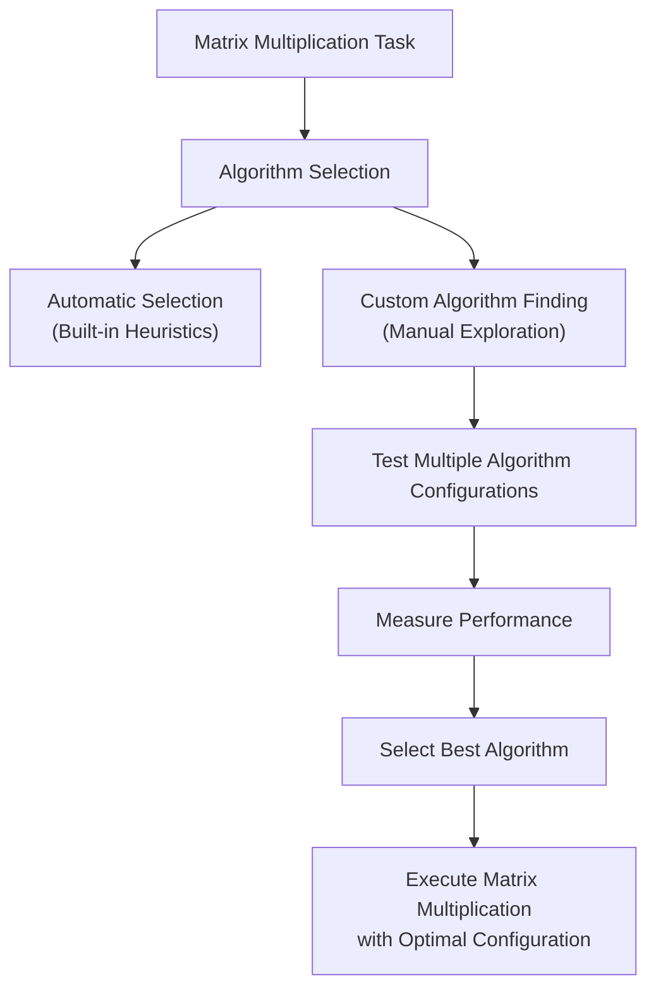
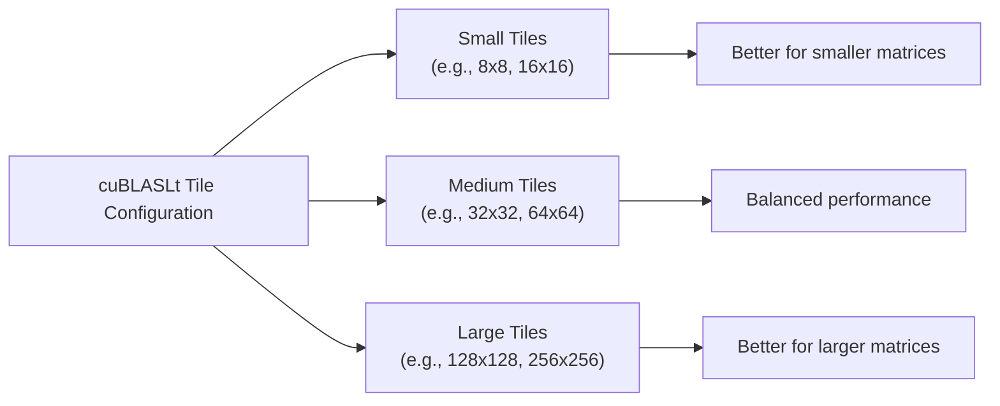
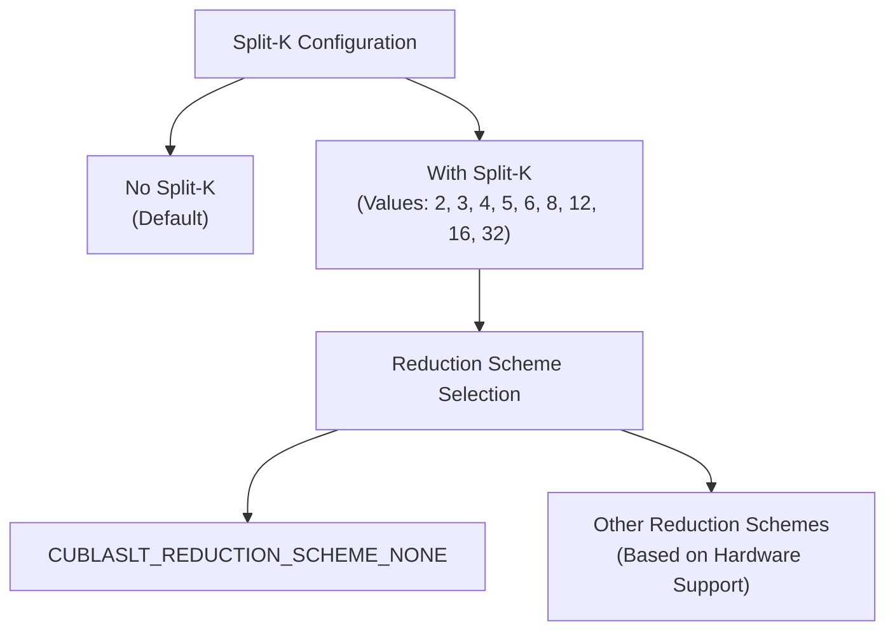
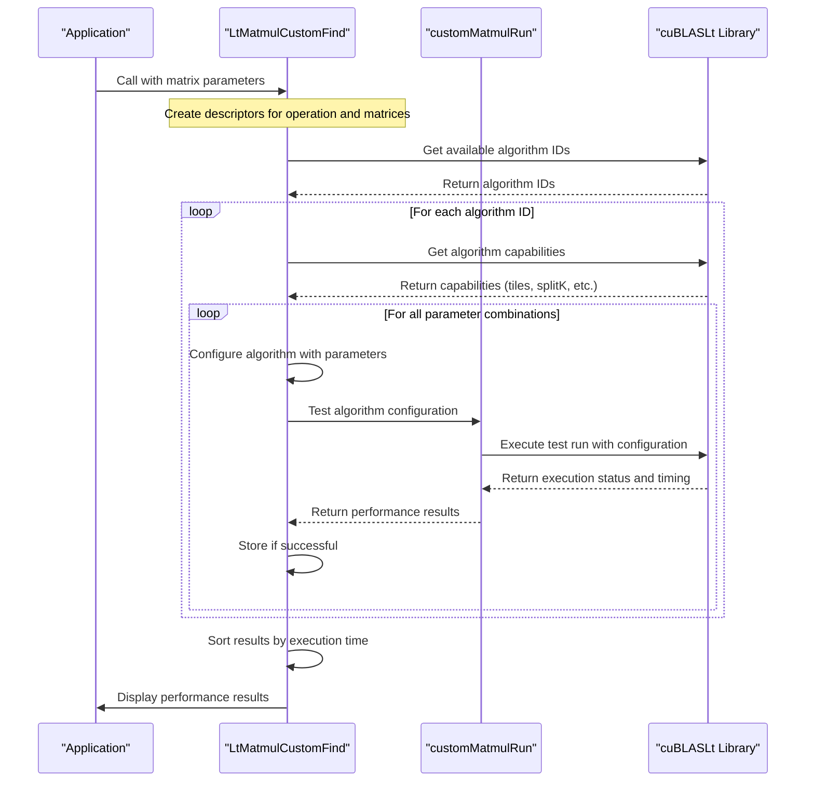
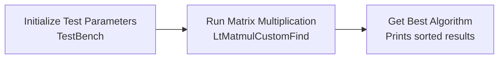
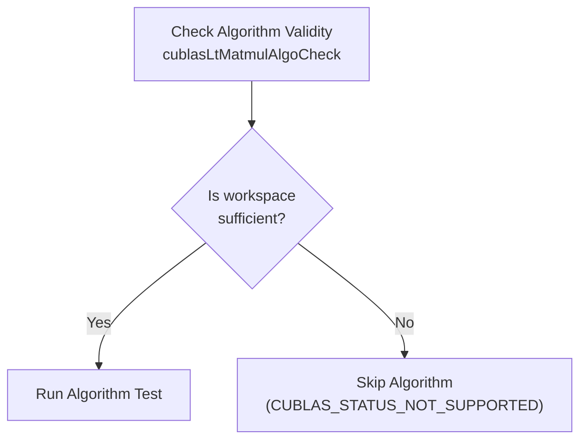

<!-- source: DeepWiki mcp.deepwiki.com · repo NVIDIA/CUDALibrarySamples · extra page Algorithm Selection with cuBLASLt · fetched 2026-10-26 -->

# Algorithm Selection with cuBLASLt

<details>
<summary>Relevant source files</summary>

The following files were used as context for generating this wiki page:

- [cuBLASLt/Common/LtMatmulCustomFind.h](cuBLASLt/Common/LtMatmulCustomFind.h)
- [cuBLASLt/Common/helpers.cpp](cuBLASLt/Common/helpers.cpp)
- [cuBLASLt/LtSgemmCustomFind/CMakeLists.txt](cuBLASLt/LtSgemmCustomFind/CMakeLists.txt)
- [cuBLASLt/LtSgemmCustomFind/main.cpp](cuBLASLt/LtSgemmCustomFind/main.cpp)

</details>


## Purpose and Scope

This document explains how to use cuBLASLt's custom algorithm finding functionality to optimize matrix multiplication performance. cuBLASLt is a lightweight matrix multiplication library that provides a custom API for general matrix-matrix multiplication (GEMM) operations with a focus on performance tuning capabilities. This page specifically covers the algorithm selection process, which is essential for achieving optimal performance in matrix multiplication operations on NVIDIA GPUs.

For information about low precision matrix multiplication with cuBLASLt, see [Low Precision Matrix Multiplication with cuBLASLt](#2.1.1).

## Introduction to Algorithm Selection in cuBLASLt

cuBLASLt provides a mechanism to select the most optimal algorithm for a specific matrix multiplication task based on matrix dimensions, data types, and available hardware. While cuBLASLt has a built-in heuristic algorithm selection, the custom algorithm finding functionality allows for more fine-grained control and potentially better performance for specific workloads.



Sources: [cuBLASLt/Common/LtMatmulCustomFind.h:29-362]()

## Algorithm Configuration Parameters

cuBLASLt algorithms can be configured with various parameters that affect performance. The key configuration parameters include:

### Tile Size

The tile size defines how the matrices are partitioned for processing. Different tile sizes work better for different matrix dimensions.



Sources: [cuBLASLt/Common/helpers.cpp:4-640](), [cuBLASLt/Common/LtMatmulCustomFind.h:235-264]()

### Split-K Mechanism

Split-K is a technique where the K dimension of the matrices is split into smaller parts to enable more parallelism during matrix multiplication.



Sources: [cuBLASLt/Common/LtMatmulCustomFind.h:190-190](), [cuBLASLt/Common/LtMatmulCustomFind.h:276-314]()

### Other Configuration Parameters

Additional parameters that can be adjusted include:

| Parameter | Description |
|-----------|-------------|
| CTA Swizzling | Controls how Cooperative Thread Arrays are arranged, affecting memory access patterns |
| Custom Option | Implementation-specific options |
| Stages | Number of pipeline stages for matrix multiplication |
| Cluster Shape | For devices that support it, controls thread cluster configuration |

Sources: [cuBLASLt/Common/LtMatmulCustomFind.h:254-260](), [cuBLASLt/Common/LtMatmulCustomFind.h:265-272]()

## The Custom Algorithm Finding Process

The custom algorithm finding process in cuBLASLt involves systematically testing various algorithm configurations and measuring their performance to identify the optimal configuration for a specific matrix multiplication task.



Sources: [cuBLASLt/Common/LtMatmulCustomFind.h:159-362](), [cuBLASLt/Common/LtMatmulCustomFind.h:80-157]()

## Key Components for Algorithm Selection

### The customMatmulPerf_t Structure

This structure stores information about different algorithm trials, including:

```cpp
struct customMatmulPerf_t {
    cublasLtMatmulAlgo_t algo;    // Algorithm configuration
    cublasStatus_t status;        // Success or failure status
    float time;                   // Execution time
    size_t workspaceSize;         // Required workspace memory
    cublasMath_t mathMode;        // Math mode used
    cublasLtReductionScheme_t reductionScheme;  // Reduction scheme
    int customOption;             // Custom options
    float wavesCount;             // Hardware utilization metric
};
```

Sources: [cuBLASLt/Common/LtMatmulCustomFind.h:40-49]()

### The LtMatmulCustomFind Function

This is the main function that implements the algorithm finding functionality. It:
1. Creates operation and matrix descriptors
2. Retrieves available algorithm IDs
3. Tests various algorithm configurations
4. Sorts and returns performance results

Sources: [cuBLASLt/Common/LtMatmulCustomFind.h:159-362]()

### The customMatmulRun Function

This function tests a specific algorithm configuration by:
1. Checking if the algorithm is valid for the operation
2. Running the matrix multiplication multiple times
3. Measuring execution time
4. Returning performance results

Sources: [cuBLASLt/Common/LtMatmulCustomFind.h:80-157]()

## Using the Algorithm Finding Functionality

### Basic Usage Example

The following example demonstrates how to use the custom algorithm finding functionality:



Sources: [cuBLASLt/LtSgemmCustomFind/main.cpp:37-64]()

### Step-by-Step Process

1. **Initialize Test Parameters**: Set up the matrix dimensions, alpha/beta values, and workspace size.
2. **Call LtMatmulCustomFind**: Pass the necessary parameters to test different algorithm configurations.
3. **Review Performance Results**: The function sorts and displays performance details for each configuration.
4. **Select the Best Algorithm**: The best-performing (fastest) valid algorithm will be listed first.

Sources: [cuBLASLt/LtSgemmCustomFind/main.cpp:37-64](), [cuBLASLt/Common/LtMatmulCustomFind.h:347-352]()

## Advanced Usage and Considerations

### Performance Analysis

Algorithm configurations are compared based on execution time. The `time_compare` function sorts configurations from fastest to slowest, considering only successful executions:

```cpp
inline bool time_compare(const customMatmulPerf_t &perf_a, const customMatmulPerf_t &perf_b) {
    return ((perf_a.status == CUBLAS_STATUS_SUCCESS) && (perf_a.time < perf_b.time));
}
```

Sources: [cuBLASLt/Common/LtMatmulCustomFind.h:77-79]()

### Workspace Requirements

Different algorithm configurations may require different amounts of workspace memory. The custom algorithm finder checks if the available workspace is sufficient for each configuration:



Sources: [cuBLASLt/Common/LtMatmulCustomFind.h:105-153]()

### Algorithm Information Retrieval

The system retrieves detailed information about each algorithm configuration for reporting and analysis, including:
- Algorithm ID
- Tile size
- Split-K configuration
- Reduction scheme
- Swizzling pattern
- Custom options
- Pipeline stages

Sources: [cuBLASLt/Common/LtMatmulCustomFind.h:52-75]()

## Best Practices

1. **Set an Adequate Workspace Size**: Larger workspace sizes allow testing more algorithm configurations.
2. **Test with Representative Data**: Use matrix dimensions similar to your actual workload.
3. **Consider Reusing the Best Algorithm**: For repetitive operations with the same dimensions, save and reuse the best algorithm.
4. **Balance Testing Time and Performance**: Comprehensive testing takes time but can yield better performance.
5. **Conduct Multiple Runs**: The functionality runs each algorithm multiple times to ensure accurate timing.

Sources: [cuBLASLt/LtSgemmCustomFind/main.cpp:37-64](), [cuBLASLt/Common/LtMatmulCustomFind.h:195-195]()

## Summary

cuBLASLt's algorithm selection functionality provides a powerful mechanism to optimize matrix multiplication performance by systematically testing and comparing different algorithm configurations. By understanding and properly using this functionality, developers can achieve significant performance improvements for specific matrix multiplication workloads.

---

