<!-- source: DeepWiki mcp.deepwiki.com · repo NVIDIA/CUDALibrarySamples · extra page Low Precision Matrix Multiplication with cuBLASLt · fetched 2026-10-26 -->

# Low Precision Matrix Multiplication with cuBLASLt

Relevant source files

The following files were used as context for generating this wiki page:

- [cuBLASLt/Common/helpers.h](cuBLASLt/Common/helpers.h)
- [cuBLASLt/LtFp8Matmul/main.cpp](cuBLASLt/LtFp8Matmul/main.cpp)
- [cuBLASLt/LtFp8Matmul/sample_cublasLt_LtFp8Matmul.cu](cuBLASLt/LtFp8Matmul/sample_cublasLt_LtFp8Matmul.cu)
- [cuBLASLt/LtFp8Matmul/sample_cublasLt_LtFp8Matmul.h](cuBLASLt/LtFp8Matmul/sample_cublasLt_LtFp8Matmul.h)
- [cuBLASLt/LtMxfp8Matmul/main.cpp](cuBLASLt/LtMxfp8Matmul/main.cpp)
- [cuBLASLt/LtMxfp8Matmul/sample_cublasLt_LtMxfp8Matmul.cu](cuBLASLt/LtMxfp8Matmul/sample_cublasLt_LtMxfp8Matmul.cu)
- [cuBLASLt/LtMxfp8Matmul/sample_cublasLt_LtMxfp8Matmul.h](cuBLASLt/LtMxfp8Matmul/sample_cublasLt_LtMxfp8Matmul.h)
- [cuBLASLt/LtNvfp4Matmul/main.cpp](cuBLASLt/LtNvfp4Matmul/main.cpp)
- [cuBLASLt/LtNvfp4Matmul/sample_cublasLt_LtNvfp4Matmul.cu](cuBLASLt/LtNvfp4Matmul/sample_cublasLt_LtNvfp4Matmul.cu)
- [cuBLASLt/LtNvfp4Matmul/sample_cublasLt_LtNvfp4Matmul.h](cuBLASLt/LtNvfp4Matmul/sample_cublasLt_LtNvfp4Matmul.h)

## Purpose and Scope

This document explains how to perform matrix multiplication using low precision data types with cuBLASLt, focusing on FP8 (8-bit floating point), MXFP8 (matrix-extended 8-bit floating point), and FP4 (4-bit floating point) formats. These operations leverage Tensor Cores to achieve high performance while reducing memory footprint and bandwidth requirements. For algorithm selection features in cuBLASLt, see [Algorithm Selection with cuBLASLt](#2.1.2).

## Introduction to Low Precision Operations

Low precision matrix multiplication is crucial for deep learning and high-performance computing applications where performance and memory efficiency are priorities. cuBLASLt provides optimized implementations that leverage NVIDIA's Tensor Cores to accelerate these operations. Supported low precision formats include:

- FP8 (8-bit floating point, E4M3 format)  
- MXFP8 (8-bit matrix-extended floating point, E8M0 for scales)
- FP4 (4-bit floating point, E2M1 format)
- INT8 (8-bit integer)

The diagram below illustrates the precision formats supported by cuBLASLt:

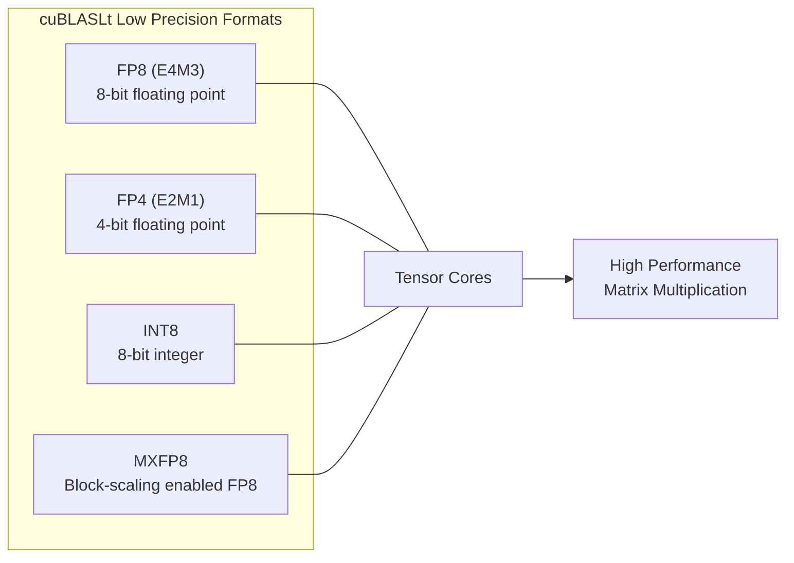

Sources: [cuBLASLt/LtFp8Matmul/sample_cublasLt_LtFp8Matmul.cu:85-89](), [cuBLASLt/LtNvfp4Matmul/sample_cublasLt_LtNvfp4Matmul.cu:96-100]()

## Scaling in Low Precision Operations

Low precision formats require scaling to maintain numerical accuracy. cuBLASLt supports several scaling modes:

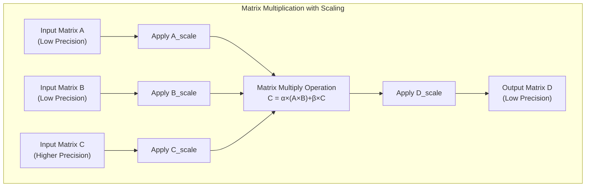

Sources: [cuBLASLt/LtFp8Matmul/sample_cublasLt_LtFp8Matmul.cu:77-82](), [cuBLASLt/LtMxfp8Matmul/sample_cublasLt_LtMxfp8Matmul.cu:86-89](), [cuBLASLt/LtNvfp4Matmul/sample_cublasLt_LtNvfp4Matmul.cu:90-93]()

### Scaling Modes

cuBLASLt supports different scaling modes for each matrix:

| Scaling Mode | Description | Typical Use Case |
|--------------|-------------|------------------|
| `CUBLASLT_MATMUL_MATRIX_SCALE_SCALAR_32F` | Single scalar scaling factor | Simple scaling |
| `CUBLASLT_MATMUL_MATRIX_SCALE_VEC32_UE8M0` | Vector of E8M0 values, 32 elements per block | MXFP8 block scaling |
| `CUBLASLT_MATMUL_MATRIX_SCALE_VEC16_UE4M3` | Vector of E4M3 values, 16 elements per block | NVFP4 block scaling |

Sources: [cuBLASLt/Common/helpers.h:88-107](), [cuBLASLt/LtMxfp8Matmul/sample_cublasLt_LtMxfp8Matmul.cu:81-84](), [cuBLASLt/LtNvfp4Matmul/sample_cublasLt_LtNvfp4Matmul.cu:83-87]()

## API Overview and Data Flow

The following diagram illustrates the key components and data flow when using cuBLASLt for low precision matrix multiplication:

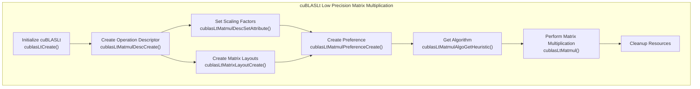

Sources: [cuBLASLt/LtFp8Matmul/sample_cublasLt_LtFp8Matmul.cu:66-129](), [cuBLASLt/LtMxfp8Matmul/sample_cublasLt_LtMxfp8Matmul.cu:64-136](), [cuBLASLt/LtNvfp4Matmul/sample_cublasLt_LtNvfp4Matmul.cu:66-140]()

## Low Precision Data Types

cuBLASLt supports various low precision data types. The table below summarizes the key characteristics:

| Data Type | Description | Bits | Exponent Bits | Mantissa Bits | CUDA Type |
|-----------|-------------|------|---------------|---------------|-----------|
| FP8 (E4M3) | 8-bit floating point | 8 | 4 | 3 | `__nv_fp8_e4m3` |
| MXFP8 (E8M0) | 8-bit scaling factor | 8 | 8 | 0 | `__nv_fp8_e8m0` |
| FP4 (E2M1) | 4-bit floating point | 4 | 2 | 1 | `__nv_fp4_e2m1` |
| BF16 | Brain floating point | 16 | 8 | 7 | `__nv_bfloat16` |

Sources: [cuBLASLt/Common/helpers.h:29-39](), [cuBLASLt/Common/helpers.h:57-61]()

## Implementing Low Precision Matrix Multiplication

### Common Pattern

All low precision matrix multiplication implementations follow this general pattern:

1. Create a matrix multiplication descriptor
2. Configure scaling modes and pointers
3. Create matrix layouts
4. Set up algorithm preference
5. Find a suitable algorithm
6. Perform the matrix multiplication
7. Clean up resources

Sources: [cuBLASLt/LtFp8Matmul/sample_cublasLt_LtFp8Matmul.cu:40-129](), [cuBLASLt/LtMxfp8Matmul/sample_cublasLt_LtMxfp8Matmul.cu:40-136](), [cuBLASLt/LtNvfp4Matmul/sample_cublasLt_LtNvfp4Matmul.cu:40-140]()

### FP8 Matrix Multiplication

The `LtFp8Matmul` function demonstrates matrix multiplication using FP8 (E4M3) data type:

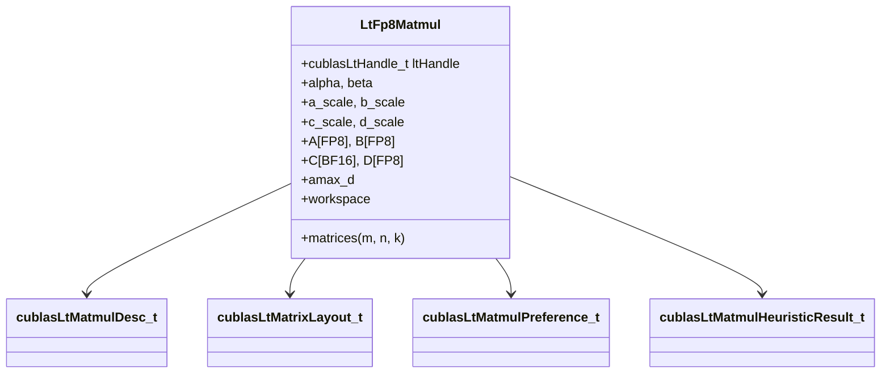

Main characteristics:
- Uses FP8 (E4M3) for input matrices A and B
- Supports different precision for output (BF16 for C, FP8 for D)
- Provides per-tensor scaling factors
- Tracks maximum absolute values through `amax_d` for dynamic scaling

Sources: [cuBLASLt/LtFp8Matmul/sample_cublasLt_LtFp8Matmul.h:38-58](), [cuBLASLt/LtFp8Matmul/sample_cublasLt_LtFp8Matmul.cu:40-129]()

### MXFP8 Matrix Multiplication

The `LtMxfp8Matmul` function implements matrix multiplication with MXFP8 block scaling:

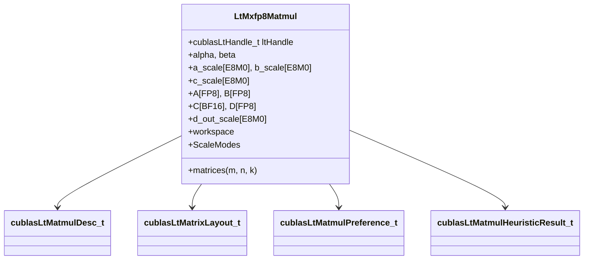

Main characteristics:
- Uses FP8 (E4M3) for input and output matrices
- Employs E8M0 format for scaling factors
- Supports block-wise scaling modes
- Configurable scaling modes for each matrix

Sources: [cuBLASLt/LtMxfp8Matmul/sample_cublasLt_LtMxfp8Matmul.h:38-61](), [cuBLASLt/LtMxfp8Matmul/sample_cublasLt_LtMxfp8Matmul.cu:40-136]()

### FP4 Matrix Multiplication

The `LtNvfp4Matmul` function demonstrates the lowest precision matrix multiplication with FP4 (E2M1):

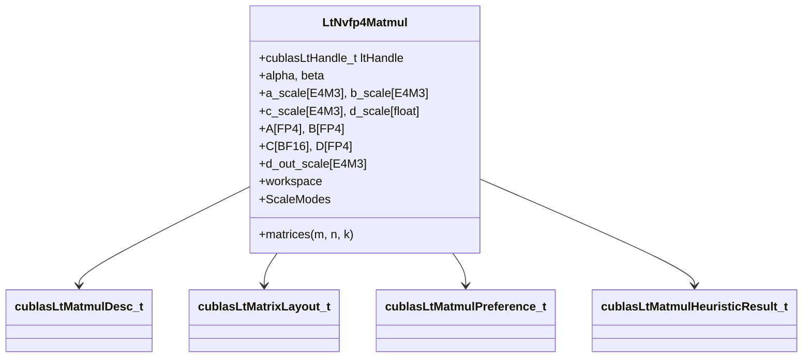

Main characteristics:
- Uses ultra-low 4-bit precision (E2M1) for input and output matrices
- Utilizes E4M3 format for scaling factors
- Requires special handling due to 4-bit packing (2 values per byte)
- Supports various block scaling modes

Sources: [cuBLASLt/LtNvfp4Matmul/sample_cublasLt_LtNvfp4Matmul.h:34-65](), [cuBLASLt/LtNvfp4Matmul/sample_cublasLt_LtNvfp4Matmul.cu:40-140]()

## Key Implementation Details

### Data Storage and Packing

For 4-bit precision (FP4), values are packed two per byte. The `StorageType` template handles this packing:

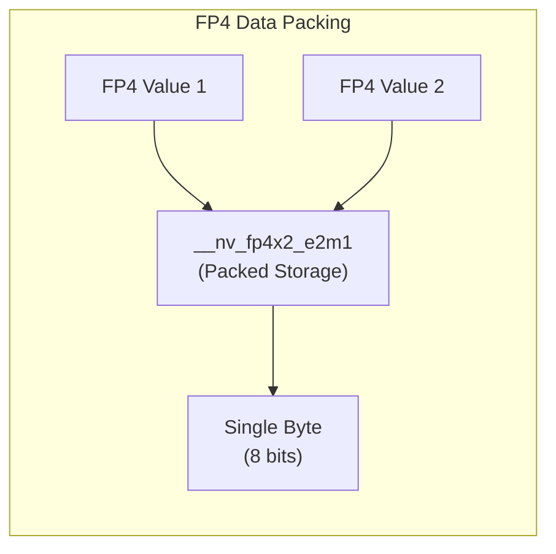

Sources: [cuBLASLt/Common/helpers.h:53-61](), [cuBLASLt/Common/helpers.h:63-71]()

### Matrix Layout and Dimensions

The process of creating matrix layouts involves specifying:
- Data type (e.g., CUDA_R_8F_E4M3, CUDA_R_4F_E2M1)
- Dimensions (rows, columns)
- Leading dimension
- Transform operations (transpose)

Sources: [cuBLASLt/LtFp8Matmul/sample_cublasLt_LtFp8Matmul.cu:86-89](), [cuBLASLt/LtNvfp4Matmul/sample_cublasLt_LtNvfp4Matmul.cu:97-100]()

### Block Scaling

Block scaling is crucial for maintaining precision in low-precision formats. The `getScaleTensorSize` function calculates the required size for scale tensors:

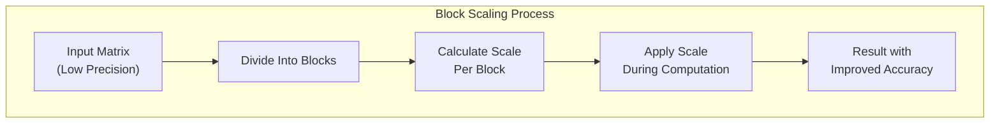

Sources: [cuBLASLt/Common/helpers.h:88-107](), [cuBLASLt/LtMxfp8Matmul/sample_cublasLt_LtMxfp8Matmul.cu:81-84]()

## Usage Examples

### Basic FP8 Matrix Multiplication

The following example demonstrates how to use FP8 matrix multiplication:

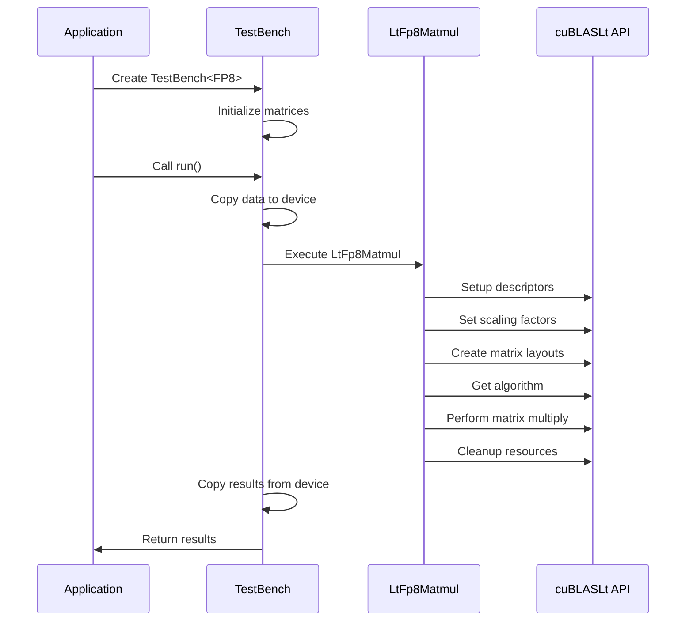

Sources: [cuBLASLt/LtFp8Matmul/main.cpp:38-67]()

### MXFP8 with Block Scaling

Example of using MXFP8 with block scaling:

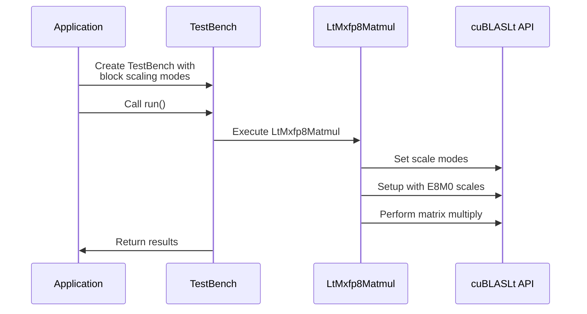

Sources: [cuBLASLt/LtMxfp8Matmul/main.cpp:38-71]()

### Ultra-Low Precision FP4

Example of using FP4 matrix multiplication:

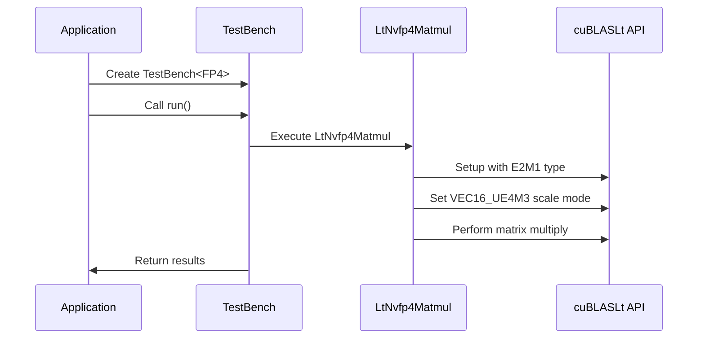

Sources: [cuBLASLt/LtNvfp4Matmul/main.cpp:38-73]()

## Performance Considerations

When using low precision matrix multiplication with cuBLASLt, consider the following:

1. **Workspace Size**: Larger workspace allows for more algorithm options, especially split-K algorithms
2. **Data Alignment**: Ensure matrices are properly aligned for optimal performance
3. **Scale Selection**: Appropriate scaling factors are crucial for numerical stability
4. **Algorithm Selection**: Use algorithm heuristics to find the best implementation
5. **Hardware Requirements**: Different precision formats require specific GPU architectures

For detailed performance optimization techniques, see [Performance Optimization](#7).

Sources: [cuBLASLt/LtFp8Matmul/sample_cublasLt_LtFp8Matmul.cu:91-96](), [cuBLASLt/LtMxfp8Matmul/sample_cublasLt_LtMxfp8Matmul.cu:97-102](), [cuBLASLt/LtNvfp4Matmul/sample_cublasLt_LtNvfp4Matmul.cu:101-106]()

## Common Pitfalls and Troubleshooting

- **Algorithm Not Found**: If `returnedResults == 0`, the requested operation may not be supported on the current hardware
- **Scaling Factors**: Improper scaling can lead to underflow/overflow or precision loss
- **Memory Allocation**: Ensure sufficient workspace is allocated for complex algorithms
- **Resource Cleanup**: Always properly destroy descriptors to prevent resource leaks
- **Hardware Compatibility**: Check that your GPU supports the desired precision format

Sources: [cuBLASLt/LtFp8Matmul/sample_cublasLt_LtFp8Matmul.cu:101-103](), [cuBLASLt/LtNvfp4Matmul/sample_cublasLt_LtNvfp4Matmul.cu:112-114]()

---

