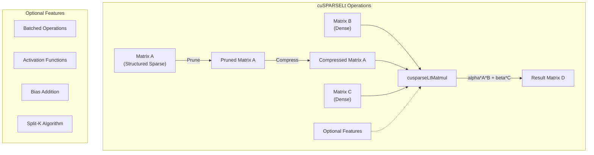
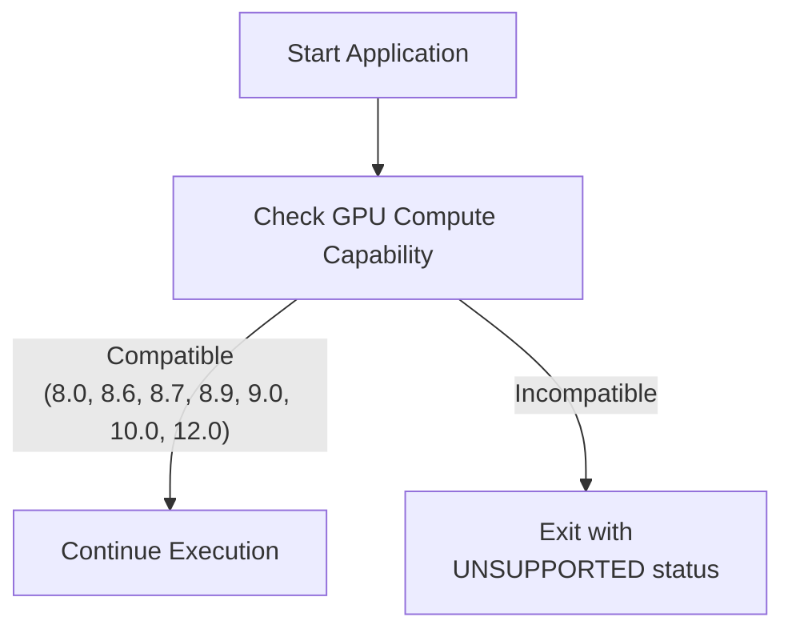
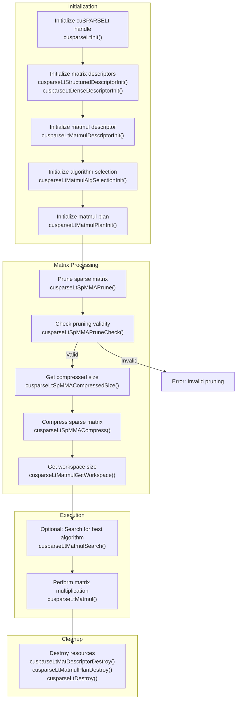
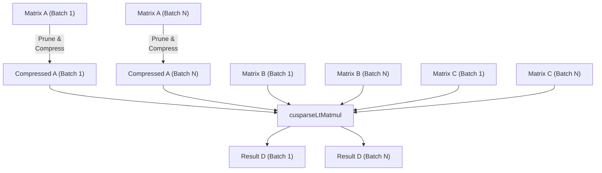
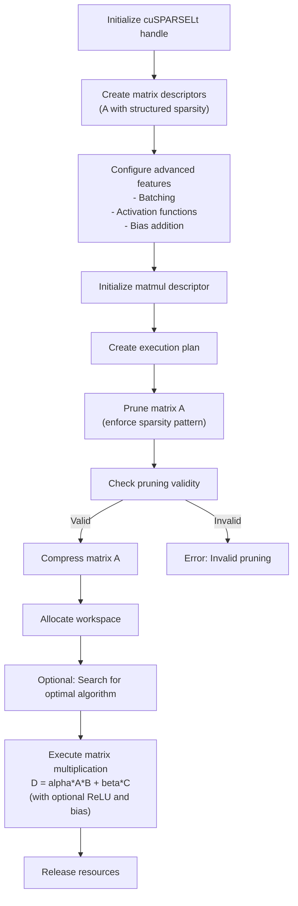

<!-- source: DeepWiki mcp.deepwiki.com · repo NVIDIA/CUDALibrarySamples · extra page Sparse Matrix Multiplication with cuSPARSELt · fetched 2026-10-26 -->

# Sparse Matrix Multiplication with cuSPARSELt

<details>
<summary>Relevant source files</summary>

The following files were used as context for generating this wiki page:

- [cuSPARSELt/matmul/CMakeLists.txt](cuSPARSELt/matmul/CMakeLists.txt)
- [cuSPARSELt/matmul/Makefile](cuSPARSELt/matmul/Makefile)
- [cuSPARSELt/matmul/README.md](cuSPARSELt/matmul/README.md)
- [cuSPARSELt/matmul/matmul_example.cpp](cuSPARSELt/matmul/matmul_example.cpp)
- [cuSPARSELt/matmul_advanced/CMakeLists.txt](cuSPARSELt/matmul_advanced/CMakeLists.txt)
- [cuSPARSELt/matmul_advanced/Makefile](cuSPARSELt/matmul_advanced/Makefile)
- [cuSPARSELt/matmul_advanced/README.md](cuSPARSELt/matmul_advanced/README.md)
- [cuSPARSELt/matmul_advanced/matmul_advanced_example.cpp](cuSPARSELt/matmul_advanced/matmul_advanced_example.cpp)

</details>


## Purpose and Scope

This document covers the implementation and usage of sparse matrix multiplication operations using NVIDIA's cuSPARSELt library. cuSPARSELt is specialized for structured sparse matrix operations that can exploit NVIDIA Sparse Tensor Cores for significant performance acceleration. This page focuses on the core workflow for performing sparse matrix multiplication, including matrix initialization, pruning, compression, and execution, as well as advanced features like batched operations and activation functions. For information on additional advanced features like split-K algorithms and custom pruning, see [Advanced Features in cuSPARSELt](#2.3.2).

## Overview

cuSPARSELt accelerates sparse matrix multiplication by leveraging structured sparsity patterns and specialized hardware acceleration. Unlike traditional sparse formats that can handle arbitrary sparsity patterns, cuSPARSELt focuses on structured sparsity (typically 50% sparsity) to take advantage of Sparse Tensor Core acceleration on NVIDIA GPUs.



Sources: [cuSPARSELt/matmul/README.md:1-16](), [cuSPARSELt/matmul_advanced/README.md:1-17]()

## Hardware Requirements

cuSPARSELt requires specific NVIDIA GPU architectures with Sparse Tensor Core support:

| Compute Capability | GPU Architecture |
|-------------------|------------------|
| 8.0               | NVIDIA A100      |
| 8.6               | NVIDIA RTX 30 Series |
| 8.7               | NVIDIA L40, L4   |
| 8.9               | NVIDIA RTX 40 Series, L40S |
| 9.0               | NVIDIA H100      |
| 10.0              | NVIDIA GB200     |
| 12.0              | NVIDIA Blackwell |

The cuSPARSELt example code performs a compatibility check to ensure the GPU supports the required features:



Sources: [cuSPARSELt/matmul/matmul_example.cpp:109-125](), [cuSPARSELt/matmul_advanced/matmul_advanced_example.cpp:141-157](), [cuSPARSELt/matmul/README.md:34-38]()

## Data Types and Computation

cuSPARSELt supports multiple data types for input matrices and computation:

| Input Matrix Types | Computation Types | Output Matrix Types |
|--------------------|-------------------|---------------------|
| FP16 (`__half`)    | FP32 (`float`)    | FP16 (`__half`)     |
| FP8 (`__nv_fp8_e4m3`) | FP32 (`float`) | FP16 (`__half`)     |
| INT8 (`int8_t`)    | INT32 (`int`)     | INT8, FP16, or INT32 |

The library provides templated helper structures for mapping C++ types to CUDA data types:

```mermaid
classDiagram
    class "cuda_type" {
        +value: cudaDataType
    }
    
    class "cuda_type~__half~" {
        +value = CUDA_R_16F
    }
    
    class "cuda_type~__nv_fp8_e4m3~" {
        +value = CUDA_R_8F_E4M3
    }
    
    class "cuda_type~int8_t~" {
        +value = CUDA_R_8I
    }
    
    class "cusparse_compute_type" {
        +value: cusparseComputeType
    }
    
    class "cusparse_compute_type~float~" {
        +value = CUSPARSE_COMPUTE_32F
    }
    
    class "cusparse_compute_type~int~" {
        +value = CUSPARSE_COMPUTE_32I
    }
    
    "cuda_type" <|-- "cuda_type~__half~"
    "cuda_type" <|-- "cuda_type~__nv_fp8_e4m3~"
    "cuda_type" <|-- "cuda_type~int8_t~"
    
    "cusparse_compute_type" <|-- "cusparse_compute_type~float~"
    "cusparse_compute_type" <|-- "cusparse_compute_type~int~"
```

Sources: [cuSPARSELt/matmul/matmul_example.cpp:18-82](), [cuSPARSELt/matmul_advanced/matmul_advanced_example.cpp:17-92]()

## Basic Workflow

The basic workflow for performing sparse matrix multiplication with cuSPARSELt involves several key steps:



Sources: [cuSPARSELt/matmul/matmul_example.cpp:193-296]()

### 1. Initialization

The first step is to initialize the cuSPARSELt handle and create descriptors for the matrices and the matrix multiplication operation:

```
cusparseLtHandle_t             handle;
cusparseLtMatDescriptor_t      matA, matB, matC;
cusparseLtMatmulDescriptor_t   matmul;
cusparseLtMatmulAlgSelection_t alg_sel;
cusparseLtMatmulPlan_t         plan;
```

Initialize the handle:
```
CHECK_CUSPARSE( cusparseLtInit(&handle) )
```

Create matrix descriptors, specifying that matrix A will have structured sparsity:
```
CHECK_CUSPARSE( cusparseLtStructuredDescriptorInit(
                                        &handle, &matA, num_A_rows,
                                        num_A_cols, lda, alignment,
                                        type_AB, order,
                                        CUSPARSELT_SPARSITY_50_PERCENT) )

CHECK_CUSPARSE( cusparseLtDenseDescriptorInit(
                                        &handle, &matB, num_B_rows,
                                        num_B_cols, ldb, alignment,
                                        type_AB, order) )
```

Sources: [cuSPARSELt/matmul/matmul_example.cpp:193-216]()

### 2. Matrix Multiplication Setup

Set up the matrix multiplication operation:

```
CHECK_CUSPARSE( cusparseLtMatmulDescriptorInit(
                                        &handle, &matmul, opA, opB,
                                        &matA, &matB, &matC, &matC,
                                        compute_type) )

CHECK_CUSPARSE( cusparseLtMatmulAlgSelectionInit(
                                        &handle, &alg_sel, &matmul,
                                        CUSPARSELT_MATMUL_ALG_DEFAULT) )

CHECK_CUSPARSE( cusparseLtMatmulPlanInit(&handle, &plan, &matmul, &alg_sel))
```

Sources: [cuSPARSELt/matmul/matmul_example.cpp:219-228]()

### 3. Pruning and Compression

Prune the sparse matrix to enforce the structured sparsity pattern:

```
CHECK_CUSPARSE( cusparseLtSpMMAPrune(&handle, &matmul, dA, dA,
                                     CUSPARSELT_PRUNE_SPMMA_TILE, stream) )
CHECK_CUSPARSE( cusparseLtSpMMAPruneCheck(&handle, &matmul, dA,
                                          d_valid, stream) )
```

Then compress the pruned matrix for optimized computation:

```
CHECK_CUSPARSE( cusparseLtSpMMACompressedSize(&handle, &plan,
                                              &compressed_size,
                                              &compressed_buffer_size) )
CHECK_CUSPARSE( cusparseLtSpMMACompress(&handle, &plan, dA, dA_compressed,
                                        dA_compressedBuffer, stream) )
```

Sources: [cuSPARSELt/matmul/matmul_example.cpp:237-264]()

### 4. Execution

Finally, perform the matrix multiplication:

```
CHECK_CUSPARSE( cusparseLtMatmul(&handle, &plan, &alpha, dA_compressed, dB,
                                 &beta, dC, dD, d_workspace, streams,
                                 num_streams) )
```

Sources: [cuSPARSELt/matmul/matmul_example.cpp:286-289]()

## Advanced Features

cuSPARSELt provides several advanced features for optimizing performance and extending functionality.

### Batched Operations

Batched operations allow processing multiple matrix multiplications in a single call:



To use batched operations:

1. Set the number of batches for each matrix:
```
CHECK_CUSPARSE( cusparseLtMatDescSetAttribute(&handle, &matA,
                                            CUSPARSELT_MAT_NUM_BATCHES,
                                            &num_batches, sizeof(num_batches)) )
```

2. Set the stride between consecutive batches:
```
CHECK_CUSPARSE( cusparseLtMatDescSetAttribute(&handle, &matA,
                                            CUSPARSELT_MAT_BATCH_STRIDE,
                                            &batch_strideA,
                                            sizeof(batch_strideA)) )
```

Sources: [cuSPARSELt/matmul_advanced/matmul_advanced_example.cpp:264-288]()

### Activation Functions (ReLU)

cuSPARSELt supports applying activation functions like ReLU during matrix multiplication:

```
// Enable ReLU activation function
int   true_value       = 1;
float relu_upper_bound = 15.0f;
float relu_threshold   = 1.0f;
CHECK_CUSPARSE( cusparseLtMatmulDescSetAttribute(&handle, &matmul,
                                        CUSPARSELT_MATMUL_ACTIVATION_RELU,
                                        &true_value, sizeof(true_value)) )
CHECK_CUSPARSE( cusparseLtMatmulDescSetAttribute(
                            &handle, &matmul,
                            CUSPARSELT_MATMUL_ACTIVATION_RELU_UPPERBOUND,
                            &(relu_upper_bound),
                            sizeof(relu_upper_bound)) )
CHECK_CUSPARSE( cusparseLtMatmulDescSetAttribute(
                            &handle, &matmul,
                            CUSPARSELT_MATMUL_ACTIVATION_RELU_THRESHOLD,
                            &(relu_threshold), sizeof(relu_threshold)) )
```

Sources: [cuSPARSELt/matmul_advanced/matmul_advanced_example.cpp:303-318]()

### Bias Addition

cuSPARSELt can add a bias vector during matrix multiplication:

```
// Set bias pointer
void* dBias;
auto  hBias = new Bias_t[m];
for (int i = 0; i < m; i++)
    hBias[i] = static_cast<Bias_t>(1.0f);
CHECK_CUDA( cudaMalloc((void**) &dBias, m * sizeof(Bias_t)) )
CHECK_CUDA( cudaMemcpy(dBias, hBias, m * sizeof(Bias_t),
                       cudaMemcpyHostToDevice) )
CHECK_CUSPARSE( cusparseLtMatmulDescSetAttribute(&handle, &matmul,
                                            CUSPARSELT_MATMUL_BIAS_POINTER,
                                            &dBias, sizeof(dBias)) )
```

Sources: [cuSPARSELt/matmul_advanced/matmul_advanced_example.cpp:320-330]()

### Algorithm Search

cuSPARSELt can automatically search for the best algorithm for a specific matrix multiplication:

```
if (matmul_search) {
    CHECK_CUSPARSE( cusparseLtMatmulSearch(&handle, &plan, &alpha,
                                           dA_compressed, dB, &beta,
                                           dC, dD, nullptr,
                                           streams, num_streams) )
    // dC accumulates so reset dC for correctness check
    CHECK_CUDA( cudaMemcpy(dC, hC, C_size, cudaMemcpyHostToDevice) )
}
```

Sources: [cuSPARSELt/matmul/matmul_example.cpp:270-277]()

## Complete Matrix Multiplication Example

This diagram illustrates the complete workflow for sparse matrix multiplication using cuSPARSELt with advanced features:



Sources: [cuSPARSELt/matmul/matmul_example.cpp:108-367](), [cuSPARSELt/matmul_advanced/matmul_advanced_example.cpp:140-488]()

## Code Example Walkthrough

Let's walk through a minimal example of using cuSPARSELt for sparse matrix multiplication, based on the sample code:

1. **Define data types and matrix dimensions**:
   ```cpp
   using AB_t = __half;   // Input matrices data type
   using C_t = __half;    // Output matrix data type
   using COMPUTE_t = float; // Computation type
   
   int m = 32; // Rows of A and C
   int n = 16; // Columns of B and C
   int k = 32; // Columns of A, rows of B
   ```

2. **Initialize cuSPARSELt and create matrix descriptors**:
   ```cpp
   cusparseLtHandle_t handle;
   cusparseLtInit(&handle);
   
   cusparseLtMatDescriptor_t matA, matB, matC;
   
   // Initialize matrix A with structured sparsity
   cusparseLtStructuredDescriptorInit(
       &handle, &matA, m, k, lda, alignment,
       CUDA_R_16F, CUSPARSE_ORDER_ROW,
       CUSPARSELT_SPARSITY_50_PERCENT);
   
   // Initialize dense matrices B and C
   cusparseLtDenseDescriptorInit(
       &handle, &matB, k, n, ldb, alignment,
       CUDA_R_16F, CUSPARSE_ORDER_ROW);
   
   cusparseLtDenseDescriptorInit(
       &handle, &matC, m, n, ldc, alignment,
       CUDA_R_16F, CUSPARSE_ORDER_ROW);
   ```

3. **Set up matrix multiplication operation**:
   ```cpp
   cusparseLtMatmulDescriptor_t matmul;
   cusparseLtMatmulDescriptorInit(
       &handle, &matmul, CUSPARSE_OPERATION_NON_TRANSPOSE,
       CUSPARSE_OPERATION_TRANSPOSE, &matA, &matB, &matC, &matC,
       CUSPARSE_COMPUTE_32F);
   
   cusparseLtMatmulAlgSelection_t alg_sel;
   cusparseLtMatmulAlgSelectionInit(
       &handle, &alg_sel, &matmul, CUSPARSELT_MATMUL_ALG_DEFAULT);
   
   cusparseLtMatmulPlan_t plan;
   cusparseLtMatmulPlanInit(&handle, &plan, &matmul, &alg_sel);
   ```

4. **Prune and compress the sparse matrix**:
   ```cpp
   // Prune the A matrix
   cusparseLtSpMMAPrune(&handle, &matmul, dA, dA,
                        CUSPARSELT_PRUNE_SPMMA_TILE, stream);
   
   // Verify pruning validity
   cusparseLtSpMMAPruneCheck(&handle, &matmul, dA, d_valid, stream);
   
   // Compress the pruned matrix
   size_t compressed_size, compressed_buffer_size;
   cusparseLtSpMMACompressedSize(&handle, &plan,
                                &compressed_size,
                                &compressed_buffer_size);
   
   // Allocate memory for compressed matrix
   cudaMalloc(&dA_compressed, compressed_size);
   cudaMalloc(&dA_compressedBuffer, compressed_buffer_size);
   
   // Compress matrix A
   cusparseLtSpMMACompress(&handle, &plan, dA, dA_compressed,
                          dA_compressedBuffer, stream);
   ```

5. **Execute the matrix multiplication**:
   ```cpp
   // Allocate workspace
   size_t workspace_size;
   cusparseLtMatmulGetWorkspace(&handle, &plan, &workspace_size);
   cudaMalloc(&d_workspace, workspace_size);
   
   // Perform multiplication: D = alpha*A*B + beta*C
   float alpha = 1.0f;
   float beta = 1.0f;
   cusparseLtMatmul(&handle, &plan, &alpha, dA_compressed, dB,
                   &beta, dC, dD, d_workspace, streams, num_streams);
   ```

6. **Clean up resources**:
   ```cpp
   cusparseLtMatDescriptorDestroy(&matA);
   cusparseLtMatDescriptorDestroy(&matB);
   cusparseLtMatDescriptorDestroy(&matC);
   cusparseLtMatmulPlanDestroy(&plan);
   cusparseLtDestroy(&handle);
   ```

Sources: [cuSPARSELt/matmul/matmul_example.cpp:126-367]()

## Summary

cuSPARSELt provides a specialized library for accelerating sparse matrix multiplication operations by leveraging structured sparsity patterns and NVIDIA's Sparse Tensor Cores. Key benefits include:

1. Performance acceleration for matrices with structured 50% sparsity
2. Support for multiple data types including FP16, FP8, and INT8
3. Advanced features like batched operations, activation functions, and bias addition
4. Automatic algorithm selection for optimal performance

When implementing sparse matrix multiplication with cuSPARSELt, follow the workflow of initialization, pruning, compression, and execution to achieve optimal performance.

Sources: [cuSPARSELt/matmul/README.md:1-44](), [cuSPARSELt/matmul_advanced/README.md:1-45]()

---

