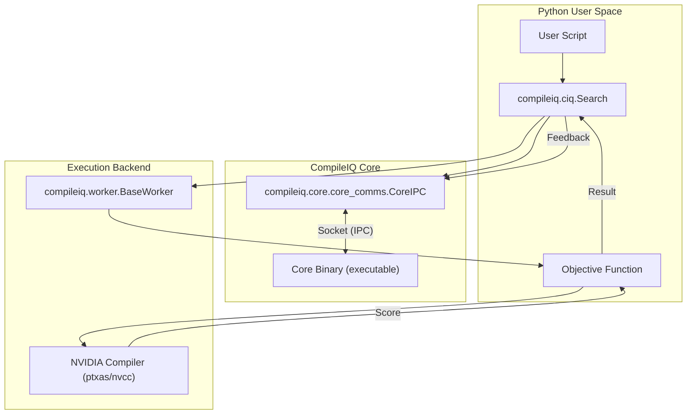
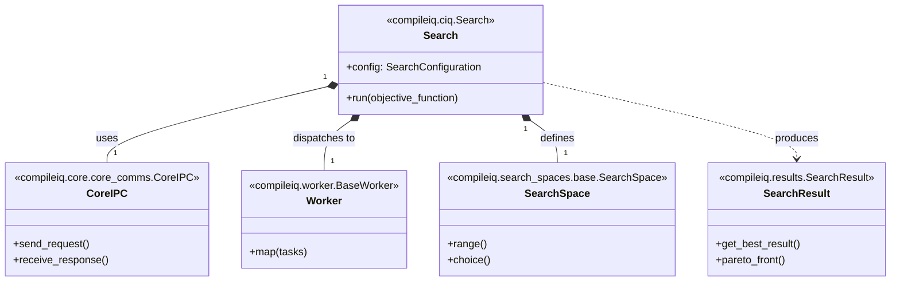

<!-- source: DeepWiki mcp.deepwiki.com · repo NVIDIA/CompileIQ · page 1 CompileIQ Overview · fetched 2026-10-26 -->

# CompileIQ Overview

Relevant source files

The following files were used as context for generating this wiki page:

- [AGENTS.md](AGENTS.md)
- [README.md](README.md)
- [docs/index.rst](docs/index.rst)
- [pyproject.toml](pyproject.toml)

CompileIQ is a hyperparameter optimization (HPO) engine specifically engineered for tuning NVIDIA compiler controls and application-level parameters [README.md:1-4](). It bridges the gap between low-level compiler tuning (via the NVIDIA Advanced Controls Interface) and high-level Python orchestration, enabling developers to find optimal configurations for performance-critical kernels [docs/index.rst:54-60]().

The system is designed to handle both standard hyperparameter tuning (e.g., block sizes, batch sizes) and specialized compiler-driven optimization using curated search spaces for tools like `ptxas` and `nvcc` [README.md:25-33]().

### System Context Diagram
The following diagram illustrates how the Python orchestration layer interacts with the precompiled Core binary and the target compiler environment.

**CompileIQ High-Level Architecture**

Sources: [AGENTS.md:72-89](), [compileiq/ciq.py](), [compileiq/core/core_comms.py]()

---

## Why CompileIQ?

Optimizing GPU workloads often requires balancing complex compiler flags that are not exposed through standard optimization levels (like `-O3`). CompileIQ provides:
*   **Automated Tuning:** Replaces manual trial-and-error with a generational search strategy [AGENTS.md:73-75]().
*   **Curated Search Spaces:** Access to version-specific compiler parameters for `ptxas` and `nvcc` [README.md:27-33]().
*   **Multi-Objective Support:** Simultaneously optimize for metrics like latency, throughput, and register pressure [docs/index.rst:59-61]().
*   **Scalable Execution:** Support for local multiprocessing, isolated execution, and distributed clusters via Ray [AGENTS.md:79-79]().

For more details on typical performance gains and use cases, see [Key Concepts & Terminology](#1.2).

---

## Core Subsystems

CompileIQ is composed of three primary layers that work in tandem:

### 1. Orchestration & API
The `Search` class in `compileiq/ciq.py` serves as the primary entry point [AGENTS.md:78-78](). It manages the lifecycle of the optimization process, including:
*   Initializing the search configuration (`SearchConfiguration`).
*   Spawning and managing the Core binary subprocess.
*   Distributing evaluation tasks to workers.
*   Collecting and persisting results into `SearchResult` objects containing pandas DataFrames [AGENTS.md:84-84]().

### 2. The Optimization Core
The "Core" is a platform-specific precompiled binary located in `compileiq/core/executable/` [AGENTS.md:7-8](). It contains the proprietary optimization algorithms. The Python layer communicates with this binary via a socket-based Inter-Process Communication (IPC) protocol managed by the `CoreIPC` class [AGENTS.md:82-82]().

### 3. Execution Backends (Workers)
CompileIQ supports multiple worker types defined in `compileiq/worker.py` to execute the user's `objective_function` [AGENTS.md:79-79]():
*   `MultiProcessWorker`: Standard local parallelization.
*   `IsoMultiProcessWorker`: High isolation (one process per task) for crash-prone workloads.
*   `RayWorker`: Distributed execution across a Ray cluster.
*   `AsyncWorker`: Concurrency for I/O bound tasks using `asyncio`.

---

## Key Code Entities

The following diagram maps high-level system concepts to their specific implementations in the codebase.

**System Concepts to Code Entity Mapping**

Sources: [AGENTS.md:76-89](), [compileiq/ciq.py](), [compileiq/results.py](), [compileiq/worker.py]()

---

## Getting Started & Next Steps

To begin using CompileIQ, follow the documentation in the child pages:

*   **[Getting Started & Installation](#1.1)**: Instructions for `pip` installation, setting up the development environment with Poetry, and running your first search [README.md:11-23]().
*   **[Key Concepts & Terminology](#1.2)**: A deep dive into the vocabulary of the system, such as "Booster Packs," "ACF files," and "Generational Search" [docs/index.rst:69-70]().

For advanced users, the **[Agent Skills](#7)** section describes how to use the bundled AI agent tools to automate optimization campaigns [AGENTS.md:106-123]().

### Environment Configuration
CompileIQ behavior can be tuned using several environment variables:

| Variable | Default | Purpose |
| :--- | :--- | :--- |
| `CIQ_SOCKET_TIMEOUT` | 20 | Seconds to wait for Core IPC [README.md:49-49]() |
| `CIQ_PROCESS_MODE` | "forkserver" | Start method for workers [README.md:51-51]() |
| `CIQ_SEARCH_SPACES_DIR` | unset | Local path for offline search space assets [README.md:52-52]() |

Sources: [README.md:45-54](), [AGENTS.md:97-101]()

---

