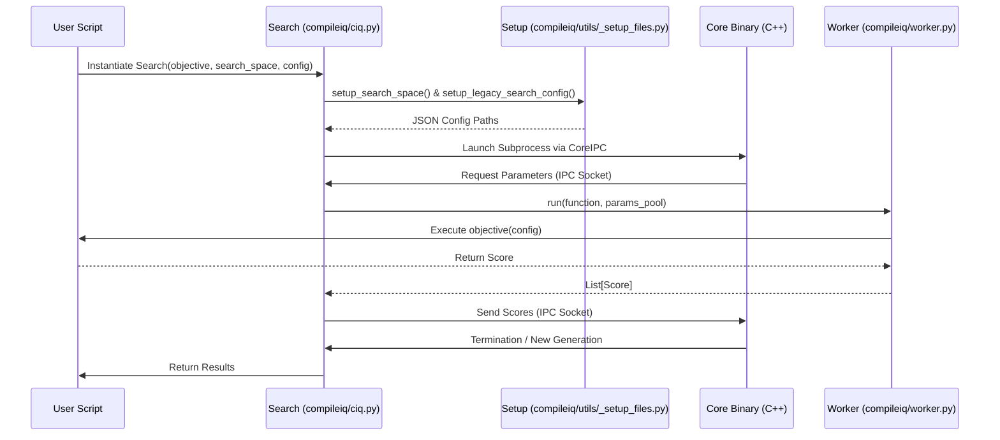
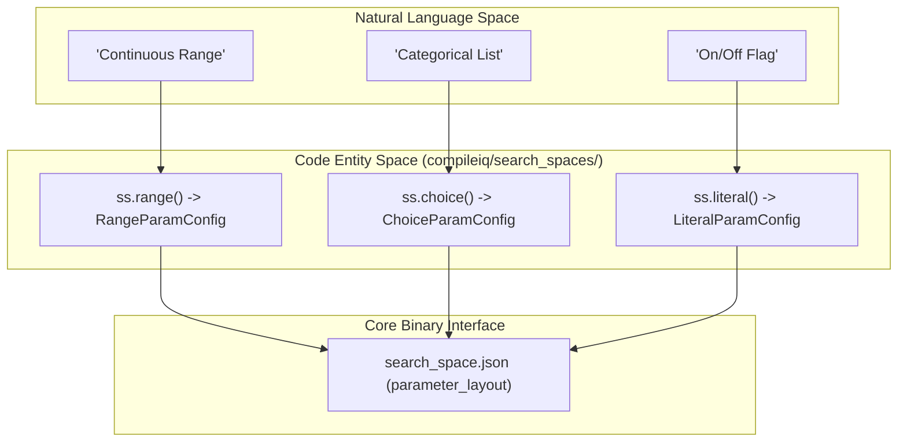

<!-- source: DeepWiki mcp.deepwiki.com · repo NVIDIA/CompileIQ · page 1.1 Getting Started & Installation · fetched 2026-10-26 -->

# Getting Started & Installation

<details>
<summary>Relevant source files</summary>

The following files were used as context for generating this wiki page:

- [CONTRIBUTING.md](CONTRIBUTING.md)
- [SECURITY.md](SECURITY.md)
- [compileiq/search_spaces/base.py](compileiq/search_spaces/base.py)
- [compileiq/utils/_setup_files.py](compileiq/utils/_setup_files.py)
- [compileiq/utils/validation.py](compileiq/utils/validation.py)
- [compileiq/worker.py](compileiq/worker.py)
- [docs/getting_started.md](docs/getting_started.md)
- [docs/install.md](docs/install.md)
- [pyproject.toml](pyproject.toml)
- [tests/unit/search_spaces/test_base.py](tests/unit/search_spaces/test_base.py)

</details>


This page provides a comprehensive guide to installing CompileIQ, setting up a development environment, and running an initial optimization search. CompileIQ is an NVIDIA hyperparameter optimization engine designed to tune compiler controls through a combination of a Python orchestration layer and a high-performance C++ Core binary.

## Installation Methods

CompileIQ can be installed either as a standard package for end-users or via a Poetry-managed environment for developers.

### 1. User Installation (via PyPI)
For users who wish to use CompileIQ as a library to tune their workloads, install directly from PyPI:
```bash
pip install compileiq
```
Sources: [docs/install.md:3-7]()

### 2. Developer Installation (via Poetry)
For contributors or users requiring the latest development features, install from the source repository using [Poetry](https://python-poetry.org/). CompileIQ supports Python versions 3.11 through 3.13.

```bash
git clone https://github.com/NVIDIA/CompileIQ.git
cd CompileIQ
make install           # Installs core dev dependencies (linter, typecheck, unittest)
make install-examples  # Installs optional dependencies for examples (Triton, XGBoost)
make install-docs      # Installs Sphinx and Mermaid documentation tools
```
Sources: [pyproject.toml:16-16](), [CONTRIBUTING.md:85-105]()

## Environment Configuration

CompileIQ uses environment variables to control IPC behavior, process management, and search space resolution.

| Environment Variable | Default | Description |
| :--- | :--- | :--- |
| `CIQ_SOCKET_TIMEOUT` | `20` | Seconds to wait for the Core binary to respond via IPC. |
| `CIQ_PROCESS_MODE` | `forkserver` | Multiprocessing start method (`fork`, `spawn`, `forkserver`). Windows defaults to `spawn`. |
| `CIQ_CORE_BINARY` | unset | Path to a custom Core executable (overrides the bundled binary). |
| `CIQ_SEARCH_SPACES_DIR` | unset | Local directory for offline search space manifests and `.bin` files. |
| `CIQ_KEEP_CACHE` | `False` | If `True`, prevents deletion of `.cache/compileiq` after a search. |

Sources: [docs/install.md:49-57](), [compileiq/worker.py:32-46]()

## Verifying the Core Binary

CompileIQ bundles platform-specific binaries for Linux (x86_64, aarch64) and Windows. These binaries are essential for the genetic algorithm execution. To ensure the binaries are present and match the expected checksums:

```bash
make verify-core
```
This command checks the bundled executables against `core-manifest.json`.
Sources: [CONTRIBUTING.md:107-112](), [pyproject.toml:11-13]()

## Running Your First Search

The following example demonstrates a single-objective optimization using the `Search` class.

### Implementation Data Flow
The `Search` class orchestrates the lifecycle by preparing configuration files, launching the Core binary, and managing worker processes to execute the objective function.

**Search Orchestration Flow**

Sources: [compileiq/ciq.py:125-150](), [compileiq/utils/_setup_files.py:57-67](), [compileiq/worker.py:101-126]()

### Code Example: Single Objective
```python
from compileiq.ciq import Search
from compileiq.types import SearchConfiguration
import compileiq.search_spaces.base as ss

# 1. Define Objective Function
def objective(config):
    # Returns a float to minimize
    return config["x"] ** 2 + config["y"]

# 2. Define Search Space
# Uses primitives from compileiq/search_spaces/base.py
search_space_config = {
    "x": ss.range(start=1.0, end=20.0, step=0.5),
    "y": ss.choice([1, 2, 3]),
    "z": ss.literal(const_value="enabled", knockout_prob=0.2)
}

# 3. Configure Search
main_config = SearchConfiguration(
    pool_size=12,
    generations=3,
    problem_type="min"
)

# 4. Execute
tuner = Search(
    objective_function=objective,
    search_space=search_space_config,
    search_config=main_config,
)
results = tuner.start()
print(f"Best Result: {results.get_best_result()}")
```
Sources: [docs/getting_started.md:15-50](), [compileiq/search_spaces/base.py:12-19](), [compileiq/search_spaces/base.py:85-88]()

## Agent Skill Installation

CompileIQ includes a set of "skills" designed for AI coding agents (Claude Code, Cursor, Windsurf, etc.) to automate the optimization workflow. These skills follow the `SKILL.md` convention.

### Skill Components
The skills are located in `agent-skills/` and include:
* `compileiq-bootstrap`: Initial environment and socket setup.
* `compileiq-booster-pack`: Applying pre-built NVIDIA compiler optimizations.
* `compileiq-run-search`: Automating the `Search.start()` lifecycle.

### Installation Command
To mount these skills into your preferred agent:
```bash
# Auto-detect and install for available agents
bash agent-skills/install.sh

# Verify installation
bash agent-skills/install.sh --check
```
Sources: [docs/install.md:15-40]()

## Key Classes and Implementation Details

### Search Space Primitives
The search space is defined using Pydantic models that are serialized to JSON for the Core binary.
* **`range()`**: Generates a `RangeParamConfig`. Validates that `start < end` and `step > 0`. [compileiq/search_spaces/base.py:12-82]()
* **`choice()`**: Generates a `ChoiceParamConfig`. Converts Python booleans to `0/1` for Core compatibility. [compileiq/search_spaces/base.py:85-121]()
* **`literal()`**: Generates a `LiteralParamConfig`. Used for constant flags that can be "knocked out" (dropped from the config) based on `knockout_prob`. [compileiq/search_spaces/base.py:124-155]()

### Worker Execution
The `MultiProcessWorker` handles the parallel execution of the `objective_function`.
* It uses `multiprocessing.Manager` to coordinate `job_queue` and `scores_queue`. [compileiq/worker.py:127-130]()
* It enforces `task_timeout`. If a function exceeds this limit, it returns `INVALID_SCORE` (represented as `"*"`). [compileiq/worker.py:120-123](), [compileiq/utils/validation.py:16-16]()

**Entity Mapping: Search Space to Code**

Sources: [compileiq/search_spaces/base.py:12-155](), [compileiq/utils/_setup_files.py:108-117]()

`Sources: compileiq/ciq.py, compileiq/worker.py, compileiq/search_spaces/base.py, compileiq/utils/_setup_files.py, compileiq/utils/validation.py, pyproject.toml, CONTRIBUTING.md, docs/install.md, docs/getting_started.md`

---

