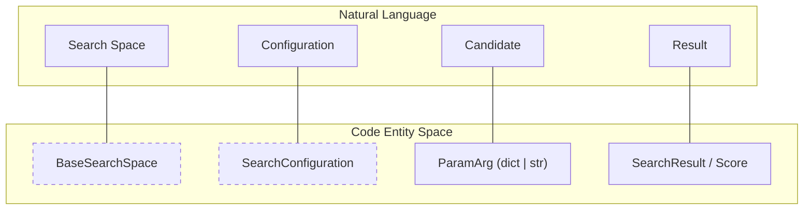
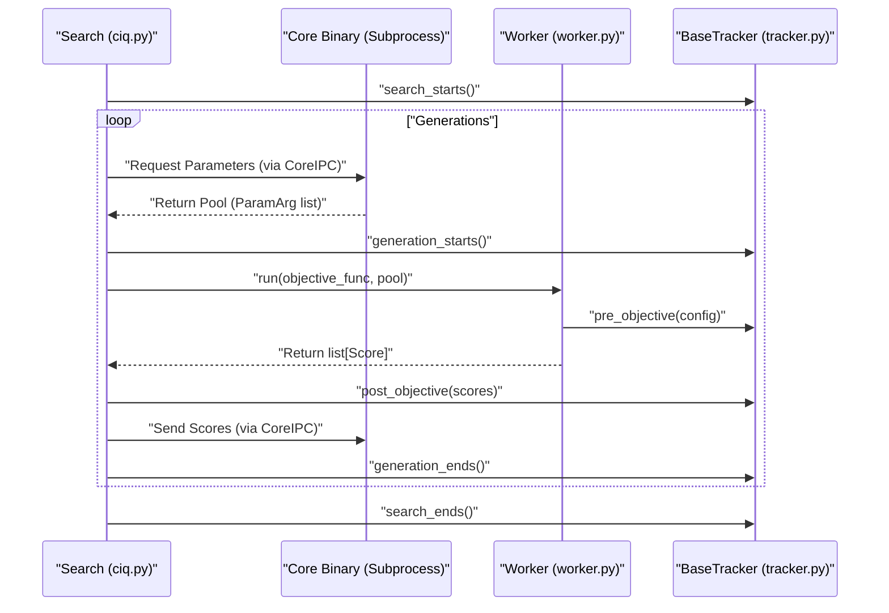

<!-- source: DeepWiki mcp.deepwiki.com · repo NVIDIA/CompileIQ · page 1.2 Key Concepts & Terminology · fetched 2026-10-26 -->

# Key Concepts & Terminology

Relevant source files

The following files were used as context for generating this wiki page:

- [README.md](README.md)
- [compileiq/tracker.py](compileiq/tracker.py)
- [compileiq/types.py](compileiq/types.py)
- [docs/compilers_overview.md](docs/compilers_overview.md)
- [docs/search_strategy.md](docs/search_strategy.md)
- [tests/integration/test_worker.py](tests/integration/test_worker.py)
- [tests/unit/test_search_configuration.py](tests/unit/test_search_configuration.py)
- [tests/unit/test_tracker_unit.py](tests/unit/test_tracker_unit.py)

This page defines the domain vocabulary and technical concepts used throughout the CompileIQ codebase. It serves as a reference for understanding the relationship between the Python orchestration layer, the optimization core, and the compiler-specific tuning interfaces.

## Core Optimization Concepts

CompileIQ operates as a generational hyperparameter optimizer. It balances exploration (finding new promising regions) and refinement (optimizing within those regions).

### Search Space & Knobs
A **Search Space** defines the universe of possible configurations that the optimizer can explore [docs/search_strategy.md:10-10](). It consists of individual **Knobs** (parameters) which can be discrete choices, continuous ranges, or categorical literals [compileiq/search_spaces/base.py:1-20]().
*   **Implementation**: Defined via `compileiq.search_spaces`.
*   **Resolution**: Compiler-specific spaces (like `PtxasSearchSpace`) are resolved from remote or local `.bin` manifest files [README.md:27-33]().

### Generations & Pools
The search progresses through a series of **Generations** [docs/search_strategy.md:13-13](). In each generation, a **Pool** (a batch of candidates) is evaluated [docs/search_strategy.md:12-12]().
*   **Pool Size**: The number of candidates evaluated per generation [compileiq/types.py:320-325]().
*   **Cull Size**: The number of candidates discarded or used to signal the direction of the next generation [docs/search_strategy.md:65-69]().

### Candidates & Parameters
A **Candidate** is a single set of sampled parameters from the search space [docs/search_strategy.md:11-11](). In the code, this is often referred to as a `ParamArg`, which can be a dictionary of key-value pairs or a path to a configuration file [compileiq/types.py:31-31]().

### Scores & Objectives
The **Objective Function** is a user-provided Python function that takes a candidate's parameters and returns a **Score** [docs/search_strategy.md:23-23]().
*   **SingleScore**: A single numerical value (float or int) [compileiq/types.py:23-23]().
*   **MultiScore**: A list of scores for multi-objective optimization [compileiq/types.py:24-24]().
*   **INVALID_SCORE**: A sentinel value used to indicate that a candidate failed evaluation (e.g., a compilation error or runtime crash) without stopping the entire search [compileiq/types.py:26-26](), [docs/compilers_overview.md:61-64]().

### Data Flow: Natural Language to Code Entities

The following diagram maps high-level search concepts to their specific class and variable representations in the codebase.

**Search Concept Mapping**

Sources: [compileiq/types.py:31-41](), [compileiq/types.py:23-28](), [docs/search_strategy.md:8-15]()

---

## Compiler Tuning Vocabulary

CompileIQ has specialized terminology for its primary use case: tuning NVIDIA compilers like `ptxas` and `nvcc`.

### Advanced Controls Interface (ACI)
A feature in NVIDIA compilers (starting in CUDA Toolkit 13.3) that allows external tools to influence internal optimization heuristics via the `--apply-controls` flag [docs/compilers_overview.md:3-4]().

### Advanced Controls File (ACF)
A file generated by CompileIQ that contains specific compiler optimization decisions. This file is passed to the compiler to change its behavior for a specific kernel without modifying the source code [docs/compilers_overview.md:3-5]().

### Booster Pack
A curated collection of pre-generated ACFs and metadata targeting specific workloads or kernels [docs/compilers_overview.md:5-5](). These are distributed as zip assets and can be applied directly to achieve performance gains without running a full search [docs/compilers_overview.md:38-41]().

---

## System Architecture Terminology

### Core Binary
The **Core** is a platform-specific executable (written in a lower-level language) that implements the underlying optimization algorithms (e.g., genetic algorithms, Pareto front calculations) [README.md:49-51]().

### CoreIPC
The communication layer that manages the lifecycle of the Core binary. It uses local socket-based **Inter-Process Communication (IPC)** to send parameter sets to the Python layer and receive scores back [docs/search_strategy.md:24-24]().

### Workers
Workers are the execution backends responsible for running the objective function.
*   **MultiProcessWorker**: Uses Python's `multiprocessing` to run evaluations in parallel on a single node [compileiq/types.py:173-178]().
*   **RayWorker**: Uses the Ray framework for distributed execution across a cluster [compileiq/types.py:123-126]().
*   **AsyncWorker**: Uses `asyncio` for concurrent execution of I/O-bound objective functions [tests/integration/test_worker.py:2-2]().

### Trackers
Entities that observe the search lifecycle and log data to external backends.
*   **LoguruTracker**: Provides structured console and file logging [compileiq/tracker.py:94-94]().
*   **MLflowTracker**: Logs parameters, metrics, and artifacts to an MLflow server [compileiq/tracker.py:151-151]().

### Component Interaction Model

The following diagram illustrates how the system components interact using the specific internal naming conventions found in the code.

**System Component Interaction**

Sources: [compileiq/types.py:100-103](), [compileiq/tracker.py:121-150](), [docs/search_strategy.md:22-26](), [compileiq/types.py:173-198]()

---

## Summary Table

| Term | Definition | Code Reference |
| :--- | :--- | :--- |
| **Knob** | A single tunable parameter in a search space. | [compileiq/search_spaces/base.py]() |
| **Baseline** | A run with an empty parameter set used for normalization. | [compileiq/types.py:192-192]() |
| **Pareto Front** | The set of optimal solutions in a multi-objective search. | [compileiq/types.py:50-53]() |
| **Problem Type** | Whether the goal is to `MIN` (minimize) or `MAX` (maximize) the score. | [compileiq/types.py:34-38]() |
| **Mutate Rate** | Probability of perturbing a parameter during candidate generation. | [compileiq/types.py:326-328]() |
| **Normalization** | Adjusting scores relative to a baseline to handle noisy benchmarks. | [compileiq/types.py:181-181]() |
| **Task Timeout** | A hard limit on the execution time of a single objective evaluation. | [compileiq/types.py:348-350]() |

Sources: [compileiq/types.py:1-100](), [docs/search_strategy.md:1-85]()

---

