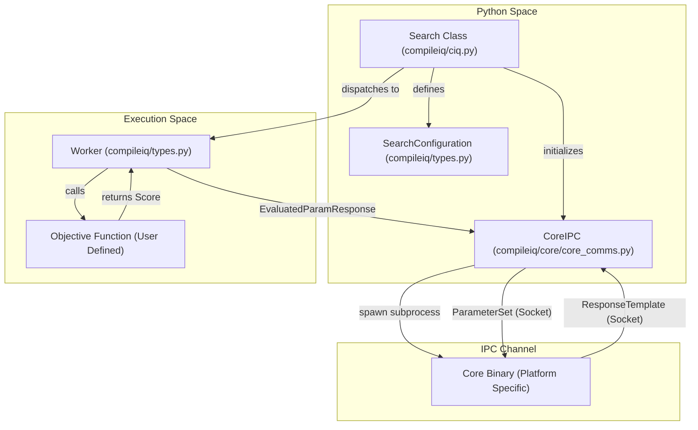
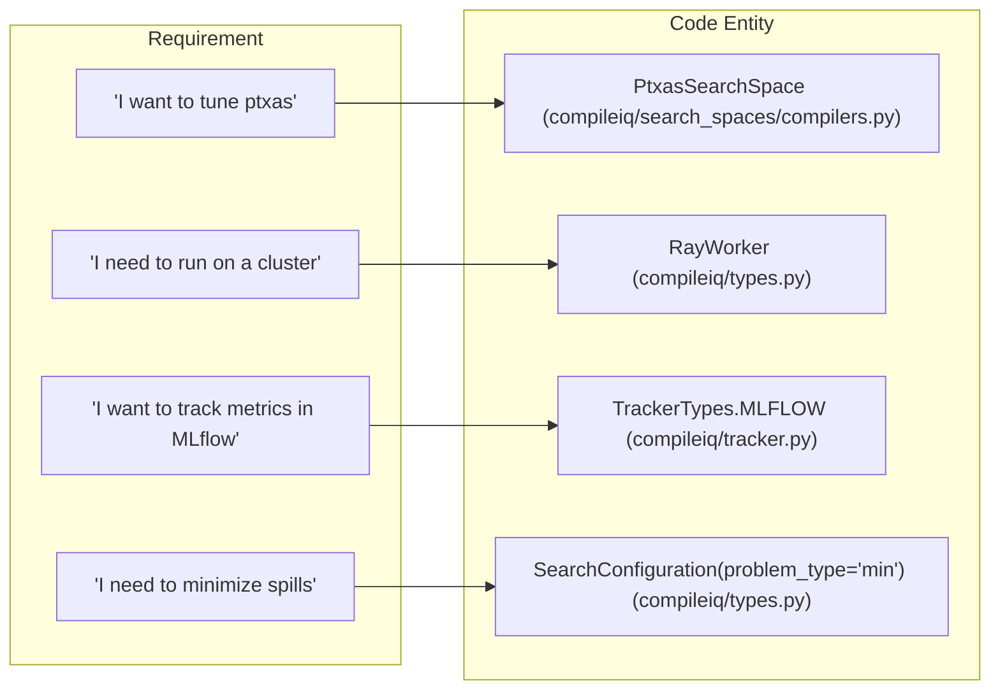

<!-- source: DeepWiki mcp.deepwiki.com · repo NVIDIA/CompileIQ · page 10 Glossary · fetched 2026-10-26 -->

# Glossary

Relevant source files

The following files were used as context for generating this wiki page:

- [README.md](README.md)
- [agent-skills/compileiq-author-objective/SKILL.md](agent-skills/compileiq-author-objective/SKILL.md)
- [agent-skills/compileiq-booster-pack/SKILL.md](agent-skills/compileiq-booster-pack/SKILL.md)
- [agent-skills/compileiq-bootstrap/SKILL.md](agent-skills/compileiq-bootstrap/SKILL.md)
- [agent-skills/compileiq-bootstrap/scripts/check_env.sh](agent-skills/compileiq-bootstrap/scripts/check_env.sh)
- [agent-skills/compileiq-search-space/SKILL.md](agent-skills/compileiq-search-space/SKILL.md)
- [compileiq/ciq.py](compileiq/ciq.py)
- [compileiq/core/core_comms.py](compileiq/core/core_comms.py)
- [compileiq/core/core_types.py](compileiq/core/core_types.py)
- [compileiq/tracker.py](compileiq/tracker.py)
- [compileiq/types.py](compileiq/types.py)
- [docs/_static/decode_acf_s_curve_full.svg](docs/_static/decode_acf_s_curve_full.svg)
- [docs/_static/decode_acf_s_curve_summary.svg](docs/_static/decode_acf_s_curve_summary.svg)
- [docs/booster_packs.md](docs/booster_packs.md)
- [docs/compilers_overview.md](docs/compilers_overview.md)
- [docs/flashinfer_booster.md](docs/flashinfer_booster.md)
- [examples/compilers/ptxas_example/README.md](examples/compilers/ptxas_example/README.md)
- [examples/compilers/ptxas_example/ptx_spill.py](examples/compilers/ptxas_example/ptx_spill.py)
- [release/search-spaces/manifest-source.yaml](release/search-spaces/manifest-source.yaml)
- [tests/integration/test_worker.py](tests/integration/test_worker.py)
- [tests/unit/search_spaces/test_build_manifest.py](tests/unit/search_spaces/test_build_manifest.py)
- [tests/unit/test_search_configuration.py](tests/unit/test_search_configuration.py)
- [tests/unit/test_tracker_unit.py](tests/unit/test_tracker_unit.py)

This page defines the core terminology, domain-specific concepts, and technical abbreviations used within the CompileIQ codebase. It serves as a reference for understanding how high-level optimization concepts map to specific code entities.

## Core Concepts

### Search Space
The definition of parameters and their valid ranges that CompileIQ will explore. It can be a simple dictionary of primitives or a complex binary asset representing compiler-specific knobs.

*   **Primitive Search Space**: Defined using functions like `range()`, `choice()`, and `log_sampling()` in `compileiq/search_spaces/base.py`.
*   **Compiler Search Space**: A specialized space representing NVIDIA compiler controls (e.g., `ptxas`, `nvcc`). These are distributed as `.bin` files and resolved via the `SearchSpaceProvider` hierarchy.

| Code Entity | Description |
| :--- | :--- |
| `SearchSpaceProvider` | Base class for fetching and resolving search spaces [compileiq/ciq.py:44](). |
| `PtxasSearchSpace` | Provider for `ptxas` compiler controls [compileiq/search_spaces/compilers.py](). |
| `NvccSearchSpace` | Provider for `nvcc` compiler controls [compileiq/search_spaces/compilers.py](). |
| `manifest.json` | Metadata file describing available compiler search space assets [README.md:41](). |

### Advanced Controls Interface (ACI)
A feature introduced in CUDA Toolkit 13.3+ that allows external control over compiler heuristics without modifying source code [docs/compilers_overview.md:3-5]().

*   **ACF (Advanced Controls File)**: A file (typically `.acf`) containing specific optimization choices generated by CompileIQ. It is passed to the compiler via the `--apply-controls` flag [docs/compilers_overview.md:3-5]().
*   **Booster Pack**: A curated collection of ACFs known to improve performance for specific workload families (e.g., Helion, FlashInfer) [docs/booster_packs.md:1-5]().

### Search Orchestration
The process of managing generations, evaluating samples, and calculating the next set of parameters.

**Data Flow: Search to Core Binary**

Sources: [compileiq/ciq.py:86-191](), [compileiq/core/core_comms.py:46](), [compileiq/types.py:37-43]()

## Terminology A-Z

### A
*   **ACF**: Advanced Controls File. A serialized set of compiler tuning knobs [docs/compilers_overview.md:3-5]().
*   **AsyncWorker**: A worker implementation using `asyncio` for high-concurrency tasks that are not CPU-bound [compileiq/ciq.py:120]().

### B
*   **Baseline**: A reference run of the objective function performed without any ACF or tuning parameters to establish a performance floor [docs/booster_packs.md:19-21]().

### C
*   **Core Binary**: A platform-specific executable (bundled in the package) that implements the genetic algorithm logic [compileiq/ciq.py:56-57]().
*   **Cull Size**: The number of worst-performing individuals removed from the population at the end of each generation [compileiq/types.py]().

### G
*   **Generation**: One full iteration of the search loop, consisting of a population (pool) of parameter sets being evaluated [compileiq/ciq.py:174-176]().

### I
*   **INVALID_SCORE**: A sentinel value (typically `float('inf')` for minimization) used to signal that a specific parameter set caused a failure (e.g., compile error, timeout) [compileiq/types.py:17](), [examples/compilers/ptxas_example/ptx_spill.py:35]().
*   **IsoMultiProcessWorker**: A "Isolated" worker that uses a clean process (often via `forkserver`) to ensure no state leakage between objective function evaluations [README.md:51]().

### K
*   **Knockout Probability**: A parameter in the search space definition that determines the likelihood of a specific knob being "turned off" or excluded from a sample [compileiq/search_spaces/base.py]().

### M
*   **MultiProcessWorker**: The default worker type using Python's `multiprocessing` to parallelize objective function calls [compileiq/ciq.py:119]().

### N
*   **Normalization**: The process of scaling scores relative to the baseline to handle noisy benchmarks or multi-objective weighting [compileiq/types.py]().

### P
*   **Pareto Front**: In multi-objective optimization, the set of all results that are not dominated by any other result (i.e., you cannot improve one metric without worsening another) [compileiq/results.py]().
*   **Pool Size**: The number of individuals (parameter sets) evaluated per generation [compileiq/types.py]().

### R
*   **RayWorker**: A worker implementation that uses the Ray distributed framework to execute objective functions across a cluster [compileiq/ciq.py:120]().

### S
*   **S-Curve**: A visualization technique used to show the distribution of performance gains/losses across a set of ACF candidates [docs/flashinfer_booster.md:153-158]().
*   **SearchConfiguration**: A Pydantic model defining the hyperparameters of the search itself (generations, mutation rate, etc.) [compileiq/types.py:39]().

## System Mapping: NL Space to Code Entities

This diagram maps natural language requirements to the specific classes and files that implement them.

Sources: [compileiq/search_spaces/compilers.py:22](), [compileiq/ciq.py:120](), [compileiq/tracker.py:29-31](), [compileiq/types.py:39]()

## Release Engineering Terms

*   **Manifest Source**: The `manifest-source.yaml` file used by release scripts to track which compiler binary assets should be included in a Search Space Catalog Release [release/search-spaces/manifest-source.yaml:1-12]().
*   **Skill**: A Markdown-based documentation format (`SKILL.md`) that allows AI coding agents to understand how to perform specific tasks with CompileIQ [agent-skills/compileiq-booster-pack/SKILL.md:1-11]().
*   **Variant**: A sub-categorization of a compiler search space (e.g., `default` vs `att` for attention-kernel optimized spaces) [release/search-spaces/manifest-source.yaml:22-24]().

Sources: [release/search-spaces/manifest-source.yaml:1-30](), [agent-skills/compileiq-booster-pack/SKILL.md:1-30]()