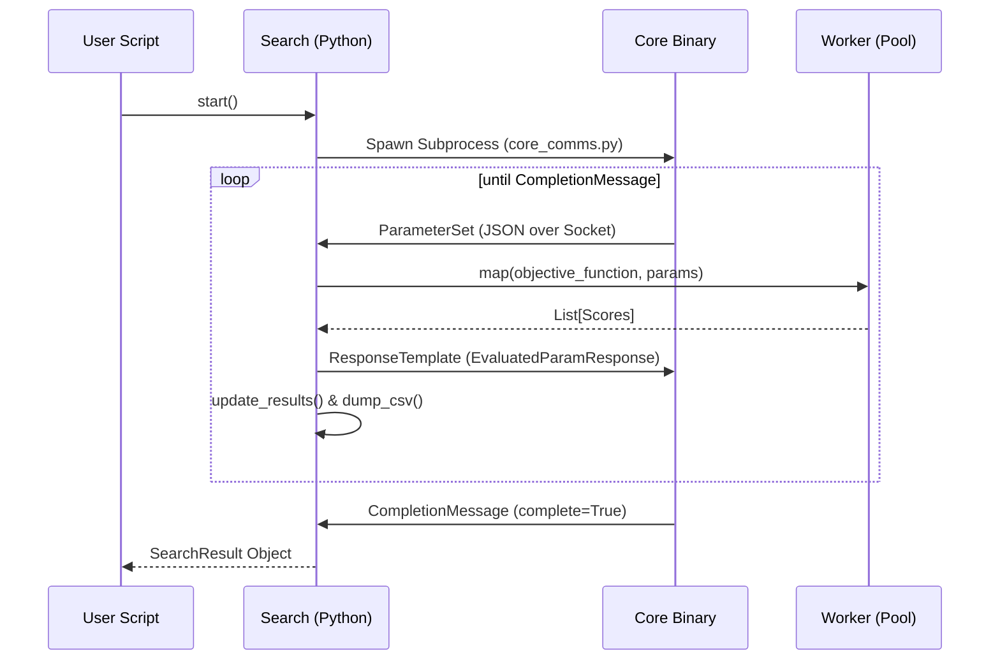

<!-- source: DeepWiki mcp.deepwiki.com · repo NVIDIA/CompileIQ · page 2 Core Architecture · fetched 2026-10-26 -->

# Core Architecture

<details>
<summary>Relevant source files</summary>

The following files were used as context for generating this wiki page:

- [compileiq/ciq.py](compileiq/ciq.py)
- [compileiq/core/core_comms.py](compileiq/core/core_comms.py)
- [compileiq/core/core_types.py](compileiq/core/core_types.py)
- [tests/integration/test_core_integration.py](tests/integration/test_core_integration.py)

</details>


CompileIQ is structured as a hybrid system where a high-level Python orchestration layer manages experiment lifecycles, and a high-performance C++ Core binary handles the search algorithms and parameter generation. These two components communicate over a local IPC channel using a structured JSON-over-TCP protocol.

### System Overview

The architecture is designed to decouple the search logic (Core) from the objective function execution (Python). This allows users to write arbitrary Python code for their benchmarks while leveraging optimized search strategies.

The following diagram illustrates the relationship between the primary code entities:

**CompileIQ Component Interaction**
```mermaid
graph LR
    subgraph "Python Orchestration Space"
        ["Search Class"] -- "manages" --> ["Worker (NATIVE/RAY/ASYNC)"]
        ["Search Class"] -- "serializes" --> ["SearchConfiguration"]
        ["Search Class"] -- "starts" --> ["CoreIPC"]
    end

    subgraph "IPC Channel (Socket)"
        ["CoreIPC"] <--> ["ParameterSet / ResponseTemplate"]
    end

    subgraph "Binary Execution Space"
        ["ParameterSet / ResponseTemplate"] <--> ["Core Binary (executable)"]
    end

    ["Worker (NATIVE/RAY/ASYNC)"] -- "evaluates" --> ["Objective Function"]
    ["Objective Function"] -- "returns" --> ["Score"]
```
Sources: [compileiq/ciq.py:86-192](), [compileiq/core/core_comms.py:44-66](), [compileiq/core/core_types.py:10-27]()

---

### 1. The Search Class & Orchestration
The `Search` class in `compileiq/ciq.py` serves as the primary entry point for users. It coordinates the initialization of the environment, the starting of the Core binary, and the generational evaluation loop.

*   **Configuration**: Validates user inputs via `SearchConfiguration` and `SearchSpaceInput` [compileiq/ciq.py:93-114]().
*   **Lifecycle**: The `start()` method triggers the search loop, which continues until the Core binary sends a `CompletionMessage` [compileiq/ciq.py:16-22](), [compileiq/core/core_types.py:16-18]().
*   **Resilience**: Manages timeouts via `task_timeout` and handles early termination via `exit_on_failure` [compileiq/ciq.py:157-164]().

For details, see [The Search Class & Orchestration](#2.1).

Sources: [compileiq/ciq.py:86-164](), [compileiq/types.py:39-40]()

---

### 2. Core Binary & IPC Communication
The search algorithms are contained within platform-specific binaries located in the `compileiq/core/executable` directory [compileiq/core/core_comms.py:33-34]().

*   **Subprocess Management**: The `CoreIPC` class resolves the correct binary for the host OS (Linux x86_64, aarch64, or Windows) and spawns it as a subprocess [compileiq/core/core_comms.py:54-80]().
*   **Socket Protocol**: Communication occurs over a local TCP socket. The Python layer acts as a server, and the Core binary connects to the `CIQ_HOST` and `CIQ_PORT` provided in its environment [compileiq/core/core_comms.py:181-190]().
*   **Message Types**:
    *   `ParameterSet`: Sent from Core to Python; contains a list of `SingleCandidate` (knobs to evaluate) [compileiq/core/core_types.py:10-14]().
    *   `ResponseTemplate`: Sent from Python to Core; contains `EvaluatedParamResponse` (scores for the candidates) [compileiq/core/core_types.py:20-27]().

For details, see [Core Binary & IPC Communication](#2.2).

Sources: [compileiq/core/core_comms.py:36-112](), [compileiq/core/core_types.py:5-27]()

---

### 3. Data Types & Result Management
CompileIQ uses a strict type system to ensure consistency between the Python evaluation and the binary search core.

| Entity | Description | Code Reference |
| :--- | :--- | :--- |
| `Score` | A union type of `int`, `float`, or the `INVALID_SCORE` string (`*`). | [compileiq/types.py:28-28]() |
| `SearchResult` | Container for all evaluated parameters, scores, and metadata. | [compileiq/results.py:45-45]() |
| `ProblemType` | Defines if the search is a `min` or `max` optimization. | [compileiq/types.py:84-84]() |
| `Pareto Front` | A set of non-dominated solutions in multi-objective searches. | [tests/integration/test_core_integration.py:192-194]() |

The `SearchResult` class provides methods like `get_best_result()` and `pareto_front()` to extract insights from the search history [tests/integration/test_core_integration.py:92-192]().

For details, see [Data Types & Result Management](#2.3).

Sources: [compileiq/types.py:20-43](), [compileiq/results.py:45-45](), [tests/integration/test_core_integration.py:73-119]()

---

### System Sequence Diagram
The following diagram traces a single generation of the search process:

**Generational Search Sequence**

Sources: [compileiq/ciq.py:188-210](), [compileiq/core/core_comms.py:130-179](), [compileiq/core/core_comms.py:192-203](), [compileiq/core/core_types.py:10-27]()

---

